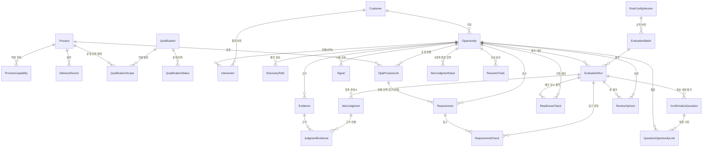

# 기능 명세 (Functional Spec) — U1 뼈대 (u1-skeleton)

이 문서는 뼈대 단위가 "어떤 순서로 무엇을 하는가"(흐름)와 "상태가 어떻게 바뀌는가"(상태 기계)의 기준입니다. 데이터 모양은 `entities.md`, 규칙은 `rules.md`가 원본이고 여기 있는 ER 그림과 규칙 요약은 거기서 파생된 보기입니다. 기술 중립으로 적었으며 코드·SQL·프레임워크 이름은 쓰지 않습니다(한 덩어리 실행·언어 선택은 코드 생성에서 계약 C1~C8을 따릅니다). 확인된 답변은 `functional-design-questions.md` Q1~Q8입니다.

## 1. 뼈대가 하는 일 한 장

가상 사례 1건(A정밀)이 **파일 투입 → 필수조건 필터 → 점수 → 분류 → 추천 목록·근거 상세 화면 → 담당자 의견 저장**까지 끊김 없이 이어지고, 검증 명령이 E 77 / P 95 / S 81.1 / R 82·필터 통과·핵심 근거 충족·시점 우선 접촉 후보를 확인한다. 같은 경로로 **실제 신규 기업 10~20곳**(10월 말 부분 시연)을 소개서 묶음으로 넣으면 참고 순위·근거가 "부분 시연·거산 확인 전" 표시와 함께 보이고 접촉 승인은 열리지 않는다.

```
[사람] 거산 역량 파일 ──import-capability──▶ cap_* (검수 상태 포함)
[사람] 사례 파일(가상·실제) ─check-case/import-case─▶ opp_* · ev_* · q_research · eval_readiness
[운영자] evaluate ──▶ ⓪ 평가 흐름: 설정 → 스냅샷 → 규칙 엔진 → eval_* 저장 → 공정 연결 갱신 → 질문 후보 q_*
[운영자] verify-case ──▶ expected 비교 표
[담당자] 화면 S1 목록 ──▶ S2 상세 ──▶ S3 의견 저장 (rec_review_opinion)
```

뼈대 밖(뒤 단위): 외부 LLM·홈페이지 읽기·전송 보호(U2), 자동 수집·병합(U3), 질문 요청·회신·반영·내보내기(U4), 담기·승인·결과·기한 체크 화면(U5), 재접촉(U6), 대시보드(U7), 접속 보호·배포(U8).

## 2. 흐름 (Workflows)

### W1. 거산 역량 파일 투입 — `import-capability <file.json>`

1. 파일을 위치 정보를 주는 로더로 읽는다. `_설명` 키는 무시, 모르는 키·허용 값 밖·연락처 패턴은 오류 목록에 모은다(BR2.1, BR2.2).
2. 오류가 하나라도 있으면 "N번째 줄 <항목>: <이유>" 목록을 출력하고 종료 코드 1, 저장 없음.
3. 파일의 datasetKind 묶음 안에 공정 9종 → 역량 항목·실적 → 자격 → 범위(공정 코드로 같은 묶음의 Process 존재 확인) → 상태 이력 순으로 저장한다(BR1.1~BR1.5). 다른 묶음의 값은 건드리지 않는다. 재투입이면 (묶음, 식별 키)로 기존 행을 찾아 값을 덮어쓰되 FieldEvidence에 새 dataVersion 행을 남기고, REVIEWED를 PENDING으로 되돌리지 않는다(BR1.7, 경고 줄 출력).
4. 모든 행에 파일의 datasetKind(VIRTUAL_REVIEWED / BROCHURE / COMPANY_CONFIRMED)·isVirtual을 붙인다. reviewDefaults(검수자·검수일·근거)를 FieldEvidence에 적는다.
5. 한 트랜잭션. 성공 시 "공정 9건, 역량 N건, 자격 N건 저장. 검수 대기 N건" 한 줄과 종료 코드 0. 평가는 자동으로 돌지 않는다.

### W2. 사례 파일 검사·투입 — `check-case <file.json>` / `import-case <file.json>`

1. (공통 검사) W1의 1~2단계와 같은 검사기. 추가로: itemInputs의 itemCode가 신규 프로필 8개와 일치하고 일치도가 그 항목의 단계값(숫자 또는 단계 이름)인지(BR4.2), expected 블록의 형식, processLinks의 processCode가 역량 파일에 있는지(역량 파일을 함께 주었을 때만; `check-case`는 없으면 "역량 파일 없이 검사함" 안내), evidenceRefs가 파일 안 인덱스인지(BR2.3).
2. `check-case`는 여기서 끝난다(종료 코드 0/1, 저장 없음, DB 불필요)(BR2.9).
3. `import-case`는 한 트랜잭션으로 고객 → 기회(caseId 식별, baseDate 저장; 재투입이면 자식 행에 supersededAt을 찍고 새로 넣음) → 발견 경로 → 공정 연결(processCode) → 근거(MANUAL, 확정값) → 요구(수준·단계 파일 값 그대로)·신호(relation·날짜 포함)·접촉 이력 → 8항목 판정 입력(ItemJudgmentInput: 파일 itemInputs를 항목별 1행으로, 없는 항목은 UNAVAILABLE 행, evidenceRefs → Evidence ID, signalRefs → Signal ID, usedCapabilityRefs는 참조 그대로 저장) → 조사 요건(ResearchTask) → 기한 체크(ReadinessCheck, evalIdAtCheck 비움) 순으로 저장한다(BR1.7, BR2.3~BR2.7, BR4.1, BR7.4).
4. 실제 기업 파일은 isVirtual=false, datasetKind는 역량 묶음과 같은 값(소개서 묶음이면 BROCHURE). verify-case는 Opportunity.baseDate를 쓴다(BR2.8).
5. 출력: "고객 1·기회 1·근거 N·요구 N·신호 N 저장. 평가하려면 geosan evaluate". 종료 코드 0.

### W3. ⓪ 평가 실행 — `evaluate [--opp <id>...] [--base-date YYYY-MM-DD]`

한 흐름 = 한 트랜잭션(BR7.5). 외부 호출 없음.

1. **설정**: 규칙 설정 파일을 읽어 버전·해시를 확인한다(BR7.6). 앱 설정에서 activeDatasetKind(거산 값 묶음)·코드 버전을 읽는다. 기준일 = 인자 → (단일 기회면 사례의 baseDate) → 오늘(BR2.8).
2. **묶음 생성**: EvaluationBatch(profile NEW, scope FULL(대상 전체) 또는 PARTIAL(--opp·verify-case), baseDate, ruleVersion·ruleHash, codeVersion, llmMode NONE, datasetKind, populationSpec, status RUNNING, sortRule).
3. **대상 기회**: 인자가 없으면 모든 기회. U1은 프로필을 NEW로 고정한다(재접촉 프로필은 U6; 연결 이력 유무는 표시용).
4. **스냅샷(기회마다)**: 기회·고객(관계 상태·기업 제한)·공정 연결(processCode를 활성 묶음의 Process로 해석, 없으면 그 연결은 UNKNOWN)·요구(holder·site 포함)·신호(relation·날짜)·연결 이력 종류·근거(FORBIDDEN은 ID·사유만, BR7.3)·**활성 묶음(activeDatasetKind)의** 거산 값(공정·역량·실적·자격·범위·현재 상태·검수 상태)·현재 기한 체크·조사 요건·8항목 판정 입력(ItemJudgmentInput 최신 version 8행 → `itemInputs`, signalIds·usedCapabilityRefs를 ID로 해석)을 C3 EvaluationInput 모양으로 모으고 해시를 만든다. 현재 행(supersededAt 없음)만 쓴다. 8행이 없으면 그 기회는 "항목 입력 없음"으로 건너뛰고 사유를 출력한다. operationalReady를 계산해 넣는다(BR5.5).
5. **규칙 엔진 계산(순수, 기회마다)** — 순서:
   1. 요구별 판정(BR3.1~BR3.3, BR3.5, BR3.6) → 제외 범위(BR3.7) → 필터 상태(BR3.4, BR3.10).
   2. 항목 8개 판정: 상태·일치도·확실도(파일 값, BR4.2·BR4.3)와 감쇠(신호 날짜·기준일, BR4.4) → 점수(BR4.1, BR4.5).
   3. 합계 F·T·E·P·S·C·R과 검증(BR4.6). 검증 실패(0≤E≤P≤100, E≤R≤100 위반)는 규칙 설정 오류로 보고 **묶음 전체를 실패**시킨다(사유에 기회 ID). 데이터가 부족한 기회(8항목 입력 없음 등)는 4단계에서 그 기회만 건너뛰고 나머지는 계속한다.
   4. 핵심 근거(BR5.1), 시점 ①②③(BR5.2~BR5.4, 체크 유지·초기화 판단 BR7.4), 조사 요건(BR5.7).
   5. 분류 11분기(BR6.1, BR6.2, 소개서 묶음 BR5.6) → 표시 값(추천 이유·막는 조건 문구·blocksApproval·scoreDisplay·다음 할 일, BR10.2·BR10.3; 모두 평가 시점에 확정해 저장) → 정렬 키(BR6.4·BR6.5) → 질문 후보(BR8.1).
6. **순위**: 묶음 안 모든 결과를 sortKey로 정렬해 originalRank를 매긴다(BR6.4, BR6.5).
7. **저장**: EvaluationRun(CONFIRMED, previousEvalId = 직전 확정 평가, 그 평가는 SUPERSEDED)·ItemJudgment 8행·RequirementCheck·JudgmentEvidence(itemInputs.evidenceRefs). 기한 체크의 evalIdAtCheck가 비어 있으면 이 평가 ID로 채우고, 초기화 조건이면 resetReason·resetAt(BR7.4).
8. **파생 갱신**: OppProcessLink.currentResult·currentReason·sourceEvalId(BR2.5).
9. **질문 후보 저장**: (targetKind, targetId)로 ConfirmationQuestion upsert(WAITING) + QuestionOpportunityLink(BR8.2).
10. 묶음 status CONFIRMED. 출력: 묶음 ID, 기회 수, 분류별 건수 요약 한 줄, 종료 코드 0. 어느 단계든 실패하면 평가·판정·질문 저장을 전부 되돌리고(평가 행은 남지 않음) 묶음 행만 FAILED로 남기며 사유 출력, 종료 코드 2.

### W4. 기대값 검증 — `verify-case <file.json>`

1. 파일의 caseId로 기회를 찾는다(없으면 "먼저 import-case"). 파일의 baseDate로 W3을 그 기회 하나에 대해 실행한다(scope PARTIAL 묶음; 기존 평가가 같은 기준일·규칙 버전·스냅샷 해시면 재사용). 목록 순위는 최신 FULL 묶음 기준이므로 verify-case가 목록 구성원을 바꾸지 않는다(BR10.1).
2. expected와 비교: E·P·R(정수), S·C(소수 첫째 자리), filterState, coreEvidenceMet, classificationCode, requirementResults(요구 name → displayResult). 항목별 일치/불일치 표를 출력한다(BR11.2).
3. 모두 일치면 "검증 통과" 종료 코드 0, 하나라도 다르면 종료 코드 2. A정밀 기대값은 BR4.7.

### W5. 추천 목록 조회 — `GET /api/v1/opportunities?tab=new&page=&pageSize=`

1. 최신 CONFIRMED **FULL** 묶음(profile NEW)을 찾는다. 없으면 빈 목록(비어 있음 상태 문구).
2. 그 묶음의 평가를 originalRank 순으로 쪽 단위(20건)로 읽되, 카드 내용은 각 기회의 **최신 확정 평가**(PARTIAL 묶음 포함)에서 조립한다: 순위(FULL 묶음), 기업·기회 이름, 분류 코드(+ coreEvidenceRecheck), scoreS·scoreDisplay(BR10.2), 추천 이유·막는 조건(blocksApproval)·다음 할 일, 현재 의견(RecordMeta), isVirtual, datasetKind, evalId(최신 확정 평가; FULL 묶음 평가와 다르면 reevaluated=true)(BR10.1, BR10.3). 최신 FULL 묶음 뒤에 투입된 기회 수는 meta.notEvaluatedCount로 알린다.
3. meta: total, updatedAt(묶음 생성 시각), hasVirtualData, datasetKind.
4. 요청 중단 한도 10초. 실패는 계약 3장 오류 형식(BR10.7).

### W6. 근거 상세 조회 — `GET /api/v1/opportunities/{oppId}`

1. 기회 존재 확인(없으면 404). 최신 확정 평가를 찾는다. 공정 연결의 sourceEvalId가 다르면 재계산해 돌려주고 로그(BR2.5).
2. 영역별 구성 함수를 순서대로 호출해 조립한다(BR10.5): header(기업·기회·관계 상태·대응 목적·담당·가상·묶음) → reasons(추천 이유·다음 할 일·질문 3개+나머지, BR8.3) → requirements(RequirementCheckView: 요구·꼭 필요한가·언제·거산 상태·판정 표시) → approvalEligibility(eligible·reason·readinessChecked·readinessNeedsRecheck; 승인 버튼은 U5) → processLinks → evidence(EvidenceView, FORBIDDEN 제외, 확인/추정 글자) → scores(E/P/S/R/C·항목표·규칙 버전·묶음·평가 시각) → records.opinion → evalId·previousEvalId·reevaluated(이전 평가가 있고 묶음 생성 시각이 마지막 조회보다 새로우면 true).
3. meta에 hasVirtualData·datasetKind·updatedAt.

### W7. 의견 저장 — `POST /api/v1/opportunities/{oppId}/opinions`

1. 헤더 X-Staff-Key 검사: 없음·목록에 없음·viewer → 403(BR9.3).
2. 본문 검사: opinion ∈ 3값, evalId 필수·존재(BR9.2), NOT_TARGET이면 reason 1~200자(BR9.1), memo ≤200, memo·reason에 연락처 패턴 없음(BR2.1). 실패 400 fields[].
3. 현재 의견 version과 expectedVersion 비교. 낡았으면 previousValue를 응답에 싣는다(BR9.4).
4. 새 ReviewOpinion 행(version+1, previousOpinionId, staffName, recordedAt 시간대 포함). 한 트랜잭션.
5. 응답 200 data {version, updatedBy, updatedAt, opinion, reason, memo}, meta.previousValue?. 분류·평가·다른 기록은 건드리지 않는다(BR9.5).

### W8. 10월 말 부분 시연 (실제 기업) — W1·W2·W3·W5·W6의 조합

1. PM: 거산 역량 파일(소개서 값, datasetKind BROCHURE)을 W1로 투입하고 앱 설정 activeDatasetKind=BROCHURE, brand.demoLabel="부분 시연·거산 확인 전"으로 둔다. 가상 검수 묶음(A정밀 검증용)은 같은 DB에 따로 남아 있고, 활성 묶음을 바꿔 평가하면 어느 쪽 값도 서로 섞이지 않는다.
2. 팀원: `examples/case-template.json`을 복사해 실제 기업 1곳 = 파일 1개(공개 홈페이지 근거, 8항목 판정, 요구는 아는 것만, 연락처 없음)를 쓰고 `check-case`로 검사해 PR.
3. PM: 합친 뒤 `import-case` 10~20회(또는 폴더 일괄은 코드 생성에서 선택) → `evaluate`.
4. 결과: 실제 기업은 BR5.6에 따라 ② 또는 ③, 카드에 "참고 N"(BR10.2), 띠에 "내부용 · 거산 확인 전 · 부분 시연·거산 확인 전"(BR10.4), ③ 안 순위는 E 순(BR6.5), 상세에 근거·요구 판정·확인 질문(ISO 9001 범위·두께 등 소개서 값 PENDING에서 생김, BR8.1). 승인 버튼은 없고(U5) approvalEligibility.eligible=false.
5. 거산 피드백은 의견 영역(검토할 만함/추가 확인/대상 아님 + 메모)으로 그 자리에서 기록한다.

### W9. 서버 시작·설정 검사 — `init-db`, `check-config`, `serve`

- `init-db`: 데이터베이스 파일 생성·마이그레이션 적용(접두사별 파일). 재실행 안전.
- `check-config`: 규칙 설정·앱 설정 형식 검사(BR2.2, BR7.6), 비밀 값 키가 있으면 오류(BR11.3).
- `serve`: 설정을 읽고(오류면 시작 거부, 어느 키인지 표시) API와 화면(정적 파일)을 한 덩어리로 띄운다. 뼈대 기간 접속 보호는 꺼짐(U8).

## 3. 상태 기계 (State Machines)

### 3-1. 거산 값 검수 상태 (reviewStatus) — Process·ProcessCapability·DeliveryRecord·Qualification·QualificationScope

```
UNAVAILABLE ──(파일 투입)──▶ PENDING ──(U4 review-set REVIEWED)──▶ REVIEWED
                                 ▲                                     │
                                 └────────(U4 review-set RECHECK)──── RECHECK ◀┘
```
- U1 전이: 파일 투입으로 UNAVAILABLE/PENDING/REVIEWED 값을 그대로 넣는다(가상 검수 묶음은 REVIEWED, 소개서 묶음은 PENDING). 재투입은 REVIEWED → PENDING을 허용하지 않는다(BR1.7). RECHECK·REVIEWED 전환 명령은 U4.
- 효과: REVIEWED만 근거(BR1.3); PENDING/UNAVAILABLE/RECHECK는 질문 후보(BR8.1).

### 3-2. 평가 묶음·평가 (EvaluationBatch.status / EvaluationRun.runStatus)

```
Batch:  RUNNING ──(모든 기회 저장 성공)──▶ CONFIRMED
        RUNNING ──(실패, 평가 행 되돌림)──▶ FAILED   (평가 행은 남지 않음)
Run:    CONFIRMED ──(같은 기회의 새 평가 저장)──▶ SUPERSEDED   (행은 보존, previousEvalId로 연결)
```
- 목록·상세는 최신 CONFIRMED 묶음의 평가만 쓴다. SUPERSEDED 평가는 "이전 평가 보기"(U2)·활동 이력(U5)·의견의 evalId 참조로 남는다.

### 3-3. 기한 체크 (ReadinessCheck) — 시점 우선 요건 ③

```
(없음) ──(파일 투입: checked=true, evalIdAtCheck=null)──▶ 대기(평가 ID 없음)
대기 ──(첫 평가가 자기 ID 기록)──▶ 유효(checked, evalIdAtCheck=E1)
유효 ──(재평가: 마감일 또는 NOW 필수 요구 판정 변화)──▶ 초기화됨(resetReason, resetAt; timing.readiness=false, "다시 확인해 주세요")
유효 ──(재평가: 그 밖의 변화)──▶ 유효(유지)
초기화됨 ──(담당자 재체크, U5 화면)──▶ 유효(새 행)
```
- U1에는 화면 체크가 없으므로 "초기화됨 → 유효"는 파일 재투입으로만 가능하다.

### 3-4. 확인 질문 (ConfirmationQuestion.status)

```
WAITING ──(U4 거산 확인 요청)──▶ REQUESTED ──(U4 회신 기록)──▶ REPLIED ──(U4 검수 전환 뒤 파생)──▶ APPLIED
```
- U1은 WAITING 생성과 읽기 전용 표시만. 같은 대상 질문은 하나이며 연결만 늘어난다(BR8.2).

### 3-5. 담당자 의견 (ReviewOpinion)

```
(없음) ──(저장)──▶ v1 ──(수정 저장)──▶ v2 ──…   각 버전은 새 행, previousOpinionId로 연결
```
- 동시 수정: expectedVersion < 현재 version이어도 저장하고 previousValue를 돌려준다(BR9.4). 의견은 분류·평가를 바꾸지 않는다(BR9.5).

### 3-6. 기회의 필터·분류 (평가마다 새로 계산, 저장된 상태를 전이시키지 않음)

filterState(PASS/PENDING/EXCLUDED)와 classificationCode(11분기)는 상태 기계가 아니라 **평가마다 다시 계산되는 값**이다. "이전 → 현재" 변화는 previousEvalId 쌍으로 읽는다(재평가됨 표시는 U2, 활동 이력은 U5).

## 4. ER 그림 (entities.md에서 파생)



글로 읽기: 거산 쪽(Process·Qualification과 그 범위·상태·검수 기록)과 고객 쪽(Customer → Opportunity → 공정 연결·요구·신호·근거·이력)이 따로 있고, 평가(EvaluationBatch → EvaluationRun)가 둘을 스냅샷으로 묶어 항목 판정·요구 판정·근거 연결을 남긴다. 기한 체크와 조사 요건은 평가 입력이고, 확인 질문은 평가가 만들며, 의견은 평가 ID를 가리키는 별도 기록이다. 부품을 넘는 참조(점선에 해당: Process↔OppProcessLink, Opportunity↔Evidence·EvaluationRun·ReviewOpinion 등)는 ID만 저장한다.

## 5. 규칙 요약 (rules.md에서 파생)

| 묶음 | 핵심 |
|---|---|
| BR1 | 9종 공정, 숫자 사양 분리, **검수 완료만 근거**, 범위 행, 상태 이력, 가상 표시, 재투입 보존 |
| BR2 | 연락처 거부, 파일 검사(줄·항목·이유), 존재 확인, 기회 ID 하나, 수준 짐작 금지, 기준일(Q4), check-case(Q8) |
| BR3 | 요구 판정 PASS/UNKNOWN/EXCLUDED, 통과 7조건, 표시 변환, 필터 한 문장, 나중 단계, 기술 조건, 제외 범위, 관계 미확인 |
| BR4 | 점수 = 배점×일치도×확실도×감쇠(HALF_UP), 고정 단계값, 7상태, E/F/T/P/S/C/R, A정밀·읽기 예시 2, 결정성 |
| BR5 | 핵심 근거, 시점 ①②③, 운영 전제, 소개서 묶음 ②/③, 조사 요건 5가지 |
| BR6 | 11분기 순서, 재확인, 코드표, 정렬 키, OTHER 정렬(가설·설정값, Q6) |
| BR7 | 묶음·스냅샷·보존, 금지 원문 제외, 기한 체크(Q1), 트랜잭션, 규칙 설정 버전 |
| BR8 | 질문 생성 조건(Q2), 대상당 하나, 상세 3개+펼치기 |
| BR9 | 의견 3값·사유 필수, 본 평가 ID, 담당자 키, 버전 이력, 기록 분리 |
| BR10 | 목록·카드 점수(Q5)·막는 조건·띠(Q7)·상세 순서·저장 피드백·다섯 상태·접근성·쉬운 말 |
| BR11 | 명령 9개, verify-case, 환경 변수 |

## 6. 화면 흐름 (S1·S2·S3, 뼈대 부분) — 상세 화면 설계의 요약

| 화면 | 뼈대에서 보이는 것 | 뒤 단위에서 더해지는 것 |
|---|---|---|
| 공통 틀 | 로고 자리, 메뉴 "추천 목록"(대시보드·질문 목록은 숨김), 담당자명 Select(앱 설정 목록 + 보기 전용, 브라우저 기억), 띠(내부용·가상·거산 확인 전·demoLabel·갱신 시각), 건너뛰기 링크 | 대시보드(U7)·질문 목록(U4) 메뉴, 접속 보호 S0(U8) |
| S1 목록 | 신규 기회 탭만, 카드(BR10.1~10.3), 의견 버튼 3개('대상 아님' 사유 인라인), [자세히 보기], 쪽 넘김, 다섯 상태 | 재접촉 탭(U6), 검색(U7), 담기(U5), 진행 점(U5·U7) |
| S2 상세 | header, 1 추천 이유·다음 할 일·확인 질문(3+펼치기, 읽기 전용), 2 요구 표 + 승인 가능 여부 줄(기한 체크는 표시만: "담당자 확인 체크됨(파일)"), 3 공정 연결, 4 근거 자료(확인/추정 글자, LLM 제안 태그 없음), 5 점수 자세히 보기(접힘), 맨 아래 의견 영역 | [거산 확인 요청](U4), 홈페이지 입력란·재평가됨·이전 평가 보기(U2), 담기·승인·결과·기한 체크 조작·진행 단계·활동 이력(U5) |
| S3 의견 영역 | [검토할 만함] [추가 확인] [대상 아님]+사유, 저장됨 HH:MM → "의견: … (수정)", 실패 시 입력 유지, 담당자 미선택 비활성 | 담기·승인·결과(U5) |

흐름 1(추천 확인 → 의견): S1 정상 → [검토할 만함] → 저장 중(버튼 로딩) → 저장됨(3초) → "의견: 검토할 만함 (수정)"; 실패 → "저장하지 못했습니다. 다시 시도". S1 → [자세히 보기] → S2 불러오는 중 → 정상 → [목록으로] → S1(의견 반영). 10/30 시연 5단계와 10월 말 부분 시연(W8)은 이 흐름을 쓴다.

## 7. 모서리 조건 (점검표 sweep 결과)

| 조건 | 처리 |
|---|---|
| 평가가 한 번도 없음 | 목록 비어 있음 문구 + "운영자가 평가를 실행하면"; 상세는 "평가 전"(NOT_EVALUATED 아님 — 평가 자체가 없음) 안내 |
| 8항목 입력이 없는 기회 | evaluate가 그 기회를 건너뛰고 "항목 입력 없음: <기회>" 출력; 사례 파일 투입 시 빠진 항목은 UNAVAILABLE 행으로 채워 보통은 생기지 않음 |
| 고객 관계 상태가 평가 뒤 바뀜 | 저장된 blocksApproval·분류는 그대로(재평가 전까지), 재평가가 새 값을 만듦 |
| 기회 1건 | 쪽 넘김 숨김, 단수 문구 |
| 100건 이상 | 20건씩 쪽 넘김 "1~20 / 134건" |
| 같은 caseId 재투입 | 기회 재사용, 값 덮어씀, 자식 행은 supersededAt + 새 행, 평가 이력 보존(BR1.7, BR2.4) |
| 가상 검수·소개서 두 묶음이 한 DB에 있음 | 묶음별로 따로 저장, 평가·조회는 활성 묶음만. 소개서 투입이 가상 검수 값을 바꾸지 않음(BR1.1, BR1.3, BR1.7) |
| 공정 연결의 코드가 활성 묶음에 없음 | 그 연결은 UNKNOWN(확인 대기) + 질문 후보, 투입 시 경고(BR2.3) |
| verify-case·--opp 부분 평가 뒤 목록 | 목록 구성원·순위는 최신 FULL 묶음, 카드 내용은 기회별 최신 평가, "재평가됨" 표시(BR10.1) |
| 같은 종류 신호가 여럿 | 대표 신호 선택 규칙(BR4.4): 최근 발생/가장 이른 마감 |
| 우대·수준 미확인 요구가 확인된 불일치 | 판정 EXCLUDED로 표시만, 필터·승인 영향 없음(BR3.4) |
| 필수 요구가 PASS인데 필요 단계 미확인 | 필터 확인 대기, 표시 PENDING_BLOCKS(BR3.3, BR3.4) |
| 파일 인코딩·BOM·CRLF | UTF-8(BOM 허용)로 읽고 나머지는 오류 "UTF-8로 저장해 주세요" |
| 파일 안 중복 키(같은 요구 두 번) | 오류(줄 번호 둘 다 표시) |
| 신호 발생일이 기준일보다 미래 | 미확보(BR4.4), 카드 점수에 가점 없음 |
| 공고 마감일 = 기준일 | 마감 전으로 본다(deadlineAt ≥ baseDate) |
| 자격 validTo = 기준일 | 유효(validTo 포함) |
| P=0(모두 미확보) | S null "산정 전", 분류 ④ NOT_EVALUATED |
| E/P/R 검증 실패 | 평가 FAILED, 묶음 FAILED, 사유 출력(규칙 설정 오류 의심) |
| 규칙 설정 파일 없음·해시 변경 | evaluate 거부, 어느 키·파일인지 표시(BR7.6) |
| DB 잠금 5초 초과 | 500 + 되돌림, "저장하지 못했습니다. 다시 시도" |
| 두 담당자가 같은 기회 의견 동시 저장 | 마지막 저장이 남고 previousValue 알림(BR9.4) |
| 낡은 evalId로 의견 | 저장(BR9.2) |
| 담당자 키 없음·viewer | 403, 화면은 버튼 비활성 + 글자(BR9.3) |
| FORBIDDEN 근거 | 스냅샷·상세·로그에 원문 없음(BR7.3) |
| 요구 0개 | 표 대신 "확인된 요구가 없습니다. 질문 목록을 보세요"; 필터 PASS(소개서 묶음이면 ③) |
| 확인 질문 4개 이상 | 3개 + 펼치기(BR8.3) |
| 시각 | 저장 시간대 포함, 표시 Asia/Seoul; 기준일은 묶음 값(NFR12) |
| 좁은 화면 | 1024~1279 접기, <1024 안내 띠(상세 화면 설계) |

## 8. 뒤 단위로 넘기는 것·범위 밖

- U2: 홈페이지 읽기·LLM 어댑터·전송 보호·재평가됨·이전 평가 보기, LLM 제안 태그. U3: 수집·병합·MergeCandidate. U4: 질문 요청·회신·반영·내보내기·검수 전환 명령·묶음 전환 명령. U5: 담기·승인·결과·기한 체크 화면·활동 이력·진행 단계·순위 조정. U6: 재접촉 프로필·7칸·탭. U7: 대시보드·검색·엑셀. U8: 접속 보호·세션·배포·백업. U10: 안내서·아연도금 사례.
- 약속 파일 "더하는 변경"(PM 확인 뒤 코드 생성에서 `contracts/`에 반영): CaseFile `baseDate`·`signals[].relation`·`signals[].scheduledAt`·`signals[].announcedAt`·`itemInputs[].usedCapabilityRefs`, C3 EvaluationInput `itemInputs`·`signals[].relation`, C1 요구 판정 표시 변환 보강(REQUIRED·단계 미확인 → PENDING_BLOCKS 우선), CaseFile `itemInputs[].signalRefs`, C6 거산 값 식별 키에 `datasetKind` 포함·`eval_batch.scope`·자식 행 `superseded_at`·공정 연결 `processCode` 참조, 목록 응답 `meta.notEvaluatedCount`, `check-case`, AppSettings `brand.demoLabel`, OpportunityCard `scoreDisplay`, RuleConfig `otherGroupSort`. 깨는 변경은 없다.
- 상세 화면 설계 갱신 제안(Q5·Q7, 회의 뒤 확정): 소개서 묶음 카드 "참고 N", 띠 demoLabel. 시연 흐름 문서의 확인 질문 3개 예시는 소개서 묶음 기준으로 고친다(Q2).

## 9. 상류 문서와의 연결

- 작업 단위 `../../../inception/units-generation/unit-of-work.md` U1 책임·포함 부품·경계·확장 지점 규칙(흐름 하나 = 파일 하나, 경로 묶음 파일 분리, 상세 영역 부품 분리, 설정 키·대응표는 추가만).
- 이야기 대응 `../../../inception/units-generation/unit-of-work-story-map.md` U1: US1.1, US1.2, US3.2, US5.1, US5.2, US5.3, US6.1, US6.2, US7.1, US10.1, US10.4 → `traceability.json`.
- 요구사항 `../../../inception/requirements-analysis/requirements.md` 1장 성공 기준(10/30 + 10월 말 부분 시연), FR1~FR4, FR6.1~6.3·6.6~6.8, FR7.1·7.2·7.6, FR10, FR11.1, FR14.1, NFR1·2·4·5·8·10·11·12.
- 부품 목록 `../../../inception/domain-design/components.md` 흐름 표(⓪), 서버 검사 담당 표, 시드 투입 순서.
- 계약 `../../../inception/contract-design/contract-summary.md` C1 경로(/config/ui, /opportunities, /opportunities/{oppId}, /opinions), C2 run_evaluation, C3 입력·출력·rank·기대값, C6, C7, C8, 3장 오류·동시 수정 규칙.
- 상세 화면 `../../../inception/refined-mockups/mockups.md`·`interaction-spec.md`·`accessibility-checklist.md` S1·S2·S3·공통 틀·다섯 상태.
