# 부품 목록 (Domain Design — Components) — 거산케미칼 AI 영업지원 에이전트 2차

이 문서는 "코드로 만들 논리 부품"을 정합니다. 데이터베이스(SQLite)·외부 LLM·외부 API·설정 파일은 부품이 아니라 부품이 쓰는 바깥 의존입니다. 배포 모양(한 덩어리로 묶을지)은 다음 단계(작업 단위 나누기)에서, 데이터 종류·검증 규칙 같은 세부 스키마는 기능 설계에서 정합니다. 요구사항(`../requirements-analysis/requirements.md`)과 사용자 스토리(`../user-stories/stories.md`)를 입력으로 삼고, 엔티티 이름은 `domain-design-questions.md` Q1에 따라 팀 데이터 설계서 v0.17의 논리 테이블 24개를 출발점으로 쓰되 요구사항과 다른 곳은 요구사항을 따르고 설계서에 없는 것은 새로 더했습니다. 설계 결정의 근거는 `decisions.md`(ADR-001~ADR-011)에 있습니다.

읽는 법: 부품은 15개입니다. "소유 데이터" 열의 엔티티는 주인 부품 하나만 고치며, 다른 부품은 ID로만 가리킵니다. 화살표(depends_on)는 "누가 누구를 부르는가"입니다.

## Part A. 부품 목록 (기계가 읽는 원본)

```yaml
components:
  - name: ConfigRegistry
    summary: 규칙 설정 파일·수집 범위·담당자 목록·LLM 모드·거산 값 묶음·로고/강조색을 코드 밖 설정으로 읽고, 규칙 설정은 버전·해시를 기록한다 (NFR11, FR4.12, FR6.8, FR14.1)
    behaviour: >
      설정 파일(규칙 설정 YAML/JSON, 앱 설정)을 시작 시와 요청 시 읽어 검증된 값만 돌려준다. 규칙 설정 파일은 버전과 해시를 계산해
      RuleConfigVersion으로 남기며, 고정(fixed)된 버전은 덮어쓰지 않고 새 버전으로만 바꾼다. 모든 기준점(75·60·70·40)·확실도·감쇠·핵심 근거·조사 요건·
      항목 배점·일치도 단계값은 "기업 승인 전 가설" 표시와 함께 설정값이다. 거산 값 묶음(가상 검수 / 소개서 / 거산 확인 완료)과 LLM 모드(외부 LLM / 호출 없음)는
      평가 묶음 단위로 읽힌다. 설정이 없거나 형식이 틀리면 어떤 키가 잘못됐는지 알리고 기본값으로 조용히 대체하지 않는다. 비밀번호·API 키는 환경 변수에서만 읽고 설정 파일에 두지 않는다.
    responsibilities:
      - 규칙 설정 파일 읽기·검증·버전/해시 기록 (부록 A의 A.1~A.3 값)
      - 앱 설정(수집 범위·키워드, 담당자 목록, 거산 값 묶음, LLM 모드·월 호출 상한, 로고·강조색, 접속 보호 켜기/끄기) 제공
      - 환경 변수(비밀번호, LLM API 키)의 존재 확인과 전달(값은 로그에 남기지 않음)
    depends_on: []
    dependents:
      - component: CapabilityCatalog
        interaction: 거산 값 묶음 종류와 공정 9종 기준 목록을 읽음
      - component: SourceIngestion
        interaction: 수집 범위(지역·생산품 키워드·건수 상한)와 소스 계약표 위치를 읽음
      - component: EvidenceExtraction
        interaction: LLM 모드·모델·월 호출 상한·홈페이지 자동 탐색 켜기 여부를 읽음
      - component: EvaluationLedger
        interaction: 평가 묶음에 기록할 규칙 설정 버전·해시·거산 값 묶음·LLM 모드를 읽고 규칙 설정 값을 RuleEngine 입력으로 넘김
      - component: OperatorCommands
        interaction: 명령 실행 전 설정 검증·설정 변경 반영, LLM 비용 환산 단가 읽기
      - component: WebApi
        interaction: 담당자 목록·브랜드(로고·강조색)·접속 보호 설정을 읽음
    external_dependencies:
      - name: 설정 파일(규칙 설정, 앱 설정)
        kind: other
        purpose: 코드 밖 설정의 원본. 버전·해시를 기록
      - name: 환경 변수
        kind: other
        purpose: 비밀번호·LLM API 키 전달
    entities:
      - name: RuleConfigVersion
        identifier: ruleVersion
        attributes: [ruleVersion, ruleHash, status, changeReason, fixedAt, companyApprovalStatus, filePath]
      - name: AppSetting
        identifier: settingKey
        attributes: [settingKey, value, updatedAt, updatedBy]

  - name: CapabilityCatalog
    summary: 거산의 공정 9종·역량 항목·실적·자격(인증/승인)·적용 범위·상태 이력과 필드별 검수 상태를 소유한다 (FR1, FR11.3)
    behaviour: >
      공정·역량·자격 값은 파일(CSV/JSON) 투입으로만 들어오고 관리 화면은 없다. 모든 값은 행 단위로 실데이터/가상 구분(datasetKind: 가상 검수 / 소개서 / 거산 확인 완료)과
      필드별 검수 상태(미확보 / 검수 대기 / 검수 완료 / 재확인)·검수자·검수일·근거를 가진다. '검수 완료'만 가점·필수조건 통과 근거로 쓸 수 있다는 규칙은 이 부품이
      조회 결과에 "사용 가능 여부"로 함께 돌려준다. 회사소개서 값은 '검수 대기'로만 등록하고 거산 메일 확인 뒤 운영 명령으로만 '검수 완료'/'재확인'으로 바꾸며,
      바뀐 값은 FieldEvidence에 새 행으로 남고 이전 행은 보존된다. 자격 적용 범위는 공정·고객·기회 단위로 별도 행이며 공정 ID가 빈 범위를 "모든 공정"으로 해석하지 않는다.
      자격 상태(정상 / 정지 / 취소 / 만료 / 미확인)는 갱신마다 새 행이다. ISO 9001·AS9100D 범위 4개 공정, 한화시스템 승인서 '미확인' 같은 초기값은 투입 파일이 정한다.
      숫자 사양(두께 등)은 최소·최대·단위로 나눠 저장하고 설비 항목은 설명용 표시를 가진다.
    responsibilities:
      - 공정·역량·실적·자격·범위·상태 이력의 등록(파일 투입)·조회
      - 필드별 검수 상태 전환(운영 명령에서 호출)과 검수 기록 보존
      - 평가 입력용 "거산 값 스냅샷"(선택한 거산 값 묶음, 검수 상태 포함) 제공
      - 검수 상태 전환 결과로 "바뀐 값의 ID(qualId / processId / capabilityId)와 새 검수 상태"를 돌려줌 (영향받는 기회 목록은 EvaluationLedger가 찾음, ADR-006)
    depends_on:
      - component: ConfigRegistry
        interaction: 거산 값 묶음 종류·공정 기준 목록 읽기
        style: sync
    dependents:
      - component: OpportunityRegistry
        interaction: 기회-공정 연결 시 공정 ID 존재 확인
      - component: EvaluationLedger
        interaction: 평가 입력 스냅샷용 거산 값·자격·검수 상태 조회
      - component: ConfirmationDesk
        interaction: 질문 대상 값의 현재 검수 상태 조회(반영 상태 자동 표시)
      - component: OperatorCommands
        interaction: 파일 투입 명령 실행
      - component: WorkflowRunner
        interaction: 검수 상태 전환 흐름(전환 → 영향 기회 → 재평가)에서 전환 호출
      - component: DashboardReporting
        interaction: 활동 요약의 인증·공정 상태 건수(검수 완료 / 검수 대기 / 미확인) 조회
    external_dependencies:
      - name: SQLite
        kind: database
        purpose: 거산 역량·자격·검수 기록 저장
      - name: 거산 역량 투입 파일(CSV/JSON)
        kind: other
        purpose: 공정 9종·회사소개서 값·가상 검수 값의 원본
    entities:
      - name: Process
        identifier: processId
        attributes: [processId, code, name, category, materialCodes, performanceTags, registryStatus, datasetKind, isVirtual]
      - name: ProcessCapability
        identifier: capabilityId
        attributes: [capabilityId, processId, capKind, name, displayValue, numericMin, numericMax, unit, standardRef, scopeNote, isDescriptiveOnly, reviewStatus, datasetKind]
        references:
          - entity: Process
            owned_by: CapabilityCatalog
            relationship: 역량 항목 하나는 공정 하나에 속한다
      - name: DeliveryRecord
        identifier: recordId
        attributes: [recordId, processId, industry, partType, period, allowedBasis, reviewStatus, datasetKind]
        references:
          - entity: Process
            owned_by: CapabilityCatalog
            relationship: 실적 하나는 공정 하나에 속한다 (고객 실명 없음)
      - name: Qualification
        identifier: qualId
        attributes: [qualId, kind, officialName, number, edition, holder, site, validFrom, validTo, sourceVersion, reviewStatus, datasetKind]
      - name: QualificationScope
        identifier: scopeId
        attributes: [scopeId, qualId, scopeKind, processId, customerId, oppId, productScope, applicability, basis, reviewStatus]
        references:
          - entity: Qualification
            owned_by: CapabilityCatalog
            relationship: 범위 하나는 자격 하나에 속한다
          - entity: Process
            owned_by: CapabilityCatalog
            relationship: 공정 단위 범위는 공정 하나를 가리킨다 (비어 있으면 "모든 공정" 아님)
          - entity: Customer
            owned_by: OpportunityRegistry
            relationship: 고객 단위 범위는 고객 하나를 가리킨다
          - entity: Opportunity
            owned_by: OpportunityRegistry
            relationship: 기회 단위 범위는 기회 하나를 가리킨다
      - name: QualificationStatus
        identifier: statusId
        attributes: [statusId, qualId, status, occurredAt, confirmedAt, confirmedBy, reason, evidenceId]
        references:
          - entity: Qualification
            owned_by: CapabilityCatalog
            relationship: 상태 행은 자격 하나에 속하며 갱신마다 새 행
          - entity: Evidence
            owned_by: EvidenceExtraction
            relationship: 상태 확인 근거 자료(선택)
      - name: FieldEvidence
        identifier: fieldEvidenceId
        attributes: [fieldEvidenceId, targetTable, targetId, targetField, valueSnapshot, dataVersion, reviewStatus, reviewer, reviewedAt, basis, evidenceId]
        references:
          - entity: Evidence
            owned_by: EvidenceExtraction
            relationship: 검수 근거 자료(선택, 거산 메일 답변 등)

  - name: OpportunityRegistry
    summary: 고객·접촉 이력·영업기회·발견 경로·기회-공정 연결·고객 요구·시점 신호를 소유하고 기업 병합과 재접촉 입력 저장을 맡는다 (FR2, FR3.1, FR3.9, FR8.1, FR8.4)
    behaviour: >
      고객에는 연락처 열이 없고 넣어도 저장하지 않는다. 병합은 사업자번호 → 정규화 상호명+주소 순으로 후보를 찾고 정확히 같을 때만 자동 병합하며, 그 밖의 유사 후보는
      MergeCandidate '확인 필요'로 남겨 운영자가 확정한다. 상호명만으로 자동 병합하지 않는다. 같은 프로젝트를 다른 경로로 찾아도 기회 ID는 하나이고 DiscoveryPath만 늘어난다.
      기회-공정 연결은 (기회, 공정) 쌍당 하나이며 현재 결과(통과 / 확인 대기 / 제외)는 EvaluationLedger가 넘겨주는 파생값으로만 갱신하고 원본 eval ID를 함께 기억한다.
      고객 요구는 요구 수준(필수 / 우대 / 비요구 / 미확인)·필요 단계·기한·확인/추정·근거·확인 질문을 가지며 수준을 짐작해 채우지 않는다. 재접촉 7칸 중 ①~⑤는 Interaction,
      ⑥·⑦은 Signal에 저장하고 각 값에 확인/추정·확인일·입력자를 붙이며 보안 등급 기본값은 '내부 구조화만'·외부 AI 불허다. 금액·단가·도면·연락처 칸은 없다.
      이 기회에 연결된 이력이 없으면 "재접촉이 아니라 신규 기회"로 판단해 돌려준다. 제외된 기회의 재검토 조건·담당·예정일을 기회에 기록한다. 관계 상태(신규 확인 / 기존 관계 확인 / 관계 미확인)와
      대응 목적(신규 제안 / 기존 제안 후속 / 재발주 확인)은 따로 저장하고, 회사소개서 주요 거래처는 '기존 관계 확인·검수 대기·내부 구조화만'으로 등록한다.
    responsibilities:
      - 고객·기회·발견 경로·공정 연결·요구·신호·접촉 이력의 등록·조회
      - 기업 병합 규칙과 "확인 필요" 후보 관리
      - 재접촉 7칸 저장과 "이력 없음 → 신규 기회" 판단, 프로필 선택 근거(이력 유무) 제공
      - 요구 후보(LLM 제안) 수용: 원문 명시 시 '필수(강한 추정)', 그 밖은 '미확인'
      - 공정 연결 현재 결과(파생값) 갱신 수신
    depends_on:
      - component: CapabilityCatalog
        interaction: 기회-공정 연결 시 공정 ID 존재 확인
        style: sync
    dependents:
      - component: SourceIngestion
        interaction: 수집한 후보 기업·기회·발견 경로 등록과 병합 요청
      - component: EvidenceExtraction
        interaction: 근거를 기회에 연결하고 요구 후보를 저장
      - component: EvaluationLedger
        interaction: 평가 입력 스냅샷용 기회·요구·신호·이력 조회, 공정 연결 현재 결과 갱신
      - component: SalesRecords
        interaction: 기록 대상 기회 존재·소속 확인, 접촉 승인 목적 선택 가능 여부(연결 이력 종류) 조회
      - component: DashboardReporting
        interaction: 건수·업무 흐름·재검토 예정일 조회
      - component: OperatorCommands
        interaction: 가상 사례 파일(고객·기회·요구·이력) 투입
      - component: WorkflowRunner
        interaction: 재접촉 저장·병합 확정·수집 등록 흐름에서 호출, 교차 참조 존재 확인 조회
      - component: WebApi
        interaction: 목록·상세·검색 조회
    external_dependencies:
      - name: SQLite
        kind: database
        purpose: 고객·기회·요구·신호·이력 저장
    entities:
      - name: Customer
        identifier: customerId
        attributes: [customerId, name, normalizedName, bizNumber, normalizedAddress, identityBasis, relationStatus, relationConfirmedAt, companyFilterStatus, companyFilterReason, securityGrade, datasetKind, isVirtual]
      - name: MergeCandidate
        identifier: mergeCandidateId
        attributes: [mergeCandidateId, customerIdA, customerIdB, matchBasis, status, decidedBy, decidedAt]
        references:
          - entity: Customer
            owned_by: OpportunityRegistry
            relationship: 유사한 고객 둘을 가리키며 사람이 확정한다
      - name: Interaction
        identifier: interactionId
        attributes: [interactionId, customerId, oppId, kind, occurredAt, allowedSummary, applyScope, pastProcessItem, orderCount, sampleApproved, requirementMet, lossReason, lossResolved, lastDeliveryAt, orderCycle, certainty, confirmedAt, enteredBy, securityGrade, externalAiAllowed, datasetKind]
        references:
          - entity: Customer
            owned_by: OpportunityRegistry
            relationship: 이력은 고객 하나에 속한다
          - entity: Opportunity
            owned_by: OpportunityRegistry
            relationship: 특정 기회에 연결할 수 있다(선택)
      - name: Opportunity
        identifier: oppId
        attributes: [oppId, customerId, item, project, distinctionBasis, purpose, owner, progressStatus, actionStage, expectedAt, reviewCondition, reviewOwner, reviewDueAt, mergeHistory, datasetKind, isVirtual]
        references:
          - entity: Customer
            owned_by: OpportunityRegistry
            relationship: 기회는 고객 하나에 속한다
      - name: DiscoveryPath
        identifier: pathId
        attributes: [pathId, oppId, pathKind, sourceId, originKey, discoveredAt, evidenceId]
        references:
          - entity: Opportunity
            owned_by: OpportunityRegistry
            relationship: 발견 경로는 기회 하나에 속하며 여러 건일 수 있다
          - entity: Evidence
            owned_by: EvidenceExtraction
            relationship: 발견 근거 자료(선택)
      - name: OppProcessLink
        identifier: linkId
        attributes: [linkId, oppId, processId, currentResult, currentReason, appliedMaterial, confirmedAt, sourceEvalId]
        references:
          - entity: Opportunity
            owned_by: OpportunityRegistry
            relationship: 연결은 기회 하나에 속한다 ((기회, 공정) 쌍당 하나)
          - entity: Process
            owned_by: CapabilityCatalog
            relationship: 연결은 공정 하나를 가리킨다
          - entity: EvaluationRun
            owned_by: EvaluationLedger
            relationship: 현재 결과의 원본 평가
      - name: Requirement
        identifier: reqId
        attributes: [reqId, oppId, linkId, reqKind, name, content, reqLevel, scopeKind, requiredValue, unit, edition, certainty, neededStage, dueAt, question, evidenceId, proposedBy]
        references:
          - entity: Opportunity
            owned_by: OpportunityRegistry
            relationship: 요구는 기회 하나에 속한다
          - entity: OppProcessLink
            owned_by: OpportunityRegistry
            relationship: 공정별 요구는 연결 하나를 가리킨다(선택)
          - entity: Evidence
            owned_by: EvidenceExtraction
            relationship: 요구의 근거 자료(선택)
      - name: Signal
        identifier: signalId
        attributes: [signalId, oppId, signalKind, occurredAt, announcedAt, scheduledAt, confirmedAt, deadlineAt, timezone, progressStatus, nextCheckAt, agreedWindow, certainty, enteredBy, evidenceId, datasetKind]
        references:
          - entity: Opportunity
            owned_by: OpportunityRegistry
            relationship: 신호는 기회 하나에 속한다
          - entity: Evidence
            owned_by: EvidenceExtraction
            relationship: 신호의 근거 자료(선택)

  - name: SourceIngestion
    summary: 외부 소스 3개(산단공 CSV·공장등록 API, 수질유해물질 CSV, 나라장터 API)와 수동 명단을 어댑터로 읽어 후보 기업·기회를 등록하고 집계를 남긴다 (FR9)
    behaviour: >
      소스마다 어댑터 하나(산단공 CSV P0, 공장등록생산정보 API P1, 특정수질유해물질 CSV P1, 나라장터 입찰공고 API P2, 수동 명단 P3)이며 소스 계약표(이용·저장 허용 범위)가
      기록된 뒤에만 수집을 시작한다. 수집 범위(지역 기본값 충남+대전·세종, 생산품 키워드, 건수 상한 30~50)는 설정값이다. CSV는 인코딩(UTF-8/CP949)을 확인해 읽고 필수 열이 없으면
      어떤 열이 없는지 알리고 멈춘다. 빈 행·쉼표·따옴표를 보존 또는 건너뛰고 건너뛴 행 번호·이유를 집계에 남기며 부분 결과를 완전한 것처럼 보이지 않는다.
      원천 레코드 수, 중복 제거 후 기업·기회 수, 필터 결과·사유, 소스·기준일을 IngestionRun으로 남기고 경로가 겹친 기회는 한 번만 센다. 수질유해물질 CSV와 겹치면
      "자체 도금라인 보유 추정" 표시만 하고 자동 제외하지 않는다. API 일 1,000건 제한을 나눠 실행한다. 채용 사이트·유료 DB는 연결하지 않는다.
    responsibilities:
      - 소스별 어댑터(읽기·정규화·오류 보고)와 소스 계약표 관리
      - 후보 기업·기회·발견 경로·시점 신호(공고 마감일)를 OpportunityRegistry에 등록 요청
      - 수집 집계(IngestionRun) 기록
    depends_on:
      - component: ConfigRegistry
        interaction: 수집 범위·키워드·건수 상한·소스 계약표 위치 읽기
        style: sync
      - component: OpportunityRegistry
        interaction: 후보 등록·병합 요청·공고 신호 저장
        style: sync
    dependents:
      - component: WorkflowRunner
        interaction: 수집 흐름(수집 → 등록 → 평가)에서 수집 호출
    external_dependencies:
      - name: 산단공 전국등록공장현황 CSV
        kind: other
        purpose: P0 후보 원천
      - name: 공장등록생산정보 API
        kind: third-party-api
        purpose: P1 업종코드 보강 (일 1,000건 제한)
      - name: 특정수질유해물질 업체정보 CSV
        kind: other
        purpose: P1 자체 도금라인 보유 추정 표시
      - name: 나라장터 입찰공고 API
        kind: third-party-api
        purpose: P2 공고·마감일 시점 신호
      - name: 수동 명단 파일(뿌리기술 전문기업·방산업체)
        kind: other
        purpose: P3 한 번 내려받는 명단
      - name: SQLite
        kind: database
        purpose: 수집 집계·소스 계약표 저장
    entities:
      - name: IngestionRun
        identifier: ingestionRunId
        attributes: [ingestionRunId, sourceId, baseDate, scopeSnapshot, rawCount, customerCount, oppCount, filterSummary, skippedRows, status, startedAt, finishedAt]
      - name: SourceContract
        identifier: sourceId
        attributes: [sourceId, sourceName, allowedUse, allowedStorage, termsRef, confirmedBy, confirmedAt]

  - name: TransferGuard
    summary: 밖으로 나가면 안 되는 것을 한 곳에서 지킨다 — 보안 등급 검사, 연락처 패턴 제거, 본문 없는 전송 로그 (FR5.3, FR5.4, FR8.2, NFR4, NFR5)
    behaviour: >
      외부 LLM 전송·엑셀/PDF 출력·질문 목록 내보내기 전에 호출되어 보내려는 자료의 보안 등급(공개 / 외부 AI 허용 / 내부 구조화만 / 처리 금지 / 미확인)과 용도(외부 AI / 발표·출력)를
      검사한다. 외부 AI 전송은 '공개'·'외부 AI 허용'만 통과시키고 재접촉 입력값·거산 내부 이력·주요 거래처 관계는 어떤 등급이어도 보내지 않는다. 거부는 사유와 함께 로그에 남긴다.
      본문 텍스트에서 이메일·전화번호 패턴을 저장 전에 제거한다. 전송 로그(TransferLog)는 시각·모드·모델·보낸 자료 등급·토큰 수·허용/거부만 남기고 본문은 남기지 않는다.
      금지 원문은 어떤 로그에도 남기지 않는다. (철회된 자료의 스냅샷 비노출과 "처리 금지 원문은 스냅샷에 넣지 않음"의 주인은 EvaluationLedger다, R-03.)
      LLM 호출 수·토큰 수 집계를 돌려주어 월 호출 상한 판정과 비용 집계(NFR6)의 원천이 된다.
    responsibilities:
      - 보안 등급·용도별 전송 허용 판정(단일 규칙 표). **입력 계약**: 전송 요청은 항목 묶음이며 항목마다 자료 종류 태그(공개 본문 / 근거 자료 / 기회 정보 / 재접촉 입력 / 내부 이력 / 거래처 관계 / 거산 내부 값)와 보안 등급을 함께 받는다. 묶음 안에 금지 종류(재접촉 입력, 내부 이력, 거래처 관계, 거산 내부 값)가 하나라도 있으면 묶음 전체를 거부하고, 종류 태그나 등급이 없는 항목은 '미확인'으로 보아 거부한다(기본 거부). 호출자의 표기 실수가 방어선을 뚫지 못하도록 종류 태그는 엔티티의 소유 부품이 붙인 값(Evidence.securityGrade, Interaction.securityGrade 등)을 그대로 넘기며, LLM 호출 ②(질문 생성)·③(문안 초안)처럼 여러 종류가 섞인 묶음은 가장 엄격한 항목의 판정을 따른다
      - 연락처 패턴 제거(저장 전)
      - 전송 로그 기록과 "전송 0건" 확인용 조회
      - 월 호출 상한 초과 여부 판정(호출 수 집계)과 기간별 호출 수·토큰 수 집계 제공(비용 환산·표시는 OperatorCommands)
    depends_on: []
    dependents:
      - component: EvidenceExtraction
        interaction: LLM 전송 전 등급 검사·연락처 제거·전송 로그
      - component: ConfirmationDesk
        interaction: 질문 목록 복사·내보내기 전 출력 허용 검사
      - component: DashboardReporting
        interaction: 엑셀·PDF 출력 전 출력 허용 검사와 가상 표시 확인
      - component: OperatorCommands
        interaction: 호출 수·토큰 집계 조회(비용 보기 명령)
    external_dependencies:
      - name: SQLite
        kind: database
        purpose: 전송 로그 저장
    entities:
      - name: TransferLog
        identifier: transferLogId
        attributes: [transferLogId, occurredAt, purpose, mode, model, securityGrade, tokenCount, decision, rejectReason, requestedBy]

  - name: EvidenceExtraction
    summary: 홈페이지 URL/본문·공고에서 외부 LLM(또는 호출 없음 템플릿)으로 근거 문장·확인 질문 후보·요구 후보를 뽑아 근거 자료로 저장하고, 홈페이지 자동 탐색(P1)을 맡는다 (FR5)
    behaviour: >
      URL이 오면 robots.txt·이용약관을 확인해 허용될 때만 본문을 가져오고, 막히면 "자동으로 읽을 수 없음 + 붙여넣기" 결과를, 열리지 않으면 "주소를 열 수 없음"을 돌려준다.
      가져온 본문은 TransferGuard로 연락처를 제거하고 등급 검사를 통과한 것만 LLM 어댑터로 보낸다. LLM 호출은 ① 근거 문장·날짜·상태 후보 추출 ② 확인 질문 생성 ③ 문안 초안의 세 곳뿐이며
      어댑터 하나 뒤에서 외부 LLM / 호출 없음(템플릿)을 설정으로 고른다(신규 기회 기본 외부 LLM, 재접촉 기본 호출 없음). 모드가 달라도 출력 형식은 같다.
      근거 자료마다 출처 등급(A~D)·보안 등급·외부 AI/발표 허용·추출 방식·추출일을 저장하고 LLM이 제안한 확실도·출처 등급은 제안값(isLlmProposed)으로 둔다.
      요구 후보는 원문 명시 시에만 '필수(강한 추정)'로 제안하고 그 밖은 '미확인'으로 OpportunityRegistry에 넘긴다. 1건당 60초 타임아웃·재시도(부작용 없음)를 지키고
      실패 이유를 돌려준다. 재평가 촉발은 하지 않고 "근거가 추가된 기회 ID"를 결과로 돌려준다(진입 부품이 평가를 요청, ADR-006).
      홈페이지 자동 탐색(P1)은 검색 방식의 비용·약관이 설정에서 확인된 때만 켜지고 결과를 찾음 / 확인 필요 / 못 찾음으로 돌려준다.
    responsibilities:
      - URL 허용 확인·본문 가져오기·붙여넣기 본문 수용
      - LLM 어댑터(외부 LLM / 호출 없음)와 세 호출 지점
      - 근거 자료(Evidence) 저장·조회, 제안값/확정값 관리. 조회 함수는 '처리 금지'와 사용 허용이 철회된 자료를 기본으로 걸러 돌려준다(화면·엑셀 등 어떤 읽기 경로에서도 비노출, NFR4). 원문 포함 조회는 EvaluationLedger의 스냅샷 생성에만 허용
      - 확인 질문 후보·요구 후보 생성과 전달
      - 홈페이지 자동 탐색 후보(HomepageCandidate) 관리
    depends_on:
      - component: TransferGuard
        interaction: 전송 전 등급 검사·연락처 제거·전송 로그·월 상한 확인
        style: sync
      - component: OpportunityRegistry
        interaction: 근거를 기회에 연결, 요구 후보 저장, 기회 정보 조회
        style: sync
      - component: ConfigRegistry
        interaction: LLM 모드·모델·상한·자동 탐색 켜기 설정 읽기
        style: sync
    dependents:
      - component: EvaluationLedger
        interaction: 평가 입력 스냅샷용 근거 자료(등급·확실도·발생일) 조회
      - component: WorkflowRunner
        interaction: 근거 추출 흐름(추출 → 재평가)에서 추출 호출
      - component: DashboardReporting
        interaction: 엑셀 출력용 근거 자료(출처 등급·인용) 조회
      - component: WebApi
        interaction: 자동 탐색 후보 조회·확정, 근거 자료 조회
    external_dependencies:
      - name: 외부 LLM API
        kind: third-party-api
        purpose: 근거·질문·문안 추출(모드 '외부 LLM'일 때만)
      - name: 기업 홈페이지(HTTP)·robots.txt
        kind: third-party-api
        purpose: 공개 본문 가져오기(허용 시)
      - name: SQLite
        kind: database
        purpose: 근거 자료·탐색 후보 저장
    entities:
      - name: Evidence
        identifier: evidenceId
        attributes: [evidenceId, oppId, sourceGrade, sourceRef, sourceVersion, originKey, quote, subject, occurredAt, confirmedAt, securityGrade, externalAiAllowed, presentationAllowed, extractionMethod, extractedBy, extractedAt, certaintyProposed, certaintyConfirmed, isLlmProposed, isVirtual]
        references:
          - entity: Opportunity
            owned_by: OpportunityRegistry
            relationship: 근거는 기회 하나에 연결된다
      - name: HomepageCandidate
        identifier: candidateId
        attributes: [candidateId, customerId, url, confidence, status, decidedBy, decidedAt]
        references:
          - entity: Customer
            owned_by: OpportunityRegistry
            relationship: 후보 홈페이지는 고객 하나에 속한다

  - name: RuleEngine
    summary: 저장소를 모르는 순수 계산 부품. 입력 스냅샷과 규칙 설정을 받아 항목 판정·E/F/T/P/R/S/C·필터·요구 판정·핵심 근거·시점 우선·운영 전제·조사 요건·11분기 분류·정렬 순위를 돌려준다 (FR3, FR4)
    behaviour: >
      입력은 평가 묶음 기준일·프로필(신규 8항목 / 재접촉 7항목)·규칙 설정 값·기회 스냅샷(요구·신호·이력·근거·거산 값·검수 상태·담당자 체크)이고 출력은 결과 구조체다.
      DB·파일·네트워크를 쓰지 않으며 같은 입력이면 항상 같은 출력이다(NFR1). 항목 점수 = 배점 × 일치도(고정 단계값만) × 확실도(1.0/0.65/0.25) × 시점 감쇠, 소수 첫째 자리 반올림(0.5 올림).
      항목 상태 일곱 가지 중 미확보만 NULL이며 행은 남긴다. E/F/T/P/R/S/C를 계산하고 0≤E≤P≤100, E≤R≤100을 검증한다. 요구별 판정(통과 / 미확인 / 제외)은 검수 완료 자격의
      명칭·판본·보유 주체·사업장·범위·유효기간·상태가 모두 맞을 때만 통과이고 "조건부 통과"는 없다. 필터 상태는 FR3.4의 한 문장 규칙(지금 단계 필수 요구의 거산 충족 미확인 또는 단계 미확인이
      하나라도 있으면 확인 대기, 요구 수준 미확인은 질문만)을 따르고 나중 단계 요구는 "후속 단계 미완료"다. 제외 범위는 원인에 맞춘다(기업 / 기회 / 공정 연결).
      핵심 근거·시점 우선 세 요건(② 합의값 없으면 미충족, ③ 담당자 체크 입력)·운영 전제·조사 요건을 판정하고 11분기를 순서대로 적용하며 핵심 근거가 약하면 "핵심 근거 재확인"으로 ⑧ 이후로 넘긴다.
      정렬 키(FR4.11)를 적용해 원래 순위를 매긴다. 거산 값 묶음이 '소개서'면 FR4.14 규칙으로 ② 또는 ③이 된다. 결과에는 확인 질문 후보(검수 대기·미확보·재확인 값, 미확인·단계 미확인 요구)도 포함한다.
      A정밀 입력은 E 77 / P 95 / S 81.1 / R 82·필터 통과·핵심 근거 충족·시점 우선 후보를, 읽기 예시 2는 E 25 / P 25 / S 100 / C 12.5%를 내야 한다.
    responsibilities:
      - 항목 점수·합계·분류·정렬의 결정적 계산
      - 요구 판정·필터 상태·제외 범위 계산
      - 분류 코드표(11분기 코드 ↔ 쉬운 말 문구) 정의
      - 확인 질문 후보 도출
    depends_on: []
    dependents:
      - component: EvaluationLedger
        interaction: 스냅샷과 규칙 설정을 넘겨 결과를 받음
    external_dependencies: []
    entities:
      - name: ClassificationCode
        identifier: code
        attributes: [code, order, ruleLabel, easyLabel, blocksApproval, isContactCandidate]

  - name: EvaluationLedger
    summary: 평가 묶음·평가·항목 판정·요구 판정·근거 연결·담당자 기한 체크·순위 조정을 소유하고, 입력 스냅샷을 만들어 RuleEngine을 호출해 결과를 보존한다 (FR4.12, FR4.7, FR5.10, FR3.8, FR4.14)
    behaviour: >
      평가 실행 요청(전체 또는 기회 ID 목록)을 받으면 ConfigRegistry에서 규칙 설정 버전·해시·거산 값 묶음·LLM 모드를, CapabilityCatalog·OpportunityRegistry·EvidenceExtraction에서
      허용된 입력만 모아 스냅샷(해시 포함)을 만들고 EvaluationBatch에 프로필·기준일·버전들을 기록한다. 프로필 선택은 이력 유무 규칙(FR4.1)으로 하고 변경 시 사유·이전 결과를 남긴다.
      RuleEngine 결과를 EvaluationRun(필터 상태·E/F/T/P/R/S/C·분류·원래 순위·직접 확인 배점·유효 기한)·ItemJudgment·RequirementCheck·JudgmentEvidence에 저장한다.
      값이 바뀌면 새 평가를 만들고 이전 평가는 절대 덮어쓰지 않는다. 담당자의 "기한 내 대응 가능" 체크(ReadinessCheck)는 담당자명·시각·당시 평가 ID와 함께 평가 입력으로 저장되어 새 평가를
      만들며, 마감일 또는 지금 단계 필수 요구 판정이 바뀌면 초기화하고 그 밖의 변경에서는 유지한다. 순위 수동 조정은 RankAdjustment 새 행(원래 순위·조정 순위·사유·조정자·일시)으로만 남기고 EvaluationRun은 바꾸지 않는다.
      사람 입력(기한 체크·순위 조정)을 이 부품이 소유하는 이유는 둘 다 평가 입력이며, SalesRecords가 이미 이 부품을 부르므로 거꾸로 부르면 순환이 생기기 때문이다(ADR-010).
      프로필은 기회마다 정하고 EvaluationRun에 기록하며, 묶음은 프로필별로 나누어 한 묶음에 신규 기회와 재접촉이 섞이지 않는다. 프로필이 바뀌면 사유와 이전 평가 ID를 새 평가에 남긴다(FR4.1).
      스냅샷에 넣을 항목은 이 부품이 Evidence·Interaction의 보안 등급으로 직접 거른다: '처리 금지'와 사용 허용이 철회된 자료의 원문은 스냅샷에 넣지 않고 ID와 차단 사유만 남기며, 조회 시에도 철회된 자료는 노출하지 않는다(NFR4, R-03).
      결과의 확인 질문 후보는 ConfirmationDesk로 넘기고 공정 연결 현재 결과는 OpportunityRegistry에 파생값으로 넘긴다. "재평가됨"과 "이전 평가 보기"를 위한 이전/현재 평가 쌍을 제공한다. 확정 묶음에는 같은 기회의 평가가 1건이다.
    responsibilities:
      - 입력 스냅샷 생성·해시, 평가 묶음·평가·항목·요구 판정·근거 연결 저장
      - 프로필 선택과 변경 이력, 담당자 기한 체크(평가 입력) 처리
      - 재평가(새 평가 생성, 이전 보존)와 이전 평가 조회
      - 영향받는 기회 찾기 — 첫 버전은 바뀐 거산 값이 속한 묶음 전체를 재평가한다(기회 2,000건 이하 NFR3, 1건 1초 이내 NFR2). ID 기반 찾기(qualId는 RequirementCheck.qualId로, processId·capabilityId는 ItemJudgment.usedCapabilityIds로)는 규모가 커질 때의 개선 항목으로 둔다
      - 목록·상세 읽기 함수에서 OppProcessLink.sourceEvalId가 그 기회의 최신 확정 평가와 같은지 비교하고, 다르면 RequirementCheck 원본으로 다시 계산해 돌려주며 불일치를 로그에 남김(ADR-007; OpportunityRegistry는 비교하지 않음)
      - 결과 후속 전달(질문 후보 → ConfirmationDesk, 공정 연결 현재 결과 → OpportunityRegistry)
    depends_on:
      - component: ConfigRegistry
        interaction: 규칙 설정 값·버전·해시·거산 값 묶음·LLM 모드 읽기
        style: sync
      - component: CapabilityCatalog
        interaction: 거산 값·자격·검수 상태 스냅샷 조회
        style: sync
      - component: OpportunityRegistry
        interaction: 기회·요구·신호·이력 스냅샷 조회, 공정 연결 현재 결과 갱신
        style: sync
      - component: EvidenceExtraction
        interaction: 근거 자료(등급·확실도·발생일) 스냅샷 조회
        style: sync
      - component: RuleEngine
        interaction: 스냅샷·규칙 설정을 넘겨 결과를 받음
        style: sync
      - component: ConfirmationDesk
        interaction: 평가에서 생긴 확인 질문 후보 전달
        style: sync
    dependents:
      - component: SalesRecords
        interaction: 의견·승인이 본 평가 ID 존재·소속 확인, 승인 가능 조건(필터 상태·거산 값 묶음) 조회
      - component: DashboardReporting
        interaction: 분류·순위·평가 완료 건수 조회
      - component: WorkflowRunner
        interaction: 모든 촉발 흐름에서 평가 실행·영향 기회 찾기·재평가·기한 체크 저장 호출
      - component: OperatorCommands
        interaction: 평가 결과 확인·기대값 비교 명령(실행은 WorkflowRunner 경유)
      - component: WebApi
        interaction: 추천 목록·근거 상세·점수 세부·이전 평가 조회
    external_dependencies:
      - name: SQLite
        kind: database
        purpose: 평가 묶음·평가·판정·스냅샷 저장
    entities:
      - name: EvaluationBatch
        identifier: batchId
        attributes: [batchId, profile, baseDate, ruleVersion, ruleHash, codeVersion, llmMode, modelId, datasetKind, populationSpec, status, sortRule, isVirtual, createdAt]
        references:
          - entity: RuleConfigVersion
            owned_by: ConfigRegistry
            relationship: 묶음은 규칙 설정 버전 하나로 평가한다
      - name: EvaluationRun
        identifier: evalId
        attributes: [evalId, batchId, oppId, profile, profileChangeReason, runStatus, inputSnapshot, snapshotHash, capabilityVersion, filterState, coreEvidenceMet, operationalReady, timingRequirements, scoreE, scoreF, scoreT, scoreP, scoreR, scoreS, completionC, classificationCode, directConfirmedWeight, validUntil, originalRank, previousEvalId]
        references:
          - entity: EvaluationBatch
            owned_by: EvaluationLedger
            relationship: 평가는 묶음 하나에 속한다
          - entity: Opportunity
            owned_by: OpportunityRegistry
            relationship: 평가는 기회 하나를 대상으로 한다
          - entity: ClassificationCode
            owned_by: RuleEngine
            relationship: 분류는 코드표의 코드 하나다
      - name: ItemJudgment
        identifier: judgmentId
        attributes: [judgmentId, evalId, itemCode, factJudged, reasoning, weight, state, matchRate, certainty, decay, score, usedCapabilityIds]
        references:
          - entity: EvaluationRun
            owned_by: EvaluationLedger
            relationship: 항목 판정은 평가 하나에 속한다 ((평가, 항목) 쌍당 하나)
      - name: RequirementCheck
        identifier: checkId
        attributes: [checkId, reqId, evalId, result, stageJudged, scopeJudged, reason, comparedValue, baseDate, qualId, linkId, evidenceId, followUpCondition]
        references:
          - entity: Requirement
            owned_by: OpportunityRegistry
            relationship: 판정은 요구 하나에 대한 것이다
          - entity: EvaluationRun
            owned_by: EvaluationLedger
            relationship: 판정은 평가 하나에 속한다
          - entity: Qualification
            owned_by: CapabilityCatalog
            relationship: 대조한 자격(선택)
          - entity: OppProcessLink
            owned_by: OpportunityRegistry
            relationship: 대조한 공정 연결(선택)
      - name: JudgmentEvidence
        identifier: judgmentEvidenceId
        attributes: [judgmentEvidenceId, judgmentId, evidenceId, relationType, applyReason]
        references:
          - entity: ItemJudgment
            owned_by: EvaluationLedger
            relationship: 연결은 항목 판정 하나를 가리킨다
          - entity: Evidence
            owned_by: EvidenceExtraction
            relationship: 연결은 근거 하나를 가리킨다 (같은 쌍 중복 금지)
      - name: ReadinessCheck
        identifier: readinessCheckId
        attributes: [readinessCheckId, oppId, checked, staffName, checkedAt, evalIdAtCheck, resetReason, resetAt]
        references:
          - entity: Opportunity
            owned_by: OpportunityRegistry
            relationship: 체크는 기회 하나에 대한 평가 입력이다
          - entity: EvaluationRun
            owned_by: EvaluationLedger
            relationship: 체크 당시 보고 있던 평가
      - name: RankAdjustment
        identifier: rankAdjustmentId
        attributes: [rankAdjustmentId, evalId, originalRank, adjustedRank, reason, adjustedBy, adjustedAt]
        references:
          - entity: EvaluationRun
            owned_by: EvaluationLedger
            relationship: 순위 조정은 평가 하나에 대한 이력 행이며 평가 자체는 바꾸지 않는다

  - name: ConfirmationDesk
    summary: 거산과의 확인 소통 창구 — 확인 질문과 상태(대기/요청/회신/반영)·요청자·기한·회신, 질문 목록 복사/내보내기, 추가조사 기록을 소유한다 (FR11, FR12)
    behaviour: >
      EvaluationLedger가 넘긴 질문 후보를 대상(공정·인증·기회·요구)·현재 값·예/아니요 형태와 함께 ConfirmationQuestion '대기'로 저장한다. 질문은 대상 하나(중복 판정 키 = targetKind + targetId)당 하나이며,
      어느 기회에 영향을 주는지는 QuestionOpportunityLink(질문-기회 연결, "답하면 바뀌는 것" 포함)로 따로 둔다. 같은 대상 질문이 다른 평가에서 다시 나오면 질문을 새로 만들지 않고 연결만 추가하며,
      sourceEvalId는 최초로 만든 평가다. 기한 지남·"답변 기다림" 건수는 연결 기준으로 기회별로 센다.
      담당자의 [거산 확인 요청]은 기존 '대기' 질문을 '요청'(요청자·기한)으로 바꾸고, 직접 추가한 질문은 처음부터 '요청'이다. 회신은 담당자가 답 한 줄과 날짜를 적어 '회신'으로 바꾼다.
      '반영'은 이 부품이 바꾸지 않는다: 운영 명령으로 CapabilityCatalog의 검수 상태가 바뀌면 조회 시 자동으로 '반영'으로 보인다(읽기 전용 원칙, 거산 값 변경 버튼 없음).
      복사·내보내기는 '대기'·'요청' 질문을 번호·질문·예/아니요·대상 순 텍스트로 만들되 TransferGuard의 출력 허용 검사를 거치고, 그 자체로는 상태를 바꾸지 않는다.
      기한 지난 요청을 먼저 보이도록 정렬 정보를 제공한다. 추가조사 기록(ResearchTask)은 질문 묶음·허용 경로·담당·예상/상한/실제 시간·재확인일·상태·결과를 가지며 기본 정렬은 재확인 예정일 오름차순 → 기회 ID다.
    responsibilities:
      - 확인 질문 저장·중복 합치기·상태 전이(대기 → 요청 → 회신, 반영은 파생)
      - 직접 추가 질문·거산 확인 요청·회신 기록
      - 질문 목록 텍스트 생성(복사·파일)
      - 추가조사 기록(P2) 관리와 조사 요건 입력값 제공
    depends_on:
      - component: CapabilityCatalog
        interaction: 질문 대상 값의 현재 검수 상태 조회('반영' 파생 표시)
        style: sync
      - component: TransferGuard
        interaction: 복사·내보내기 전 출력 허용 검사
        style: sync
    dependents:
      - component: EvaluationLedger
        interaction: 평가에서 생긴 질문 후보 전달
      - component: DashboardReporting
        interaction: 거산 확인·답변 기다림 건수와 기한 지남 조회
      - component: WebApi
        interaction: 질문 목록·요청·회신·복사·내보내기·조사 기록 요청 처리
    external_dependencies:
      - name: SQLite
        kind: database
        purpose: 확인 질문·조사 기록 저장
    entities:
      - name: ConfirmationQuestion
        identifier: questionId
        attributes: [questionId, targetKind, targetId, questionText, currentValue, answerFormat, status, requestedBy, requestedAt, dueAt, replyText, repliedAt, repliedBy, sourceEvalId, isUserAdded]
        references:
          - entity: EvaluationRun
            owned_by: EvaluationLedger
            relationship: 질문을 최초로 만든 평가(선택, 직접 추가 질문은 없음)
      - name: QuestionOpportunityLink
        identifier: questionLinkId
        attributes: [questionLinkId, questionId, oppId, effectIfAnswered, linkedAt]
        references:
          - entity: ConfirmationQuestion
            owned_by: ConfirmationDesk
            relationship: 연결은 질문 하나를 가리킨다
          - entity: Opportunity
            owned_by: OpportunityRegistry
            relationship: 연결은 영향받는 기회 하나를 가리킨다 (질문 하나에 여러 연결)
      - name: ResearchTask
        identifier: taskId
        attributes: [taskId, evalId, oppId, questionSet, allowedChannel, owner, estimatedHours, maxHours, actualHours, recheckAt, status, resultSummary, resultEvidenceId, closeReason]
        references:
          - entity: EvaluationRun
            owned_by: EvaluationLedger
            relationship: 조사는 평가 하나에서 비롯된다
          - entity: Opportunity
            owned_by: OpportunityRegistry
            relationship: 조사는 기회 하나에 대한 것이다

  - name: SalesRecords
    summary: 담당자의 기록 다섯 가지 중 네 가지(내 의견·담기·접촉 승인/접촉 건·영업 결과)를 각각 다른 저장소에 소유하고, 활동 이력·진행 단계를 기록에서 계산한다 (FR7, US6.6, US6.7)
    behaviour: >
      의견(검토할 만함 / 추가 확인 필요 / 대상 아님 + 메모, '대상 아님' 사유 필수)과 승인은 실제로 본 평가 ID를 필수로 저장한다. 담기는 의견과 독립된 켜고 끄는 상태(공용 목록)다.
      접촉 승인은 상태 미정 / 승인 / 거절 / 취소와 승인자·시각·변경 이력, 목적(요구 확인 / 검수된 역량 소개 / 기존 제안 후속 확인 / 일정 응답)을 가지며 승인 가능 조건
      (지금 단계 필수 요구 모두 통과 + 관계·중복 확인 완료 + 평가 묶음이 '소개서'가 아님)을 EvaluationLedger·OpportunityRegistry 조회로 검사하고 막히면 이유를 돌려준다.
      "기존 제안 후속 확인"은 연결 이력 종류가 견적·제안일 때만 허용한다. 영업 결과(미실행 / 진행중 / 샘플·등록 승인 받음 / 보류 / 수주 / 실주, '실주' 사유 필수)와 접촉 시도·회신·다음 일정은
      접촉 건(Action)마다 새 행이며 무응답은 자동으로 실주가 되지 않는다. 모든 기록은 담당자명·시각(시간대 포함)을 저장하고 수정은 새 이력으로 남긴다(덮어쓰지 않음).
      동시 수정은 마지막 저장이 이기되 이전 값을 이력으로 남기고 "다른 담당자가 방금 바꿨습니다"를 돌려준다. 재평가로 분류가 바뀌어도 승인은 남고 "이전 승인은 이전 평가 기준" 표시 정보를 제공한다.
      진행 단계(①~⑥)와 배지(보류·실주·대상 아님·거절)는 저장하지 않고 승인·접촉·결과·의견 기록에서 계산하며, 활동 이력은 시스템 분류(EvaluationLedger)·의견·담기·승인·접촉 시도·회신·결과를 시각순으로 합친다.
    responsibilities:
      - 의견·담기·접촉 승인/접촉 건·영업 결과 저장(각각 별도 저장소)과 이력 보존
      - 승인 가능 조건·목적 선택 가능 여부 검사
      - 동시 수정 감지와 이전 값 알림
      - 진행 단계·배지 계산, 활동 이력 합치기
    depends_on:
      - component: OpportunityRegistry
        interaction: 기회 존재·소속 확인, 관계 상태·연결 이력 종류 조회
        style: sync
      - component: EvaluationLedger
        interaction: 본 평가 ID 확인, 필터 상태·거산 값 묶음·분류 이력 조회
        style: sync
    dependents:
      - component: DashboardReporting
        interaction: 건수(확인할 기회·승인 대기·일정)·최근 활동·활동 요약 조회
      - component: WebApi
        interaction: 의견·담기·승인·결과·활동 이력·진행 단계 요청 처리
    external_dependencies:
      - name: SQLite
        kind: database
        purpose: 의견·담기·접촉·결과 저장
    entities:
      - name: ReviewOpinion
        identifier: opinionId
        attributes: [opinionId, oppId, evalId, opinion, memo, reason, staffName, recordedAt, previousOpinionId]
        references:
          - entity: Opportunity
            owned_by: OpportunityRegistry
            relationship: 의견은 기회 하나에 대한 것이다
          - entity: EvaluationRun
            owned_by: EvaluationLedger
            relationship: 의견은 실제로 본 평가 하나를 가리킨다(필수)
      - name: Bookmark
        identifier: bookmarkId
        attributes: [bookmarkId, oppId, isActive, staffName, changedAt]
        references:
          - entity: Opportunity
            owned_by: OpportunityRegistry
            relationship: 담기는 기회 하나에 대한 공용 상태다
      - name: Action
        identifier: actionId
        attributes: [actionId, oppId, evalId, approvalStatus, purpose, approvedBy, approvedAt, approvalHistory, rejectReason, attemptAt, replyReceived, repliedAt, nextScheduleAt, notExecutedReason, staffName, recordedAt]
        references:
          - entity: Opportunity
            owned_by: OpportunityRegistry
            relationship: 접촉 건은 기회 하나에 속한다
          - entity: EvaluationRun
            owned_by: EvaluationLedger
            relationship: 승인은 실제로 본 평가 하나를 가리킨다(필수)
      - name: Outcome
        identifier: outcomeId
        attributes: [outcomeId, oppId, actionId, status, reason, resumeCondition, nextScheduleAt, memo, staffName, recordedAt, previousOutcomeId]
        references:
          - entity: Opportunity
            owned_by: OpportunityRegistry
            relationship: 결과는 기회 하나에 대한 것이다
          - entity: Action
            owned_by: SalesRecords
            relationship: 결과는 접촉 건 하나에 연결될 수 있다(선택)

  - name: DashboardReporting
    summary: 여러 부품의 기록을 읽어 대시보드 건수·일정·업무 흐름·최근 활동·활동 요약(P2)과 엑셀·단순 PDF 출력(P2)을 만든다. 데이터를 소유하지 않는 읽기 전용 부품이다 (FR6.4, FR9.3 활동 요약, FR13)
    behaviour: >
      건수 정의(확인할 기회 = 연락 검토 분류인데 내 의견 없음 / 접촉 승인 대기 = 의견 '검토할 만함'인데 승인 미정 / 오늘·지난 후속 일정 = 결과 기록 다음 일정·재접촉 후속 약속·재검토 예정일 중 오늘 이전~7일 /
      거산 확인·답변 기다림 = '기다리는 중'·'준비 중'·'더 알아봐야 함' 분류 또는 요청 상태 질문)와 업무 흐름(후보·근거 확보·평가 완료·내 의견·승인)을 계산한다. 기한 지난 일정은 처리 전까지 남긴다.
      활동 요약은 담당자별 의견·승인·접촉 시도·회신·수주·실주·진행중·미실행 건수와 인증·공정 상태 건수, 가상 데이터 건수를 기간별로 집계하며 엑셀 숫자와 같아야 한다.
      엑셀·PDF 출력은 화면과 같은 상태·근거·분류를 쓰고 가상 표시를 포함하며 TransferGuard의 출력 허용 검사를 거친다. 계산은 요청 시 수행하고 캐시를 두면 원본을 기준으로 한다.
    responsibilities:
      - 대시보드 건수·일정·업무 흐름·최근 활동 계산
      - 활동 요약 집계(P2)
      - 엑셀·단순 PDF 출력(P2)
    depends_on:
      - component: OpportunityRegistry
        interaction: 기회·재검토 예정일·재접촉 후속 약속 조회
        style: sync
      - component: EvaluationLedger
        interaction: 분류·순위·평가 완료 여부 조회
        style: sync
      - component: SalesRecords
        interaction: 의견·담기·승인·결과·다음 일정 조회
        style: sync
      - component: ConfirmationDesk
        interaction: 요청 상태 질문·기한 지남 조회
        style: sync
      - component: CapabilityCatalog
        interaction: 활동 요약의 인증·공정 상태 건수(검수 완료 / 검수 대기 / 미확인) 조회
        style: sync
      - component: EvidenceExtraction
        interaction: 엑셀 출력용 근거 자료(출처 등급·인용) 조회
        style: sync
      - component: TransferGuard
        interaction: 출력 전 허용 검사
        style: sync
    dependents:
      - component: WebApi
        interaction: 대시보드·활동 요약·출력 요청 처리
    external_dependencies:
      - name: 엑셀·PDF 생성 라이브러리
        kind: other
        purpose: P2 출력 파일 생성
    entities: []

  - name: WorkflowRunner
    summary: 여러 부품을 정해진 순서로 호출하는 "흐름" 부품. 평가를 실행·촉발하는 일곱 흐름을 소유하고, 한 흐름을 한 DB 트랜잭션으로 묶으며, 교차 부품 참조의 존재 확인을 맡는다 (ADR-006, ADR-009, ADR-011)
    behaviour: >
      업무 규칙은 두지 않고 호출 순서·트랜잭션·실패 되돌리기만 맡는다. 흐름 일곱 가지는 다음 표와 같다.
      ⓪ 평가 실행 흐름(뼈대 핵심 경로) — OperatorCommands 평가 명령(전체 또는 기회 ID 목록) → EvaluationLedger 평가 묶음 생성·스냅샷·RuleEngine 호출·저장 → OpportunityRegistry 공정 연결 현재 결과 갱신 → ConfirmationDesk 질문 후보 전달. 이 모두가 한 트랜잭션이다.
      ① 근거 추출 흐름 — EvidenceExtraction 추출 → 근거 추가된 기회 → EvaluationLedger 재평가(⓪과 같은 저장 단계).
      ② 검수 전환 흐름 — CapabilityCatalog 검수 상태 전환 → EvaluationLedger 영향 기회 찾기(첫 버전은 해당 묶음 전체) → 재평가.
      ③ 기한 체크 흐름 — EvaluationLedger 기한 체크 저장 → 새 평가.
      ④ 재접촉 저장 흐름 — 교차 참조 존재 확인 → OpportunityRegistry 재접촉 7칸 저장(이력 없음 판단 포함) → EvaluationLedger 평가(재접촉 또는 신규 프로필).
      ⑤ 병합 확정 흐름 — OpportunityRegistry 병합 확정 → 영향 기회 → EvaluationLedger 재평가.
      ⑥ 수집 흐름 — SourceIngestion 수집 → OpportunityRegistry 등록 → EvaluationLedger 평가(묶음 생성).
      한 흐름은 한 SQLite 트랜잭션이다: 중간 단계(예: 평가 저장 뒤 공정 연결 갱신, 추출 뒤 재평가)가 실패하면 흐름의 업무 데이터 저장을 전부 되돌리고 실패 이유를 호출자에게 돌려준다.
      외부 호출(LLM·HTTP·파일/API 읽기)은 트랜잭션 밖에서 먼저 끝내고 결과만 트랜잭션 안에서 저장한다. 트랜잭션 밖에 따로 남기는 기록(되돌려지지 않음): TransferLog의 허용·거부 기록, 호출 수·토큰 집계, IngestionRun의 실패 사유·건너뛴 행.
      교차 부품 참조(ID만 저장, 외래 키 없음)의 존재 확인은 저장 전에 이 부품이 소유 부품 조회로 수행하며,
      없는 대상을 가리키는 저장은 거부한다(서버 검사 항목으로 데이터 사전에 표시, 테스트로 보장). WebApi와 OperatorCommands가 같은 흐름 함수를 쓰므로 순서 코드가 중복되지 않는다.
    responsibilities:
      - 흐름 7개(평가 실행 + 촉발 6개)의 호출 순서와 트랜잭션 경계
      - 실패 시 전체 되돌리기와 사유 반환
      - 교차 부품 참조 존재 확인(저장 전 서버 검사)
    depends_on:
      - component: CapabilityCatalog
        interaction: 검수 상태 전환 호출, 공정·자격 ID 존재 확인
        style: sync
      - component: SourceIngestion
        interaction: 수집 호출
        style: sync
      - component: OpportunityRegistry
        interaction: 재접촉 저장·병합 확정·등록 호출, 고객·기회 ID 존재 확인
        style: sync
      - component: EvidenceExtraction
        interaction: 근거 추출 호출, 근거 ID 존재 확인
        style: sync
      - component: EvaluationLedger
        interaction: 평가 실행·영향 기회 찾기·재평가·기한 체크 저장 호출, 평가 ID 존재 확인
        style: sync
    dependents:
      - component: OperatorCommands
        interaction: 수집·평가·검수 전환·병합 확정·가상 본문 추출 명령이 흐름 함수를 호출
      - component: WebApi
        interaction: 홈페이지 확정·기한 체크·재접촉 저장 요청이 흐름 함수를 호출
    external_dependencies:
      - name: SQLite
        kind: database
        purpose: 흐름 단위 트랜잭션
    entities: []

  - name: OperatorCommands
    summary: 비개발 운영자가 안내서만 보고 명령 3개 이내로 하는 일(파일 투입, 수집, 평가 실행, 검수 상태 전환, 백업·복원, 병합 확정, 비용 보기)의 명령줄 진입 부품 (US1.1, US2.1, US5.1, US1.3, US9.4, NFR6)
    behaviour: >
      각 명령은 설정을 검증하고 단순 투입은 해당 부품을, 재평가가 따르는 일은 WorkflowRunner의 흐름 함수를 호출한 뒤 쉬운 말로 결과(건수·건너뛴 행·실패 이유)를 보인다.
      가상 사례 파일(고객·기회·요구·근거·거산 역량·검수 상태·항목 입력값·가상 합의값·기대 결과)을 한 묶음으로 투입하고 기대 결과와 비교하는 검증 명령(A정밀 E 77 / P 95 / S 81.1 / R 82)을 제공한다.
      백업은 SQLite 파일 복사, 복원은 직전 백업으로 되돌리기다. 비용 보기 명령은 TransferGuard의 호출 수·토큰 집계에 ConfigRegistry의 환산 단가를 곱해 기간별 비용을 보인다(NFR6).
      실패는 오류 코드 없이 원인과 다음 행동을 보인다.
    responsibilities:
      - 명령 3개 이내 운영 흐름(투입·수집·평가·전환·백업/복원·병합 확정·비용 보기)
      - 가상 사례 투입과 기대값 검증 명령(뼈대 검증)
      - LLM 비용 환산·표시
    depends_on:
      - component: ConfigRegistry
        interaction: 설정 검증·반영, 비용 환산 단가
        style: sync
      - component: CapabilityCatalog
        interaction: 거산 역량 파일 투입
        style: sync
      - component: OpportunityRegistry
        interaction: 가상 사례(고객·기회·요구·이력) 투입
        style: sync
      - component: WorkflowRunner
        interaction: 수집·평가·검수 전환·병합 확정·가상 본문 추출 흐름 실행
        style: sync
      - component: EvaluationLedger
        interaction: 평가 결과 확인·기대값 비교
        style: sync
      - component: TransferGuard
        interaction: 호출 수·토큰 집계 조회
        style: sync
    dependents: []
    external_dependencies:
      - name: 가상 사례 파일(CSV/JSON)
        kind: other
        purpose: A정밀·아연도금·S01~S14 가상 입력과 기대값
      - name: SQLite 파일
        kind: database
        purpose: 백업·복원 대상
    entities: []

  - name: WebApi
    summary: 화면이 쓰는 HTTP API 진입 부품. 담당자명 전달, 공용 비밀번호 접속 보호와 세션, 요청 검증, 재평가가 따르는 요청의 WorkflowRunner 흐름 호출을 맡는다 (FR14, NFR4, NFR10)
    behaviour: >
      접속 보호가 켜진 환경(거산 접속)에서는 세션 없이 또는 틀린 비밀번호로 오는 모든 요청을 거부하고(화면·API 모두), 맞으면 세션 쿠키를 유지한다. 비밀번호는 환경 변수에서만 읽고 로그에 남기지 않는다.
      담당자명은 요청에 실려 오며 '보기 전용'이면 기록 요청을 거부한다(실수 방지용, 보안 아님). 재평가가 따르는 요청(홈페이지 확정·붙여넣기, 기한 체크, 재접촉 저장)은 WorkflowRunner의 흐름 함수를 호출하고,
      조회와 단순 기록은 해당 부품을 직접 호출한다. 요청 검증(URL 형식, 사유 필수, 날짜) 실패와 하위 오류는 쉬운 말 문구로 바꾸고 오류 코드는 로그에만 남긴다.
      외부 호출 타임아웃(목록 10초, 근거 추출 60초)을 지킨다. 모든 응답에 데이터 갱신 시각과 가상 데이터 포함 여부를 실어 화면 띠에 쓰게 한다.
    responsibilities:
      - HTTP 경로와 요청·응답 형식(계약 설계에서 확정)
      - 접속 보호·세션, 담당자명·보기 전용 처리
      - 재평가가 따르는 요청을 WorkflowRunner 흐름으로 넘김
      - 오류 번역(쉬운 말)과 타임아웃
    depends_on:
      - component: ConfigRegistry
        interaction: 담당자 목록·브랜드·접속 보호 설정
        style: sync
      - component: OpportunityRegistry
        interaction: 목록·상세·검색 조회
        style: sync
      - component: EvidenceExtraction
        interaction: 자동 탐색 후보 조회·확정, 근거 자료 조회
        style: sync
      - component: EvaluationLedger
        interaction: 추천 목록·점수 세부·이전 평가 조회
        style: sync
      - component: WorkflowRunner
        interaction: 홈페이지 확정·붙여넣기·기한 체크·재접촉 저장 흐름 실행
        style: sync
      - component: SalesRecords
        interaction: 의견·담기·승인·결과·활동 이력·진행 단계
        style: sync
      - component: ConfirmationDesk
        interaction: 질문 목록·요청·회신·복사·내보내기·조사 기록
        style: sync
      - component: DashboardReporting
        interaction: 대시보드·활동 요약·출력
        style: sync
    dependents:
      - component: WebUI
        interaction: 모든 화면 데이터와 기록 요청
    external_dependencies:
      - name: 환경 변수(공용 비밀번호)
        kind: other
        purpose: 접속 보호 비밀번호
    entities:
      - name: AccessSession
        identifier: sessionId
        attributes: [sessionId, createdAt, expiresAt, lastSeenAt]

  - name: WebUI
    summary: React 화면 부품 하나 — 공통 틀(S0 접속 보호·담당자명·알림 띠), S1 추천 목록, S2 근거 상세(신규·재접촉), S3 인라인 기록 영역, S4 대시보드, S5 재접촉 입력, S6 질문 목록과 테마·쉬운 말 대응표 (FR6, 상세 화면 설계)
    behaviour: >
      상세 화면 설계(`../refined-mockups/`)의 화면·상호작용·접근성 명세를 그대로 구현한다. Ant Design 5 + Pretendard, 테마 토큰과 브랜드(로고·강조색)는 설정 한 곳에서만 읽고
      화면 코드에 색·글꼴 값을 직접 적지 않는다. 분류 코드 → 쉬운 말 문구 대응표는 한 파일에 둔다. 모든 입력은 인라인(모달 없음, S5 이탈 확인만 브라우저 기본 확인창 예외).
      가상 데이터·내부용·거산 확인 전 띠, 다섯 상태(비어 있음·불러오는 중·정상·오류·일부), 키보드 조작·aria-live·16px·대비 4.5:1을 공통 부품으로 보장한다. 담당자명은 브라우저에 기억하고
      '보기 전용'이면 기록 버튼을 비활성한다. 1024~1279px 접기·<1024px 안내 띠 규칙과 지연 시 줄이는 순서(최소 형태)를 따른다. 데이터는 WebApi로만 주고받는다.
    responsibilities:
      - 화면 7개(S0~S6)와 공통 틀·상태 부품
      - 테마·브랜드·쉬운 말 대응표 한 곳 관리
      - 접근성 점검표 준수와 화면 수용 기준(S01~S14 화면 시나리오) 테스트
    depends_on:
      - component: WebApi
        interaction: 화면 데이터 조회와 기록 요청(HTTP)
        style: sync
    dependents: []
    external_dependencies:
      - name: Ant Design 5 · Pretendard
        kind: other
        purpose: 화면 부품 라이브러리와 글꼴
      - name: 브라우저 localStorage
        kind: other
        purpose: 담당자명·접힌 상태 같은 사용자별 편의 기억(신뢰 저장소 아님)
    entities: []
```

## Part B. 사람이 읽는 보기

### 부품 그림

```mermaid
graph LR
  WebUI -->|화면 데이터·기록 요청| WebApi
  WebApi -->|설정| ConfigRegistry
  WebApi -->|목록·상세 조회| OpportunityRegistry
  WebApi -->|탐색 후보·근거 조회| EvidenceExtraction
  WebApi -->|추천·점수·이전 평가 조회| EvaluationLedger
  WebApi -->|의견·담기·승인·결과| SalesRecords
  WebApi -->|질문 목록·요청·회신| ConfirmationDesk
  WebApi -->|대시보드·출력| DashboardReporting
  WebApi -->|확정·기한 체크·재접촉 저장 흐름| WorkflowRunner
  OperatorCommands -->|설정 검증·단가| ConfigRegistry
  OperatorCommands -->|파일 투입| CapabilityCatalog
  OperatorCommands -->|가상 사례 투입| OpportunityRegistry
  OperatorCommands -->|수집·평가·전환·병합·추출 흐름| WorkflowRunner
  OperatorCommands -->|결과 확인·기대값 비교| EvaluationLedger
  OperatorCommands -->|호출 수·토큰 집계| TransferGuard
  WorkflowRunner -->|검수 전환·ID 확인| CapabilityCatalog
  WorkflowRunner -->|수집| SourceIngestion
  WorkflowRunner -->|재접촉 저장·병합 확정·등록| OpportunityRegistry
  WorkflowRunner -->|근거 추출| EvidenceExtraction
  WorkflowRunner -->|평가·영향 기회·재평가·기한 체크| EvaluationLedger
  SourceIngestion -->|수집 범위| ConfigRegistry
  SourceIngestion -->|후보 등록·병합| OpportunityRegistry
  CapabilityCatalog -->|거산 값 묶음| ConfigRegistry
  OpportunityRegistry -->|공정 ID 확인| CapabilityCatalog
  EvidenceExtraction -->|등급 검사·연락처 제거·로그| TransferGuard
  EvidenceExtraction -->|근거 연결·요구 후보| OpportunityRegistry
  EvidenceExtraction -->|LLM 모드| ConfigRegistry
  EvaluationLedger -->|규칙 설정·버전| ConfigRegistry
  EvaluationLedger -->|거산 값 스냅샷| CapabilityCatalog
  EvaluationLedger -->|기회 스냅샷·현재 결과 갱신| OpportunityRegistry
  EvaluationLedger -->|근거 스냅샷| EvidenceExtraction
  EvaluationLedger -->|계산| RuleEngine
  EvaluationLedger -->|질문 후보| ConfirmationDesk
  ConfirmationDesk -->|검수 상태 조회| CapabilityCatalog
  ConfirmationDesk -->|출력 허용 검사| TransferGuard
  SalesRecords -->|기회·이력 종류| OpportunityRegistry
  SalesRecords -->|평가 ID·필터 상태| EvaluationLedger
  DashboardReporting -->|기회·일정| OpportunityRegistry
  DashboardReporting -->|분류·순위| EvaluationLedger
  DashboardReporting -->|기록| SalesRecords
  DashboardReporting -->|질문 상태| ConfirmationDesk
  DashboardReporting -->|인증·공정 상태 건수| CapabilityCatalog
  DashboardReporting -->|근거 자료| EvidenceExtraction
  DashboardReporting -->|출력 허용| TransferGuard
```



글로 읽는 흐름: 운영자 명령 또는 화면 요청이 들어오면 → 재평가가 따르는 일은 흐름 부품(WorkflowRunner)이 순서대로 → 설정을 읽고 → 거산 값·기회·근거를 모아 → 규칙 엔진이 계산하고 → 평가 기록이 보존하며 → 질문은 확인 창구로, 공정 연결 결과는 기회 기록으로 간다. 담당자의 기록은 평가 ID를 가리키며 따로 저장되고, 대시보드는 모든 기록을 읽기만 한다. 밖으로 나가는 것은 모두 전송 보호를 거친다. 순환 호출은 없다.

흐름 표(WorkflowRunner 소유, 한 흐름 = 한 트랜잭션; "외부 호출 단계"는 트랜잭션 밖, "트랜잭션 단계"는 안):

| 흐름 | 누가 시작 | 외부 호출 단계(밖) | 트랜잭션 단계(안) | 실패 시 |
|---|---|---|---|---|
| ⓪ 평가 실행 (뼈대 핵심) | OperatorCommands(평가 명령) | 없음 | EvaluationLedger 묶음 생성·스냅샷·RuleEngine·저장 → OpportunityRegistry 공정 연결 갱신 → ConfirmationDesk 질문 후보 | 평가·연결·질문 전부 되돌림, 사유 표시 |
| ① 근거 추출 | WebApi(홈페이지 확정·붙여넣기), OperatorCommands(가상 본문) | robots·HTTP·LLM 호출(TransferGuard 검사 포함) | EvidenceExtraction 저장 → EvaluationLedger 재평가(⓪의 저장 단계) | 저장·재평가 되돌림, "근거를 가져오지 못했습니다"; TransferLog는 남음 |
| ② 검수 전환 | OperatorCommands | 없음 | CapabilityCatalog 전환 → EvaluationLedger 영향 기회(첫 버전: 묶음 전체) → 재평가 | 전환 포함 되돌림 |
| ③ 기한 체크 | WebApi | 없음 | EvaluationLedger 체크 저장 → 새 평가 | 체크 저장 되돌림, "저장하지 못했습니다" |
| ④ 재접촉 저장 | WebApi | 없음 | 참조 존재 확인 → OpportunityRegistry 저장 → EvaluationLedger 평가 | 저장 되돌림, 입력값 유지 |
| ⑤ 병합 확정 | OperatorCommands | 없음 | OpportunityRegistry 병합 확정 → 영향 기회 → EvaluationLedger 재평가 | 병합 되돌림 |
| ⑥ 수집 | OperatorCommands | 파일·API 읽기 | SourceIngestion 정규화·IngestionRun → OpportunityRegistry 등록 → EvaluationLedger 평가 묶음 | 등록·평가 되돌림; IngestionRun의 실패 사유·건너뛴 행은 트랜잭션 밖에 남음 |

트랜잭션 밖에 따로 남기는 기록(실패해도 되돌리지 않음): TransferLog(허용·거부), 호출 수·토큰 집계, IngestionRun의 실패 사유·건너뛴 행 번호.

### 부품 요약

| Component | Purpose | Depends On | Dependents | Entities Owned |
|---|---|---|---|---|
| ConfigRegistry | 설정 파일·버전/해시, 담당자 목록·브랜드·LLM 모드·거산 값 묶음·비용 단가 | — | CapabilityCatalog, SourceIngestion, EvidenceExtraction, EvaluationLedger, OperatorCommands, WebApi | RuleConfigVersion, AppSetting |
| CapabilityCatalog | 거산 공정·역량·실적·자격·범위·상태·검수 기록 | ConfigRegistry | OpportunityRegistry, EvaluationLedger, ConfirmationDesk, OperatorCommands, WorkflowRunner, DashboardReporting | Process, ProcessCapability, DeliveryRecord, Qualification, QualificationScope, QualificationStatus, FieldEvidence |
| OpportunityRegistry | 고객·이력·기회·발견 경로·공정 연결·요구·신호·병합·재접촉 입력 | CapabilityCatalog | SourceIngestion, EvidenceExtraction, EvaluationLedger, SalesRecords, DashboardReporting, OperatorCommands, WorkflowRunner, WebApi | Customer, MergeCandidate, Interaction, Opportunity, DiscoveryPath, OppProcessLink, Requirement, Signal |
| SourceIngestion | 외부 소스 어댑터·수집 집계·소스 계약표 | ConfigRegistry, OpportunityRegistry | WorkflowRunner | IngestionRun, SourceContract |
| TransferGuard | 등급·종류별 전송 검사(기본 거부)·연락처 제거·전송 로그·호출/토큰 집계 | — | EvidenceExtraction, ConfirmationDesk, DashboardReporting, OperatorCommands | TransferLog |
| EvidenceExtraction | URL 허용 확인·본문·LLM 어댑터·근거 자료·요구/질문 후보·자동 탐색 | TransferGuard, OpportunityRegistry, ConfigRegistry | EvaluationLedger, WorkflowRunner, DashboardReporting, WebApi | Evidence, HomepageCandidate |
| RuleEngine | 순수 계산(점수·필터·판정·분류·정렬·질문 후보) | — | EvaluationLedger | ClassificationCode |
| EvaluationLedger | 스냅샷(등급 거르기)·평가 묶음·평가·항목/요구 판정·근거 연결·기한 체크·순위 조정 이력·영향 기회 찾기·재평가 | ConfigRegistry, CapabilityCatalog, OpportunityRegistry, EvidenceExtraction, RuleEngine, ConfirmationDesk | SalesRecords, DashboardReporting, WorkflowRunner, OperatorCommands, WebApi | EvaluationBatch, EvaluationRun, ItemJudgment, RequirementCheck, JudgmentEvidence, ReadinessCheck, RankAdjustment |
| ConfirmationDesk | 확인 질문(대상당 하나)·질문-기회 연결·상태·요청·회신·복사/내보내기·조사 기록 | CapabilityCatalog, TransferGuard | EvaluationLedger, DashboardReporting, WebApi | ConfirmationQuestion, QuestionOpportunityLink, ResearchTask |
| SalesRecords | 의견·담기·승인/접촉·결과, 진행 단계·활동 이력 계산 | OpportunityRegistry, EvaluationLedger | DashboardReporting, WebApi | ReviewOpinion, Bookmark, Action, Outcome |
| DashboardReporting | 대시보드 건수·일정·업무 흐름·활동 요약·엑셀/PDF (읽기 전용) | OpportunityRegistry, EvaluationLedger, SalesRecords, ConfirmationDesk, CapabilityCatalog, EvidenceExtraction, TransferGuard | WebApi | — |
| WorkflowRunner | 흐름 7개(평가 실행 + 촉발 6개)의 호출 순서·트랜잭션·되돌리기·교차 참조 존재 확인 | CapabilityCatalog, SourceIngestion, OpportunityRegistry, EvidenceExtraction, EvaluationLedger | OperatorCommands, WebApi | — |
| OperatorCommands | 명령줄 운영(투입·수집·평가·전환·백업/복원·병합 확정·비용 보기·뼈대 검증) | ConfigRegistry, CapabilityCatalog, OpportunityRegistry, WorkflowRunner, EvaluationLedger, TransferGuard | — | — |
| WebApi | HTTP API·접속 보호·세션·담당자명·흐름 호출·오류 번역 | ConfigRegistry, OpportunityRegistry, EvidenceExtraction, EvaluationLedger, WorkflowRunner, SalesRecords, ConfirmationDesk, DashboardReporting | WebUI | AccessSession |
| WebUI | React 화면 S0~S6·공통 틀·테마·대응표 | WebApi | — | — |

### 엔티티 소유

| Entity | Owning Component | Identifier | Attributes (이름만) | References |
|---|---|---|---|---|
| RuleConfigVersion | ConfigRegistry | ruleVersion | ruleHash, status, changeReason, fixedAt, companyApprovalStatus, filePath | — |
| AppSetting | ConfigRegistry | settingKey | value, updatedAt, updatedBy | — |
| Process | CapabilityCatalog | processId | code, name, category, materialCodes, performanceTags, registryStatus, datasetKind, isVirtual | — |
| ProcessCapability | CapabilityCatalog | capabilityId | capKind, name, displayValue, numericMin/Max, unit, standardRef, scopeNote, isDescriptiveOnly, reviewStatus, datasetKind | Process |
| DeliveryRecord | CapabilityCatalog | recordId | industry, partType, period, allowedBasis, reviewStatus, datasetKind | Process |
| Qualification | CapabilityCatalog | qualId | kind, officialName, number, edition, holder, site, validFrom/To, sourceVersion, reviewStatus, datasetKind | — |
| QualificationScope | CapabilityCatalog | scopeId | scopeKind, productScope, applicability, basis, reviewStatus | Qualification, Process, Customer, Opportunity |
| QualificationStatus | CapabilityCatalog | statusId | status, occurredAt, confirmedAt, confirmedBy, reason | Qualification, Evidence |
| FieldEvidence | CapabilityCatalog | fieldEvidenceId | targetTable/Id/Field, valueSnapshot, dataVersion, reviewStatus, reviewer, reviewedAt, basis | Evidence |
| Customer | OpportunityRegistry | customerId | name, normalizedName, bizNumber, normalizedAddress, identityBasis, relationStatus, relationConfirmedAt, companyFilterStatus/Reason, securityGrade, datasetKind, isVirtual | — |
| MergeCandidate | OpportunityRegistry | mergeCandidateId | matchBasis, status, decidedBy, decidedAt | Customer ×2 |
| Interaction | OpportunityRegistry | interactionId | kind, occurredAt, allowedSummary, applyScope, 재접촉 ①~⑤ 값, certainty, confirmedAt, enteredBy, securityGrade, externalAiAllowed, datasetKind | Customer, Opportunity |
| Opportunity | OpportunityRegistry | oppId | item, project, distinctionBasis, purpose, owner, progressStatus, actionStage, expectedAt, reviewCondition/Owner/DueAt, mergeHistory, datasetKind, isVirtual | Customer |
| DiscoveryPath | OpportunityRegistry | pathId | pathKind, sourceId, originKey, discoveredAt | Opportunity, Evidence |
| OppProcessLink | OpportunityRegistry | linkId | currentResult, currentReason, appliedMaterial, confirmedAt, sourceEvalId | Opportunity, Process, EvaluationRun |
| Requirement | OpportunityRegistry | reqId | reqKind, name, content, reqLevel, scopeKind, requiredValue, unit, edition, certainty, neededStage, dueAt, question, proposedBy | Opportunity, OppProcessLink, Evidence |
| Signal | OpportunityRegistry | signalId | signalKind, occurredAt, announcedAt, scheduledAt, confirmedAt, deadlineAt, timezone, progressStatus, nextCheckAt, agreedWindow, certainty, enteredBy, datasetKind | Opportunity, Evidence |
| IngestionRun | SourceIngestion | ingestionRunId | sourceId, baseDate, scopeSnapshot, rawCount, customerCount, oppCount, filterSummary, skippedRows, status, startedAt, finishedAt | — |
| SourceContract | SourceIngestion | sourceId | sourceName, allowedUse, allowedStorage, termsRef, confirmedBy, confirmedAt | — |
| TransferLog | TransferGuard | transferLogId | occurredAt, purpose, mode, model, securityGrade, tokenCount, decision, rejectReason, requestedBy | — |
| Evidence | EvidenceExtraction | evidenceId | sourceGrade, sourceRef, sourceVersion, originKey, quote, subject, occurredAt, confirmedAt, securityGrade, externalAiAllowed, presentationAllowed, extractionMethod, extractedBy/At, certaintyProposed/Confirmed, isLlmProposed, isVirtual | Opportunity |
| HomepageCandidate | EvidenceExtraction | candidateId | url, confidence, status, decidedBy, decidedAt | Customer |
| ClassificationCode | RuleEngine | code | order, ruleLabel, easyLabel, blocksApproval, isContactCandidate | — |
| EvaluationBatch | EvaluationLedger | batchId | profile, baseDate, ruleVersion, ruleHash, codeVersion, llmMode, modelId, datasetKind, populationSpec, status, sortRule, isVirtual, createdAt | RuleConfigVersion |
| EvaluationRun | EvaluationLedger | evalId | profile, profileChangeReason, runStatus, inputSnapshot, snapshotHash, capabilityVersion, filterState, coreEvidenceMet, operationalReady, timingRequirements, E/F/T/P/R/S/C, classificationCode, directConfirmedWeight, validUntil, originalRank, previousEvalId | EvaluationBatch, Opportunity, ClassificationCode |
| ItemJudgment | EvaluationLedger | judgmentId | itemCode, factJudged, reasoning, weight, state, matchRate, certainty, decay, score, usedCapabilityIds(사용한 거산 공정·역량 ID 목록) | EvaluationRun |
| RequirementCheck | EvaluationLedger | checkId | result, stageJudged, scopeJudged, reason, comparedValue, baseDate, followUpCondition | Requirement, EvaluationRun, Qualification, OppProcessLink |
| JudgmentEvidence | EvaluationLedger | judgmentEvidenceId | judgmentId, evidenceId, relationType, applyReason ((judgmentId, evidenceId) 쌍 유일) | ItemJudgment, Evidence |
| ReadinessCheck | EvaluationLedger | readinessCheckId | checked, staffName, checkedAt, evalIdAtCheck, resetReason, resetAt | Opportunity, EvaluationRun |
| RankAdjustment | EvaluationLedger | rankAdjustmentId | originalRank, adjustedRank, reason, adjustedBy, adjustedAt | EvaluationRun |
| ConfirmationQuestion | ConfirmationDesk | questionId | targetKind, targetId (중복 키), questionText, currentValue, answerFormat, status, requestedBy/At, dueAt, replyText, repliedAt/By, isUserAdded | EvaluationRun |
| QuestionOpportunityLink | ConfirmationDesk | questionLinkId | effectIfAnswered, linkedAt | ConfirmationQuestion, Opportunity |
| ResearchTask | ConfirmationDesk | taskId | questionSet, allowedChannel, owner, estimated/max/actualHours, recheckAt, status, resultSummary, resultEvidenceId, closeReason | EvaluationRun, Opportunity |
| ReviewOpinion | SalesRecords | opinionId | opinion, memo, reason, staffName, recordedAt, previousOpinionId | Opportunity, EvaluationRun |
| Bookmark | SalesRecords | bookmarkId | isActive, staffName, changedAt | Opportunity |
| Action | SalesRecords | actionId | approvalStatus, purpose, approvedBy/At, approvalHistory, rejectReason, attemptAt, replyReceived, repliedAt, nextScheduleAt, notExecutedReason, staffName, recordedAt | Opportunity, EvaluationRun |
| Outcome | SalesRecords | outcomeId | status, reason, resumeCondition, nextScheduleAt, memo, staffName, recordedAt, previousOutcomeId | Opportunity, Action |
| AccessSession | WebApi | sessionId | createdAt, expiresAt, lastSeenAt | — |

설계서 24개 테이블과의 대응: 설계서의 PROCESS·PROCESS_CAPABILITY·DELIVERY_RECORD·FIELD_EVIDENCE·QUALIFICATION·QUALIFICATION_SCOPE·QUALIFICATION_STATUS·CUSTOMER·INTERACTION·OPPORTUNITY·DISCOVERY_PATH·OPP_PROCESS_LINK·REQUIREMENT·REQUIREMENT_CHECK·SIGNAL·EVALUATION_BATCH·EVALUATION_RUN·ITEM_JUDGMENT·EVIDENCE·JUDGMENT_EVIDENCE·RESEARCH_TASK·REVIEW_OPINION·ACTION·OUTCOME(24개)는 같은 뜻의 엔티티로 그대로 두었습니다. 새로 더한 것은 RuleConfigVersion·AppSetting(설정), MergeCandidate(병합 확인 필요), IngestionRun·SourceContract(수집 집계·소스 계약표), TransferLog(전송 로그), HomepageCandidate(자동 탐색), ClassificationCode(코드표), ReadinessCheck(기한 체크, FR4.7), RankAdjustment(순위 조정 이력, FR4.12), ConfirmationQuestion·QuestionOpportunityLink(확인 질문·상태와 기회 연결, FR11), Bookmark(담기, FR7.3), AccessSession(접속 보호, FR14.2)입니다.

**교차 부품 참조 규칙(ADR-011)**: 다른 부품의 엔티티를 가리키는 참조(예: QualificationScope → Customer, FieldEvidence → Evidence, OppProcessLink → EvaluationRun)는 ID만 저장하고 DB 외래 키를 걸지 않는다. 존재 확인은 저장 전에 서버가 소유 부품 조회로 수행하며, 없는 대상을 가리키는 저장은 거부한다. 이 검사는 데이터 사전에 "서버 검사" 항목으로 표시하고 테스트로 보장한다. 같은 부품 안의 참조(예: ProcessCapability → Process, ItemJudgment → EvaluationRun, QuestionOpportunityLink → ConfirmationQuestion)는 외래 키를 건다.

서버 검사 담당(경로별; 기능 설계의 데이터 사전으로 옮김):

| 저장 경로 | 교차 참조 | 존재 확인 담당 |
|---|---|---|
| 거산 역량 파일 투입(OperatorCommands) | QualificationScope → Customer·Opportunity, FieldEvidence·QualificationStatus → Evidence | OperatorCommands가 투입 전에 OpportunityRegistry 조회로 확인. Evidence 참조는 파일 투입에서는 비워 두고(근거 연결은 ① 흐름에서 생김) 값이 있으면 거부 |
| 가상 사례 파일 투입(OperatorCommands) | Opportunity → Customer, Requirement·Signal·DiscoveryPath → Evidence | 한 파일 묶음 안에서 투입 순서(Customer → Opportunity → Evidence → Requirement·Signal·DiscoveryPath)로 확인 |
| WorkflowRunner 흐름 ⓪~⑥ | OppProcessLink → EvaluationRun, ConfirmationQuestion → EvaluationRun, Evidence → Opportunity, Interaction → Customer·Opportunity | WorkflowRunner가 저장 전에 소유 부품 조회로 확인 |
| WebApi 단순 기록 | ReviewOpinion·Action·Outcome·Bookmark → Opportunity·EvaluationRun, QuestionOpportunityLink → Opportunity, ResearchTask → EvaluationRun·Opportunity | 기록 부품(SalesRecords, ConfirmationDesk)이 이미 의존하는 OpportunityRegistry·EvaluationLedger 조회로 자기 안에서 확인(선언된 depends_on 안에서 수행) |

시드(가상 사례·거산 역량) 투입 순서: Customer·Opportunity → 거산 공정·자격·범위 → 근거 → 요구·신호·발견 경로 → 평가. 테이블 수준 순환이 없으므로 마이그레이션 순서는 자유롭지만, 투입 순서는 위 존재 확인 때문에 지킨다. 설계서와 다른 곳: OUTCOME 상태에 "샘플·등록 승인 받음" 추가(상세 화면 설계 수정 요청), ACTION 승인 상태는 미정/승인/거절/취소(FR7.4).

### 바깥 의존

| Component | Dependency | Kind | Purpose |
|---|---|---|---|
| ConfigRegistry | 설정 파일(규칙·앱) / 환경 변수 | other | 설정 원본 / 비밀번호·API 키 |
| CapabilityCatalog, OpportunityRegistry, SourceIngestion, TransferGuard, EvidenceExtraction, EvaluationLedger, ConfirmationDesk, SalesRecords | SQLite | database | 단일 파일 DB(NFR3). 모듈별 테이블 접두사로 소유를 나눔 |
| CapabilityCatalog | 거산 역량 투입 파일(CSV/JSON) | other | 공정·소개서·가상 검수 값 |
| SourceIngestion | 산단공 CSV, 공장등록 API, 수질유해물질 CSV, 나라장터 API, 수동 명단 | other / third-party-api | 후보·신호 원천(자동 소스 3개 이내) |
| EvidenceExtraction | 외부 LLM API, 기업 홈페이지·robots.txt | third-party-api | 근거 추출(모드 설정) / 공개 본문 |
| DashboardReporting | 엑셀·PDF 생성 라이브러리 | other | P2 출력 |
| WorkflowRunner | SQLite | database | 흐름 단위 트랜잭션 |
| OperatorCommands | 가상 사례 파일, SQLite 파일 | other / database | 투입·검증 / 백업·복원 |
| WebApi | 환경 변수(공용 비밀번호) | other | 접속 보호 |
| WebUI | Ant Design 5·Pretendard, 브라우저 localStorage | other | 부품 라이브러리 / 사용자별 편의 기억 |

### 근거 (왜 따로 두는가)

| Component | 따로 두는 이유 |
|---|---|
| ConfigRegistry | 바뀌는 속도가 다름(규칙 수치는 기업 승인·G0마다 바뀜) + 버전·해시라는 고유 책임. 코드와 설정을 분리하라는 NFR11 |
| CapabilityCatalog | 데이터 주인이 거산(검수자)이고 변경 경로가 "메일 확인 → 운영 명령"뿐. 검수 상태 규칙이 한 곳에 있어야 '검수 완료만 근거' 원칙을 지킴 |
| OpportunityRegistry | 고객·기회의 생애가 평가와 독립적(평가는 여러 번, 기회는 하나). 병합·연락처 금지·재접촉 저장 규칙이 데이터 소유와 함께 감 |
| SourceIngestion | 소스마다 다른 형식·오류·약관, P0→P3로 늘어남. 어댑터 묶음으로 두면 새 소스 추가가 다른 부품을 건드리지 않음 |
| TransferGuard | 보안 규칙(유출 금지)의 단일 지점. "전송 0건" 테스트와 대표·상무의 확인 근거가 한 곳(Q4) |
| EvidenceExtraction | 외부 LLM·HTTP라는 불안정한 경계를 가둠. 모드 교체(외부 LLM / 호출 없음)와 비용 상한이 여기서만 바뀜 |
| RuleEngine | 결정성(NFR1)과 기대값 테스트(A정밀)를 DB 없이 보장. 규칙 수치가 바뀌어도 설정만 바뀜(Q2) |
| EvaluationLedger | 재현성(스냅샷·버전·해시)과 "이전 평가 보존"이라는 고유 책임. 계산(RuleEngine)과 보존을 나눠 각각 테스트(Q2) |
| ConfirmationDesk | 거산 소통 흐름(대기→요청→회신→반영)은 평가 계산과 속도가 다르고 P1·P2에 걸쳐 자람. 읽기 전용 원칙을 한 부품에 가둠(Q3) |
| SalesRecords | 다섯 기록을 각각 다른 저장소에 두라는 FR7.1. 사람의 판단은 시스템 분류와 섞이면 안 되고, 동시 수정·이력 규칙이 고유 |
| DashboardReporting | 데이터를 소유하지 않는 읽기 전용 집계. 지연 시 가장 먼저 줄이는 항목(업무 흐름 줄, 활동 요약, 출력)이 모여 있어 빼기 쉬움 |
| WorkflowRunner | 평가 실행과 재평가를 촉발하는 흐름 7개의 순서·트랜잭션·되돌리기가 한 곳에 있어 WebApi와 OperatorCommands에 같은 코드가 생기지 않고, 순환 의존 없이 후속 촉발을 처리함(ADR-006, ADR-009). 업무 규칙은 두지 않음 |
| OperatorCommands | "명령 3개 이내"라는 운영자 경험이 고유 책임. 재평가가 따르는 명령은 WorkflowRunner를 호출 |
| WebApi | 접속 보호·세션·담당자명·오류 번역은 화면과 기록 부품 어느 쪽에도 속하지 않는 경계 책임. 계약 설계의 대상 |
| WebUI | 화면은 상세 화면 설계 문서를 그대로 구현하는 한 묶음. 화면별로 나누면 공통 틀·테마·상태 부품이 중복됨(추천안, 기록만) |

**부품 경계 선택지와 기각한 대안**: (a) 기술 층으로 나누기(api / service / db 세 부품) — 규칙·보안·검수 같은 업무 규칙이 service 한 덩어리에 섞여 비전공 팀이 어디를 고칠지 알기 어려워 기각. (b) 규칙 엔진이 저장까지(Q2-B), 질문을 평가 기록 안에(Q3-B), 전송 검사를 각자(Q4-B) — 모두 사용자가 A를 골라 기각(ADR-002~004). (c) 서비스 여러 개로 나누기 — 4인 비전공·SQLite 단일 파일·단일 애플리케이션 제약(CON-02)과 맞지 않아 기각(ADR-001). 배포 모양 자체는 작업 단위 나누기에서 정한다.

## 상류 문서와의 연결

- 요구사항 FR1~FR14·NFR1~NFR12는 위 부품의 behaviour와 responsibilities에 번호로 연결했고, 사용자 스토리 40개는 `traceability.json`에 부품 단위로 대응했다.
- 뼈대(10/30, A정밀 1건)에 꼭 필요한 부품: ConfigRegistry, CapabilityCatalog, OpportunityRegistry, RuleEngine, EvaluationLedger, SalesRecords(의견만), WorkflowRunner(⓪ 평가 실행 흐름만), OperatorCommands, WebApi, WebUI(S1·S2·S3). EvaluationLedger가 ConfirmationDesk를 부르므로 뼈대에서는 ConfirmationDesk를 "질문 후보 저장만 하는 최소형"으로 둔다(R-10). EvidenceExtraction·TransferGuard는 근거를 파일로 넣으면 뼈대 뒤로, SourceIngestion(11/6)·DashboardReporting(P1~P2)도 뼈대 뒤로 미룰 수 있다. 작업 단위 나누기에서 확정한다.
- 팀 실천 방식: 규칙 엔진 순수 분리는 "시나리오 S01~S14를 먼저 쓰고 통과시키는" 테스트 방식(custom)과 맞고, 뼈대(A정밀 1건 끝까지)는 OperatorCommands의 검증 명령 + WebUI S1·S2·S3 + 그 사이 모든 부품을 한 번 통과한다. 모듈 분리는 트렁크 기반·짧은 가지에서 4명이 서로 다른 부품을 고치기 쉽게 한다.
- 상세 화면 설계: WebUI 하나가 S0~S6을 담고, WebApi가 재평가 촉발·접속 보호를 맡는다. "질문 목록 읽기 전용"(R-02 결정)은 ConfirmationDesk의 '반영 파생' 규칙으로 옮겼다.
- 요구사항 갱신 필요(작업 단위 나누기에서): 접촉 승인 버튼 [승인][거절]·결과 상태 "샘플·등록 승인 받음"·질문 상태 네 단계·보기 전용 담당자·S0 접속 보호 화면은 상세 화면 설계의 갱신 목록을 그대로 따른다.
