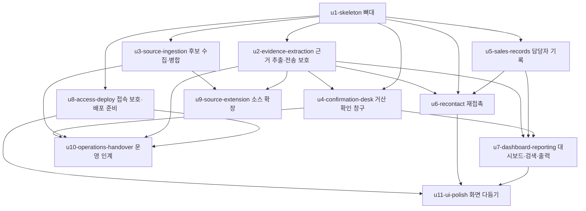

# 작업 단위 의존 관계 (Unit Dependency DAG) — 거산케미칼 AI 영업지원 에이전트 2차

이 문서는 "어느 단위가 어느 단위에 기대는가"(위상)만 적습니다. 무엇을 먼저 만들지, 어디가 병목인지는 다음 단계(전달 계획)가 정합니다. 단위 정의는 `unit-of-work.md`에 있습니다.

## 1. 의존 그래프 (기계가 읽는 원본)

```yaml
units:
  - name: u1-skeleton
    kind: service
    depends_on: []
  - name: u2-evidence-extraction
    kind: service
    depends_on: [u1-skeleton]
  - name: u3-source-ingestion
    kind: service
    depends_on: [u1-skeleton]
  - name: u4-confirmation-desk
    kind: service
    depends_on: [u1-skeleton, u2-evidence-extraction]
  - name: u5-sales-records
    kind: service
    depends_on: [u1-skeleton]
  - name: u6-recontact
    kind: service
    depends_on: [u1-skeleton, u2-evidence-extraction, u5-sales-records]
  - name: u7-dashboard-reporting
    kind: service
    depends_on: [u2-evidence-extraction, u4-confirmation-desk, u5-sales-records]
  - name: u8-access-deploy
    kind: service
    depends_on: [u1-skeleton]
  - name: u9-source-extension
    kind: service
    depends_on: [u2-evidence-extraction, u3-source-ingestion]
  - name: u10-operations-handover
    kind: packaging
    depends_on: [u2-evidence-extraction, u3-source-ingestion, u4-confirmation-desk, u8-access-deploy]
  - name: u11-ui-polish
    kind: ui
    depends_on: [u6-recontact, u7-dashboard-reporting, u8-access-deploy]
```

## 2. 그림



글로 읽기: 뼈대(U1)가 뿌리이고 U2·U3·U5·U8이 뼈대에만 기댑니다. 거산 확인 창구(U4)는 뼈대와 전송 보호(U2)에, 재접촉(U6)은 뼈대·담당자 기록·전송 보호에, 대시보드(U7)는 전송 보호·확인 창구·담당자 기록에, 소스 확장(U9)은 근거 추출과 후보 수집에, 운영 인계(U10)는 접속 보호·배포 준비와 안내서가 다루는 명령의 단위(U2·U3·U4)에, 화면 다듬기(U11)는 화면이 있는 마지막 단위들(U6·U7·U8)에 기댑니다. 순환은 없습니다.

## 3. 의존 관계 설명 (A는 B에 기댄다)

| A | B | 왜 기대는가 |
|---|---|---|
| U2 근거 추출 | U1 뼈대 | 근거를 연결할 기회·평가 기록·재평가할 규칙 엔진·근거 자료를 보일 S2가 뼈대에서 생김 |
| U3 후보 수집 | U1 뼈대 | 등록할 고객·기회 테이블과 평가 묶음, 명령줄 진입이 뼈대에서 생김 |
| U4 확인 창구 | U1 뼈대, U2 전송 보호 | 질문 후보·조사 요건 저장(최소형)·거산 값 테이블·평가 재실행이 뼈대에서 생김. 질문 목록 복사·내보내기가 TransferGuard 출력 검사(U2)를 거침 |
| U5 담당자 기록 | U1 뼈대 | 의견 저장·S2·평가 ID가 뼈대에서 생김. 다른 네 기록은 같은 틀을 확장 |
| U6 재접촉 | U1 뼈대, U2 전송 보호, U5 담당자 기록 | 규칙 엔진·S1/S2 틀(U1)과 승인 목적·결과 기록 영역(U5)을 재접촉용 상세가 그대로 씀. 문안 템플릿은 LLM 어댑터의 '호출 없음' 모드이고 전송 0건 테스트는 TransferGuard 로그(U2)를 봄. **(갱신 2026-11-03, PM 결정) 보류** — 거산 요청, 11/15 뒤 재개 여부 결정 |
| U7 대시보드 | ~~U2 전송 보호, U4 확인 창구,~~ U5 담당자 기록 **(갱신 2026-11-03, PM 결정 Q3·Q7: U5에만 기댐)** | ~~건수 4개가 질문 상태(요청·기한)와 의견·승인·결과·일정에서 계산됨. 엑셀·PDF 출력이 TransferGuard 출력 검사와 근거 자료 인용(U2)을 씀~~ → 건수 5개(미접촉/관심/접촉 중/견적·샘플/이번 주 일정)·일정·최근 기록이 모두 U5 기록에서 계산됨. 엑셀 출력 최소형은 U5의 연락처 패턴 검사(`find_contact`)를 재사용하고 등급 검사·전송 로그는 U2 때 합침. 화면은 가짜 숫자로 먼저 만들 수 있어 U5 서버 완성 전에도 시작 가능 |
| U8 접속 보호 | U1 뼈대 | 보호할 WebApi·화면과 한 덩어리 빌드 대상이 뼈대에서 생김 |
| U9 소스 확장 | U2 근거 추출, U3 후보 수집 | 홈페이지 자동 탐색은 근거 추출 뒤 이어지고, API·CSV 어댑터는 1단계 수집 틀과 소스 계약표를 확장 |
| U10 운영 인계 | U8 접속 보호·배포 준비, U2 전송 보호, U3 후보 수집, U4 확인 창구 | 안내서·백업/복원 완성은 배포된 한 덩어리를 전제로 하고, 안내서가 수집(U3)·검수 전환(U4) 명령을 다루며 비용 보기는 TransferGuard 집계(U2)를 씀 |
| U11 화면 다듬기 | U7 대시보드, U6 재접촉, U8 접속 보호 | 화면이 있는 마지막 단위들(S0은 U8, S5는 U6, S4·검색은 U7; S6은 U7이 기대는 U4, S1~S3는 U1·U5)이 끝난 뒤에만 다듬을 수 있음 |

## 4. 단위 사이의 연결 지점 (API·공유 데이터)

| 연결 | 종류 | 내용 | 계약 확정 단계 |
|---|---|---|---|
| U1 → U2·U4·U5·U6·U7 | 공유 데이터(같은 SQLite) | 뼈대가 만든 테이블(거산 값·기회·평가·의견)을 뒤 단위가 읽고 자기 테이블을 더함. 교차 참조는 ID만(ADR-011) | 기능 설계(데이터 사전) |
| U1 → 뒤 단위 | 내부 함수(부품 경계) | WorkflowRunner 흐름 함수, EvaluationLedger 평가 실행, RuleEngine 입력 스냅샷 형식 | 계약 설계(내부 계약) |
| U1 → U2·U4·U5·U6·U7·U8 | HTTP API | WebApi 경로(목록·상세·의견)를 뒤 단위가 확장. 응답에 갱신 시각·가상 데이터 포함 여부 | 계약 설계 |
| U2 → U4·U6·U7·U10 | 내부 함수 | TransferGuard 전송·출력 검사(종류 태그 + 등급), 전송 로그·호출/토큰 집계 조회, LLM 어댑터 '호출 없음' 모드 | 계약 설계 |
| U1 → U2 | 공유 데이터·내부 함수 | Evidence 테이블과 스냅샷용 읽기 함수(U1 최소형)를 U2가 추출 결과 저장으로 확장 | 기능 설계 |
| U6 → U7 | 공유 데이터·화면 부품 | 재접촉 후속 약속(Signal ⑦)을 U7 일정 목록이 읽음. 검색 칸은 U7 소유, U6은 호출만. **(갱신 2026-11-03) 보류** — U6 보류로 U7 일정 목록의 출처는 U5 결과 기록의 다음 일정뿐 | 기능 설계 |
| U4 → U7 | 공유 데이터 | ConfirmationQuestion·QuestionOpportunityLink 상태를 건수로 | 기능 설계 |
| U5 → U6·U7 | 공유 데이터·화면 부품 | Action·Outcome·Bookmark, 승인·결과 인라인 부품 재사용 | 기능 설계 |
| U3 → U9 | 내부 함수 | SourceIngestion 어댑터 인터페이스, SourceContract, IngestionRun 집계 형식 | 계약 설계 |
| U8 → 전체 | 환경 설정 | 환경 변수(비밀번호·API 키), 접속 보호 켜기/끄기, 빌드 산출물 위치 | 인프라 설계 |
| U10 → 전체 | 문서·명령 | 운영 안내서가 OperatorCommands 명령 이름·설정 파일 키를 그대로 씀 | 코드 생성 |

## 5. 병렬로 만들 수 있는 묶음

의존이 없는 단위끼리는 어느 순서로도 되고 동시에 해도 됩니다(동시 진행은 최대 2개, Q4).

- 뼈대 뒤 1차 독립 묶음: **U2, U3, U5, U8** — 서로 기대지 않음(4개 중 어느 2개든 동시 가능)
- U2가 끝나면 **U4**(U1·U2 뒤), U2·U3가 끝나면 **U9**, U2·U5가 끝나면 **U6**, U2·U4·U5가 끝나면 **U7**, U2·U3·U4·U8이 끝나면 **U10**
- **(갱신 2026-11-03, PM 결정 1)** U7은 U5만 끝나면 된다(U2·U4 의존 제거). U6은 보류. 실제 진행 순서는 U5 → U8 → U7 → U2 → U3이고, U5·U8·U7 줄과 U2·U3 줄을 동시에 진행한다
- U4와 U5, U4와 U3, U6과 U9, U7과 U9, U9와 U10은 서로 기대지 않아 동시 가능
- U11은 U6·U7·U8 뒤

충돌이 큰 쌍(같은 파일을 많이 고침): **U4와 U5**(S2 하단 기록 영역·WebApi 기록 경로), **U2와 U5**(S2 영역), U6과 U7(검색·일정). 동시 진행 2개를 고를 때 이 쌍은 피하거나 U1의 확장 지점 규칙(`unit-of-work.md` U1 구현 메모)을 먼저 적용한다.

유효한 위상 순서는 여러 개입니다. 예를 들어 U1 → {U2, U8} → {U3, U5} → {U4, U6} → {U7, U9} → {U10, U11}도, U1 → {U2, U3} → {U5, U8} → {U4, U9} → {U6, U7} → … 도 모두 그래프를 만족합니다. 어느 것을 고를지는 전달 계획이 11/6·11/15 조건(`unit-of-work.md` 4장)과 4명의 여력으로 정합니다.

## 6. 걷는 뼈대(첫 단위)가 뒤 단위 없이 돌아가는 이유

활성 범위 mvp는 뼈대 켜짐이고 구현은 unit-major·체크포인트 켜짐이므로 U1이 첫 DAG 단위입니다. U1은 다음을 모두 자기 안에 갖습니다.

- 입력: 가상 사례 파일(A정밀 고객·기회·요구·신호·이력·근거 자료(공고 A등급·홈페이지 B등급 인용)·거산 역량·검수 상태·가상 합의값·담당자 체크됨·조사 요건·기대 결과)을 OperatorCommands 투입 명령으로 넣는다. 근거 자료는 Evidence 테이블에 파일로 저장되므로 외부 LLM·홈페이지 읽기·외부 소스가 필요 없다.
- 계산: RuleEngine(신규 프로필, 조사 요건 포함)과 EvaluationLedger ⓪ 흐름이 평가를 만들고 근거 연결·공정 연결 현재 결과·질문 후보를 저장한다.
- 출력: WebApi와 WebUI S1·S2(근거 자료 목록·확인 질문 읽기 전용 포함)·S3(P0 부분)이 목록·상세를 보이고 의견을 저장한다. 한 덩어리 실행(FastAPI + React 빌드)이 여기서 처음 돈다.
- 검증: 구현 검증 명령(전달 계획에서 사람이 확정)이 "백엔드 시나리오 테스트 + A정밀 E 77 / P 95 / S 81.1 / R 82 + 분류 시점 우선 접촉 후보 + 화면에서 의견 저장"을 확인한다. 설계 검토만으로는 뼈대 완료로 보지 않는다(팀 실천 방식).

뒤 단위는 모두 U1이 만든 테이블·흐름·화면 틀을 확장하므로 U1 없이는 시작할 수 없고, U1은 뒤 단위 없이 끝까지 돈다.
