# 거산케미칼 AI 영업지원 에이전트 2차 기획서 (v0.15 · 개발 기준본)

**9종 공정 역량과 인증·승인 조건을 함께 검토하고, 신규 기회와 재접촉의 다음 행동을 제안하는 영업지원 도구**

| 항목 | 내용 |
|---|---|
| 작성 | 인공지능 사관학교 기업연계 14팀 AGENT DDALGI · 팀장 최지예 |
| 대상 | 거산케미칼 · 충남 천안 · 도금·표면처리 임가공 |
| 개정일 / 최종발표 | 2026-10-12 / **2026-12-11(금)** |
| 문서 상태 | **팀 내부 개발 착수 기준본.** 2026-10-12 기준 정리 반영. 기업 승인·실제 데이터 검증·평가 실행 버전 고정은 별도 확인한다. 세부 설계는 데이터/API 정의와 작업표에서 관리한다 |
| 반영 방향 | 공정·인증 공통 평가, 신규·재접촉 순차 구현, 팀 운영 지원형 파일럿 |
| 점수 기준 | v0.5.2의 A/B 배점·계산을 상황별 프로필로 재사용하는 제안. C 배점은 별도 가산하지 않음 |
| 적용 관계 | 이 v0.15 본문을 현재 기준으로 사용. 요약본은 읽기 안내이며, 이전 판은 변경 추적용. 24개 논리 테이블 구성과 A/B 배점·판정 유지 |

**읽는 순서:** 팀 공통은 0장 요약 → 2장 완료 범위 → 5장 판단 방식 → 10장 단계·담당을 읽는다. 4.4의 ERD·필드와 부록 F의 계산 규칙은 구현할 때 참조한다. 현재 부록은 A·B·C·F·H이며, 과거 판별 비교 문서를 함께 읽어야만 개발할 수 있는 구조로 운영하지 않는다.

**이번 정리의 목적:** 기능·트랙·공정 범위를 더 늘리지 않고, 개발 전 기준과 개발 중 상세화할 내용을 구분한다. 공정 판정 집계·평가 재현·상세 설계 시점의 표현을 바로잡았으며, 배점·판정 규칙과 최종 필수 기능은 유지했다. v0.15 안에서 정리하며 별도 기획서 버전을 추가하지 않는다.

이 문서는 기획과 논리 설계의 기준이다. 구현 완료, 기업 승인, 실제 추천 성능 또는 일정 실현 가능성을 검증했다는 뜻은 아니다.

## 0. 의사결정 요약

| 질문 | 이번 기획의 답 |
|---|---|
| 무엇을 만드는가? | 공정 역량·인증 범위와 고객의 수요·요구조건을 대조해, 어떤 영업기회를 왜 검토하고 무엇을 확인할지 제시한다. |
| 왜 필요한가? | 공정별 근거 자료가 부족하고 영업·상담 지식이 담당자에게 분산되어 있다. 회사가 할 수 있는 일과 고객에게 필요한 일을 근거로 연결한다. |
| 구조는 어떻게 바뀌는가? | 공정·인증은 공통 평가에 함께 사용한다. 신규·재접촉은 고객 관계와 해당 기회의 상담 이력에 따른 대응 방식으로 구분한다. |
| 발표 전 어디까지 만드는가? | 9종 전체를 담는 데이터 구조, 공정·인증 기반 발굴·평가, 신규 기회 지원, 재접촉 지원, 근거·질문·담당자 의견·결과 기록·출력을 모두 기본 구현한다. |
| 어떻게 나누어 개발하는가? | 공통 기반 → 대표 흐름 → 신규·재접촉 중 준비된 흐름 → 나머지 흐름 → 통합 검증 순서. 앞 흐름의 수주 성과를 다음 개발의 조건으로 삼지 않는다. |
| 실제 기업 검증은? | 준비된 대표 활용 사례부터 진행한다. 기능 구현, 실제 데이터 검증, 기업 직접 사용, 실제 접촉 성과를 따로 보고한다. |
| 공정은 줄이는가? | 9종 전체를 유지한다. 원본에서 확인된 공정명은 8개이며 9번째는 기업 원자료 대조가 필요하다. 기본 등록과 기술 검수 완료를 구분한다. |
| 기업이 해야 하는 일은? | 추천 확인 → 의견 선택 → 접촉했다면 결과 기록. 조사·근거 정리·추천 실행은 초기에는 팀이 지원한다. |
| 핵심 일정은? | 견학·G0 면담 목표 **10/30**, 실데이터 검증 범위 판단 **11/6**, 두 흐름 연결 중간 점검 **11/13**, 평가계획 합의 **11/20**, 필수 기능 인수·평가 버전 고정 **11/27**, 기업 평가·시연 **12/2~12/4**, 인계 **12/10**, 최종발표 **12/11**(10장). |
| 지금 필요한 확인은? | 기업에 여쭐 것(12.1): 면담·검수 일정, 실제 우선 업무, 직접 사용 참여, 허용 자료와 공정·인증 검수, 실행량·조사시간, 사건 후 실제 발주 시점, 종료 후 운영. 팀이 초안을 만들어 확인받을 것(12.2): 프로필 적용 사례·핵심 근거·G2 평가 조건·비용 상한. |

**12월 11일 발표의 목표:** 공통 평가와 두 대응 흐름의 기본 동작을 보여주고, 실제로 검증한 사례·표본·사용 범위와 미검증 범위를 함께 제시한다. 매출 증가나 수주 확률은 검증 결과 없이 주장하지 않는다.

### 0.1 기준으로 고정할 것과 상세화할 것

| 구분 | 현재 기준 | 관리 방법 |
|---|---|---|
| 목적·최종 기능 | 9종 전체 구조, 공정·인증 공통 평가, 신규·재접촉 두 대응 흐름, 근거·의견·결과·출력 | 2.2의 완료 범위를 기준으로 작업. 범위 변경은 이유·일정 영향을 기록하고 팀 합의 |
| 판단 규칙 | 5장·부록 F의 필터, A/B 적용, 배점·상태·분기 | 초기 구현 기준으로 고정. 검증된 성능 수치로 해석하지 않음. 변경 시 규칙 버전·기대 결과·평가 영향 기록 |
| 데이터 의미·연결 | 4.4의 기회·요구·근거·평가·승인 연결과 보존 원칙 | 24개 테이블은 논리 구성안. 물리 테이블 수 자체를 완료 목표로 삼지 않음 |
| 개발 중 상세 설계 | 자료형·인덱스·API 필드·화면 배치·모듈 구조·마이그레이션 | 해당 기능을 구현하기 전에 BE·AI·FE가 계약 확정. 의미·규칙을 유지하는 변경은 기획서 재작성 없이 관리 |
| 기업 확인 | 실제 9종 명칭, 자료 허용, 검수자·사용자, 실제 평가·운영 조건 | 12장의 확인 항목에 담당·기한·상태 기록. 가상 기능 개발과 실제 자료 사용 승인을 구분 |
| 일정·인력 | 10장의 7단계와 12/11 발표, 역할별 기본 분담 | 1단계에 실명·주간 가용 시간·첫 작업량 확인. 기업 참여 일정은 협의 전까지 목표일로 표시 |

**문서 운영:** 이 본문 하나를 기획 기준으로 사용한다. 요약본에는 새로운 요구나 독립된 규칙을 추가하지 않는다. 개발 산출물은 기존 데이터/API 정의와 작업표에 연결하고, 사소한 구현 변경마다 새 기획서를 만들지 않는다. 범위·판단 규칙·인수 기준 또는 주요 일정이 바뀌면 해당 절과 변경 이유만 갱신한다(11장).

## 1. 배경과 문제 정의

### 1.1 1차에서 확인한 문제

1차 MVP는 공정별 고객맞춤 영업자료 제작을 목표로 자료 선택·초안 생성·편집·출력 흐름을 개발했다. 그러나 결과물이 일반 회사소개서 수준에 머물렀고, 팀은 **공정별 근거 데이터와 그 구조의 부족**을 주요 원인으로 진단했다. 모델·프롬프트·검색·출력 품질의 영향은 별도 검증 대상이다.

거산케미칼은 공정 수행 능력을 제공하는 기업이므로 고객에게 중요한 질문은 해당 부품의 소재·규격·품질 조건에 대응할 근거가 있는가이다. 여기에 특정 고객·품목·프로젝트의 인증·승인 조건이 있으면 함께 확인해야 한다. 특정 산업에 속한다는 이유만으로 동일 인증을 모두 필수라고 가정하지 않는다.

### 1.2 사실·진단·가설 구분

| 구분 | 내용 | 근거 또는 확인 계획 |
|---|---|---|
| 기존 기획서가 확인 사실로 기록한 내용 | 영업자료 유지 인력·시간 부족, 소개·입소문 중심 거래, 담당자 대응 편차, 인증 활용 설명자료 부족 | v0.9에 정리된 1차 미팅·기업자료 해석을 계승. 원자료와 구체 사례는 후속 면담에서 보완 |
| 팀 진단 | 역량 근거의 부족이 1차 자료 품질 저하에 영향을 줌 | 공정·인증 정보를 구조화한 뒤 동일 시나리오로 확인 |
| 검증할 가설 | 발굴·재접촉 지원이 지금 기업 업무에 유용함 | 우선 업무와 실제 연락 여력을 면담에서 확인. 1차 당시 신규 영업 인력 여건도 재확인 |
| 검증할 가설 | 팀 지원형 웹 사용이 담당자 부담을 줄임 | 추천 확인·의견·결과 기록 과제를 직접 수행하도록 제안 |
| 새 기획 방향 | 공정·인증 공통 평가와 두 대응 흐름을 단계적으로 완성 | 이 문서의 범위·일정·완료조건에 반영. 기업 참여와 운영 합의는 별도 |

### 1.3 1차 MVP와의 관계

**2차는 별도 기능·별도 저장소·별도 DB·별도 배포로 개발한다.** 이번 통합은 2차 내부의 공정·인증 판단 구조를 통합하는 것이다. 1차 프로그램과의 기능·DB 통합 및 회사소개서 품질 개선은 이번 완료 범위에 넣지 않는다. 향후 연결을 위해 공정·소재·인증의 명칭과 코드 대응표를 유지한다.

## 2. 목표·범위·완료조건

### 2.1 목표

담당자가 후보 기업의 품목·프로젝트를 살펴보고, 검수된 거산 역량과 비교해 **추천 이유·거래 전 확인 조건·다음 행동**을 판단하도록 돕는다. 점수는 검토 순서의 참고값이며 수주 확률·기술 수행 가능성·거래 자격을 보장하지 않는다.

### 2.2 발표 전 필수 범위

| 필수 항목 | 구현할 내용 | 완료 확인 |
|---|---|---|
| 9종 공정 기반 | 공통 스키마(4.4), 전체 목록 대조·등록, 필드별 출처·검수 상태 | 9종을 수용하는 구조 확인. 실제 명칭 미확인 항목은 완료로 세지 않음 |
| 통합 발굴 | 공정 수요 검색과 인증·승인 조건 검색, 기업·기회 중복 정리 | 같은 기회는 발견 경로가 달라도 같은 기회 ID로 연결 |
| 공통 평가 | 공정 근거, 필수·우대 인증, 필터·근거 상태·시점 확인 | 불일치·미확인·비요구·대체 공정 사례의 처리 검증 |
| 신규 기회 지원 | 제품·소재·처리 목적 근거, 첫 제안 사유·확인 질문 | 신규 기업과 기존 고객의 새 프로젝트 시나리오 모두 실행 |
| 재접촉 지원 | 허용된 해당 기회 이력, 현재 재접촉 이유·후속 일정 | 과거 제안 후속·재발주 시나리오 실행. 이력 부족은 확인 필요로 표시 |
| 최소 사용 화면 | 추천 조회·근거 상세·의견 선택·결과 기록 | 기업 담당자 과제를 모사한 전체 흐름 실행 |
| 최소 운영 기록 | 평가 버전·필터·원래 순위·승인·조사·실제 접촉·결과 | 판단을 재현할 수 있는 필수 기록 저장 |
| 출력·인계 | 후보 및 근거 엑셀·PDF, 실행·갱신 안내, 평가 결과 | 화면과 출력의 상태·근거 일치, 인계 목록 확인 |

**기본 기능 완료와 실데이터 검증 완료는 구분한다.** 허용된 실제 이력이 없더라도 재접촉 기능은 표시된 가상 사례로 구현·검증한다. 이 경우 발표에 “재접촉 기능 구현 완료, 실제 이력 검증 미실시”라고 기록한다. 개발이 미완료라면 데이터 미확보와 구분해 미완료로 보고한다.

### 2.3 이번에 제외하거나 후속으로 두는 범위

| 구분 | 항목 |
|---|---|
| 이번 범위 밖 | 단가·견적금액 산정, 납기 확정, 고객 자동 발송, 가격·사업모델·경쟁사 비교 |
| 후속 확장 | RFQ·도면 자동 구조화(레벨 3), 가중치 자동 조정, 예측모델 학습, CRM·ERP·메일 연동, 설비 가동능력 판단, 1차 MVP 통합 |
| 화면 확장 | 전용 조사 관리 화면, 기업의 독립적인 수집·규칙 관리. 단, 현재 분류에 필요한 조사 기록 자체는 필수 |

신규·재접촉 기본 지원은 이번 범위다. 이를 G4 이후 확장 항목으로 다시 미루지 않는다. 자료·일정 부족으로 목표를 달성하지 못하면 실제 미완료 범위를 기록하고 범위 변경 이력을 남긴다.

### 2.4 필수 범위의 우선순위와 지연 대응

9종 공정 공통 구조와 두 대응 흐름을 모두 기본 구현한다. 일정이 밀리면 화면 꾸밈·별도 관리 화면·출력 디자인부터 줄인다. **자료가 없어서 실데이터 평가를 못 하는 것과 기능을 아직 연결하지 못한 것은 서로 다른 상태**로 기록한다.

| 우선 | 유지할 완료 기준 | 지연 시 조정할 부분 |
|---|---|---|
| 1 | 9종 구조·필드 검수, 기회 병합, 요구별 필터, 규칙 계산·분기·정렬 | 필수 판정을 생략하거나 점수로 우회하지 않음 |
| 1 | 최소 조회·근거·의견·결과 화면과 첫 대응 흐름 | 화면 꾸밈을 줄이고 저장·조회 연결을 우선 |
| 2 | 나머지 대응 흐름의 전체 동작 | 자료 미확보이면 표시된 가상 사례로 기능 검증. 연결 미완료이면 복구 담당·기한·남은 기능 기록 |
| 2 | 단계·기한·자격 상태와 현재/수행 시점 판정 | 자동 비교의 일부를 근거·확인자·일자가 있는 담당자 확인으로 구현 가능. 미확인은 대기, 알려진 정지·취소·필수 불충족은 통과 금지 |
| 3 | 조사·재검토 조건을 기회/평가 ID와 연결해 저장 | 전용 관리 화면은 후속으로 두고 기본 메모/구조화 입력 재사용. 외부 메모만으로 필수 저장 기능 완료 처리하지 않음 |
| 3 | 화면과 같은 근거·상태의 엑셀·PDF 출력 | PDF는 단순 인쇄형으로 구현 가능. 수동 발표자료만 만든 경우 PDF 출력 기능은 미완료 |

PM은 11/13·11/20 점검에서 결정일·이유·담당·복구 일정·영향 시나리오를 기록한다. 필수 기능을 실제로 제외해야 하는 변경은 미완료/범위 변경으로 명시하며, 구현 완료로 바꾸어 보고하지 않는다.

## 3. 통합 구조와 선택 근거

### 3.1 세 트랙을 어떻게 정리하는가

| 기존 구분 | 현재 기획에서의 위치 | 기능 유지 여부 |
|---|---|---|
| A · 기존 거래처 재접촉 | 해당 기회 이력과 현재 사유를 활용하는 재접촉 대응 | 유지. 단계적으로 기본 구현 |
| B · 신규 고객 발굴 | 신규 기회 탐색과 첫 제안 대응. 기존 고객의 새 기회도 포함 | 유지. 적용 대상 확장은 새 검증 필요 |
| C · 인증 소구 | 인증 기반 후보 검색 + 모든 기회의 인증·승인 조건 대조 + 검수된 인증 근거 설명 | 유지. 독립 트랙·별도 가산점으로 운영하지 않음 |

**공통 평가는 판단 절차를 함께 쓰는 뜻이다.** 모든 기회를 하나의 새 배점표로 채점한다는 뜻은 아니다. 신규 기회와 재접촉의 정보 차이는 기존 B/A 기반 평가 프로필로 처리한다(5.1·부록 F).

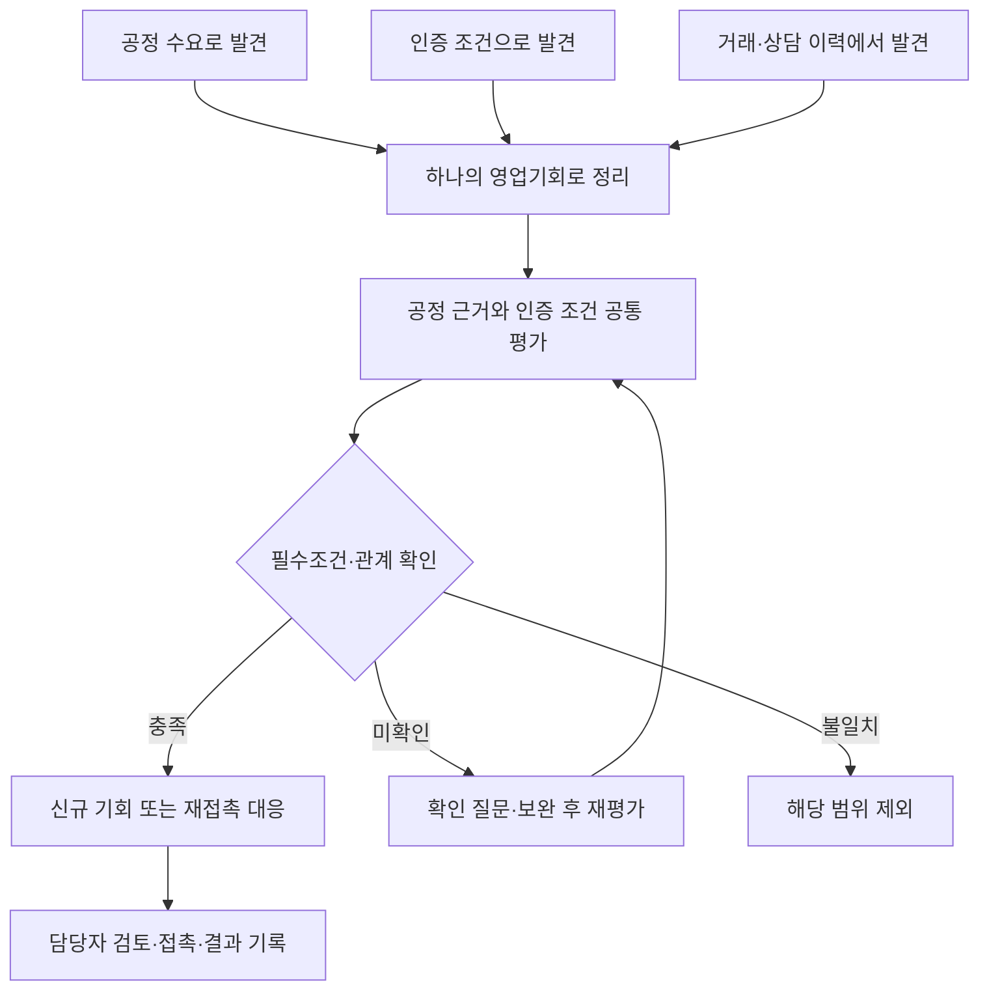

### 3.2 대안 비교

| 대안 | 장점 | 한계 | 판단 |
|---|---|---|---|
| 세 트랙을 독립 구현 | 목적별 설명이 쉬움 | 관계 구분과 인증 조건이 겹쳐 같은 기회·판정을 중복 관리할 수 있음 | 기존 구조 개정 |
| 모든 기준을 새 단일 점수로 합산 | 하나의 숫자로 표현 가능 | 배점·분모·기준점 재설계와 검증 부담, 필수조건 상쇄 위험 | 이번에 임의 도입하지 않음 |
| 공통 판단 + 상황별 대응·평가 프로필 | 공정·인증을 함께 확인하고 기존 계산 규칙을 활용 | 프로필 적용 범위와 비교 방식 명시 필요 | **이번 내부 설계안** |

### 3.3 고객 관계와 영업기회 분리

고객 관계는 **신규 확인 / 기존 관계 확인 / 관계 미확인**으로 기록한다. 기존 관계의 근거가 실제 거래인지 과거 상담·견적인지는 이력 종류로 구분하며, 상담만 있었다고 거래실적을 생성하지 않는다. 별도로 해당 기회의 신규 제안인지, 기존 제안 후속인지, 재발주 확인인지를 기록한다. 회사와 거래한 적이 있다는 이유만으로 모든 기회를 재접촉으로 만들지 않는다.

관계 미확인 후보는 공통 평가와 참고 계산을 진행할 수 있다. 다만 **필터 확인 대기: 관계·중복 미확인**으로 유지하고 접촉 후보로 확정하지 않는다. 접촉 전에 담당자가 기존 거래·상담과 중복 연락 여부를 확인한다.

## 4. 데이터 설계와 확보 계획

### 4.1 공정 9종과 준비 상태

| 확인 상태 | 공정명 |
|---|---|
| v0.9가 회사소개서 기준으로 정리한 8개 | 아연도금, 아노다이징, 무전해니켈, 크롬, 전해연마, 인산염피막, 크로메이트, 부동태 |
| 원자료 대조 필요 | 9번째 공정명·코드. 임의 명칭을 생성하지 않음 |

9종을 담는 공통 구조는 처음부터 만든다. 목록 대조가 끝나면 실제 9종을 등록한다. 미확인 항목은 관리용 확인 과제로 남기며 실제 공정명처럼 추천에 쓰지 않는다. 자료가 준비된 공정은 수를 제한하지 않고 검증한다.

각 공정의 소재·치수·두께·성능·시험·인증 연결은 **미확보 / 확보·검수 대기 / 검수 완료 / 재확인 필요**를 필드별로 기록한다. 목록 등록만으로 모든 사양을 검증했다고 표시하지 않는다. 거산의 기술 역량은 추정값으로 채우지 않는다.

### 4.2 핵심 기록과 관계

아래는 무엇을 기록하는지의 요약이다. 테이블 단위 설계와 ERD는 4.4에 있다.

| 기록 | 최소 내용·적용 범위 |
|---|---|
| 공정·역량 | 공정 ID·명칭·소재·사양·설비·시험·실적과 각 필드 근거·검수 상태 |
| 인증·승인 | 종류·공식 명칭/식별번호·적용 판본·주체·해당 범위·유효기간·현재 상태(정지/취소 등)·상태 확인일/근거·검수자·검수일 |
| 고객 | 고객 ID·사업자번호 또는 확인된 식별 근거·관계 상태·확인일 |
| 영업기회 | 기회 ID·고객 ID·품목·프로젝트·발견 경로들·담당자·진행 상태 |
| 기회-공정 연결 | 고객 요구와 해당 공정의 대응 근거·요구별 필수/우대/비요구/미확인·필요 단계/기한·통과/미확인/제외·사유 |
| 요구·상담 | 회사 공통/특정 기회 적용 범위·확인/추정·관심요소·확인 항목·의사결정 구조·다음 일정 |
| 시점 신호 | 사건 발생일·확인일·진행 상태·마감·예정일·다음 확인일·근거 |
| 평가 | 프로필·입력·기준일·규칙/역량DB 버전·항목 상태·점수·분류·원래 순위 |
| 의견·실행·결과 | 담당자 의견, 승인·실행 주목적·접촉 시도·응답·후속 일정·결과·미실행 사유를 분리 |

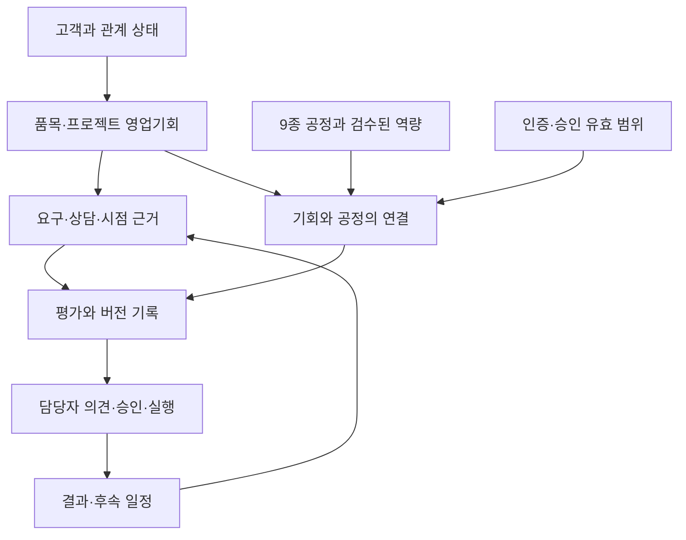

상담 메모의 기본 적용 범위는 입력한 영업기회다. 회사 공통 정보로 재사용하려면 적용 범위를 확인한다. “이번 부품은 11월 납품”을 회사 전체 납기 조건으로 복제하지 않는다. 같은 프로젝트에 인증 요구가 추가되면 같은 기회 ID를 갱신하고, 다른 품목·프로젝트라는 근거가 있을 때만 새 기회를 만든다.

### 4.2.1 자격 종류와 요구별 기록

아래 구분은 이번 서비스의 자료 분류안이다. 인증 이름·기관의 공식 분류를 임의로 바꾸거나, 예시가 거산의 보유 자격이라고 가정하지 않는다.

| 종류 | 관리할 내용 | 기존 데이터와 연결 |
|---|---|---|
| 품질경영체계 인증 | 조직·사업장·인증 범위·판본·현재 상태 | 인증 기록. 9100 계열과 OASIS의 일반적 성격은 부록 C에서 확인 |
| 특수·중요공정 인정 | 특정 공정·규격의 인정 범위 | 인증/승인과 공정 연결. Nadcap의 Chemical Processing·Coatings는 종류 설명 예시 |
| 고객사 승인 | 고객·사업장·공정·품목별 승인 조건 | 해당 고객·기회의 요구와 승인 근거 |
| 협력사·공급망 등록 | 등록 대상·참여 가능한 단계·승인 조건 | 해당 고객·사업의 요구와 진행 이력 |
| 샘플·양산 승인 | 해당 품목의 샘플·현장 검증·생산 승인 조건 | 기회별 승인 이력. 회사 공통 인증으로 복제하지 않음 |

사업별 필수 요구는 ‘기회의 요구조건’, 공정 수행능력은 ‘역량DB’에 둔다. 이를 모두 인증 종류로 묶지 않는다. 한 기회에 인증과 고객 승인 등 여러 요구가 있으면 **요구별로 근거와 결과를 기록**한다. 한 인증의 통과가 다른 승인까지 통과한 것으로 합쳐지지 않도록 한다.

기존 인증·요구·근거 기록을 확장하며 별도 승인관리 시스템을 추가하지 않는다. 최소 논리 필드는 자격 종류, 요구 ID, 요구 수준, 필요 단계·충족기한, 연결한 자격/공정 ID, 개별 판정, 현재 상태·확인일, 후속 조건이다. 실제 DB 열·코드는 상세 설계에서 확정한다. 사업장·공정 등 범위 항목은 해당 자격과 요구에서 적용되는지를 먼저 확인하고 **해당 없음과 미확인을 구분**한다.

### 4.3 자료 요청과 모집단 관리

기업에 새로운 문서를 작성하도록 요구하기보다 기존 자료·면담 구술을 팀이 구조화하고 확인받는다. 필요한 것은 9종 명칭·기본 사양, 인증 원본과 적용 범위, 시험·실적의 비식별 근거, 허용된 거래·상담 사례다. 전체 거래처 명단을 필수로 요구하지 않는다.

외부 소스는 **3개 이내**에서 선정한다. 정확한 소스명, 이용·저장·재배포 허용 범위, 갱신 주기, 식별자, 출처 등급, 비용·실패 대응을 소스 계약표에 남긴다. 이 문서가 특정 외부 API의 현재 제공 범위나 이용 허용을 확인한 것은 아니다.

조사 전 산업·품목·소재·지역/물류 범위·소스·기간·기준일을 정한다. 수집 자료/공고 수, 중복 제거 기업 수, 중복 제거 기회 수, 유효 기회 수, 제외·미확인 사유를 각각 기록한다. 공정·인증 발견 경로가 겹친 기회는 합계에서 한 번만 센다.

### 4.4 DB 설계와 ERD

이 절은 **개발 착수를 위한 논리 설계안**이다. 테이블의 뜻과 연결을 검토했으며, 실제 DB 파일·SQLAlchemy 모델·마이그레이션은 제공되지 않아 실행 검증은 하지 않았다. 1단계에는 전체 관계와 첫 통합 사례의 필수 필드·상태·API 계약을 맞춘다. 물리 자료형·제약·인덱스·삭제 정책은 4.4.8에 따라 해당 기능 구현 전에 확정하고 저장/조회로 확인한다. SQLite + SQLAlchemy 기본안과 24개 논리 테이블 구성을 유지하되, 테이블 수 자체를 고정된 요구사항으로 취급하지 않는다.

**읽는 법:** PK는 한 행의 고유 ID, FK는 다른 테이블의 ID를 참조하는 열이다. `||`는 반드시 하나, `|o`는 없거나 하나, `o{`는 0개 이상이다. 선택 FK의 NULL만으로 ‘해당 없음’을 판단하지 않고 적용 여부·미확인 상태를 따로 기록한다. ERD는 핵심 연결을 나눠 표현하며 전체 최소 필드는 4.4.5를 따른다.

#### 4.4.1 설계 원칙

| 원칙 | 저장 기준 |
|---|---|
| 기회 중심 | 점수·요구·질문·의견·결과를 같은 `opp_id`에 연결. 발견 경로는 여러 행으로 남김 |
| 범위 구분 | 고객 공통, 특정 기회, 특정 공정 연결의 조건을 구분. 다른 기회 승인·상담을 자동 복제하지 않음 |
| 요구별 판정 | 요구의 실제 내용과 판정 근거를 남김. 자격 ID와 공정 연결 ID를 같은 열에 혼용하지 않음 |
| 값·근거 검수 | 검수 당시 값·대상 필드·근거·검수자·일자 보존. 거산 역량을 추정으로 채우지 않음 |
| 평가 재현 | 당시 허용된 확정 입력·규칙 설정·코드 버전·검수 값과 같은 모집단의 정렬 결과를 보존 |
| 사람의 판단 분리 | 추천, 운영 의견, 접촉 승인·실행, 영업 결과를 따로 저장. 추천에 대한 의견·승인은 대상 평가를 연결 |
| 데이터 사용 | 출처 등급과 사용 허용을 별도로 관리. 금지 원문은 메모·스냅샷에도 저장하지 않음 |

v0.14에서 `JUDGMENT_EVIDENCE`(항목–근거 연결)와 `EVALUATION_BATCH`(평가 모집단)를 추가했고, v0.15에서 같은 모양의 테이블을 합쳐 전체 **24개**로 정리했다(4.4.8). 전용 평가·권한·설비 자산관리 시스템은 추가하지 않는다. G2 평가 원본은 버전이 고정된 평가표 파일로 시작할 수 있다(4.4.7).

#### 4.4.2 ERD ① 역량과 자격의 범위

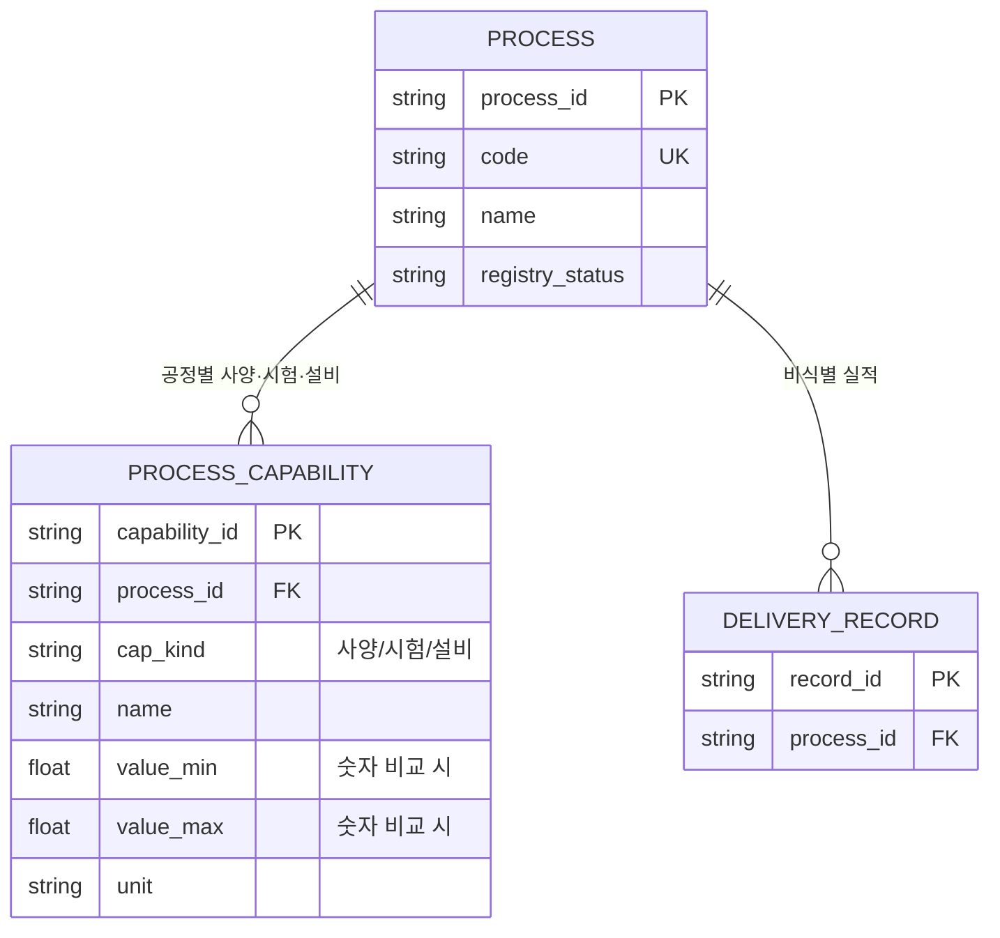

`PROCESS_CAPABILITY`는 공정별 사양(두께·치수·규격), 시험 항목, 사용 설비를 `cap_kind`로 구분해 한 테이블에 둔다. 사양·시험은 5.2.4의 기술 필수조건 대조에 쓰이고, 설비는 판정 규칙에 쓰이지 않는 설명 정보다. 여러 공정이 같은 설비를 써도 공정별로 기록하며 행 수를 고유 자산 수로 집계하지 않는다. 소재·성능 태그는 공통 코드/목록으로 관리한다. 숫자 자동 비교가 필요한 사양만 값·단위를 구조화하며 문자열을 해석해 처리 가능을 자동 확정하지 않는다.

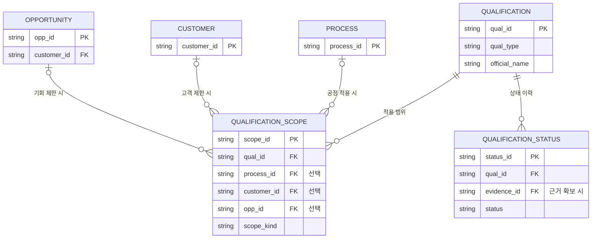

회사·사업장 단위 인증은 공정 ID가 없어도 기록할 수 있다. 고객 승인에는 고객 범위, 특정 샘플·양산 승인에는 해당 기회 범위를 연결한다. `scope_kind`와 각 범위의 적용/해당 없음/미확인을 함께 확인하며, 공정 ID가 NULL이라고 모든 공정에 통용되는 인증으로 해석하지 않는다. 기회가 지정된 경우 고객이 그 기회의 고객과 일치해야 한다.

#### 4.4.3 ERD ② 기회·요구·판정

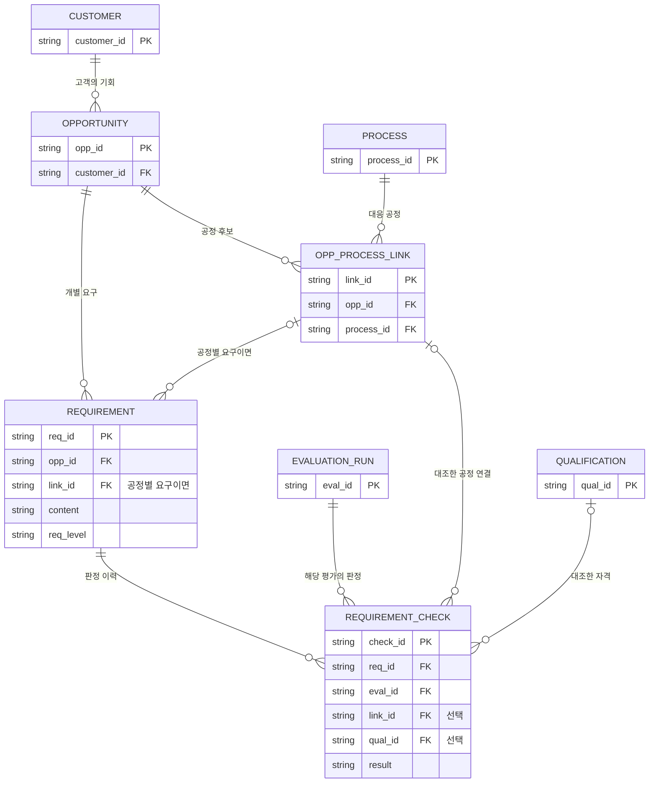

`REQUIREMENT`는 **무엇을 요구하는가**, `REQUIREMENT_CHECK`는 **그 평가에서 무엇과 비교해 어떻게 판단했는가**다. 예를 들어 두께 조건은 내용·값·단위·적용 공정과 근거를 남긴다. 자격이 필요 없는 기술 요구는 `qual_id=NULL`로 기록할 수 있다. 자격과 공정을 함께 확인한 판정은 두 FK를 모두 가질 수 있다. FK가 둘 다 없는 ‘미확인’도 이유와 질문을 기록하며, 근거 없는 통과로 바꾸지 않는다.

기업 전체 제한은 고객의 필터 상태·사유, 기회 공통 제한은 요구의 `scope_kind=OPPORTUNITY`, 공정별 제한은 `scope_kind=PROCESS_LINK`와 `link_id`로 관리한다. 공통 요구를 공정별 요구로 내려 대안 공정을 통해 우회하지 않는다. 요구·공정 연결·평가의 `opp_id`가 같아야 한다.

고객은 `INTERACTION`(거래·견적·상담·제안 이력과 상담 메모)을 여러 개 가질 수 있고, 기회는 `DISCOVERY_PATH`·`SIGNAL`을 여러 개 가진다. `INTERACTION`에는 고객 ID가 필수이며 기회 ID는 적용 시 연결한다. 회사 공통 메모는 확인된 적용 범위만 재사용한다. 평가에 편입된 기회에는 발견 경로와 식별 근거가 최소 1건 있어야 한다.

#### 4.4.4 ERD ③ 평가·근거와 실행 기록

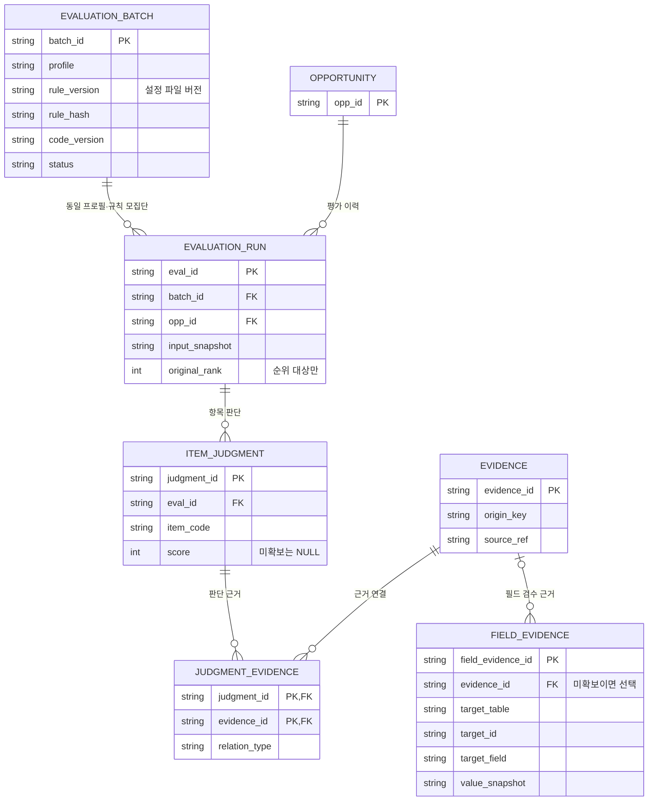

`FIELD_EVIDENCE.target_table/target_id`는 **허용된 테이블·레코드를 가리키는 일반 참조이며 SQL FK가 아니다.** 이 그림에서 공정과 자격 양쪽에 필수 연결된 것처럼 그리지 않는다. BE는 허용 대상 목록(PROCESS·PROCESS_CAPABILITY·DELIVERY_RECORD·QUALIFICATION·QUALIFICATION_SCOPE), ID·필드 존재, 버전 일치와 삭제 제한을 서버에서 검사한다. 이를 DB에서 강제할 항목은 물리 설계에서 명시 FK/연결로 확정하고 데이터 사전에 구분한다. 검수 기록은 값이 바뀌면 새 행으로 남기며, 평가가 사용한 검수 ID·값은 입력 스냅샷에 보존한다.

평가 확정 시 선택 프로필의 모든 항목 행을 저장한다. 미확보 항목도 NULL 점수 행으로 존재하므로 완료율 분모가 줄지 않는다. 실행 중·오류는 `run_status`로 구분하며 추천 순위에 넣지 않는다. 개별 참고 평가도 하나의 별도 batch에 기록할 수 있지만 비교 모집단이 없으면 순위를 부여하지 않는다.

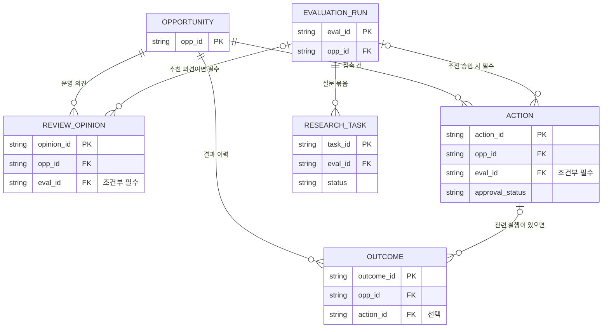

일반 기회 메모는 평가 ID 없이 가능하지만 **추천에 대한 의견·승인은 실제로 본 `eval_id`를 필수로 저장**한다. 과거 수동 접촉 이력을 넣을 때는 추천 기반 실행과 구분한다. 새 평가가 만들어져도 예전 승인으로 자동 실행하지 않는다. ACTION 한 행은 한 접촉 건이며 재시도는 새 행으로 추가한다. 승인 변경 이력은 승인자·시각·사유가 있는 변경 기록으로 보존한다.

#### 4.4.5 테이블별 최소 필드와 담당

모든 업무 기록은 생성자/생성 시각과 실데이터·가상 데이터 구분을 직접 보관하거나 상위 기록에서 일관되게 상속한다. 시간은 시각과 시간대를 보존하고 화면은 한국 시각으로 표시한다. 아래 JSON/목록은 검증된 구조화 값만 허용하며 금지 원문 보관용으로 쓰지 않는다. FK 대상은 위 도식의 동일 이름 PK다.

| 영역·테이블 | PK·연결 | 주요 필드·저장 의미 |
|---|---|---|
| 공정 `PROCESS` | process_id; code 유일 | name, category, material_codes, performance_tags, registry_status. 9번째 미확인 항목은 실제 공정처럼 등록하지 않음 |
| 역량 항목 `PROCESS_CAPABILITY` | capability_id; process_id | cap_kind(사양/시험/설비), 명칭·표시값, 필요 시 숫자 최소/최대·단위, 규격·판본, 치수 조건·적용 범위, 시험의 자체/외주, 확인 상태. 설비는 설명용이며 자동 생산능력 계산에 쓰지 않음 |
| 실적 `DELIVERY_RECORD` | record_id; process_id | 산업·부품 유형·시기·허용 근거. 고객 실명을 저장하지 않음 |
| 자격 `QUALIFICATION` | qual_id | 종류·공식명·번호·판본·보유 주체·사업장·유효기간·자료 버전. 변경된 값은 당시 평가 스냅샷에 보존 |
| 자격 범위 `QUALIFICATION_SCOPE` | scope_id; qual_id; 선택 process_id/customer_id/opp_id | scope_kind, 제품·규격·사업장 범위, 항목별 적용/해당 없음/미확인·그 근거 |
| 상태 `QUALIFICATION_STATUS` | status_id; qual_id; 선택 evidence_id | 정상/정지/취소/만료/미확인, 상태 발생일(알 때)·확인일·확인자·사유. 갱신마다 새 행 |
| 필드 검수 `FIELD_EVIDENCE` | field_evidence_id; 선택 evidence_id | target_table/id/field, value_snapshot, data_version, 검수 상태·검수자·검수일. 일반 참조 검사 필수 |
| 고객 `CUSTOMER` | customer_id | 이름·확인된 사업자번호·식별 근거, 관계 상태·확인일, 기업 전체 필터 상태·사유·근거 |
| 접촉 이력 `INTERACTION` | interaction_id; customer_id; 선택 opp_id/evidence_id | 종류(거래/견적/상담/제안/메모), 발생일, 허용된 내용 요약, apply_scope(특정 기회/회사 공통), 상담 4항목(관심요소·확인항목·의사결정 구조·다음 일정), 회사 공통 적용 확인자/근거, 사용 허용 기록 |
| 기회 `OPPORTUNITY` | opp_id; customer_id | 품목·프로젝트·구분 근거, 대응 목적·담당·진행 상태, 현재 행동 단계·예상 수행일·재검토 조건/담당/일자·중복 병합 이력 |
| 발견 `DISCOVERY_PATH` | path_id; opp_id; 선택 evidence_id | 공정/인증/이력 경로, 소스 계약표의 source_id, 원본키·발견일. source_id는 계약표 참조이며 DB FK로 표시하지 않음 |
| 공정 연결 `OPP_PROCESS_LINK` | link_id; opp_id/process_id | 현재 결과·사유·적용 소재/범위·확인일. 현재 결과는 같은 기회·실제/가상 구분의 최근 확정 평가에서 공정 대응과 적용 필수요구를 종합한 조회용 파생값(아래 집계 원칙). 캐시 저장 시 원본 eval_id 추적. `(opp_id,process_id)` 유일. 과거 판정은 해당 평가 스냅샷에 보존 |
| 요구 `REQUIREMENT` | req_id; opp_id; 선택 link_id/evidence_id | 요구 종류·명칭·내용, req_level, scope_kind, 필요한 값/단위/판본, 확인/추정·필요 단계·기한·질문. 고객 요구 변경 전 값은 평가 입력에 보존 |
| 판정 `REQUIREMENT_CHECK` | check_id; req_id/eval_id; 선택 qual_id/link_id/evidence_id | result, 판단한 현재 단계·수행 시점·범위, 사유·대조값·기준일·판정자·후속 조건. 사용한 자격 범위/상태 ID와 추가 근거는 평가 입력 명세에도 포함 |
| 신호 `SIGNAL` | signal_id; opp_id; 선택 evidence_id | 유형·실제 발생일·발표일·예정일·확인일·기한/시간대·유형별 진행 상태·다음 확인일. F.2/F.4의 상태를 빠짐없이 대응 |
| 모집단 `EVALUATION_BATCH` | batch_id | 단일 profile, base_date, **rule_version·rule_hash·code_version**(규칙 설정 파일의 버전·해시, 상태 초안/고정/폐기, 변경 이유·고정일·기업 승인 상태는 설정 파일 이력에 보존), 모집단 범위/기간/소스, 상태·실제/가상 구분, 정렬 규칙·전체 eval_id 명세, 후보/진단 표본 명세·고정일, 평가 원본 파일의 버전/참조 |
| 평가 `EVALUATION_RUN` | eval_id; batch_id/opp_id | run_status(프로필·기준일·규칙 버전은 batch에서 상속), 허용 입력 snapshot·해시, 역량DB/검수 버전, filter_state·핵심근거/운영/시점 요건, E/F/T/P/R/S/C, classification·직접 확인 배점·유효 기한·원래 순위, 조정 순위·사유·조정자/일시 |
| 항목 `ITEM_JUDGMENT` | judgment_id; eval_id | item_code, 판단할 사실·추론 이유, weight, state, match_rate/certainty/decay, score. `(eval_id,item_code)` 유일 |
| 근거 `EVIDENCE` | evidence_id | source_grade, source_ref·원본 버전, 원천 origin_key/인용 관계, 허용 문장·대상/범위·발생일/확인일, security_grade·사용 허용 기록 |
| 연결 `JUDGMENT_EVIDENCE` | 복합 PK judgment_id/evidence_id; 각각 FK | 직접/간접/상충 등 relation_type, 적용 이유. 동일 연결 중복 방지 |
| 조사 `RESEARCH_TASK` | task_id; eval_id | 질문 묶음·허용 경로·담당·예상/상한/실제 시간·재확인일·상태·결과 근거/요약·종료 사유 |
| 의견 `REVIEW_OPINION` | opinion_id; opp_id; 조건부 eval_id | 의견·메모·작성자/시각·실제 본 추천 버전. G2 블라인드 판정과 구분 |
| 접촉 `ACTION` | action_id; opp_id; 조건부 eval_id | approval_status(미정/승인/거절/취소), 승인자/일시·변경 이력, 목적·시도 시각·회신·후속 일정·미실행 사유 |
| 결과 `OUTCOME` | outcome_id; opp_id; 선택 action_id | 미실행/진행중/보류/수주/실주, 사유·재개 조건·기록자/일시. 수정은 새 이력으로 남김 |

**공정 연결의 현재 결과 집계:** 개별 `REQUIREMENT_CHECK` 하나를 복사하지 않는다. 같은 확정 평가의 공정 대응 결과와 현재 단계에 적용되는 기회 공통·해당 공정의 필수요구를 5.2·부록 F의 기존 필터 규칙으로 종합한다. 해당 범위의 명백한 필수 불일치가 있으면 제외, 차단 조건이 미확인이면 확인 대기, 필요한 확인을 충족하면 통과로 표현한다. 우대·비요구 불일치로 자동 제외하지 않고, 판정 행이 없다는 이유로 자동 통과시키지 않는다. 필수요구의 필요 단계 불명확도 대기로 처리하며, 후속 단계 요구와 요구 자체 미확인은 F.3의 구분을 따른다. 대안 공정은 각각 판정하되 기회 공통 필수조건을 우회하지 않는다. 캐시와 원본이 다르면 원본 평가가 기준이며, 입력·자격 상태 변경 시 재확인 표시와 재평가로 갱신한다. 캐시 저장 여부와 갱신 방식은 상세 설계에서 정한다.

BE는 DB·저장·조회·참조 검사를 책임지고 AI는 평가 입력·규칙·판정 근거 계약을 확인한다. FE는 상태·근거·입력/출력 표시, PM은 업무 범위·기업 검수 요청·인수 사례를 맡는다. 실제 거산 역량 검수는 기업 기술/품질 담당자에게 확인한다.

#### 4.4.6 주요 코드·제약·사용 허용

| 항목 | 고정할 기준 |
|---|---|
| 고객 관계 | 신규 확인 / 기존 관계 확인 / 관계 미확인. 관계 미확인은 접촉 확정 금지 |
| 프로필·목적 | 신규 기회(B) / 재접촉(A); 신규 제안 / 기존 제안 후속 / 재발주 확인을 별도 기록 |
| 요구 | 필수 / 우대 / 비요구 / 미확인. 필요 단계의 미확인도 별도 보존 |
| 판정·필터 | 통과 / 미확인 / 제외. 포괄적 조건부 통과 없음 |
| 검수 | 미확보 / 검수 대기 / 검수 완료 / 재확인. 검수 완료 값만 거산 가점 근거 |
| 항목 상태 | 확인 / 강한 추정 / 약한 추정 / 불일치 / 가점 없음 / 신호 없음 / 미확보. 앞 6개는 완료, 미확보만 NULL |
| 점수 | P=0이면 S=NULL(산정 전). W는 P로부터 계산해 API/화면/출력에 제공하며 중복 열 저장 불필요. `0≤E≤P≤100`, `E≤R≤100` |
| 실행 분류 | 부록 F.9의 11개 분기·표시 문구를 동일 코드표로 관리. DB·API·화면이 같은 코드를 사용 |
| 자료 허용 | 공개 / 외부 AI 허용 / 내부 구조화만 / 처리 금지와 함께 external_ai_allowed·presentation_allowed를 허용/불허/미확인으로 기록. 허용 범위·확인자/일자·참조·기한이 있으면 보존 |

단순 보안 등급만으로 외부 AI 전송이나 발표 공개를 허용하지 않는다. 근거·내부 이력·상담 기록의 사용 허용을 서버가 호출/조회/출력 전에 검사한다. 미확인 자료는 외부 AI 전송을 보류하며 금지 원문은 어떤 등급에서도 저장하지 않는다. 처리 금지 기록이 필요하면 원문 없이 차단 사유·참조만 남긴다. 허용 철회 시 과거 스냅샷도 계속 노출하지 않으며 정정·삭제 정책을 적용한다.

**구현 전 필수 제약:** 확인된 공정 code·정규화된 사업자번호 중복 방지(미확인 번호 NULL 허용), 없는 FK 대상 저장 거부, 기회와 메모/이력의 고객 일치(기회 범위 메모는 opp_id 필수), 요구·공정 연결·평가의 기회 일치, 공정별 요구는 req.link_id 필수 및 판정의 link_id와 일치, 의견/접촉의 eval_id 및 결과의 action_id가 같은 opp_id에 속함, run의 프로필·기준일·규칙 버전은 batch에서 상속(별도 열 중복 없음), 확정 batch 내 같은 기회의 평가 1건, 항목/근거 연결 중복 방지, 과거 평가·검수·승인 이력의 임의 덮어쓰기 방지. 개인정보·사용 허용 철회에 따른 삭제 절차와 일반 이력 보존은 구분한다.

SQLite 사용 시 각 DB 연결에서 외래키 검사를 활성화·확인하고, 마이그레이션 후 참조 오류를 점검한다. 다대다 관계는 연결 테이블과 중복 방지 키를 사용한다. 이 구현 주의점은 [SQLite 공식 문서](https://sqlite.org/foreignkeys.html)와 [SQLAlchemy 공식 관계 문서](https://docs.sqlalchemy.org/en/20/orm/basic_relationships.html)를 확인했다(2026-10-12). 나머지 테이블·필드 선택은 이 기획에 맞춘 설계 제안이다.

#### 4.4.7 G2 원본과 개발 단계별 DB 완료 확인

G2는 프로필별 **고정 평가표 파일**로 시작할 수 있다. batch에는 원래 순위·고정 표본의 ID 명세와 파일 버전/참조를 보존한다. 평가자용 파일에는 점수·순위·시스템 분류를 제외하고 무작위 등 사전 합의한 표시 순서를 쓴다. 관리자용 명세와 평가자용 자료를 분리해 단순히 열을 숨긴 원본 파일을 배포하지 않는다.

평가표는 sample_id·batch_id·eval_id·opp_id·프로필·추천/진단 표본 구분, 평가자·노출 여부·미평가/완료·판정·사유·시각을 추적한다. 관리용 항목은 평가자에게 모두 보여줄 필요가 없다. 복수 평가자 원본과 합의한 통합 결과를 따로 보존한다. 고정 추천 표본만 분모로 사용하고 임의 교체하지 않는다. 실제 사용 의견을 블라인드 평가 원본으로 대신 집계하지 않는다.

| 확인 시점 | 담당·산출물 | 구현 후 통과해야 할 사례 |
|---|---|---|
| 1단계 설계 | BE 주관, AI·FE·PM 검토: 전체 관계 초안, 첫 통합 사례의 필수 필드·NULL/코드·API 예시 | 고객/기회/요구/평가 ID와 상태 의미 일치. 회사·고객·기회 승인 및 상담 범위를 논리 구조로 표현 |
| 2단계 기반 | BE·AI: 초기 마이그레이션·최소 입력 사례 | 없는 ID, 고객/기회 불일치, 같은 항목/근거 연결 중복 저장 거부 |
| 3~4단계 흐름 | BE·AI·FE: 신규·재접촉 연결 사례 | 다른 프로젝트 조건 혼입 방지, 같은 기회 병합, 자격 없는 기술 요구 판정 저장 |
| 5단계 통합 인수 | BE·AI: 과거 입력·결과 재현; PM·FE: 승인·출력 확인 | 값 변경 후 이전 평가 유지, 미확보 NULL/완료 0점 구분, 프로필별 순위와 대상 평가 승인 연결 |
| 6단계 실제 평가 전 | PM·BE: 고정 batch·평가자용 파일 | 고정 표본 누락·교체 방지, 점수·순위 노출 없음, 가상/진단 표본 분리 |

이 표는 **검증 계획**이며 실제 DB 테스트 통과 결과가 아니다. 테이블 수나 ERD 작성만으로 설계 완료를 판정하지 않는다. 데이터 사전에서 DB 제약으로 강제하는 항목과 서버에서 검사하는 항목을 구분하고, 실제 저장·조회·재평가 결과를 확인한 뒤 단계 완료로 기록한다.


#### 4.4.8 테이블 구성 검토와 단계별 확정 범위

**24개 논리 테이블을 기본안으로 유지한다.** 요구별 판정, 자격 상태 이력, 평가 재현, 사람 판단 분리 등 필요한 정보와 연결을 보존하는 것이 핵심이다. v0.14의 28개에서 아래 세 곳을 통합했다. 이는 구조 단순화 제안이며 실제 구현량 감소를 측정한 결과는 아니다. 상세 설계에서 테이블을 조정해도 필수 정보·제약·이력과 인수 사례를 보존해야 한다.

| 합친 것 | 이유 | 지켜야 할 점 |
|---|---|---|
| `PROCESS_SPEC`·`EQUIPMENT`·`TEST_CAPABILITY` → `PROCESS_CAPABILITY` | 공정에 속하는 역량 항목으로 공통 관리. 설비는 자동 생산능력 판정에 쓰이지 않는 설명 정보다 | `cap_kind`별 필수 필드·검증을 정의. 정량 비교가 필요한 항목은 숫자·단위·범위를 보존 |
| `INTERACTION_HISTORY`·`CONTACT_NOTE` → `INTERACTION` | 둘 다 고객(선택적으로 기회)에 붙는 접촉 기록이다. 상담 메모는 상담 이력의 구조화 필드다 | 종류·적용 범위로 구분. 다른 기회의 상담 조건을 자동 복제하지 않는 원칙 유지 |
| `RULE_VERSION` → 규칙 설정 파일 + `EVALUATION_BATCH`의 버전·해시 | 당시 규칙 설정 파일·계산 코드·허용된 확정 입력을 보존하고 batch의 버전·해시로 연결해 재현 | 고정 파일은 덮어쓰지 않음. 코드·실행 환경과 설정 파일을 인계/백업에 포함. 원본 누락·해시 불일치 시 재현 완료로 처리하지 않음 |

**합치지 않은 것과 이유:** `EVIDENCE`(출처 근거)와 `FIELD_EVIDENCE`(거산 값의 검수 기록)는 대상과 목적이 다르다. `REQUIREMENT_CHECK`(필수조건 필터)와 `ITEM_JUDGMENT`(점수 항목)는 규칙상 서로 상쇄하면 안 되는 판단이다. `REVIEW_OPINION`·`ACTION`·`OUTCOME`은 추천 평가·실제 접촉·영업 결과를 섞지 않기 위해 나눴다. `QUALIFICATION_STATUS`는 정지·취소·만료 이력을 덮어쓰지 않기 위해 필요하다.

**상세 설계는 사용 순서대로 확정한다.** 1단계에는 전체 24개 목록·PK/FK 관계 초안과 첫 통합 사례의 필수 필드·상태·API 입출력을 합의한다. 아래 16개는 공통 기반의 우선 설계 묶음이며, 10/16까지 모든 물리 설계를 끝내야 한다는 뜻은 아니다. 자료형·필수값·제약·인덱스·삭제 정책은 2단계부터 해당 저장/API 기능을 구현하기 전에 순차 확정한다. 먼저 구현하는 기능이 뒤 묶음의 정보를 사용하면 그 테이블도 함께 앞당긴다.

| 상세 확정 시점 | 테이블 | 개수 |
|---|---|---:|
| 1단계 계약 초안 → 2단계의 해당 기능 구현 전 — 공통 기반 | `PROCESS`, `PROCESS_CAPABILITY`, `QUALIFICATION`, `QUALIFICATION_SCOPE`, `FIELD_EVIDENCE`, `CUSTOMER`, `OPPORTUNITY`, `DISCOVERY_PATH`, `OPP_PROCESS_LINK`, `REQUIREMENT`, `REQUIREMENT_CHECK`, `EVALUATION_BATCH`, `EVALUATION_RUN`, `ITEM_JUDGMENT`, `EVIDENCE`, `JUDGMENT_EVIDENCE` | 16 |
| 2단계 해당 기능 구현 전(10/30 연결 목표) — 필터·계산·의견 저장 | `QUALIFICATION_STATUS`(자격 유효성 판정), `SIGNAL`(시점 점수), `DELIVERY_RECORD`(유사 실적 항목), `REVIEW_OPINION` | 4 |
| 3~4단계 해당 기능 구현 전(11/2~11/13) — 두 대응 흐름 | `INTERACTION`(재접촉 이력·상담 메모), `ACTION`(승인·접촉) | 2 |
| 5단계 해당 기능 구현 전(11/16~11/27) — 기록·평가 고정 | `OUTCOME`, `RESEARCH_TASK` | 2 |

공통 기반 묶음은 2단계의 "후보 → 근거 → 평가" 연결에 필요하다. `EVALUATION_RUN`이 프로필·기준일·규칙 버전을 batch에서 상속하므로 `EVALUATION_BATCH`도 함께 구현한다. 전체 관계를 먼저 검토하는 목적은 뒤 단계의 재작업을 줄이는 것이다. 이후 스키마 변경 가능성을 없앤다는 보장은 아니며, 필요한 변경은 데이터 사전과 마이그레이션에 기록하고 기존 데이터·동작을 확인한다.

## 5. 핵심 기능과 판단 규칙

### 5.1 통합 평가와 점수 적용

**공정·인증·근거·필수조건·관계 확인은 모든 기회가 공유한다. 점수표는 해당 기회의 상황에 맞춰 하나를 선택한다.** 프로필은 내부 계산 방식이며 기업 화면에 세 트랙 메뉴를 만들 필요는 없다.

| 기회 상황 | 적용 프로필 | 적용 조건 |
|---|---|---|
| 신규 기업의 새 기회 | **신규 기회 프로필(B 기반)** | 제품·소재·공정 관련 근거. 접촉 전 신규 관계 확인 |
| 기존 고객의 새로운 품목·프로젝트 | **신규 기회 프로필(B 기반)** | 과거 다른 프로젝트의 이력을 자동 가점하지 않음. 기존 관계는 대응 맥락으로 활용 |
| 해당 기회의 과거 거래·견적·상담을 잇는 후속·재발주 | **재접촉 프로필(A 기반)** | 허용된 해당 이력과 현재 재접촉 사유 확인. 단순히 오래 연락하지 않았다는 이유만으로 가점하지 않음 |
| 관계 미확인 | B 기반 참고 계산 가능 | 최종 분류는 관계·중복 확인 대기. 프로필이 적절한지는 이력 확인 후 재판단 |
| 인증 조건으로 발견된 기회 | 위 상황에 따라 A 또는 B 기반 | C 점수를 추가·평균·최댓값 선택하지 않음 |

적용 프로필은 점수 계산 전에 기록한다. 높은 점수를 얻기 위해 두 프로필 중 유리한 것을 선택하지 않는다. 재접촉 근거가 미확보이면 자동으로 신규로 바꾸지 않고 확인 대기로 남긴다. 프로필 변경 시 사유·이전 결과를 보존하고 새 버전의 평가 실행을 남긴다.

**이번 점수 정책:** A/B의 배점, 일치도, 확실도, 감쇠, E/P/R 기준점과 분기·프로필 내부 정렬을 부록 F에 보존한다. 필수 인증은 필터에서 먼저 판단한다. 우대 인증은 확인된 제안 근거로 표시하며 별도 가산하지 않는다. A의 기존 요구 충족 항목에 인증 사실이 쓰일 수 있어도 독립 인증 보너스를 더하지 않는다.

이 정책은 **수치 변경 없이 적용 대상과 절차를 바꾸는 내부 제안**이다. 특히 기존 고객의 새 기회에 B 기반 표를 쓰는 것과 C 발견 기회를 A/B로 평가하는 것은 새 적용 범위이므로, 과거 평가 결과를 새 성능 근거로 승계하지 않는다. G2 전에 해당 사례와 기준점·완료율을 검증한다.

서로 다른 프로필의 점수를 합쳐 하나의 숫자 순위로 만들지 않는다. 기본 화면은 신규 기회·재접촉 목록을 나누고 각 목록 안에서 정렬한다. 두 목록에 걸친 실제 실행 순서는 담당자가 유효 기한·근거·실행 여력을 보고 조정하고 사유를 남긴다.

### 5.2 인증·승인·공정의 선행 확인과 행동

**접촉 추천의 전제는 해당 단계의 필수조건 충족 AND 프로필 핵심 근거 충족 AND 운영·기회 조건 충족이다.** 필수 자격과 공정 불일치는 다른 점수로 상쇄하지 않는다. 이 전제는 모든 기술 사양을 미리 알아야 한다거나 높은 시점 점수를 반드시 받아야 한다는 뜻은 아니다. 기존 11단계 분기와 시점 우선 3요건은 그대로 적용한다.

확인 묶음은 ‘자격 확인 / 적용 범위 확인 / 공정 연결 확인’으로 부른다. 프로젝트 검증 단계 G0~G4와 혼동되는 새로운 G1·G2·G3 이름을 만들지 않는다. 미확인 후보의 참고 계산은 허용하되 필터 상태가 최종 분류보다 먼저 적용된다.

#### 5.2.1 요구 상태별 처리

아래의 ‘필수’는 **현재 검토하는 행동 단계에 필요한 것으로 확인된 요구**다. 고객이 이후 단계에서 충족해도 된다고 확인한 조건은 5.2.3에 따라 따로 관리한다.

| 고객 조건 / 거산 상태 | 시스템 처리 | 허용되는 다음 행동 |
|---|---|---|
| 요구 자체 미확인 | 요구 미확인. 필수·비요구를 임의 결정하지 않음 | 다른 접촉 조건 충족 시 요구 확인 목적의 접촉 검토. 자격 충족 주장 금지 |
| 비요구로 확인 | 해당 인증을 필터·추가 가점에 사용하지 않음 | 인증 미보유만으로 제외하지 않음 |
| 우대로 확인 | 검수된 일치 근거 또는 미확인 상태 표시 | 일치한 범위만 설명, 별도 가산 없음 |
| 현재 단계 필수 요구 + 충족 미확인 | **필터 확인 대기** | 해당 범위의 접촉 추천 보류, 범위·상태·고객 요구 확인 |
| 현재 단계 필수 요구 + 검수된 일치 | 해당 필수조건 통과 | 나머지 필수 요구·핵심 근거·시점·담당자 판단 계속 확인 |
| 현재 단계 필수 요구 + 불일치 | **적용 범위 제외** | 같은 기회의 다른 가능한 공정 연결은 유지 |

#### 5.2.2 자격의 범위와 현재 유효성

자격·승인 종류에 맞춰 공식 명칭·판본, 보유 주체, 계약·생산 주체, 사업장, 공정·제품 범위, 유효기간, 현재 상태, 고객 추가승인을 대조한다. 필요한 적용 범위를 검수하고, 요구하지 않는 범위 항목을 억지로 채우지 않는다.

명칭은 문자열이 같은지만 비교하지 않는다. 공고·고객의 실제 요구, 적용 판본, 동등 자격을 인정하는 명시적 근거를 확인한다. 비슷한 이름·상위 인증·협력업체 인증으로 임의 대체하지 않으며, 다른 계약·생산 주체의 자격을 거산 자격으로 표시하지 않는다.

만료일이 남아 있어도 **정지·취소가 확인되면 그 자격을 유효한 근거로 쓰지 않는다.** 정상·정지·취소·만료·상태 미확인을 확인 근거·일자와 함께 기록한다. 재심사나 갱신 절차 중이라는 이유만으로 정지·취소를 추정하지 않는다. 통과 판정에는 해당 요구를 충족한다고 볼 수 있는 현재 근거가 필요하다.

한 기회의 복수 필수 요구는 각각 확인한다. 예를 들어 ‘품질체계 인증 확인, 고객 특수공정 승인 미확인’이라면 둘 다 통과했다고 표시하지 않는다. 이 예시는 실제 거산 보유 사실이 아니다.

#### 5.2.3 현재 단계와 후속 단계의 조건

포괄적인 **‘조건부 통과’ 상태는 추가하지 않는다.** 기존 통과/미확인/제외를 유지하고, 통과가 적용되는 현재 행동과 후속 미완료 조건을 함께 기록한다.

| 상황 | 판정·표현 |
|---|---|
| 현재 접촉·신청 전에 필요한 고객 승인이 미확인 또는 명백히 미충족 | 확인 대기 또는 해당 범위 제외. 높은 점수로 승격하지 않음 |
| 고객 절차상 승인 전에 상담·등록 신청이 가능하다고 확인 | 해당 상담/신청 단계의 요건만 판정. ‘현재 단계 요건 확인 / 샘플·양산 승인 미완료’처럼 별도 표시 |
| 필수 승인 요구는 확인됐으나 필요한 단계·기한이 불명확 | 단계·기한 확인 대기. 나중에 받아도 된다고 임의 해석하지 않음 |
| 현재 유효하나 요구되는 수행 시점 전에 만료 예정 | 현재 단계와 수행 단계 판정을 분리. 갱신 예정만으로 수행 시점 유효성을 확정하지 않음 |
| 수행 시점·상세 요구가 아직 정해지지 않음 | 필요한 확인 질문·재확인일을 기록. 미래 일정 미정만으로 모든 최초 상담을 차단하지 않음 |

고객의 절차 근거와 담당자 확인이 있을 때만 다음 단계로 충족 시점을 미룬다. 현재 단계에서 허용된 행동을 기록하며 최종 거래·양산 자격을 확보했다고 표시하지 않는다. 단계별 자격 확인은 참고 기록과 담당자 검토 범위이며 실제 등록 신청·고객 접촉을 자동 실행하지 않는다.

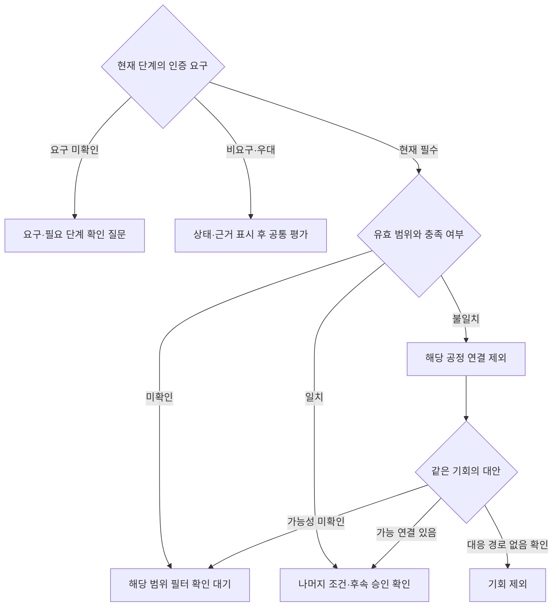

도식의 요구 미확인과 필수 요구의 필요 단계 미확인은 다르다. 후자는 위 표에 따라 대기로 처리한다. 기업 전체 제한은 기업, 프로젝트 제한은 기회, 특정 소재·공정의 불일치는 해당 연결에 적용한다. 대안 공정이 남으면 같은 기회에서 검토하며 서로 다른 공정의 사양을 하나의 공정 능력으로 합치지 않는다.

#### 5.2.4 알려진 기술 필수조건과 추가 확인

소재·공정뿐 아니라 **두께·치수·규격·시험·품질기록·수량·납기라도 현재 단계의 필수 요구로 확인됐다면 먼저 충족 여부를 확인한다.** 항목 이름이 상담 질문에 들어 있다는 이유로 접촉 후로 미루지 않는다. 요구 자체가 미정인 항목은 질문으로 남기며, 유사실적도 고객이 필수로 정한 경우와 일반 참고 근거를 구분한다.

공정의 명백한 불일치는 해당 연결 제외, 필요한 대응 근거 미확보는 확인 대기로 처리한다. 수량·납기·생산 여력은 담당자의 확인 상태와 근거만 기록하며 자동 생산능력 예측·납기 확정 기능을 추가하지 않는다. 자격 통과만으로 공정 수행 가능성을 확정하지 않는다.

#### 5.2.5 현재 제외된 기회의 재검토

현재 단계의 필수 자격 미충족으로 제외된 기회에 실제 자격 취득 계획이나 고객의 공급업체 육성·승인 절차 근거가 있으면 재검토 조건·근거·담당자·예정일을 남길 수 있다. 현재 행동을 허용할 근거가 없는 동안 접촉 후보와 G2 접촉 추천 상위 표본에서 제외한다. 제외·대기 판정의 별도 진단 표본에는 포함할 수 있다. 자격 확보 또는 고객이 현재 상담·등록을 허용하는 절차 등 새 근거가 확인되면 **같은 기회 ID를 재평가**한다. 단순 취득 의향으로 높은 점수를 부여하거나 같은 프로젝트를 중장기 기회로 복제하지 않는다. 별도의 자격 취득 프로젝트 관리 기능은 이번에 추가하지 않는다.

### 5.3 고객 요구와 공정 역량 연결

| 요구 정보 수준 | 이번 기능 | 출력 |
|---|---|---|
| 레벨 1 · 외부 기업·제품 정보 | 관련 제품·소재·성능 목적의 근거 추출, 공정 수요 가설 | 연결 이유, 추정 표시, 외주 여부·실제 사양 확인 질문 |
| 레벨 2 · 허용된 상담·메일·담당자 입력 | 요구 정리, 해당 기회와 공정·인증 연결, 상담 기록 4항목 정리 | 확인 요구와 추정 분리, 부족·상충 조건, 다음 일정 |
| 레벨 3 · RFQ·도면·규격 | 후속 확장 | 별도 사용 허용·보안 경로와 기술 검수 이후 검토 |

AI는 후보 근거와 질문을 정리한다. 기술이사·품질 담당자의 검수 없이 처리 가능, 납기 가능, 견적 가능을 확정하지 않는다. 가격·납기·설비 가동 여력 등 변동 요소는 담당자 판단으로 남긴다.

### 5.4 다음 행동·자료·결과 기록

추천 주목적과 실제 실행 주목적을 **요구 확인 / 검수된 역량 소개 / 기존 제안 후속 확인 / 일정 응답** 중 기록한다. 기존 제안이 없는 새 기회에 ‘기존 제안 후속’을 쓰지 않는다. 자료는 확인된 사실과 검수된 역량만 주장하고 추정은 질문으로 남긴다.

기업 담당자의 의견(검토할 만함 / 추가 확인 필요 / 대상 아님)은 시스템 분류와 별도로 저장한다. 승인·접촉 시도·회신·상담·후속 일정도 구분한다. 영업 결과는 미실행 / 진행중 / 보류 / 수주 / 실주의 5분류와 사유로 기록한다. 무응답은 자동 실주로 처리하지 않는다. 수주·실주는 성립·불발 근거와 담당자 확인을 기록한다. 보류에는 재개 조건을 남긴다. 추천의 ‘조건부 대기·관찰·후순위’를 영업 결과로 덮어쓰지 않는다.

추가조사 분류에 필요한 질문 묶음·허용 경로·담당자·예상 시간·시간 상한·재확인일은 첫 구현부터 저장한다. 전용 화면은 후속으로 미룰 수 있으며 기존 메모·엑셀 기록을 연결해도 된다. 결과가 쌓여도 가중치는 자동 변경하지 않는다.

## 6. 기술 구성·자원·위험

### 6.1 처리 구조와 역할

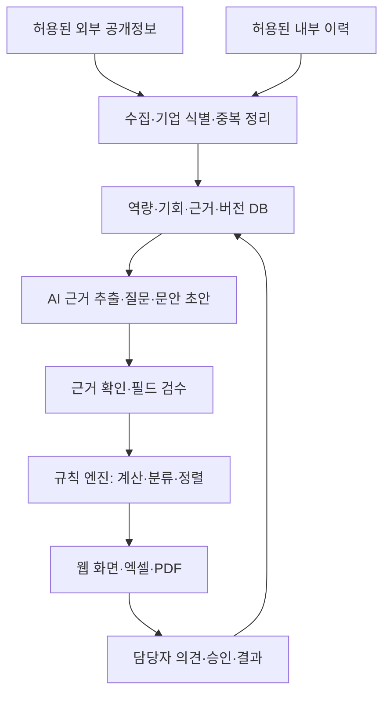

| 계층 | 기본 기술안 | 담당 |
|---|---|---|
| 수집·매칭 | Python·허용 API/페이지 수집, 사업자번호 우선 매칭, 불확실한 병합은 확인 | BE |
| 저장 | SQLAlchemy 기반 관계형 DB(테이블 설계 4.4). 개발 SQLite, 운영 PostgreSQL 필요 여부는 동시접속·배포 조건 확인 후 결정 | BE |
| 규칙 엔진 | Python의 결정적 계산·필터·분기·정렬 | AI 담당, BE 연동 |
| 생성·검색 | 허용 근거를 검색해 LLM에 전달. 임베딩·RAG는 실제 데이터·검색 필요에 맞춰 구성 | AI |
| 화면·출력 | FastAPI + React 기본안, 2차 전용 구축, 엑셀·PDF 출력 | BE·FE |

LLM은 사실·날짜·상태 후보 추출과 질문·문안 초안을 맡는다. 반올림·점수·분류·정렬은 규칙 엔진이 계산한다. 같은 확정 입력·기준일·프로필·규칙/역량DB 버전에는 같은 결과를 내야 한다. 원문을 다시 추출할 때의 LLM 변동은 계산 재현성과 별도로 검사한다. 자체 예측모델 학습·파인튜닝은 이번에 하지 않는다.

### 6.2 데이터 사용·보안

공개자료, 기업이 외부 AI 사용을 허용한 자료, 내부 구조화만 허용한 자료, 처리 금지 자료를 구분한다. 고객 도면·RFQ 원문·세부 공정 노하우는 이번 저장·외부 AI 전송 대상에서 제외하고, 허용된 최소 구조화 필드와 참조 ID만 사용한다. 금지 원문을 외부 AI에 먼저 보내 비식별화하지 않는다. 임베딩 API에도 같은 허용 기준을 적용한다.

자료별 허용 범위·보관 위치·접근자·발표 공개 가능 여부·정정/삭제 방법을 기록한다. 실제 고객명·거래 이력은 허용된 화면·출력에만 노출한다. 발표용 가상·비식별 데이터는 실데이터와 구분한다. 최초 구조화의 허용 경로가 없으면 해당 자료 사용을 보류한다.

### 6.3 자원·비용 계획

| 자원 | 계획·산정 방식 | 확정 담당·시점 |
|---|---|---|
| 인력 | PM·FE·BE·AI 4역할. 겸임 가능 시간을 포함해 주별 작업량 조정 | PM·팀, W1 및 매주 점검 |
| 기업 협조 | 공정·인증 검수, 허용 사례, 평가·직접 사용 일정 | PM·기업, G0 협의 |
| LLM·임베딩 | 건당 입력·출력량과 호출 횟수를 표본 실행에서 측정해 월 실행량에 곱함 | AI, 11/6 준비 판단 전 초안 |
| 외부 데이터 | 선정 소스의 무료 범위·구독·호출 제한을 확인 | BE, 소스 확정 전 |
| 서버·DB | 배포 방식·동시 사용자·저장량 기준으로 견적 확인 | BE, 웹 운영안 확정 시 |
| 예산 상한·계정 | 실제 금액 미확정. 월 상한·초과 시 중단/축소 기준·비용 부담자 기록 | PM·기업, 실제 운영 전 |

가격이나 승인되지 않은 예산을 임의로 기입하지 않는다. 건당 조사시간·검수시간과 반복 운영 부담도 비용에 포함한다. 종료 후 비용·유지보수는 자동으로 팀이 부담한다고 약속하지 않는다.

### 6.4 위험관리

| 위험 | 가능성 / 영향 | 대응·전환 조건 | 담당 |
|---|---|---|---|
| 실제 자료·면담 지연 | 중 / 높음 | 기능 개발은 진행, 실데이터 검증 범위는 11/6 준비 상태로 구분 | PM |
| 자격 판정 규칙의 구현 복잡도 | 중 / 중 | 요구별 기록·상태 저장을 먼저 구현하고 단계·기한·수행 시점 비교는 2.4 축소안 적용. S08·S11·S13으로 경계 확인 | AI·BE |
| 인증 범위·공정 사양 오해 | 중 / 높음 | 필드 검수·필수조건 선행·적용 범위별 제외, 근거 변경 시 재평가 | AI·기업 검수자 |
| 두 흐름 개발 지연 | 중 / 높음 | 공통 엔진·화면 재사용, 주차별 통과 확인, 추가 관리자 화면은 후속. **11/13 중간 점검**에서 2.4의 축소 순서 적용 | PM·팀 |
| 후보 부족·소스 접근 실패 | 중 / 높음 | 실제 기업·기회 수 구분, 부족분을 가상 후보로 채워 성능 발표하지 않음 | BE·AI |
| 두 프로필 점수의 오해 | 중 / 중 | 목록·평가 표본 분리, 서로 다른 점수의 통합 순위 금지 | AI·FE |
| 기업 사용 부담·미참여 | 중 / 높음 | 팀 지원, 최소 3단계 사용 과제. 미참여면 실사용 미검증으로 보고 | PM·FE |
| 자료 유출·과도한 공개 | 중 / 높음 | 입력 전 허용 확인, 최소 구조화, 금지 원문 미전송·미저장 | 전원 |
| 종료 후 운영 불가 | 중 / 높음 | 실행·조회·갱신 가능 범위를 따로 확인, 계정·비용·지원 책임 협의 | PM·BE |

가능성은 팀의 초기 판단이며 실제 이슈에 따라 갱신한다. 평가 중 오류를 발견하면 영향받는 추천을 보류하고 이전 입력·결과를 보존한 뒤 수정 버전으로 다시 평가한다.

## 7. 화면과 파일럿 운영

### 7.1 기업 담당자의 최소 흐름

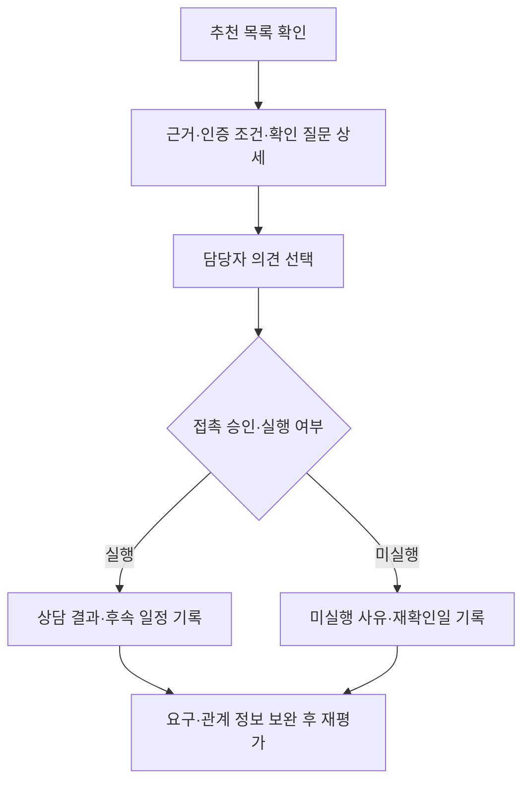

| 화면 | 기본 표시 | 상세 보기·기록 |
|---|---|---|
| 추천 목록 | 기업·영업기회, 신규 기회/재접촉, 추천 이유, 인증 조건, 확인할 점, 다음 행동 | 시스템 분류, S·항목 완료율 C·출처 등급. 다른 프로필 점수로 한 줄 순위 표시 금지 |
| 근거 상세 | 제품·소재·공정 연결, 자격 종류·요구별 판정, 필요 단계·관계 상태 | 자격 상태·현재/수행 시점 유효성·후속 조건·근거/확인일·계산 E/F/T/P/R·버전 |
| 의견·결과 | 검토할 만함/추가 확인/대상 아님, 짧은 기회별 메모 | 승인·실행 주목적·접촉 여부·영업 결과·다음 일정 |

숫자보다 행동·근거를 먼저 읽히게 배치한다. 계산 상세는 펼쳐보기로 제공하고, 판단에 필요한 근거를 기업 사용자에게 숨기지 않는다. 인증 요구 미확인과 필수 인증 충족 미확인을 다른 문구로 표시한다. 자격 여러 개의 판정은 상세에 펼치고 기본 카드에는 현재 행동을 막는 조건과 다음 질문을 요약한다. 현재 단계의 통과를 최종 납품·양산 승인처럼 표시하지 않는다.

### 7.2 운영 기본안

**팀 운영 지원형 웹 파일럿을 기본 설계안으로 반영한다.** 기업 담당자의 직접 사용 참여·접속 방식·사용 일정은 협의 전이다. 팀은 수집·추천 실행·외부 근거 정리·검수 요청과 회신 관리·결과 전달을 지원한다. 거산 공정·인증 범위의 최종 검수는 기업 기술·품질 담당자가 맡는다. 기업 사용자는 추천 확인·의견·결과 기록부터 시작한다.

엑셀·PDF는 전달·평가 보조물로 사용한다. 기업의 웹 참여가 어려우면 같은 데이터로 의견을 수집하되, 이를 웹 직접 사용 검증으로 보고하지 않는다. 종료 후 기업 단독 운영 가능 여부는 직접 사용 결과와 인계 점검으로 판단한다.

### 7.3 평가 화면과 일반 사용 화면

G2 블라인드 평가에서는 점수·순위·시스템 추천 분류를 가린다. 평가를 마친 뒤 일반 화면에서 전체 근거와 점수를 보여주고 사용성을 확인한다. 담당자에게 이미 점수·순위를 보여준 사례를 새 블라인드 평가 사례처럼 다시 사용하지 않는다.

## 8. 시연·기능 인수 시나리오

아래는 기능 검증용 시나리오다. 가상 데이터는 화면·기록·발표에서 가상으로 표시한다. 실제 인증 보유나 고객 수요를 가정해 사실처럼 보여주지 않는다.

| 번호 | 시나리오 | 기대 동작 |
|---|---|---|
| S01 | 9종 공정 구조와 현재 등록 현황 확인 | 8개 명칭 근거와 미대조 1개 구분. 목록·필드 검수 상태를 따로 확인 |
| S02 | 공정 검색과 인증 검색에서 같은 프로젝트 발견 | 기회 1건에 발견 경로·근거 병합, 기업·기회 중복 집계 없음 |
| S03 | 신규 기업에 관련 소재·제품 근거 있음 | B 기반 평가, 검수된 공정 근거·실제 요구 확인 질문 제공 |
| S04 | 기존 고객의 새 프로젝트 | 기존 관계 유지, B 기반 신규 기회 평가. 다른 프로젝트 상담 조건 자동 복제 금지 |
| S05 | 기존 제안에 후속 연락 약속 있음 | A 기반 평가, 해당 이력·현재 사유·일정 연결. 완료·취소 일정 가점 금지 |
| S06 | 고객 관계 미확인 | 참고 계산 가능, 최종 분류는 관계·중복 필터 확인 대기 |
| S07 | 인증 요구 자체 미확인 또는 비요구 | 요구 확인 질문과 비요구를 구분. 미보유 일괄 탈락 없음 |
| S08 | 복수 자격 중 고객 승인 미확인, 승인 필요 단계 불명확 | 하나의 인증 통과로 전체 통과 금지. 현재 필수 또는 필요 단계 불명확이면 대기, 고객이 허용한 상담 단계와 후속 승인 분리 |
| S09 | 한 공정 불일치, 같은 기회에 다른 연결 존재 | 불일치 연결만 제외, 대안의 가능/미확인/없음에 맞춰 재판정 |
| S10 | 승인·접촉·의견·결과 기록 | 시스템 분류와 사람 의견·실제 결과 구분, 같은 기회에 기록 |
| S11 | 인증 정지/취소, 수행 전 만료, 갱신·재심사 진행, 일정 취소 | 영향 기회 재평가·이전 버전 보존. 만료일만으로 유효 단정 금지, 갱신 예정·재심사 중을 유효/취소로 임의 판정 금지 |
| S12 | 추가조사 분류 | 질문·경로·담당·시간·재확인일 기록. 요건 부족이면 조건부 대기 |
| S13 | 현재 단계의 필수 두께·시험·수량 근거 미확보 / 불일치 확인 / 범위 해당 없음 | 근거 미확보는 확인 대기, 명백한 불일치는 해당 범위 제외. 해당 없음은 근거로 확인하고 미확인과 구분 |
| S14 | 현재 필수 자격 미충족, 취득 계획은 있으나 현재 행동 허용 근거 없음 | 현재 접촉·G2 추천 상위 표본에서 제외, 별도 진단 가능. 같은 기회에 재검토 조건을 기록하고 자격 충족·현재 행동 허용의 새 근거 확인 시 재평가 |

각 시나리오의 입력·기대 결과·실제 결과·결함·수정 버전을 남긴다. 계산 경계는 부록 F에 따라 별도 점검하고, 실제 추천 품질의 표본 수로 가상 시나리오를 합산하지 않는다.

## 9. 목표·성과지표·검증

### 9.1 무엇을 성공으로 볼 것인가

| 목표 | 지표 | 현재 기준 | 목표·판정 | 측정 시점·방법 |
|---|---|---|---|---|
| 기본 기능 완성 | 2.2 및 S01~S14 수행 여부 | 현재 구현 상태 대조 필요 | 각 흐름과 필수 예외 처리 완료, 차단 결함 해소 | 11/27 통합 인수 점검 |
| 근거성 | 주장-근거 연결, 거산 필드 검수 상태 | 미측정 | 근거 없는 확정 주장·필수조건 상쇄는 수정 전 사용 금지 | 개발 중·G2 전후 |
| 추천 타당성 | 평가자가 연락할 만하다고 본 비율 | 동일 범위의 수작업 비교값 미측정 | G2 전에 기준값·목표·불합격 처리 합의 | 고정 표본 블라인드 평가 |
| 업무 효율 | 기회 1건 조사·검토·기록 시간 | 사전 측정 필요 | 합의한 개선 목표와 실제 변화 보고 | 동일 유형 수작업/도구 비교 |
| 사용 편의성 | 3개 핵심 과제 수행, 도움 요청·오류·소요시간 | 미측정 | 참여자·과제·성공 기준 사전 합의 | 기업 직접 사용 시 |
| 실제 실행 | 승인·접촉·회신·상담·결과 건수 | 없음 또는 기존 기록 확인 필요 | 기간·분모·미실행 사유를 함께 관찰 | 파일럿 및 후속 운영 |

숫자 목표는 현재 기준값과 기업 여력을 확인해 G2 전에 고정한다. 테스트를 통과했다고 영업 효과가 검증된 것은 아니다. 추천 품질, 사용성, 실제 영업 결과는 별도로 보고한다.

### 9.2 표본·평가 방법

신규 기회와 재접촉은 배점 구조가 달라 **프로필별로 평가 모집단·목표 표본·실제 n을 기록한다.** 준비된 대표 프로필의 시스템 상위 최대 20개를 우선 평가하는 기존 기본안을 유지한다. 다른 프로필도 실제 데이터가 준비되면 기업 평가 여력에 맞춰 별도 표본 수를 G2 전에 합의한다. 두 흐름의 기본 구현은 필수지만 양쪽의 실제 평가 20개씩을 일괄 의무로 늘리지 않는다.

선정은 사람이 순서를 조정하기 전 시스템 결과로 고정한다. 접촉 후보가 부족하면 실제 n을 보고하고 조사 대기·가상 사례로 채우지 않는다. 실제 이력이 없어 재접촉 표본이 0이면 기능 검증 결과와 별도로 “실제 재접촉 추천 품질 미검증”이라고 쓴다. 서로 다른 프로필 비율을 평균해 단일 성능 수치로 발표하지 않는다.

평가자는 점수·순위·시스템 분류를 가린 상태에서 허용 근거와 해당 기회를 보고 연락할 만함/추가 확인/낮음 및 사유를 기록한다. 추천 타당성은 프로필별 고정 평가 대상 n 중 ‘연락할 만함’으로 판정한 기회의 비율로 계산하며, ‘추가 확인·낮음’도 분모에 포함한다. 평가 미완료가 남으면 완료 수·미평가 수·이유와 중간 집계만 보고하고 최종 비율을 확정하지 않는다. n=0이면 산정 불가로 표시한다. 미평가 사례를 임의로 분모에서 빼거나 다른 후보로 교체하지 않는다. 복수 평가자의 판정 통합 방식은 G2 전에 정한다. 필터 미확인·제외·낮은 완료율·프로필 전환·인증 조건 등은 별도 진단 표본으로 검증한다. 추천 표본과 진단 표본의 분모를 합치지 않는다.

계산 재현성은 동일 확정 입력·기준일·버전의 결과 일치로, 추출 품질은 근거 문장·날짜·상태 추출의 일치·오류로 확인한다. 오류 수정에 사용한 사례와 수정 후 최종 확인 사례를 구분한다.

### 9.3 단계별 검증 기준

| 단계 | 확인할 것 | 통과하지 못하거나 자료가 없을 때 |
|---|---|---|
| G0 · 업무·운영 합의 | 우선 활용 사례, 사용자·검수자, 허용 자료·외부 AI 범위, 실행량 K·조사시간 | 개발은 계속하되 실제 운영 승인으로 간주하지 않음 |
| G1 · 데이터 준비 | 평가에 쓸 공정·인증 필드 검수, 고객 근거·관계·식별·필수조건 상태 | 준비된 사례만 운영 검토. 미준비 흐름은 기능 검증과 구분 |
| G2 · 추천 품질 | 프로필별 모집단·버전·표본·목표 고정, 블라인드 평가·진단·재현성 | 미달이면 원인 수정·새 버전 재평가. 일정 부족은 미검증/미달로 보고 |
| G3 · 실행 관찰 | 담당자 승인 후 K 이내 접촉, 응답·상담·미실행 사유·업무시간 | 접촉하지 않은 건을 실주로 세지 않음. 발표 시 초기 관찰만 보고 가능 |
| G4 · 후속 운영·확장 판단 | 운영 부담·데이터 품질·사용 효과, 후속 기능 필요성 | 확장 보류 가능. 이미 범위에 포함된 신규·재접촉 개발을 막는 조건으로 사용하지 않음 |

실행량 K는 합의 기간 동안 실제 연락할 수 있는 기회 수이며 평가 표본 수와 다르다. 같은 기업에 여러 기회가 있으면 중복 접촉을 조율하고 기업 수·기회 수·접촉 횟수를 별도로 집계한다.

## 10. 단계별 실행계획과 인수인계

### 10.1 개발 순서와 단계별 완료조건

**공통 기반을 만든 뒤 신규·재접촉 중 준비된 흐름을 먼저 연결하고, 다음 단계에서 나머지 흐름을 추가한다.** 공정·인증은 두 흐름이 함께 사용하는 기준이다. 9종 공정 구조를 처음부터 만들고, 최종발표 전 두 흐름의 기본 기능을 모두 완성한다. 앞 흐름의 수주나 G4 통과를 다음 흐름 개발의 조건으로 삼지 않는다.

다음 일정은 12/11 최종발표를 기준으로 세운 팀 계획안이다. 면담·기업 평가·시연은 기업과 협의한다. 첫 주에 각 담당의 실제 작업 가능 시간을 확인해 세부 업무량을 조정하되 필수 완료 범위는 2.2를 따른다.

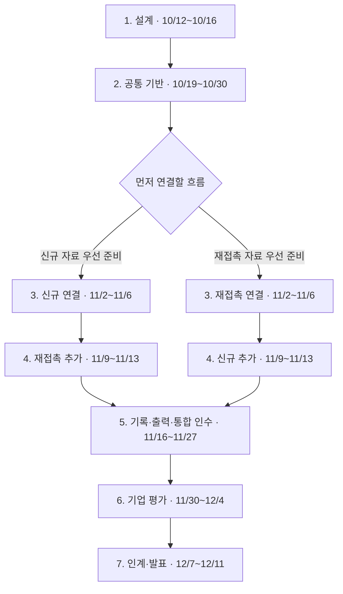

첫 흐름은 10/23까지 확보 가능 자료와 구현 난이도를 보고 PM·BE·AI·FE가 정한다. 자료가 둘 다 부족해도 첫 가상 시나리오를 선택해 개발은 계속한다. 첫 흐름의 선택은 개발 순서이며, 다른 흐름을 범위에서 제외하는 결정이 아니다. 기업 자료 요청·사용 허용 협의·공정 검수는 1단계부터 병행한다. 단계 2에는 조회→근거→의견의 공통 연결을 만들고, 단계 3·4에서 각 대응 흐름의 고유 근거·질문·이력 처리를 완성한다.

| 개발 단계·기간 | 이번 단계에서 완성할 것 | 통합 산출물 | 다음 단계로 넘길 최소 확인 |
|---|---|---|---|
| 1. 설계 · 10/12~10/16 | 9종 공통 구조·전체 관계, 첫 통합 사례의 필수 필드·상태·화면/API 계약, 작업 분담 | ERD·데이터/API 정의 초안, 첫 사례의 입력·기대 결과·화면 초안, 공정·자료 준비표, 역할별 작업표 | 같은 기회·요구·평가 ID와 상태의 뜻이 일치하고 첫 사례를 담당별로 이어받을 수 있음. 24개 전체 물리 설계 완료를 진입 조건으로 삼지 않음 |
| 2. 공통 기반 · 10/19~10/30 | 허용 자료 수집·기업/기회 식별, 근거 저장, 공정·인증 대조, 필터·계산·기본 화면 | 공통 기능 실행본, 입력 사례, 소스 사용표·수집 집계, 기본 검증 결과 | 후보→근거→평가→의견 저장이 한 번 이어지고, 통과/미확인/제외 및 같은 기회 병합의 기본 사례 확인. 10/30 면담·G0 협의 목표 |
| 3. 첫 대응 흐름 · 11/2~11/6 | 준비된 신규 또는 재접촉 흐름, 대응 목적·질문·근거 표시 | 첫 흐름 실행본, 시연 사례, 11/6 실데이터 준비 판단표 | 첫 흐름의 입력→추천·질문→담당자 의견 저장 실행. 실제 자료와 가상 사례 표시. 막히는 필수조건을 점수로 통과시키지 않음 |
| 4. 나머지 대응 흐름 · 11/9~11/13 | 공통 기능을 재사용해 다른 흐름 연결, 기존 고객의 새 기회·프로필 전환·상담 적용 범위 | 두 흐름 실행본, 실제/가상 검증 구분표, 11/13 점검 기록 | 신규와 재접촉을 각각 실행하고 같은 기회 중복·다른 프로젝트 이력 혼입 방지. 미완료는 담당·원인·복구 일정을 명시 |
| 5. 기록·출력·통합 인수 · 11/16~11/27 | 승인·조사·실제 접촉·결과·재검토 최소 기록, 엑셀·단순 PDF, S01~S14·재현성 확인과 결함 수정 | 운영 기록·출력 연결본, 평가계획·규칙 후보, 필수 기능 인수 결과, 평가용 실행 버전·입력·표본 고정 기록 | 11/20 평가계획 합의, 11/27 인수 및 평가 버전 최종 고정 목표. 화면·출력 상태 일치, 추천 분류·기업 의견·영업 결과 별도 저장. 2.2와 S01~S14의 실패 항목은 미완료로 기록 |
| 6. 기업 평가·사용 · 11/30~12/4 | 준비된 프로필의 G2 평가, 담당자 직접 사용, 시연·의견 수렴 | 프로필별 평가 결과·실제 n, 사용 관찰, 개선 내역, 미검증 목록 | 12/2 평가 마감 목표, 12/4 시연 협의. 미평가·표본 0·참여 불가를 그대로 보고. 실제 접촉은 담당자 승인 및 G3 조건 확인 뒤 진행 |
| 7. 인계·발표 · 12/7~12/11 | 실행·갱신 안내, DB 백업/복원 확인, 초기 실행 관찰, 발표·리허설 | 12/10 인계 패키지, 최종 시연본·발표자료, 12/11 최종발표 | 전달 파일·실행 방법·지원 책임 확인. 기능 구현/실데이터 검증/기업 직접 사용/영업 성과를 구분해 설명 |

**11/20은 평가계획 합의와 규칙 후보 정리 목표일, 11/27은 인수 후 실제 평가에 사용할 버전·입력·표본을 고정하는 목표일이다.** 조건이 준비되지 않았으면 날짜만으로 고정하지 않는다. 이미 확정한 버전이라도 계산·필터·입력 해석에 영향을 주는 수정이 있으면 변경 내용을 남기고 평가 전에 다시 고정한다. 평가 시작 후 결과 영향 수정이 발생하면 기존 평가 기록을 보존하고 새 버전의 평가를 분리한다. 점수·순위를 이미 본 사례는 새 블라인드 평가 사례로 재사용하지 않는다.

기능 개발은 개발 단계의 최소 확인으로 이어가며, 실제 기업 데이터 사용과 접촉은 해당 G0~G3 조건을 따로 확인한다. 일정표에 다음 단계가 왔다고 기업 운영 승인을 받은 것으로 처리하지 않는다.

### 10.2 11월 6일 준비 판단과 지연 대응

| 준비 상태 | 진행 방식 |
|---|---|
| 운영 합의·자료 사용 허용·사용 필드 검수가 준비됨 | 해당 사례로 실제 파일럿 준비·평가 진행 |
| 일부만 준비됨 | 준비된 사례만 실제 검증, 나머지는 표시된 가상 사례로 기능 검증. 부족 필드·확인 담당·다음 일정 기록 |
| 실제 자료 사용·기업 참여 조건이 준비되지 않음 | 공개자료·가상 데이터로 기능과 근거 표시 검증. 기업 검증 완료·현장 효과로 주장하지 않음 |

견학을 했다는 사실만으로 G0·G1을 통과시키지 않는다. 비대면으로 필요한 합의·검수가 완료되면 해당 범위의 준비를 인정한다. 이 판단은 실데이터 검증 범위를 정하는 것이며 두 대응 기능을 자동 제외하지 않는다.

11/13 점검에서는 **자료 미확보와 개발 미완료를 따로 기록**한다. 자료 미확보는 가상 사례로 기능 검증을 계속할 수 있다. 개발 미완료는 담당·차단 원인·복구 일정을 정하며, 가상 사례 전환만으로 해결됐다고 보지 않는다. 화면 꾸밈·별도 관리 화면·출력 디자인부터 줄이고, 필수 기록·필터·두 대응 흐름과 단순 출력은 유지한다.

11/20까지 실제 평가 조건이 준비되지 않으면 준비된 프로필만 G2 대상으로 계획하고 나머지는 미검증으로 남긴다. 11/27 최종 고정 때 실제 준비 상태를 다시 기록한다. 날짜 도달만으로 기능 완료·운영 승인·평가 통과 처리하지 않는다.

### 10.3 단계별 팀 담당과 산출물

실명은 PM 최지예 외에 제공되지 않아 역할로 표기한다. 아래는 역할별 기본 분담이며 겸임 여부와 실제 담당자는 1단계 작업표에서 확정한다. **PM은 단계의 완료 상태와 기업 협의를 취합하고, 각 구현 담당은 자신의 산출물과 확인 결과를 넘긴다.**

| 단계 | PM·기획 | FE·화면 | BE·데이터/API | AI·근거/규칙 |
|---|---|---|---|---|
| 1. 설계 | 범위·질문·첫 인수 사례·실명/가용 시간·작업표 | 첫 사례 화면 초안·상태 문구·입출력 확인 | 전체 ERD·첫 사례의 필수 필드/제약·API 계약 초안 | 추출 항목·A/B 적용표·같은 입력의 기대 결과 |
| 2. 공통 기반 | 공정 목록 대조·허용 자료 확인·면담 | 후보 목록·근거 상세·의견 입력 | 테이블·수집·기업 식별·기회 병합·공통 API | 근거 추출·필터·계산·분류·정렬 및 기본 사례 검증 |
| 3. 첫 흐름 | 첫 흐름 인수·11/6 자료 준비 판단 | 첫 흐름 화면 연결·미확인 표시 | 해당 흐름 입력·저장·조회 API | 해당 프로필·다음 질문·문안 연결 |
| 4. 두 흐름 | 다른 흐름 인수·경계 사례·지연 판단 | 두 흐름 전환·이력·관계 표시 | 기회별 상담 적용 범위·프로필 전환·이력 연결 | 두 프로필 경계·현재 재접촉 이유·중복 근거 방지 |
| 5. 기록·출력·통합 인수 | 평가계획·사용 과제, 시나리오 결과·미완료 취합 | 승인·결과 입력, 엑셀·단순 PDF, 화면·사용 흐름 수정 | 운영 기록·출력 데이터, 저장 정합성·버전·배포·복원 확인 | 규칙 후보, 계산 재현성·분기·경계 오류 수정 |
| 6. 기업 평가 | 블라인드 평가·사용 관찰·실제 n·한계 보고 | 직접 사용 지원·화면 오류 수정 | 평가 입력/결과 보존·실행 오류 지원 | 실패 원인 분석·수정 시 새 버전 영향 기록 |
| 7. 인계·발표 | 인계 확인·검증 보고·발표 총괄 | 간단 사용 안내·화면 시연 | 소스·환경·DB 백업·실행/복원 안내 | 규칙·프롬프트·허용 입력·재평가 안내 |

AI 담당의 규칙 구현 부담을 줄이기 위해 PM은 기대 결과가 있는 시나리오를 정리하고, BE는 요구·자격·근거·판정 이력의 저장/조회를 책임진다. FE와 BE는 출력용 데이터를 함께 정하되 FE는 사용자 출력 흐름, BE는 화면과 일치하는 데이터 제공을 맡는다. 별도 관리 시스템을 추가하지 않는다.

기업 의사결정자는 업무 우선순위·자료 제공·운영 참여를 확인한다. 기업 영업 담당자는 추천 의견·접촉 결정·실제 실행·결과를 맡고, 기술/품질 담당자는 공정·인증 범위와 필수 기술조건을 검수한다. 인증·공정 변경과 계정 관리를 맡을 기업 갱신 담당은 별도로 협의한다.

### 10.4 인계와 종료 후 운영

12/10까지 역량DB·검수 상태, 후보·근거·질문 엑셀/PDF, 실행본·소스·환경/실행 방법, 간단 사용 안내, 데이터 갱신 체크리스트, 기획서·고정 규칙 설정 파일·해당 계산 코드·허용된 평가 입력·실제 검증 결과를 전달한다. 확정된 기술 구성에 맞춰 DB 내보내기·백업·복원 방법을 포함한다.

**자료 전달과 독립 운영 가능 판정은 별개다.** 조회·의견·결과 기록, 수집 실행, 데이터 갱신, 오류 대응 중 기업이 직접 해본 범위와 팀 지원이 필요한 범위를 나누어 인계한다. 계정·API 비용 부담자, 종료 후 문의 기간·지원 범위, 운영 중단 시 자료 보관·삭제를 협의한다. 합의 없는 상시 지원을 약속하지 않는다.

인증 만료 60일 전 확인과 월 1회 갱신 점검은 운영 제안으로 유지하되 기업 담당·실제 주기를 협의한다. 공정·인증 변경, 정지·취소, 수행예정일 변경 시 영향받은 기회와 자료를 재평가한다. 현재와 수행 시점의 유효성, 다음 확인일을 함께 인계한다. API 계정이 인계되지 않으면 검증된 조회·기존 결과 출력 등 실제 가능한 기능과 사용 불가 기능을 명시한다.

## 11. 후속 확장과 변경 관리

후속 대상은 RFQ 요구 자동 구조화, CRM/ERP 연동, 설비 처리량 기반 판단, 누적 사례 검색 고도화, 1차 자료 생성과의 통합, 가중치·예측모델 개선이다. 필요한 데이터·운영 부담·보안 경로·검증 계획을 확인한 뒤 별도 범위로 정한다.

기업의 피드백은 우선 확인 질문·화면·운영 개선 후보로 모은다. 점수·감쇠·분기·적용 범위를 바꾸면 규칙 버전과 변경 이유를 남기고 별도 평가한다. 일정 건수가 쌓였다는 이유만으로 자동 학습이나 가중치 개선 효과를 주장하지 않는다.

**기준본 변경 규칙:** 화면 배치·API 구현·자료형·인덱스처럼 기존 의미와 동작을 지키는 변경은 데이터/API 정의·작업표·코드 이력에서 관리한다. 목적·필수 기능·판단 규칙·인수 기준·주요 일정이 바뀌면 PM이 변경 이유·담당·일정 및 평가 영향을 정리하고 해당 절만 갱신한다. 기업 합의에 영향을 주는 사항은 기업 확인 상태를 함께 갱신한다. 평가 규칙 버전은 기획서 버전과 구분하며, 오탈자 수정이나 기업 승인 기록만으로 새 기획서 번호를 만들 필요는 없다.

## 12. 확인 요청과 다음 작업

### 12.1 기업에 확인할 사항

| 확인 항목 | 질문·필요 결과 |
|---|---|
| 면담·검수 일정 | 견학 또는 비대면 면담 가능일, 기술·영업 담당자 확인 |
| 실제 우선 업무 | 공정·인증 근거로 찾을 산업·품목과 먼저 검증할 활용 사례는 무엇인가? |
| 사용 참여 | 추천 결과를 직접 보고 의견·결과를 입력할 담당자와 시간이 있는가? |
| 자료·허용 범위 | 9종 실제 목록, 자격 종류·현재 상태·필요 단계와 공정 검수 자료, 고객 등록·샘플 절차 근거, 허용 이력·외부 AI/발표 범위 |
| 실행 여력 | 기간별 연락 가능한 기회 수 K, 조사시간, 응답·후속 일정 기록 방식 |
| 실제 시점 | 증설·수주 등 사건 후 공정 발주가 발생하는 시기와 유효성을 확인할 방법 |
| 종료 후 운영 | 계정·비용·갱신 담당, 직접 운영 가능한 범위, 필요한 지원 |

### 12.2 팀이 초안을 준비할 사항

팀은 프로필 적용 사례표, 핵심 접촉 근거, 공정·인증 확인 질문, 후보 모집단 집계, 실제·가상 데이터 구분, G2 표본·목표·실패 처리, 사용 과제, 비용 상한안을 먼저 준비한다. 기업에 점수 계산식 전체를 새로 설계하도록 요구하지 않는다.

이 문서 기준으로 요구사항·화면·데이터/API 계약·역할별 작업을 연결하고, 1단계에 현재 구현 상태와 주간 가용 시간을 대조한다. 신규·재접촉 각 1건의 입력 예시와 기대 결과를 만들고, 그중 한 건을 먼저 "후보 → 근거 → 평가 → 의견 저장"으로 연결한다. 기업 승인 시 승인자·승인일·적용 범위를 현재 문서에 기록하고, 실제 고정한 평가 규칙 버전은 별도로 관리한다. 기업 승인만을 이유로 새 기획서 번호를 발행하지 않는다.

## 13. 발표에서 설명할 내용

| 설명할 내용 | 함께 제시할 근거·한계 |
|---|---|
| 1차의 데이터 부족 진단을 2차 역량DB로 연결 | 진단과 검증 사실을 구분, 1차 품질 개선 완료로 표현하지 않음 |
| 공정·인증을 함께 보는 영업기회 구조 | 같은 기회 병합, 필수 인증 분기, 신규·재접촉 대응 시연 |
| 9종 전체 설계와 단계적 검수 | 실제 등록 수·미대조 공정·필드 검수 상태 공개 |
| 두 흐름의 기본 구현 | 실제/가상 시연과 기능 인수 결과 구분 |
| 추천 품질·사용성 | 프로필별 실제 n·평가 조건·결과, 직접 사용 참여·미검증 범위 |
| 초기 접촉 관찰 | 승인·연락·회신·상담의 실제 건수와 기간. 매출·수주 효과로 확대 해석하지 않음 |

**발표 핵심 문장:** 거산케미칼의 공정 역량과 인증 조건을 고객의 구체적인 기회에 연결하고, 확인된 근거와 남은 질문을 담당자에게 제공하는 영업지원 도구를 구현·검증한다.

## 부록 A. 문서 적용과 변경의 경계

| 영역 | 이번 문서에서의 처리 |
|---|---|
| 기획 범위 | 한 트랙 우선 구현에서 공통 기반+신규·재접촉 기본 구현으로 변경 |
| 개발·실증 순서 | 단계별 개발, 대표 활용 사례부터 기업 검증. 기능 개발과 수주 성과의 선후 조건 분리 |
| 계산 수치 | A/B의 배점·계수·기준점·내부 정렬은 유지. C 점수는 현행 계산에서 사용하지 않음 |
| 적용 범위 | B 기반을 신규 기회로 확장, A 기반은 해당 기회 이력 확인 시 적용. 새 적용 범위 검증 필요 |
| 단일 통합점수 | 미도입. 향후 원하면 항목 매핑·중복·분모·기준점을 별도 설계·검증 |
| 자료·운영·검증 | 기업 확인·허용·실데이터·평가 목표 미확정 항목은 해당 상태 유지 |
| 이전 문서 | v0.14 이하와 v0.5.2는 출처·변경 추적용. 현재 적용 절차·DB·실행계획은 이 v0.15 본문을 우선. 요약본에 별도 요구·규칙을 두지 않음 |

## 부록 B. 프로필 전환 검토표

| 원래 기준 | 새 위치 | 중복·누락 방지 |
|---|---|---|
| B 제품·소재·목적·실적 | 신규 기회 프로필 F.1 | 서로 다른 평가 사실을 근거로 연결. 소재 문장 하나를 세 사실로 반복 채점 금지 |
| A 과거 공정·수주·요구 충족·중단 사유 | 재접촉 프로필 F.2 | 회사 전체 과거 이력을 무관한 새 기회에 이식하지 않음 |
| C 요구 인증·특수공정 승인 | 공통 인증 대조 F.3 | 필수조건은 필터, 우대는 검수된 설명 근거. 별도 25·20점 가산 금지 |
| C 산업·부품·실적 | 공통 근거 및 선택 프로필의 해당 항목 | A/B에 들어간 사실에 C 점수를 추가하지 않음 |
| C 모집·신규 사업 신호 | 선택 프로필의 기존 정의에 해당하는 시점 항목만 채점 | 해당 항목이 없는 공고는 기한·다음 행동 근거로만 기록. A에 모집공고 항목을 임의 추가하지 않음 |
| 트랙별 완료율 | 선택 프로필 내부에서 계산 | B 기반 전체 8항목, A 기반 전체 7항목. 인증 확인 질문을 분모에 임의 추가하지 않음 |
| 접촉 기준점 | F.9 유지, 새 적용 범위에서 G2 전 진단 | 기존 수치를 검증된 통합 기준이라고 표현하지 않음 |


## 부록 C. 설계안 검토와 외부 근거 확인

「인증·승인과 공정역량을 결합한 영업기회 트랙 설계안」의 원칙을 기존 범위와 대조했다. **일반 제도의 사실 확인**과 **우리 서비스의 설계 선택**을 구분한다. 확인일은 2026-10-12이며 거산의 실제 자격 보유·현재 상태나 특정 고객의 필수 요구를 조회·검증한 것은 아니다.

| 공식 자료에서 확인한 내용 | 이번 설계에 적용한 해석·한계 |
|---|---|
| IAQG는 OASIS를 9100 계열 품질경영체계에 대한 인증·등록 공급자 정보를 담는 시스템으로 설명한다. [외부 1] | 품질체계 인증을 기록하는 범주로 사용. OASIS 등록을 특정 고객의 공정·양산 승인 완료로 해석하지 않음 |
| PRI는 Nadcap을 중요 공정·제품에 대한 인정 프로그램으로 설명하며 Chemical Processing과 Coatings를 별도 분야로 제시한다. [외부 2] | 공정 인정의 적용 범위를 개별 검수하는 설계 근거. 거산의 Nadcap 보유나 모든 산업의 필수 요구를 뜻하지 않음 |
| Infineon은 공급자 자격과 별도로 공급 재료·장비·서비스를 개별 용도별로 평가한다고 설명한다. [외부 3] | 회사 자격과 특정 용도의 적합성을 분리할 필요를 보여주는 기업 사례. 반도체 전체나 거산 고객에게 동일 절차가 적용된다고 일반화하지 않음 |

설계안의 35/15/15/15/20점은 새로운 제안이며 기존 70/30 구조를 80/20으로 바꾼다. 항목 수·완료율·R·접촉 기준점 재검증 없이 도입하지 않는다. 기존 A/B 수치와 우대 인증 추가 가점 없음 원칙을 유지한다.

설계안의 ‘조건부 통과’는 현재 행동의 필수요건과 후속 승인을 나누는 방식으로 조정했다. ‘일반 공정/자격 기반/재접촉’은 겹칠 수 있어 단일 기회유형으로 만들지 않았다. 기존 관계 상태·대응 목적·자격 요구를 각각 유지한다. 생산능력 자동 판정과 자격 취득 관리 기능도 추가하지 않았다. 자세한 채택·조정·미채택 이유는 별도 검토반영표에 정리했다.

**외부 근거**

1. [IAQG · OASIS](https://iaqg.org/tools/oasis/) - 9100 계열 인증·등록 정보의 성격.
2. [PRI · Nadcap Accreditation](https://www.p-r-i.org/nadcap/accreditation) - 중요 공정 인정과 분야 구분.
3. [Infineon · Supplier quality management](https://www.infineon.com/quality/quality-management/supplier-quality-management) - 공급자 자격 및 개별 용도 평가.

공식 사이트를 참고 출처로 추가한 것이 자동 수집 소스/API 연동의 추가를 뜻하지 않는다. 실제 수집은 기존 3개 이내 선정·허용 범위 확인 원칙을 따른다.

## 부록 F. 현행 평가 규칙서

**적용 상태:** 기업 미승인·평가 고정 전 제안이다. 기존 v0.5.2 및 v0.9의 A/B 항목 배점·일치도·확실도·감쇠·날짜 경계·11단계 분기·프로필 내 정렬은 유지했다. 신규 기회/재접촉 적용 범위와 공통 인증·관계 판단을 개정했다. C 배점은 현행 계산에서 제외하며 인증 기능은 공통 판단·발굴·설명 근거로 유지한다.

G2 전 각 프로필의 적용 사례·모집단·완료율·기준점·핵심 근거를 진단한다. 진단 중 수치를 수정해야 하면 새 규칙 버전으로 기록하고 고정 후 평가한다. 이 문서 작성만으로 기존 수치가 새 적용 대상에서 검증된 것은 아니다.

### F.1 신규 기회 프로필: 기존 B 배점 유지

> 신규 기업의 새 기회 또는 기존 고객의 별도 새 품목·프로젝트에 적용한다. 적용 대상 확장은 본문 5.1에 따른 새 검증 대상이다. 관계 미확인에는 참고 계산만 허용하며 최종 분류는 필터 확인 대기다.


| 대분류 | 세부 기준 | 배점 | 일치도 단계 |
|---|---|---:|---|
| 적합도 | 표면처리가 필요한 제품·부품 생산 근거 | 25 | 해당 1.0 |
| 적합도 | 소재와 보유 공정 일치 | 20 | 정확히 일치 1.0 / 일부 가능 0.5 |
| 적합도 | 유사 산업·부품 납품실적 | 15 | 동일 부품 1.0 / 동일 산업 0.67 / 인접 산업 0.33 |
| 적합도 | 처리 목적·성능 태그 일치 (내식·내마모·외관·전도 등) | 10 | 2개 이상 일치 1.0 / 1개 일치 0.5 |
| 시점 | 공장 증설·신규 생산라인 | 10 | 직접 관련 1.0 / 간접 관련 0.5 |
| 시점 | 신규 수주·제품 출시·사업 확대 | 8 | 직접 관련 1.0 / 간접 관련 0.5 |
| 시점 | 입찰·협력사 모집·구매 공고 | 7 | 직접 관련 1.0 / 간접 관련 0.5 |
| 시점 | 관련 직무 채용 (구매·품질·생산기술·표면처리) | 5 | 직접 관련 1.0 / 간접 관련 0.5 |
| **합계** |  | **100** |  |

- 시점 신호의 `직접 관련`은 표면처리 대상 제품·부품과 연결된 신호를 뜻한다. 부록 F.4의 진행 상태·감쇠도 함께 적용한다.
- 제품 필요성은 처리 관련 수요 근거, 소재 일치는 고객 소재와 검수된 거산 역량, 성능 태그는 내식·외관 등 목적의 근거로 구분한다. 같은 소재 문장만으로 세 항목을 모두 직접 확인으로 채점하지 않는다(부록 F.6).
- 운송·거래 가능성은 하드필터에서 확인하므로 점수에 넣지 않는다.
- 요구 인증은 공통 대조로 처리한다. 요구 자체 미확인은 확인 질문, 현재 단계의 필수 요구 충족 미확인 또는 필수 요구의 필요 단계 불명확은 필터 확인 대기다(F.3). 비요구와 우대는 구분하며 별도 가산하지 않는다. 같은 기회에 요구를 추가하고 인증 발견 경로용 기회를 복제하지 않는다.

---
### F.2 재접촉 프로필: 기존 A 배점 유지

> 해당 기회의 허용된 거래·견적·상담·제안 이력과 현재 재접촉 사유가 확인될 때 적용한다. 단순 연락 시도만으로 A를 적용하지 않는다. 기존 고객의 무관한 새 프로젝트에는 자동 적용하지 않는다.


관계 유형 자체에는 점수를 주지 않는다. 과거 거래·상담에서 확인된 정보를 적합도와 시점 판단에 반영한다. 과거 공정 일치·수주 이력·요구 충족·실주 사유 해소는 서로 다른 평가 사실로 연결해 중복 가점을 점검한다(부록 F.6).

| 대분류 | 세부 기준 | 배점 | 일치도 단계 |
|---|---|---:|---|
| 적합도 | 과거 거래 공정·품목과 현재 역량의 일치 (유사 품목 대응 포함) | 25 | 동일 공정·동일 품목 1.0 / 동일 공정·유사 품목 0.6 / 일부 공정 0.3 |
| 적합도 | 과거 수주·샘플 승인 이력 | 20 | 반복 수주 1.0 / 1회 수주 0.7 / 샘플 승인만 0.4 |
| 적합도 | 과거 요구조건(품질·납기·인증) 충족 | 15 | 모두 충족 1.0 / 일부 충족 0.5 |
| 적합도 | 실주·거래중단 사유의 해소 | 10 | 사유 없음 또는 해소 확인 1.0 / 미해소 0 (사유 불명은 미확보) |
| 시점 | 예상 재발주 시점 도래 | 10 | 예상 시점과 절대 차이 0~60일 1.0 / 61~120일 0.5 / 121일 이상 0 |
| 시점 | 신규 수주·증설·관련 채용 신호 | 10 | 직접 관련 1.0 / 간접 관련 0.5 (부록 F.4 감쇠 적용) |
| 시점 | 후속 연락 약속·샘플 일정·보류 해제 | 10 | 유효한 일정 0~30일 이내 예정 또는 1~30일 경과 1.0 / 31~90일 이내 예정 0.5 / 그 외 0 |
| **합계** |  | **100** |  |

- 마지막 연락 후 기간이 길다는 이유만으로 가점하지 않는다. 예상 재발주 시점은 해당 고객의 평균 발주주기 또는 프로젝트 주기로 계산한다.
- 실주 사유가 가격이었는데 단가 조건이 바뀌었거나, 설비 부족이었는데 해당 설비를 도입했다면 `해소 확인`으로 본다.


날짜 경계는 계산 재현성을 위한 미승인 초기안이다. 후속 일정은 `예정 / 기한 경과 / 완료 / 취소 / 미확보`를 별도로 기록한다. 30일을 넘겨 지난 약속은 0점이며, 완료·취소된 일정은 날짜와 무관하게 0점이다. 일정을 새로 합의한 근거가 있으면 해당 일자로 갱신한다. 담당자는 접촉 전 일정이 아직 유효한지 확인한다.

재발주 주기·후속 일정에는 예정일·상태·변경 근거·다음 확인일을 함께 기록하고, 미래 예정일을 이미 발생한 사건 날짜로 사용하지 않는다(부록 F.4). 재발주 주기를 계산할 근거가 없으면 미확보다. 견적·상담만 있었고 수주·샘플 승인이 없다는 사실이 확인되면 수주 이력 가점은 0점이며, 이 때문에 후보 전체를 제외하지 않는다. `일부 요구 충족`은 필수조건 미충족을 허용한다는 뜻이 아니다. 필수조건이 실제로 맞지 않으면 부록 F.5의 해당 범위 제외가 우선한다.

---
### F.3 모든 프로필에 적용하는 자격·공정 선행 확인

독립 C 점수는 현행 평가에서 계산하지 않는다. 과거 C 배점은 출처에 남겨 두며 A/B에 더하지 않는다. 공통 판단은 본문 5.2의 단계·범위 원칙을 적용한다.

| 확인 묶음 | 판정 기준 |
|---|---|
| 자격 요구 | 자격 종류와 개별 요구별 필수/우대/비요구/미확인, 고객·품목·프로젝트, 필요한 단계·기한과 출처 |
| 유효 범위 | 적용되는 주체·사업장·공정·규격/판본·제품 범위, 현재 상태·유효기간·정지/취소·확인일. 해당 없음은 근거로 구분 |
| 현재 행동 | 현재 필수 요구를 모두 확인. 고객이 허용한 상담/등록 단계와 이후 샘플·양산 승인 조건을 분리 |
| 공정 연결 | 해당 단계에서 이미 확인된 소재·공정·상세 기술 필수조건의 충족 여부와 프로필별 핵심 근거 |

현재 단계 필수 요구의 충족이 미확인이면 필터 대기, 불일치면 해당 범위 제외다. 필수 요구의 필요 단계 자체가 불명확해도 대기로 확인한다. 요구 자체가 미확인이면 질문으로 남기며 다른 접촉 조건을 적용한다. 인증 비요구는 미보유 제외 사유가 아니다. 일부 요구 또는 일부 범위의 일치로 전체 필수조건을 통과시키지 않는다.

인증의 정지·취소가 확인되면 만료일이 남아도 유효 근거로 사용하지 않는다. 갱신 예정만으로 수행 시점 유효성을 확정하지 않고, 재심사 진행만으로 취소라고 가정하지 않는다. 현재 유효성과 고객이 요구하는 수행 시점의 유효성을 구분한다.

기존 통과/미확인/제외 외에 포괄적인 조건부 통과 상태를 만들지 않는다. 고객 절차상 현재 행동이 허용된 근거를 확인했을 때만 현재 단계 판정과 후속 미완료 요건을 병기한다. 이 기록은 최종 거래·양산 승인이나 자동 실행 권한이 아니다.

우대 인증은 검수된 소개 근거로만 사용한다. A의 과거 요구 충족 항목에 쓰더라도 해당 사실의 근거를 연결하며 별도 인증 보너스를 주지 않는다. 품질기록·추적성·기회 구체성은 요구·질문·설명 항목으로 보강하되 새 점수 항목을 추가하지 않는다.

---

### F.4 시점 신호 감쇠와 예외

**기준안 v0.5.2의 기간·계수와 예외를 수치 변경 없이 통합했다. 기업 미승인 초기 가설이며 실제 발주 시점에 대한 검증이 필요하다.** 실제 사건 발생일과 평가 기준일의 차이를 사용하며 수집일로 대신하지 않는다.

| 일반 외부 신호의 경과일 | 계수 |
|---|---:|
| 0~30일 | 1.0 |
| 31~90일 | 0.5 |
| 91일 이상 | 0 |

이 기준은 증설·제품 출시·수주·채용 등 시점 가점에만 적용한다. 91일이 지난 사건을 역사적 사실이나 적합도 근거에서 삭제한다는 뜻은 아니다. 발생일 미상은 시점 항목 미확보로 두고, 기사 날짜가 사건 날짜인지 확인한다. 미래 예정 사건은 계획과 실제 발생을 구분하며 일반 감쇠표로 임의 가점하지 않는다.

| 예외 유형 | 처리 |
|---|---|
| 입찰·협력사 모집·구매 공고 | 유효하게 모집 중이고 마감 전이면 1.0, 마감·취소 후 0. 마감 시각·시간대가 있으면 함께 적용. 마감·진행 여부 미상은 미확보 |
| 정기 재공고 | 과거 마감 공고를 그대로 활성 공고로 사용하지 않음. 새 공고 또는 다음 일정 근거로 재평가 |
| 재접촉 프로필 재발주·후속 일정 | 부록 F.2의 별도 날짜 기준. 완료·취소·장기 경과 약속을 계속 가점하지 않음 |

**신호별 진행 상태와 날짜 기록**

신호에는 실제 발생일, 발표일(필요 시), 확인일, 명시된 예정일·마감일, 진행 상태, 다음 확인일과 근거를 구분해 남긴다. 예정일을 발생일로 대체하거나 확인일 갱신으로 오래된 신호를 새 사건처럼 만들지 않는다.

| 신호 유형 | 확인할 상태 | 이번 적용 규칙 |
|---|---|---|
| 입찰·협력사 모집·구매 요청 | 진행 중 / 마감 / 취소 / 미확인, 유효기간 | 위 공고 예외 적용. 진행 여부·마감 미상은 미확보, 마감·취소는 시점 0 |
| 현재 채용 모집 | 공고 중 / 종료 / 채용 완료 / 미확인 | 현재 모집 신호는 진행 중일 때 기본 감쇠 적용. 종료·채용 완료는 현재 모집 가점 0. 상태 미확인은 해당 모집 신호 미확보 |
| 증설·신규 사업·신규 수주 | 계획 / 진행 / 준공·가동·납품 / 취소 / 미확인 | 실제 확인된 사건에 기본 감쇠 적용. 사업·수주 취소 확인 시 해당 시점 가점 0. 실제 준공·가동은 새로 확인된 사건으로 기록 가능하며 단순 완료를 일괄 0점으로 만들지 않음 |
| 재접촉 프로필 후속 약속 | 예정 / 기한 경과 / 완료 / 취소 / 미확보 | 부록 F.2 날짜 기준 적용. 완료·취소 가점 0, 일정 자체 미확보는 미확보 |

증설·수주 사건은 확인됐지만 이후 진행 상태가 미확인인 경우, 확인된 과거 사건에 대한 기본 감쇠까지만 적용한다. 현재 가동 준비 중이라는 추가 주장이나 유효기간 연장에 사용하지 않는다. 종료된 채용 사실을 사업 확대 신호로 재해석하려면 별도의 평가 사실과 근거를 확인한다.

기본 기간 밖의 신호를 계속 가점할 필요가 있으면 유형별 근거 요건·유효기간·판단 담당자를 정해 별도 승인한다. **이번에는 새로운 유형별 기간을 확정하지 않으며, 승인 전에는 기존 기본 감쇠·명시된 예외를 적용한다.** 미래 예정 사건은 확인 질문·다음 확인일로 남기고 임의 가점하지 않는다. 현재 선정 소스와 허용된 담당자 확인을 사용하며 상태 정보 때문에 소스를 무조건 늘리지 않는다.

**G0에서 확인할 감쇠 질문**

“증설·신규 수주 발표 또는 실제 사건이 발생한 뒤, 표면처리 발주나 협력사 검토가 보통 언제 시작됩니까? 최근 사례에서 어떤 날짜·진행 상태를 보면 접촉 시점을 판단할 수 있습니까?” 유형별 차이, 오래됐지만 아직 유효했던 사례, 활용 가능한 근거와 갱신 담당자를 함께 확인한다. 실제 기업 사례는 아직 확인하지 않았으며, 긴 발주 간격이 있을 수 있다는 것은 검증할 가설이다.

**장기 진행 신호의 관찰 기록**

일반 감쇠가 적용되는 사건 중 91일 이상 경과했지만 진행 중임이 근거로 확인된 사례를 별도 관찰한다. 기회·신호 ID, 유형, 실제 발생일·평가기준일, 진행 상태·근거·확인일, 검토/발주 예상시점(미정 허용), 다음 확인일을 남긴다. 상태가 미확인이면 확인 대기로 표시하고 ‘진행 확인’ 사례 수에 포함하지 않는다.

이 관찰 자체로 감쇠계수·T·접촉 분류·순위를 바꾸지 않는다. **입찰·협력사 모집·후속 약속에는 위 예외 및 부록 F.2 기준을 우선**하므로 91일이 지났다고 일괄 0점으로 만들지 않는다. 실제 준공·가동·신규 공고 같은 새 사건이 별도 근거로 확인되면 위 감쇠·예외 규칙으로 재평가할 수 있지만, 진행 상태를 다시 확인한 날짜만으로 사건 발생일을 갱신하지 않는다.

시점 우선 분류는 부록 F.8의 구체 행동·기한·준비 가능 조건도 요구한다. 일반 사건의 감쇠만으로 그 분류가 적은 원인을 단정하지 않고, 데이터 소스에서 행동 신호를 얻을 수 있는지도 함께 확인한다.


### F.5 모집단·편입·판정 단위와 중복

조사 전에 적용 프로필, 산업·품목·소재, 지역·물류 조건, 3개 이내 수집 소스, 조사 기준일·기간을 기록한다. 수집 후에는 원천 레코드 수, 중복 제거 후 기업·기회 수, 필터 결과·사유를 남긴다. 실제 소스·숫자·범위가 미정인 칸을 임의로 채우지 않는다.

| 편입 확인 | 정보가 부족할 때 |
|---|---|
| 기업 식별, 영업 상태, 제조·공급망 관련성 | 식별·상태·업종 확인 대기. 상호명만으로 자동 병합하지 않음 |
| 표면처리 관련 가능성, 합의한 운송·납품 범위 | 연결 근거·운영 기준 확인 대기. 임의 거리 제한 금지 |
| 관련 사실의 A~C등급 출처, 기존 관계·중복 여부 | D 단독은 확인 대기. 관계 미확인을 신규로 확정하지 않음 |

재접촉 프로필은 해당 기회의 허용된 거래·견적·상담 이력과 현재 재접촉 사유가 필요하다. 신규 기회 프로필에서 신규 기업은 평가대상 제품·부품의 관련 근거가 필요하며, 신제품 출시를 필수로 요구하지 않는다. 기존 고객의 새 기회는 기존 건과 구분되는 품목·프로젝트 근거가 필요하다. 기업 관계와 해당 기회의 과거 이력을 따로 확인한다. 관계·중복이 미확인이면 참고 계산은 가능하지만 최종 분류는 필터 확인 대기다. 모든 프로필에 F.3의 인증 요구와 유효 범위 대조를 적용한다.

필터는 **통과 / 미확인 / 제외**로 나눈다. 미확보는 불일치가 아니다. 최초 편입 때 모든 후보에게 두께·치수·수량 등 상세 기술정보를 요구하지 않는다. 이미 확인된 필수 요구가 있으면 F.3에 따라 그 요구가 필요한 단계와 충족 여부를 먼저 확인한다. 두께·시험·납기 같은 상세 항목도 현재 단계의 필수라면 뒤로 미루지 않는다.

| 판정 단위 | 적용 예와 범위 |
|---|---|
| 기업 | 폐업·휴업·청산, 기업 전체 거래 제한은 해당 기업과 소속 기회에 적용 |
| 영업기회 | 특정 프로젝트·품목의 거래 제한, 외주 수요 없음 등은 해당 기회에 적용 |
| 기회–공정 연결 | 특정 소재·규격·필수 승인 불일치는 해당 연결에 적용. 다른 가능한 연결은 유지 |

자체 설비 보유만으로 외주 수요가 없다고 판단하지 않는다. 공정 연결 일부가 제외되면 나머지 연결로 계속 평가한다. 통과 연결은 없지만 다른 대응 가능성이 미확인이면 확인 대기이며, 대응 경로가 없다고 확인된 경우에만 해당 기회를 제외한다. 서로 다른 공정의 조건을 한 공정의 처리 능력처럼 합치지 않는다.

한 기업은 `customer_id`, 품목·프로젝트 기회는 `opp_id`로 식별하고 점수·질문·결과를 기회에 연결한다. 같은 프로젝트에서 인증 요구가 발견되면 **같은 opp_id를 갱신**한다. 인증 경로용 기회를 복제하지 않는다. 다른 품목·프로젝트 근거가 있을 때만 새 기회를 만든다. 각 평가 실행에는 사전에 선택한 프로필 하나만 적용한다. 고객 관계·발견 경로·해당 기회의 대응 목적을 별도 기록한다. 높은 점수를 얻기 위한 프로필 선택은 금지하며 변경 시 사유·이전 결과를 보존한다. 같은 기업의 접촉은 담당자가 조율하고 기업 수·기회 수·접촉 수는 따로 집계한다.

### F.6 근거·확실도와 거산 역량의 검수

| 상태 | 확실도 | 판단 기준 |
|---|---:|---|
| 확인 | 1.0 | A/B등급 자료가 평가 사실을 직접 명시하며 대상·범위·유효성이 맞음 |
| 강한 추정 | 0.65 | A/B의 관련 간접 근거 또는 독립된 C등급 2건 이상이 같은 추론을 지지 |
| 약한 추정 | 0.25 | 관련 C 단독 또는 확인된 업종·제품 특성으로 수요를 추정 |
| 불일치 | 0 | 평가 조건 불일치가 확인됨. 필수조건이면 필터가 우선 |
| 가점 없음·신호 없음 | 0 | 정해진 조사 범위에서 가점 근거가 없음을 확인. 판정 완료 |
| 미확보 | 계산 안 함 | 미조사·접근 실패·D 단독·근거 상충·누락·재확인 대기 |

A는 공식 공시·입찰·기업 제공 내부자료, B는 기업 공식 홈페이지·보도자료·채용공고, C는 출처가 확인되는 기업DB·산업DB·언론, D는 블로그·카페·출처 불명 자료다. 높은 출처 등급이 모든 추론을 직접 확인으로 바꾸지는 않는다. 동일 보도자료의 전재 기사들은 독립된 C 근거 2건으로 세지 않는다. 원천·인용 관계·대상·시점·상충 여부와 추론 이유를 기록한다.

평가항목마다 **판정할 사실 → 근거 ID·해당 문장 → 직접/간접 여부 → 일치도·확실도 → 점수**를 연결한다. 출처 URL 또는 내부 문서 ID·쪽수, 발생일·확인일, 적용 범위를 남긴다. 한 자료가 여러 사실을 각각 입증할 수는 있지만, 소재명 하나를 외주 수요·성능 목적의 직접 증거로 반복 사용하지 않는다. 중복 오류는 판정을 수정하며 새 감점계수를 만들지 않는다.

고객 수요는 근거에 따라 추정할 수 있으나 **거산 역량은 추정으로 만들지 않는다.** 거산 필드가 미확보이면 확인 질문, 확보·검수 대기이면 검토자료로만 사용한다. 검수 완료 필드만 출처·적용 조건·검수자·검수일의 범위에서 가점 근거가 된다. 변경·재확인이 필요하면 확정 사용을 보류하고 관련 점수·자료를 재평가한다. 양쪽 비교가 필요한 항목에서 거산 근거가 없으면 해당 항목은 미확보다.

인증은 **보유 목록 → 실제 유효 범위 검수 → 고객 요구의 필수/우대/비요구/미확인 구분 → 기회별 대조**를 거친다. 인증명·산업명만으로 거래 자격을 확정하지 않는다. 필수 인증의 일부 범위 일치로 통과시키지 않는다. 우대 인증 자체에는 별도 가점을 추가하지 않는다. 현재 단계의 필수 범위 미충족은 해당 범위 제외, 충족 여부나 필요 단계가 미확인이면 필터 확인 대기다. 후속 단계에서 충족해도 되는지는 고객 절차 근거로 확인한다(F.3).

출처 신뢰등급과 데이터 보안등급은 별개다. 허용된 구조화 입력·참조 ID만 평가 기록으로 보관하며 금지 원문을 스냅샷에 복제하지 않는다. 제한 자료를 먼저 외부 LLM에 보내 비식별화하지 않는다. 최초 구조화·내부 확인 경로가 미정이면 보류한다(6.2).

### F.7 계산과 표시 — S·C·W·E·F·T·P·R

전체 배점은 프로필마다 **적합 근거 70 + 시점 신호 30 = 100**이다. 항목 계산은 아래와 같다.

```text
항목 점수 = 배점 × 일치도 × 확실도 × 시점 감쇠계수
적합도 항목의 감쇠계수 = 1
```

판정 완료 항목은 소수 첫째 자리에서 반올림해 정수로 저장하며 **0.5는 올린다.** 합계는 정수 항목점수의 합이다. S와 완료율은 소수 첫째 자리까지 표시하지만 분기에는 반올림한 화면 점수 대신 원래 E·P를 사용한다. 미확보는 `미확보/null`이며 확인된 0점과 구분한다.

| 기호 | 의미·계산 |
|---|---|
| F | 적합 근거의 확보가점 합계. 전체 배점 70 |
| T | 시점 신호의 확보가점 합계. 전체 배점 30 |
| E | 확보환산점수. `E=F+T` |
| P | 판정 완료 항목의 원래 배점 합 |
| S | 발굴 점수. `E/P×100`(P>0). P=0이면 **산정 전** |
| C | 항목 평가 완료율. `판정 완료 항목 수/전체 항목 수×100` |
| W | 배점 기준 평가 완료율. `P/100×100`. 숫자는 P와 같음 |
| R | 재확인 검토상한. 아래 시나리오로 계산하는 조사 참고값 |

확인·추정·불일치·가점 없음·신호 없음은 판정 완료에 포함한다. 미확보 항목의 배점만 S 계산의 분모 P에서 제외한다. **C의 분모는 전체 항목 수, W의 분모는 전체 배점 100으로 유지한다.** C·W에는 추정이 포함되므로 확정정보 비율이나 정보의 정확도로 표현하지 않는다. F/70·T/30은 확보가점이며 완료율·별도 정규화 점수가 아니다. 각 축의 판정/전체 항목 수와 미확보 수를 함께 표시하고, 축 전체가 미확보이면 화면에는 `산정 전`, 내부 합계에만 0을 사용한다.

```text
R = E + 미확보 항목 배점 합
    + Σ(추정 항목의 확실도만 1.0으로 재계산한 점수 − 현재 점수)
```

R은 미확보를 만점, 강한/약한 추정을 직접 확인한다고 가정한다. 추정 항목의 일치도·감쇠는 유지하고 각각 동일한 방식으로 반올림한 뒤 차이를 더한다. 확인된 불일치·가점 없음·신호 없음은 유지한다. `0≤E≤P≤100`, `E≤R≤100`이다. R은 **E 척도의 조건부 조사값**이며 S의 최대값·달성 확률·모든 사실을 알 때의 절대 최대값이 아니다. P=0의 계산상 R100은 운영 분기에 사용하지 않는다. 새 사실·일치도 변경·신호 만료는 기준일과 입력을 갱신해 재평가한다.

**낮은 완료율의 100점 예:** 신규 기회 프로필 8항목 중 25점 항목 하나만 만점 확인하면 E25·P25·S100·C12.5%다. 접촉 후보가 아니며 R100이어도 조사 요건을 모두 충족할 때만 추가조사로 보낸다. 전체 미확보이면 S는 산정 전·C0%이며, 필터·운영 전제 통과를 가정해 초기 평가 대기로 둔다. 실제 편입정보도 없으면 필터 대기가 먼저다.

일반 외부 사건은 발생일 기준 0~30일 1, 31~90일 0.5, 91일 이상 0의 **초기 가설**을 적용한다. 공고·재접촉 프로필 일정 예외는 F.4·F.2에 따른다. 확인일을 새 발생일로 바꾸지 않으며, 장기 진행 신호의 관찰 기록만으로 T·분류·순위를 바꾸지 않는다.

### F.8 접촉 준비조건과 접촉 목적

적용 프로필·허용 자료·거산 사용 근거의 검수·핵심 근거 운영 정의가 미확정이면 운영 검증 대기다. 실제 사용 전에는 적용 프로필의 핵심 근거와 공통 인증 조건을 **각각** 충족해야 한다. 단순한 관계 명칭으로 프로필을 선택하지 않는다.

| 적용 범위 | 접촉 전 핵심 근거 |
|---|---|
| 재접촉 프로필 | 과거 거래·견적·상담 근거는 확인, 현재 품목·사유는 확인 또는 강한 추정, 현재 거산 역량은 검수 완료 |
| 신규 기회 프로필 | 제품·부품 및 고객 소재/공정 연결의 고객 근거가 각각 확인 또는 강한 추정, 거산 공정·소재 근거는 검수 완료 |
| 공통 자격·공정 조건 | 현재 단계의 확인된 필수 요구를 각각 충족하고, 제안에 쓰는 자격의 실제 범위·상태·대상 연결을 검수. 후속 미완료 승인은 별도 표시. 요구 미확인/비요구 처리는 F.3 적용 |

적용 프로필의 고객 핵심 묶음이 하나라도 약한 추정·미확보뿐이면 `핵심 근거 재확인`이며 접촉 분기를 통과하지 않는다. 이후 R·조사 요건에 따라 처리한다. 거산 자료 미검수로 운영이 대기인 경우와 고객 근거 보완이 필요한 경우를 구분한다. 현재 단계의 필수 고객 요구 충족 여부 또는 필수 요구의 필요 단계가 미확인이면 필터 대기가 먼저다. 명백한 필수 기술조건 불일치도 점수로 상쇄하지 않는다.

**시점 우선 접촉에는 다음 세 조건이 모두 필요하다.** ① 기회와 직접 연결된 모집·구매 요청·합의된 후속 연락 등 행동 신호가 직접 확인됨. ② 현재 유효성과 마감·연락 가능 기간을 확인했고 합의한 실행기간 안에 대응해야 함. ③ 준비시간을 고려해 기한 내 대응할 수 있다는 담당자 확인 또는 합의된 준비시간 근거가 있음. 일반 증설·채용 기사나 높은 T만으로 충족하지 않는다. 임의의 ‘7일 이내’ 기준도 만들지 않는다.

접촉 목적은 분류와 별개다. 핵심 고객 근거가 강한 추정뿐이면 요구 확인 중심으로 접근하며 검수된 거산 기본역량을 소개할 수 있다. 직접 확인·추정이 섞이면 확인 사실만 제안 근거로 쓰고 추정은 질문으로 남긴다. 직접 확인됐더라도 세부 기술조건·최종 거래 자격은 별도 확인한다.

파일럿 기록표에서 추천·실행 주목적을 각각 `요구 확인 / 검수된 역량 소개 / 기존 제안 후속 확인 / 일정 응답` 중 하나로 고르고 변경 이유를 남긴다. 미정·미실행은 빈칸과 상태를 유지한다. 기존 제안이 없으면 제안 후속을 선택하지 않는다. 일정 응답에도 요구 확인 질문을 붙일 수 있으며 급한 기한이 확정 표현을 허용하지는 않는다. 이는 기존 다음 행동·질문 메모의 보완이다. 4.4의 저장/API 코드로 같은 뜻을 표현하며 새 점수나 자동 발송 기능은 추가하지 않는다.

### F.9 실행 분기 — 위에서 처음 해당하는 하나 적용

F.3의 현재 단계·개별 필수 요구를 반영해 기회 단위의 필터 상태를 먼저 정리한 후 아래 순서를 적용한다. 대기 후보의 참고 계산값은 이 선행 판정을 우회하지 않는다. 제외된 일부 공정 연결만 제거하고 남은 연결로 평가하는 원칙은 유지한다.

| 순서 | 조건 | 처리 |
|---:|---|---|
| 1 | 적용 범위의 하드필터 제외 | 기업·기회·연결 중 해당 범위만 제외 |
| 2 | 적용 범위의 하드필터 미확인 | 필터 확인 대기 |
| 3 | 운영 전제·핵심 근거 운영 정의 미확정 | 운영 검증 대기. 가상 계산은 별도 표시 |
| 4 | P=0 | 미산정·초기 평가 대기. R 분기 미적용 |
| 5 | E≥75 + 핵심 근거 충족 + 시점 우선 요건 충족 | 시점 우선 접촉 후보 |
| 6 | E≥75 + 핵심 근거 충족 + 시점 우선 요건 미충족 | 계획형 접촉 후보 |
| 7 | E≥60 및 P≥70 + 핵심 근거 충족 | 담당자 검토 후 접촉 후보 |
| 8 | 앞 규칙 미해당, P>0, R≥60 + 조사 요건 모두 충족 | 추가조사 검토 대기 |
| 9 | 앞 규칙 미해당, P>0, R≥60 + 조사 요건 일부 미충족 | 조건부 대기. 부족 요건·재개 조건 기록 |
| 10 | 앞 규칙 미해당, 40≤R<60 | 관찰 |
| 11 | 앞 규칙 미해당, R<40 | 후순위 |

75·60·70·40은 검증 전 가설이다. 별도 F 하한은 없다. E≥75에서 F≥45가 되는 것은 T≤30에 따른 산술 결과다. E≥60·P≥70이어도 핵심 묶음이 부족하면 접촉 후보가 아니다. 계획형은 접촉 가능한 분류이며 시점 신호가 약하다는 이유만으로 관찰로 내리지 않는다. 규칙 7에 급한 기한이 있어도 자동 승격하지 않고 기한과 담당자 조정 사유를 기록한다. 실제 연락은 모든 접촉 분류에서 담당자 승인 후 기간별 K 이내로 실행한다(9장).

### F.10 접촉 정렬·추가조사와 담당자 판단

접촉·초기 평가·필터 확인·추가조사·관찰/후순위 목록을 분리한다. 서로 다른 프로필의 점수를 통합 순위로 비교하지 않는다. 각 프로필 내 접촉 목록의 분류 순서는 **시점 우선 → 계획형 → 담당자 검토 후 접촉**이다. 같은 분류 안의 정렬은 다음 순서대로 적용한다.

| 접촉 분류 | 정렬 키의 적용 순서 |
|---|---|
| 시점 우선 | 확인된 유효 접촉 기한 오름차순 → E 내림차순 → F 내림차순 → 직접 확인 배점 내림차순 → P 내림차순 → opp_id 오름차순 |
| 계획형 | E 내림차순 → F 내림차순 → 직접 확인 배점 내림차순 → P 내림차순 → opp_id 오름차순 |
| 검토 후 접촉 | E 내림차순 → F 내림차순 → 직접 확인 배점 내림차순 → P 내림차순 → 확인된 유효 접촉 기한 오름차순 → opp_id 오름차순 |

직접 확인 배점은 **확인 상태 항목의 원래 배점 합**이며 획득가점이 아니다. 불일치·가점 없음·신호 없음·추정은 이 집계에서 제외한다. 유효 접촉 기한은 해당 행동의 실제 기한이며 기사 날짜·다음 확인일로 대체하지 않는다. 시간대를 맞추고 없는 기한은 뒤에 둔다. S는 표시·설명에 유지하되 정렬 키로 쓰지 않는다. 담당자가 순서를 바꾸면 원래 순위·사유·일시를 남기고, G2 목록은 조정 전에 고정한다.

추가조사에는 다음 다섯 요건이 모두 필요하다: **관련 A~C등급 근거 1건 이상 / 구체 질문 묶음 / 허용된 실제 확인 경로·담당자 / E·P·핵심 근거를 통해 분류를 바꿀 수 있는 질문 / 합의한 조사시간 안의 실행 여력.** 질문 묶음별 예상 소요시간·시간 상한·재확인일을 기록하고 담당자가 판단한다. R만 높거나 조사 경로가 이론적으로 존재한다는 이유만으로 충족하지 않는다. 하나라도 부족하면 조건부 대기와 재개 조건을 기록한다. 한 항목으로 분류가 바뀌지 않아도 여러 항목의 묶음 확인은 검토할 수 있다. 조사 대기는 자동 조사 실행 명령이 아니다.

조사 순서는 질문 묶음·유효 기한·경로·작업량·재확인일을 보고 담당자가 정하고 이유를 남긴다. R 또는 R/시간 자동 순위는 사용하지 않는다. 시스템 기본 표시는 **재확인 예정일 오름차순(미기재 마지막) → opp_id 오름차순**이다. 시간 상한 도달, 경로 없음, 접촉 준비 완료, 신호 마감·취소 때에는 종료·대기·재평가를 결정한다. 새 근거나 재평가 예정일 없이 반복 조사하지 않는다. 필수조건 확인은 별도 필터 목록에서 유지하며 시간 소진으로 생략하지 않는다. P0에는 점수 순위를 주지 않고 초기 확인 항목·경로·담당자를 정한다.

## 부록 H. 쉬운 용어와 읽기 예시

| 용어 | 의미 |
|---|---|
| 영업기회 | 한 기업의 특정 품목·프로젝트·제안 건. 기업 한 곳에 여러 기회가 있을 수 있음 |
| 공통 평가 | 모든 기회에 공정·인증·근거·필수조건·관계 확인 절차를 함께 적용 |
| 평가 프로필 | 신규 기회는 B 기반, 재접촉은 A 기반 항목표를 사용하는 내부 계산 방식 |
| 핵심 근거 | 점수가 높아도 접촉 전에 반드시 갖춰야 하는 고객 연결 근거와 검수된 거산 근거 |
| 필터 | 현재 단계에서 확인된 필수 자격·공정 조건과 관계·중복 등 선행 확인. 통과/미확인/제외를 구분 |
| 현재 단계 통과 | 고객 근거로 확인한 해당 행동의 조건 충족. 이후 샘플·양산 승인 완료와 구분 |
| 해당 없음 / 미확인 | 해당 자격·요구에서 적용되지 않음을 확인 / 적용 여부나 충족을 아직 모름 |
| F / T / E | 적합 근거 점수(최대 70) / 시점 점수(최대 30) / 두 점수 합 |
| P / S | 판정 완료 항목의 원래 배점 합 / E÷P×100. P=0이면 S는 산정 전 |
| C / W | 완료 항목 수÷전체 항목 수×100 / P÷100×100. 추정도 완료에 포함 |
| R | 미확보를 만점, 추정을 직접 확인으로 가정한 조사 참고값. 실제 성공 확률이 아님 |
| 계획형 접촉 | E≥75와 핵심 근거는 충족하되 시점 우선의 세 요건을 모두 충족하지 않은 접촉 후보. 기한이 전혀 없다는 뜻은 아님 |
| 관찰 / 후순위 | 앞 분기에 해당하지 않을 때 40≤R<60 / R<40인 추천 상태 |
| 가점 없음 / 미확보 | 정한 범위에서 조사해 가점 근거 없음을 확인 / 조사·근거·확인이 충분하지 않음 |
| 담당자 의견 / 영업 결과 | 추천에 대한 평가 / 실제 실행 이후 상태. 서로 대신하지 않음 |
| K / 평가 표본 | 실제 실행기간에 연락할 수 있는 기회 수 / 품질 평가에 사용하는 사례 수 |
| 기능 완료 / 실증 완료 | 프로그램이 시나리오대로 동작 / 허용된 실제 데이터와 기업 평가로 해당 사용 범위를 확인 |
| 시점 우선 접촉 | 핵심 근거 + E≥75 + 기한 있는 행동 신호·실행기간·준비 가능의 세 요건을 모두 충족. 가장 먼저 연락 검토 |
| 검토 후 접촉 | 핵심 근거 + E≥60·P≥70. 담당자 판단 후 연락 |
| 필터 확인 대기 | 현재 단계 필수조건의 충족이나 필요 단계, 관계·중복을 아직 모름 |
| 운영 검증 대기 | 적용 프로필·허용 자료·거산 근거 검수 등 운영 전제가 아직 정해지지 않음 |
| 초기 평가 대기 | 판정을 마친 항목이 하나도 없음(P=0) |
| 추가조사 대기 / 조건부 대기 | 조사하면 분류가 바뀔 수 있고 경로·시간이 있음 / 조사할 가치는 있으나 경로·시간 등 조건 부족 |
| 핵심 근거 재확인 | 점수는 넘었지만 핵심 근거가 약한 추정·미확보라 접촉 후보가 아님 |
| 확인 / 강한 추정 / 약한 추정 | 확실도 1.0 / 0.65 / 0.25. 거산 역량에는 추정을 쓰지 않음 |
| 출처 A~D | A 공시·입찰·기업 내부자료 / B 기업 홈페이지·보도자료·채용 / C 출처 있는 기업DB·언론 / D 블로그·출처 불명 |
| 레벨 1 / 2 / 3 | 고객 정보 수준: 공개정보만 / 상담·메일 있음 / RFQ·도면(후속) |
| G0~G4 | 업무·운영 합의 / 데이터 준비 / 추천 품질 / 실행 관찰 / 후속 운영·확장 판단 |
| 상위 20 | 담당자 조정 전에 고정한 프로필별 시스템 접촉 후보 상위 최대 20개. 부족하면 실제 n 보고 |

**가상 계산 예시:** 신규 기회 프로필의 8항목 중 25점짜리 한 항목만 만점으로 확인되면 E25·P25·S100·C12.5%다. S100은 모든 조건 충족을 뜻하지 않으며 접촉 추천 기준을 통과한 것도 아니다. 필터·운영 전제가 준비되지 않았으면 그 대기 상태가 먼저 적용된다. 이 예시는 실제 추천 성능이 아니다.

## 참고한 내부 자료

1. 「거산케미칼 AI 영업지원 2차 기획서 v0.14」 및 첨부 v0.15(2026-10-12): 이번 기준 정리의 직접 대상. v0.13은 ERD 도입, v0.11은 통합 구조와 평가 규칙의 이전 기준본.
2. 「거산케미칼 AI 영업지원 2차 기획서 v0.10」: v0.11의 기준본. 통합 구조와 배점 적용.
3. 「거산케미칼 AI 영업지원 2차 기획서 v0.9」(2026-10-12): 프로젝트 사실·기존 범위·공정 목록·일정·평가 규칙.
4. 「잠재고객 발굴 기준 및 세부 점수화 기준안 v0.5.2」(2026-10-12): 원 배점·계산·근거·시점·판정 기준.
5. 「공정·인증 통합 발굴 구조 검토안 v0.1」(2026-10-12): 공통 평가와 관계별 대응 구조.
6. 「파일럿 운영방안 제안 v0.1」(2026-10-12): 팀 지원·기업 직접 사용·최소 화면·의견/결과 구분.
7. 「인증·승인과 공정역량을 결합한 영업기회 트랙 설계안」(20261012_cert-process-track.md): 자격 종류·검수·단계·기술조건 보완 제안.
8. 「잘 쓴 프로젝트 기획서의 조건과 실무형 기본 양식」(2026-10-11): 요약·문제·목표·대안·범위·일정·자원·위험·요청 구조.
9. 팀 내부 검토 의견: 관계 미확인, 기존 고객의 새 기회, 인증 상태별 처리, 같은 기회의 대안 공정, 단계별 개발과 발표 전 완료 범위, 일정 축소 순서.

부록 C의 제도 설명과 4.4의 SQLite·SQLAlchemy 공식 문서 링크는 이전 검토의 출처를 유지했다. 이번에는 첨부 v0.15 본문·요약의 내부 정합성과 개발 기준의 경계를 검토했다. 실제 DB 실행·성능, 기업 인증 유효성·개별 고객 요구·현재 API 가격은 검증하지 않았다. 기업 미확정 사항은 그대로 추적한다.
