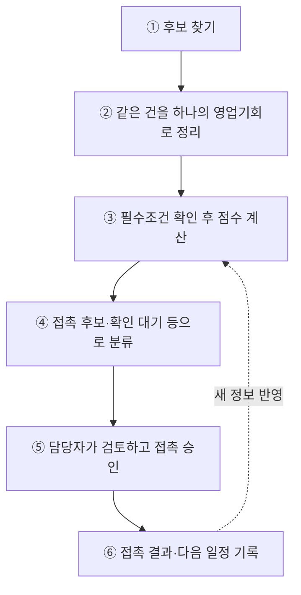
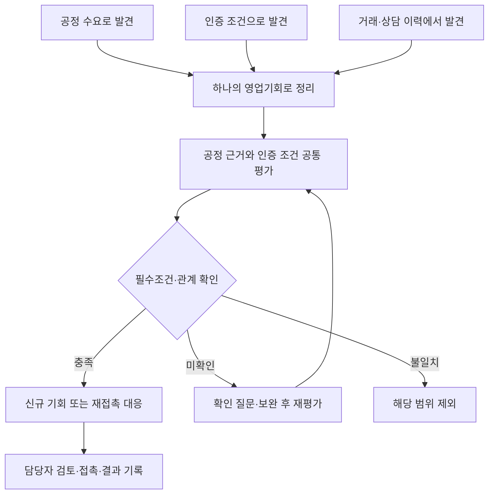
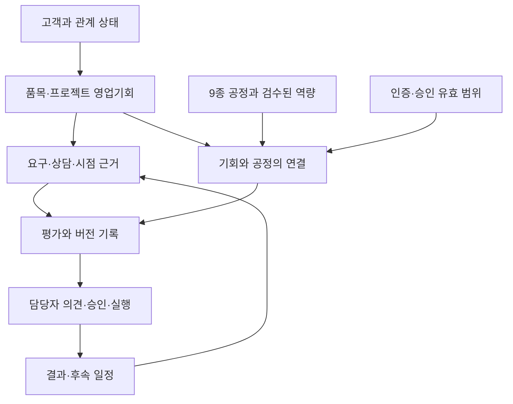
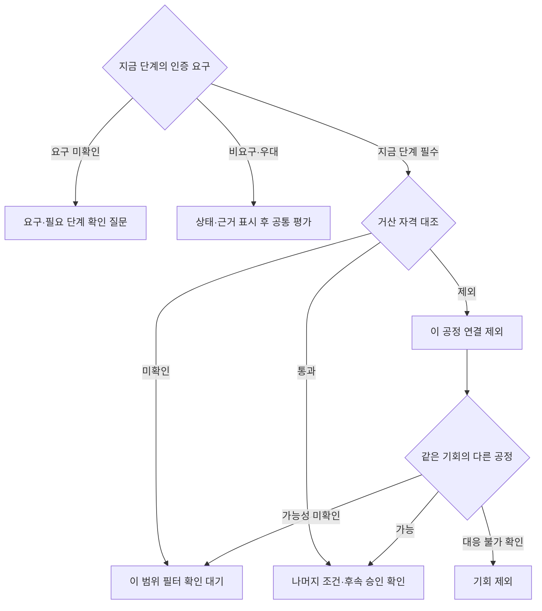
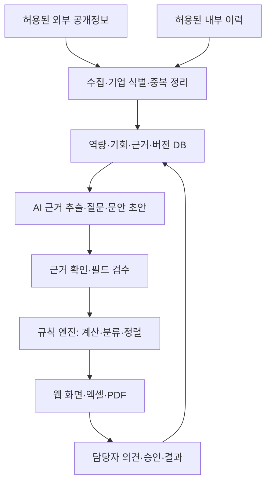
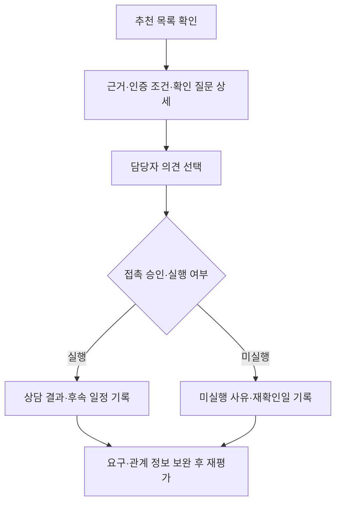
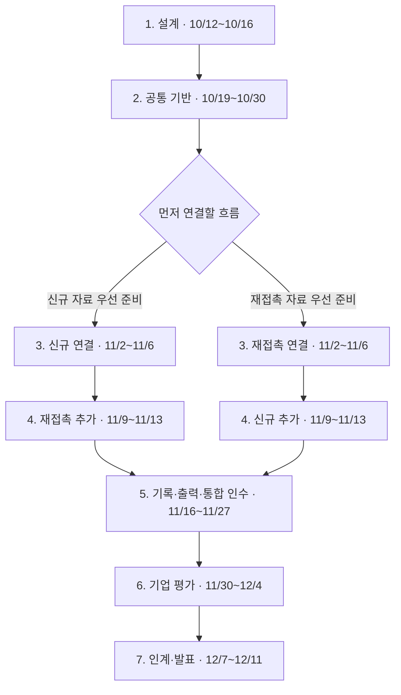

# 거산케미칼 AI 영업지원 에이전트 2차 기획서 (v0.17 · 개발 기준본)

**9종 공정 역량과 인증·승인 조건을 함께 검토하고, 신규 기회와 재접촉의 다음 행동을 제안하는 영업지원 도구**

| 항목 | 내용 |
|---|---|
| 작성 | 인공지능 사관학교 기업연계 14팀 AGENT DDALGI · 팀장 최지예 |
| 대상 | 거산케미칼 · 충남 천안 · 도금·표면처리 임가공 |
| 개정일 / 최종발표 | 2026-10-15 / **2026-12-11(금)** |
| 문서 상태 | **팀 내부 개발 착수 기준본.** 기업 승인·실제 데이터 검증·평가 실행 버전 고정은 별도 확인합니다. 세부 설계는 데이터/API 정의와 작업표에서 관리합니다 |
| 반영 방향 | 공정·인증 공통 평가, 신규·재접촉 두 대응 흐름의 순차 구현, 팀 운영 지원형 파일럿 |
| 점수 기준 | 프로필 선택은 5.1, 필수조건은 5.2, 배점·계산 요약은 부록 F, 상세는 「평가 규칙서 v0.17」 |
| 함께 보는 문서 | **「데이터설계서 v0.17」**(BE용, 4.4의 상세), **「평가 규칙서 v0.17」**(AI용, 부록 F의 상세). 이 본문이 기준이고 두 문서는 각각 본문 4장·5장을 구현 수준으로 푼 것. 이전 판과의 관계는 부록 A |

**읽는 순서:** 처음 읽는 분은 0장부터 순서대로 살펴보세요. 0.1에서 전체 흐름을 보고, 0.2에서 자주 나오는 용어를 익힌 뒤 0.3의 의사결정 요약을 읽으면 됩니다.

0장에서는 전체 그림을 보고, 자세한 조건은 각 절에서 확인하세요. 같은 설명을 여러 곳에 싣는 대신 기준이 되는 절을 안내합니다. 3장·5장·규칙서는 0.1의 A정밀 가상 사례 중 해당 판단에 필요한 부분만 이어서 설명합니다. 추가 용어는 부록 H에서 찾을 수 있습니다.

**담당별로 읽을 것:** 공통 부분을 먼저 읽고 담당 영역으로 넘어가세요. PM은 전체를 확인합니다.

| 누가 | 반드시 | 자기 영역 | 건너뛰어도 됨 |
|---|---|---|---|
| 전원 | 0장, 2장, 3장, 5장, 8장, 10.1 | — | 부록 A·B·C |
| PM | 전부 | 9장, 10장, 11~12장, 평가 규칙서 F.8~F.10 | — |
| BE | 공통 + 4장 전체 | **데이터설계서 전체**, 6.1~6.2, 10.3의 BE 열 | 평가 규칙서는 F.7·F.9만(코드값·분기 코드표) |
| AI | 공통 + 4.2~4.3 | **평가 규칙서 전체**, 6.1, 10.3의 AI 열 | 데이터설계서는 3~4장(요구·판정·평가 테이블)만 |
| FE | 공통 + 7장 | 평가 규칙서 F.9·F.10(화면에 띄울 분류·정렬), 부록 H, 10.3의 FE 열 | 데이터설계서, 규칙서 나머지 |

이 문서는 기획과 논리 설계의 기준입니다. 구현 완료, 기업 승인, 실제 추천 성능 또는 일정 실현 가능성을 검증했다는 뜻은 아닙니다.

## 0. 먼저 읽기: 전체 흐름·용어·의사결정 요약

### 0.1 한눈에 보는 전체 흐름

**거산케미칼은 금속 부품에 표면처리를 해 주는 임가공 회사입니다.** 고객이 원하는 처리를 할 수 있는지, 그 고객·프로젝트가 요구하는 인증·승인 조건을 갖췄는지가 영업의 핵심입니다.

이 도구는 **어떤 영업기회를 왜 검토할지, 연락 전에 무엇을 확인할지, 다음에 무엇을 할지** 보여줍니다. 실제 연락·견적·수주는 사람이 담당합니다.

처음 제안하는 **신규 기회**와 해당 기회의 과거 이력에 이어 연락하는 **재접촉** 모두 이 절차를 사용합니다. 적용 조건은 3.1, 판단 규칙은 5장에 있습니다. 초기에는 팀이 조사와 추천 실행을 지원하고, 기업 담당자가 추천을 확인해 의견·결과를 남깁니다(7.2).

**공통 가상 사례 — A정밀 밸브 바디 건**

대전의 A정밀이 산업용 밸브 바디(알루미늄 주물)의 아노다이징 외주 협력사를 모집한다고 가정합니다. 공고 조건은 “ISO 9001 보유 업체, 당사 품질팀 샘플 승인 후 양산”이며 마감은 3주 뒤입니다. 거산은 2024년에 A정밀과 다른 부품의 아연도금 견적을 주고받았지만 거래로 이어지지 않았습니다. 실제 고객이나 거산의 실제 인증 보유를 뜻하지 않습니다.

| 단계 | 이 사례에서 하는 일 |
|---|---|
| ① 찾기 | 공고와 A정밀 홈페이지의 제품 정보에서 발견합니다. |
| ② 정리 | “A정밀 · 밸브 바디 아노다이징” 기회 하나로 합칩니다. 고객 관계는 “기존 관계 확인(2024년 견적)”입니다. |
| ③ 평가 | ISO 9001 요구를 거산 인증과 대조합니다. 이번 품목은 새 제안이므로 신규 기회 프로필을 씁니다. |
| ④ 분류 | 예시의 필터·점수·핵심 근거·시점 조건을 충족하면 “시점 우선 접촉 후보”가 됩니다. 계산 결과는 부록 F에서 확인합니다. |
| ⑤ 판단 | 담당자가 “검토할 만함”을 선택하고 응모를 승인합니다. |
| ⑥ 기록 | 응모·회신·샘플 승인 진행 상황을 기록합니다. |

### 0.2 자주 나오는 용어 10개

처음에는 아래 뜻만 이해하면 됩니다. 적용 조건과 계산법은 오른쪽 절에서 확인하세요.

| 용어 | 쉬운 뜻 | 자세히 보기 |
|---|---|---|
| **영업기회(기회)** | 한 기업의 특정 품목·프로젝트·제안 건. 기업 한 곳에 여러 기회가 있을 수 있습니다. | 3.3·4.2 |
| **공통 평가** | 모든 기회에 적용하는 필터 → 점수 → 분류 절차입니다. | 3.1 |
| **평가 프로필** | 신규 기회 또는 재접촉에 맞춰 고르는 점수표입니다. | 5.1 |
| **필터** | 현재 반드시 충족해야 할 조건을 먼저 확인하는 절차입니다. | 5.2 |
| **필수 / 우대 / 비요구 / 미확인** | 고객이 그 조건을 꼭 요구하는지, 우대하는지, 요구하지 않는지, 아직 모르는지를 구분합니다. | 5.2.1 |
| **검수 완료** | 거산의 공정·인증 정보를 기업 담당자가 확인한 상태입니다. | 4.1·4.2 |
| **핵심 근거** | 연락 전에 갖춰야 하는 고객 쪽 연결 근거와 검수된 거산 근거입니다. | 5.2·평가 규칙서 F.8 |
| **E / P / S / R** | 확보 점수 / 판정한 항목의 배점 합 / 표시 점수 / 추가 조사로 가능한 점수 상한입니다. | 부록 F |
| **담당자 의견 / 영업 결과** | 추천에 대한 사람의 평가 / 실제 접촉 후의 상태입니다. | 5.4 |
| **G0~G4** | 기업과 업무 합의부터 후속 운영까지 확인하는 검증 단계입니다. | 9.3 |

### 0.3 의사결정 요약

| 먼저 알아둘 것 | 이번 기획의 답 | 기준 위치 |
|---|---|---|
| 왜 만드는가? | 흩어진 영업 지식과 부족한 공정별 근거를 정리해 고객의 수요와 연결합니다. | 1장 |
| 어디까지 만드는가? | 9종 공정 구조, 신규·재접촉 두 흐름, 근거·의견·결과 기록과 출력을 기본 구현합니다. | 2.2 |
| 어떤 순서로 만드는가? | 공통 기반을 만든 뒤 준비된 흐름부터 연결하고 나머지 흐름을 완성합니다. | 10.1 |
| 무엇을 검증하는가? | 기능 완성, 실제 데이터 평가, 기업 직접 사용, 실제 접촉 결과를 구분해 확인합니다. | 9장 |
| 언제까지인가? | **12/11 최종발표**가 목표입니다. 개발·기업 평가·인계 일정은 10장에 모았습니다. | 10.1 |
| 지금 무엇을 확인하는가? | 기업의 자료·참여·운영 조건, 팀의 평가·비용 초안, 10/16 멘토링의 1차 MVP 관계를 확인합니다. | 12장·1.3 |

### 0.4 기준으로 고정할 것과 상세화할 것

**이 본문이 기획의 기준입니다.** 요약본은 읽기 안내로만 쓰며 새로운 요구나 독립된 규칙을 추가하지 않습니다. 변경 절차는 11장을 따릅니다.

| 구분 | 기준 위치 | 개발할 때 지킬 점 |
|---|---|---|
| 목적·최종 기능 | 2.2 | 범위를 바꾸려면 이유·일정 영향을 기록하고 팀이 합의합니다. |
| 판단 규칙 | 5장·평가 규칙서 | 초기 구현 기준으로 고정합니다. 수치가 검증된 성능을 뜻하지는 않습니다. |
| 데이터 의미·연결 | 4.4·데이터설계서 | 연결과 보존 원칙을 지킵니다. 논리 테이블 수 자체를 완료 목표로 삼지 않습니다. |
| 개발 중 상세 설계 | 데이터/API 정의·작업표 | 자료형·인덱스·API 필드·화면·모듈·데이터 이전 방법은 해당 기능 구현 전에 BE·AI·FE가 계약을 확정합니다. |
| 기업 확인 | 12장 | 담당·기한·상태를 기록합니다. 가상 기능 개발과 실제 자료 사용 승인은 구분합니다. |
| 일정·인력 | 10장 | 1단계에 실명·주간 가용 시간·첫 작업량을 확인합니다. 기업 참여 일정은 협의 전까지 목표일로 표시합니다. |

## 1. 배경과 문제 정의

### 1.1 1차에서 확인한 문제

1차 MVP는 공정별 고객맞춤 영업자료 제작을 목표로 자료 선택·초안 생성·편집·출력 흐름을 개발했습니다. 그러나 결과물이 일반 회사소개서 수준에 머물렀고, 팀은 **공정별 근거 데이터와 그 구조의 부족**을 주요 원인으로 진단했습니다. 모델·프롬프트·검색·출력 품질의 영향은 별도 검증 대상입니다.

따라서 고객 부품의 소재·규격·품질 조건에 대응할 수 있다는 근거부터 보완합니다. 인증·승인은 개별 고객의 요구를 확인해 적용합니다(5.2.1).

### 1.2 사실·진단·가설 구분

| 구분 | 내용 | 근거 또는 확인 계획 |
|---|---|---|
| 1차 미팅·기업자료에서 확인한 사실 | 영업자료 유지 인력·시간 부족, 소개·입소문 중심 거래, 담당자 대응 편차, 인증 활용 설명자료 부족 | 1차 때 팀이 정리한 미팅 기록·기업자료 해석. 원자료와 구체 사례는 후속 면담에서 보완 |
| 팀 진단 | 역량 근거의 부족이 1차 자료 품질 저하에 영향을 줌 | 공정·인증 정보를 구조화한 뒤 동일 시나리오로 확인 |
| 검증할 가설 | 발굴·재접촉 지원이 지금 기업 업무에 유용함 | 우선 업무와 실제 연락 여력을 면담에서 확인. 1차 당시 신규 영업 인력 여건도 재확인 |
| 검증할 가설 | 팀 지원형 웹 사용이 담당자 부담을 줄임 | 추천 확인·의견·결과 기록 과제를 직접 수행하도록 제안 |
| 새 기획 방향 | 공정·인증 공통 평가와 두 대응 흐름을 단계적으로 완성 | 이 문서의 범위·일정·완료조건에 반영. 기업 참여와 운영 합의는 별도 |

### 1.3 1차 MVP와의 관계

> **확인 대기(10/16 멘토링).** 이 절은 멘토링에서 확인한 뒤 확정합니다. 그 전까지는 아래 방향(2차 별도 구축)으로 설계하되, 1차 코드·DB에 의존하는 결정은 하지 않습니다.
>
> 결정이 바뀌면 2.3(1차 통합을 후속으로 둔 것), 6.1(2차 전용 구축), 13장(1차→2차 서사)을 함께 고칩니다. 멘토에게는 다음을 확인합니다.
>
> ① 2차를 1차와 분리해 만드는 것이 맞나요? 1차 저장소 위에 구현하기를 기대하나요?  
> ② 1차 결과물(회사소개서 자동 생성)은 최종발표에서 어떻게 다루면 좋을까요? "1차 한계 → 2차 역량DB" 서사로 설명해도 괜찮을까요?  
> ③ 1차 통합을 범위 밖으로 둔 것이 평가에 불리한가요?  
> ④ 공정·소재·인증 코드 대응표를 유지하는 것으로 "향후 연결 가능"을 인정받을 수 있나요?  
> ⑤ 영업 기록처럼 기업 안에서 생긴 자료를 AI 분석에 쓸 때, 연락처를 지우고 설정 스위치·전송 기록·월 비용 한도를 거쳐 외부 AI로 보내는 설계(6.1·6.2)가 평가에서 충분한 보호로 보이나요? 서비스를 깊이 쓰게 될 때의 대책(로컬 모델(sLLM) 포함)을 지금 어디까지 준비하기를 기대하나요?

**현재 방향: 2차는 별도 기능·별도 저장소·별도 DB·별도 배포로 개발합니다.** 이번 통합은 2차 내부의 공정·인증 판단 구조를 통합하는 것입니다. 1차 프로그램과의 기능·DB 통합 및 회사소개서 품질 개선은 이번 완료 범위에 넣지 않습니다. 향후 연결을 위해 공정·소재·인증의 명칭과 코드 대응표를 유지합니다.

## 2. 목표·범위·완료조건

### 2.1 목표

담당자가 후보 기업의 품목·프로젝트를 살펴보고, 검수된 거산 역량과 비교해 **추천 이유·거래 전 확인 조건·다음 행동**을 판단하도록 돕습니다. 점수는 검토 순서의 참고값이며 수주 확률·기술 수행 가능성·거래 자격을 보장하지 않습니다.

### 2.2 발표 전 필수 범위

| 필수 항목 | 구현할 내용 | 완료 확인 |
|---|---|---|
| 9종 공정 기반 | 공통 스키마(4.4 요약, 상세는 데이터설계서), 전체 목록 대조·등록, 필드별 출처·검수 상태 | 9종을 수용하는 구조 확인. 실제 명칭 미확인 항목은 완료로 세지 않음 |
| 통합 발굴 | 공정 수요 검색과 인증·승인 조건 검색, 기업·기회 중복 정리 | 같은 기회는 발견 경로가 달라도 같은 기회 ID로 연결 |
| 공통 평가 | 공정 근거, 필수·우대 인증, 필터·근거 상태·시점 확인 | 불일치·미확인·비요구·대체 공정 사례의 처리 검증 |
| 신규 기회 지원 | 제품·소재·처리 목적 근거, 처음 제안할 이유·확인 질문 | 신규 기업과 기존 고객의 새 프로젝트 시나리오 모두 실행 |
| 재접촉 지원 | 허용된 해당 기회 이력, 현재 재접촉 이유·후속 일정 | 과거 제안 후속·재발주 시나리오 실행. 이력 부족은 확인 필요로 표시 |
| 최소 사용 화면 | 추천 조회·근거 상세·의견 선택·결과 기록 | 기업 담당자의 사용 과제를 따라 전체 흐름 실행 |
| 최소 운영 기록 | 평가 버전·필터·원래 순위·승인·조사·실제 접촉·결과 | 판단을 재현할 수 있는 필수 기록 저장 |
| 출력·인계 | 후보 및 근거 엑셀·PDF, 실행·갱신 안내, 평가 결과 | 화면과 출력의 상태·근거 일치, 인계 목록 확인 |

**기본 기능 완료와 실데이터 검증 완료는 구분합니다.** 허용된 실제 이력이 없더라도 재접촉 기능은 표시된 가상 사례로 구현·검증합니다. 이 경우 발표에 “재접촉 기능 구현 완료, 실제 이력 검증 미실시”라고 기록합니다. 개발이 미완료라면 데이터 미확보와 구분해 미완료로 보고합니다.

### 2.3 이번에 제외하거나 후속으로 두는 범위

| 구분 | 항목 |
|---|---|
| 이번 범위 밖 | 단가·견적금액 산정, 납기 확정, 고객 자동 발송, 가격·사업모델·경쟁사 비교 |
| 후속 확장 | RFQ·도면 자동 구조화(레벨 3), 가중치 자동 조정, 예측모델 학습, CRM·ERP·메일 연동, 설비 가동능력 판단, 1차 MVP 통합 |
| 화면 확장 | 전용 조사 관리 화면, 기업의 독립적인 수집·규칙 관리. 단, 현재 분류에 필요한 조사 기록 자체는 필수 |

2.2의 필수 기능은 G4 이후 확장 항목으로 미루지 않습니다. 변경이 필요하면 2.4·11장에 따라 미완료 범위와 변경 이력을 기록합니다.

### 2.4 필수 범위의 우선순위와 지연 대응

일정이 밀리면 **화면 꾸밈·별도 관리 화면·출력 디자인부터 줄입니다.** 아래 표는 기능별로 어디까지 단순화할 수 있는지 정한 기준입니다. 날짜별 점검과 조치는 10.2를 따릅니다.

| 우선 | 유지할 완료 기준 | 지연 시 조정할 부분 |
|---|---|---|
| 1 | 9종 구조·필드 검수, 기회 병합, 요구별 필터, 규칙 계산·분기·정렬 | 필수 판정을 생략하거나 점수로 우회하지 않음 |
| 1 | 최소 조회·근거·의견·결과 화면과 첫 대응 흐름 | 화면 꾸밈을 줄이고 저장·조회 연결을 우선 |
| 2 | 나머지 대응 흐름의 전체 동작 | 자료 미확보이면 표시된 가상 사례로 기능 검증. 연결 미완료이면 복구 담당·기한·남은 기능 기록 |
| 2 | 단계·기한·자격 상태와 현재/수행 시점 판정 | 자동 비교의 일부를 근거·확인자·일자가 있는 담당자 확인으로 구현 가능. 미확인은 대기, 알려진 정지·취소·필수 불충족은 통과 금지 |
| 3 | 조사·재검토 조건을 기회/평가 ID와 연결해 저장 | 전용 관리 화면은 후속으로 두고 기본 메모/구조화 입력 재사용. 외부 메모만으로 필수 저장 기능 완료 처리하지 않음 |
| 3 | 화면과 같은 근거·상태의 엑셀·PDF 출력 | PDF는 단순 인쇄형으로 구현 가능. 수동 발표자료만 만든 경우 PDF 출력 기능은 미완료 |

PM은 11/13·11/20 점검에서 결정일·이유·담당·복구 일정·영향 시나리오를 기록합니다. 필수 기능을 실제로 제외해야 하는 변경은 미완료/범위 변경으로 명시하며, 구현 완료로 바꾸어 보고하지 않습니다.

## 3. 영업기회 구조와 선택 근거

### 3.1 영업기회의 구조: 공통 평가 하나, 대응 흐름 둘

이 서비스에서는 영업기회를 세 가지 관점으로 나눠 봅니다.

| 층 | 내용 | 어디서 자세히 다루는가 |
|---|---|---|
| **발견 경로** | 기회를 찾는 입구. ① 공정 수요가 보이는 기업·품목, ② 인증·승인 조건이 보이는 공고·프로젝트, ③ 허용된 거래·상담 이력. 같은 기회를 여러 경로로 찾아도 기회는 하나입니다 | 4.3 수집, 평가 규칙서 F.5 |
| **공통 평가** | 모든 기회가 거치는 같은 절차. 공정 근거와 인증·승인 조건을 함께 대조하고, 필수조건을 필터로 가른 뒤, 상황에 맞는 프로필 하나로 점수를 계산해 분류합니다 | 5.1~5.2, 평가 규칙서 |
| **대응 흐름** | 담당자에게 보여주는 근거·질문·다음 행동의 종류. **신규 기회**와 **재접촉** 둘입니다. 어느 쪽인지는 고객 관계와 그 기회의 상담 이력으로 정합니다(3.3) | 5.3~5.4, 7장 |

| 대응 흐름 | 적용 조건 | 이번 범위 |
|---|---|---|
| **신규 기회** | 신규 기업의 새 기회, 또는 기존 고객의 과거 거래와 무관한 새 품목·프로젝트 | 제품·소재·처리 목적의 연결 근거와 첫 제안 이유·확인 질문을 제공합니다. 기존 고객의 새 기회 적용은 G2 전 별도 검증 |
| **재접촉** | 해당 기회에 과거 거래·견적·상담·제안 이력이 있고 현재 재접촉 사유가 있을 때 | 허용된 해당 이력과 다시 연락할 이유·후속 일정을 제공합니다. 실제 이력이 없을 때의 기능 검증은 2.2 참조 |

인증은 **발견 경로·공통 필터·검수된 설명 근거**에 사용합니다. 별도 인증 메뉴·점수표·평가 표본은 두지 않습니다. 요구 수준별 처리는 5.2에서 설명합니다. 두 대응 흐름의 점수표 선택 기준은 5.1에 있습니다.

### 3.2 대안 비교

| 대안 | 장점 | 한계 | 판단 |
|---|---|---|---|
| 재접촉·신규 발굴·인증 소구를 각각 독립 기능(트랙)으로 구현 | 목적별 설명이 쉬움 | 고객 관계 구분과 인증 조건이 서로 겹쳐, 같은 기회를 두 곳에서 따로 평가·관리하게 됨 | 채택하지 않음 |
| 모든 기준을 새 단일 점수로 합산 | 하나의 숫자로 표현 가능 | 배점·분모·기준점 재설계와 검증 부담, 다른 점수가 필수조건의 부족을 덮을 위험 | 채택하지 않음 |
| 공통 평가 + 상황별 대응 흐름·평가 프로필 | 공정·인증을 함께 확인하고 검토를 마친 계산 규칙을 활용 | 프로필 적용 범위와 비교 방식을 명시해야 함 | **채택(이번 설계안)** |

### 3.3 고객 관계와 영업기회는 따로 기록한다

고객 한 곳에 대해 두 가지를 따로 적습니다. 하나는 **그 회사와 거산의 관계**이고, 다른 하나는 **이번 기회에 대해 과거에 무슨 일이 있었는가**입니다.

**고객 관계**는 셋 중 하나입니다.

| 값 | 뜻 | A정밀 건 |
|---|---|---|
| 신규 확인 | 거래·견적·상담 이력이 없다고 확인함 | — |
| 기존 관계 확인 | 어떤 이력이든 있음. 이력 종류(거래/견적/상담/제안)를 함께 적습니다 | **여기.** 2024년 아연도금 **견적** 이력 |
| 관계 미확인 | 아직 조사하지 않았거나 이력 자료 사용 허가가 없음 | — |

**이번 기회의 대응 목적**도 셋 중 하나입니다.

| 값 | 뜻 | A정밀 건 |
|---|---|---|
| 신규 제안 | 이 품목·프로젝트에 대해서는 처음 제안 | **여기.** 밸브 바디 아노다이징은 처음 |
| 기존 제안 후속 | 이 품목에 대해 이미 제안·견적을 냈고 그 제안·견적에 이어서 연락 | — |
| 재발주 확인 | 이 품목을 납품한 적이 있고 다시 발주될 시점인지 확인 | — |

둘을 합치면 A정밀 건은 **"기존 관계가 있는 고객의 신규 제안"**입니다. 그래서 점수는 신규 기회 프로필로 계산하고(5.1), 연락할 때는 "2024년에 견적 드렸던 거산입니다"라는 맥락을 씁니다. 2024년 아연도금 견적은 맥락일 뿐, 이번 아노다이징 건의 점수에는 들어가지 않습니다.

관계가 **미확인**인 후보도 점수는 계산해 볼 수 있습니다. 다만 분류는 "필터 확인 대기(관계·중복 미확인)"에 머물고, 담당자가 기존 거래처인지와 이미 연락 중인 건인지 확인한 뒤에야 접촉 후보가 됩니다.

> **이력 기록 시 주의:** 견적·상담 이력과 실제 납품 실적을 구분합니다. 거래실적은 실제 납품이 있을 때만 기록합니다. 거래처라는 이유만으로 그 회사의 모든 기회를 재접촉으로 분류하지 않으며, 재접촉은 "이 기회"에 이력이 있을 때만 적용합니다(5.1).

## 4. 데이터 설계와 확보 계획

### 4.1 공정 9종과 준비 상태

| 번호 | 공정명 | 회사소개서(2026-09-21판) 근거 |
|---:|---|---|
| 1 | 아연도금 | 생산라인 사진·본문 목록·설명 슬라이드 |
| 2 | 아노다이징 | 생산라인 사진·본문 목록·설명 슬라이드 |
| 3 | 흑착색(알카리흑착) | 생산라인 사진·본문 목록·설명 슬라이드. 본문 목록에 "알카리흑착"과 "흑착색"이 따로 적혀 있어 같은 공정인지 기업 확인 필요 |
| 4 | 크로메이트 | 생산라인 사진·본문 목록 |
| 5 | 전해연마 | 생산라인 사진의 "전해/크롬도금" 상자와 본문 목록·설명 슬라이드. 사진 슬라이드에서는 크롬도금과 한 상자 |
| 6 | 크롬도금 | 위와 같음 |
| 7 | 무전해니켈(무전해도금) | 생산라인 사진·본문 목록·설명 슬라이드 |
| 8 | 인산염피막 | 생산라인 사진·설명 슬라이드. 본문 목록 문장에는 없음 |
| 9 | 부동태 | 생산라인 사진·본문 목록 |

사진의 상자는 8개지만 "전해/크롬도금" 한 상자에 두 공정이 있어 전체는 9종입니다. 소개서 표기를 등록용 이름으로 쓰며, 공식 공정명·코드·3번 명칭 통일은 기업 검수에서 확정합니다. 준비된 공정은 수 제한 없이 검증합니다.

각 공정의 소재·치수·두께·성능·시험·인증 연결은 **미확보 / 확보·검수 대기 / 검수 완료 / 재확인 필요**를 필드별로 기록합니다. 목록 등록만으로 모든 사양을 검증했다고 표시하지 않습니다. 거산의 기술 역량은 추정값으로 채우지 않습니다.

### 4.2 핵심 기록과 관계

아래 표는 기록할 내용입니다. 테이블 설계·ERD는 「데이터설계서」, 그 요약은 4.4를 봅니다.

| 기록 | 최소 내용·적용 범위 |
|---|---|
| 공정·역량 | 공정 ID·명칭·소재·사양·설비·시험·실적과 각 필드 근거·검수 상태 |
| 인증·승인 | 종류·공식 명칭/식별번호·적용 판본·주체·해당 범위·유효기간·현재 상태(정지/취소 등)·상태 확인일/근거·검수자·검수일 |
| 고객 | 고객 ID·사업자번호 또는 확인된 식별 근거·관계 상태·확인일 |
| 영업기회 | 기회 ID·고객 ID·품목·프로젝트·발견 경로들·담당자·진행 상태 |
| 기회-공정 연결 | 고객 요구와 해당 공정의 대응 근거·요구별 필수/우대/비요구/미확인·필요 단계/기한·통과/미확인/제외·사유 |
| 요구·상담 | 회사 공통/특정 기회 적용 범위·확인/추정·관심요소·확인 항목·의사결정 구조·다음 일정 |
| 시점 신호 | 사건 발생일·확인일·진행 상태·마감·예정일·다음 확인일·근거 |
| 평가 | 프로필·입력·기준일·규칙/역량DB 버전·항목 상태·점수·분류·원래 순위 |
| 의견·실행·결과 | 담당자 의견, 승인·실행 주목적·접촉 시도·응답·후속 일정·결과·미실행 사유를 분리 |

상담 메모는 기본적으로 입력한 영업기회에만 적용합니다. 회사 공통 정보로 재사용하려면 범위를 확인합니다. 예를 들어 “이번 부품은 11월 납품”을 회사 전체 납기 조건으로 복제하지 않습니다. 같은 프로젝트의 인증 요구 추가는 같은 기회 ID에 반영하고, 다른 품목·프로젝트라는 근거가 있을 때만 새 기회를 만듭니다.

### 4.2.1 자격 종류와 요구별 기록

아래는 서비스의 자료 분류안입니다. 공식 인증 이름·기관 분류를 바꾸는 기준이 아니며, 예시를 거산의 보유 자격으로 가정하지 않습니다.

| 종류 | 관리할 내용 | 기존 데이터와 연결 |
|---|---|---|
| 품질경영체계 인증 | 조직·사업장·인증 범위·판본·현재 상태 | 인증 기록. 9100 계열과 OASIS의 일반적 성격은 부록 C에서 확인 |
| 특수·중요공정 인정 | 특정 공정·규격의 인정 범위 | 인증/승인과 공정 연결. Nadcap의 Chemical Processing·Coatings는 종류 설명 예시 |
| 고객사 승인 | 고객·사업장·공정·품목별 승인 조건 | 해당 고객·기회의 요구와 승인 근거 |
| 협력사·공급망 등록 | 등록 대상·참여 가능한 단계·승인 조건 | 해당 고객·사업의 요구와 진행 이력 |
| 샘플·양산 승인 | 해당 품목의 샘플·현장 검증·생산 승인 조건 | 기회별 승인 이력. 회사 공통 인증으로 복제하지 않음 |

사업별 필수 요구는 ‘기회의 요구조건’, 공정 수행능력은 ‘역량DB’에 두며 모두 인증 종류로 묶지 않습니다. **요구별 근거와 결과를 따로 기록**하고, 개별 판정은 5.2를 따릅니다.

기존 인증·요구·근거 기록을 확장하며 별도 승인관리 시스템을 추가하지 않습니다. 최소 논리 필드는 자격 종류, 요구 ID, 요구 수준, 필요 단계·충족기한, 연결한 자격/공정 ID, 개별 판정, 현재 상태·확인일, 후속 조건입니다. 실제 DB 열·코드는 상세 설계에서 확정합니다. 사업장·공정 등 범위 항목은 해당 자격과 요구에 적용되는지 먼저 확인합니다. **해당 없음과 미확인을 구분**합니다.

### 4.3 자료 요청과 모집단 관리

새 문서 작성보다 기존 자료·면담 내용을 팀이 구조화해 확인받습니다. 요청 자료는 9종 명칭·기본 사양, 인증 원본·적용 범위, 시험·실적의 비식별 근거, 허용된 거래·상담 사례입니다. 전체 거래처 명단은 필수가 아닙니다.

**재접촉 자료는 최소 필드로 받습니다.** 재접촉 프로필(규칙서 F.2)의 7항목에 하나씩 대응하는 입력은 다음 최소 필드뿐입니다:

① 과거 거래 공정·품목(현재 역량과 대조),  
② 수주 여부·횟수 또는 샘플 승인만 있었는지,  
③ 당시 품질·납기·인증 요구를 모두/일부 충족했는지,  
④ 실주·거래중단 사유와 그 사유가 지금 해소됐는지,  
⑤ 마지막 납품일·평균 발주 주기,  
⑥ 그 고객의 최근 수주·증설·채용 신호(공개자료로 대체 가능),  
⑦ 다음 약속·샘플 일정과 그 상태.

각 값에는 확인/추정과 확인일을 붙입니다. 금액·단가·도면·담당자 연락처는 평가에 쓰지 않으므로 받지 않습니다.

**기업 영업 담당자가 최소 필드를 화면에 직접 입력**하며, 팀은 거래 내역서·견적서 원본을 받지 않습니다. 직접 입력도 어렵다면 표시된 가상 사례로만 검증하고 "실제 이력 검증 미실시"로 보고합니다(2.2). 입력 경로는 G0에서 확인합니다(12.1).

외부 소스는 **3개 이내**에서 선정합니다. 정확한 소스명, 이용·저장·재배포 허용 범위, 갱신 주기, 식별자, 출처 등급, 비용·실패 대응을 소스 계약표에 남깁니다. 이 문서가 특정 외부 API의 현재 제공 범위나 이용 허용을 확인한 것은 아닙니다.

조사 전 산업·품목·소재·지역/물류 범위·소스·기간·기준일을 정합니다. 수집 자료/공고 수, 중복 제거 기업 수, 중복 제거 기회 수, 유효 기회 수, 제외·미확인 사유를 각각 기록합니다. 공정·인증 발견 경로가 겹친 기회는 합계에서 한 번만 셉니다.

### 4.4 DB 설계 요약 (상세는 별도 「데이터설계서」)

상세 테이블·ERD·필드·제약은 **「데이터설계서 v0.17」**을 따릅니다. 팀 공통으로 알아둘 24개 논리 테이블은 다음 여섯 묶음입니다.

| 묶음 | 테이블 | 한 줄 설명 | A정밀 건에서는 |
|---|---|---|---|
| 거산 역량 | `PROCESS`, `PROCESS_CAPABILITY`, `DELIVERY_RECORD`, `FIELD_EVIDENCE` | 9종 공정과 공정별 사양·시험·설비·실적, 그리고 각 값을 누가 언제 검수했는지 | 아노다이징 공정 행, 알루미늄 주물 대응 사양 행과 그 검수 기록 |
| 거산 자격 | `QUALIFICATION`, `QUALIFICATION_SCOPE`, `QUALIFICATION_STATUS` | 인증·승인의 종류·범위·현재 상태 이력 | ISO 9001 행, 적용 사업장·범위 행, 상태(정상, 확인일) 행 |
| 고객과 기회 | `CUSTOMER`, `INTERACTION`, `OPPORTUNITY`, `DISCOVERY_PATH`, `OPP_PROCESS_LINK` | 고객과 관계 상태, 거래·견적·상담 이력, 영업기회, 어디서 발견했는지, 어느 공정과 연결되는지 | A정밀(기존 관계), 2024년 견적 이력, 밸브 바디 기회, 발견 경로 2건, 아노다이징 연결 |
| 요구와 시점 | `REQUIREMENT`, `REQUIREMENT_CHECK`, `SIGNAL` | 고객이 요구하는 것, 평가 때마다 그 요구를 어떻게 판정했는지, 날짜가 있는 신호 | ISO 9001 요구·샘플 승인 요구, 각각의 판정, 공고 마감일 신호 |
| 평가와 근거 | `EVALUATION_BATCH`, `EVALUATION_RUN`, `ITEM_JUDGMENT`, `EVIDENCE`, `JUDGMENT_EVIDENCE`, `RESEARCH_TASK` | 같은 규칙으로 돌린 평가 묶음, 기회별 평가 한 번, 항목별 점수, 근거 문서, 항목과 근거의 연결, 추가조사 질문 | 신규 기회 프로필 평가 1회와 8개 항목 행, 공고·홈페이지 근거, 질문 묶음 |
| 사람의 판단 | `REVIEW_OPINION`, `ACTION`, `OUTCOME` | 담당자 의견, 승인과 접촉 시도, 영업 결과 | "검토할 만함", 응모 승인·실행, 진행중 |

**팀 공통이 지킬 원칙 네 가지.**

1. **기회 중심.** 점수·요구·질문·의견·결과는 같은 기회 ID에 연결합니다. 여러 경로로 발견해도 기회는 하나입니다.
2. **거산 값은 검수된 것만.** 공정 사양·인증 범위는 기업 검수 완료 값만 추천 근거로 씁니다. 검수 전에는 "검수 대기"로 표시하고 가점에 쓰지 않습니다(4.1).
3. **평가는 재현 가능해야 합니다.** 평가 당시 입력·규칙 버전·검수 값을 저장하고, 값이 바뀌어도 과거 평가는 보존합니다.
4. **사람의 판단은 따로.** 시스템 추천·담당자 의견·접촉 승인·영업 결과는 다른 테이블에 저장하며 서로 덮어쓰지 않습니다(5.4).

**개발 순서.** 1단계에 24개 전체의 관계 초안과 첫 통합 사례(A정밀 건)의 필수 필드·API 계약을 맞춥니다. 물리 설계(자료형·인덱스·삭제 정책)는 해당 기능을 구현하기 직전에 차례로 확정합니다. 공통 기반 16개 → 필터·계산·의견 4개 → 두 대응 흐름 2개 → 기록·평가 2개 순서이며, 자세한 목록과 단계별 통과 사례는 데이터설계서 7·8장에 있습니다.

> **주의.** 테이블 수는 목표가 아닙니다. 위 네 원칙과 인수 사례를 지키면 테이블을 합치거나 나눌 수 있습니다. ERD 작성만으로 완료 처리하지 않고 실제 저장·조회·재평가를 확인합니다.

## 5. 판단 규칙: 어떤 기회를 왜 추천하는가

이 장은 0.1의 ③ 공통 평가·④ 분류의 판단 기준을 정합니다. 숫자와 계산 순서는 「평가 규칙서」를 따릅니다.

### 5.1 점수표는 기회 상황에 따라 하나를 고른다

필터·근거·관계 확인 절차는 공통입니다. 점수표는 **이 기회의 과거 이력**에 따라 아래처럼 고릅니다.

| 기회 상황 | 적용 프로필 | 이유 | A정밀 건 |
|---|---|---|---|
| 신규 기업의 새 기회 | 신규 기회 프로필 | 쓸 수 있는 정보가 제품·소재·공정 근거뿐 | — |
| 기존 고객의 과거 거래와 무관한 새 품목·프로젝트 | 신규 기회 프로필 | 다른 프로젝트의 이력은 이 기회의 근거가 아님. 관계는 연락 맥락으로만 씀 | **여기.** 2024년 아연도금 견적은 밸브 바디 건의 점수에 들어가지 않음 |
| 이 기회에 거래·견적·상담·제안 이력이 있고 지금 다시 연락할 이유가 있음 | 재접촉 프로필 | 과거 이력에서 공정 일치·요구 충족·실주 사유를 알 수 있음 | — |
| 관계 미확인 | 신규 기회 프로필로 참고 계산만 | 최종 분류는 "관계·중복 확인 대기". 이력이 확인되면 프로필을 다시 정함 | — |
| 인증 조건으로 발견된 기회 | 위 상황에 따라 둘 중 하나 | 인증은 발견 경로일 뿐, 별도 점수표가 없음 | 공고로 발견했지만 점수는 신규 기회 프로필 |

프로필은 점수를 계산하기 **전에** 기록합니다. 재접촉 근거가 있을 것 같은데 자료 허가가 없으면 신규로 바꾸지 않고 "확인 대기"로 둡니다. 프로필을 바꾸면 사유와 이전 결과를 남기고 새 평가를 한 번 더 실행합니다.

**인증 자체의 가점은 없습니다.** 필수·우대 인증은 5.2.1의 표에 따라 처리합니다. 재접촉 프로필의 "과거 요구조건 충족"에 인증 사실을 쓸 수는 있지만 인증 보너스를 더하지 않습니다.

**신규 기회와 재접촉은 목록을 나누고 각 목록 안에서만 정렬합니다.** 프로필은 내부 계산 방식이므로 기업 화면에 선택 메뉴를 두지 않습니다. 두 목록 사이의 실제 연락 순서는 담당자가 기한·근거·여력을 보고 정하며 사유를 남깁니다.

> **주의.** 점수에 유리한 프로필을 고르지 않습니다. 기존 고객의 새 기회와 인증 조건으로 발견한 기회에 대한 위 표의 적용 방식은 이번에 넓힌 범위입니다. 기준점(75·60·70·40 등)은 이 범위에서 아직 검증되지 않았으므로 G2 전에 사례로 점검합니다. 과거 트랙별 평가 결과를 새 범위의 성능 근거로 쓰지 않습니다.

### 5.2 인증·승인·공정 조건은 점수보다 먼저 본다

접촉 후보가 되려면 세 가지 조건을 **각각** 충족해야 합니다.

① 지금 단계에 필요한 필수조건을 충족했습니다.  
② 프로필의 핵심 근거가 있습니다(규칙서 F.8).  
③ 운영 조건이 준비됐습니다(허용 자료, 거산 자료 검수, 실행 여력).

하나라도 빠지면 점수가 높아도 후보가 아닙니다. 이 절은 ①을 설명합니다.

확인은 "자격 확인 → 적용 범위 확인 → 공정 연결 확인" 순서로 부르며, 프로젝트 검증 단계 G0~G4와 혼동되는 새 G1·G2·G3 이름은 만들지 않습니다. 이 전제는 모든 기술 사양을 미리 알아야 한다거나 높은 시점 점수를 반드시 받아야 한다는 뜻이 아닙니다.

#### 5.2.1 고객 요구를 적고 수준을 정한다

요구 하나마다 수준을 넷 중 하나로 적습니다. 같은 산업에 속한다는 이유만으로 모든 고객이 같은 인증을 필수로 요구한다고 가정하지 않습니다.

| 수준 | 뜻 | 시스템 처리 | A정밀 건 |
|---|---|---|---|
| 필수 | 이 단계를 넘으려면 반드시 있어야 함 | 필터에 걸림. 아래 5.2.3으로 판정 | ISO 9001 — 공고에 "보유 업체"라고 명시 |
| 우대 | 있으면 유리하지만 없어도 됨 | 검수된 일치 범위만 설명 근거로 표시. 점수 없음 | — |
| 비요구 | 요구하지 않는다고 확인됨 | 필터·점수에 쓰지 않음. 미보유여도 제외하지 않음 | — |
| 미확인 | 요구하는지 아직 모름 | 확인 질문으로 남김. 필수·비요구를 짐작하지 않음. 다른 조건이 맞으면 "요구 확인" 목적의 접촉은 가능 | Nadcap 등 특수공정 인정 — 공고에 언급 없음 |

A정밀의 **ISO 9001**과 **A정밀 품질팀 샘플 승인**은 각각 기록·판정합니다. 한 요구의 통과가 다른 요구의 통과를 뜻하지 않습니다.

#### 5.2.2 요구마다 "지금 단계에 필요한가"를 적는다

| 상황 | 판정 | A정밀 건 |
|---|---|---|
| 지금 행동(상담·응모·등록)에 필요한 필수 요구 | 5.2.3으로 판정. 미확인이면 접촉 보류 | ISO 9001 — 응모 자격이므로 지금 단계 |
| 고객 절차상 나중 단계(샘플·양산)에 필요하다고 **확인된** 요구 | 지금 판정에서는 빼고, 화면에 "후속 단계 미완료"로 함께 표시 | 샘플 승인 — 공고에 "승인 후 양산"이라고 명시 |
| 필수인 것은 확인됐지만 어느 단계·기한에 필요한지 불명확 | **단계·기한 확인 대기.** 나중에 받아도 된다고 짐작하지 않음 | — |
| 지금은 유효하지만 고객이 요구하는 수행 시점 전에 만료 예정 | 지금 단계 판정과 수행 시점 판정을 따로 적음. 갱신 예정만으로 수행 시점을 통과시키지 않음 | — |
| 수행 시점·상세 요구가 아직 미정 | 확인 질문과 재확인일을 기록. 미정이라는 이유만으로 첫 상담을 막지 않음 | — |

지금 단계를 통과했다는 것은 "이 행동을 해도 된다"는 뜻이지 "거래·양산 자격을 확보했다"는 뜻이 아닙니다. 시스템은 판정을 기록할 뿐, 등록 신청이나 고객 연락을 자동으로 하지 않습니다.

#### 5.2.3 지금 단계의 필수 요구마다 거산 자격을 대조한다

판정은 아래 세 가지이며 "조건부 통과" 같은 중간 상태는 없습니다.

| 결과 | 조건 | 다음 행동 | A정밀 건 |
|---|---|---|---|
| 통과 | 검수 완료된 거산 자격이 명칭·판본·보유 주체·사업장·공정/제품 범위·유효기간·현재 상태 모두 맞음 | 나머지 필수 요구·핵심 근거·시점 확인으로 넘어감 | 거산 ISO 9001이 검수 완료이고 아노다이징 사업장이 범위에 들어가면 통과 |
| 미확인 | 거산 자격이 있는지, 범위가 맞는지, 상태가 유효한지 중 하나라도 모름 | **필터 확인 대기.** 이 범위의 접촉 보류, 확인 질문 생성 | 인증서가 "검수 대기"면 미확인. 질문: "인증 범위에 아노다이징 라인이 포함되는가" |
| 제외 | 거산에 그 자격이 없거나 범위가 안 맞는다고 확인됨 | 이 공정 연결은 제외. 같은 기회에 다른 공정 연결이 있으면 그쪽은 계속 | — |

**대조 기준.** 자격 종류에 따라 공식 명칭·판본, 보유·계약·생산 주체, 사업장, 공정·제품 범위, 유효기간, 현재 상태, 고객 추가 승인을 확인합니다. 고객이 요구하지 않는 범위는 비워 둡니다. 이름의 글자보다 공고·고객의 실제 요구와 일치하는지 보며, 동등 자격을 인정하는 명시적 근거가 있을 때만 다른 자격으로 대신합니다.

**유효성은 만료일만 보지 않습니다.** 정지·취소가 확인되면 만료 전이어도 근거로 쓰지 않으며, 갱신 심사 중이라는 이유로 취소를 추정하지 않습니다. 상태(정상/정지/취소/만료/미확인)와 확인일·근거를 함께 기록합니다.

**제외의 범위는 원인에 맞춥니다.** 폐업 같은 기업 전체의 제한은 기업과 모든 기회에, 프로젝트의 제한은 해당 기회에, 소재·공정 불일치는 해당 공정 연결에만 적용합니다. 다른 공정 연결은 따로 판정하며, 대안 공정의 후속 처리는 아래 흐름도를 따릅니다.

> **주의.** 비슷한 이름·상위·협력업체 인증이나 다른 계약·생산 주체의 자격으로 대신하지 않습니다. 다른 공정의 사양을 합쳐 한 공정의 능력으로 보지 않습니다. 요구 미확인과 필수 요구 충족 미확인의 접촉 허용 차이는 5.2.1·5.2.3 표를 따릅니다. ISO 9001·샘플 승인 예시는 가상이며 거산의 실제 보유 사실이 아닙니다.

#### 5.2.4 인증이 아닌 기술 조건도 필수면 같은 방식으로 본다

두께·치수·규격·시험·품질기록·수량·납기도 **지금 단계의 필수 요구로 확인됐다면** 5.2.3과 같이 먼저 대조합니다. 상담 때 물어볼 항목이라는 이유로 접촉 뒤로 미루지 않습니다. 요구가 아직 미정인 항목은 질문으로 남깁니다. 유사 실적도 고객이 필수로 요구한 경우와 일반 참고 근거를 구분합니다.

| 거산 쪽 상태 | 판정 |
|---|---|
| 검수된 사양이 요구와 명백히 안 맞음 | 그 공정 연결 제외 |
| 대응 가능한지 근거가 없음 | 확인 대기 |
| 수량·납기·생산 여력 | 담당자가 확인한 상태와 근거만 기록. 시스템이 생산능력·납기를 계산하지 않음 |

A정밀 공고에 "피막 두께 15μm 이상"이 적혀 있다면 검수된 거산 아노다이징 두께 범위와 대조합니다. "검수 대기"면 위 표에 따라 확인 대기로 둡니다. 자격 통과가 공정 수행 가능까지 확정하지는 않습니다.

#### 5.2.5 지금은 제외된 기회를 다시 볼 조건

필수 자격이 없어 제외된 기회라도, 거산이 그 자격을 취득할 계획이 있거나 고객이 공급업체 육성·승인 절차를 운영한다는 근거가 있으면 **재검토 조건·근거·담당자·예정일**을 적어 둘 수 있습니다.

- 지금 행동을 허용할 근거가 생기기 전까지는 접촉 후보와 G2 추천 상위 표본에서 뺍니다. 제외·대기 사례를 모은 별도 진단 표본에는 넣을 수 있습니다.
- 자격을 취득했거나 고객이 지금 상담·등록을 허용하는 절차를 확인하면, **같은 기회 ID**로 다시 평가합니다.

> **주의.** 취득 의향만으로 점수를 올리거나, 같은 프로젝트를 "중장기 기회"로 복제하지 않습니다. 자격 취득 프로젝트를 관리하는 기능은 이번 범위에 없습니다.

### 5.3 고객 정보 수준에 따라 할 수 있는 일

| 정보 수준 | 무엇이 있는가 | 이번에 하는 일 | 화면에 나오는 것 | A정밀 건 |
|---|---|---|---|---|
| 레벨 1 | 외부 공개정보(홈페이지·공고·보도) | 제품·소재·처리 목적의 근거를 뽑고 "이 공정이 필요할 것"이라는 가설을 세움 | 연결 이유, "추정" 표시, 외주 여부·실제 사양을 물을 질문 | 공고·홈페이지만 있는 지금 단계 |
| 레벨 2 | 허용된 상담·메일·담당자 입력 | 요구를 정리하고 기회·공정·인증에 연결. 상담 4항목(관심 요소, 확인 항목, 의사결정 구조, 다음 일정) 정리 | 확인된 요구와 추정의 구분, 부족·상충 조건, 다음 일정 | 응모 뒤 A정밀 품질팀과 통화한 뒤 |
| 레벨 3 | RFQ·도면·규격서 | **후속 확장.** 사용 허가·보안 경로·기술 검수 뒤에 검토 | — | — |

AI는 근거·질문 정리까지만 합니다. "처리 가능", "납기 가능", "견적 가능"은 기술이사·품질 담당자의 검수 뒤에만 확정하며, 가격·납기·설비 여력은 담당자가 판단합니다.

### 5.4 추천 뒤에 기록하는 것

**연락 목적.** 추천할 때의 목적과 실제로 연락한 목적을 각각 넷 중 하나로 적습니다.

| 목적 | 언제 | A정밀 건 |
|---|---|---|
| 요구 확인 | 고객 요구가 추정뿐일 때 | — |
| 검수된 역량 소개 | 요구가 확인됐고 거산 근거가 검수 완료일 때 | 응모 서류에 아노다이징 사양·ISO 9001 범위 제시 |
| 기존 제안 후속 확인 | 이 기회에 이미 제안·견적이 있을 때 | — (처음 제안이므로 쓰지 않음) |
| 일정 응답 | 마감·약속 일정에 맞춰 회신할 때 | 공고 마감 전 응모 |

제안 자료에는 확인된 사실과 검수된 역량만 쓰고 추정은 질문으로 남깁니다.

**세 가지 기록은 서로 다릅니다.**

| 기록 | 값 | 누가 | 비고 |
|---|---|---|---|
| 시스템 분류 | 접촉 후보·확인 대기·추가조사·관찰·후순위 등(규칙서 F.9) | 시스템 | 재평가하면 바뀜 |
| 담당자 의견 | 검토할 만함 / 추가 확인 필요 / 대상 아님 | 기업 영업 담당자 | 분류와 별도 저장. 어느 평가 버전을 보고 낸 의견인지 함께 저장 |
| 영업 결과 | 미실행 / 진행중 / 보류 / 수주 / 실주 + 사유 | 기업 영업 담당자 | 승인·접촉 시도·회신·상담·후속 일정도 각각 구분해 기록 |

무응답은 "미실행" 또는 "진행중"이며 자동으로 "실주" 처리하지 않습니다. 수주·실주에는 성립·불발 근거와 담당자 확인을, 보류에는 재개 조건을 적습니다. 시스템 분류인 "조건부 대기·관찰·후순위"는 결과 칸에 쓰지 않습니다.

**추가조사 기록.** 추가조사로 분류된 기회에는 질문 묶음, 허용된 확인 경로, 담당자, 예상 시간, 시간 상한, 재확인일을 첫 구현부터 저장합니다. 전용 화면은 나중에 만들어도 되고 당분간 메모·엑셀을 연결해도 됩니다.

> **주의.** 결과가 쌓여도 배점·가중치를 자동으로 바꾸지 않습니다. 바꾸려면 규칙 버전을 올리고 따로 평가합니다(11장).

## 6. 기술 구성·자원·위험

### 6.1 처리 구조와 역할

| 계층 | 기본 기술안 | 담당 |
|---|---|---|
| 수집·매칭 | Python·허용 API/페이지 수집, 사업자번호 우선 매칭, 불확실한 병합은 확인 | BE |
| 저장 | SQLAlchemy 기반 관계형 DB(테이블 설계는 데이터설계서). 개발 SQLite, 운영 PostgreSQL 필요 여부는 동시접속·배포 조건 확인 후 결정 | BE |
| 규칙 엔진 | Python의 결정적 계산·필터·분기·정렬 | AI 담당, BE 연동 |
| 생성·검색 | 허용 근거를 검색해 LLM에 전달. 임베딩·RAG는 실제 데이터·검색 필요에 맞춰 구성 | AI |
| 화면·출력 | FastAPI + React 기본안, 2차 전용 구축, 엑셀·PDF 출력 | BE·FE |

반올림·점수·분류·정렬은 규칙 엔진이 계산하며, 확정 입력·기준일·프로필·규칙/역량DB 버전이 같으면 결과도 같아야 합니다. LLM의 원문 재추출 결과 차이는 계산 재현성과 따로 확인합니다. 자체 예측모델 학습·파인튜닝은 이번에 하지 않습니다.

**LLM 호출 경계와 실행 모드.** 호출은 ① 외부 공개자료의 사실·근거 문장·날짜·상태 후보 추출, ② 확인 질문 생성, ③ 문안 초안, ④ 프로그램 안 영업 기록(접촉 기록·꼬리 질문 답·영업 결과(단계)·거절 이유·영업 메모)의 분석·정리·질문 답변의 네 곳으로 제한합니다. ④는 연락처(전화·이메일·사람 이름)를 지운 뒤, 설정 스위치가 켜져 있을 때만, 전송 기록을 남기고 월 비용 한도 안에서 보냅니다(6.2). 하나의 어댑터 뒤에서 **외부 LLM / 호출 없음(템플릿·수동 입력)**을 설정으로 고릅니다. 로컬 모델(sLLM)은 지금 쓰지 않고, 깊이 쓰게 될 때의 대책 가운데 하나로 둡니다(아래 문단). 기본값은 다음과 같습니다.

| 흐름 | 기본 모드 | 이유 |
|---|---|---|
| 신규 기회 | 외부 LLM | 입력이 공개자료뿐이라 전송 제한이 없음 |
| 영업 기록의 분석·정리·질문 답변 | 외부 LLM(설정 스위치가 켜져 있을 때만) | 지금은 테스트 단계이고, 기업이 쓰는 수준이 핵심 내용이 아닌 분석 정도의 질문·답변이며, 기업에도 전달한 내용(PM 결정 2026-11-13). 연락처를 지우고 전송 기록·월 비용 한도를 거침. 스위치가 꺼져 있으면 아무것도 보내지 않음 |
| 재접촉 | 정하지 않음 | 재접촉 흐름은 만들지 않기로 해(2026-11-03 보류, 2026-11-13 PM 결정) 지금은 보낼 입력값이 없음. 흐름을 만들게 되면 그때 다시 정함 |

로컬 모델(sLLM)은 지금 도입하지 않습니다. **서비스를 계속·깊이 쓰게 되어 견적·단가·도면·고객별 상담 내용 같은 핵심 내용까지 다루게 될 때의 대책 가운데 하나**로 두며, 그때 실행 환경(GPU)·품질·종료 후 기업 운영 가능 여부를 확인해 정하고 이유를 이 절에 남깁니다. 단계별 대책은 「영업 기록을 외부 AI로 보내는 범위와, 깊이 쓰게 될 때의 대책」(`docs/ai-records-policy.md`)에 정리했습니다. 모드가 달라도 규칙 엔진의 입력·출력 형식은 같아야 하며, 모드 전환으로 점수·분류가 바뀌지 않습니다.

### 6.2 데이터 사용·보안

공개자료, 기업이 외부 AI 사용을 허용한 자료, 내부 구조화만 허용한 자료, 처리 금지 자료를 구분합니다. 고객 도면·RFQ 원문·세부 공정 노하우는 이번 저장·외부 AI 전송 대상에서 제외합니다. 허용된 최소 구조화 필드와 참조 ID만 사용합니다. 금지 원문을 외부 AI에 먼저 보내 비식별화하지 않습니다. 임베딩 API에도 같은 허용 기준을 적용합니다.

**영업 기록의 외부 AI 전송 원칙(PM 결정 2026-11-13).** 프로그램 안 영업 기록(접촉 기록·꼬리 질문 답·영업 결과(단계)·거절 이유·영업 메모)은 회사별로 외부 AI에 보내 분석·정리·질문 답변에 씁니다. 보낼 때는 네 가지를 거칩니다. ① 메모 속 전화·이메일·사람 이름을 지운 뒤에만 보냅니다. ② 설정 스위치로 켜고 끕니다(꺼져 있으면 아무것도 나가지 않습니다). ③ 전송 기록을 남깁니다. ④ 월 비용 한도 안에서 보냅니다. 연락처(전화·이메일·사람 이름), 회사 대표번호, 고객 도면·RFQ 원문·세부 공정 노하우, 단가·견적 금액(이 프로그램은 다루지 않습니다)은 보내지 않습니다. 이렇게 정한 이유는 지금이 테스트 단계이고, 기업이 쓰는 수준이 핵심 내용이 아닌 분석 정도의 질문·답변이며, 기업에도 전달한 내용이기 때문입니다. 서비스를 계속·깊이 쓰게 되면 「영업 기록을 외부 AI로 보내는 범위와, 깊이 쓰게 될 때의 대책」(`docs/ai-records-policy.md`)의 단계(실제 영업에 매일 쓰기 시작할 때 / 핵심 내용까지 다루게 될 때)에 따라 보내는 범위와 보호 수단을 다시 정합니다. AI 제공사의 약관(보낸 내용을 학습에 쓰는지, 보관 기간)은 실사용 전에 확인합니다.

**재접촉 이력의 보관 원칙.** 재접촉 흐름은 만들지 않기로 했으므로(2026-11-03 보류, 2026-11-13 PM 결정), 최소 필드(4.3)를 외부 LLM·임베딩 API에 보낼지는 그 흐름을 만들게 되면 그때 다시 정합니다. 받게 되는 경우에는 기업이 지정한 환경(기업 PC·기업 계정의 서버)에 우선 보관하고 팀 개인 장비·개인 클라우드에 복사하지 않습니다. 발표·보고서의 고객명·품목은 가명만 쓰고, 대응표는 기업에만 남깁니다. 사관학교 기업연계의 비밀유지 서약·자료 반환 조건이 있으면 이 원칙보다 우선합니다.

자료별 허용 범위·보관 위치·접근자·발표 공개 가능 여부·정정/삭제 방법을 기록합니다. 실제 고객명·거래 이력은 허용된 화면·출력에만 표시합니다. 발표용 가상·비식별 데이터는 실데이터와 구분합니다. 최초 구조화를 위한 허용 경로가 없으면 해당 자료 사용을 보류합니다.

### 6.3 자원·비용 계획

| 자원 | 계획·산정 방식 | 확정 담당·시점 |
|---|---|---|
| 인력 | PM·FE·BE·AI 4역할. 겸임 가능 시간을 포함해 주별 작업량 조정 | PM·팀, W1 및 매주 점검 |
| 기업 협조 | 공정·인증 검수, 허용 사례, 평가·직접 사용 일정 | PM·기업, G0 협의 |
| LLM·임베딩 | 건당 입력·출력량과 호출 횟수를 표본 실행에서 측정해 월 실행량에 곱함 | AI, 11/6 준비 판단 전 초안 |
| 외부 데이터 | 선정 소스의 무료 범위·구독·호출 제한을 확인 | BE, 소스 확정 전 |
| 서버·DB | 배포 방식·동시 사용자·저장량 기준으로 견적 확인 | BE, 웹 운영안 확정 시 |
| 예산 상한·계정 | 실제 금액 미확정. 월 상한·초과 시 중단/축소 기준·비용 부담자 기록 | PM·기업, 실제 운영 전 |

가격이나 승인되지 않은 예산을 임의로 적지 않습니다. 건당 조사시간·검수시간과 반복 운영 부담도 비용에 포함합니다. 종료 후 비용·유지보수를 자동으로 팀이 부담한다고 약속하지 않습니다.

### 6.4 위험관리

| 위험 | 가능성 / 영향 | 대응·전환 조건 | 담당 |
|---|---|---|---|
| 실제 자료·면담 지연 | 중 / 높음 | 기능 개발은 진행, 실데이터 검증 범위는 11/6 준비 상태로 구분 | PM |
| 자격 판정 규칙의 구현 복잡도 | 중 / 중 | 요구별 기록·상태 저장을 먼저 구현하고 단계·기한·수행 시점 비교는 2.4 축소안 적용. S08·S11·S13으로 경계 확인 | AI·BE |
| 인증 범위·공정 사양 오해 | 중 / 높음 | 필드 검수·필수조건 선행·적용 범위별 제외, 근거 변경 시 재평가 | AI·기업 검수자 |
| 두 흐름 개발 지연 | 중 / 높음 | 공통 엔진·화면 재사용, 주차별 통과 확인, 추가 관리자 화면은 후속. **11/13 중간 점검**에서 2.4의 축소 순서 적용 | PM·팀 |
| 후보 부족·소스 접근 실패 | 중 / 높음 | 실제 기업·기회 수 구분, 부족분을 가상 후보로 채워 성능 발표하지 않음 | BE·AI |
| 두 프로필 점수의 오해 | 중 / 중 | 목록·평가 표본 분리, 서로 다른 점수의 통합 순위 금지 | AI·FE |
| 기업 사용 부담·미참여 | 중 / 높음 | 팀 지원, 최소 3단계 사용 과제. 미참여면 실사용 미검증으로 보고 | PM·FE |
| 자료 유출·과도한 공개 | 중 / 높음 | 입력 전 허용 확인, 최소 구조화, 금지 원문 미전송·미저장. 영업 기록은 연락처를 지우고 설정 스위치·전송 기록·월 비용 한도를 거쳐서만 외부 AI로 전송. 계속·깊이 쓰게 되면 단계별 대책으로 다시 정함(6.1·6.2) | 전원 |
| 종료 후 운영 불가 | 중 / 높음 | 실행·조회·갱신 가능 범위를 따로 확인, 계정·비용·지원 책임 협의 | PM·BE |

가능성은 팀의 초기 판단이며 실제 이슈에 따라 갱신합니다. 평가 오류가 생기면 영향받는 추천을 보류하고, 이전 입력·결과를 보존한 뒤 수정 버전으로 재평가합니다.

## 7. 화면과 파일럿 운영

### 7.1 기업 담당자의 최소 흐름

| 화면 | 기본 표시 | 상세 보기·기록 |
|---|---|---|
| 추천 목록 | 기업·영업기회, 신규 기회/재접촉, 추천 이유, 인증 조건, 확인할 점, 다음 행동 | 시스템 분류, S·항목 완료율 C·출처 등급. 다른 프로필 점수로 한 줄 순위 표시 금지 |
| 근거 상세 | 제품·소재·공정 연결, 자격 종류·요구별 판정, 필요 단계·관계 상태 | 자격 상태·현재/수행 시점 유효성·후속 조건·근거/확인일·계산 E/F/T/P/R·버전 |
| 의견·결과 | 검토할 만함/추가 확인/대상 아님, 짧은 기회별 메모 | 승인·실행 주목적·접촉 여부·영업 결과·다음 일정 |

숫자보다 행동·근거를 먼저 배치하고, 계산·여러 자격의 판정은 상세에서 펼쳐봅니다. 기본 카드에는 현재 행동을 막는 조건과 다음 질문을 요약하되 판단에 필요한 근거는 숨기지 않습니다. 인증 요구 미확인과 필수 인증 충족 미확인은 다른 문구로 표시합니다. 현재 단계 통과를 최종 납품·양산 승인처럼 표시하지 않습니다.

### 7.2 운영 기본안

**팀 운영 지원형 웹 파일럿이 기본 설계안이며, 기업의 직접 사용 참여·접속 방식·일정은 협의 전입니다.** 팀은 수집·추천 실행·외부 근거 정리·검수 요청과 회신 관리·결과 전달을 지원합니다. 거산 공정·인증 범위의 최종 검수는 기업 기술·품질 담당자가 맡습니다. 기업 사용자는 추천 확인·의견·결과 기록부터 시작합니다.

엑셀·PDF는 전달·평가 보조물입니다. 웹 참여가 어려우면 같은 데이터로 의견을 수집하되 웹 직접 사용 검증으로 보고하지 않습니다. 종료 후 독립 운영 판단은 10.4를 따릅니다.

### 7.3 평가 화면과 일반 사용 화면

G2 평가 화면은 점수·순위·시스템 추천 분류를 가립니다. 평가 후 일반 화면에서 전체 근거와 점수를 보여주고 사용성을 확인합니다. 블라인드 평가·표본 재사용 기준은 9.2를 따릅니다.

## 8. 시연·기능 인수 시나리오

아래는 기능 검증용 시나리오입니다. 가상 데이터는 화면·기록·발표에서 가상으로 표시합니다. 실제 인증 보유나 고객 수요를 가정해 사실처럼 보여주지 않습니다.

| 번호 | 시나리오 | 기대 동작 |
|---|---|---|
| S01 | 9종 공정 구조와 현재 등록 현황 확인 | 9종이 각각 소개서 근거와 함께 등록되고, 명칭 확정·필드 검수 상태를 공정별로 따로 확인 |
| S02 | 공정 검색과 인증 검색에서 같은 프로젝트 발견 | 기회 1건에 발견 경로·근거 병합, 기업·기회 중복 집계 없음 |
| S03 | 신규 기업에 관련 소재·제품 근거 있음 | 신규 기회 프로필 평가, 검수된 공정 근거·실제 요구 확인 질문 제공 |
| S04 | 기존 고객의 새 프로젝트 | 기존 관계 유지, 신규 기회 프로필로 평가. 다른 프로젝트 상담 조건 자동 복제 금지 |
| S05 | 기존 제안에 후속 연락 약속 있음 | 재접촉 프로필 평가, 해당 이력·현재 사유·일정 연결. 완료·취소 일정 가점 금지 |
| S06 | 고객 관계 미확인 | 참고 계산 가능, 최종 분류는 관계·중복 필터 확인 대기 |
| S07 | 인증 요구 자체 미확인 또는 비요구 | 요구 확인 질문과 비요구를 구분. 미보유 일괄 탈락 없음 |
| S08 | 복수 자격 중 고객 승인 미확인, 승인 필요 단계 불명확 | 하나의 인증 통과로 전체 통과 금지. 현재 필수 또는 필요 단계 불명확이면 대기, 고객이 허용한 상담 단계와 후속 승인 분리 |
| S09 | 한 공정 불일치, 같은 기회에 다른 연결 존재 | 불일치 연결만 제외, 대안의 가능/미확인/없음에 맞춰 재판정 |
| S10 | 승인·접촉·의견·결과 기록 | 시스템 분류와 사람 의견·실제 결과 구분, 같은 기회에 기록 |
| S11 | 인증 정지/취소, 수행 전 만료, 갱신·재심사 진행, 일정 취소 | 영향 기회 재평가·이전 버전 보존. 만료일만으로 유효 단정 금지, 갱신 예정·재심사 중을 유효/취소로 임의 판정 금지 |
| S12 | 추가조사 분류 | 질문·경로·담당·시간·재확인일 기록. 요건 부족이면 조건부 대기 |
| S13 | 현재 단계의 필수 두께·시험·수량 근거 미확보 / 불일치 확인 / 범위 해당 없음 | 근거 미확보는 확인 대기, 명백한 불일치는 해당 범위 제외. 해당 없음은 근거로 확인하고 미확인과 구분 |
| S14 | 현재 필수 자격 미충족, 취득 계획은 있으나 현재 행동 허용 근거 없음 | 현재 접촉·G2 추천 상위 표본에서 제외, 별도 진단 가능. 같은 기회에 재검토 조건을 기록하고 자격 충족·현재 행동 허용의 새 근거 확인 시 재평가 |

각 시나리오의 입력·기대 결과·실제 결과·결함·수정 버전을 남기고, 계산 경계는 평가 규칙서로 별도 점검합니다. 실제 추천 품질 표본은 9.2를 따릅니다.

## 9. 목표·성과지표·검증

### 9.1 무엇을 성공으로 볼 것인가

| 목표 | 지표 | 현재 기준 | 목표·판정 | 측정 시점·방법 |
|---|---|---|---|---|
| 기본 기능 완성 | 2.2 및 S01~S14 수행 여부 | 현재 구현 상태 대조 필요 | 각 흐름과 필수 예외 처리 완료, 차단 결함 해소 | 11/27 통합 인수 점검 |
| 근거성 | 주장-근거 연결, 거산 필드 검수 상태 | 미측정 | 근거 없는 확정 주장·필수조건 상쇄는 수정 전 사용 금지 | 개발 중·G2 전후 |
| 추천 타당성 | 평가자가 연락할 만하다고 본 비율 | 동일 범위의 수작업 비교값 미측정 | G2 전에 기준값·목표·불합격 처리 합의 | 고정 표본 블라인드 평가 |
| 업무 효율 | 기회 1건 조사·검토·기록 시간 | 사전 측정 필요 | 합의한 개선 목표와 실제 변화 보고 | 동일 유형 수작업/도구 비교 |
| 사용 편의성 | 3개 핵심 과제 수행, 도움 요청·오류·소요시간 | 미측정 | 참여자·과제·성공 기준 사전 합의 | 기업 직접 사용 시 |
| 실제 실행 | 승인·접촉·회신·상담·결과 건수 | 없음 또는 기존 기록 확인 필요 | 기간·분모·미실행 사유를 함께 관찰 | 파일럿 및 후속 운영 |

숫자 목표는 현재 기준값·기업 여력을 확인해 G2 전에 고정합니다. 기능 테스트 통과와 영업 효과 검증은 다릅니다. 추천 품질·사용성·실제 영업 결과는 별도로 보고합니다.

### 9.2 표본·평가 방법

배점 구조가 다르므로 **프로필별 평가 모집단·목표 표본·실제 n을 기록합니다.** 준비된 대표 프로필의 시스템 상위 최대 20개를 우선 평가합니다. 다른 프로필은 실제 자료가 준비되면 기업 여력에 맞춰 별도 표본 수를 G2 전에 합의합니다. 2.2의 구현 범위와 달리 실제 평가는 양쪽 20개씩을 일괄 의무로 두지 않습니다.

사람이 순서를 조정하기 전 시스템 결과로 표본을 고정합니다. 접촉 후보가 부족하면 실제 n을 보고하며 조사 대기·가상 사례로 채우거나 가상 시나리오 수를 합산하지 않습니다. 실제 이력이 없어 재접촉 표본이 0이면 기능 검증 결과와 별도로 “실제 재접촉 추천 품질 미검증”을 보고합니다. 서로 다른 프로필의 비율을 평균해 단일 성능 수치로 발표하지 않습니다.

평가자는 점수·순위·시스템 분류를 가린 채 허용 근거와 해당 기회를 보고 연락할 만함/추가 확인/낮음과 사유를 기록합니다. 추천 타당성은 프로필별 고정 평가 대상 n 중 ‘연락할 만함’의 비율이며, ‘추가 확인·낮음’도 분모에 포함합니다. 미완료가 남으면 완료 수·미평가 수·이유와 중간 집계만 보고하고 최종 비율은 확정하지 않습니다. n=0은 산정 불가입니다. 미평가 사례를 분모에서 임의로 빼거나 다른 후보로 교체하지 않습니다. 복수 평가자의 판정 통합 방식은 G2 전에 정합니다.

필터 미확인·제외·낮은 완료율·프로필 전환·인증 조건은 별도 진단 표본으로 검증하며 추천 표본과 분모를 합치지 않습니다. 계산 재현성은 동일한 확정 입력·기준일·버전의 결과 일치로, 추출 품질은 근거 문장·날짜·상태 추출의 일치·오류로 확인합니다. 오류 수정 사례와 수정 후 최종 확인 사례는 구분합니다.

계산·필터·입력 해석에 영향을 주는 수정은 변경 기록을 남기고 평가 전에 다시 고정합니다. 평가 시작 후 결과에 영향을 주는 수정은 기존 기록을 보존하고 새 버전 평가를 분리합니다. **점수·순위를 이미 본 사례는 새 블라인드 평가 사례로 재사용하지 않습니다.** 고정 목표일과 준비 판단은 10.1~10.2를 따릅니다.

### 9.3 단계별 검증 기준

| 단계 | 확인할 것 | 통과하지 못하거나 자료가 없을 때 |
|---|---|---|
| G0 · 업무·운영 합의 | 우선 활용 사례, 사용자·검수자, 허용 자료·외부 AI 범위(영업 기록은 6.2의 네 조건으로 전송), 실행량 K·조사시간 | 개발은 계속하되 실제 운영 승인으로 간주하지 않음 |
| G1 · 데이터 준비 | 평가에 쓸 공정·인증 필드 검수, 고객 근거·관계·식별·필수조건 상태 | 준비된 사례만 운영 검토. 미준비 흐름은 기능 검증과 구분 |
| G2 · 추천 품질 | 프로필별 모집단·버전·표본·목표 고정, 블라인드 평가·진단·재현성 | 미달이면 원인 수정·새 버전 재평가. 일정 부족은 미검증/미달로 보고 |
| G3 · 실행 관찰 | 담당자 승인 후 K 이내 접촉, 응답·상담·미실행 사유·업무시간 | 접촉하지 않은 건을 실주로 세지 않음. 발표 시 초기 관찰만 보고 가능 |
| G4 · 후속 운영·확장 판단 | 운영 부담·데이터 품질·사용 효과, 후속 기능 필요성 | 확장 보류 가능. 이미 범위에 포함된 신규·재접촉 개발을 막는 조건으로 사용하지 않음 |

실행량 K는 합의 기간에 실제 연락할 수 있는 기회 수로, 평가 표본 수와 다릅니다. 같은 기업의 여러 기회는 중복 접촉을 조율하고 기업 수·기회 수·접촉 횟수를 따로 집계합니다.

## 10. 단계별 실행계획과 인수인계

### 10.1 개발 순서와 단계별 완료조건

**공통 기반 → 준비된 흐름 → 나머지 흐름 순서로 개발합니다.** 필수 범위는 2.2를 따르며, 앞 흐름의 수주나 G4 통과를 다음 흐름 개발 조건으로 삼지 않습니다.

12/11 최종발표 기준의 팀 계획안입니다. 면담·기업 평가·시연은 기업과 협의하고, 첫 주에 담당별 작업 가능 시간을 확인해 세부 업무량을 조정합니다.

첫 흐름은 10/23까지 PM·BE·AI·FE가 확보 가능한 자료와 구현 난이도로 정합니다. 양쪽 자료가 부족하면 가상 시나리오로 시작합니다. 기업 자료 요청·사용 허용 협의·공정 검수는 1단계부터 병행하며, 단계별 구현 내용과 확인 기준은 아래 표를 따릅니다.

| 개발 단계·기간 | 이번 단계에서 완성할 것 | 통합 산출물 | 다음 단계로 넘길 최소 확인 |
|---|---|---|---|
| 1. 설계 · 10/12~10/16 | 9종 공통 구조·전체 관계, 첫 통합 사례의 필수 필드·상태·화면/API 계약, 작업 분담 | ERD·데이터/API 정의 초안, 첫 사례의 입력·기대 결과·화면 초안, 공정·자료 준비표, 역할별 작업표 | 같은 기회·요구·평가 ID와 상태의 뜻이 일치하고 첫 사례를 담당별로 이어받을 수 있음. 24개 전체 물리 설계 완료를 진입 조건으로 삼지 않음 |
| 2. 공통 기반 · 10/19~10/30 | 허용 자료 수집·기업/기회 식별, 근거 저장, 공정·인증 대조, 필터·계산·기본 화면 | 공통 기능 실행본, 입력 사례, 소스 사용표·수집 집계, 기본 검증 결과 | 후보→근거→평가→의견 저장이 한 번 이어지고, 통과/미확인/제외 및 같은 기회 병합의 기본 사례 확인. 10/30 면담·G0 협의 목표 |
| 3. 첫 대응 흐름 · 11/2~11/6 | 준비된 신규 또는 재접촉 흐름, 대응 목적·질문·근거 표시 | 첫 흐름 실행본, 시연 사례, 11/6 실데이터 준비 판단표 | 첫 흐름의 입력→추천·질문→담당자 의견 저장 실행. 실제 자료와 가상 사례 표시. 막히는 필수조건을 점수로 통과시키지 않음 |
| 4. 나머지 대응 흐름 · 11/9~11/13 | 공통 기능을 재사용해 다른 흐름 연결, 기존 고객의 새 기회·프로필 전환·상담 적용 범위 | 두 흐름 실행본, 실제/가상 검증 구분표, 11/13 점검 기록 | 신규와 재접촉을 각각 실행하고 같은 기회 중복·다른 프로젝트 이력 혼입 방지. 미완료는 담당·원인·복구 일정을 명시 |
| 5. 기록·출력·통합 인수 · 11/16~11/27 | 승인·조사·실제 접촉·결과·재검토 최소 기록, 엑셀·단순 PDF, S01~S14·재현성 확인과 결함 수정 | 운영 기록·출력 연결본, 평가계획·규칙 후보, 기능 인수 결과, 평가용 버전·입력·표본 고정 기록 | 화면·출력 상태 일치, 추천 분류·기업 의견·영업 결과 별도 저장. 2.2와 S01~S14 실패는 미완료로 기록. 평가계획·버전 고정 목표일은 아래 참조 |
| 6. 기업 평가·사용 · 11/30~12/4 | 준비된 프로필의 G2 평가, 담당자 직접 사용, 시연·의견 수렴 | 프로필별 결과·실제 n, 사용 관찰, 개선 내역, 미검증 목록 | 12/2 평가 마감 목표, 12/4 시연 협의. 참여 불가를 보고하고, 표본·미평가 처리는 9.2, 접촉은 G3 기준 적용 |
| 7. 인계·발표 · 12/7~12/11 | 실행·갱신 안내, DB 백업/복원 확인, 초기 실행 관찰, 발표·리허설 | 12/10 인계 패키지, 최종 시연본·발표자료, 12/11 최종발표 | 10.4에 따라 인계 확인. 기능·실데이터 검증·직접 사용·영업 성과는 9.1에 따라 구분 |

**11/20은 평가계획 합의·규칙 후보 정리, 11/27은 인수 후 평가용 버전·입력·표본 고정 목표일입니다.** 준비 조건을 충족해야 고정하며 수정·재평가는 9.2를 따릅니다.

개발은 위 단계별 최소 확인으로 이어갑니다. 실제 자료 사용·접촉은 9.3의 G0~G3를 별도 확인하며, 날짜만으로 기능 완료·운영 승인·평가 통과로 처리하지 않습니다.

### 10.2 11월 6일 준비 판단과 지연 대응

| 준비 상태 | 진행 방식 |
|---|---|
| 운영 합의·자료 사용 허용·사용 필드 검수가 준비됨 | 해당 사례로 실제 파일럿 준비·평가 진행 |
| 일부만 준비됨 | 준비된 사례만 실제 검증, 나머지는 표시된 가상 사례로 기능 검증. 부족 필드·확인 담당·다음 일정 기록 |
| 실제 자료 사용·기업 참여 조건이 준비되지 않음 | 공개자료·가상 데이터로 기능과 근거 표시 검증. 기업 검증 완료·현장 효과로 주장하지 않음 |

견학만으로 G0·G1을 통과시키지 않습니다. 비대면으로 합의·검수가 완료되면 해당 범위의 준비를 인정합니다. 이 판단은 실데이터 검증 범위를 정하며, 2.2의 기능 범위를 바꾸지 않습니다.

11/13에는 **자료 미확보와 개발 미완료를 따로 기록**합니다. 자료가 없으면 가상 사례로 기능 검증을 계속합니다. 개발 미완료는 담당·차단 원인·복구 일정을 정하며, 가상 사례 전환만으로 해결됐다고 보지 않습니다. 기능 축소·대체 구현의 허용 범위는 2.4를 따릅니다.

11/20까지 실제 평가 조건이 갖춰지지 않으면 준비된 프로필만 G2 대상으로 계획하고 나머지는 미검증으로 남깁니다. 11/27 최종 고정 때 실제 준비 상태를 다시 기록합니다.

### 10.3 단계별 팀 담당과 산출물

PM 최지예 외에는 역할로 표기하며, 실명·겸임 여부는 1단계 작업표에서 확정합니다. **PM은 단계별 완료 상태·기업 협의를 취합하고, 구현 담당은 산출물·확인 결과를 넘깁니다.**

| 단계 | PM·기획 | FE·화면 | BE·데이터/API | AI·근거/규칙 |
|---|---|---|---|---|
| 1. 설계 | 범위·질문·첫 인수 사례·실명/가용 시간·작업표 | 첫 사례 화면 초안·상태 문구·입출력 확인 | 전체 ERD·첫 사례의 필수 필드/제약·API 계약 초안 | 추출 항목·프로필 적용표·같은 입력의 기대 결과 |
| 2. 공통 기반 | 공정 목록 대조·허용 자료 확인·면담 | 후보 목록·근거 상세·의견 입력 | 테이블·수집·기업 식별·기회 병합·공통 API | 근거 추출·필터·계산·분류·정렬 및 기본 사례 검증 |
| 3. 첫 흐름 | 첫 흐름 인수·11/6 자료 준비 판단 | 첫 흐름 화면 연결·미확인 표시 | 해당 흐름 입력·저장·조회 API | 해당 프로필·다음 질문·문안 연결 |
| 4. 두 흐름 | 다른 흐름 인수·경계 사례·지연 판단 | 두 흐름 전환·이력·관계 표시 | 기회별 상담 적용 범위·프로필 전환·이력 연결 | 두 프로필 경계·현재 재접촉 이유·중복 근거 방지 |
| 5. 기록·출력·통합 인수 | 평가계획·사용 과제, 시나리오 결과·미완료 취합 | 승인·결과 입력, 엑셀·단순 PDF, 화면·사용 흐름 수정 | 운영 기록·출력 데이터, 저장 정합성·버전·배포·복원 확인 | 규칙 후보, 계산 재현성·분기·경계 오류 수정 |
| 6. 기업 평가 | 블라인드 평가·사용 관찰·실제 n·한계 보고 | 직접 사용 지원·화면 오류 수정 | 평가 입력/결과 보존·실행 오류 지원 | 실패 원인 분석·수정 시 새 버전 영향 기록 |
| 7. 인계·발표 | 인계 확인·검증 보고·발표 총괄 | 간단 사용 안내·화면 시연 | 소스·환경·DB 백업·실행/복원 안내 | 규칙·프롬프트·허용 입력·재평가 안내 |

AI 담당의 부담을 나누어 PM은 기대 결과가 있는 시나리오를, BE는 요구·자격·근거·판정 이력의 저장/조회를 맡습니다. 출력 데이터는 FE·BE가 함께 정하고, FE는 출력 흐름, BE는 화면과 일치하는 데이터를 책임집니다. 별도 관리 시스템은 추가하지 않습니다.

기업 의사결정자는 업무 우선순위·자료 제공·운영 참여를 확인합니다. 영업 담당자는 추천 의견·접촉 결정·실행·결과를, 기술/품질 담당자는 공정·인증 범위·필수 기술조건 검수를 맡습니다. 인증·공정 변경·계정 관리를 맡을 갱신 담당은 별도 협의합니다.

### 10.4 인계와 종료 후 운영

12/10까지 역량DB·검수 상태, 후보·근거·질문 엑셀/PDF, 실행본·소스·환경/실행 방법, 간단 사용 안내, 데이터 갱신 체크리스트, 기획서·고정 규칙 설정 파일·해당 계산 코드·허용된 평가 입력·실제 검증 결과를 전달합니다. 확정된 기술 구성에 맞춰 DB 내보내기·백업·복원 방법을 포함합니다.

**자료 전달과 독립 운영 가능 판정은 별개입니다.** 직접 사용 결과·인계 점검으로 조회·의견·결과 기록, 수집 실행, 갱신, 오류 대응 중 기업이 직접 해본 범위와 팀 지원 범위를 구분합니다. 계정·API 비용 부담자, 종료 후 문의 기간·지원 범위, 운영 중단 시 자료 보관·삭제를 협의하며 합의 없는 상시 지원은 약속하지 않습니다.

인증 만료 60일 전 확인과 월 1회 갱신 점검은 운영 제안이며, 기업 담당·실제 주기는 협의합니다. 공정·인증 변경, 정지·취소, 수행예정일 변경 시 영향받은 기회·자료를 재평가합니다. 현재·수행 시점의 유효성과 다음 확인일을 함께 인계합니다. API 계정을 인계하지 못하면 검증된 조회·기존 결과 출력 등 가능한 기능과 사용 불가 기능을 명시합니다.

## 11. 후속 확장과 변경 관리

후속 대상은 RFQ 요구 자동 구조화, CRM/ERP 연동, 설비 처리량 기반 판단, 누적 사례 검색 고도화, 1차 자료 생성과의 통합, 가중치·예측모델 개선입니다. 필요한 데이터·운영 부담·보안 경로·검증 계획을 확인한 뒤 별도 범위로 정합니다.

기업의 피드백은 우선 확인 질문·화면·운영 개선 후보로 모읍니다. 점수·감쇠·분기·적용 범위를 바꾸면 규칙 버전을 올리고, 변경 이유·변경 후 기대 결과를 남겨 별도 평가합니다. 일정 건수가 쌓였다는 이유만으로 자동 학습이나 가중치 개선 효과를 주장하지 않습니다.

**기준본 변경 규칙:** 화면 배치·API 구현·자료형·인덱스처럼 기존 의미와 동작을 지키는 변경은 데이터/API 정의·작업표·코드 이력에서 관리합니다. 목적·필수 기능·판단 규칙·인수 기준·주요 일정이 바뀌면 PM이 변경 이유·담당·일정 및 평가 영향을 정리하고 해당 절만 갱신합니다. 기업 합의에 영향을 주는 사항은 기업 확인 상태를 함께 갱신합니다. 평가 규칙 버전은 기획서 버전과 구분합니다. 오탈자 수정이나 기업 승인 기록만으로 새 기획서 번호를 만들 필요는 없습니다.

## 12. 확인 요청과 다음 작업

### 12.1 기업에 확인할 사항

| 확인 항목 | 질문·필요 결과 |
|---|---|
| 면담·검수 일정 | 견학 또는 비대면 면담 가능일, 기술·영업 담당자 확인 |
| 실제 우선 업무 | 공정·인증 근거로 찾을 산업·품목과 먼저 검증할 활용 사례는 무엇인가요? |
| 사용 참여 | 추천 결과를 직접 보고 의견·결과를 입력할 담당자와 시간이 있나요? |
| 자료·허용 범위 | 9종 공식 명칭·코드(특히 알카리흑착=흑착색 여부, 전해연마·크롬도금 구분), 자격 종류·현재 상태·필요 단계와 공정 검수 자료, 고객 등록·샘플 절차 근거, 허용 이력·외부 AI/발표 범위(영업 기록의 외부 AI 전송은 6.2의 원칙을 따름) |
| 재접촉 이력 제공 방식 | 거래 내역서 원본 없이 담당자가 4.3의 최소 필드 ①~⑦를 직접 입력할 수 있나요? 몇 건까지 가능한가요? 입력값은 어디에 저장해야 하나요(기업 PC·기업 서버)? 비밀유지 서약·자료 반환 조건은 무엇인가요? |
| AI 처리 허용 범위 | 영업 기록(접촉 기록·꼬리 질문 답·영업 결과·거절 이유·영업 메모)은 연락처를 지우고 외부 AI로 보내 분석·질문 답변에 씁니다(6.2, 기업에도 전달한 내용). 실제 영업에 매일 쓰기 시작할 때 보내는 항목 목록을 글로 확인해 주실 수 있나요? 견적·단가·도면·고객별 상담 내용까지 다루게 되면 어떤 보호(기업 명의 계정, 회사 이름 가명 처리, 로컬 모델 검토 — 6.1)를 원하시나요? |
| 실행 여력 | 기간별 연락 가능한 기회 수 K, 조사시간, 응답·후속 일정 기록 방식 |
| 실제 시점 | 증설·수주 등 사건 후 공정 발주가 발생하는 시기와 유효성을 확인할 방법 |
| 종료 후 운영 | 계정·비용·갱신 담당, 직접 운영 가능한 범위, 필요한 지원 |

### 12.2 팀이 초안을 준비할 사항

**멘토링(10/16)에서 먼저 확인할 것:** 1차 MVP와의 관계와 재접촉 구현 방식(1.3의 다섯 질문). 답에 따라 2.3·6.1·13장을 갱신합니다.

팀은 프로필 적용 사례표, 핵심 접촉 근거, 공정·인증 확인 질문, 후보 모집단 집계, 실제·가상 데이터 구분, G2 표본·목표·실패 처리, 사용 과제, 비용 상한안을 먼저 준비합니다. 기업에 점수 계산식 전체를 새로 설계하도록 요구하지 않습니다.

이 문서를 기준으로 요구사항·화면·데이터/API 계약·역할별 작업을 연결합니다. 1단계에 현재 구현 상태와 주간 가용 시간을 대조합니다. 신규·재접촉 각 1건의 입력 예시와 기대 결과를 만듭니다. 그중 한 건을 먼저 "후보 → 근거 → 평가 → 의견 저장"으로 연결합니다. 기업 승인 시 승인자·승인일·적용 범위를 현재 문서에 기록합니다. 승인 기록과 버전 관리는 11장의 기준을 따릅니다.

## 13. 발표에서 설명할 내용

발표에서는 아래 순서로 설명하고, 기능 시연과 실제 검증 결과를 구분합니다.

| 설명할 내용 | 제시할 근거·한계와 기준 위치 |
|---|---|
| 1차의 데이터 부족 진단 → 2차 역량DB | 진단과 검증 사실을 구분합니다. 1차 품질 개선을 완료했다는 뜻은 아닙니다(1.1·1.3). |
| 공정·인증 구조와 두 흐름의 시연 | 같은 기회 병합·필수 인증 분기·신규/재접촉을 시연합니다(3·5·8장). 9종의 실제 등록 수·명칭 확정 여부·필드 검수 상태를 공개하고(4.1), 실제/가상 시연과 기능 인수 결과를 구분합니다. |
| 추천 품질·사용성과 초기 접촉 관찰 | 프로필별 실제 n·평가 조건·결과, 직접 사용 참여·미검증 범위를 제시합니다. 승인·연락·회신·상담은 실제 건수와 기간으로 보고하며 매출·수주 효과로 확대 해석하지 않습니다(9장). |

**발표 핵심 문장:** 거산케미칼의 공정 역량과 인증 조건을 고객의 구체적인 기회에 연결하고, 확인된 근거와 남은 질문을 담당자에게 제공하는 영업지원 도구를 구현·검증합니다.

## 부록 A. 이전 판과의 관계와 변경 기록

이 부록은 이전 판·검토안에서 바뀐 내용을 찾는 용도입니다. 본문을 이해하거나 개발을 시작하기 위해 이전 판을 함께 읽을 필요는 없습니다.

**이전 판 계보:** 「잠재고객 발굴 기준 및 세부 점수화 기준안 v0.5.2」는 배점·계산·근거 등급·시점 감쇠·분기의 원 출처입니다. v0.9에서 프로젝트 사실·공정 목록·일정을 정리했고, v0.10~v0.11에서 공통 평가 구조로 바꿨습니다. v0.13에서 ERD를 넣었으며, v0.14~v0.15에서 평가 재현용 테이블(`JUDGMENT_EVIDENCE`·`EVALUATION_BATCH`)을 추가한 뒤 28개 테이블을 24개로 합쳤습니다.

| 영역 | v0.9 이전 | 현재 변경·찾을 곳 |
|---|---|---|
| 기획 범위 | 트랙 A·B·C 중 하나를 우선 구현 | 공통 기반 + 신규·재접촉 두 흐름을 모두 기본 구현(2.2) |
| 구조 | A 기존 거래처 재접촉 / B 신규 고객 발굴 / C 인증 소구를 독립 기능으로 설명 | C의 검색·조건 대조·근거 설명을 발견 경로·필터·설명 근거에 흡수. 인증 트랙·메뉴·점수는 없음(3.1) |
| 점수표 | 트랙 A·B·C별 배점표 | A → 재접촉(규칙서 F.2), B → 신규 기회(F.1), 수치 유지. C 배점표 미사용. 항목별 대응은 부록 B |
| 적용 범위 | B는 신규 기업, A는 기존 거래처 | 기존 고객의 새 품목·프로젝트도 신규 기회로, 해당 기회의 이력이 확인될 때만 재접촉으로 적용. 새 범위는 G2 전 검증(5.1) |
| 단일 통합점수 | 검토안에서 제안됨 | 미도입. 도입하려면 항목 매핑·중복·분모·기준점의 별도 설계·검증 필요 |
| 조건부 통과 | 검토안에서 제안됨 | 상태를 추가하지 않고 현재 단계 판정과 후속 미완료 조건을 함께 기록(5.2.2·5.2.3) |
| 개발·실증 순서 | 한 트랙의 수주 후 다음 트랙 개발 | 기능 개발과 수주 성과의 선후 조건 분리(10.1) |
| 자료·운영·검증 | — | 기업 확인·허용·실데이터·평가 목표의 미확정 상태를 그대로 표시(9·12장) |
| 문서 운영 | 요약본·개발목표 문서가 별도 | 본문 하나가 기준. 요약본에는 독립 요구·규칙을 두지 않음(0.4) |

**v0.15 → v0.16 변경(2026-10-15):**

- 0장에 전체 흐름(0.1)·핵심 용어(0.2)를 추가하고 의사결정 요약을 0.3으로 옮겼습니다.
- 3.1의 "세 트랙 전환표"를 "현재 구조 설명"으로 바꾸고, 전환표는 부록 A·B로 옮겼습니다.
- 본문·부록 F·H의 "A 기반/B 기반/C 점수"를 "재접촉 프로필/신규 기회 프로필/인증"으로 바꿨습니다.
- 4.1 공정 목록을 회사소개서 2026-09-21판과 대조해 빠져 있던 흑착색을 넣고, 9종 전체의 근거를 적었습니다(이전 판은 8개 확인·1개 미대조). 배점·판정 규칙·필수 기능·일정은 유지했습니다.

**v0.16 → v0.17 변경(2026-10-15):**

- 0.1 끝에 공통 가상 사례(A정밀 밸브 바디 건)를 추가했습니다. 3.3과 5장은 "상태 값마다 사례 칸, 긍정문 서술, 절 끝 주의 박스" 방식으로 다시 썼으며 원문의 규칙을 모두 옮겼습니다.
- **5.2.2(단계·기한)와 5.2.3(자격 대조)의 순서를 바꿨습니다.** 이전 5.2.2(자격 범위·유효성)는 현재 5.2.3의 "무엇과 무엇을 대조하는가"와 주의 박스로, 이전 5.2.3(현재·후속 단계)은 현재 5.2.2로 옮겼습니다. 5.2.1·5.2.4·5.2.5·5.3·5.4 번호는 유지했습니다.
- 4.4의 ERD·필드·제약(4.4.1~4.4.8)은 「데이터설계서 v0.17」로, 부록 F.1~F.10은 같은 사례의 계산 예시를 넣어 「평가 규칙서 v0.17」로 분리했습니다. 본문 4.4는 한 쪽 요약, 부록 F는 계산 요약으로 바꿨습니다. 분리 문서의 번호(F.1~F.10, 설계서 1~8장)는 유지해 기존 참조가 유효합니다.
- **같은 날 v0.16 대조 후 보완:** 빠졌던 5.1의 프로필 메뉴 없음·과거 결과 미승계, 5.2의 새 G 이름 금지, 규칙서 F.2의 중복 가점 점검·접촉 전 일정 확인, F.7의 표시 자릿수를 되살렸습니다. 규칙서 F.4·F.7 사례의 "발표 45일 전"은 발생일 기준으로 고쳤습니다.
- **같은 날 보안 검토 반영:** 원본 대신 담당자 최소 필드 입력 경로(4.3), LLM 호출 경계·외부/로컬/호출 없음 모드·흐름별 기본값(6.1), 입력값 보관 원칙(6.2), 기업 확인 항목(12.1), 멘토링 질문 ⑤(1.3)를 추가했습니다.
- 쉬운 읽기본 검토 후, 4.3의 최소 필드를 규칙서 F.2의 7항목에 대응하는 ①~⑦로 보완했습니다. 빠졌던 샘플 승인·요구 충족·사유 해소·신호를 포함했고, 12.2의 "네 가지 질문"은 "다섯 질문"으로 맞췄습니다. 규칙·범위·배점·분류·일정은 바꾸지 않았습니다.

**같은 날 문체·중복 정리:** 절 번호를 유지하면서 반복 설명은 기준 절로 모으고, 다른 절은 짧은 안내와 참조로 연결했습니다. 범위·조건·계산·일정은 유지했습니다.

**2026-11-13 PM 결정 반영(버전 표기는 v0.17 그대로):**

- **무엇을 고쳤나:** 프로그램 안 영업 기록(접촉 기록·꼬리 질문 답·영업 결과(단계)·거절 이유·영업 메모)을 외부 AI로 보내 분석·정리·질문 답변에 쓰기로 했습니다. 이전 판은 "기업 내부 자료·재접촉 입력값은 외부 AI로 보내지 않고 호출 없음 모드로 처리"였습니다. 보낼 때는 연락처 지우기·설정 스위치·전송 기록·월 비용 한도의 네 가지를 거칩니다. 연락처, 회사 대표번호, 고객 도면·RFQ 원문·세부 공정 노하우, 단가·견적 금액은 여전히 보내지 않습니다.
- **왜:** 지금은 테스트 단계이고, 기업이 쓰는 수준이 핵심 내용이 아닌 분석 정도의 질문·답변이며, 기업에도 전달한 내용입니다(PM 결정 2026-11-13). 서비스를 계속·깊이 쓰게 되면 「영업 기록을 외부 AI로 보내는 범위와, 깊이 쓰게 될 때의 대책」(`docs/ai-records-policy.md`)의 단계에 따라 다시 정합니다.
- **고친 절:** 1.3 멘토링 질문 ⑤, 6.1의 LLM 호출 경계(세 곳 → 네 곳)·흐름별 기본값 표·로컬 모델 문단, 6.2의 영업 기록 전송 원칙(새 문단)과 재접촉 이력의 보관 원칙, 6.4 위험 표의 "자료 유출·과도한 공개" 줄, 9.3의 G0 줄, 12.1의 "자료·허용 범위"·"AI 처리 허용 범위" 두 줄.
- **자리를 옮긴 것:** 로컬 모델(sLLM)은 "재접촉용 대안"에서 "깊이 쓰게 될 때의 대책 가운데 하나"로 옮겼습니다.
- **바꾸지 않은 것:** 점수·분류 규칙, 배점, 일정, 4.3의 최소 필드, 그 밖의 절에 있는 재접촉 흐름 설명. 재접촉 흐름을 만들지 않기로 한 결정(2026-11-03 보류, 2026-11-13)에 맞춰 다른 절을 정리하는 일은 이번 수정에 넣지 않았습니다.

**2026-11-13 PM 결정 반영 2(#685, 버전 표기는 v0.17 그대로, 2026-11-14 기획서에 적음):**

- **무엇을 고쳤나:** 신규 기회 프로필 8항목 가운데 두 항목의 이름을 "공고"(7점) → "구매·외주 의향", "채용"(5점) → "관심"으로 바꿨습니다. 나라장터 입찰 공고와 채용 공고는 연결하지 않기로 했고, 그 두 항목 자리는 담당자가 통화 뒤 고른 답(견적 요청·외주처를 바꿀 생각 있음 / 방문·샘플 요청·관심 높음 등)으로 채웁니다.
- **왜:** 화면과 규칙 설정은 이미 이 이름을 쓰고 있어, 기획서의 이름을 같게 맞췄습니다.
- **고친 절:** 부록 F "점수 구조" 문단.
- **바꾸지 않은 것:** 배점(7점·5점), 항목 수, 계산식, 확실도·시점 감쇠 규칙("공고는 마감 전이면 1.0" 포함), 분류 순서, A정밀 가상 사례, 부록 B의 이전 배점표 대응표, 그 밖의 절에 예시로 나오는 "공고".

**쉬운 읽기본과의 관계:** 같은 날 만든 가독성 개정본(비전공자용)은 0.4의 요약본 원칙에 따른 읽기 안내이며 기준본이 아닙니다. 데이터설계서·평가 규칙서의 "기획서 n장" 참조는 이 본문의 절 번호를 가리킵니다.

## 부록 B. 이전 배점표에서 현재 프로필로의 대응

이전 판의 A·B·C 배점표 항목이 현재 어디에 있는지 보여주는 대응표입니다. 이전 판을 모르는 독자는 읽을 필요가 없습니다.

| 이전 배점표 항목 | 현재 위치 | 중복·누락 방지 |
|---|---|---|
| B · 제품·소재·목적·실적 | 신규 기회 프로필(규칙서 F.1) | 서로 다른 평가 사실을 근거로 연결. 소재 문장 하나를 세 사실로 반복 채점 금지 |
| A · 과거 공정·수주·요구 충족·중단 사유 | 재접촉 프로필(규칙서 F.2) | 회사 전체 과거 이력을 무관한 새 기회에 이식하지 않음 |
| C · 요구 인증·특수공정 승인 | 공통 인증 필터(규칙서 F.3) | 필수조건은 필터, 우대는 검수된 설명 근거. 이전의 25·20점 가산 금지 |
| C · 산업·부품·실적 | 공통 근거 및 선택 프로필의 해당 항목 | 두 프로필에 이미 들어간 사실에 인증 점수를 추가하지 않음 |
| C · 모집·신규 사업 신호 | 선택 프로필에 정의된 시점 항목만 채점 | 해당 항목이 없는 공고는 기한·다음 행동 근거로만 기록. 재접촉 프로필에 모집공고 항목을 임의 추가하지 않음 |
| 트랙별 완료율 | 선택한 프로필 내부에서만 계산 | 신규 기회 프로필 전체 8항목, 재접촉 프로필 전체 7항목. 인증 확인 질문을 분모에 임의 추가하지 않음 |
| 접촉 기준점 | 규칙서 F.9 유지, 새 적용 범위에서 G2 전 진단 | 이전 수치를 검증된 통합 기준이라고 표현하지 않음 |

## 부록 C. 설계안 검토와 외부 근거 확인

팀 내부 검토안 「인증·승인과 공정역량을 결합한 영업기회 트랙 설계안」의 원칙을 이 기획의 범위와 대조했습니다. **일반 제도의 사실 확인**과 **우리 서비스의 설계 선택**을 구분합니다. 확인일은 2026-10-12입니다. 거산의 실제 자격 보유·현재 상태나 특정 고객의 필수 요구를 조회·검증한 것은 아닙니다.

| 공식 자료에서 확인한 내용 | 이번 설계에 적용한 해석·한계 |
|---|---|
| IAQG는 OASIS를 9100 계열 품질경영체계에 대한 인증·등록 공급자 정보를 담는 시스템으로 설명합니다. [외부 1] | 품질체계 인증을 기록하는 범주로 사용. OASIS 등록을 특정 고객의 공정·양산 승인 완료로 해석하지 않음 |
| PRI는 Nadcap을 중요 공정·제품에 대한 인정 프로그램으로 설명하며 Chemical Processing과 Coatings를 별도 분야로 제시합니다. [외부 2] | 공정 인정의 적용 범위를 개별 검수하는 설계 근거. 거산의 Nadcap 보유나 모든 산업의 필수 요구를 뜻하지 않음 |
| Infineon은 공급자 자격과 별도로 공급 재료·장비·서비스를 개별 용도별로 평가한다고 설명합니다. [외부 3] | 회사 자격과 특정 용도의 적합성을 분리할 필요를 보여주는 기업 사례. 반도체 전체나 거산 고객에게 동일 절차가 적용된다고 일반화하지 않음 |

검토안의 35/15/15/15/20점은 새로운 제안입니다. 이 제안을 적용하면 현행 적합도 70·시점 30 구조가 80·20으로 바뀝니다. 항목 수·완료율·R·접촉 기준점 재검증 없이 도입하지 않습니다. 두 프로필의 현행 수치와 우대 인증 추가 가점 없음 원칙을 유지합니다.

설계안의 ‘조건부 통과’는 현재 행동의 필수요건과 후속 승인을 나누는 방식으로 조정했습니다. ‘일반 공정/자격 기반/재접촉’은 겹칠 수 있어 단일 기회유형으로 만들지 않았습니다. 기존 관계 상태·대응 목적·자격 요구를 각각 유지합니다. 생산능력 자동 판정과 자격 취득 관리 기능도 추가하지 않았습니다. 자세한 채택·조정·미채택 이유는 별도 검토반영표에 정리했습니다.

**외부 근거**

1. [IAQG · OASIS](https://iaqg.org/tools/oasis/) - 9100 계열 인증·등록 정보의 성격.
2. [PRI · Nadcap Accreditation](https://www.p-r-i.org/nadcap/accreditation) - 중요 공정 인정과 분야 구분.
3. [Infineon · Supplier quality management](https://www.infineon.com/quality/quality-management/supplier-quality-management) - 공급자 자격 및 개별 용도 평가.

공식 사이트를 참고 출처로 추가한 것이 자동 수집 소스/API 연동의 추가를 뜻하지 않습니다. 실제 수집은 기존 3개 이내 선정·허용 범위 확인 원칙을 따릅니다.

## 부록 F. 평가 규칙 요약 (상세는 별도 「평가 규칙서」)

계산 수치와 순서의 요약입니다. 상세는 **「평가 규칙서 v0.17」**, 프로필 선택·인증 처리·접촉 전제는 본문 5장을 따릅니다.

**점수 구조.** 두 프로필 모두 적합도 70점 + 시점 30점 = 100점입니다. 신규 기회 프로필은 8항목(제품 근거 25, 소재 일치 20, 납품실적 15, 성능 태그 10, 증설 10, 신규 수주·출시 8, 구매·외주 의향 7, 관심 5), 재접촉 프로필은 7항목(과거 공정·품목 일치 25, 수주 이력 20, 요구 충족 15, 실주 사유 해소 10, 재발주 시점 10, 신호 10, 후속 약속 10). 신규 기회 프로필의 "구매·외주 의향"(7점)은 통화에서 견적 요청·외주처를 바꿀 생각 있음 등을 확인한 것이고, "관심"(5점)은 방문·샘플 요청·관심 높음 등을 확인한 것입니다. 이전 이름은 "공고"·"채용"이었고 배점은 그대로입니다(2026-11-13 PM 결정 #685: 공고·채용 공고는 연결하지 않고 통화에서 확인한 신호로 채운다).

**항목 점수 = 배점 × 일치도 × 확실도 × 시점 감쇠.** 확실도는 확인 1.0 / 강한 추정 0.65 / 약한 추정 0.25입니다. 시점 감쇠는 사건 발생 뒤 0~30일 1.0 / 31~90일 0.5 / 91일 이상 0입니다. 공고는 마감 전이면 1.0입니다. 거산 값의 사용 기준은 4.1·5.2를 따릅니다.

**기호와 계산.** 분류에는 S가 아니라 E·P·R을 씁니다.

| 기호 | 의미·계산 |
|---|---|
| F / T / E | 적합 근거 점수(최대 70) / 시점 점수(최대 30) / 두 점수 합인 확보 점수 |
| P / S | 판정을 마친 항목의 원래 배점 합 / E÷P×100(표시용). P=0이면 S는 산정 전 |
| C / W | 완료 항목 수÷전체 항목 수×100 / P÷100×100. 추정도 완료에 포함 |
| R | 미확보를 만점, 추정을 직접 확인으로 가정했을 때 조사하면 올라갈 수 있는 상한. 실제 성공 확률이 아닌 조사 참고값 |

**분류 순서(위에서부터 처음 해당하는 것).** ① 필터 제외 → ② 필터 미확인(확인 대기) → ③ 운영 전제 미확정 → ④ P=0(초기 평가 대기) → ⑤ E≥75 + 핵심 근거 + 시점 우선 세 요건 = 시점 우선 접촉 → ⑥ E≥75 + 핵심 근거 = 계획형 접촉 → ⑦ E≥60, P≥70 + 핵심 근거 = 검토 후 접촉 → ⑧ R≥60 + 조사 요건 충족 = 추가조사 → ⑨ R≥60 + 요건 일부 미충족 = 조건부 대기 → ⑩ 40≤R<60 = 관찰 → ⑪ R<40 = 후순위.

**A정밀 건(가상)의 결과.** E 77 / P 95 / S 81.1 / R 82, 필터 통과, 핵심 근거 충족, 공고 마감 3주 → **시점 우선 접촉 후보**. 계산 과정은 규칙서 F.7에 있습니다.

> **주의.** 75·60·70·40과 확실도·감쇠 수치는 모두 기업 승인 전 가설입니다. 변경은 11장의 규칙 버전·별도 평가 기준을 따릅니다. 프로필 간 정렬과 인증 점수 처리는 5.1에서 확인합니다.

## 부록 H. 쉬운 용어와 읽기 예시

기본 용어 10개는 **0.2**, 점수 기호·계산식은 **부록 F**를 봅니다. 여기에는 추가 용어와 구분이 필요한 상태를 모았습니다.

| 용어 | 짧은 뜻·찾을 곳 |
|---|---|
| 현재 단계 통과 | 지금 행동의 조건 충족. 이후 샘플·양산 승인과 구분(5.2.2) |
| 해당 없음 / 미확인 | 적용되지 않음을 확인 / 적용 여부나 충족을 아직 모름(4.2.1·5.2.3) |
| 계획형 접촉 | 부록 F의 해당 점수·핵심 근거는 충족하지만 시점 우선의 세 요건을 모두 충족하지 않은 후보. 기한이 전혀 없다는 뜻은 아님 |
| 관찰 / 후순위 | 앞 분기에 해당하지 않을 때 조사 상한으로 나누는 추천 상태. 수치 기준은 부록 F |
| 가점 없음 / 미확보 | 정한 범위에서 조사해 가점 근거 없음을 확인 / 조사·근거·확인이 충분하지 않음 |
| K / 평가 표본 | 연락할 수 있는 기회 수와 품질 평가 사례 수의 구분은 9.2·9.3 |
| 기능 완료 / 실증 완료 | 프로그램 동작과 허용된 실제 데이터·기업 평가를 통한 사용 범위 확인의 구분은 2.2·9장 |
| 시점 우선 접촉 | 가장 먼저 연락 검토. 부록 F의 점수·핵심 근거에 더해 기한 있는 행동 신호·실행기간·준비 가능의 세 요건을 모두 충족 |
| 검토 후 접촉 | 부록 F의 점수·핵심 근거 기준을 충족하고 담당자 판단 후 연락 |
| 필터 확인 대기 | 현재 필수조건 충족·필요 단계 또는 관계·중복을 아직 모름(3.3·5.2) |
| 운영 검증 대기 | 적용 프로필·허용 자료·거산 근거 검수 등 운영 전제가 미정(5.2) |
| 초기 평가 대기 | 판정을 마친 항목이 하나도 없는 상태. 분류 순서는 부록 F |
| 추가조사 대기 / 조건부 대기 | 조사로 분류가 바뀔 수 있고 경로·시간이 있음 / 조사할 가치는 있으나 경로·시간 등 조건 부족. 분류 기준은 부록 F, 기록은 5.4 |
| 핵심 근거 재확인 | 점수는 넘었지만 핵심 근거가 약한 추정·미확보라 접촉 후보가 아님(평가 규칙서 F.8~F.9) |
| 확인 / 강한 추정 / 약한 추정 | 확실도 등급. 계수는 부록 F, 거산 값의 검수 기준은 4.1·5.2 |
| 출처 A~D | A 공시·입찰·기업 내부자료 / B 기업 홈페이지·보도자료·채용 / C 출처 있는 기업DB·언론 / D 블로그·출처 불명 |
| 레벨 1 / 2 / 3 | 공개정보만 / 상담·메일 있음 / RFQ·도면(후속). 활용 범위는 5.3 |
| 상위 20 | 담당자 조정 전 고정한 프로필별 시스템 접촉 후보 상위 최대 20개. 부족하면 실제 n 보고(9.2) |

**읽기 예시 1 — A정밀 밸브 바디 건(가상):** 전체 흐름은 0.1, 평가 수치·결과는 부록 F, 계산 과정은 평가 규칙서 F.7을 봅니다. 샘플 승인은 후속 단계로 표시하며(5.2.2), 응모 후 영업 결과의 예시는 "진행중"입니다.

**읽기 예시 2 — 점수만 높은 경우:** 신규 기회 프로필 8항목 중 25점짜리 한 항목만 만점으로 확인되면 E 25·P 25·S 100·C 12.5%입니다. S 100은 조건 충족을 뜻하지 않고 접촉 후보도 아닙니다. 필터·운영 전제가 준비되지 않았으면 그 대기 상태가 먼저입니다. 두 예시 모두 가상이며 실제 추천 성능이 아닙니다.

## 참고한 내부 자료

1. 「거산케미칼 AI 영업지원 2차 기획서 v0.14」 및 첨부 v0.15(2026-10-12): 이번 기준 정리의 직접 대상. v0.13은 ERD 도입, v0.11은 통합 구조와 평가 규칙의 이전 기준본.
2. 「거산케미칼 AI 영업지원 2차 기획서 v0.10」: v0.11의 기준본. 통합 구조와 배점 적용.
3. 「거산케미칼 AI 영업지원 2차 기획서 v0.9」(2026-10-12): 프로젝트 사실·기존 범위·공정 목록·일정·평가 규칙.
4. 「잠재고객 발굴 기준 및 세부 점수화 기준안 v0.5.2」(2026-10-12): 원 배점·계산·근거·시점·판정 기준.
5. 「공정·인증 통합 발굴 구조 검토안 v0.1」(2026-10-12): 공통 평가와 관계별 대응 구조.
6. 「파일럿 운영방안 제안 v0.1」(2026-10-12): 팀 지원·기업 직접 사용·최소 화면·의견/결과 구분.
7. 「인증·승인과 공정역량을 결합한 영업기회 트랙 설계안」(20261012_cert-process-track.md): 자격 종류·검수·단계·기술조건 보완 제안.
8. 「잘 쓴 프로젝트 기획서의 조건과 실무형 기본 양식」(2026-10-11): 요약·문제·목표·대안·범위·일정·자원·위험·요청 구조.
9. 팀 내부 검토 의견: 관계 미확인, 기존 고객의 새 기회, 인증 상태별 처리, 같은 기회의 대안 공정, 단계별 개발과 발표 전 완료 범위, 일정 축소 순서.

부록 C의 제도 설명과 데이터설계서 6장의 SQLite·SQLAlchemy 공식 문서 링크(이전 판 4.4.6)는 이전 검토의 출처를 유지했습니다. 버전별 변경은 부록 A를 봅니다. 실제 DB 실행·성능, 기업 인증 유효성·개별 고객 요구·현재 API 가격은 검증하지 않았습니다. 기업 미확정 사항은 그대로 추적합니다.
