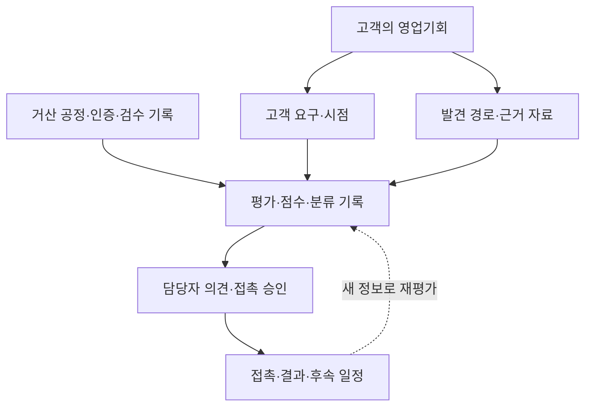
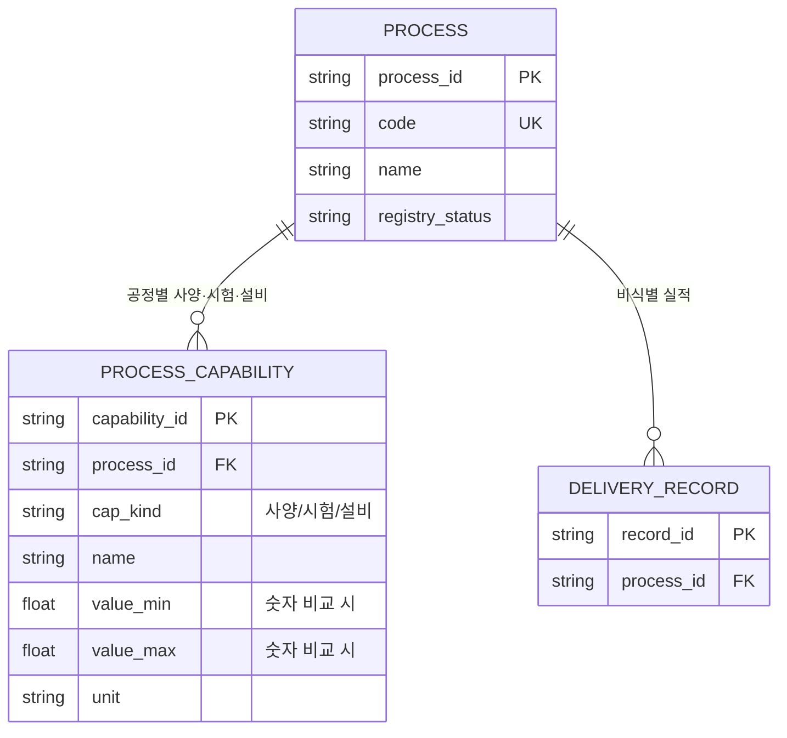
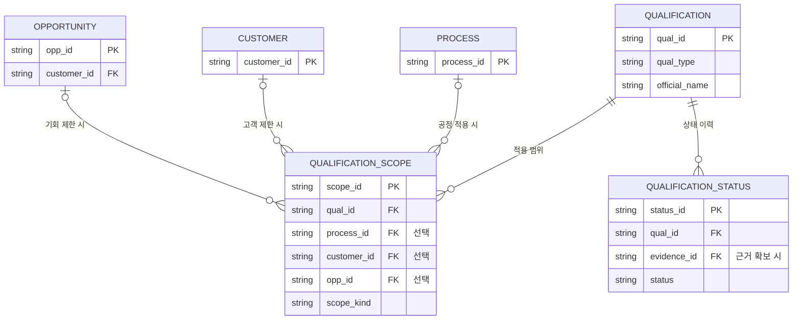
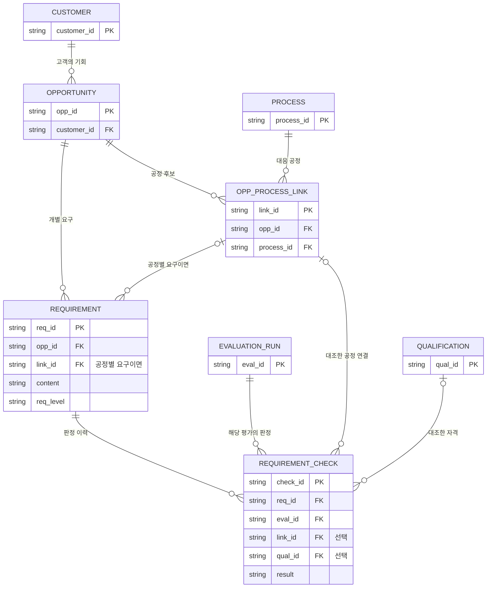
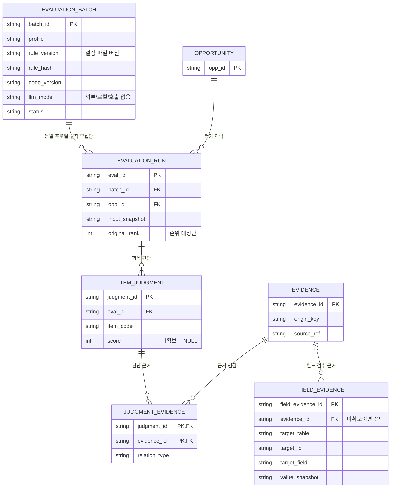
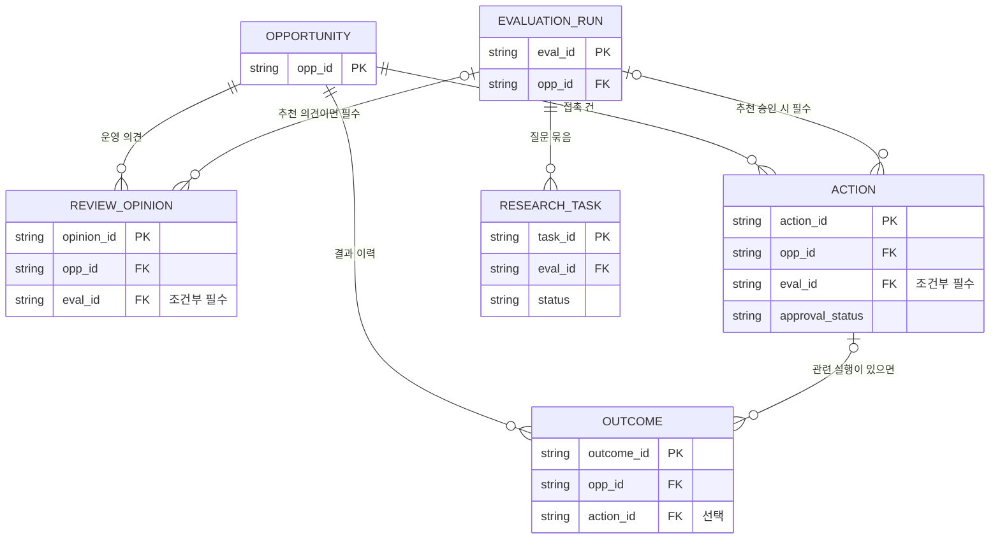

# 거산케미칼 AI 영업지원 2차 — 데이터 설계서 (v0.17 · 기획서 4.4 분리본)

**고객의 영업기회, 거산의 역량, 추천 근거와 실제 결과를 어떻게 나눠 저장할지 정한 문서입니다.**

| 항목 | 내용 |
|---|---|
| 상위 문서 | 「거산케미칼 AI 영업지원 에이전트 2차 기획서 v0.17」 4장 |
| 독자 | BE(백엔드)가 주로 구현하고, AI·FE(프론트엔드)는 주고받을 데이터와 표시 방법을, PM은 업무 범위를 확인합니다. |
| 상태 | **논리 설계안입니다.** 저장할 정보와 연결을 정한 단계입니다. 실제 DB 파일·SQLAlchemy 모델·DB 구조를 만들거나 변경하는 작업(마이그레이션)은 아직 없으며, 실행 검증 전입니다. |
| 개정일 | 2026-10-15 · 설명 순서와 문체 정리. 24개 테이블과 기존 관계·필드·규칙을 유지했습니다. |

처음 읽을 때는 **0장 → 1장 → 담당 영역** 순서로 보세요. 0장은 공통 이해를 돕는 안내이고, 실제 저장 기준은 1~8장에 있습니다. 기존 기획서와 평가 규칙서의 참조가 이어지도록 **1~8장 번호는 그대로 유지**했습니다.

## 0. 먼저 이해하기: 업무에서 데이터까지

### 0.1 무엇을 기록하는 문서인가요?

영업기회를 추천하려면 “고객이 무엇을 원하는지”, “거산이 어떤 근거를 갖고 있는지”, “그 근거로 어떻게 판단했는지”를 함께 알아야 합니다. 추천 이후에는 담당자의 의견과 실제 접촉 결과도 남겨야 합니다.

이 정보를 프로그램이 저장하고 찾아보는 공간이 **데이터베이스(DB)**입니다. 종류별로 모아 두는 기록표를 **테이블**, 표에 쌓이는 기록 한 건을 **행**, 이름·날짜처럼 기록하는 항목을 **필드**라고 부릅니다. 이 설계의 24개 테이블은 다음 여섯 묶음으로 이해하면 됩니다.

| 묶음 | 답하려는 업무 질문 | 상세 필드 |
|---|---|---|
| 거산의 공정·역량과 검수 | 어떤 공정을 할 수 있고, 그 사양·실적은 누가 확인했나요? | 5.1 |
| 거산의 인증·승인 | 어떤 자격을 갖고 있으며, 어디까지 적용되고 지금도 유효한가요? | 5.2 |
| 고객과 영업기회 | 어느 회사의 어떤 품목·프로젝트이며, 어디서 발견했나요? | 5.3 |
| 고객 요구와 시점 | 고객이 무엇을 요구하고, 언제 확인하거나 연락해야 하나요? | 5.4 |
| 평가와 근거 | 어떤 자료와 규칙으로 점수·분류를 정했나요? | 5.5 |
| 담당자 판단과 실행 결과 | 담당자가 어떻게 판단했고, 실제로 무엇을 했으며 결과는 어땠나요? | 5.6 |

아래는 저장된 정보를 함께 사용하는 모습입니다. **실제 DB의 연결선을 모두 표시한 그림은 아니며**, 업무를 이해하기 위한 그림입니다. 정확한 테이블 관계는 2~4장의 ERD를 봅니다.

### 0.2 A정밀 사례 한 건은 어떻게 저장되나요?

**아래는 기획서와 같은 가상 사례입니다.** 실제 고객이나 거산의 실제 자격 보유를 뜻하지 않습니다. A정밀의 밸브 바디 아노다이징 기회를 공고와 홈페이지에서 발견했다고 가정합니다. A정밀과는 2024년에 다른 부품의 아연도금 견적 이력이 있습니다.

| 업무에서 알게 된 내용 | 저장하는 곳 | 이 사례에서 남기는 기록 |
|---|---|---|
| 거산은 아노다이징을 할 수 있고, 그 사양과 ISO 9001 범위를 기업 담당자가 확인했습니다. | 공정 `PROCESS` / 역량 `PROCESS_CAPABILITY` / 자격 `QUALIFICATION`·`QUALIFICATION_SCOPE`·`QUALIFICATION_STATUS` / 필드 검수 `FIELD_EVIDENCE` | 공정 1건과 사양 1건, 인증 1건과 적용 범위·현재 상태 1건씩을 만듭니다. "이 값을 누가 언제 확인했는가"는 필드 검수에 따로 남깁니다. |
| A정밀은 과거 견적 이력이 있는 회사입니다. | 고객 `CUSTOMER` / 접촉 이력 `INTERACTION` | 고객 1건의 관계를 “기존 관계 확인”으로 둡니다. 2024년 이력은 종류를 “견적”으로 적고 고객에 연결합니다. 기회 ID는 비워 둡니다. |
| 이번에 검토할 대상은 밸브 바디 아노다이징입니다. | 기회 `OPPORTUNITY` / 공정 연결 `OPP_PROCESS_LINK` | 기회 1건과 아노다이징 연결 1건을 만듭니다. |
| 같은 기회를 공고와 홈페이지에서 찾았습니다. | 발견 경로 `DISCOVERY_PATH` | 발견 경로는 2건을 남기되 같은 기회에 연결합니다. |
| ISO 9001은 현재 단계에, 샘플 승인은 후속 단계에 필수입니다. | 고객 요구 `REQUIREMENT` | 요구를 2건으로 나누어 각각의 수준과 필요 단계를 적습니다. |
| 자료를 바탕으로 이 기회를 평가합니다. | 평가 `EVALUATION_RUN` / 요구 판정 `REQUIREMENT_CHECK` / 점수 항목 `ITEM_JUDGMENT` | 평가할 때마다 평가 1건을 남기고, 그 평가의 요구별 판정과 항목별 점수를 연결합니다. |
| 담당자가 의견을 남기고 접촉을 결정하면 그 내용을 기록합니다. | 의견 `REVIEW_OPINION` / 접촉 `ACTION` / 결과 `OUTCOME` | 추천에 대한 의견·승인은 실제로 본 평가에 연결합니다. 실제 접촉과 영업 결과는 별도 기록입니다. |

이렇게 나누면 같은 회사의 다른 프로젝트 이력이 이번 기회의 근거에 섞이지 않습니다. 다시 평가하더라도 이전에 어떤 자료로 판단했는지 확인할 수 있습니다. **나중에 값이 바뀌면 고치지 않고 새 행을 더합니다.** 예를 들어 2주 뒤 ISO 9001 범위에 아노다이징 라인이 빠져 있다고 밝혀지면, 자격 범위와 필드 검수에 새 행을 추가하고 새 평가를 한 번 더 만듭니다. 이전 평가와 그것을 보고 낸 의견·승인은 그대로 남습니다.

### 0.3 비슷해 보이는 기록을 왜 나누나요?

| 나누어 저장하는 것 | 쉬운 설명 | 개발할 때 볼 곳 |
|---|---|---|
| 고객 요구 `REQUIREMENT` / 요구 판정 `REQUIREMENT_CHECK` | “ISO 9001이 필요하다”는 고객 요구이고, “지금 확인한 자료로는 충족 여부를 모른다”는 평가 결과입니다. 요구와 그때의 판단을 구분합니다. | 3장 |
| 필수조건 판정 `REQUIREMENT_CHECK` / 점수 항목 `ITEM_JUDGMENT` | 필수조건을 갖췄는지와 검토 점수가 얼마인지는 서로 다른 판단입니다. 높은 점수로 필수조건 미충족을 덮지 않도록 나눕니다. | 3~4장 |
| 출처 근거 `EVIDENCE` / 거산 값의 검수 `FIELD_EVIDENCE` | “어떤 자료에서 확인했나”와 “거산의 이 값을 누가 확인했나”를 구분합니다. 자료가 있다고 그 값이 검수 완료인 것은 아닙니다. | 4장 |
| 담당자 의견 `REVIEW_OPINION` / 접촉 `ACTION` / 결과 `OUTCOME` | “검토할 만하다”, “연락을 승인하고 시도했다”, “진행중 또는 수주·실주다”는 각각 다른 사실입니다. 한 기록으로 덮어쓰지 않습니다. | 4장 |
| 자격 `QUALIFICATION` / 자격 상태 이력 `QUALIFICATION_STATUS` | 자격의 기본 정보와 정지·취소·만료 등 상태 변화를 나누어 이전 상태를 확인할 수 있게 합니다. | 2장 |

### 0.4 담당별로 무엇부터 확인하나요?

공통으로 0~1장을 읽은 뒤 아래 항목을 확인하세요. **착수 단계에서는 전체 관계 초안과 첫 사례의 데이터 약속을 맞춥니다.** 24개 테이블의 실제 DB 설계를 한꺼번에 끝내야 한다는 뜻은 아닙니다. 단계별 확정 범위는 8장에 있습니다.

| 담당 | 먼저 확인할 일 | 이어서 읽을 부분 |
|---|---|---|
| BE · 백엔드 | 고객·기회·요구·평가의 연결, 첫 사례의 필수 필드·빈 값 허용 여부·API 입출력을 정리합니다. | 2~8장 전체 |
| AI | 평가에 필요한 입력, 상태, 규칙, 판정 근거가 저장되는지 확인합니다. | 3~4장, 5장의 요구·시점·평가·근거, 6~8장 |
| FE · 프론트엔드 | 입력할 값과 화면·출력에 보여줄 상태·근거가 무엇인지 확인합니다. | 5장 관련 항목, 6장 코드값, 7장 인수 사례, 8장 확정 시점 |
| PM · 기획 | 업무 범위, 기업 검수 요청, 완료를 확인할 사례와 담당을 맞춥니다. | 1장, 7~8장; 필요한 필드는 5장 |

**PM이 1단계에서 확인할 것:** ① 0.2의 A정밀 예시대로 각 테이블에 행이 들어가는지 BE와 함께 따라가 봤는가 ② 재접촉 최소 필드 ①~⑦(기획서 4.3)이 `INTERACTION`·`SIGNAL`의 어느 열에 들어가는지 정했는가 ③ 기업이 검수할 값(`FIELD_EVIDENCE`가 가리키는 값)의 목록이 나와 있는가 ④ 외부 AI에 보내면 안 되는 열이 무엇인지 6장의 허용 등급으로 표시했는가.

여기서 **데이터/API 계약**은 담당자 사이에서 “어떤 이름의 값을 어떤 형식으로 주고받을지” 정하는 약속입니다. 자료형·필수값·인덱스·삭제 정책 등 실제 DB 구현 사항은 해당 기능을 만들기 전에 BE·AI·FE가 확정합니다.

### 0.5 상세 설계를 읽을 때 필요한 용어

| 용어 | 뜻 |
|---|---|
| ID / PK | ID는 기록을 구분하는 번호입니다. PK는 한 테이블에서 기록 한 건을 유일하게 구분하는 ID입니다. |
| UK | 같은 테이블에서 중복을 허용하지 않는 값입니다. 예를 들어 공정 코드입니다. |
| FK | 다른 테이블의 기록을 연결하기 위해 저장하는 ID입니다. 예를 들어 기회의 `customer_id`는 그 기회가 어느 고객의 것인지 가리킵니다. |
| NULL | 값이 저장되지 않은 상태입니다. 이것만으로 “해당 없음”이나 “조건 충족”을 뜻하지 않습니다. 적용 여부와 미확인 상태를 따로 확인합니다. |
| ERD | 어떤 테이블이 어떤 테이블과 연결되는지 보여주는 그림입니다. |
| 스냅샷(snapshot) | 나중에 값이 바뀌어도 당시 평가를 확인할 수 있게 남기는 입력값 사본입니다. 사용이 허용된 내용만 보존합니다. |
| 코드값 | 화면·API·DB가 같은 뜻으로 사용하는 정해진 값입니다. 예를 들어 판정의 “통과 / 미확인 / 제외”입니다. |

ERD의 연결 기호는 다음 뜻입니다.

- `||`: 반드시 하나입니다.
- `|o`: 없거나 하나입니다.
- `o{`: 0개 이상입니다.

## 1. 설계 원칙

이 문서가 정하는 범위는 **24개 논리 테이블의 뜻과 연결, 최소 필드, 코드값, 구현 전 제약, 단계별 확정 순서**입니다. 아래 원칙은 상세 설계를 조정하더라도 지켜야 합니다.

| 원칙 | 저장할 때 지킬 기준 |
|---|---|
| 기회 중심 | 점수·요구·질문·의견·결과를 같은 `opp_id`에 연결합니다. 여러 곳에서 발견했다면 발견 경로를 여러 행으로 남깁니다. |
| 범위 구분 | 고객 공통, 특정 기회, 특정 공정 연결의 조건을 구분합니다. 다른 기회의 승인·상담 내용을 자동으로 복제하지 않습니다. |
| 요구별 판정 | 고객이 실제로 요구한 내용과 판정 근거를 남깁니다. 자격 ID와 공정 연결 ID를 같은 열에 섞어 저장하지 않습니다. |
| 값·근거 검수 | 검수 당시 값, 대상 필드, 근거, 검수자와 날짜를 보존합니다. 거산의 역량을 추정값으로 채우지 않습니다. |
| 평가 재현 | 당시 사용이 허용된 확정 입력·규칙 설정·코드 버전·검수 값을 보존합니다. 같은 평가 대상 묶음의 정렬 결과도 함께 남깁니다. |
| 사람의 판단 분리 | 추천, 운영 의견, 접촉 승인·실행, 영업 결과를 따로 저장합니다. 추천에 대한 의견·승인에는 대상 평가를 연결합니다. |
| 데이터 사용 | 출처 등급과 사용 허용을 따로 관리합니다. 금지된 원문은 메모나 스냅샷에도 저장하지 않습니다. |

전용 평가·권한·설비 자산관리 시스템은 추가하지 않습니다. 기업이 추천 품질을 확인하는 G2 평가의 원본은 **버전이 고정된 평가표 파일**로 시작할 수 있습니다(7장).

## 2. ERD ① 역량과 자격의 범위

### 2.1 공정에 사양·시험·설비·실적을 연결하기

**무엇을 연결하나요?** 공정(`PROCESS`)에 그 공정의 사양·시험·설비(`PROCESS_CAPABILITY`)와 비식별 실적(`DELIVERY_RECORD`)을 연결합니다. 어떤 자료가 어느 공정의 능력을 설명하는지 구분하기 위한 구조입니다.

**예를 들면:** 아노다이징의 두께 사양과 시험 항목을 기록할 때는 각각 아노다이징 공정에 연결합니다. 이는 저장 방식의 예시이며, 거산의 실제 사양이 확인됐다는 뜻은 아닙니다.

사양·시험·설비는 `PROCESS_CAPABILITY` 한 테이블에 저장하고, `cap_kind`로 종류를 구분합니다.

| 저장할 정보 | 사용 방법과 주의점 |
|---|---|
| 사양(두께·치수·규격)·시험 항목 | 기획서 5.2의 기술 필수조건과 비교할 때 사용합니다. |
| 사용 설비 | 설명 정보로만 쓰며 판정 규칙에는 쓰지 않습니다. 여러 공정이 같은 설비를 사용해도 공정별로 기록합니다. 따라서 저장된 행 수를 실제 고유 자산 수로 세지 않습니다. |
| 소재·성능 태그 | 공통 코드/목록으로 관리합니다. |
| 숫자로 비교할 사양 | 자동 숫자 비교가 필요한 항목만 값·단위를 나눠 저장합니다. 글로 적힌 값을 해석해 처리 가능 여부를 자동 확정하지 않습니다. |

### 2.2 자격에 적용 범위와 상태 이력을 연결하기

**무엇을 연결하나요?** 자격(`QUALIFICATION`)에 적용 범위(`QUALIFICATION_SCOPE`)와 상태 이력(`QUALIFICATION_STATUS`)을 연결합니다. 자격이 있다는 사실만으로 모든 공정·고객·프로젝트에 적용되는 것은 아니기 때문입니다.

**예를 들면:** A정밀 밸브 바디 건의 샘플 승인을 기록한다면 그 기회에 해당하는 범위를 연결합니다. 특정 샘플의 승인을 회사 전체에 적용되는 자격으로 보지 않습니다.

| 확인할 것 | 기록·판단 기준 |
|---|---|
| 회사·사업장 단위 인증 | 공정 ID 없이도 기록할 수 있습니다. |
| 고객 승인 | 고객 범위를 연결합니다. |
| 특정 샘플·양산 승인 | 해당 기회 범위를 연결합니다. |
| 범위의 뜻 | `scope_kind`와 각 범위의 적용/해당 없음/미확인을 함께 확인합니다. |
| 공정 ID가 NULL인 경우 | 공정 ID 값이 비어 있다는 뜻입니다. 모든 공정에 통용되는 인증이라고 해석하지 않습니다. |
| 기회가 지정된 경우 | 연결된 고객이 그 기회의 고객과 일치해야 합니다. |

## 3. ERD ② 기회·요구·판정

**무엇을 연결하나요?** 고객의 영업기회에 대응 공정과 고객 요구를 연결하고, 평가할 때마다 그 요구를 어떻게 판정했는지 남깁니다. **요구 자체와 그 요구에 대한 판정은 다른 기록**이기 때문입니다.

**예를 들면:** 고객이 요구한 두께는 `REQUIREMENT`에 기록합니다. 평가할 때 어떤 공정 자료와 비교해 어떻게 판단했는지는 `REQUIREMENT_CHECK`에 기록합니다.

**요구와 판정에 남기는 내용**

- `REQUIREMENT`에는 무엇을 요구하는지 적습니다. 두께 조건이라면 내용·값·단위·적용 공정과 근거를 남깁니다.
- `REQUIREMENT_CHECK`에는 **그 평가에서 무엇과 비교해 어떻게 판단했는지** 적습니다.

| 판정 상황 | 연결 ID를 기록하는 방법 |
|---|---|
| 자격이 필요 없는 기술 요구 | `qual_id=NULL`로 기록할 수 있습니다. |
| 자격과 공정을 함께 확인한 판정 | 자격과 공정 연결의 FK를 모두 가질 수 있습니다. |
| 두 FK가 모두 없는 ‘미확인’ | 이유와 질문을 남깁니다. 근거 없는 통과로 바꾸지 않습니다. |

**제한이 어느 범위에 해당하는지도 구분합니다.**

| 제한 범위 | 저장 위치 |
|---|---|
| 기업 전체 | 고객의 필터 상태·사유 |
| 기회 공통 | 요구의 `scope_kind=OPPORTUNITY` |
| 특정 공정 | `scope_kind=PROCESS_LINK`와 `link_id` |

공통 요구를 공정별 요구로 바꿔 대안 공정으로 우회하지 않습니다. 요구·공정 연결·평가의 `opp_id`는 모두 같아야 합니다.

**이력·발견 경로·신호도 같은 고객과 기회에 연결합니다.**

- 한 고객에게 `INTERACTION`(거래·견적·상담·제안 이력과 상담 메모)이 여러 개 있을 수 있습니다. 고객 ID는 필수이고, 기회 ID는 그 기회에 적용되는 경우 연결합니다.
- 회사 공통 메모는 적용 범위가 확인된 부분만 재사용합니다.
- 한 기회에는 `DISCOVERY_PATH`·`SIGNAL`이 여러 개 있을 수 있습니다. 평가에 포함된 기회에는 발견 경로와 식별 근거가 최소 1건 있어야 합니다.

## 4. ERD ③ 평가·근거와 실행 기록

### 4.1 평가 결과와 사용한 근거를 연결하기

**무엇을 연결하나요?** 같은 프로필·규칙으로 평가할 묶음(`EVALUATION_BATCH`, batch) 아래에 기회별 평가 한 번(`EVALUATION_RUN`, run)을 기록합니다. 그 평가의 항목별 판단과 근거를 연결해, 어떤 자료로 결과를 냈는지 나중에도 확인할 수 있게 합니다.

**예를 들면:** A정밀 밸브 바디 건을 한 번 평가하면 그 평가에 항목별 판단과 근거를 연결합니다. 거산 자료를 검수한 값도 당시 평가가 사용한 상태로 보존합니다.

**거산 값의 검수 기록은 어떻게 연결하나요?**

`FIELD_EVIDENCE.target_table/target_id`는 검수한 값이 어느 테이블의 어느 기록에 있는지 가리킵니다. **허용된 테이블·레코드를 가리키는 일반 참조이며 SQL FK는 아닙니다.** 즉, DB에 외래키로 선언한 연결과 구분합니다. 이 그림에서 공정과 자격 양쪽에 필수 연결된 것처럼 그리지 않습니다.

| 확인·보존할 것 | 처리 기준 |
|---|---|
| 참조할 수 있는 대상 | PROCESS·PROCESS_CAPABILITY·DELIVERY_RECORD·QUALIFICATION·QUALIFICATION_SCOPE 목록을 사용합니다. |
| 서버에서 검사할 내용 | BE가 허용 대상 목록, ID·필드의 존재, 버전 일치, 삭제 제한을 검사합니다. |
| DB에서 강제할 항목 | 물리 설계에서 명시 FK/연결로 확정합니다. 어떤 항목인지 데이터 사전에도 구분해 적습니다. |
| 검수한 값이 바뀐 경우 | 새 행으로 검수 기록을 남깁니다. |
| 평가가 사용한 검수 값 | 검수 ID와 값을 입력 스냅샷에 보존합니다. |

**평가 항목과 순위는 어떻게 남기나요?**

| 상황 | 저장·순위 기준 |
|---|---|
| 평가가 확정됨 | 선택한 프로필의 모든 항목 행을 저장합니다. |
| 항목이 미확보임 | NULL 점수 행으로도 남깁니다. 따라서 완료율의 분모가 줄지 않습니다. |
| 실행 중·오류 | `run_status`로 구분하고 추천 순위에 넣지 않습니다. |
| 개별 참고 평가 | 하나의 별도 batch에 기록할 수 있습니다. 다만 비교할 모집단이 없으면 순위를 부여하지 않습니다. |

### 4.2 담당자의 의견·접촉·결과를 연결하기

**무엇을 연결하나요?** 영업기회에 담당자 의견, 접촉 건, 영업 결과를 연결합니다. 추천을 보고 낸 의견이나 승인은 **실제로 본 평가**에도 연결합니다. 추가조사 질문 묶음은 해당 평가에 연결합니다. 어떤 추천을 보고 어떤 행동을 했는지 구분하기 위한 구조입니다.

**예를 들면:** A정밀 추천을 보고 연락을 승인했다면, 그 승인에 당시 본 평가 ID를 남깁니다. 나중에 새 평가가 생겨도 예전 승인으로 자동 실행하지 않습니다.

| 기록 상황 | 지킬 기준 |
|---|---|
| 일반 기회 메모 | 평가 ID 없이도 기록할 수 있습니다. |
| 추천에 대한 의견·승인 | 실제로 본 `eval_id`를 필수로 저장합니다. |
| 과거 수동 접촉 이력 | 추천에 따른 실행과 구분해 기록합니다. |
| 새로운 평가가 만들어짐 | 이전 승인으로 자동 실행하지 않습니다. |
| 접촉과 재시도 | ACTION 한 행은 한 접촉 건입니다. 재시도는 새 행으로 추가합니다. |
| 승인 변경 | 승인자·시각·사유가 있는 변경 기록으로 이력을 보존합니다. |

## 5. 테이블별 최소 필드와 담당

24개 테이블을 업무별 여섯 묶음으로 나눠 봅니다. 각 테이블은 **용도 → 식별·연결 → 저장 항목 → 기억할 규칙** 순서로 읽으면 됩니다.

FK 대상은 2~4장 도식의 같은 이름을 가진 PK입니다. ‘선택’·‘조건부’ 연결은 아래에 따로 표시했습니다. 기본 용어는 0.5에서 확인할 수 있습니다.

모든 업무 기록은 생성자/생성 시각과 실데이터·가상 데이터 구분을 직접 보관하거나 상위 기록에서 일관되게 상속합니다. 시각과 시간대를 보존하고, 화면에는 한국 시각으로 표시합니다. 아래 JSON(정해진 항목·값으로 저장하는 형식)/목록에는 검증된 구조화 값만 저장하며 금지 원문을 보관하지 않습니다.

### 5.1 거산 역량 — 공정·역량·실적·필드 검수

**공정 `PROCESS` — 공정 목록을 등록합니다.**

- **식별·연결:** PK `process_id`.
- **저장 항목:** name, category, material_codes, performance_tags, registry_status.
- **기억할 규칙:** code는 유일해야 합니다. 소개서 표기로 등록하며, 공식 명칭·코드가 확정되기 전까지 검수 상태로 구분합니다.

**역량 항목 `PROCESS_CAPABILITY` — 공정의 사양·시험·설비를 기록합니다.**

- **식별·연결:** PK `capability_id`; FK `process_id`.
- **저장 항목:** cap_kind(사양/시험/설비), 명칭·표시값, 필요 시 숫자 최소/최대·단위, 규격·판본, 치수 조건·적용 범위, 시험의 자체/외주, 확인 상태.
- **기억할 규칙:** 설비는 설명용이며 자동 생산능력 계산에 쓰지 않습니다.

**실적 `DELIVERY_RECORD` — 허용된 실적 근거를 기록합니다.**

- **식별·연결:** PK `record_id`; FK `process_id`.
- **저장 항목:** 산업·부품 유형·시기·허용 근거.
- **기억할 규칙:** 고객 실명은 저장하지 않습니다.

**필드 검수 `FIELD_EVIDENCE` — 각 값의 검수 기록을 남깁니다.**

- **식별·연결:** PK `field_evidence_id`; 선택 FK `evidence_id`.
- **저장 항목:** target_table/id/field, value_snapshot, data_version, 검수 상태·검수자·검수일.
- **기억할 규칙:** 일반 참조 검사가 필수입니다.

### 5.2 거산 자격 — 자격·적용 범위·상태

**자격 `QUALIFICATION` — 인증·승인의 기본 정보를 기록합니다.**

- **식별·연결:** PK `qual_id`.
- **저장 항목:** 종류·공식명·번호·판본·보유 주체·사업장·유효기간·자료 버전.
- **기억할 규칙:** 변경된 값은 당시 평가 스냅샷에 보존합니다.

**자격 범위 `QUALIFICATION_SCOPE` — 자격이 적용되는 범위를 기록합니다.**

- **식별·연결:** PK `scope_id`; FK `qual_id`; 선택 FK `process_id/customer_id/opp_id`.
- **저장 항목:** scope_kind, 제품·규격·사업장 범위, 항목별 적용/해당 없음/미확인·그 근거.

**상태 `QUALIFICATION_STATUS` — 자격 상태의 변화를 기록합니다.**

- **식별·연결:** PK `status_id`; FK `qual_id`; 선택 FK `evidence_id`.
- **저장 항목:** 정상/정지/취소/만료/미확인, 상태 발생일(알 때)·확인일·확인자·사유.
- **기억할 규칙:** 갱신할 때마다 새 행을 만듭니다.

### 5.3 고객과 기회 — 고객·이력·기회·발견·공정 연결

**고객 `CUSTOMER` — 고객 회사의 정보와 관계를 기록합니다.**

- **식별·연결:** PK `customer_id`.
- **저장 항목:** 이름·확인된 사업자번호·식별 근거, 관계 상태·확인일, 기업 전체 필터 상태·사유·근거.

**접촉 이력 `INTERACTION` — 거래·견적·상담·제안·메모를 기록합니다.**

- **식별·연결:** PK `interaction_id`; FK `customer_id`; 선택 FK `opp_id/evidence_id`.
- **저장 항목:** 종류(거래/견적/상담/제안/메모), 발생일, 허용된 내용 요약, apply_scope(특정 기회/회사 공통).
- **상담·허용 항목:** 상담 4항목(관심요소·확인항목·의사결정 구조·다음 일정), 회사 공통 적용 확인자/근거, 사용 허용 기록.

**재접촉 최소 필드 중 이곳에 저장하는 값은 기획서 4.3의 ①~⑤입니다.**

① 과거 공정·품목  
② 수주 여부·횟수·샘플 승인 여부  
③ 당시 요구 충족(모두/일부)  
④ 실주·중단 사유와 해소 여부  
⑤ 마지막 납품일·평균 발주 주기

각 값에는 확인/추정·확인일·입력자를 붙입니다. ⑥·⑦의 저장 위치는 5.4의 `SIGNAL`입니다.

- **기억할 규칙:** 금액·단가·도면·연락처 열은 두지 않습니다. 입력 기본 등급은 "내부 구조화만 허용"입니다(6장).

**기회 `OPPORTUNITY` — 품목·프로젝트별 영업기회를 기록합니다.**

- **식별·연결:** PK `opp_id`; FK `customer_id`.
- **저장 항목:** 품목·프로젝트·구분 근거, 대응 목적·담당·진행 상태, 현재 행동 단계·예상 수행일·재검토 조건/담당/일자·중복 병합 이력.

**발견 `DISCOVERY_PATH` — 기회를 어디서 발견했는지 기록합니다.**

- **식별·연결:** PK `path_id`; FK `opp_id`; 선택 FK `evidence_id`.
- **저장 항목:** 공정/인증/이력 경로, 소스 계약표의 source_id, 원본키·발견일.
- **기억할 규칙:** source_id는 계약표 참조이며 DB FK로 표시하지 않습니다.

**공정 연결 `OPP_PROCESS_LINK` — 기회와 공정을 연결하고 현재 결과를 보여줍니다.**

- **식별·연결:** PK `link_id`; FK `opp_id/process_id`.
- **저장 항목:** 현재 결과·사유·적용 소재/범위·확인일.
- **기억할 규칙:** `(opp_id,process_id)`는 유일해야 합니다. 과거 판정은 해당 평가 스냅샷에 보존합니다.

**현재 결과는 조회용 파생값입니다.** 같은 기회·실제/가상 구분의 최근 확정 평가에서 공정 대응과 적용 필수요구를 종합해 만듭니다. 개별 `REQUIREMENT_CHECK` 하나를 복사하지 않습니다. 집계 순서는 다음과 같습니다.

1. **같은 확정 평가의 결과를 모읍니다.** 공정 대응 결과와 현재 단계에 적용되는 기회 공통·해당 공정의 필수요구를 기획서 5.2·규칙서의 기존 필터 규칙으로 종합합니다.
2. **해당 범위의 결과를 정합니다.** 명백한 필수 불일치가 있으면 **제외**, 차단 조건이 미확인이면 **확인 대기**, 필요한 확인을 충족하면 **통과**로 표시합니다.
3. **자동 처리하면 안 되는 경우를 확인합니다.** 우대·비요구 불일치로 자동 제외하지 않고, 판정 행이 없다는 이유로 자동 통과시키지 않습니다. 필수요구의 필요 단계가 불명확해도 대기로 처리합니다. 후속 단계 요구와 요구 자체 미확인은 규칙서 F.3의 구분을 따릅니다.
4. **대안 공정도 따로 판정합니다.** 다른 공정을 검토하더라도 기회 공통 필수조건을 우회하지 않습니다.
5. **원본 평가를 기준으로 갱신합니다.** 캐시(조회용으로 따로 저장한 값)를 저장하면 원본 eval_id를 추적합니다. 캐시와 원본이 다르면 원본 평가가 기준입니다. 입력·자격 상태가 바뀌면 재확인 표시와 재평가로 갱신합니다. 캐시 저장 여부와 갱신 방식은 상세 설계에서 정합니다.

### 5.4 요구와 시점 — 고객 요구·개별 판정·시점 신호

**요구 `REQUIREMENT` — 고객이 요구하는 조건을 기록합니다.**

- **식별·연결:** PK `req_id`; FK `opp_id`; 선택 FK `link_id/evidence_id`.
- **저장 항목:** 요구 종류·명칭·내용, req_level, scope_kind, 필요한 값/단위/판본, 확인/추정·필요 단계·기한·질문.
- **기억할 규칙:** 고객 요구가 바뀌기 전의 값은 평가 입력에 보존합니다.

**판정 `REQUIREMENT_CHECK` — 각 요구를 어떻게 판단했는지 기록합니다.**

- **식별·연결:** PK `check_id`; FK `req_id/eval_id`; 선택 FK `qual_id/link_id/evidence_id`.
- **저장 항목:** result, 판단한 현재 단계·수행 시점·범위, 사유·대조값·기준일·판정자·후속 조건.
- **기억할 규칙:** 사용한 자격 범위/상태 ID와 추가 근거는 평가 입력 명세에도 포함합니다.

**신호 `SIGNAL` — 날짜와 진행 상태가 있는 신호를 기록합니다.**

- **식별·연결:** PK `signal_id`; FK `opp_id`; 선택 FK `evidence_id`.
- **저장 항목:** 유형·실제 발생일·발표일·예정일·확인일·기한/시간대·유형별 진행 상태·다음 확인일.
- **재접촉 최소 필드:** ⑥ 최근 수주·증설·채용 신호, ⑦ 다음 약속·샘플 일정과 상태를 이곳에 저장합니다.
- **기억할 규칙:** 규칙서 F.2/F.4의 상태를 빠짐없이 대응합니다.

### 5.5 평가와 근거 — 평가 묶음·개별 평가·항목·근거·조사

**모집단 `EVALUATION_BATCH` — 같은 기준으로 평가할 묶음을 기록합니다.**

해시(hash)는 보존한 파일·입력값이 같은 내용인지 확인하는 데 쓰는 값입니다.

- **식별·연결:** PK `batch_id`.
- **평가 기준:** 단일 profile, base_date, **rule_version·rule_hash·code_version**.
- **모집단·실행 항목:** 모집단 범위/기간/소스, 상태·실제/가상 구분, **llm_mode**(외부 LLM / 로컬 모델 / 호출 없음, 기획서 6.1)·모델 식별자.
- **정렬·표본·원본 항목:** 정렬 규칙·전체 eval_id 명세, 후보/진단 표본 명세·고정일, 평가 원본 파일의 버전/참조.
- **기억할 규칙:** 규칙 설정 파일의 버전·해시, 상태 초안/고정/폐기, 변경 이유·고정일·기업 승인 상태는 설정 파일 이력에 보존합니다.

**평가 `EVALUATION_RUN` — 영업기회별 평가 한 번을 기록합니다.**

- **식별·연결:** PK `eval_id`; FK `batch_id/opp_id`.
- **입력·상태 항목:** run_status, 허용 입력 snapshot·해시, 역량DB/검수 버전, filter_state·핵심근거/운영/시점 요건.
- **점수·분류 항목:** E/F/T/P/R/S/C, classification·직접 확인 배점·유효 기한·원래 순위, 조정 순위·사유·조정자/일시.
- **기억할 규칙:** 프로필·기준일·규칙 버전은 batch에서 상속합니다.

**항목 `ITEM_JUDGMENT` — 점수 항목별 판단을 기록합니다.**

- **식별·연결:** PK `judgment_id`; FK `eval_id`.
- **저장 항목:** item_code, 판단할 사실·추론 이유, weight, state, match_rate/certainty/decay, score.
- **기억할 규칙:** `(eval_id,item_code)`는 유일해야 합니다.

**근거 `EVIDENCE` — 판단에 쓴 자료와 사용 허용을 기록합니다.**

- **식별·연결:** PK `evidence_id`.
- **출처·내용 항목:** source_grade, source_ref·원본 버전, 원천 origin_key/인용 관계, 허용 문장·대상/범위·발생일/확인일.
- **허용·추출 항목:** security_grade·사용 허용 기록, 추출 방식(외부 LLM/로컬 모델/수동 입력)과 추출자·추출일.

**연결 `JUDGMENT_EVIDENCE` — 항목 판단과 근거를 연결합니다.**

- **식별·연결:** 복합 PK `judgment_id/evidence_id`; 각각 FK입니다.
- **저장 항목:** 직접/간접/상충 등 relation_type, 적용 이유.
- **기억할 규칙:** 동일 연결의 중복을 막습니다.

**조사 `RESEARCH_TASK` — 추가로 확인할 질문과 조사 결과를 기록합니다.**

- **식별·연결:** PK `task_id`; FK `eval_id`.
- **저장 항목:** 질문 묶음·허용 경로·담당·예상/상한/실제 시간·재확인일·상태·결과 근거/요약·종료 사유.

### 5.6 사람의 판단 — 담당자 의견·접촉·영업 결과

**의견 `REVIEW_OPINION` — 담당자의 의견과 메모를 기록합니다.**

- **식별·연결:** PK `opinion_id`; FK `opp_id`; 조건부 FK `eval_id`.
- **저장 항목:** 의견·메모·작성자/시각·실제 본 추천 버전.
- **기억할 규칙:** G2 블라인드 판정과 구분합니다.

**접촉 `ACTION` — 승인과 실제 접촉을 기록합니다.**

- **식별·연결:** PK `action_id`; FK `opp_id`; 조건부 FK `eval_id`.
- **승인 항목:** approval_status(미정/승인/거절/취소), 승인자/일시·변경 이력.
- **실행 항목:** 목적·시도 시각·회신·후속 일정·미실행 사유.

**결과 `OUTCOME` — 영업 결과와 후속 조건을 기록합니다.**

- **식별·연결:** PK `outcome_id`; FK `opp_id`; 선택 FK `action_id`.
- **저장 항목:** 미실행/진행중/보류/수주/실주, 사유·재개 조건·기록자/일시.
- **기억할 규칙:** 수정은 새 이력으로 남깁니다.

**누가 무엇을 확인하나요?**

| 담당 | 책임 |
|---|---|
| BE | DB·저장·조회·참조 검사 |
| AI | 평가 입력·규칙·판정 근거 계약 확인 |
| FE | 상태·근거·입력/출력 표시 |
| PM | 업무 범위·기업 검수 요청·인수 사례 |
| 기업 기술/품질 담당자 | 실제 거산 역량 검수 확인 |

## 6. 주요 코드·제약·사용 허용

아래 표는 같은 상태를 DB·API·화면에서 어떻게 기록할지 정하는 기준입니다.

| 항목 | 고정할 기준 |
|---|---|
| 고객 관계 | 신규 확인 / 기존 관계 확인 / 관계 미확인으로 구분합니다. 관계 미확인이면 접촉을 확정하지 않습니다. |
| 프로필·목적 | 프로필은 신규 기회(B) / 재접촉(A)로 구분합니다. 목적은 신규 제안 / 기존 제안 후속 / 재발주 확인으로 별도 기록합니다. |
| 요구 | 필수 / 우대 / 비요구 / 미확인으로 기록합니다. 필요 단계가 미확인인 상태도 따로 보존합니다. |
| 판정·필터 | 통과 / 미확인 / 제외를 사용합니다. 포괄적인 조건부 통과는 두지 않습니다. |
| 검수 | 미확보 / 검수 대기 / 검수 완료 / 재확인으로 기록합니다. 거산 가점 근거에는 검수 완료 값만 사용합니다. |
| 항목 상태 | 확인 / 강한 추정 / 약한 추정 / 불일치 / 가점 없음 / 신호 없음 / 미확보를 사용합니다. 앞 6개는 완료이며, 미확보만 NULL입니다. |
| 점수 | P=0이면 S=NULL(산정 전)입니다. W는 P로부터 계산해 API/화면/출력에 제공합니다. 별도 열로 중복 저장할 필요는 없습니다. `0≤E≤P≤100`, `E≤R≤100`을 지킵니다. |
| 실행 분류 | 규칙서 F.9의 11개 분기·표시 문구를 하나의 코드표로 관리합니다. DB·API·화면이 같은 코드를 사용합니다. |
| 자료 허용 | 공개 / 외부 AI 허용 / 내부 구조화만 / 처리 금지와 함께 external_ai_allowed·presentation_allowed를 허용/불허/미확인으로 기록합니다. 허용 범위·확인자/일자·참조·기한이 있으면 보존합니다. 담당자가 입력한 재접촉 최소 필드는 기본값을 "내부 구조화만"·external_ai_allowed=불허로 둡니다. |
| LLM 실행 모드 | 외부 LLM / 로컬 모델 / 호출 없음(기획서 6.1)을 batch 단위로 기록합니다. 모드가 달라도 규칙 엔진의 입력·출력 형식은 같습니다. |

**자료를 사용할 때 확인할 사항**

- 단순 보안 등급만으로 외부 AI 전송이나 발표 공개를 허용하지 않습니다.
- 서버는 호출/조회/출력 전에 근거·내부 이력·상담 기록의 사용 허용을 검사합니다.
- 미확인 자료는 외부 AI 전송을 보류합니다. 금지 원문은 어떤 등급에서도 저장하지 않습니다.
- 처리 금지 기록이 필요하면 원문 없이 차단 사유·참조만 남깁니다.
- 허용이 철회되면 과거 스냅샷도 계속 노출하지 않습니다. 정정·삭제 정책을 적용합니다.

**구현 전 필수 제약**

다음 규칙을 모두 지켜야 합니다. DB 제약으로 강제할 항목과 서버에서 검사할 항목은 데이터 사전에 구분합니다.

| 확인할 대상 | 반드시 지킬 규칙 |
|---|---|
| 공정·사업자번호 중복 | 확인된 공정 code와 정규화된 사업자번호의 중복을 막습니다. 미확인 번호는 NULL을 허용합니다. |
| FK 참조 대상 | 존재하지 않는 FK 대상을 저장하려 하면 거부합니다. |
| 기회와 메모/이력 | 같은 고객에 속해야 합니다. 기회 범위 메모에는 opp_id가 필수입니다. |
| 요구·공정 연결·평가 | 모두 같은 기회에 속해야 합니다. |
| 공정별 요구와 판정 | 공정별 요구는 req.link_id가 필수이며, 판정의 link_id와 같아야 합니다. |
| 의견/접촉·결과 | 의견/접촉의 eval_id와 결과의 action_id는 같은 opp_id에 속해야 합니다. |
| run과 batch | run의 프로필·기준일·규칙 버전은 batch에서 상속합니다. 별도 열에 중복 저장하지 않습니다. |
| 확정 batch의 평가 | 같은 기회의 평가는 1건만 둡니다. |
| 항목/근거 연결 | 같은 연결의 중복 저장을 막습니다. |
| 과거 이력 | 평가·검수·승인 이력을 임의로 덮어쓰지 않습니다. |

개인정보·사용 허용 철회에 따른 삭제 절차와 일반 이력 보존은 구분합니다.

SQLite를 사용하면 **각 DB 연결에서 외래키 검사를 활성화하고 확인**합니다. 마이그레이션 후에는 참조 오류를 점검합니다. 다대다 관계는 연결 테이블과 중복 방지 키를 사용합니다.

이 구현 주의점은 [SQLite 공식 문서](https://sqlite.org/foreignkeys.html)와 [SQLAlchemy 공식 관계 문서](https://docs.sqlalchemy.org/en/20/orm/basic_relationships.html)를 확인한 내용입니다(2026-10-12). 나머지 테이블·필드 선택은 이 기획에 맞춘 설계 제안입니다.

## 7. G2 원본과 개발 단계별 DB 완료 확인

G2는 프로필별 **고정 평가표 파일**로 시작할 수 있습니다. 평가 대상을 고정해 보관하고, 평가자에게는 점수·순위·시스템 분류를 제외한 자료를 제공합니다.

**평가 파일은 이렇게 관리합니다.**

- batch에는 원래 순위·고정 표본의 ID 명세와 파일 버전/참조를 보존합니다.
- 관리자용 명세와 평가자용 자료를 분리합니다. 원본 파일의 열만 숨긴 채 배포하지 않습니다.
- 평가자용 파일은 무작위 등 사전에 합의한 표시 순서를 사용합니다.
- 복수 평가자의 원본과 합의한 통합 결과는 따로 보존합니다.

**평가표에서 추적할 항목은 다음과 같습니다.** 관리용 항목을 평가자에게 모두 보여줄 필요는 없습니다.

| 구분 | 추적할 항목 |
|---|---|
| 평가 대상 | sample_id·batch_id·eval_id·opp_id·프로필 |
| 표본 종류 | 추천/진단 표본 구분 |
| 평가 진행 | 평가자·노출 여부·미평가/완료 |
| 평가 내용 | 판정·사유·시각 |

비율을 계산할 때는 **고정 추천 표본만 분모로 사용**하고 표본을 임의로 교체하지 않습니다. 실제 사용 의견을 블라인드 평가 원본 대신 집계하지 않습니다.

아래 표는 개발 단계별 **검증 계획**입니다. 실제 DB 테스트를 이미 통과했다는 뜻은 아닙니다.

| 확인 시점 | 담당·산출물 | 구현 후 통과해야 할 사례 |
|---|---|---|
| 1단계 설계 | BE 주관, AI·FE·PM 검토: 전체 관계 초안, 첫 통합 사례의 필수 필드·NULL/코드·API 예시 | 고객/기회/요구/평가 ID와 상태의 뜻이 일치해야 합니다. 회사·고객·기회 승인 및 상담 범위를 논리 구조로 표현합니다. |
| 2단계 기반 | BE·AI: 초기 마이그레이션·최소 입력 사례 | 없는 ID, 고객/기회 불일치, 같은 항목/근거 연결의 중복 저장을 거부해야 합니다. |
| 3~4단계 흐름 | BE·AI·FE: 신규·재접촉 연결 사례 | 다른 프로젝트의 조건이 섞이지 않아야 합니다. 같은 기회를 병합하고, 자격이 필요 없는 기술 요구의 판정도 저장할 수 있어야 합니다. |
| 5단계 통합 인수 | BE·AI: 과거 입력·결과 재현; PM·FE: 승인·출력 확인 | 값이 바뀌어도 이전 평가를 유지해야 합니다. 미확보 NULL/완료 0점을 구분하고, 프로필별 순위와 대상 평가의 승인을 연결합니다. |
| 6단계 실제 평가 전 | PM·BE: 고정 batch·평가자용 파일 | 고정 표본의 누락·교체를 막고 점수·순위를 노출하지 않아야 합니다. 가상/진단 표본을 분리합니다. |

테이블 수나 ERD 작성만으로 설계 완료를 판단하지 않습니다. 6장의 DB 제약·서버 검사 구분을 데이터 사전에 남기고, **실제 저장·조회·재평가 결과를 확인한 뒤** 단계 완료로 기록합니다.

## 8. 테이블 구성 검토와 단계별 확정 범위

**24개 논리 테이블을 기본안으로 유지합니다.** 요구별 판정, 자격 상태 이력, 평가 재현, 사람 판단 분리에 필요한 정보와 연결을 보존하는 것이 핵심입니다.

설계 검토 중 비슷한 모양의 테이블을 아래처럼 세 곳 합쳤습니다. 상세 설계에서 테이블을 더 조정하더라도 **필수 정보·제약·이력과 인수 사례는 보존**해야 합니다.

| 하나로 둔 것 | 이유 | 지켜야 할 점 |
|---|---|---|
| 공정 사양·설비·시험 역량 → `PROCESS_CAPABILITY` 하나 | 공정에 속하는 역량 항목으로 함께 관리합니다. 설비는 자동 생산능력 판정에 쓰지 않는 설명 정보입니다. | `cap_kind`별 필수 필드·검증을 정의합니다. 정량 비교가 필요한 항목은 숫자·단위·범위를 보존합니다. |
| 거래·견적 이력과 상담 메모 → `INTERACTION` 하나 | 둘 다 고객에 연결하는 접촉 기록이며, 필요하면 기회에도 연결합니다. 상담 메모는 상담 이력의 구조화 필드입니다. | 종류·적용 범위로 구분합니다. 다른 기회의 상담 조건을 자동 복제하지 않습니다. |
| 규칙 버전 테이블 대신 규칙 설정 파일 + `EVALUATION_BATCH`의 버전·해시 | 당시 규칙 설정 파일·계산 코드·허용된 확정 입력을 보존합니다. batch의 버전·해시로 연결해 당시 결과를 재현합니다. | 고정 파일은 덮어쓰지 않습니다. 코드·실행 환경·설정 파일을 인계/백업에 포함합니다. 원본 누락·해시 불일치가 있으면 재현 완료로 처리하지 않습니다. |

테이블을 **합치지 않고 나눈 이유는 0.3**을 참고합니다.

**상세 설계는 사용할 순서대로 확정합니다.**

- **1단계:** 전체 24개 목록·PK/FK 관계 초안과 첫 통합 사례의 필수 필드·상태·API 입출력을 합의합니다.
- 아래 **16개는 공통 기반의 우선 설계 묶음**입니다. 10/16까지 모든 물리 설계를 끝내야 한다는 뜻은 아닙니다.
- 자료형·필수값·제약·인덱스·삭제 정책은 **2단계부터 해당 저장/API 기능을 구현하기 전에** 차례로 확정합니다.
- 먼저 구현하는 기능이 뒤 묶음의 정보를 사용하면 **그 테이블도 함께 앞당깁니다.**

| 상세 확정 시점 | 테이블 | 개수 |
|---|---|---:|
| 1단계 계약 초안 → 2단계의 해당 기능 구현 전 — 공통 기반 | `PROCESS`, `PROCESS_CAPABILITY`, `QUALIFICATION`, `QUALIFICATION_SCOPE`, `FIELD_EVIDENCE`, `CUSTOMER`, `OPPORTUNITY`, `DISCOVERY_PATH`, `OPP_PROCESS_LINK`, `REQUIREMENT`, `REQUIREMENT_CHECK`, `EVALUATION_BATCH`, `EVALUATION_RUN`, `ITEM_JUDGMENT`, `EVIDENCE`, `JUDGMENT_EVIDENCE` | 16 |
| 2단계 해당 기능 구현 전(10/30 연결 목표) — 필터·계산·의견 저장 | `QUALIFICATION_STATUS`(자격 유효성 판정), `SIGNAL`(시점 점수), `DELIVERY_RECORD`(유사 실적 항목), `REVIEW_OPINION` | 4 |
| 3~4단계 해당 기능 구현 전(11/2~11/13) — 두 대응 흐름 | `INTERACTION`(재접촉 이력·상담 메모), `ACTION`(승인·접촉) | 2 |
| 5단계 해당 기능 구현 전(11/16~11/27) — 기록·평가 고정 | `OUTCOME`, `RESEARCH_TASK` | 2 |

공통 기반 묶음은 2단계의 "후보 → 근거 → 평가" 연결에 필요합니다. `EVALUATION_RUN`이 프로필·기준일·규칙 버전을 batch에서 상속하므로 `EVALUATION_BATCH`도 함께 구현합니다.

전체 관계를 먼저 검토하는 목적은 뒤 단계의 재작업을 줄이는 것입니다. 이후 스키마 변경이 없다는 보장은 아닙니다. 필요한 변경은 데이터 사전과 마이그레이션에 기록하고, 기존 데이터·동작을 확인합니다.

**같은 날 반영한 설계 보완(원문 유지):** 재접촉 최소 필드 ①~⑦의 저장 위치를 `INTERACTION`·`SIGNAL`에 명시하고, `EVALUATION_BATCH`에 llm_mode, `EVIDENCE`에 추출 방식을 추가한 내용을 유지했습니다. 테이블 수와 관계는 바꾸지 않았습니다.
