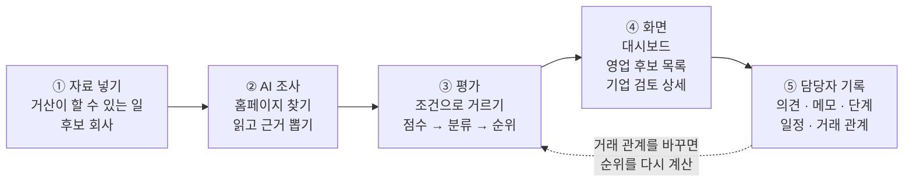
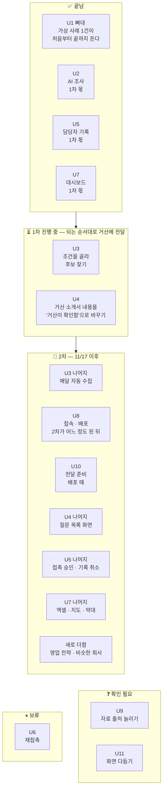

# 지도 — 전체 기획과 현황을 한곳에서

> **기준일: 2026-11-13** (`develop` 줄기 기준)

이 폴더는 **"지금 이 프로그램이 무엇을 하고, 어디까지 됐고, 누가 무엇을 맡는지"**를 팀 누구나 같은 그림으로 보기 위한 곳입니다. 기획이 말로 조금씩 바뀌어 왔기 때문에, 바뀐 결과를 여기에 모아 둡니다.

## 무엇이 궁금한가요?

| 궁금한 것 | 볼 문서 |
|---|---|
| 전체가 어떻게 생겼나, 지금 어디까지 왔나 | 이 문서 (아래 그림 2장) |
| 담당자가 화면에서 지금 무엇을 할 수 있나 | [기능 지도](feature-map.md) |
| 그 기능은 어느 폴더에 있고 누가 맡나 | [구조 지도](structure-map.md) |
| 처음 기획에서 무엇이 왜 바뀌었나 | [기획 변경 기록](change-log.md) |
| 어떤 자료를 넣어 무엇이 나오고, 그것이 어디로 가나 | [데이터 지도](data-map.md) |
| 발표 때 그림만 한 화면에서 탭으로 넘겨 보고 싶다 | [지도 보기 페이지](map-view.html) — 파일을 브라우저로 열면 그림 11개가 그려진다(인터넷 필요). 지도 그림이 바뀌면 이 파일의 같은 블록도 같이 고친다 |
| 문서와 코드가 서로 다른 곳은 어디인가 | [구조 지도 9장](structure-map.md#9-어긋난-곳--pm-확인이-필요한-목록) |

---

## 1. 이 프로그램이 하는 일

거산케미칼 영업 담당자가 **"어느 회사에 먼저 연락할까"**를 정하도록 돕는 웹 도구입니다. 거산이 할 수 있는 일(공정·인증)과 후보 회사의 공개 자료를 견주어 순위와 이유를 보여 주고, 담당자의 영업 기록을 쌓습니다.

**그림을 글로 풀면**

1. **자료 넣기** — 거산이 할 수 있는 일과 후보 회사를 넣습니다. 팀이 손으로 정리한 실제 회사 18곳에 더해, 담당자가 공정·지역·산업을 고르면 AI가 공공자료에서 후보를 찾아 목록에 더합니다. 이 PC의 시험 DB에는 이렇게 찾은 161곳을 합쳐 179곳이 들어 있습니다(11/12). 웹에서도 찾는 갈래는 만드는 중입니다([#221], [#314]).
2. **AI 조사** — 회사를 넣으면 AI가 공식 홈페이지를 찾고, 읽고, 근거 문장과 확인할 질문을 뽑습니다. 공개 자료만 씁니다.
3. **평가** — 꼭 맞아야 하는 조건으로 거르고, 점수를 매기고, 분류하고, 순위를 정합니다. 숫자는 기획서의 규칙 그대로입니다.
4. **화면** — 담당자는 대시보드(오늘 할 일), 영업 후보 목록(순위), 기업 검토 상세(이유와 근거)를 봅니다.
5. **담당자 기록** — 의견, 영업 메모, 영업 단계, 일정을 남깁니다. 기록은 대시보드의 건수가 됩니다. 점선 화살표는 **거래 관계를 바꾸면 순위를 다시 계산**한다는 뜻입니다.

**이 서비스의 핵심** — 공개 자료로 한 번 뽑은 순위를 보여 주고 끝나는 것이 아니라, 담당자가 기록을 남길수록 그 기록이 순위와 근거에 되돌아와 **거산에 맞게 맞춰지는 것**입니다(PM 결정 2026-11-08). 지금은 기록을 남기는 것까지 되고, 기록이 순위로 돌아오는 되먹임 3단계는 2차입니다. 자세한 것은 [기능 지도 "이 서비스의 핵심" 장](feature-map.md#이-서비스의-핵심--쓸수록-거산에-맞게-순위근거가-맞춰진다)과 [발표 메모 0장](../presentation-notes.md).

**이 프로그램이 하지 않는 일** — 단가·견적 계산, 납기 확정, 고객에게 자동 발송, 가격·경쟁사 비교는 만들지 않습니다.

---

## 2. 지금 어디까지 왔나

일을 11개 묶음(U1~U11)으로 나눴습니다. 묶음마다 지금 위치입니다.

| 묶음 | 쉬운 말 | 지금 위치 | 볼 이슈 |
|---|---|---|---|
| U1 뼈대 | 가상 사례 1건이 넣기 → 평가 → 화면 → 의견 저장까지 이어진다 | ✅ 끝남 | — |
| U2 AI 조사 | 홈페이지를 찾아 안쪽 페이지까지 읽고 근거와 질문을 뽑는다. 밖으로 나가는 것을 검사한다. 상세의 [다시 조사]로 다시 돌린다 | ✅ 1차 몫 끝남 | [#218] [#557] [#596] |
| U3 후보 수집 | 담당자가 고른 조건으로 AI가 공공자료에서 후보를 찾고 점수를 제안하는 것까지 됨. 누르기 전 예상 금액 보이기와 웹에서 찾는 갈래는 진행 중, 매달 자동 수집은 2차 | ⏳ 일부 1차 | [#221] [#549] [#314] |
| U4 거산 확인 창구 | 거산 값을 "확인 완료"로 바꾸는 명령은 됨. 배포 DB에서 실행하는 일이 남음. 질문 목록 화면은 2차 | ⏳ 일부 1차 | [#212] [#223] |
| U5 담당자 기록 | 접촉·메모·영업 단계·일정을 남긴다. 2차 몫인 기록 취소는 화면이 먼저 합쳐졌고 서버가 남음 | ✅ 1차 몫 끝남 | [#210] [#304] [#253] |
| U6 재접촉 | 예전 거래처를 다시 영업한다 | ⏸ 보류 | 11/3 PM 결정 |
| U7 대시보드 | 첫 화면의 건수·일정·최근 기록과, 눌러서 목록을 걸러 보는 것까지 됨. 엑셀·지도·막대는 2차 | ✅ 1차 몫 끝남 | [#306] |
| U8 접속·배포 | 비밀번호 화면과 백업·되돌리기 명령은 됨. 거산이 접속할 곳에 올리는 일은 2차가 어느 정도 된 뒤에 한다(PM 결정 11/10~11/11) | 📅 2차로 옮김(11/12) | [#213] [#214] |
| U9 자료 출처 늘리기 | 일부는 U2·U3으로 옮겨 감. 나머지는 이슈가 없음 | ❓ 확인 필요 | — |
| U10 운영 인계 | 안내서·접속 안내·전달 메일. 배포 때 함께 한다 | 📅 2차로 옮김(11/12) | [#220] |
| U11 화면 다듬기 | 간격·글꼴·색 손질. 여유가 있을 때 | ❓ 이슈 없음 | — |

**이슈로 본 진행 (2026-11-13)**

| 전달 차수 | 끝난 이슈 | 열린 이슈 |
|---|---|---|
| 뼈대 (10/28) | 24 | 0 |
| 10월 말 부분 시연 | 63 | 0 |
| 1차 — 11/15 거산 전달 | 181 | 8 |
| 2차 보강 — 11/17 이후 | 15 | 33 |

기능별 상태는 [기능 지도](feature-map.md)에 있습니다. 기능 92줄 가운데 됨 69, 진행 중 6, 2차 예정 15, 보류 2입니다.

---

## 3. 누가 무엇을 맡나

| 사람 | 맡은 것 |
|---|---|
| 최지예 (PM) | 합치기, 통합 확인, 문서, 거산 전달 준비, 백업 |
| 유동렬 | 채점 규칙, AI 조사, 거산 소개서 내용을 '거산이 확인함'으로 바꾸기, 후보 수집 |
| 이강욱 | 서버, 화면 요청 창구, 운영 명령, 기록 저장, 거산이 접속할 곳에 올리기 |
| 고선주 | 화면 전체, 대시보드 집계 |

폴더별 담당은 [구조 지도 3장](structure-map.md#3-폴더표)에 있습니다.

---

## 4. 꼭 알아야 할 말

| 말 | 쉬운 뜻 |
|---|---|
| 분류 | 프로그램이 회사마다 매긴 판정. "지금 바로 연락 검토", "추가 조사 필요" 같은 11가지 |
| 담당자 검토 의견 | 사람이 남기는 의견 3가지(검토 권고 / 추가 확인 필요 / 검토 대상 제외). 분류를 바꾸지 않는다 |
| 영업 단계 | 실제 영업이 어디까지 갔나. 미접촉 → 관심 → 접촉 → 견적·샘플 → 성사·보류·거절 |
| 점수 "참고 50점 · 3/8" | 확인된 점수와 "8개 항목 중 3개를 조사함". "참고"는 거산 확인 전 값으로 계산했다는 뜻 |
| 거래 확인 전 / 기존 거래처 | 거래 여부를 아직 모르는 회사 / 이미 거래 중인 회사 |
| 검토사항 | 담당자가 확인할 목록. AI가 만든 질문과 "자료 못 찾음", "자료 부족" 줄 |
| 거산 확인 전 | 거산 소개서에서 온 값이 아직 거산의 확인을 받지 않았다는 표시 |
| 가상 사례 | 실제 거산 사양이 아닌 연습용 자료 (A정밀) |
| 1차 / 2차 | 1차는 11/15 무렵부터 되는 순서대로 거산에 전달하는 것, 2차는 11/17 이후 보강 |
| 회사 파일 (사례 파일) | 회사 1곳의 공개 자료를 정해진 칸에 맞춰 쓴 파일 |
| 약속 파일 | "이 모양으로만 주고받는다"고 정한 파일. PM 확인 없이 고치지 않는다 |
| 창구 (API) | 화면이 서버에 요청하는 정해진 문 |
| 운영 명령 | 운영자가 터미널에서 실행하는 명령 |
| 이슈 / PR | 이슈는 할 일 한 건, PR은 "이 변경을 합쳐 주세요"라는 요청 |

---

## 5. 지도를 낡지 않게 하는 법

지도는 **늘 한 벌**만 둡니다. 날짜별 사본을 만들지 않습니다. 옛 모습은 GitHub에서 파일을 열고 **History**를 누르면 볼 수 있습니다.

| 언제 | 누가 | 무엇을 고치나 |
|---|---|---|
| 담당자 눈에 보이는 기능이 생기거나 바뀌는 PR을 올릴 때 | PR을 올리는 사람 | [기능 지도](feature-map.md)의 그 줄과 맨 위 "최근 바뀐 것" |
| PM 결정으로 기획이 바뀔 때 | PM (또는 AI 도구) | [기획 변경 기록](change-log.md) 3장 맨 위에 한 줄 |
| 새 자료(파일·공공 소스)가 들어오거나 단계의 입력·출력이 바뀔 때 | PR을 올리는 사람 | [데이터 지도](data-map.md) 1장의 자료 줄과 3장의 단계 줄 |
| 정기적으로, 또는 PM이 "지도 갱신해 줘"라고 할 때 | AI 도구 | 이슈 목록과 코드를 다시 읽어 네 문서를 맞추고, 기획 변경 기록 1장에 건수 한 줄 |

- 지도의 상태 칸은 **요약**입니다. 진행 상황의 기준은 계속 이슈입니다.
- 문서와 코드가 다르면 한쪽에 맞추지 않고 [구조 지도 9장](structure-map.md#9-어긋난-곳--pm-확인이-필요한-목록)에 적습니다.
- 연락처, 거산 내부 자료, 단가는 적지 않습니다.

기술 메모 — AI 도구가 지도를 갱신하는 순서

1. `git switch develop && git pull`로 최신 `develop`을 받는다. 지도는 항상 최신 `develop` 기준으로 쓴다.
2. `gh issue list --state all --limit 400 --json number,title,state,labels,milestone,assignees`로 이슈를 읽는다.
3. `contracts/openapi.json`(창구), `geosan/commands/app.py`(명령), `migrations/versions/`(표), `web/src/pages/`·`web/src/components/`(화면)를 읽어 지난 기준일 이후 달라진 것을 찾는다. `git log --since=<지난 기준일> --oneline`이 출발점이다.
4. 기능 지도의 줄을 고치고 "최근 바뀐 것" 5줄을 새로 쓴다. 상태 값은 `✅ 됨` / `⏳ 진행 중` / `📅 2차 예정` / `⏸ 보류` 네 가지만 쓴다.
5. 기능 지도 표에서 상태별 줄 수를 세어 기능 지도의 원 그림, 이 문서 2장, 기획 변경 기록 1장에 같은 숫자를 적는다.
6. 구조 지도의 창구·명령·표 개수와 "어긋난 곳"을 맞춘다. 정리된 줄은 지운다. 데이터 지도 1장의 자료 목록과 3장의 단계 상태도 같이 맞춘다.
6-1. 지도 문서의 Mermaid 블록을 고쳤으면 `map-view.html`의 같은 `id`(`mm-…`) 블록에 그대로 복사한다. 파일을 브라우저로 열어 그림이 그려지는지 보는 것이 Mermaid 문법 검사다.
7. 네 문서의 기준일을 고친다.
8. 그림(Mermaid)은 문법 검사 도구로 그려지는지 확인하고, 그림마다 "그림을 글로 풀면"을 함께 둔다.
9. 확인하지 못한 것은 추측으로 쓰지 않고 "확인 필요"로 적는다.

---

## 6. 더 깊이 볼 문서

| 문서 | 어디 |
|---|---|
| 팀 규칙 | 저장소 맨 위 `AGENTS.md` |
| 설치와 명령 | 저장소 맨 위 `README.md` |
| 팀원 시작 안내 | `docs/team-start-guide.md` |
| 회사 파일 쓰는 법 | `docs/case-file-guide.md` |
| 역할표 | `aidlc/…/inception/delivery-planning/team-allocation.md` |
| 작업 묶음 U1~U11 | `aidlc/…/inception/units-generation/unit-of-work.md` |
| 약속 요약 | `aidlc/…/inception/contract-design/contract-summary.md` |
| 처음 기획서 | `docs/input/` (고치지 않는 원본) |

`aidlc/…`는 `aidlc/spaces/default/intents/261019-geosan-sales-agent/`를 줄여 쓴 것입니다.

[#210]: https://github.com/agent-ddalgi-team/final-geosan/issues/210
[#212]: https://github.com/agent-ddalgi-team/final-geosan/issues/212
[#213]: https://github.com/agent-ddalgi-team/final-geosan/issues/213
[#214]: https://github.com/agent-ddalgi-team/final-geosan/issues/214
[#218]: https://github.com/agent-ddalgi-team/final-geosan/issues/218
[#220]: https://github.com/agent-ddalgi-team/final-geosan/issues/220
[#221]: https://github.com/agent-ddalgi-team/final-geosan/issues/221
[#223]: https://github.com/agent-ddalgi-team/final-geosan/issues/223
[#304]: https://github.com/agent-ddalgi-team/final-geosan/issues/304
[#306]: https://github.com/agent-ddalgi-team/final-geosan/issues/306
[#314]: https://github.com/agent-ddalgi-team/final-geosan/issues/314
[#253]: https://github.com/agent-ddalgi-team/final-geosan/issues/253
[#549]: https://github.com/agent-ddalgi-team/final-geosan/issues/549
[#557]: https://github.com/agent-ddalgi-team/final-geosan/issues/557
[#596]: https://github.com/agent-ddalgi-team/final-geosan/issues/596
