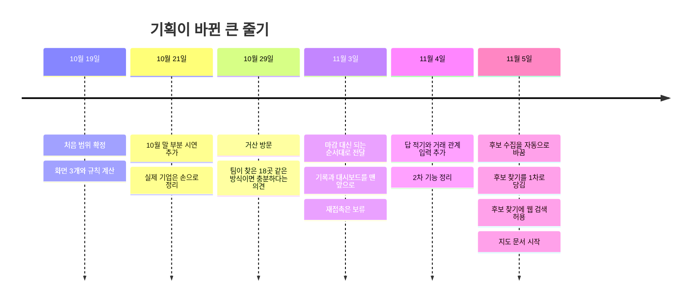

# 기획 변경 기록 — 무엇이 언제 왜 바뀌었나

> **기준일: 2026-11-13** · [지도 입구로 돌아가기](README.md)

이 문서는 **쌓아 가는 기록**입니다. 지도(기능 지도·구조 지도)는 늘 "지금" 한 벌만 두고, 바뀐 내용은 여기에 한 줄씩 더합니다.

- **1장 지도 갱신 기록** — 지도를 갱신할 때마다 건수 한 줄. "지난번 이후 무엇이 달라졌나"를 봅니다.
- **2장 큰 줄기** — 기획이 바뀐 흐름을 그림 한 장으로 봅니다.
- **3장 기획 변경** — 결정 하나에 한 줄. 최근 것이 위에 있습니다.
- **4장 일하는 방식 변경** — 기능이 아니라 팀 규칙이 바뀐 것.
- **5장 출발점** — 처음(10/19)에 만들기로 한 것과 안 만들기로 한 것.

---

## 1. 지도 갱신 기록

- **2026-11-13 (#658)** 목록 거리 서버 연결: 페이지 전 거리 정렬·필터, 미확인 처리·전체 건수 확인. 실제 DB 사본 739곳에서 공공좌표 거리 697곳·50km 이내 308곳, 전체 페이지 순서·평가·영업 기록 보존 확인. 화면 연결은 별도라 상태 건수는 그대로.

지도를 갱신할 때마다 맨 위에 한 줄을 더합니다. 건수는 [기능 지도](feature-map.md)의 줄 수입니다.

| 갱신한 날 | ✅ 됨 | ⏳ 진행 중 | 📅 2차 예정 | ⏸ 보류 | 이번에 달라진 것 |
|---|---|---|---|---|---|
| 2026-11-13 (3) | 69 | 6 | 15 | 2 | 서버 3건이 합쳐진 뒤 기준으로 다시 셈. 상세 "활동 이력"의 [잘못 입력]([#253])과 맨 아래 "비슷한 회사 참고"([#268])가 진행 중에서 됨으로. 자료 줄 [메모 적기]([#259])는 저장까지 확인했고 같은 줄의 [붙여넣고 조사] 확인이 남아 진행 중 그대로. 세 가지 모두 DB 사본으로 켠 서버와 브라우저에서 눌러 확인함. 앞줄의 숫자(진행 중 6 · 2차 예정 18 · 보류 1)는 그 뒤 합쳐진 PR들로 표와 어긋나 있어 표를 다시 세어 맞춤: 조사 에이전트 줄이 보류로 바뀌어 보류 2([#224]). 기능 92줄 ([#668]) |
| 2026-11-13 (2) | 67 | 6 | 18 | 1 | 밤새 올린 PR 6개를 합친 뒤 기준으로 다시 셈. 대시보드 "공정별"·"산업군별" 막대가 2차 예정에서 됨으로([#627]). 새 줄 둘: 상세 "검토사항" 묶음·접기([#619]), "영업 분석" 화면([#608]). 기능 92줄. 추천 목록 세 묶음([#610])·예상 금액과 한도 잠금([#549])·걸러 본 목록의 곳 수([#370])는 있던 줄을 고침 |
| 2026-11-13 | 64 | 6 | 19 | 1 | 이슈 정리에 맞춤. 배포([#213])와 배포 DB 검수 전환([#212]) 두 줄을 "진행 중"에서 "2차 예정"으로(배포는 2차가 어느 정도 된 뒤, PM 11/11). 입구 그림에서 접속·배포와 전달 준비를 2차 칸으로 옮기고 이슈 건수를 다시 셈(11/13 기준 1차 열림 8, 2차 열림 33). 최근 소식 검색은 2차 이슈 하나로 합침 ([#622]) |
| 2026-11-12 (2) | 64 | 8 | 17 | 1 | 상세 맨 아래 "비슷한 회사 참고" 화면이 합쳐져 그 줄이 2차 예정에서 진행 중으로(서버 [#268]이 남음). 검토사항 자료 줄의 [메모 적기] 화면도 합쳐짐(서버 [#259]가 남아 진행 중 그대로). 기능 줄 수는 90줄 그대로 ([#624]) |
| 2026-11-12 | 64 | 7 | 18 | 1 | 입구와 구조 지도를 11/12 기준으로 맞춤. 입구: 묶음 U2(AI 조사)·U5(담당자 기록)를 "1차 몫 끝남"으로, 이슈 건수와 후보 179곳을 반영. 구조 지도: 창구 13 → 17개, 운영 명령 16 → 21개, 저장 표 43 → 46개, 닫힌 이슈 두 줄을 "어긋난 곳"에서 지움. 기능 지도: 표를 다시 세어 90줄(11/10 뒤 PR들이 더한 줄 포함), 기록 저장 때 평가 번호 남기기 두 줄과 [AI 점수 제안]을 "됨"으로, 수질 명단 표시 규칙([#613])과 웹 검색 진행을 적음. 열린 PR이 고치는 [메모 적기]·"비슷한 회사 참고" 줄은 건드리지 않음 ([#616]) |
| 2026-11-10 | 58 | 8 | 16 | 1 | "검토 대상 제외"로 저장한 회사가 관심 기업에서 빠지게 바꿈. 관심 기업 보기 줄에서 "제외 기업" 거르기를 빼고, 대시보드 관심 구역에서 "제외" 칸을 빼고, 관심 단추 줄 둘(카드·상세)에 저절로 꺼지는 규칙을 적음. 목록 머리 "제외한 회사" 보기 줄을 더해 기능 83줄 ([#536]) |
| 2026-11-09 (4) | 56 | 7 | 17 | 1 | "이번 수집만 / 전체" 전환 줄을 없애고(같은 조건 재실행·실패 때 비어 버림) 정렬 줄에 "최근 들어온 순"과 "전체 보기"를 더함. 카드 꼬리표는 "11/9 들어옴". 관심 기업 보기 줄에 공정 선택란을 더함. 줄 하나가 빠져 기능 81줄 ([#516]) |
| 2026-11-09 (3) | 57 | 7 | 17 | 1 | [AI 점수 제안] 줄에 화면 쪽 진행을 적음: 카드·상세 머리의 흐린 점수에 "AI 제안 · 확인 전", 상세 검토사항의 제안 줄에 [확정]·[고치기]를 가짜 응답으로 만들어 확인함. 서버 창구(#497)와의 실제 연결은 미확인이라 상태는 진행 중 그대로. 기능 줄 수는 그대로 ([#498]) |
| 2026-11-09 (2) | 57 | 7 | 17 | 1 | [새 후보 가져오기] 줄의 "#428 PR 합침과 실제 외부 호출 확인이 남았다"를 11/9 브라우저 확인 결과(공정 9개·실행 중 잠금·완료 요약·실패 뒤 기존 목록 보존·재실행)로 바꿈. 상태는 실제 외부 AI 확인 전이라 진행 중 그대로. 기능 줄 수는 그대로 ([#500]) |
| 2026-11-09 | 57 | 7 | 17 | 1 | 후보 찾기 화면의 세 줄(목록 머리 수집 요약, "이번 수집만 / 전체" 전환, 카드의 고른 이유·점수 전·이번에 들어옴)을 "됨"으로. 임시 DB에 넣은 시험 회차로 실제 서버와 브라우저에서 보이는 것을 확인함. 조건 칸·[새 후보 가져오기] 단추 줄은 이 갱신에 넣지 않고 진행 중 그대로(#428 쪽에서 다룸). 건수는 앞 줄에서 3줄만 옮긴 것으로, 표 줄 수를 다시 세어 맞추는 일은 하지 않음. 기능 82줄 ([#316]) |
| 2026-11-08 밤 (2) | 54 | 10 | 17 | 1 | 데이터 지도(`data-map.md`)를 새로 만듦: 가지고 진행한 자료 13개, 단계 12개의 입력→출력→다음 단계, 시기별 자료 표. 기능 줄 수는 그대로 ([#460]) |
| 2026-11-08 밤 | 54 | 10 | 17 | 1 | "이 서비스의 핵심" 장을 더하고, 기록 저장 때 평가 번호를 남기는 줄(⏳)과 되먹임 3단계 줄(📅)을 더함. 그림의 건수(됨 50 · 진행 중 13)가 표 줄 수(됨 54 · 진행 중 9)와 달랐던 것을 표 기준으로 맞춤. 기능 82줄 ([#458]) |
| 2026-11-06 오후 | 44 | 13 | 14 | 1 | [새 후보 가져오기] 조건 칸·단추(선택지 연결 전이라 화면에는 아직 안 보임), 회사 파일의 홈페이지 주소 칸, 후보 찾기 두 갈래 순서를 줄에 반영. "표면처리를 직접 하는 회사일 수 있음" 꼬리표 줄을 더함. 지난번에 후보 찾기 화면 줄 3개가 건수에서 빠져 있던 것을 바로잡음(진행 중 9 → 12, 이번에 13). 기능 72줄 ([#348]) |
| 2026-11-06 | 44 | 9 | 14 | 1 | 목록의 공정 탭·지역·산업 거르기, 대시보드 건수 카드·검색이 목록을 거르는 것이 "됨"으로. 카드의 공정·지역·산업 꼬리표 줄을 더함. "거래 중" 회사의 카드가 여럿일 때의 순서 보완도 끝남. 기능 68줄 ([#306], [#305], [#325]) |
| 2026-11-05 늦은 밤 | 40 | 12 | 14 | 1 | 후보 찾기 웹 검색(진행 중)과 채용 공고 근거(2차 예정) 줄을 더함. 기능 67줄 ([#313]) |
| 2026-11-05 밤 | 40 | 11 | 13 | 1 | 후보 찾기와 AI 점수 제안을 1차로 당김 ([#221], [#286]) |
| 2026-11-05 저녁 | 40 | 9 | 15 | 1 | 거래 관계 단추, 회사 소개와 대표번호 [맞음], 기록 한 칸, AI 조사가 "됨"으로 ([#307]) |
| 2026-11-05 | 35 | 13 | 15 | 1 | 지도를 처음 만듦 ([#293]) |

---

## 2. 큰 줄기

**그림을 글로 풀면**

1. **10/19** 처음 범위를 정했습니다. 화면 3개(추천 목록·근거 상세·의견)와 규칙 계산이 중심이었습니다.
2. **10/21** 10월 말에 거산에 보여 줄 "부분 시연"을 더했습니다. 실제 기업 10~20곳을 팀이 손으로 정리하기로 했습니다.
3. **10/29** 거산을 방문했습니다. 거산은 팀이 찾아 온 18곳을 예시로 보고 "이런 식이면 충분하다"고 했고, 영업 기록이 쌓이기를 원했습니다.
4. **11/3** 방문 결과로 기획을 크게 바꿨습니다. 11/15를 마감으로 보지 않고 되는 순서대로 전달하며, 담당자 기록과 대시보드를 가장 먼저 만들고, 재접촉은 보류했습니다.
5. **11/4** 화면을 써 본 뒤 답 적기와 거래 관계 입력을 더했고, 2차로 넘길 기능을 정리했습니다.
6. **11/5** 새 후보 회사를 사람이 아니라 서버가 자동으로 모으는 방식으로 바꿨습니다. 같은 날 저녁, 담당자가 공정·지역·산업을 고르면 AI가 공공자료에서 후보를 찾는 기능을 1차로 당겼습니다. 이어서 후보 찾기에 AI 웹 검색을 쓰도록 자료 범위를 넓히고, 채용 공고도 근거로 쓰기로 했습니다.

---

## 3. 기획 변경

- **2026-11-13 · #686 · PM 결정:** 목록·대시보드 지도는 저장된 위치만 쓰고 외부 좌표 조회를 하지 않는다. 위치를 모르는 회사는 거리 미확인. 네이버 실시간 보완은 자세히 보기·geocode 명령에서만(목록이 요청마다 다시 물어 느려지고 하루 수백 번 호출이 쌓였기 때문).
- **2026-11-13 · #222 · 이강욱 확인:** 좌표 확보를 위치 CSV → 주소검색·CSV 재대조 → 좌표제공 → 네이버 보완으로 변경. 공공좌표만 저장하며 네이버는 실시간 표시 전용. CSV 목록·기준일·보완 스위치와 하루 합계 10,000회 한도를 확정. 지도 화면·지도 서버는 #641·#642에서 별도로 연결.

**읽는 법** — "원래"는 그 결정 전의 계획, "지금"은 결정 뒤의 계획입니다. 상태는 세 가지입니다: ✅ 결정됨 · 📝 초안(아직 결정 전) · ❓ 확인 필요.

### 2026-11-13

| 무엇 | 원래 | 지금 | 이유 | 상태 · 근거 |
|---|---|---|---|---|
| 카드의 후속 조치 줄 | 카드에 "추천 근거" / "검토사항" / "후속 조치" 세 줄 | 카드에는 "추천 근거" / "검토사항" 두 줄만. 후속 조치는 상세 "1. 추천 근거와 후속 조치"에서 읽음. 서버 응답은 그대로 | PM 결정(11/13): 상세에 같은 내용이 더 자세히 있고, 카드에 세부 단계·고른 이유·공장 정보·세 묶음이 더해져 길어졌다. 목록은 누구에게 연락할지 고르는 화면. 안 고른 방법: 카드에서 접어 두기(누를 곳이 늘고 카드 높이가 회사마다 달라짐) | ✅ PM 결정 2026-11-13 · [#647] (관련 #139 #160) |

### 2026-11-12

| 무엇 | 원래 | 지금 | 이유 | 상태 · 근거 |
|---|---|---|---|---|
| 조사 상태 보이기와 [다시 조사] | 카드는 조사가 안 됐든 실패했든 "점수 전"만 보여 언제 풀리는지 알 수 없음. 상세는 [맞음]·[고치기]·[다시 조사]와 "홈페이지 확인 필요"·"못 찾음" 띠, 홈페이지 없는 회사는 [다시 조사]가 없음 | 카드는 "점수 전 · 조사 중" 또는 "점수 전 · 조사 중단"만. 상세 점수 줄 옆에 "조사 중단 · 홈페이지 못 찾음"처럼 이유. [다시 조사]는 상세 우측 상단 하나, 홈페이지가 없으면 홈페이지부터 다시 찾음. [맞음]·[고치기]·띠는 없앰 | PM 결정(11/12): 담당자는 목록에 들어온 뒤 조사가 따로 도는 줄 몰라 헷갈림. 카드는 짧게, 이유는 상세에서 | ✅ [#596] |
| 거산 확인 완료 뒤의 후보 찾기 | 공장 행·단지 조회·웹 후보·AI 판단을 지금 묶음 것만 씀. 거산 확인 완료로 전환(#212)하면 소개서 묶음 때 모은 공장 17,358행·판단 8,706건을 못 찾아 [새 후보 가져오기]가 멈춤 | 소개서·거산 확인 완료 묶음은 공개 자료와 AI 판단을 같이 씀. 가상 묶음은 계속 따로. 새로 등록하는 회사만 지금 묶음 이름표 | 묶음은 거산 역량 값을 나누는 것이고 공개 공장 자료는 어느 묶음이든 같은 실제 자료 | ✅ PM 결정 2026-11-12 · [#586] |
| 수질 명단으로 붙이는 "자체 도금" 꼬리표 | 회사명이 같고 같은 시·군이면 붙임. 같은 시의 다른 공장에도 붙음(예: 같은 회사의 다른 거리 공장) | 회사명 + 도로명·건물번호가 같을 때만 붙임. "외 19필지"·괄호 안 동 이름은 무시 | "이름만 같고 주소가 다른 곳"이 섞이지 않게(PM 11/12). 안 고른 방법: 주소 글자 전체 일치(표기 차이로 거의 안 맞음) | ✅ PM 확인 2026-11-12 · [#613] |
| 다시 판단한 결과가 카드에 가는지 | 회사를 목록에 처음 올릴 때만 "고른 이유"·적합도를 적음. 다시 판단해도 카드는 옛 문장 | 후보 찾기를 돌릴 때 AI가 찾아 올린 기존 회사의 "고른 이유"·적합도를 최신 판단으로 바꾸고 그 회사만 재평가. 사례 파일 회사와 담당자가 정한 값은 그대로 | 원자재·업종명을 넣어 다시 판단했는데([#570]) 카드가 안 바뀌어 근거가 화면에 안 보였다(PM 11/12). 안 고른 방법: 카드를 고치는 운영 명령 추가 | ✅ PM 결정 2026-11-12 · [#615] |
| 공장 정보 줄의 업종명 | "공장 정보" 줄에 원자재·종업원 수·규모만. 업종은 AI가 고른 이유 문장에서 짐작 | 줄 맨 앞에 공장 등록 업종명. 예: "업종 절삭가공 및 유사처리업 · 종업원 약 1명(추정) · 소기업" | AI 문장만으로는 절삭가공 회사인지 알 수 없었다(PM 11/12). 추정과 등록 사실을 나눠 보이려고. 안 고른 방법: 업종명을 AI 문장에 넣게 지시문 고치기 | ✅ PM 결정 2026-11-12 · [#617] |
| 영업 메모 → 단계별 꼬리 질문 + 한 줄 메모 | 접촉은 방법·결과·날짜만 고르고 나머지는 자유 메모. 단계는 담당자가 고르고, 접촉을 적으면 "접촉으로 바꿀까요?"를 물음([#433]) | "연결됨"이면 지금 세부 단계의 질문을 고르고 답에 따라 꼬리 질문이 이어짐(예: "지금 도금은?" → "외주 줌" → "바꿀 생각?"). 세부 단계 5개(연결 전·연결됨·수요 확인 / 자료·견적·방문·샘플)는 알아낸 사실로 자동, 큰 단계도 앞으로만 자동. 질문에 없는 이야기는 한 줄 메모 100자. 질문 문구는 파일 하나에 두어 거산 확인 뒤 바꿈 | 메모는 고려할 게 많고 서로 견줄 수 없음. 고른 값이라야 "몇 번 만에 수요 확인" 같은 분석이 됨(PM 11/12). 안 고른 방법: 큰 단계를 새 6단계로 바꾸기(카드·대시보드 모두 바뀜), 담당자가 단계를 직접 고르기(사람마다 기준이 다름) | ✅ PM 확인 2026-11-12 · [#607] |
| 2차 화면 3개(기록 취소 · 자료 줄 메모 · 비슷한 회사 참고) | 메모를 질문지로 바꿀지 검토하는 동안 보류(11/10). 약속에 칸이 없어 화면·서버 6개 이슈가 멈춤 | 보류를 풀고 약속에 칸을 적음. 세 기능은 11/4 결정 그대로 만들고, 질문지는 따로 정함 | 세 기능은 지금 메모 칸 위에 더하는 것이라 질문지가 정해져도 그 위에 얹을 수 있음. 안 고른 방법: 질문지 결정까지 더 기다리기 | ✅ PM 지시 2026-11-12 · [#594] · 질문지는 [#561] |
| 영업 기록을 AI에 보내기 | 거산 내부 이력·재접촉 입력·영업 메모는 어떤 AI에도 안 보냄(CON-09). 메모 전송 범위는 [#247]에서 정하기 전까지 안 보냄 | 배포 전 시험 기간에는 영업 기록(접촉·질문지 답·결과·거절 이유·메모)을 회사별로 에이전트에 보내 해석·순위 제안을 받음. 메모 속 연락처는 지우고 보내고 설정으로 켜고 끔. 배포 전에 다시 정함 | 지금 기록은 시험용으로 AI로 만든 것이고 질문지는 공통 질문이라 보내도 문제없음. 안 고른 방법: 숫자 집계만 보내기(해석이 얕음) | ✅ PM 결정 2026-11-12 · [#561] · 배포 전 재결정 |

### 2026-11-11

| 무엇 | 원래 | 지금 | 이유 | 상태 · 근거 |
|---|---|---|---|---|
| AI 후보 판단 입력 | 회사명·단지명·생산품·업종명·주소만 보고 판단. 생산품 이름만으로는 무슨 금속인지 몰라 도금 종류를 짐작 | 팩토리온 공장조회에서 붙은 **원자재**를 함께 보냄(예: "철강재, 스테인레스, 알루미늄"). 업종명이 비면 팩토리온 업종명. 원자재는 소재 단서로만 쓰고 원자재만으로 "상"을 주지 않음(지시문 pick-v3). 판단 기준이 바뀌어 다음 후보 찾기 때 한 번 다시 판단 | 점수 8칸 중 소재 칸이 홈페이지 없는 회사는 비어 있음. 파일은 무료이고 판단한 상·중 공장의 약 2/3에 원자재가 있음. 조사 검색으로 찾으면 회사당 약 $0.08이고 결과가 매번 다름 | ✅ PM 결정 2026-11-11 · [#570] |
| 거래 관계 확인 | 거래 관계가 "확인 전"이면 필수조건 대기로 멈춤(기획서 S06). AI가 찾은 회사 177곳 전부가 "거래 여부가 아직 확인 전"으로 멈춤 | 규칙 설정으로 끔: "확인 전"이어도 거래 관계 때문에는 멈추지 않고 막는 조건에서 "거래 여부"가 빠짐. "거래 중"으로 표시한 회사는 그대로 맨 아래 | 신규 잠재고객만 찾으므로 거래 관계 확인은 기획에서 보류 | ✅ PM 결정 2026-11-11 · [#567] |

### 2026-11-10

| 무엇 | 원래 | 지금 | 이유 | 상태 · 근거 |
|---|---|---|---|---|
| 자동 조사가 읽는 범위 | 새로 들어온 회사는 홈페이지 첫 화면 1장만 읽어 점수 8항목 중 1~2개만 참(11/9·11/10 조사된 14곳 전부) | 같은 사이트의 회사소개·제품·연혁 같은 페이지를 최대 3장 더 읽고 AI는 한 번만 부름. 근거 출처는 인용문이 있는 페이지 주소. 이 PC 3곳 시험: 점수 없음→2/8, 0→1/8, 2/8→3/8 | 처음 18곳은 사람이 사례 파일로 채웠지만 자동 조사는 첫 화면만 봄. 남은 빈칸(증설·수주·공고)은 홈페이지로는 못 채워 #558에서(11/12 #612로 합침) | PM 결정 2026-11-11 · [#557] |
| 새 후보 가져오기의 숫자·비용 보이기 | 단추 하나가 AI 판단·거르기·등록·조사를 한 번에 해서, 누를 때 얼마가 들지와 맞는 공장이 전부 들어왔는지 알 수 없음(11/10 대전: 맞는 공장 1,518곳 중 100곳만 들어와 "전부 나온 건가?" 오해) | 조건을 고르면 맞는 공장 수·들어온 곳 수가 0원으로 바로 보이고(1단계), 누르기 전 예상 금액을 보이며 이번 달 남은 금액을 넘으면 화면·서버·명령이 막음(2단계). 단추 이름 [영업 후보로 더하기 💰], AI가 판단만 한 것은 "공장", 들어와 조사된 것은 "영업 후보". 단추 둘로 나누기·운영 담당 판단 단추는 2차 | 배포 상한 $20·1,000회인데 충남 전체 판단만 약 $30이라 담당자 한 번 클릭으로 그 달 예산이 다 나갈 수 있음. 안 고른 방법: 거르기에도 단추 두기("단추 = 돈"이 흐려짐), 한도까지 돌리고 멈추기 | ✅ 결정됨 · [#549] 약속 [#552] |
| "검토 대상 제외"와 관심 기업 | 메모·영업 기록·검토 의견을 저장하면 관심이 켜지고, 기록이 있으면 관심을 끌 수 없음(#356). 그래서 제외한 회사도 관심 기업에 남아 관심 기업 보기에 "제외 기업" 거르기, 대시보드 관심 구역에 "제외" 칸이 있었음 | 제외를 저장하면 관심이 저절로 꺼지고, 제외한 회사는 메모·접촉을 적어도 다시 켜지지 않으며 [관심]도 눌러지지 않음(의견을 바꾸라는 안내). 의견을 검토 권고·추가 확인 필요로 바꾸면 다시 켜짐. 제외한 회사는 목록 머리 [제외한 회사 보기]에서 봄. 지금 DB의 "관심 + 제외" 회사도 정리함(약속 v4) | 관심은 "영업해 볼 회사"인데 그만 보기로 한 회사가 섞임. 또 관심 빼기 거부 안내("빼려면 '검토 대상 제외'로 저장해 주세요")대로 해도 빠지지 않아 담당자가 막혔음. 안 고른 방법: 관심은 켜 둔 채 화면에서만 숨기기(기록상 관심인데 안 보여 헷갈림) | ✅ 결정됨 · [#536] |
| AI 응답을 못 받은 뒤의 비용과 재조사 | 사용량이 빈 호출이 한 건이라도 있으면 그달 AI 호출을 막음 | 빈 호출은 설정의 추정 비용(초기 $0.10)을 월 합계에 더하고 상한 안에서 다음 호출을 허용. 실제 사용량 정산은 선택. AI 응답은 전체 60초 안의 남은 시간만큼 기다림 | 12/11 뒤 잠금을 풀 운영자가 없어 한 번의 통신 실패로 계속 못 쓰게 되는 일을 막음. 비용을 빼고 잠금만 없애는 방법은 고르지 않음 | ✅ PM 결정 · [#538](https://github.com/agent-ddalgi-team/final-geosan/issues/538), 약속 PR [#540](https://github.com/agent-ddalgi-team/final-geosan/pull/540) |

### 2026-11-09

| 무엇 | 원래 | 지금 | 이유 | 상태 · 근거 |
|---|---|---|---|---|
| 정렬 줄의 "전체 보기" | 공정을 고르지 않으면 늘 공정별 묶음으로만 보임(#383). 공정을 가로질러 한 줄로 보는 방법 없음 | 정렬 줄 끝 "전체 보기"를 누르면 묶음을 풀고 모든 회사를 한 줄로 본다(순위 번호는 숨김). 다시 누르거나 공정을 고르면 묶음 보기 | "최근 들어온 순"을 묶음 안에서만 보면 공정이 다른 새 회사를 한눈에 못 봄. PM이 정렬 줄 마지막 단추로 지정 | ✅ 결정됨 · [#516] |
| 관심 기업 보기의 공정 선택란 | 관심 기업 보기에는 지역·산업 선택란만 있고 공정 선택란은 없음(#383) | 공정 선택란도 둔다(맨 위 "전체"). 선택지 곳 수는 관심 기업 안에서만 센다 | 관심 기업이 늘면 공정으로도 좁혀 봐야 함. 지역·산업만 되고 공정만 안 되는 것이 어색함(PM 2026-11-09) | ✅ 결정됨 · [#516] |
| 목록에서 새로 들어온 회사를 보는 방법 | 수집 요약 옆 "이번 수집만 / 전체" 전환. 마지막 회차에 처음 들어온 회사만 보임. 카드 꼬리표 "이번에 들어옴 · 11/20" | 정렬 "최근 들어온 순". 들어온 시각 최신 순으로 위에, 18곳·예전 회사는 아래에 추천 순 그대로. 카드 꼬리표는 "11/9 들어옴" | 같은 조건을 다시 돌리거나 회차가 실패하면 전환 보기가 비어 버림(11/9 오전에 들어온 10곳이 오후 재실행 뒤 안 보임). 전환은 나머지 회사를 숨겨 목록을 잃음. 안 고른 방법: 기준을 "회사를 실제로 더한 마지막 회차"로(두 번 나눠 들어온 날은 반만 보임) | ✅ 결정됨 · [#516] |
| 후보 찾기 웹 검색의 저장·판단 연결 | 웹 검색 결과는 회사명·주소·출처 주소만 저장. AI 판단 기록은 공장 행에만 연결. 하루 한도·보관일·막는 사이트는 미정 | 검색 결과의 생산품 요약도 저장. 판단 기록은 공장 행 또는 웹 후보 중 하나에 연결. 하루 20회·15일 보관·막는 사이트 12곳(채용 8·유료 기업 정보 4)으로 시작. 독립 부품은 먼저 만들어도 됨 | 요약을 저장해야 15일 안 같은 조건에서 검색·판단을 다시 부르지 않음. 판단이 어느 회사 것인지 남아야 출처 저장 규칙을 지킴. 월 20달러 상한을 나눠 쓰므로 작게 시작 | ✅ PM 결정 2026-11-09 · [#314] [#487] |

### 2026-11-08

| 무엇 | 원래 | 지금 | 이유 | 상태 · 근거 |
|---|---|---|---|---|
| 이 서비스의 핵심을 무엇으로 보나 | "공개 자료로 한 번 뽑은 순위"를 보여 주는 도구 | "쓸수록 거산에 맞게 순위·근거가 맞춰지는 영업 비서". 담당자 기록(의견·메모·접촉·단계·거절 이유)이 순위에 되돌아오는 되먹임을 2차의 중심에 둠: ① 같은 회사 반영 → ② 비슷한 회사로 번짐 → ③ 선호가 가중치로(사람 승인). 통계 학습은 안 씀 | 공개 자료만의 순위는 누가 만들어도 비슷함. 거산만의 값은 담당자가 연락해 보고 남긴 기록이고, 그것이 순위로 돌아와야 "거산 전용"이 됨. 설명 못 하는 방식은 담당자가 믿지 않음 | ✅ PM 결정 2026-11-08 · [#458] · 발표 메모 0장 |
| 영업 단계·접촉·메모 기록과 순위의 연결 | 검토 의견만 "어느 평가를 보고 남겼나"가 남음. 접촉·단계·메모는 회사 번호만 | 접촉·단계·메모 저장 행에도 그때 본 평가 번호를 남김(화면 변화 없음). 낡은 번호여도 저장, 다른 회사 번호만 거부. 1차, 11/15 전 | 이 서비스의 핵심은 쓸수록 거산에 맞게 순위·근거가 맞춰지는 것. 그러려면 "몇 위를 보고 연락했고 결과가 어땠나"가 처음부터 남아야 하고, 늦게 넣으면 그 전 기록은 복구 불가. 기록이 순위에 돌아오는 되먹임은 2차([#268] [#269]) | ⏳ [#451] (약속) · [#450] (서버) |
| 상세 기록 구역의 세 칸(기록 남기기·영업 단계·다음 일정) | 같은 모양으로 나란히, 순서 안내 없음. 접촉 기록에 앞날도 넣을 수 있음 | 머리에 "① 한 일 → ② 지금 단계 → ③ 다음 할 일" 안내. 접촉 날짜는 오늘까지(뒤면 저장 거부). 접촉을 적은 뒤 단계가 미접촉이면 "접촉으로 바꿀까요?" 한 번 묻기 | PM도 접촉 기록의 미래 날짜를 대시보드 일정으로 오해함. 세 칸 합치기는 대시보드 계산·기획서의 세 기록 분리까지 건드려 2차 이후 | ✅ [#432] · [#433] [#434] [#435] |
| 산단공 단지 조회 결과를 다시 쓰는 기간 | 7일(11/7 결정) | 15일. 설정값이라 코드는 그대로 | 공장 등록은 월 단위로 바뀌어 7일은 뜻이 작고, 2차의 한 달 자동 수집보다는 짧아야 해서. 호출 비용 차이는 거의 없음 | ✅ [#405] |
| 단지 조회 결과를 다시 쓸 때 "어느 조회가 어떤 공장을 받았나"를 찾는 법 | 공장 행의 "받은 시각"으로 찾음 | 조회 기록에 받은 행 번호 목록 칸을 두고 그 목록으로 찾음. 받은 행은 지역과 상관없이 전부 저장하고 쓸 때 거름. 다 받은 조회만 다시 씀 | 다른 단지명 조회가 같은 공장을 또 받으면 시각이 덮여 앞 조회의 결과가 빠지는데, 프로그램은 그걸 완전한 결과로 믿게 됨 | ✅ [#405] · [#404] |

### 2026-11-07

| 무엇 | 원래 | 지금 | 이유 | 상태 · 근거 |
|---|---|---|---|---|
| 공정을 고르기 전의 목록 | 비워 두고 공정을 먼저 고르게 함(#368) | 공정별 묶음으로 보이고 지역·산업을 먼저 고를 수 있음. 묶음 안에서만 번호 | 지역을 먼저 골라 인근 후보를 훑는 쓰임. 섞인 순위 금지는 그대로 | ✅ [#383] · [#368] |

### 2026-11-06

| 무엇 | 원래 | 지금 | 이유 | 상태 · 근거 |
|---|---|---|---|---|
| 영업 후보 목록을 처음 열 때 | 프로그램이 공정을 대신 골라 줌(회사가 있는 첫 공정). 항상 공정 하나가 골라져 있음 | 처음에는 공정이 골라져 있지 않고 "공정을 고르면 그 공정의 후보가 나타납니다"만 보임. 공정을 고르면 카드와 지역·산업 선택란이 나타남. 마지막으로 본 공정은 브라우저가 기억해 다음에는 그 공정으로 바로 열림. 검색·관심 기업 보기·대시보드 칸으로 넘어온 목록은 그대로 | 프로그램이 대신 고르면 "왜 이 공정부터 나오지?"가 되고, 곧 붙을 [새 후보 가져오기]도 공정을 먼저 고르는 흐름이라 맞춤. 매번 한 번 더 누르지 않도록 지난번 공정을 기억함(기억 없이 매번 빈 화면으로 시작하는 방법은 안 고름) | ✅ [#368] |
| 영업 후보 목록의 머리 | 공정은 탭이고 회사가 있는 공정만 보임(지금 2개). 회사 이름 검색은 대시보드에만 있음 | 공정을 선택란으로 바꿔 거산 공정 9종을 모두 보이고(0곳 포함, "전체"는 없음), 같은 줄에 지역·산업 선택란과 회사 이름 검색 칸, 정렬을 둠. 검색은 고른 조건과 상관없이 전체 후보에서 찾음. "가까운 순"은 "(준비 중)"으로만 보임 | 거산 공정이 2종뿐인 것처럼 보였고, 후보 찾기가 붙으면 회사가 많아져 목록에서 이름으로 찾아야 함. 공정 "전체"는 서로 다른 공정을 한 줄 순위로 섞어 두지 않음 | ✅ [#361] · 가까운 순은 [#222] |
| 관심과 대시보드 | "담기"는 없고 "관심"은 미접촉과 접촉 사이의 영업 단계. 대시보드는 목록의 모든 회사를 세어 기록 없는 회사가 전부 미접촉 | 관심은 단계가 아니라 카드마다 켜고 끄는 표시. 대시보드는 관심으로 고른 회사만 세고 "관심 기업"과 "영업 진행" 두 구역으로 보임. 미접촉은 검토 권고를 받고 아직 접촉 전인 회사만 | 아무도 고르지 않은 18곳이 모두 미접촉으로 보였고, 후보 찾기가 붙으면 그 숫자가 목록 길이가 됨. 거산에 전달하기 전이라 실제 기록이 없는 지금이 바꾸기 가장 쌈 | ✅ [#356] · [#357] |
| 후보 찾기 두 갈래를 돌리는 순서 | "웹 검색도 돌려 같은 회차에 합친다"고만 적혀 있고 순서가 없었음 | 공공자료를 먼저 돌리고 그다음 웹 검색. 이미 목록에 있는 회사는 출처를 바꾸지 않고, 같은 회사인지 애매하면 "확인 필요"로 남기며, 공공자료가 아예 실패하면 웹 검색을 돌리지 않음 | 꼭 필요한 공공자료 갈래가 월 AI 비용과 조회 한도를 먼저 쓰게 하고, 같은 조건으로 찾으면 결과와 출처 표시가 매번 같아야 해서. 동시에 돌리면 먼저 끝난 쪽이 출처가 됨 | ✅ [#345] · [#314] |
| 후보 찾기 AI 비용을 적는 곳 | AI 호출 기록 한 줄마다 영업 기회 번호가 꼭 있어야 함 | 같은 기록 표에 회차 번호 칸을 더하고, 영업 기회 번호는 비울 수 있게 함. 둘 중 하나는 꼭 있어야 함 | 후보를 판단할 때는 회사가 아직 목록에 없어 영업 기회 번호가 없음. 표를 따로 만들면 월 비용 한도를 두 곳에서 더해야 해서 빠뜨릴 위험이 있음 | ✅ [#327] · [#221] |
| 후보 찾기 저장 표를 만드는 사람 | 찾기 코드를 만드는 사람이 표도 같이 만듦 | PM 세션이 표 9개를 한 번에 먼저 올리고, 찾기·서버 코드는 그 표에 쓰기만 함 | 표의 칸은 PM 세션만 고친다는 규칙을 그대로 지키고, 두 사람이 같은 모양을 보고 동시에 만들 수 있음 | ✅ [#327] |
| 후보 목록의 출발점 | 공장현황 파일 하나. 산단공 조회는 고른 회사의 정보 채우기에만 씀 | 파일 + 산단공 조회의 단지 입주 목록 둘. 조회가 안 되면 파일 목록으로 계속하고 화면에 작게 알림 | 파일은 1년에 한 번 나와서 그 뒤 입주한 회사가 빠짐. 천안제3일반산업단지는 파일 100줄, 조회 266줄이고 조회에만 있는 제조업이 14곳 | ✅ [#323] · [#221] |
| 표면처리를 직접 하는 회사 | 수질유해물질 업체 명단으로 표시하기로 했으나 아직 안 만듦 | 후보 찾기에서 AI와 업종명으로 판단해 "표면처리를 직접 하는 회사일 수 있음 · 확인 필요" 꼬리표를 붙임. 자동으로 빼지 않고, 빼는 것은 담당자가 "검토 대상 제외"로 함 | 실제 파일에서 아산의 아노다이징 회사가 후보로 나옴. 자체 설비가 있어도 외주를 줄 수 있어 단정하지 않음 | ✅ [#319] · [#221] |

### 2026-11-05

| 무엇 | 원래 | 지금 | 이유 | 상태 · 근거 |
|---|---|---|---|---|
| 후보를 찾는 자료의 범위 | 자동으로 모으는 바깥 자료는 3개 안에서만 | 범위를 넓혀 후보 찾기에 AI 웹 검색을 허용. 채용 사이트·유료 기업 정보 결과는 버리고, 사람 이름·연락처는 가져오지 않고, 검색어에 거산 내부 정보는 넣지 않음. 설정으로 켜고 끄며 하루 한도와 결과 저장 일수를 둠 | 1차의 중심은 18곳이 아니라 AI가 후보를 찾아 주는 것. 공공자료의 생산품 글만으로는 놓치는 회사가 있음 | ✅ [#313] · [#314] |
| 웹에서 찾았지만 등록 자료에 없는 회사 | 정한 적 없음 | 공식 홈페이지가 확인되고, 실제 검색 결과나 페이지에 적힌 회사이고, 출처 주소를 저장한 경우에만 넣음. 꼬리표 "등록 자료에서 못 찾음 · 확인 필요", 담당자 확인 전까지 점수 흐리게 | AI가 없는 회사를 지어낼 수 있음. 반대로 실제 회사인데 등록 자료에 안 나오는 경우도 있었음 | ✅ [#314] |
| 채용 공고 | 채용 사이트는 쓰지 않음 (10/19) | 찾은 회사를 조사할 때 AI 웹 검색이 찾은 채용 공고의 날짜·직무 요지·링크만 근거로 씀. 채용 사이트를 직접 긁지 않고 인사 담당자 연락처는 저장하지 않음. 유료 기업 정보는 계속 쓰지 않음. 후보 찾기 다음에 만듦 | 평가 규칙에는 채용 신호 자리가 이미 있었고, 자료를 가져오는 길만 막혀 있었음 | ✅ [#313] · [#315] |
| 후보 찾기를 만드는 순서 | 공공자료 찾기와 점수 제안을 함께 | ① 공공자료 찾기 + 고른 이유 + 공정 연결(11/15 필수) → ② 웹 검색(11/15 목표, 넘치면 바로 다음) → ③ 점수 8항목 제안(넘치면 11/17 주). 그동안 찾은 회사는 "점수 전"으로 두고 공정 적합도 순으로 보임 | 한 사람에게 일이 몰려서 꼭 필요한 것부터 | ✅ [#221] · [#314] · [#286] |
| 후보 찾기를 넣는 때 | 2차 (11/17 이후) | 1차. 담당자가 공정·지역·산업을 고르면 AI가 공공자료에서 맞는 회사를 골라 목록에 더함 | 18곳은 팀이 찾은 예시이고, 프로그램이 할 일은 조건에 맞는 후보를 찾아 주는 것 | ✅ [자동 갱신 제안] 9장 · [#221] |
| 후보 목록을 얻는 곳 | 산단공 조회에서 산업단지 이름으로 뽑음 | 산단공 공장현황 파일에서 얻고, 조회는 고른 회사의 업종·홈페이지를 채우는 데만 씀 | 18곳으로 재 보니 산업단지 이름 조회로는 5곳, 파일에는 17곳이 나옴. 산업단지 밖 공장이 많음 | ✅ [자동 갱신 제안] 9장 · [#221] |
| AI 점수 제안을 넣는 때 | 2차 | 1차에 최소 범위. AI가 판단한 공정을 저장하고 점수 8항목을 제안해 "AI 제안·확인 전" 흐린 점수로 보임. 사람이 적은 값은 덮지 않음 | 점수 없이 뜨는 회사는 18곳 같은 모양이 아님 | ✅ [#286] |
| 공공 조회에 딸려 오는 대표자 이름·팩스번호 | 정한 적 없음 | 1차에는 저장하지 않고 받는 즉시 버림. 필요한지 거산에 물음 | 개인정보를 저장하지 않는 규칙 | ✅ [#221] · [#275] |
| 10/29 방문 기록의 "18곳" 뜻 | "거산이 18곳으로 바로 영업을 시작" | 거산은 18곳을 예시로 보고 "이런 식이면 충분하다"고 한 것. 아래 11/3 줄의 이유 칸에 남은 "18곳으로 바로 영업"도 이 뜻으로 읽음 | 기록이 PM 뜻과 다르게 적혀 있었음 | ✅ PM 정정 |
| 새 후보 회사를 모으는 방법 | 사람이 공공 자료 파일(CSV)을 내려받아 넣음 | 서버가 공공 자료 창구(산단공 공장등록 API)를 정해진 주기로 불러 새 후보를 더함. 파일 방식은 예비 | 사람이 파일을 주지 않아도 목록이 새로워져야 함 | ✅ [자동 갱신 제안] · [#221] |
| AI가 점수 입력까지 제안 | 사람이 회사별 파일에 점수 항목을 적어야 순위에 들어감 | AI가 점수 입력과 공정 연결을 제안하고, "AI 제안·확인 전" 흐린 점수로 순위에 들어감. 2차 | 수집만 자동이면 점수 없는 회사만 쌓임 | ✅ [자동 갱신 제안] · [#286] |
| 근거를 다시 조사하는 때 | 담당자가 [다시 조사]를 누를 때만 (11/3 결정) | 세 가지: ① 상세를 열었을 때 근거가 오래됐으면 자동으로 ② [다시 조사]를 누를 때 ③ 정기적으로 순위 위쪽 회사와 새 후보만. 2차 | 자료가 사람 손 없이 새로워지게 하려고. 비용은 월 한도 안에서 | ✅ [자동 갱신 제안] |
| 전체 기획·현황 지도 | 없음 | `docs/map/`에 지도 문서 4개 | 말로 요청한 기획 수정이 쌓여 전체 모습이 보이지 않음 | ✅ [#293] |

### 2026-11-04

| 무엇 | 원래 | 지금 | 이유 | 상태 · 근거 |
|---|---|---|---|---|
| 검토사항 질문에 답 적기 | 질문은 읽기만 함 | 질문 줄마다 [답 적기]. 답은 영업 메모처럼 내부 전용. 1차 | 화면을 써 본 뒤 PM 요청 | ✅ [답 적기 제안] · [#248] [#249] |
| 거래 확인 전 카드의 점수 | 점수를 가리거나 "참고 50점"으로 표시 | 점수를 흐리게 보여 주고 "거래 확인 전" 꼬리표. 순서는 그대로 | 거산 값 확인 뒤 18곳 점수가 모두 가려져 비교할 수 없었음 | ✅ [점수 표시 제안] · [#262] [#263] [#264] |
| 거래 관계 입력 | PM이 회사별 파일을 고쳐야 바뀜 | 담당자가 상세 화면 머리에서 [거래 없음] [거래 중]을 고르고 되돌릴 수 있음. 저장하면 순위를 다시 계산. 1차 | 거래 관계는 거산이 쓰면서 알려 주기로 함 | ✅ [점수 표시 제안] · [#265] [#266] |
| 거래 중인 회사의 목록 위치 | 신규 회사와 같이 정렬 | 목록에 남기되 "기존 거래처" 꼬리표를 달고 맨 아래로 | 새 거래처를 찾는 용도라 위쪽이 깨끗해야 함 | ✅ 팀 기본안. 거산에 확인할지는 ❓ [#275] |
| 잘못 저장한 기록 | 지우기 없음 | 지우지 않고 "잘못 입력"으로 표시(줄 긋기, 건수에서 빠짐). 2차 | 실수는 생기는데 지우면 기록을 믿을 수 없게 됨 | ✅ [기록 취소 제안] · [#253] [#254] |
| 검토사항의 "자료 못 찾음·부족" 줄 | 표시만 함 | [메모 적기]와 [붙여넣고 조사] 두 길. 2차 | 담당자가 직접 찾은 자료를 쓸 수 있게 | ✅ [자료 줄 제안] · [#259] [#260] |
| 비슷한 회사 참고 | 없음 | 같은 공정·산업군 회사 최대 5곳의 영업 단계·거절 이유·최근 메모를 상세에 보여 줌. 2차 | 쌓인 기록을 다음 영업의 참고로 씀 | ✅ [비슷한 회사 제안] · [#268] [#269] |
| 영업 전략 초안 틀 | 없음 | 네 문단 틀(왜 이 회사 / 먼저 확인할 것 / 첫 접근 / 피할 것). 2차 | 상세 화면 "영업 전략" 영역 준비 | 📝 PM 초안, 거산 의견 전 · [전략 초안 틀] · [#27] |
| 영업 메모를 AI에 보내 전략 제안 받기 | 메모는 밖으로 나가지 않음 | 미정 (안 보냄 / 이름·연락처를 지우고 보냄 / 고른 메모만 보냄) | 거산의 답이 필요함 | 📝 결정 전 · [#247] |

### 2026-11-03 — 방문 뒤 큰 변경

**일정과 우선순위**

| 무엇 | 원래 | 지금 | 이유 | 상태 · 근거 |
|---|---|---|---|---|
| 전달 일정 | 11/15까지 끝내는 것이 마감 | 11/15는 마감이 아님. 되는 순서대로 거산에 전달 | 거산이 18곳으로 바로 영업을 시작하며 기록이 쌓이기를 원함 | ✅ [범위 변경 제안] · [#208] |
| 담당자 기록 | 나중 순서. 담기·접촉 승인·결과 기록 | 가장 먼저. 네 가지 기록(접촉 시도·영업 메모·영업 단계·다음 일정) | 쌓이는 자료의 핵심 | ✅ [범위 변경 제안] · [#209] [#210] |
| "담기" 기능 | 만들기로 함 | 만들지 않음. 영업 단계에 "관심"을 넣어 대신함 | 단계로 걸러 보면 같은 효과 | ✅ [범위 변경 제안] · [#211] |
| 접촉 승인 | 승인·거절·취소 절차 | 화면에서 숨김. 자리는 남겨 둠 | 담당자가 1~2명이면 걸림돌 | ✅ [범위 변경 제안] · [#131] |
| 기록 고치기·지우기 | 정해지지 않음 | 지우기 없음. 메모는 덧붙이기, 단계·일정은 새 줄 | 기록을 믿을 수 있어야 함 | ✅ [범위 변경 제안] |
| 대시보드 | 나중 순서. 건수 4개 | 첫 화면. 건수 5개(미접촉·관심·접촉 중·견적·샘플·이번 주 일정) + 일정 + 최근 내 기록 + 회사 이름 검색 | 첫 화면에서 오늘 할 일을 보게 | ✅ [범위 변경 제안] · [#215] [#216] |
| 접속 보호·배포·백업 | 나중 순서 | 앞 순서. 11/10까지 한 번 올려 봄 | 실제 기록이 쌓이면 접속 환경과 백업이 먼저 | ✅ [범위 변경 제안] · [#213] [#214] |
| 재접촉(기존 거래처 다시 영업) | 1차에 만듦 | 보류. 거산이 원하면 다시 시작 | 거산이 신규 영업을 먼저 원함 | ✅ [범위 변경 제안] |
| AI 근거 추출 | 10월 말~11월 초 | 미루지 않고 기록·배포와 동시에 진행. 18곳 먼저 | PM이 "지금부터"로 정함 | ✅ [범위 변경 제안] · [#219] |
| 후보 수집 | 11/6까지 | 11/17부터 | 18곳으로 시작하면 당장 필요 없음 | ✅ [범위 변경 제안] · [#221] |
| 거산 확인 창구 | 질문 목록 화면·내보내기·검수 전환 모두 | 검수 전환 명령만 먼저. 나머지는 2차 | 나머지는 AI 근거 추출 뒤에야 가능 | ✅ [범위 변경 제안] · [#212] [#223] |
| 소개서 값의 "거산 확인" 상태 | 값마다 확인 대기 | 소개서 값 전부를 "거산 확인 완료"로 바꾸고 18곳을 다시 평가 | 거산 담당자가 방문 때 전체를 확인해 줌 | ✅ [범위 변경 제안] · [#212] |

**화면**

| 무엇 | 원래 | 지금 | 이유 | 상태 · 근거 |
|---|---|---|---|---|
| 상세 화면 구성 | 추천 이유·근거·의견 중심 | 다섯 영역: ① 회사 소개 ② 추천 이유 ③ 검토사항 ④ 영업 전략 ⑤ 담당자 기록. ④만 2차 | PM이 정리한 화면 구성. 넘치는 일은 줄이지 않고 전달을 늦춤 | ✅ [상세 화면 구성] |
| 상세 머리의 "기업 요약"과 [다시 조사] | 없음 | 홈페이지·대표번호·한 줄 소개·특징·조사 날짜와 [다시 조사] 단추. 자동으로 주기 조사는 하지 않음 | 자동 조사는 비용이 계속 들고 순위가 모르게 바뀜 | ✅ [상세 머리 조사] |
| 추천 목록 공정 탭 | 공정이 섞인 한 줄 순위 | 공정별 탭. 순위도 공정 안에서 | 거산 영업이 공정별로 진행됨 | ✅ [공정 탭] · [#209] [#210] |
| 추천 목록 지역·산업 선택 | 없음 | 공정 → 지역 → 산업 순서로 고르기 | 좌표나 AI 없이 바로 만들 수 있음 | ✅ [지역·산업 선택] · [#230] |
| 대시보드 공정·산업군 막대 | 없음 | 만들되 2차. 실제 숫자가 나오기 전에는 숨김 | 상세 화면을 1차로 당기며 옮김 | ✅ [대시보드 막대·지도] · [#229] |
| 엑셀 내려받기 | 1차 | 2차 | 같은 이유 | ✅ [상세 화면 구성] · [#217] |
| 거산과의 거리·지도 | 없음 | 지도 앱 링크 2개만 1차. 거리 표시·가까운 순·대시보드 지도는 2차 | 좌표를 얻는 창구 승인이 먼저 필요 | ✅ [거리·지도 제안] · [#222] [#226] |

**자료·AI·환경**

| 무엇 | 원래 | 지금 | 이유 | 상태 · 근거 |
|---|---|---|---|---|
| 홈페이지 찾기와 외부 AI | 자동으로 찾는 것은 나중, 방식 미정 | AI 웹 검색이 홈페이지를 찾아 저장하고 근거 추출·재평가까지 자동으로 이어 감. 담당자는 상세에서 확인·수정 | 다른 검색 서비스는 결과 저장과 AI 입력이 약관상 금지 | ✅ [외부 AI 설정] · [#218] |
| 연락처 규칙 | 연락처는 어디에도 저장하지 않음 | 영업 메모에는 상대 담당자 연락처를 적을 수 있고, 공개된 회사 대표번호는 상세에 보임. 밖으로는 내보내지 않음 | 프로그램을 거산 담당자의 내부 메모장으로 봄 | ✅ [연락처 규칙 변경] |
| 올려 두는 곳(배포) | 화면과 서버를 한 덩어리로, 서비스 미정 | 화면과 서버를 두 서비스에 나눠 올림. 한 덩어리 방식은 예비로 남김 | 화면만 고칠 때 서버가 멈추지 않음 | ✅ [배포 결정] · [#213] |

### 2026-10-21

| 무엇 | 원래 | 지금 | 이유 | 상태 · 근거 |
|---|---|---|---|---|
| 10월 말 목표 | 가상 사례 1건이 끝까지 도는 것 | 여기에 부분 시연을 더함. 공정 1~2개, 실제 기업 10~20곳의 참고 순위와 근거 | 결과가 타당한지 거산 의견을 먼저 받으려고 | ✅ [뼈대 변경 제안] |
| 실제 기업을 넣는 방법 | 자동 수집이 들어온 뒤 | 회사별 파일을 팀이 손으로 써서 넣음 | 뼈대와 자동화를 같은 주에 만들면 뼈대가 늦어짐 | ✅ [뼈대 변경 제안] |
| 뼈대를 만드는 방식 | AI가 한 번에 만듦 | 얇은 틀만 PM이 먼저 올리고 팀원 3명이 자기 부분을 넓힘 | 4명이 같이 일하도록 | ✅ [뼈대 변경 제안] |
| 실제 기업 카드의 점수 | 점수 표시 없음 | "참고 ○점"으로 표시하고 "거산 확인 전" 문구를 붙임 | 목록만 보고 순위를 설명하려고 | ✅ [뼈대 변경 제안] · [#180] |

---

## 4. 일하는 방식 변경

기능이 아니라 팀 규칙이 바뀐 것입니다. 자세한 내용은 저장소 맨 위의 `AGENTS.md`에 있습니다.

| 날짜 | 바뀐 것 |
|---|---|
| 11/5 | 지도 문서를 `docs/map/`에서 관리 ([#293]). 우선순위 표시와 전달 차수를 짝 맞춤 |
| 11/4 | 칸반 보드를 쓰지 않고 이슈 목록만 봄 ([#271]). 이슈 본문에 "왜 · 흐름" 5줄 |
| 11/3 | 전달 차수에 "2차 보강(11/17 이후)" 추가 |
| 10/27 | 글쓰기 규칙(첫 줄 결론, 어디 얘기인지 먼저), 우선순위 표시 4단계 ([#154]) |
| 10/24 | 발표 재료를 그날 바로 적기 |
| 10/22 | 기본 작업 줄기를 `develop`으로. 합치기는 PM과 이강욱만 |
| 10/21 | 테스트 없이 PR을 올리지 않기. 진행 상황의 기준은 이슈 하나 |

---

## 5. 출발점 — 처음(10/19) 범위

**만들기로 한 것**

- 거산의 공정·인증을 고객 회사의 영업 기회와 견주어 추천 이유·확인 질문·다음 할 일을 보여 주는 웹 도구
- 꼭 맞아야 하는 조건으로 거르기 → 점수 → 분류 → 순서 정하기 (기획서의 규칙 숫자 그대로)
- 화면 3개: 추천 목록, 근거 상세, 의견·결과
- 홈페이지 본문을 주면 AI가 근거와 확인 질문을 뽑기 (공개 자료만)
- 공공 자료에서 실제 후보 회사 불러오기
- 그다음 차례: 재접촉, 승인·접촉·결과 기록, 외부 자료 추가, 홈페이지 자동 찾기, 거산 접속 환경
- 더 뒤 차례: 엑셀·PDF 출력, 화면 다듬기

**안 만들기로 한 것** (지금도 그대로)

- 단가·견적 금액 계산, 납기 확정, 고객에게 자동 발송, 가격·경쟁사 비교
- 견적 요청서·도면 자동 정리, 점수 비중 자동 조정, 예측 모델 학습
- 다른 업무 시스템(고객 관리·자원 관리·메일) 연동
- 채용 공고 사이트, 유료 기업 정보, 홈페이지에서 연락처 자동 수집

근거: [처음 범위 문서]

---

## 근거 문서

변경 제안 문서는 모두 설계 기록 폴더(`aidlc/…/inception/delivery-planning/`)에 있습니다.

[뼈대 변경 제안]: ../../aidlc/spaces/default/intents/261019-geosan-sales-agent/inception/delivery-planning/b1-change-proposal-20261021.md
[범위 변경 제안]: ../../aidlc/spaces/default/intents/261019-geosan-sales-agent/inception/delivery-planning/scope-change-proposal-20261102.md
[연락처 규칙 변경]: ../../aidlc/spaces/default/intents/261019-geosan-sales-agent/inception/delivery-planning/contact-policy-change-20261103.md
[외부 AI 설정]: ../../aidlc/spaces/default/intents/261019-geosan-sales-agent/inception/delivery-planning/llm-settings-proposal-20261103.md
[배포 결정]: ../../aidlc/spaces/default/intents/261019-geosan-sales-agent/inception/delivery-planning/hosting-decision-20261103.md
[상세 화면 구성]: ../../aidlc/spaces/default/intents/261019-geosan-sales-agent/inception/delivery-planning/detail-screen-layout-20261103.md
[상세 머리 조사]: ../../aidlc/spaces/default/intents/261019-geosan-sales-agent/inception/delivery-planning/detail-header-research-20261103.md
[공정 탭]: ../../aidlc/spaces/default/intents/261019-geosan-sales-agent/inception/delivery-planning/process-tabs-20261103.md
[지역·산업 선택]: ../../aidlc/spaces/default/intents/261019-geosan-sales-agent/inception/delivery-planning/list-filters-region-industry-20261103.md
[대시보드 막대·지도]: ../../aidlc/spaces/default/intents/261019-geosan-sales-agent/inception/delivery-planning/dashboard-breakdown-map-20261103.md
[거리·지도 제안]: ../../aidlc/spaces/default/intents/261019-geosan-sales-agent/inception/delivery-planning/distance-map-proposal-20261103.md
[기록 취소 제안]: ../../aidlc/spaces/default/intents/261019-geosan-sales-agent/inception/delivery-planning/record-cancel-20261104.md
[답 적기 제안]: ../../aidlc/spaces/default/intents/261019-geosan-sales-agent/inception/delivery-planning/review-answer-inline-20261104.md
[자료 줄 제안]: ../../aidlc/spaces/default/intents/261019-geosan-sales-agent/inception/delivery-planning/review-gap-memo-paste-20261104.md
[점수 표시 제안]: ../../aidlc/spaces/default/intents/261019-geosan-sales-agent/inception/delivery-planning/score-display-pending-20261104.md
[비슷한 회사 제안]: ../../aidlc/spaces/default/intents/261019-geosan-sales-agent/inception/delivery-planning/similar-companies-strategy-20261104.md
[전략 초안 틀]: ../../aidlc/spaces/default/intents/261019-geosan-sales-agent/inception/delivery-planning/strategy-draft-template-20261104.md
[자동 갱신 제안]: ../../aidlc/spaces/default/intents/261019-geosan-sales-agent/inception/delivery-planning/auto-refresh-candidates-proposal-20261105.md
[처음 범위 문서]: ../../aidlc/spaces/default/intents/261019-geosan-sales-agent/ideation/scope-definition/scope-document.md

[#27]: https://github.com/agent-ddalgi-team/final-geosan/issues/27
[#131]: https://github.com/agent-ddalgi-team/final-geosan/issues/131
[#154]: https://github.com/agent-ddalgi-team/final-geosan/issues/154
[#180]: https://github.com/agent-ddalgi-team/final-geosan/issues/180
[#208]: https://github.com/agent-ddalgi-team/final-geosan/issues/208
[#209]: https://github.com/agent-ddalgi-team/final-geosan/issues/209
[#210]: https://github.com/agent-ddalgi-team/final-geosan/issues/210
[#211]: https://github.com/agent-ddalgi-team/final-geosan/issues/211
[#212]: https://github.com/agent-ddalgi-team/final-geosan/issues/212
[#213]: https://github.com/agent-ddalgi-team/final-geosan/issues/213
[#214]: https://github.com/agent-ddalgi-team/final-geosan/issues/214
[#215]: https://github.com/agent-ddalgi-team/final-geosan/issues/215
[#216]: https://github.com/agent-ddalgi-team/final-geosan/issues/216
[#217]: https://github.com/agent-ddalgi-team/final-geosan/issues/217
[#218]: https://github.com/agent-ddalgi-team/final-geosan/issues/218
[#219]: https://github.com/agent-ddalgi-team/final-geosan/issues/219
[#221]: https://github.com/agent-ddalgi-team/final-geosan/issues/221
[#222]: https://github.com/agent-ddalgi-team/final-geosan/issues/222
[#223]: https://github.com/agent-ddalgi-team/final-geosan/issues/223
[#226]: https://github.com/agent-ddalgi-team/final-geosan/issues/226
[#229]: https://github.com/agent-ddalgi-team/final-geosan/issues/229
[#230]: https://github.com/agent-ddalgi-team/final-geosan/issues/230
[#247]: https://github.com/agent-ddalgi-team/final-geosan/issues/247
[#248]: https://github.com/agent-ddalgi-team/final-geosan/issues/248
[#249]: https://github.com/agent-ddalgi-team/final-geosan/issues/249
[#253]: https://github.com/agent-ddalgi-team/final-geosan/issues/253
[#254]: https://github.com/agent-ddalgi-team/final-geosan/issues/254
[#259]: https://github.com/agent-ddalgi-team/final-geosan/issues/259
[#260]: https://github.com/agent-ddalgi-team/final-geosan/issues/260
[#262]: https://github.com/agent-ddalgi-team/final-geosan/issues/262
[#263]: https://github.com/agent-ddalgi-team/final-geosan/issues/263
[#264]: https://github.com/agent-ddalgi-team/final-geosan/issues/264
[#265]: https://github.com/agent-ddalgi-team/final-geosan/issues/265
[#266]: https://github.com/agent-ddalgi-team/final-geosan/issues/266
[#268]: https://github.com/agent-ddalgi-team/final-geosan/issues/268
[#269]: https://github.com/agent-ddalgi-team/final-geosan/issues/269
[#271]: https://github.com/agent-ddalgi-team/final-geosan/issues/271
[#275]: https://github.com/agent-ddalgi-team/final-geosan/issues/275
[#286]: https://github.com/agent-ddalgi-team/final-geosan/issues/286
[#293]: https://github.com/agent-ddalgi-team/final-geosan/issues/293
[#305]: https://github.com/agent-ddalgi-team/final-geosan/issues/305
[#306]: https://github.com/agent-ddalgi-team/final-geosan/issues/306
[#307]: https://github.com/agent-ddalgi-team/final-geosan/issues/307
[#313]: https://github.com/agent-ddalgi-team/final-geosan/issues/313
[#314]: https://github.com/agent-ddalgi-team/final-geosan/issues/314
[#315]: https://github.com/agent-ddalgi-team/final-geosan/issues/315
[#316]: https://github.com/agent-ddalgi-team/final-geosan/issues/316
[#319]: https://github.com/agent-ddalgi-team/final-geosan/issues/319
[#323]: https://github.com/agent-ddalgi-team/final-geosan/issues/323
[#325]: https://github.com/agent-ddalgi-team/final-geosan/issues/325
[#327]: https://github.com/agent-ddalgi-team/final-geosan/issues/327
[#356]: https://github.com/agent-ddalgi-team/final-geosan/issues/356
[#357]: https://github.com/agent-ddalgi-team/final-geosan/issues/357
[#361]: https://github.com/agent-ddalgi-team/final-geosan/issues/361
[#368]: https://github.com/agent-ddalgi-team/final-geosan/issues/368
[#383]: https://github.com/agent-ddalgi-team/final-geosan/issues/383
[#345]: https://github.com/agent-ddalgi-team/final-geosan/issues/345
[#348]: https://github.com/agent-ddalgi-team/final-geosan/issues/348
[#405]: https://github.com/agent-ddalgi-team/final-geosan/issues/405
[#404]: https://github.com/agent-ddalgi-team/final-geosan/issues/404
[#432]: https://github.com/agent-ddalgi-team/final-geosan/issues/432
[#433]: https://github.com/agent-ddalgi-team/final-geosan/issues/433
[#434]: https://github.com/agent-ddalgi-team/final-geosan/issues/434
[#435]: https://github.com/agent-ddalgi-team/final-geosan/issues/435
[#450]: https://github.com/agent-ddalgi-team/final-geosan/issues/450
[#451]: https://github.com/agent-ddalgi-team/final-geosan/issues/451
[#458]: https://github.com/agent-ddalgi-team/final-geosan/issues/458
[#460]: https://github.com/agent-ddalgi-team/final-geosan/issues/460
[#487]: https://github.com/agent-ddalgi-team/final-geosan/issues/487
[#498]: https://github.com/agent-ddalgi-team/final-geosan/issues/498
[#516]: https://github.com/agent-ddalgi-team/final-geosan/issues/516
[#536]: https://github.com/agent-ddalgi-team/final-geosan/issues/536
[#500]: https://github.com/agent-ddalgi-team/final-geosan/issues/500
[#549]: https://github.com/agent-ddalgi-team/final-geosan/issues/549
[#552]: https://github.com/agent-ddalgi-team/final-geosan/pull/552
[#557]: https://github.com/agent-ddalgi-team/final-geosan/issues/557
[#567]: https://github.com/agent-ddalgi-team/final-geosan/issues/567
[#570]: https://github.com/agent-ddalgi-team/final-geosan/issues/570
[#586]: https://github.com/agent-ddalgi-team/final-geosan/issues/586
[#594]: https://github.com/agent-ddalgi-team/final-geosan/issues/594
[#561]: https://github.com/agent-ddalgi-team/final-geosan/issues/561
[#596]: https://github.com/agent-ddalgi-team/final-geosan/issues/596
[#613]: https://github.com/agent-ddalgi-team/final-geosan/issues/613
[#615]: https://github.com/agent-ddalgi-team/final-geosan/issues/615
[#617]: https://github.com/agent-ddalgi-team/final-geosan/issues/617
[#607]: https://github.com/agent-ddalgi-team/final-geosan/issues/607
[#616]: https://github.com/agent-ddalgi-team/final-geosan/issues/616
[#538]: https://github.com/agent-ddalgi-team/final-geosan/issues/538
[#540]: https://github.com/agent-ddalgi-team/final-geosan/issues/540
[#624]: https://github.com/agent-ddalgi-team/final-geosan/issues/624
[#622]: https://github.com/agent-ddalgi-team/final-geosan/issues/622
[#627]: https://github.com/agent-ddalgi-team/final-geosan/issues/627
[#619]: https://github.com/agent-ddalgi-team/final-geosan/issues/619
[#608]: https://github.com/agent-ddalgi-team/final-geosan/issues/608
[#610]: https://github.com/agent-ddalgi-team/final-geosan/issues/610
[#549]: https://github.com/agent-ddalgi-team/final-geosan/issues/549
[#370]: https://github.com/agent-ddalgi-team/final-geosan/issues/370
[#647]: https://github.com/agent-ddalgi-team/final-geosan/issues/647

- **2026-11-13 · #642 · 이강욱 확인:** 지도 성공 범위는 한국 시간 올해 1월 1일 이후로 기존 지도 약속을 유지. 최근 12개월을 쓰는 대시보드 막대와 구분한다. 지도 서버는 공공좌표 우선·네이버 실시간 전용 결정을 적용하며 지도 화면은 별도다.
[#668]: https://github.com/agent-ddalgi-team/final-geosan/issues/668
[#224]: https://github.com/agent-ddalgi-team/final-geosan/issues/224
[#686]: https://github.com/agent-ddalgi-team/final-geosan/issues/686
