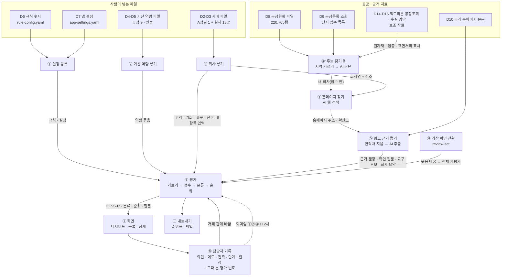
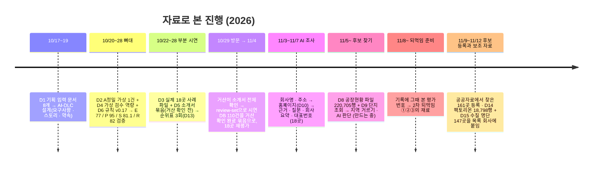

# 데이터 지도 — 어떤 자료를 넣어 무엇이 나오고, 그것이 어디로 가나

> **기준일: 2026-11-12** (`develop` 줄기 기준. 건수는 2026-11-12 PM PC의 DB를 읽은 값) · [지도 입구로 돌아가기](README.md)

이 문서는 **자료의 눈으로** 본 지도입니다. 기능 지도가 "화면에서 무엇을 할 수 있나", 구조 지도가 "어느 폴더에 있고 누가 맡나"라면, 데이터 지도는 **"어떤 자료를 가지고 진행했고, 단계마다 무엇을 넣으면 무엇이 나오며, 그 결과가 다음 단계의 입력이 되는가"**를 봅니다.

- **1장 가지고 진행한 자료** — 지금까지 쓴 자료 하나하나의 출처·크기·있는 곳.
- **2장 한눈에 보는 흐름** — 자료가 단계를 지나며 모양이 바뀌는 그림 한 장.
- **3장 단계마다 입력 → 하는 일 → 출력** — 단계 하나에 표 한 줄. 출력이 어느 단계의 입력이 되는지 적었습니다.
- **4장 어느 시기에 어떤 자료로 진행했나** — 10/17부터 지금까지.
- **5장 자료의 꼬리표와 밖으로 나가는 것** — 가상/실제, 거산 확인 전/후, 밖으로 보내는 것과 안 보내는 것.
- **6장 확인 필요** — 문서와 실제가 다를 수 있는 곳.

쉬운 말 몇 가지: **입력**은 넣는 것, **출력**은 나오는 것, **표**는 자료를 쌓아 두는 장부 한 권(구조 지도 6장), **묶음**은 거산 값(공정·인증)을 어느 근거로 적었는지에 따라 나눈 세 종류(가상 검수 · 소개서 · 거산 확인 완료)입니다.

---

## 1. 가지고 진행한 자료

| # | 자료 | 무엇인가 | 어디에 있나 | 크기 | 출처 · 꼬리표 |
|---|---|---|---|---|---|
| D1 | 기획 입력 문서 | 2차 기획서(v0.15·v0.17), 데이터 설계서, 자료 상태 메모, 거산 회사소개서(연락처 뺀 본문), 페르소나, 방문 후 기획 변경 메모, 데이터 소스 리서치 | `docs/input/` (고치지 않는 원본) | 문서 8개 | 팀·PM 작성, 거산 제공(소개서). AI-DLC 설계 단계의 입력으로만 썼고 프로그램이 읽지는 않음 |
| D2 | 가상 사례 A정밀 | 밸브 바디 아노다이징 영업 기회 1건. 고객·요구·신호·근거·8항목 입력·기대값까지 한 파일 | `examples/case-apjeong.json` | 사례 1건 | **가상**(거산 실제 사양 아님). 기대값 E 77 / P 95 / S 81.1 / R 82 — 규칙 엔진이 맞게 도는지 재는 자 |
| D3 | 실제 기업 사례 파일 | 공개 자료로 팀이 손으로 쓴 회사 1곳 = 파일 1개. 아연도금 9곳 · 아노다이징 9곳. 회사마다 근거 3~12건, 8항목 입력 8건, 카드 문장, 확인 질문 | `examples/cases/*.json` | 18곳 | **실제** 회사, 출처는 공식 홈페이지·공공 자료(파일 안 `sourceRef`). 연락처 없음. 쓰는 법은 `docs/case-file-guide.md` |
| D4 | 거산 역량 파일(가상 검수 묶음) | 거산 공정 9종·세부 역량·납품 실적·인증 3건. 뼈대 검증용 | `examples/capability-geosan.json` | 공정 9 · 인증 3 | **가상 검수** 묶음(VIRTUAL_REVIEWED) |
| D5 | 거산 역량 파일(소개서 묶음) | 거산 회사소개서 2026-09-21판에서 옮긴 공정 9종·인증 12건. 값마다 "거산 확인 전" | `examples/capability-geosan-brochure.json` | 공정 9 · 인증 12 · 값 110건 | **소개서** 묶음(BROCHURE). 10/29 방문 확인 뒤 시연 DB에서 **거산 확인 완료** 묶음으로 복사(D11, [#212]) |
| D6 | 규칙 숫자 파일 | 8항목 배점·일치도 단계·확실도(1.0/0.65/0.25)·감쇠·기준점(E 75·60, P 70, R 60·40)·반올림·분류 11가지 이름 | `examples/rule-config.yaml` | 판 v0.17-e | 기획서 5장·부록 F 그대로. **"기업 승인 전 가설"** 표시. 코드에 숫자를 직접 쓰지 않고 이 파일에서만 읽음 |
| D7 | 앱 설정 파일 | 담당자 목록, 쓰는 묶음, 후보 찾기 범위(지역·키워드·최대 50곳·단지 조회·웹 검색), AI 설정(제공사·모델·월 1,000회·월 20달러), 산업군 10개 | `examples/app-settings.yaml` (가상용 `app-settings-virtual.yaml`) | 파일 1개 | PM이 정함. 키(비밀값)는 들어 있지 않고 환경 변수로만 |
| D8 | 산단공 전국등록공장현황 파일 | 공공데이터포털의 전국 등록 공장 목록. 열 5개(순번·회사명·단지명·생산품·공장주소) | `data/sources/kicox-factory-csv/20251231/` (Git에 올리지 않음) · 테스트용 합성 파일 `tests/fixtures/kicox-factory-synthetic.csv` | 전국 220,705행 (2025-12-31 기준, 1년에 한 번 갱신). 충남·대전·세종만 걸러 18,975행 저장 | **공공·실제**. 지역은 공장주소 글자로 거르고(충남·대전·세종), 대표자 이름 같은 개인정보 열은 받지 않음 |
| D9 | 산단공 공장등록 조회(공식 API) | 산업단지 이름으로 지금 입주한 회사 목록을 받는 조회. 회사명 조회는 고른 회사의 업종명·주생산품 채우기용 | 서버가 호출, 결과는 `src_` 표 | 하루 1,000회 한도, 단지별 결과 15일 보관. 단지 10곳 조회 저장 | **공공·실제**. 읽는 열은 회사명·단지명·주생산품·업종명·공장주소·공장관리번호뿐. 대표자 이름·팩스·전화·홈페이지는 받는 즉시 버림 |
| D10 | 공개 홈페이지 본문 | 회사 공식 홈페이지의 글. 그 사이트의 수집 제한(robots)을 지켜 읽음 | 저장하지 않음 — 뽑은 근거 문장과 대표번호만 저장 | 회사당 최대 2MB. 같은 사이트의 회사소개·제품·연혁 페이지를 최대 3장 더 읽음([#557]). 뽑아 저장한 근거 문장 356건 | **공개·실제**. 연락처를 지운 뒤에만 AI로 보냄 |
| D11 | 저장소(DB)와 백업 | 위 자료가 들어와 쌓이는 곳. 표 47개 | `data/geosan.db` (SQLite, Git에 올리지 않음) · `backups/*.db` | 표 46개 | 시연 DB는 D5를 거산 확인 완료 묶음으로 바꾼 상태(11/4). 배포 DB 반영은 [#213] 뒤 |
| D12 | 담당자 기록 | 프로그램 안에서 생기는 자료. 검토 의견·영업 메모·접촉·영업 단계(거절 이유)·다음 일정·검토사항 체크·질문 답·거래 관계·홈페이지 확인 | `rec_`·`opp_`·`q_` 표 | 쓰는 만큼 | **거산 내부**. 밖으로 내보내지 않음. 메모의 상대 담당자 연락처·대표번호도 안에만 |
| D13 | 시연 결과물 | 화면 없이 뽑은 순위표·근거·사실표 | `out/demo-*/ranking.csv` 등 (Git에 올리지 않음) | 시연 3회분 | 연락처 없음. "시연용 초안·거산 확인 전" 머리글 |
| D14 | 팩토리온 공장조회 파일 | 산단공 팩토리온에서 지역별로 내려받은 공장 등록 정보. 읽는 칸은 회사명·산업단지명·생산품·공장주소·원자재·종업원 수·업종번호·업종명·공장 규모 | `data/sources/` 엑셀 3개(대전·세종·충남, Git에 올리지 않음) → `src_` 표 | 18,798행 (2026-11-11 내려받음) | **공공·실제**. 후보 목록의 출발점이 아니라 이미 목록에 있는 회사에 붙이는 **보조 자료**([#573]). 원자재는 AI 후보 판단의 소재 단서로도 씀([#570]). 전화번호·홈페이지 칸은 읽지 않음. 종업원 수는 언제나 "추정" |
| D15 | 특정수질유해물질 업체 명단 | 국립환경과학원 배출량조사시스템의 업체정보. 칸 4개(사업장명·관할기관·주소·폐수처리 형태) | `data/sources/` CSV 1개(Git에 올리지 않음) → `src_` 표 | 전국 1,617곳 중 충남·대전·세종 147곳 저장 (2026-11-11 내려받음) | **공공·실제**. 보조 자료([#573]): 목록 회사와 회사명, 도로명·건물번호가 모두 같으면 "표면처리를 직접 할 수 있음 · 확인 필요" 표시([#613], 11/12 전에는 이름과 시·군만 봄). 회사를 빼지는 않음 |
| D16 | AI 후보 판단 | 공장 행마다 AI가 낸 판단(제조업인가 · 맞는 공정 · 산업군 · 고른 이유 · 적합도 상/중/하). 같은 공장은 다시 판단하지 않고 다시 씀 | `src_` 판단 표 | 14,345건 (상 766 · 중 6,359 · 하 7,220) | D8·D9·D14에서 **만들어진 자료**. "AI 제안" 꼬리표. 소개서·거산 확인 완료 묶음이 같이 씀([#586]) |

**아직 안 들어온 자료** — 후보 찾기 웹 검색 결과([#314], 기능은 만드는 중이고 이 PC DB에는 0건), 최근 소식 웹 검색([#612], 2차), 채용 공고 근거([#315], 2차), 주소 → 좌표([#222]).

**쓰지 않기로 한 자료** — 나라장터 입찰 공고: 공공기관이 사는 공고라 민간 제조사의 협력사 모집이 거의 없어 연결하지 않음(PM 판단 2026-11-11, [#561] 8번). 약속의 소스 표에는 이름이 남아 있음.

---

## 2. 한눈에 보는 흐름

**그림을 글로 풀면**

1. **사람이 넣는 파일 네 가지**(규칙 숫자, 앱 설정, 거산 역량, 사례)가 ①②③으로 들어갑니다. 이 넷이 1차 자료의 바탕입니다.
2. **공공 자료 두 가지**(공장현황 파일, 공장등록 조회)는 ③′ 후보 찾기로 들어가, 주소로 지역을 거르고 AI가 "제조업인가 · 어느 공정이 맞나 · 왜"를 판단해 새 회사를 **점수 전** 상태로 등록합니다. 지금까지 161곳이 이 길로 들어왔습니다(사례 파일 18곳과 합쳐 179곳). **보조 자료 두 가지**(팩토리온 공장조회, 수질 명단)는 목록을 늘리지 않고 이미 있는 회사에 원자재·종업원 수·업종·표면처리 표시를 붙이며, 원자재는 AI 판단의 소재 단서로도 들어갑니다. 웹 검색 갈래는 만드는 중입니다.
3. 회사가 들어오면 **회사명과 주소만** AI 웹 검색에 보내 홈페이지를 찾고(④), 그 홈페이지 본문에서 **연락처를 지운 뒤** AI가 근거 문장·확인 질문·요구 후보·회사 요약을 뽑습니다(⑤).
4. ⑥ 평가는 ①②③⑤의 출력을 **한 번에 모아**(입력 스냅샷) 규칙 엔진에 넣고, 점수 E·P·S·R, 분류 11가지, 순위, 질문 후보를 냅니다. 같은 입력이면 늘 같은 출력입니다.
5. ⑦ 화면은 ⑥의 결과를 보여 주고, ⑧ 담당자 기록은 그 위에 쌓입니다. 기록 가운데 **거래 관계**만 바로 ⑥으로 돌아가 다시 평가되고, 나머지 기록이 순위로 돌아오는 **되먹임**은 2차입니다([기능 지도 "이 서비스의 핵심"](feature-map.md#이-서비스의-핵심--쓸수록-거산에-맞게-순위근거가-맞춰진다)).
6. ⑩ 거산 확인 전환은 소개서 묶음을 거산 확인 완료 묶음으로 바꾸고 전체를 다시 평가합니다. ⑪은 순위표와 백업을 파일로 냅니다.

---

## 3. 단계마다 입력 → 하는 일 → 출력

상태는 기능 지도와 같은 네 값입니다(✅ 됨 · ⏳ 진행 중 · 📅 2차 예정 · ⏸ 보류). "다음에 누가 쓰나" 칸이 **출력이 어느 단계의 입력이 되는지**입니다.

| 단계 | 넣는 것 (입력) | 하는 일 | 나오는 것 (출력) | 어디에 저장 | 다음에 누가 쓰나 | 상태 |
|---|---|---|---|---|---|---|
| ① 설정 등록 | D6 규칙 숫자, D7 앱 설정 | 모르는 키·빠진 값·모델 이름을 검사하고 판 번호·해시와 함께 등록 | 등록된 규칙 판, 앱 설정 사본 | `cfg_` 2표 | ⑥ 평가(규칙·기준점), ③′ 후보 찾기(범위·한도), ④⑤ AI 호출(모델·한도) | ✅ `init-db`·`check-config` |
| ② 거산 역량 넣기 | D4 또는 D5 역량 파일 | 공정·세부 역량·실적·인증·적용 범위를 검사해 저장. 같은 키를 다시 넣으면 값은 덮고 이력은 보존 | 역량 묶음(가상 검수 / 소개서) | `cap_` 7표 | ⑥ 평가(어느 공정이 맞나, 인증 요구가 통과되나), ⑩ 전환 | ✅ `import-capability` |
| ③ 회사 넣기 | D2·D3 사례 파일 1개 | 형식·코드값·연락처 포함 여부를 검사하고 고객·기회·공정 연결·요구·신호·근거·8항목 입력·조사 요건을 저장 | 고객 1 · 영업 기회 1 · 근거 N · 8항목 입력 8 | `opp_`·`ev_`·`eval_`(점수 입력)·`q_` | ④ 홈페이지 찾기(회사명·주소), ⑥ 평가 | ✅ `import-case`·`check-case` |
| ③′ 후보 찾기 | 담당자가 고른 조건(공정 필수 · 지역 · 산업) + D8 파일 행 + D9 조회 행 | 주소로 지역 거르기 → 파일과 조회의 같은 회사 합치기 → AI 판단(제조업 여부 · 맞는 공정 · 산업군 · 고른 이유 · 적합도 상/중/하 · 표면처리를 직접 하는 회사인지) → 새 회사 등록. 대표자 이름·팩스는 받는 즉시 버림 | 새 고객·기회(점수 전, "이번에 들어옴" 꼬리표), 회차 기록, 같은 회사일 수 있는 "확인 필요" 후보 | `src_` 7표 → `opp_`(회차·확인 필요 포함) | ④ 자동 조사, ⑥(점수 제안 [#286] 뒤 순위에) | ✅ 읽기·거르기·조회·판단·등록·실행 명령 `ingest`([#320] [#404] [#328] [#437] [#427]) / ⏳ 누르기 전 비용 보이기와 단추 나누기 [#549], 전체 마무리 [#221] |
| ③″ 후보 찾기 웹 검색 | 같은 조건 | AI 웹 검색이 조건의 이름만으로 회사를 찾음. 출처 주소 없는 것·채용 사이트·유료 기업 정보는 버림 | 회사명·주소·출처 주소(“등록 자료에서 못 찾음 · 확인 필요” 꼬리표) | `src_` 웹 검색 실행 표 | ③′와 같이 ④로 | ⏳ 만드는 중 [#314]. 이 PC DB에는 결과 0건 |
| ③‴ 보조 자료 붙이기 | D14 팩토리온 엑셀, D15 수질 명단 CSV | 설정한 시·도 행만 저장 → 회사명+주소(없으면 회사명+같은 시·군)로 목록 회사에 붙임. 새 파일을 넣으면 그 자료를 통째로 바꿈. 수질 명단 표시는 회사명과 도로명·건물번호가 모두 같을 때만 붙임([#613]) | 회사별 공장 정보(원자재·종업원 수 추정·업종·규모), 표면처리 표시(출처: 업종번호 또는 수질 명단) | `src_` 2표, `opp_` 고객 칸 | ③′ AI 판단(원자재를 소재 단서로 [#570]), ⑦ 카드·상세 | ✅ `source-load` [#573] |
| ④ 홈페이지 찾기 | 회사명 + 주소 (사례 파일·공공 자료 출처만) | 전송 보호 검사(메모·내부 값이 섞이면 호출 안 함) → AI 웹 검색 → 공식 홈페이지 1개·확신도(0~1)·이유. 확신도 0.7 아래면 "확인 필요" | 홈페이지 주소·확신도·상태(찾음 / 확인 필요 / 못 찾음) | `opp_` 고객 홈페이지 칸, `tg_` 호출 기록(본문 없음) | ⑤ 읽기, ⑦ 상세 머리([맞음]·[고치기]·[다시 조사]) | ✅ [#218] [#304] |
| ⑤ 읽고 근거 뽑기 | 홈페이지 주소(또는 담당자가 붙여 넣은 본문) | robots·공개 주소 검사 → 본문 읽기(최대 2MB) → 회사 대표번호 뽑기(사람 이름 붙은 번호는 제외) → 연락처 지우기 → 전송 보호 검사 → AI 근거 추출. 60초 안, 재시도 1회 | 근거 문장(출처 등급·확실도 제안), 확인 질문, 요구 후보, 회사 요약 한 줄·강점 3개, 산업군 제안(최대 3), 8항목 입력 제안([#286]) | `ev_`, `q_`, `opp_`(요약·산업군·대표번호), `tg_` | ⑥ 재평가(자동), ⑦ 상세(근거 자료·검토사항·회사 소개) | ✅ 근거·질문·요약·8항목 입력 제안([#286])·안쪽 페이지 읽기([#557]) / 📅 최근 소식 검색 [#612](2차) |
| ⑥ 평가 | 평가 입력 스냅샷 = 기준일 + ①규칙 + ②역량 묶음 + ③고객·기회·공정 연결·요구·신호·접촉 이력·8항목 입력 + ⑤근거 + ⑧준비 체크·거래 관계 | 꼭 맞아야 하는 조건으로 거르기(회사·기회·공정 연결 단위) → 8항목 점수(일치도 × 확실도 × 감쇠, 0.5 올림) → 합계 E·F·T·P·R·S·C → 핵심 근거·시점·조사 준비 판정 → 분류 11가지 → 정렬 키 → 순위(거래 중은 맨 아래) → 질문 후보 | 평가 묶음 1 + 회사마다 평가 결과·항목 판정·요구 판정·근거 연결·기한 체크, 순위, 질문 | `eval_` 7표, `q_` | ⑦ 화면 전부, ⑧ 기록(그때 본 평가 번호), 재현(같은 입력 해시 → 같은 출력) | ✅ `evaluate` + 자동(⑤⑨⑩ 뒤) |
| ⑦ 화면 | `eval_`·`opp_`·`ev_`·`q_`·`rec_` | 창구 13개로 대시보드(건수·일정·최근 기록), 목록(공정 탭·지역·산업 거르기·카드), 상세(머리·근거·검토사항·점수·기록) 구성 | 담당자가 보는 화면. 가상 사례와 "거산 확인 전"은 띠로 표시 | 저장 없음(읽기) | ⑧ 담당자 | ✅ |
| ⑧ 담당자 기록 | 담당자 입력: 검토 의견(3가지) · 영업 메모 · 접촉(전화·방문·메일, 결과, 날짜) · 영업 단계(거절이면 이유 6가지) · 다음 일정 · 검토사항 체크 · 질문 답 · 거래 관계 · 홈페이지 확인 · 관심 | 담당자를 골랐는지 검사 → 저장 + 활동 이력 1줄. 거래 관계는 이력 1행 + 그 회사 재평가 | 기록 행, 활동 이력. 접촉·단계·메모 행에 **그때 본 평가 번호** | `rec_` 4표, `opp_`(거래 관계 이력·홈페이지), `q_`(답) | ⑦ 대시보드 건수·최근 기록·활동 이력, ⑨ 재평가(거래 관계만), 📅 되먹임 ①②③의 재료 | ✅ 기록 · 평가 번호([#450] [#451]) |
| ⑨ 재평가 촉발 | 거래 관계 변경(⑧), 조사 완료(⑤), 전환(⑩), 홈페이지 고침(⑧) | 그 회사 또는 전체를 ⑥으로 다시 보내고 순위를 다시 맞춤 | 새 평가 결과(옛 결과는 이력으로 남음) | `eval_` | ⑦ | ✅ |
| ⑩ 거산 확인 전환 | D5 소개서 묶음 110건 + 확인자·날짜·근거 | 원본 보존 + 거산 확인 완료 묶음으로 복사 → 쓰는 묶음 전환 → 전체 재평가, 한 번에 | 거산 확인 완료 묶음. 카드의 "거산 확인 전" 띠가 내려감 | `cap_` | ⑥ | ✅ 명령 `review-set`·`dataset-set` / ⏳ 배포 DB 실행은 [#213] 뒤 [#212] |
| ⑪ 내보내기 | `eval_`·`opp_`·`ev_` / DB 파일 | 순위표·근거·사실표를 파일로(연락처 없음) / 서버를 켠 채 DB 복사 | `ranking.csv` 등 / 백업 `.db` | `out/` / `backups/` | 시연 자료, 되돌리기(`restore`) | ✅ `demo-report` [#214] |
| ⑫ 되먹임 | ⑧ 기록 + 그때 본 평가 번호 | ① 같은 회사 반영 → ② 비슷한 회사로 번짐 → ③ 선호를 가중치 제안으로(사람 승인). 설명 가능한 규칙만 | 바뀐 순위·근거와 "왜 바뀌었나" | — | ⑥ | 📅 2차 [#268] [#269], ①·③은 이슈 아직 없음 |

**출력이 입력이 되는 고리 세 개만 기억하면 됩니다.**

- **③·⑤ → ⑥**: 사람이 적은 사례 파일과 AI가 뽑은 근거가 **같은 모양의 근거·요구·8항목 입력**으로 합쳐져 평가에 들어갑니다. AI가 뽑은 것은 "AI 제안·확인 전"으로 구분됩니다.
- **⑥ → ⑦ → ⑧ → ⑥**: 평가 결과를 보고 담당자가 기록하면, 지금은 거래 관계만 되돌아가고, 2차에는 기록 전부가 규칙으로 되돌아갑니다. 그래서 1차에 ⑧의 기록에 **그때 본 평가 번호**를 남깁니다.
- **D8·D9 → ③′ → ④⑤⑥**: 공공 자료에서 찾은 회사도 사례 파일로 넣은 회사와 **같은 길**(홈페이지 찾기 → 근거 뽑기 → 평가)을 탑니다. 다른 점은 사람이 8항목을 적지 않았으므로 "점수 전"이고, AI 점수 제안([#286])이 붙어 흐린 점수로 순위에 들어갑니다.

---

## 4. 어느 시기에 어떤 자료로 진행했나

**그림을 글로 풀면**

| 시기 | 가지고 진행한 자료 | 무엇을 했나 | 나온 것 | 근거 |
|---|---|---|---|---|
| 10/17~19 | D1 기획 입력 문서 8개 | AI-DLC로 의도·범위·요구사항·스토리·화면·부품·약속을 설계 | `aidlc/` 설계 기록, 약속 요약 | `docs/input/00_자료상태메모.md` |
| 10/20~28 뼈대 | D2 A정밀 1건, D4 가상 검수 역량, D6 규칙 v0.17 | 넣기 → 거르기 → 점수 → 분류 → 화면 → 의견 저장이 한 번에 도는지 | A정밀이 기대값 E 77 / P 95 / S 81.1 / R 82로 나옴(`verify-case`) | 뼈대 검증 CI |
| 10/22~28 부분 시연 | D3 실제 18곳(아연도금 9 · 아노다이징 9), D5 소개서 묶음 | 공정 2개의 참고 순위와 근거를 거산에 보이기. 소개서 값은 "거산 확인 전" | 순위표 3회(10/24 · 10/26 · 10/29). 전원 "거래 확인 전"이라 접촉 후보 0곳 | [#22] [#68] [#94], `out/demo-*` |
| 10/29 방문 → 11/4 | D5 110건 | 거산이 소개서 전체를 "문제없다"고 확인 → 시연 DB에서 거산 확인 완료 묶음으로 복사·전환·재평가 | 핵심 근거 충족 0곳 → 13곳, 순위·점수는 그대로. 배포 DB는 아직 | [#212] |
| 11/3~11/7 AI 조사 | 회사명·주소(D3 출처), D10 홈페이지 본문 | AI 웹 검색으로 홈페이지 찾기 → 본문 읽기 → 연락처 지우기 → 근거·질문·회사 요약·산업군 제안 → 재평가 | 18곳의 홈페이지 상태·근거·검토사항. 모델 gpt-6.1-sol, 월 20달러 한도 | [#218] [#304] |
| 11/5~ 후보 찾기 | D8 파일(충남·대전·세종), D9 단지 조회 | 주소로 지역 거르기, 파일·조회 합치기(천안제3일반산업단지: 파일 100행 · 조회 266행 확인), AI 판단 검사, 하루 1,000회·15일 보관 | 읽기·거르기·조회·판단 부품은 됨. 실행 명령과 단추 연결, 웹 검색, 점수 제안은 진행 중 | [#221] [#320] [#404] [#437] [#427] [#314] [#286] |
| 11/8~ | ⑧ 기록 | 접촉·단계·메모에 그때 본 평가 번호를 같이 저장 | 2차 되먹임 ①②③의 재료 | [#450] [#451] [#458] |
| 11/9~11/12 | D8 18,975행, D9 단지 10곳, D14 팩토리온 18,798행, D15 수질 명단 147곳 | 공공자료에서 찾은 회사 등록, 자동 조사가 안쪽 페이지까지 읽기, 팩토리온 원자재를 AI 판단에 넣기, 공장 정보·표면처리 표시 붙이기, 거산 확인 완료 묶음도 같은 공장 자료·판단을 쓰게 함 | 영업 후보 179곳(사례 파일 18 + 공공자료 161), AI 판단 14,345건, 근거 문장 356건, 외부 AI·검색 호출 기록 857건 | [#557] [#570] [#573] [#586] |

---

## 5. 자료의 꼬리표와 밖으로 나가는 것

**꼬리표 세 가지** — 자료마다 아래 셋 중 어디인지가 화면과 출력물에 보입니다.

| 꼬리표 | 뜻 | 어떻게 보이나 |
|---|---|---|
| 가상 / 실제 | A정밀은 가상, 18곳과 공공 자료는 실제 | 가상은 카드·상세·순위표에 "가상 · 거산 실제 사양 아님" 띠 |
| 거산 확인 전 / 확인 완료 | 거산 값(공정·인증)을 소개서에서 옮겼는지, 거산이 확인했는지 | 확인 전이면 카드 "참고 ○점"과 "거산 확인 전" 띠. 시연 DB는 확인 완료 |
| 사람이 적음 / AI 제안 | 근거·산업군·점수 입력을 사람이 적었나, AI가 뽑았나 | AI 제안은 "AI 제안 · 확인 전"으로 흐리게. 담당자가 [확정]하면 사람 값으로 |

**밖으로 보내는 것과 안 보내는 것** — 자세한 그림은 [구조 지도 8장](structure-map.md#8-밖으로-나가는-것과-안-나가는-것).

- **보냄(외부 AI 서비스 한 곳)**: 회사명·주소(홈페이지 찾기), 연락처를 지운 공개 홈페이지 본문(근거 뽑기), 공장 행의 회사명·생산품·업종명·주소(후보 판단), 담당자가 고른 조건의 이름(웹 검색). 보내기 전마다 전송 보호 검사를 거치고, 호출마다 시각·모델·토큰 수만 기록합니다(본문 없음).
- **안 보냄**: 연락처(전화·이메일·사람 이름), 대표번호, 거산 역량 값, 가상 사례. 공공 조회에 딸려 오는 대표자 이름·팩스·전화는 저장도 전송도 하지 않습니다.
- **영업 기록(2026-11-13 PM 결정, [#681])**: 접촉 기록·꼬리 질문 답·영업 결과·거절 이유·영업 메모는 연락처를 지우고 설정 스위치·전송 기록·월 비용 한도를 거쳐 외부 AI로 보낼 수 있습니다. 보내는 기능은 아직 없어서 지금 프로그램은 영업 메모와 담당자 기록을 보내지 않습니다. 자세한 범위와 대책은 [영업 기록을 외부 AI로 보내는 범위와 대책](../ai-records-policy.md).
- **파일로 나가는 것**: 순위표·근거·사실표(`demo-report`, 연락처 없음), 백업 DB 파일(프로그램 밖으로 옮기지 않음).

---

## 6. 확인 필요

- D8 파일 행 수는 약속 요약(220,705행)과 실제 파일(머리글 포함 220,706줄)이 맞습니다. 파일은 Git에 없으므로 새 PC에서는 다시 내려받아야 합니다(`app-settings.yaml`의 `factoryCsvPath`).
- 이 문서의 건수는 2026-11-12 PM PC의 DB를 읽은 값입니다. 배포 DB나 다른 팀원 PC의 값은 다를 수 있습니다.
- 수질 명단은 [#561] 댓글(11/11)에 "쓰지 않음"이라고 적혀 있지만, 같은 날 [#573]에서 보조 자료로 넣는 것이 승인돼 DB에 들어와 있습니다. 이 문서는 "쓴 자료"(D15)로 적었습니다.
- 후보 찾기 웹 검색([#314])은 다른 PC에서 실제 검색을 돌린 기록이 있으나 이 PC DB에는 결과가 없어 건수를 적지 않았습니다.
- 이 PC DB에는 가상 사례 A정밀(D2)이 들어 있지 않습니다(회사 179곳 모두 실제). 가상 사례는 뼈대 검증의 임시 DB에서만 씁니다.
- 이 문서의 단계 번호는 [구조 지도 2장](structure-map.md#2-자료가-흐르는-길)의 ①~⑩과 같고, ③′·③″·③‴·⑪·⑫는 이 문서에서 더한 것입니다.

[#22]: https://github.com/agent-ddalgi-team/final-geosan/issues/22
[#68]: https://github.com/agent-ddalgi-team/final-geosan/issues/68
[#94]: https://github.com/agent-ddalgi-team/final-geosan/issues/94
[#212]: https://github.com/agent-ddalgi-team/final-geosan/issues/212
[#213]: https://github.com/agent-ddalgi-team/final-geosan/issues/213
[#214]: https://github.com/agent-ddalgi-team/final-geosan/issues/214
[#218]: https://github.com/agent-ddalgi-team/final-geosan/issues/218
[#221]: https://github.com/agent-ddalgi-team/final-geosan/issues/221
[#222]: https://github.com/agent-ddalgi-team/final-geosan/issues/222
[#268]: https://github.com/agent-ddalgi-team/final-geosan/issues/268
[#269]: https://github.com/agent-ddalgi-team/final-geosan/issues/269
[#286]: https://github.com/agent-ddalgi-team/final-geosan/issues/286
[#304]: https://github.com/agent-ddalgi-team/final-geosan/issues/304
[#314]: https://github.com/agent-ddalgi-team/final-geosan/issues/314
[#315]: https://github.com/agent-ddalgi-team/final-geosan/issues/315
[#320]: https://github.com/agent-ddalgi-team/final-geosan/issues/320
[#328]: https://github.com/agent-ddalgi-team/final-geosan/issues/328
[#404]: https://github.com/agent-ddalgi-team/final-geosan/issues/404
[#427]: https://github.com/agent-ddalgi-team/final-geosan/issues/427
[#437]: https://github.com/agent-ddalgi-team/final-geosan/issues/437
[#450]: https://github.com/agent-ddalgi-team/final-geosan/issues/450
[#451]: https://github.com/agent-ddalgi-team/final-geosan/issues/451
[#458]: https://github.com/agent-ddalgi-team/final-geosan/issues/458
[#549]: https://github.com/agent-ddalgi-team/final-geosan/issues/549
[#557]: https://github.com/agent-ddalgi-team/final-geosan/issues/557
[#612]: https://github.com/agent-ddalgi-team/final-geosan/issues/612
[#561]: https://github.com/agent-ddalgi-team/final-geosan/issues/561
[#570]: https://github.com/agent-ddalgi-team/final-geosan/issues/570
[#573]: https://github.com/agent-ddalgi-team/final-geosan/issues/573
[#586]: https://github.com/agent-ddalgi-team/final-geosan/issues/586
[#613]: https://github.com/agent-ddalgi-team/final-geosan/issues/613
[#681]: https://github.com/agent-ddalgi-team/final-geosan/issues/681
