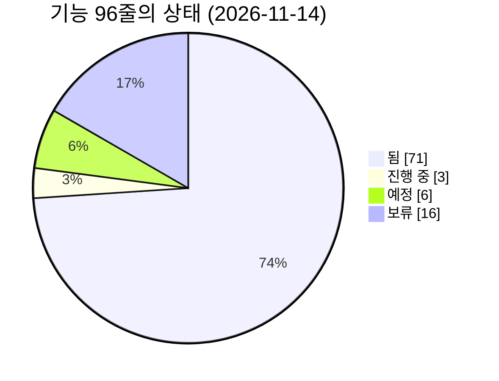
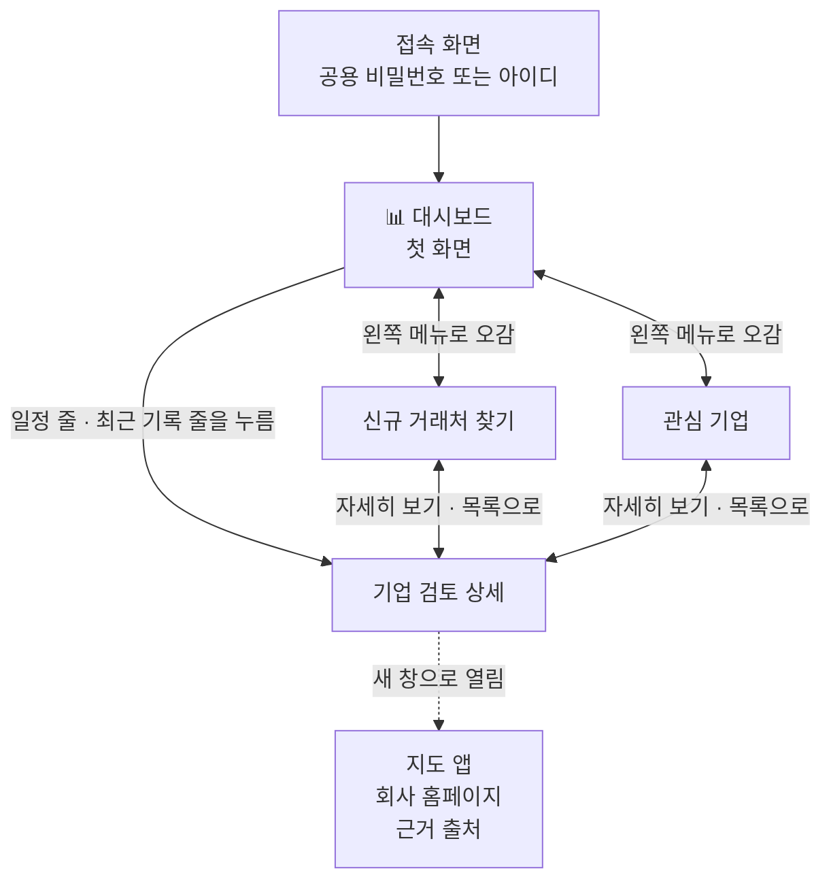
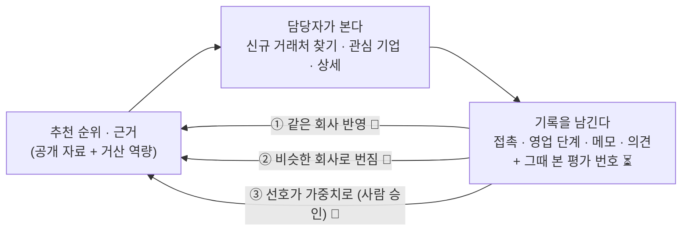
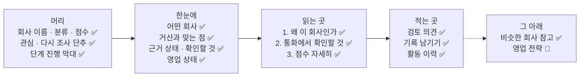

# 기능 지도 — 담당자가 화면에서 지금 무엇을 할 수 있나

> **기준일: 2026-11-14** (`develop` 줄기 기준) · [지도 입구로 돌아가기](README.md)

거산 영업 담당자가 **화면 어디에서 무엇을 할 수 있는지**를 한 줄씩 적은 표입니다. 한 줄이 기능 하나입니다.

## 최근 바뀐 것

최근 5줄만 둡니다. 전체 기록은 [기획 변경 기록](change-log.md)에 쌓습니다.

- **11/17** 신규 거래처 찾기의 접힌 [＋ 새 후보 찾기] 칸 안 지난 찾기 요약이 "지난 새 후보 찾기"로 바뀌고(옛 이름 "영업 후보 더하기" 없앰), 지난 실패는 "11/13 찾기 실패 · …"처럼 날짜를 붙여 지난 일로 보입니다. 대시보드 작은 달력은 노트북 폭에서도 할 일 옆에 작게(320px) 놓입니다 ([#825]).
- **11/16** 영업 분석 그림 아래에 "기록에서 배우기"가 붙었습니다: 실패에서 배우기(어디서 멈췄나 · 거절 이유 · 실패 전 신호를 성사 회사와 견주기)를 먼저, 그다음 성공 패턴 · 잘 되는 조합 · 꼬리 질문 답 채움률 · 질문지 다듬기 제안(승인 전) · 영업 코치 제안 효과. AI 없이 저장된 기록만 세고, 표본이 적으면 "판단 보류"입니다 ([#802]).
- **11/16** 운영 담당에게만 왼쪽 메뉴 맨 아래 "운영 관리"가 생겼습니다. 이번 달 AI 사용액(한도 대비 %, 회사 조사·후보 판단 / 웹 검색 / 영업 기록·코치별, 날짜별)과 오늘 자동 조사 금액, 자료별 기준일·다음 갱신 권장일, 최근 막힌 전송 10건을 봅니다. 대시보드 "오늘 확인할 것" 맨 앞에는 "⚠ AI 사용 82% ($41/$50) · 운영 관리 →"·"📂 공장현황 자료(2025-12-31 기준) 갱신할 때가 지났습니다"(운영 담당), "⛔ 이번 달 AI 한도에 닿아 조사·코치가 멈췄습니다"(모든 담당자)가 뜹니다 ([#799]).
- **11/16** 조사가 홈페이지로 적합도를 다시 볼 때, 도금·직접 제조를 "안 적어 둔 것"만으로는 내리지 않습니다(서비스·용역, 조립만, 자체 도금 같은 반대 근거가 있을 때만). 홈페이지를 읽을 때 일부 국내 호스팅이 "연결 안 됨"이 되던 문제도 고쳤습니다. https 인증서가 자체 서명·기한 만료인 홈페이지는 같은 주소의 http로 한 번 다시 읽고, 그 근거 출처 옆에 "(암호화 없는 주소로 읽음)"이 붙습니다(설정으로 켜고 끔) ([#810]).
- **11/16** 대시보드 브리핑의 영업 진행 띠 칸(미접촉 · 접촉 · 견적·샘플 · 성사 · 보류)을 누르면 그 단계 회사가 띠 아래에 "코파스 주식회사 · 마지막 접촉 3일 전 · 다음 11/18 방문"처럼 펴집니다. 다음 일정 없이 마지막 접촉 뒤 14일이 지난 접촉·견적 회사에는 "⚠ 멈춘 회사"가 붙고 맨 위에 섭니다 ([#800]).
- **11/16** 기업 상세를 정리했습니다. 머리 단추는 한 줄([기록 남기기] [관심] [다시 조사] [보고서]), 검토 의견은 꼬리표 줄, 산업은 "한눈에" 칸에서 바로 고칩니다. "왜 이 회사인가"는 항목 한 줄 + "근거 3건" 접기, 점수는 묶음 막대, 활동 이력은 그림 점 세로 타임라인입니다. "한눈에"에는 거산과 회사를 잇는 작은 지도가 붙고, 오른쪽 영업 코치는 연두 판으로 구분되고 "① 통화 전 — 물어볼 것 → ② 기록 남기기" 순서이며, 상세에서는 왼쪽 메뉴가 처음에 접힙니다 ([#803]).
- **11/16** 발표 시연용 DB의 대시보드 지도가 채워집니다. 가상 회사 18곳에 천안·아산 일대에 지어낸 위치를 주어, 지도에 성사 4곳·진행 중 7곳이 점("A정밀(가상)")으로 보이고 방문 준비에 "거산 → G정공(가상) 2.9km → B금속(가상) 1.4km" 같은 거리 화살표가, 카드에 "거산에서 2.9km"가 붙습니다. 시연 DB에서만이고 실제 DB는 공공좌표만 그대로입니다 ([#811]).
- **11/16** 신규 거래처 찾기 머리가 "공정 · 지역 · 정렬 + 오른쪽 검색" 한 줄과 접힌 [조건 더 보기]로 줄었습니다. [＋ 새 후보 찾기 💰]는 접혀 있다가 필요할 때 펴고, 펴면 "자료 기준"(공장현황 파일·공장조회·마지막 AI 판단 날짜)이 보입니다. 지역은 권역 4개(천안·아산 / 세종·대전·공주 / 충남 서북부 / 충남 남부)로 고르고, 카드의 검토 의견은 고르기 칸 하나, 공장 정보 줄은 상세에서만 봅니다 ([#798]).
- **11/16** 발표 시연용 DB를 만들면 진행 중 7곳에 다음 일정(오늘 2곳 · 1~10일 뒤 5곳)이 들어가 대시보드 달력과 "오늘 확인할 것"이 채워지고, 가상 회사 카드의 추천 근거가 회사별 문장("철강 차량용 브라켓을 만들며 내식성·외관을 요구하고 프레스 라인을 늘려 아연도금 물량이 늘 수 있다")으로 보입니다. 지도는 [#811]에서 채웠습니다 ([#790]).
- **11/16** 영업 분석이 그림 넷으로 바뀌었습니다: "어디서 빠지나" 깔때기(접촉 18 → 연결 15 → 수요 확인 13 → 견적·샘플 7 → 성사 4, 단계 사이 "↓ 54% 넘어감 · 여기서 멈춤 6곳 · 거절 2(납기 2) · 보류 2"), 거절 이유 막대, "어느 조합에서 잘 되나" 공정 × 산업 칸(표본 10곳 밑은 회색), "회사별로 어디서 멈췄나" 점 줄(연결 · 연결 안 됨 · 단계가 올라간 날). 숫자 칸·도넛·공정 막대는 없앴고 표와 관심 기업 분포는 [표로 보기]에 접혀 있습니다 ([#801]).
- **11/16** 신규 거래처 찾기가 비었을 때 회사를 모두 관심 기업으로 옮겨서라면 "후보 없음" 대신 "관심 기업으로 옮긴 18곳은 이 목록에서 빠져 있습니다. 위의 [관심 기업도 함께 보기]를 켜면 함께 보입니다."가 보입니다. 노트북 폭에서도 대시보드 관심 기업 세 칸이 한 줄에 놓이고, 영업 분석 공정 이름이 "아연도금(전…"으로 잘리지 않고 "아연도금 / (전기아연도금)" 두 줄로 보입니다 ([#787]).
- **11/16** 오른쪽 💬 영업 코치 칸이 화면마다 기본값을 따릅니다: 기업 상세·신규 거래처 찾기는 펼침, 대시보드·관심 기업·영업 분석은 접힘(💬만). 펼치거나 접은 것은 그 화면에만 기억합니다 ([#795]).
- **11/16** 대시보드가 "오늘 할 일과 방문 전 정리" 순서로 바뀌었습니다: 맨 위 오늘 브리핑(일정 · 전달 사항 · 영업 진행 흐름) → 오늘 할 일 + 작은 달력 → 방문 준비(회사마다 [보고서 ↗]·[상세]와 거산 → 회사 → 근처 관심 기업 거리 화살표, 옆에 지도) → 더 보기(접힘). 회사 검색은 오른쪽 위에 작게 ([#795]).
- **11/16** 조사가 홈페이지를 읽으면 적합도도 홈페이지로 다시 정합니다. 카드 꼬리표가 "적합도 상 ↑"·"적합도 하 ↓"처럼 바뀌고 고른 이유가 "홈페이지 기준 · …"으로, 상세 "한눈에" 근거 상태는 "적합도 상 (홈페이지 기준 · 처음엔 생산품 기준 중)"으로 보입니다. 홈페이지가 닫힌 회사(빈 화면·호스팅 만료)는 "홈페이지가 닫혀 있습니다(호스팅 만료)"로 보이고 "홈페이지 없음" 묶음으로 갑니다 ([#793]).
- **11/16** 대시보드 "📬 나에게 온 전달 사항"에 전달 글 앞부분이 함께 보여 상세를 열지 않아도 무슨 말인지 압니다. 상세 전달 사항 포스트잇에는 받는 사람이 아직 안 봤으면 "영업 담당 확인 전"이 보입니다 ([#794]).
- **11/16** 왼쪽 메뉴에 새로 생긴 것 숫자가 붙습니다. 대시보드는 오늘 확인할 것(지난 일정 + 오늘 일정 + 나에게 온 전달 사항) 곳 수, 신규 거래처 찾기는 마지막으로 연 뒤 새로 들어온 후보, 관심 기업은 다른 사람 기록·새 조사 결과가 붙은 곳 수입니다. 신규 거래처 찾기·관심 기업은 그 화면을 열면 0으로 돌아가고(대시보드는 일정·전달 사항을 정리하면 줄어듭니다), 메뉴를 접으면 그림 모서리에 빨간 숫자로 보입니다 ([#770] [#791]).
- **11/16** 왼쪽 메뉴가 어두운 칸 + 선 그림(대시보드 네 칸 · 신규 거래처 찾기 공장과 돋보기 · 관심 기업 별 · 영업 분석 막대)으로 바뀌었습니다. 맨 위 [메뉴 접기]로 접으면 그림만 남고, 그림에 손을 올리면 오른쪽에 이름표가 뜹니다 ([#767] [#783]).
- **11/16** 영업 분석 오른쪽 위에서 기간을 고릅니다([전체] · [최근 30일] · [최근 3개월] · [이번 달] · [올해] 또는 시작일·끝일). 그 기간 안에 접촉한 회사만 세고, 맨 위 숫자 칸(접촉한 회사 · 진행 중 · 완료 · 성사 · 거절)과 공정별 막대 · 결과 도넛 · 거절 이유 막대로 보입니다 ([#760]).
- **11/16** 발표 시연용 DB의 가상 회사가 6곳에서 18곳(성사 4 · 거절 5 · 보류 2 · 진행 중 7)으로 늘고 접촉이 1~150일 전으로 퍼져, 영업 분석에서 [최근 30일]을 고르면 숫자가 달라집니다 ([#765]).
- **11/16** 기업 상세가 구역별로 정리되었습니다. 영업 진행은 4칸 띠(미접촉 · 접촉 · 견적·샘플 · 성사)와 그 아래 세부 단계 점 줄로 보이고, 강조색은 연두 한 가지만 씁니다 ([#759]).
- **11/16** 영업 코치 답 아래에 "할 일 제안"이 붙습니다. "가나텍 · 11/18(수) 방문 [넣기]"를 누르면 그 회사 다음 일정으로 저장되고(이미 일정이 있으면 바꿀지 먼저 묻습니다), 신규 거래처 찾기에서 물으면 아직 연락 안 한 후보 표(지역·적합도·거산에서 거리)로 답합니다. 긴 답은 5줄 + [더 보기] ([#774]).
- **11/16** 영업 코치가 오른쪽에 붙어 스크롤을 따라옵니다. 기업 상세는 왼쪽에서 근거를 읽고 오른쪽에서 바로 기록을 남기고, 다른 화면은 오른쪽에서 질문합니다. [›]로 접으면 💬만 남습니다 ([#773]).
- **11/16** 담당자가 없을 때 다른 직원이 남기는 "전달 사항"이 생겼습니다. 상세 기록 칸 맨 위 노란 포스트잇과 대시보드 "📬 나에게 온 전달 사항"으로 보이고, 받는 사람이 [확인했어요]를 누릅니다. 영업 코치는 확인 전 전달 사항을 피드백 첫 줄에서 짚어 줍니다 ([#771]).
- **11/16** 대시보드 "오늘 확인할 것"이 🔴 지난 일정 — 했나요? · 📅 오늘 일정 · 🔍 확인할 것이 남은 관심 기업으로 나뉘어 회사마다 한 줄로 보입니다. 지난 일정은 [완료] · [날짜 바꾸기] · [필요 없어요]로 정리하고, "영업 진행"은 상세와 같은 4칸 띠(미접촉 · 접촉 · 견적·샘플 · 성사)입니다 ([#766]).
- **11/16** 메뉴가 왼쪽으로 옮겨졌습니다: 📊 대시보드 · 🔍 신규 거래처 찾기 · ⭐ 관심 기업 · 📈 영업 분석. "영업 후보 목록"은 이름이 "신규 거래처 찾기"로 바뀌었고, 관심 기업은 따로 된 화면입니다. 메뉴는 [‹]로 접으면 아이콘만 남습니다 ([#762]).
- **11/15** 배포 서버에서는 사람마다 아이디·비밀번호로 들어옵니다. 처음 들어온 사람이 화면에 보일 이름과 새 비밀번호를 정하고, 그 뒤 메모·접촉에는 그 사람 이름이 남습니다(위쪽 "영업 김 님 · [로그아웃]"). 계정이 없는 이 PC는 지금처럼 공용 비밀번호입니다 ([#754]).
- **11/15** 대시보드 일정 달력이 어두운 판 위 둥근 칸으로 바뀌었습니다. 일정이 있는 날만 색 칸(기한 지남 갈색 · 오늘 금색 · 7일 안 연노랑 · 그 뒤 연두)과 "2건"이 보이고, 일정 없는 날은 흐립니다 ([#758]).
- **11/15** 영업 코치에게 메모를 한 번 보내면 다 정리됩니다. [보내기 💰] 한 번에 피드백과 "다음 통화에 물어볼 것"이 함께 오고, [이대로 저장]하면 둘 다 저장되어 다음 통화 전 칸("11/15 통화 뒤 코치 정리 · 외주처는 어디인가요?")과 회사 보고서 "영업 방향"에 보입니다. 피드백을 줄마다 고르던 단추와 상세의 [통화 준비 💰] 단추는 뺐습니다 ([#750]).

## 상태를 읽는 법

| 표시 | 뜻 |
|---|---|
| ✅ 됨 | 화면과 서버가 모두 `develop` 줄기에 합쳐져 있음 |
| ⏳ 진행 중 | 만드는 중. 화면만 있거나 서버만 있는 경우도 여기 |
| 📅 예정 | 만들기로 했고 아직 시작 전 |
| ⏸ 보류 | 만들지 않거나, 만들어 두고 화면에서 빼거나 꺼 둠. 줄마다 이유를 적는다 |

- **✅ 됨은 "코드가 합쳐졌다"는 뜻입니다.** 거산이 접속하는 주소에 올리는 일은 만들 것이 어느 정도 된 뒤에 합니다 ([#213], PM 결정 11/11). 이 지도를 만들면서 브라우저에서 하나씩 눌러 보지는 않았습니다.
- **1차/2차 구분은 없앴습니다**(PM 결정 2026-11-13). 그래서 "2차 예정"이라는 말을 "예정"으로 바꿨습니다. 옛 기록에 남은 "1차"·"2차"는 그때의 구분입니다.
- 세부 진행 상황의 기준은 계속 **이슈**입니다. 이 표의 상태는 요약이고, 줄마다 이슈 번호를 눌러 확인합니다.

## 한눈에 — 기능 96줄의 상태

**그림을 글로 풀면** — 96줄 가운데 됨 71, 진행 중 3, 예정 6, 보류 16입니다. 보류 16줄 가운데 9줄은 11/13에 상세 화면을 읽는 보고서처럼 바꾸면서 화면에서 뺀 것이고, 6줄은 하지 않기로 한 것(재접촉 화면 · 접촉 승인 · 질문 목록 화면 · 영업 전략 · 채용·입찰 공고 근거 · 조사 에이전트), 1줄은 만들어 두고 꺼 둔 것(엑셀)입니다.

## 화면은 어떻게 이어져 있나

**그림을 글로 풀면**

1. 공용 비밀번호(담당자 계정이 있으면 아이디·비밀번호)를 넣으면 **대시보드**가 첫 화면으로 열립니다.
2. 왼쪽 어두운 메뉴(대시보드 · 신규 거래처 찾기 · 관심 기업 · 영업 분석, 메뉴마다 선 그림)로 오갑니다. 메뉴는 접을 수 있고, 접으면 그림만 남으며 손을 올리면 이름표가 뜹니다(11/16 [#762] [#767]).
3. 목록 카드의 "자세히 보기", 대시보드의 일정 줄·최근 기록 줄을 누르면 그 회사의 **기업 검토 상세**로 갑니다.
4. 상세에서 지도 앱, 회사 홈페이지, 근거 출처는 새 창으로 열립니다.
5. 대시보드에서 회사 이름을 검색하거나 건수 카드를 누르면 **그 조건으로 걸러진 목록**이 열립니다. 예: "관심 기업" 칸을 누르면 관심으로 고른 회사만 보입니다.

> **이름 안내** — 이슈와 설계 문서에서 "추천 목록"이라고 부르는 화면의 실제 이름은 **"신규 거래처 찾기"**(11/16 전 이름 "영업 후보 목록"), "상세 화면"의 실제 제목은 **"기업 검토 상세"**입니다. 이 지도는 화면에 보이는 이름을 씁니다.

---

## 이 서비스의 핵심 — 쓸수록 거산에 맞게 순위·근거가 맞춰진다

> **2026-11-08 PM 정리.** 발표 메모 0장([docs/presentation-notes.md](../presentation-notes.md))과 같은 내용의 요약입니다.

이 프로그램은 "공개 자료로 한 번 뽑은 순위"를 보여 주고 끝나는 도구가 아닙니다. 담당자가 **기록을 남길수록** 그 기록이 순위와 근거에 되돌아와 **거산의 영업 방식에 맞춰 가는 영업 비서**가 목표입니다. 아래 표의 줄들이 그 되먹임의 재료와 단계입니다.

**그림을 글로 풀면** — 순위를 보고 → 연락하고 기록을 남기면 → 그 기록이 세 갈래로 순위에 돌아옵니다. 지금은 "기록 남기기"와 "그때 본 평가 번호 남기기"까지 됐고, 세 갈래 되먹임은 아직 시작 전입니다.

| 단계 | 쉬운 뜻 | 지도의 어느 줄 | 상태 |
|---|---|---|---|
| 재료 | 접촉·영업 단계·메모·검토 의견·거절 이유를 남긴다 | [4장 기록](#기록) | ✅ 됨 |
| 재료 | 기록을 저장할 때 그때 보고 있던 평가 번호를 같이 남긴다(화면 변화 없음). 늦게 넣으면 그 전 기록은 복구할 수 없어 11/15 전에 넣었다 | [4장 기록](#기록) | ✅ 됨 · [#450] [#451] |
| 재료 | AI 판단이 맞았는지는 꼬리 질문 답(공정·산업 "변경됨" 기록)과 메모로 본다. 영업 성과와 따로 잰다. 접촉할 때 "AI 판단이 맞았나(맞음·다름·모름)"를 따로 고르던 칸은 고르는 것 자체가 일이라 화면에서 뺐다(11/14 PM 결정). 서버의 그 칸은 그대로라 그 전에 고른 값은 남아 있다 | [4장 기록](#기록) | ✅ 됨 · [#531] [#740] |
| ① 같은 회사 반영 | 그 회사의 기록이 그 회사의 순위·근거에 바로 반영된다. 예: "거절(단가) 기록이 있어 순위를 내렸습니다" | [6장](#6-화면-뒤에서-돌아가는-일) | 📅 예정 · 이슈 아직 없음 |
| ② 비슷한 회사로 번짐 | 같은 공정·산업군·지역 회사의 기록이 비슷한 회사의 순위·근거에 참고로 들어간다 | [4장 기록](#기록) 비슷한 회사 참고 · [6장](#6-화면-뒤에서-돌아가는-일) | 📅 예정 · [#268] [#269] [#610] |
| ③ 선호가 가중치로 | 담당자가 반복해서 고른 것을 점수 가중치 제안으로 바꾸고 사람이 승인해야 적용된다 | [6장](#6-화면-뒤에서-돌아가는-일) | 📅 예정 · 이슈 아직 없음 |

- 통계 학습(왜 바뀌었는지 설명 못 하는 방식)은 쓰지 않습니다. 어느 단계든 바뀐 순위 옆에 "왜 바뀌었나"가 보여야 합니다(PM 결정 2026-11-08).
- 발표에서는 "처음 1~5위 추천의 성사율 → 기록 반영 뒤 성사율" 비교가 가능하도록 처음부터 설계했다는 점을 말합니다.

---

## 1. 모든 화면 공통

| 어디 | 담당자가 할 수 있는 것 | 상태 | 이슈 · 담당 |
|---|---|---|---|
| [접속 화면] | 공용 비밀번호를 넣어야 화면이 열린다. 여러 번 틀리면 잠시 뒤 다시 시도하라는 안내가 나온다. (11/15 PM 결정 [#754]) 담당자 계정을 만들어 두면 아이디·비밀번호 칸이 보이고, 처음 들어온 사람은 "화면에 보일 이름"과 새 비밀번호를 먼저 정한다. 들어오면 위쪽 담당자 고르기 대신 "영업 김 님 · [로그아웃]"이 보이고, 메모·접촉·의견에는 로그인한 사람이 남는다(다른 사람 이름으로는 저장 거부, 보기 전용 계정은 기록 단추가 막힘). 계정 전 기록의 담당자는 예전 이름("영업 담당")으로 보인다. 계정은 PM이 `geosan staff-add`로 만들고 임시 비밀번호를 전달한다. 이 PC DB 사본·브라우저로 로그인 → 이름 정하기 → 메모 저장 → 활동 이력 "영업 테스트" → 로그아웃까지 확인했다 | ✅ 됨 | [#213] [#754] |
| [왼쪽 메뉴] | (11/16 PM 결정 [#762]) 위쪽 메뉴를 왼쪽으로 옮겼다. 어두운 세로 칸(묶음 "영업")에 대시보드(네 칸 그림) · 신규 거래처 찾기(공장 + 돋보기) · 관심 기업(별) · 영업 분석(막대) 네 줄이고, 맨 위 "영업" 옆 [메뉴 접기]로 접으면 그림만 남는다(11/16 [#783]: 맨 아래에 두면 첫 화면에서 가려져 옮김)(그림에 손을 올리거나 키보드로 오면 오른쪽에 이름표, 이모지 대신 선 그림·글자는 한글만 — 11/16 [#767], 인쇄 때 숨김)(마우스를 올리면 이름, 접은 상태는 브라우저가 기억, 좁은 화면은 접힌 채로). 위쪽에는 브랜드와 담당자(또는 로그인한 사람)만 남았다. 화면 테스트로 확인했다. (11/16 PM 결정 [#770]) 이름 뒤(접으면 그림 오른쪽 위)에 빨간 숫자 꼬리표: 대시보드 = 오늘 확인할 것 곳 수(지난 일정 + 오늘 일정 + 나에게 온 전달 사항, "확인할 것이 남은 관심 기업"은 빼고), 신규 거래처 찾기 = 마지막으로 연 뒤 새로 들어온 후보, 관심 기업 = 마지막으로 연 뒤 다른 사람 기록·새 조사 결과가 붙은 곳. 영업 분석은 숫자 없음. 0이면 안 보이고 99를 넘으면 "99+", 손을 올리면 뜻("새 후보 12곳"). 마지막으로 연 시각은 브라우저가 담당자별로 기억하고(처음 쓰는 브라우저는 지금부터 셈), 영업 코치 [넣기]로 일정이 바뀌면 바로 다시 센다 (11/16 PM 결정 [#803]) 기업 상세에서는 처음에 접혀 있고(본문이 넓어짐), 펴면 상세에서만 따로 기억한다 | ✅ 됨 | [#215] [#608] [#762] [#770] [#803] |
| [오른쪽 › 💬 영업 코치 칸] | (11/16 PM 결정 [#773], [#756] 둘째 조각) 넓은 화면에서 오른쪽에 붙어 스크롤을 따라오는 칸. 대시보드·신규 거래처 찾기·관심 기업·영업 분석에서는 질문 칸(예전 대시보드 본문에 있던 것), 기업 상세에서는 전달 사항 포스트잇·통화 전·기록 남기기가 이 칸에 있어 왼쪽 근거·점수를 읽으며 바로 적는다. [›]로 접으면 💬만 남고(쓰던 글은 그대로), 브라우저가 기억한다. 좁은 화면은 본문 아래. 이 PC DB 사본 + 브라우저로 확인 (11/16 PM 결정 [#803]) 본문과 같은 흰 바탕이라 경계가 안 보여 옅은 연두 판 + 그림자로 떠 있는 판처럼 바꿨다. 상세에서는 ① 통화 전 — 물어볼 것(지난 통화 뒤 정리 + 통화에서 확인할 것) → ② 기록 남기기 → 코치 답 순서이고, 빈 "전달 사항" 제목·"지금 세부 단계"(머리 띠와 같음)·안내 문장은 뺐다. "알아낸 것"은 "지금까지 들은 답 n개"로 접는다 | ✅ 됨 | [#773] [#756] [#803] |
| [왼쪽 메뉴] | (11/16 PM 결정 [#762]) 위쪽 메뉴를 왼쪽으로 옮겼다. 어두운 세로 칸(묶음 "영업")에 대시보드(네 칸 그림) · 신규 거래처 찾기(공장 + 돋보기) · 관심 기업(별) · 영업 분석(막대) 네 줄이고, 맨 위 "영업" 옆 [메뉴 접기]로 접으면 그림만 남는다(11/16 [#783]: 맨 아래에 두면 첫 화면에서 가려져 옮김)(그림에 손을 올리거나 키보드로 오면 오른쪽에 이름표, 이모지 대신 선 그림·글자는 한글만 — 11/16 [#767], 인쇄 때 숨김)(마우스를 올리면 이름, 접은 상태는 브라우저가 기억, 좁은 화면은 접힌 채로). 위쪽에는 브랜드와 담당자(또는 로그인한 사람)만 남았다. 화면 테스트로 확인했다. (11/16 PM 결정 [#770]) 이름 뒤(접으면 그림 오른쪽 위)에 빨간 숫자 꼬리표: 대시보드 = 오늘 확인할 것 곳 수(지난 일정 + 오늘 일정 + 나에게 온 전달 사항, "확인할 것이 남은 관심 기업"은 빼고), 신규 거래처 찾기 = 마지막으로 연 뒤 새로 들어온 후보, 관심 기업 = 마지막으로 연 뒤 다른 사람 기록·새 조사 결과가 붙은 곳. 영업 분석은 숫자 없음. 0이면 안 보이고 99를 넘으면 "99+", 손을 올리면 뜻("새 후보 12곳"). 마지막으로 연 시각은 브라우저가 담당자별로 기억하고(처음 쓰는 브라우저는 지금부터 셈), 영업 코치 [넣기]로 일정이 바뀌면 바로 다시 센다 | ✅ 됨 | [#215] [#608] [#762] [#770] |
| [오른쪽 › 💬 영업 코치 칸] | (11/16 PM 결정 [#773], [#756] 둘째 조각) 넓은 화면에서 오른쪽에 붙어 스크롤을 따라오는 칸. 대시보드·신규 거래처 찾기·관심 기업·영업 분석에서는 질문 칸(예전 대시보드 본문에 있던 것), 기업 상세에서는 전달 사항 포스트잇·통화 전·기록 남기기가 이 칸에 있어 왼쪽 근거·점수를 읽으며 바로 적는다. [›]로 접으면 💬만 남고(쓰던 글은 그대로), 브라우저가 기억한다. 좁은 화면은 본문 아래. 이 PC DB 사본 + 브라우저로 확인 (11/16 PM 결정 [#795]) 화면마다 기본값이 다르다: 기업 상세·신규 거래처 찾기는 펼친 채로, 대시보드·관심 기업·영업 분석은 접힌 채로(💬만, 누르면 펼침) 열린다. 담당자가 펼치거나 접으면 그 화면 종류에만 기억한다(예: 대시보드에서 펼쳐도 관심 기업은 그대로 접힘). 좁은 화면은 지금처럼 본문 아래. 화면 시험으로 확인했다 | ✅ 됨 | [#773] [#756] [#795] |
| [오른쪽 › 💬 영업 코치 칸 › 답 아래 "할 일 제안"] · [신규 거래처 찾기에서 묻기] | (11/16 PM 결정 [#774], [#756] 셋째 조각) 답에서 날짜가 있는 할 일을 권하면 같은 한 번의 AI 호출로 제안이 함께 온다(따로 부르지 않음). 서버가 회사 이름·할 일 보기·날짜(오늘 이후)를 검증해 0~3개만 남기고, 답 아래 "가나텍(가상) · 11/18(수) 방문 [넣기]"로 보인다. AI는 저장하지 않는다 — 담당자가 [넣기]를 눌러야 그 회사 다음 일정으로 저장되고(단계·거절 이유는 그대로, 활동 이력에 "11/18(수) 방문 일정 잡음 · 영업 코치 제안"), 이미 일정이 있으면 "11/20(금) 다시 연락 → 11/18(수) 방문으로 바꿀까요?"를 먼저 묻는다. 넣으면 대시보드 오늘 확인할 것·달력이 다시 읽힌다. 신규 거래처 찾기에서 물으면 아직 연락 안 한 후보 표(회사·시·도 시·군·공정 적합도·공정·관심·거산에서 거리, 적합도 → 거리 순, 상한은 기존 설정 그대로)도 보낸다(점수·주소 전체·대표번호는 보내지 않음). 긴 답은 5줄 + [더 보기] | ✅ 됨 | [#774] [#756] |
| [위쪽 › "담당자" 선택] | 자기 이름을 고르면 기록을 저장할 수 있다. 고르지 않으면 "먼저 담당자를 고르세요"가 뜬다 | ✅ 됨 | [#10] |
| [위쪽 아래 띠] | "내부용 · 고객 제출용 아님"이 항상 보이고, 가상 자료·거산 확인 전·다시 평가됨 안내가 상황에 따라 보인다 | ✅ 됨 | [#202] |
| [화면 전체] | 불러오는 중·빈 목록·오류와 "다시 시도"가 화면마다 같은 모양으로 보인다. 좁은 화면에서는 넓은 화면에서 써 달라는 안내가 뜬다 | ✅ 됨 | — |

## 2. 대시보드 (첫 화면)

| 어디 | 담당자가 할 수 있는 것 | 상태 | 이슈 · 담당 |
|---|---|---|---|
| [대시보드 › 맨 위 "오늘 확인할 것"] | (11/16 PM 결정 [#766]) 주제별 묶음으로 나눴다: 🔴 지난 일정 — 했나요?(회사 · "11/13(목) · 방문" + [완료] [날짜 바꾸기] [필요 없어요]) → 📅 오늘 일정 → 🔍 확인할 것이 남은 관심 기업([모두 보기]). 회사마다 한 줄이고 5곳이 넘으면 [더 보기]. 지난 일정 단추를 누르면 단계는 그대로 두고 일정만 바꾼 기록과 활동 이력 한 줄("11/13(목) 일정(방문) — 완료로 정리")이 남고 목록에서 빠진다(보기 전용은 단추 없음). 예전 설명: 첫 화면 맨 위에서 오늘 볼 것을 줄로 본다(AI 없이 저장된 값으로 센다). 거절·성사로 끝난 회사라도 끝난 뒤 일부러 잡은 일정은 보인다(#720). 예: "오늘 일정 2건 · ○○정밀 견적 · △△금속 방문", "놓친 일정 1건", "확인할 것이 남은 관심 회사 3곳". 0건인 줄은 안 보이고, 모두 0건이면 "오늘 확인할 것이 없습니다" 한 줄. 일정 줄을 누르면 줄 아래에 그 회사 상세로 가는 작은 목록이 펴지고, 관심 회사 줄을 누르면 그 회사들만 걸러진 목록이 열린다. "확인할 것이 남은 관심 회사"는 필수조건이 아직 정해지지 않았거나, 확정된 공정 없이 AI 제안만 있거나, 평가 전이거나, 핵심 근거가 모자란 회사다. 성사·거절·보류로 끝난 회사는 세지 않는다. 그 아래로 일정 달력 → 건수 칸 → 최근 내 기록 → 지도 순서다. "다시 조사할 때"·"AI와 다른 값" 줄은 #677 뒤, 영업 비서의 오늘 정리는 아래 줄(#743). 임시 DB와 가짜 응답으로 확인했고 실제 DB·브라우저로는 아직 보지 않았다 (11/16 PM 결정 [#795]) 이 묶음은 맨 위 "오늘 브리핑" 아래 왼쪽 "오늘 할 일" 자리에 놓이고 오른쪽에 작은 달력이 붙는다(노트북 폭 + 코치 칸이면 위아래). 위 "그 아래로 일정 달력 → 건수 칸 → 최근 내 기록 → 지도" 순서는 #795 순서(브리핑 → 할 일 | 작은 달력 → 방문 준비 | 지도 → 더 보기)로 바뀌었다 | ✅ 됨 | [#679] [#766] [#795] |
| [상세 › 기록 › 맨 위 "전달 사항"] · [대시보드 › 오늘 확인할 것 › 📬 나에게 온 전달 사항] | (11/16 PM 결정 [#771], [#756] 첫 조각) 담당자가 아닌 직원도 [전달 사항 남기기]로 회사 건의 말을 받는 사람 한 명에게 남긴다(기본 받는 사람: 그 회사에 마지막으로 기록한 사람). 상세 기록 칸 맨 위에 노란 포스트잇 "검수 담당 → 영업 담당 · 11/16 — 기술팀 확인: 도금 두께 요구는 우리 설비로 가능"이 붙고 받는 사람에게만 [확인했어요], 확인하면 옅게 "✓ 확인함". 받는 사람 대시보드에는 "📬 나에게 온 전달 사항 1곳 · (주)가나텍 검수 담당 · 11/16"과 그 아래 전달 글 앞부분(80자, 같은 회사에 여러 건이면 가장 최근 것, 11/16 PM 지시 [#794]). 받는 사람이 아닌 사람(보낸 사람 포함)의 포스트잇에는 [확인했어요] 대신 "영업 담당 확인 전"이 보인다([#794]). 영업 코치는 [보내기] 때 전달 사항을 "동료 전달(확인 전)"으로 읽어 피드백 첫 줄에서 짚는다(보낸·받는 사람 이름은 보내지 않음). 회사 보고서에는 바로 싣지 않는다. 이 PC DB 사본 + 브라우저 + 실제 AI 1번으로 확인: 코치 첫 줄 "11/16 동료 전달: 요구 도금 두께는 설비로 가능하다고 해요. 다음 통화 때 전해 주세요." | ✅ 됨 | [#771] [#756] [#794] |
| [대시보드 › "오늘 확인할 것" › 제목 아래 "오늘 정리"] | 대시보드를 열면 하루(한국 날짜) 한 번 AI가 쓴 정리 몇 줄이 줄 목록 위에 보인다. 예: "- 놓친 일정: 11/10 회사 A, 11/12 회사 B" / "- 11/10 회사 A → 근처 회사 B 6.5km" / "- 11/13 회사 C 미접촉 → 견적·샘플" + "AI가 쓴 글 · 확인 필요" + 근거 회사 링크. 같은 날 다시 열면 서버가 기억해 둔 글을 다시 보여 주고 AI를 부르지 않는다(기억은 서버가 켜져 있는 동안만 — 서버를 다시 켜면 그날 한 번 더 부름). 보내는 것은 일정 날짜·회사 이름·거리·단계 이름뿐이고 주소·좌표·대표번호·메모는 보내지 않는다. 영업 기록 설정이 꺼져 있거나 담당자를 고르지 않았으면 부르지 않고 아무것도 보이지 않는다. 하루 질문 한도(30번)·월 한도에 함께 센다. 정리할 것이 없으면 안 보인다. "막힌 회사"는 지금 보류인 회사, 단계 이동은 지난 7일 동안 앞으로 간 것만 싣는다(접촉 → 미접촉 같은 되돌림은 뺌, PM 결정 11/14). 실제 DB 사본으로 1회 실측, 브라우저로는 아직 보지 않았다 (11/16 [#795]) 자리가 맨 위 "오늘 브리핑" 제목 바로 아래로 옮겨졌다(주제별 칸 위) | ✅ 됨 | [#743] [#795] |
| [대시보드 › "오늘 확인할 것" 아래 질문 칸] | 한 줄로 묻고 [묻기 💰]를 누르면 답이 그 아래에 펴진다. 예: "가격 때문에 거절된 회사는?" → "A정밀: 2026-10-06 전화 뒤 가격 이유로 거절" + "AI가 쓴 답 · 확인 필요" 표시 + 근거 회사 링크(누르면 상세). AI는 프로그램이 만든 조회 결과(회사 목록·회사 요약·영업 분석표·일정·거절 이유별 회사)만 보고 답하며, 일정 조회에는 지도와 같은 계산의 "같이 들를 곳"(방문할 회사 근처 5km 안 관심 기업의 이름·거리·묶음, 5곳 미만이면 10km 안까지, [#743])도 실려 "오늘 방문 어디야?"에 근처 회사를 함께 답할 수 있다. AI는 아무 값도 바꾸지 않는다. AI에 보내는 것은 회사 이름·확정 공정과 산업·단계·접촉 날짜·방법·결과·거절 이유·꼬리 질문에서 고른 답·다음 일정 날짜·회사 사이 거리뿐이고, 메모 글·한 줄 메모·일정 글·대표번호·주소·좌표는 보내지 않는다. 회사가 설정 수(60곳)보다 많으면 관심 회사부터 싣고 "72곳 가운데 60곳만 보았습니다"를 답 아래에 적는다. 영업 기록을 AI에 보내는 설정이 꺼져 있으면(기본) 칸 대신 "영업 기록을 AI에 보내는 설정이 꺼져 있습니다" 한 줄만 보인다. 하루 30번까지. 임시 DB와 가짜 AI 응답으로만 확인했고 실제 AI·실제 DB·브라우저로는 아직 보지 않았다 | ✅ 됨 | [#680] |
| [대시보드 › "관심 기업" 구역] | 관심으로 고른 회사가 모두 몇 곳인지 맨 앞 큰 칸 "관심 기업 ○곳"으로 보고, 그 가운데 의견 전 / 검토 중이 각각 몇 곳인지 본다. "제외"로 저장한 회사는 관심 기업에서 빠져 세지 않는다(#536). 0곳이면 "아직 관심으로 고른 회사가 없습니다. 추천 목록에서 [관심]을 눌러 담아 보세요" 안내가 나온다. 새로 찾은 회사도 확정 평가 기록이 있으면 관심을 켜는 즉시 반영한다. 전체 평가를 기다리지 않는다(예: 관심 기업 1곳 · 의견 미선택 1곳) (11/16 PM 결정 [#795]) 날마다 보는 것이 아니라 맨 아래 접힌 "더 보기 · 관심 기업 건수 · 최근 내 기록" 안으로 옮겼다(지우지 않음, 누르면 펼침) | ✅ 됨 | [#356] [#357] [#215] [#216] [#465](https://github.com/agent-ddalgi-team/final-geosan/issues/465) [#795] |
| [대시보드 › "영업 진행" 구역] | (11/16 PM 결정 [#800]) 띠 칸과 "보류 n곳"을 누르면 그 단계 회사가 띠 아래에 펴진다: "코파스 주식회사 · 마지막 접촉 3일 전 · 다음 11/18 방문"(접촉 기록이 없으면 "아직 접촉 전", 일정이 없으면 "일정 없음"). 다음 일정 없이 마지막 접촉 뒤 14일(설정 `dashboard.stalledAfterDays`)이 지난 접촉·견적 회사에는 "⚠ 멈춘 회사"가 붙고 맨 위에 선다. 앞 5곳 + [n곳 더 보기], 끝에 [목록에서 보기 →](예전 칸 링크). 칸 숫자와 같은 분류라 목록 길이가 숫자와 같다. 메모·연락처는 싣지 않는다. 서버는 임시 DB·API, 화면은 가짜 응답으로 확인. (11/16 PM 결정 [#766]) 상세 맨 위와 같은 4칸 띠 "미접촉 2 · 접촉 2 · 견적·샘플 1 · 성사 1"로 바꿨다(옛 서버면 칸을 누르면 그 회사 목록, 성사는 `?filter=WON`). 보류는 띠 아래 "보류 n곳" 한 줄. "이번 주 일정"(달력·오늘 확인할 것과 같음)과 "완료"(영업 분석 #760에서)는 대시보드에서 뺐다. 예전 설명: 관심 기업 가운데 영업 대상으로 정한 뒤의 진행을 영업 대상 · 접촉 전(아직 연락하지 않은 곳) / 접촉 중 / 견적·샘플 / 보류 / 완료로 보고, 끝에 이번 주 일정 건수를 본다. 관심으로 고르지 않은 회사는 어느 칸에도 세지 않는다. [관심]만 누르고 의견·기록이 없는 회사는 위 구역의 "의견 전"에만 있고 이 구역에는 들지 않는다. 의견 없이 통화부터 남긴 회사는 의견이 "영업 대상"으로 정해져 "접촉 중"에 보인다([#697]) (11/16 PM 결정 [#795]) 맨 위 "오늘 브리핑"의 오른쪽 칸으로 올렸고 칸 사이에 → 를 그려 "미접촉 2 → 접촉 2 → 견적·샘플 1 → 성사 1" 흐름으로 읽힌다 | ✅ 됨 | [#356] [#357] [#697] [#766] [#795] [#800] |
| [대시보드 › 건수 칸 누르기] | 칸을 누르면 그 칸에 든 회사만 목록에 걸러서 보인다("관심 기업" 칸은 관심 기업 보기를 연다). 이때는 공정 선택란 없이 전체에서 거르고, 목록 머리에 무엇으로 걸렀는지 칸 이름과 [거르기 풀기]가 보인다 | ✅ 됨 | [#356] [#357] [#306] |
| [대시보드 › "일정 달력"] | 어두운 판 위 둥근 칸 달력에서 일정이 있는 날만 색 칸으로 보고(기한 지남 갈색 · 오늘 금색 · 7일 안 연노랑 · 그 뒤 연두, 칸 왼쪽 위 "2건", 왼쪽 아래 두 자리 날짜 "04"), 일정 없는 날은 흐리게 보인다. 달력 아래 색 설명 줄이 있고 글자는 한글·숫자만 쓴다([#758]). 그 날을 누르면 작은 팝업에 회사·건 이름·내용이 보인다. 팝업의 [상세 보기]는 그 회사 상세로 간다. 팝업은 [닫기]·Esc·바깥 누르기로 닫고, ‹ › 로 달을 넘긴다. 기한 지난 일정이 맨 위에 보인다 (11/16 PM 결정 [#795]) "오늘 할 일" 오른쪽의 작은 달력으로 줄였다(칸 높이 36px·작은 글자, 날짜를 누르면 팝업 등 동작은 같음) (11/17 [#825]) 작은 달력은 최대 340px로 늘어나지 않고, 노트북 폭(본문 약 700px)에서도 할 일(기본 340px) 옆에 320px로 놓인다(전에는 아래로 내려가 712px로 커졌음). 브라우저 1,060px에서 확인 | ✅ 됨 | [#216] [#572] [#758] [#795] [#825] |
| [대시보드 › "최근 내 기록"] | 내가 남긴 최근 기록 10건을 보고 누르면 그 회사 상세로 간다. 담당자를 바꾸면 그 담당자의 기록으로 바뀐다 (11/16 PM 결정 [#795]) 맨 아래 접힌 "더 보기" 안으로 옮겼다 | ✅ 됨 | [#216] [#351] [#795] |
| [대시보드 › 회사 이름 검색] | 이름을 넣고 "검색"을 누르면 그 이름으로 걸러진 목록으로 간다 (11/16 PM 결정 [#795]) 맨 위 날짜 줄 오른쪽에 작게(폭 약 260px) 둔다. 동작은 같다 | ✅ 됨 | [#306] [#795] |
| [대시보드 › 지도] | 거산 본사를 가운데 두고 30·50·100km 원 안의 회사를 점으로 본다(● 관심 / ◆ 진행 중 / ★ 올해 성공, 점을 누르면 말풍선, 좌표 없는 회사 수 한 줄). 화면(#641)과 지도 서버(#642)가 연결돼 실제 DB 사본에서 점 6곳을 확인했다. 바탕은 네이버 지도로 그린다(#671, 화면용 키 `VITE_NCP_MAPS_CLIENT_ID`). 네이버에는 좌표·원 반지름만 넘기고 회사 이름·단계·거리는 우리 말풍선으로만 보인다. 키가 없거나 인증에 실패하면 원·점의 상대 위치만 보이는 자리표시로 돌아간다. 11/13 PM 콘솔 설정 뒤 실제 브라우저에서 네이버 지도 위 원 3개·점 6곳과 점 누르면 말풍선("관심 · 거산에서 34.7km · 자세히 보기")을 확인했다 (11/16 PM 결정 [#795]) 지도는 "방문 준비" 구역 오른쪽(좁으면 아래)에 놓인다. 구역 제목은 "방문 준비" (11/16 PM 결정 [#811]) 시연 DB에서는 가상 회사가 가상 위치(천안·아산 일대에 지어낸 점, 출처 "가상 위치")로 보이고 점 이름에 "(가상)"이 붙는다. 실제 DB와 시연 표시 없는 가상 DB는 지금처럼 공공좌표만 | ✅ 됨 | [#226] [#641] [#642] [#671] · 서버 이강욱 / 화면 고선주·PM [#795] [#811] |
| [대시보드 › 지도 › 같이 들를 곳] | 방문할 회사(진행 중·관심)마다 "진행 중 · 코파스 주식회사 · 거산에서 8.2km → 근처 2곳" 줄. 누르면 지도가 그 회사로 다가가 5km 원과 근처 관심 기업(○)을 보이고, 아래에 "(주)○○ 1.5km · 관심"처럼 가까운 순 목록(10곳 넘으면 더 보기). 지도 점(●◆★○)에 마우스를 올리면 회사 이름이 뜨고, 누르면 말풍선이 열린다. 근처 회사도 관심 기업만(목록 후보는 아직 보지 않은 회사일 수 있어 뺌, PM 정정 11/13), 반경은 설정 `visitGroupRadiusKm`(5km). 5km 안 관심 기업이 5곳 미만인 회사는 그 회사만 10km 안까지 보고 줄에 "근처 3곳 (10km 안 · 5km 안이 5곳 미만)"을 붙이며 원도 10km로 그린다(설정 `visitGroupWidenBelowCount`·`visitGroupWideRadiusKm`, PM 결정 11/14 [#743]). [묻기]와 오늘 정리도 같은 결과를 쓴다. 실제 DB 사본으로 브라우저 확인(넓히기는 가짜 응답·임시 DB로만 확인) | ✅ 됨 | [#673] [#226] [#743] · PM |
| [대시보드 › 맨 위 "오늘 브리핑"] · [대시보드 › "방문 준비"] | (11/16 PM 결정 [#795]) 대시보드를 "오늘 할 일과 방문 나가기 전 정리" 순서로 다시 놓았다: 맨 위 "11/16(월) 오늘" + 오른쪽 작은 회사 검색 → ① 오늘 브리핑(AI 오늘 정리 몇 줄 · 📅 일정 "지난 1 · 오늘 2" · 📬 전달 사항 "확인 전 1곳"(있을 때만) · 📈 영업 진행 띠) → ② 오늘 할 일 | ③ 작은 달력 → ④ 방문 준비: 오늘부터 7일 안 일정이 잡힌 회사마다 "가나텍(가상) · 오늘 · 방문 [보고서 ↗] [상세]"와 거리 화살표 "거산 ─8.2km→ 가나텍 ─1.5km→ ○○금속 · 같이 들를 곳 2곳", 오른쪽에 지도 → ⑤ 더 보기(접힘: 관심 기업 건수 · 최근 내 기록). 기한 지난 일정은 ②의 지난 일정 단추로 정리하므로 방문 준비에 넣지 않는다. 새 API 없이 대시보드·지도 응답만 쓴다. 화면 시험(가짜 응답)으로 확인했다 | ✅ 됨 | [#795] |

## 3. 신규 거래처 찾기 · 관심 기업 (11/16 전 이름 "영업 후보 목록")

| 어디 | 담당자가 할 수 있는 것 | 상태 | 이슈 · 담당 |
|---|---|---|---|
| [목록 › 맨 위] | "전체 ○곳"을 보고 카드를 20곳씩 넘겨 본다. 순서는 프로그램이 정한다: "근거 있음 ○곳" → "근거 조금 ○곳" → "홈페이지 없음 ○곳" → "조사 전 ○곳" → "끝난 회사 ○곳" 묶음 순이고, 묶음이 바뀌는 자리에 제목이 보인다(11/13 PM 결정, [#675] — 전의 "지금 연락할 곳 / 확인 필요 / 나중" 세 묶음을 바꿈). 묶음 기준: 살아 있는 근거가 3건 이상이면 "근거 있음", 1~2건이거나 홈페이지는 찾았는데 근거가 없으면 "근거 조금", 홈페이지를 못 찾았으면 "홈페이지 없음", 아직 조사가 안 돌았으면 "조사 전". 거래 중·검토 대상 제외·성사·거절·보류·필수조건 탈락은 근거가 많아도 맨 아래 "끝난 회사". 묶음 안은 적합도 상 → 중 → 하 순이고, "근거 있음" 묶음만 그다음에 점수·분류 순서와 영업 결과 조정을 쓴다. 카드에는 "적합도 상" 꼬리표 하나가 붙고(끝난 회사는 "거래 중"·"성사·거절·보류" 같은 끝난 이유), 점수는 "근거 있음" 묶음 카드에만 보인다. 같은 공정·산업에서 최근 12개월 성사·거절이 5곳 이상 쌓이면 "근거 있음" 묶음 안 순서가 오르내리고, 카드 "순서 조정" 줄에 이유가 보인다(예: "같은 공정·산업(아연도금 · 자동차 부품)에서 최근 12개월 성사 3곳 → 위로"). 평소 목록에는 관심으로 고른 회사가 빠져 있고, 머리의 "관심 기업 ○곳" 링크로 가거나 "관심 기업도 함께 보기" 스위치로 섞어 본다. [관심]을 누르면 그 카드가 빠지고 "관심 기업으로 옮겼습니다 · 관심 기업 보기"가 보인다. 점수·분류·순위 번호 계산은 바꾸지 않는다. 근거 기준 3건은 설정값이고 거산이 써 본 뒤 다시 정한다. 서버는 임시 DB·API로, 화면은 가짜 응답으로 확인했다 | ✅ 됨 | [#10] [#610] [#675] |
| [목록 › 카드 머리] | 순위, 회사 이름, 분류와 "가상 사례"·"거산 확인 전"·"재평가됨" 꼬리표를 본다. 꼬리표를 줄였다: 지역 꼬리표는 없고(목록 머리 지역 선택란과 겹침), 공정 꼬리표는 확정된 공정만 보인다. 무엇을 확인하라는 말인지 알 수 없던 꼬리표 세 가지("필수조건 확인 필요", "필수조건 확인 전"·"핵심 근거 재확인", "핵심 근거 재확인 필요")도 뺐다. 어느 묶음인지는 묶음 제목("근거 조금 ○곳")으로 알고, 무엇을 확인할지는 "검토사항" 줄이 말한다. 회사 이름을 눌러도 상세로 간다("자세히 보기 →"는 그대로, [#691]). 화면은 가짜 응답으로만 확인했다 | ✅ 됨 | [#202] [#659] [#691] |
| [목록 › 카드 점수] | "참고 50점 · 3/8" 같은 점수를 본다. 필수조건이 확인 전이면 흐리게 + "거래 확인 전", 거래 중이면 "기존 거래처"가 붙는다. 거래 관계 "확인 전"만으로는 흐려지지 않는다(11/11 PM 결정, 규칙 설정으로 끔) | ✅ 됨 | [#264] [#567] |
| [목록 › 카드 영업 단계 꼬리표] | 접촉·견적·샘플·보류·성사·거절 꼬리표를 본다. 세부 단계가 있으면 "접촉 · 수요 확인"처럼 붙는다. "관심"은 단계가 아니라 [관심] 단추로 옮겼다 | ✅ 됨 | [#210] [#357] [#607] |
| [⭐ 관심 기업 화면] | (11/16 [#762]) 목록 머리의 [관심 기업만 보기] 단추를 없애고 왼쪽 메뉴 "관심 기업" 화면으로 옮겼다(새 회사 찾기 조건 칸은 없음, 대시보드 "관심 기업" 칸·목록의 "관심 기업 ○곳" 링크도 이 화면으로, 예전 주소 `?bookmarked=true`는 이 화면으로 옮겨 줌). 예전 설명: [관심 기업만 보기]를 누르면 관심으로 고른 회사만 모아 보고, 전체 보기 / 영업 대상 / 검토 중 / 기타로 걸러 본다("기타"는 의견을 아직 안 고른 회사). 제외한 회사는 관심 기업이 아니라서 아래 "제외한 회사" 보기에서 본다(#536). 전체 목록으로는 위쪽 메뉴 "영업 후보 목록"으로 돌아간다. 고른 값은 주소에 남아 새로 고침해도 유지된다. 관심 기업 보기 안에서도 공정·지역·산업 선택란으로 더 좁혀 볼 수 있고(공정 선택란 맨 위는 "전체"), 선택지 옆 곳 수는 관심 기업 안에서만 센다. 여기서 고른 공정은 평소 목록의 "마지막 선택" 기억을 바꾸지 않는다. 실제 임시 DB·API와 화면 테스트로 확인했다(11/9) | ✅ 됨 | [#356] [#357] [#516] [#536] |
| [목록 › 머리 "제외한 회사" 보기] | [제외한 회사 보기]를 누르면 "제외"로 저장한 회사만 모아 본다. 머리에 "제외로 저장한 회사입니다. 검토 의견을 바꾸면 관심 기업으로 돌아갑니다"가 보이고, 공정·지역·산업 선택란으로 좁혀 볼 수 있다(공정 맨 위는 "전체"). 0곳이면 "제외로 저장한 회사가 없습니다". 전체 목록으로는 위쪽 메뉴로 돌아간다. 고른 값은 주소에 남는다 | ✅ 됨 | [#536] |
| [목록 › 카드 [관심] 단추] | [관심]을 누르면 그 회사가 관심 기업으로 담기고 단추가 "관심 기업"으로 바뀐다. 다시 누르면 빠진다. 팀이 함께 쓰는 표시다. 메모·영업 기록·검토 의견이 있는 회사는 빼지 못하고 "기록이 있는 회사는 관심에서 뺄 수 없습니다" 안내가 단추 옆에 나온다. 검토 의견을 저장하면 관심이 저절로 켜진다. 단 "제외"를 저장하면 관심이 저절로 꺼지고, 제외한 회사는 메모·접촉을 적어도 다시 켜지지 않으며 [관심]을 누르면 "관심 기업에 다시 담으려면 검토 의견을 영업 대상이나 검토 중으로 바꿔 주세요" 안내가 나온다(#536). 담당자를 고르기 전에는 잠긴다. 관심이 켜지면(단추든, 기록 저장으로 저절로든) 홈페이지 주소가 있고 아직 조사 전인 회사는 [다시 조사]를 누르지 않아도 조사가 뒤에서 저절로 돈다. 하루에 쓸 수 있는 금액은 설정이고(예시 1달러, 0이면 꺼짐) 오늘 쓴 금액이 그 이상이면 돌지 않는다(마지막 한 곳만큼은 넘을 수 있다). 홈페이지가 없는 회사·이미 조사된 회사는 그대로다. 가짜 홈페이지·가짜 AI 응답과 임시 DB로 확인했고 실제 AI 호출은 미확인(#690) 고친 것([#719]): 설정의 자동 조사 스위치를 꺼 두면 관심을 켜도 조사가 돌지 않는다. 첫 통화를 거절·보류·성사로 마무리해 저장한 회사는 관심이 켜져도 조사하지 않는다. 연달아 관심을 켜도 방금 시작한 조사를 예상 비용으로 함께 세어 하루 금액을 크게 넘지 않는다. 잘못 저장한 통화를 [잘못 입력]으로 취소한 회사는 다른 기록이 없으면 관심을 다시 끌 수 있다. 프로그램이 남긴 "변경 기록"만 있는 회사도 관심을 끌 수 있다(담당자가 남긴 메모·접촉·답·의견은 지금처럼 센다, [#737]) | ✅ 됨 | [#356] [#357] [#536] [#690] [#719] [#737] |
| [목록 › 카드 두 줄] | "추천 근거" / "검토사항"을 회사마다 다른 문장으로 읽는다. "후속 조치"는 카드에서 빼고 상세 "1. 추천 근거와 후속 조치"에서 읽는다(11/13 PM 결정). "검토사항" 줄은 무엇을 확인해야 하는지 낱말로 말한다(11/13 PM 결정): "확인할 것: 공정 · 소재 · 근거 부족". "공정"은 확정된 공정이 없고 AI 제안만 있을 때(제안 개수는 카드에 쓰지 않는다), "소재"는 적용 부품의 소재나 거산의 처리 소재가 확인 전일 때, "근거 부족"은 핵심 근거가 약하거나 없을 때(둘을 구분하지 않는다) 붙는다. 필수 요구는 이름 그대로 적는다(많으면 앞 3개 + "외 n개"). 확인할 것이 없으면 전 문장("없음 — 지금 단계 필수 요구 통과")이 그대로 보인다. 평가 전 회사도 "평가 전" 꼬리표 없이 같은 방식으로 "확인할 것: 공정 · 근거 부족"처럼 보인다(점수가 없다는 것은 점수 자리의 "점수 전"으로 안다). 긴 문장은 상세에서 읽는다. 재접촉 관리를 하지 않아 "거래 관계"는 넣지 않는다. 서버는 실제 임시 DB·API로, 화면은 가짜 응답으로 확인했다 | ✅ 됨 | [#139] [#160] [#647] [#659] |
| [목록 › 카드 "담당자 검토 의견"] | "영업 대상" / "검토 중" / "제외" 단추로 바로 저장하고 고친다(말만 바뀌고 저장 값은 그대로, [#697]). 제외는 이유를 꼭 적는다 | (11/16 PM 지시 [#798]) 카드에서는 단추 셋 대신 "의견 [고르기 ▾]" 칸 하나로 고른다(상세는 단추 그대로). 영업 대상·검토 중은 고르면 바로 저장, 제외는 이유 칸이 열려 적어야 저장. ✅ 됨 | [#10] [#697] |
| [목록 › 카드 "자세히 보기"] | 그 회사의 상세로 간다 | ✅ 됨 | — |
| [목록 › 머리 공정 · 지역 · 산업 선택란] | 한 줄에 놓인 공정·지역·산업 선택란으로 회사를 골라 본다. 공정 선택란 맨 위는 "전체(공정별로 묶음)"이고 그 아래에 거산 공정 9종이 곳 수와 함께 모두 보인다(예: "아연도금(전기아연도금) 9", "크롬 도금 0"). 처음 열면 "전체(공정별로 묶음)"로 열려 회사가 있는 공정마다 "아연도금(전기아연도금) · 9곳" 같은 묶음으로 보이고, 번호는 묶음 안에서만 매긴다(서로 다른 공정을 한 줄 순위로 섞지 않는다). 지역·산업은 이때도 고를 수 있어 지역을 먼저 골라 인근 후보를 훑을 수 있다(묶음 머리에 "충남 · 자동차 부품"처럼 고른 조건이 붙고, 회사가 0곳인 묶음은 보이지 않는다). 한 공정이 50곳을 넘으면 묶음 끝 "이 공정만 보기"로 그 공정 보기에 간다. 마지막 선택(공정 하나 또는 묶음 보기)은 이 브라우저가 기억해, 다음에 목록을 열면 그것으로 열린다(프로그램이 공정을 대신 고르지 않는다). 공정 하나를 고르면 순위는 그 공정 안 번호이고 20곳씩 넘겨 본다. 고른 조건은 주소에 남아 새로 고침해도 유지된다. 회사가 0곳인 공정을 고르면 "이 공정의 후보가 아직 없습니다. 후보 찾기로 회사를 찾으면 여기에 나타납니다"가 나온다. 대시보드 칸으로 넘어온 목록에는 공정 선택란이 없다(관심 기업 보기에는 있다, #516). 공정 순서는 역량 파일의 순서를 따르고, 파일을 다시 넣어도(같은 시각에 저장돼도) 그 파일 순서로 유지된다. (11/13 #370) 의견·영업 단계·대시보드 칸으로 거른 목록에서도 지역·산업 곳 수는 지금 보이는 목록 안에서 센다. 예: "검토 중" 2곳 목록이면 "천안시 1 · 대전광역시 1"(전에는 전체 기준 "천안시 7 · 대전광역시 3"). | (11/16 PM 지시 [#798]) 앞줄에는 공정·지역·정렬과 오른쪽 끝 회사 이름 검색만 두고, 산업·거리·"전체 보기"·관심 기업도 함께 보기·제외한 회사 보기는 접힌 [조건 더 보기] 안으로 옮겼다(걸린 조건이 있으면 "조건 더 보기 (2)"로 펴진 채 연다). 지역 선택란은 "권역"(천안·아산 / 세종·대전·공주 / 충남 서북부 / 충남 남부 / 충남)과 "시·군 직접 고르기" 묶음으로 나뉜다(권역은 설정 값). ✅ 됨 | [#383] [#361] [#368] [#306] [#406] · [#370] |
| [목록 › 머리 회사 이름 검색] | 이름을 넣고 [검색]을 누르거나 Enter를 치면 고른 공정·지역·산업과 상관없이 전체 후보에서 찾는다. 결과 위에 "전체 후보에서 찾은 결과"와 검색어가 보이고, 검색하는 동안 세 선택란은 숨는다. [검색 지우기]를 누르면 검색하기 직전에 보던 목록(고른 조건, 관심 기업 보기)으로 돌아간다. 찾은 곳이 없으면 "이 이름으로 찾은 후보가 없습니다"가 나온다 | ✅ 됨 | [#361] |
| [목록 › 카드 공정·산업 꼬리표] | 카드에서 확정된 공정 이름(사례 파일에 적혔거나 담당자가 꼬리 질문에서 확정한 것)과 산업(예: 자동차 부품)을 본다. 산업이 비어 있으면 "산업 미확정"으로 보인다. AI가 제안만 하고 아직 확인 안 된 공정은 꼬리표로 보이지 않고, 확정된 공정이 하나도 없으면 카드 "검토사항" 줄에 "공정" 한 낱말이 들어간다(예: "확인할 것: 공정 · 근거 부족", 11/13 PM 결정). 지역 꼬리표는 뺐다(지역은 목록 머리 선택란으로 거른다). 산업 꼬리표도 확정된 것만 보일지는 PM 확인 뒤. 화면은 가짜 응답으로만 확인했다 | ✅ 됨 | [#306] [#659] |
| [목록 › 머리 정렬] | "추천 순"(프로그램이 정한 순서) 또는 "최근 들어온 순"(후보 찾기로 들어온 시각이 최신인 회사가 위, 사례 파일 18곳과 예전 회사는 아래에 추천 순 그대로)으로 본다. 고른 정렬은 주소에 남아 새로 고침해도 유지되고, 공정별 묶음 보기에도 같이 적용된다. "최근 들어온 순"은 서버·화면 테스트로 확인했고 브라우저 확인은 합친 뒤다(11/9). "가까운 순"도 고를 수 있다(#666, 아래 [목록 › 거리] 줄; 11/16 [#791]에서 옛 "준비 중" 설명을 고침). 정렬 줄 끝의 "전체 보기"를 누르면 공정별 묶음을 풀고 모든 회사를 한 줄로 본다(고른 정렬이 전체에 걸쳐 적용되고, 공정이 섞이므로 순위 번호는 없다). 다시 누르거나 공정을 고르면 묶음 보기로 돌아가고, 마지막 선택은 브라우저가 기억한다. 화면 테스트로 확인했다(11/9) | ✅ 됨 | [#361] [#516] |
| [목록 › 머리 "영업 후보로 더하기 💰" 단추] | 공정·지역·산업을 고르고 누르면 AI가 공공자료에서 맞는 회사를 골라 목록에 더하고, 새 회사만 자동으로 조사한다. (11/10 #549 1단계) 단추 이름이 [새 후보 가져오기]에서 [영업 후보로 더하기 💰]로 바뀌었고, 공정을 고르면 단추 위에 "맞는 공장 1,518곳 (상 134 · 중 1,382 · 하 2) · 영업 후보로 들어온 곳 102곳 · 아직 안 들어온 상 32곳"이 바로 보인다. 저장된 AI 판단만 세서 비용이 들지 않고, 판단 전 공장이 있으면 "아직 AI 판단 전 n곳"이 붙는다. 이 PC DB 사본의 실제 서버로 확인했고 브라우저 확인은 합친 뒤다. (11/13 #549 2단계) 단추 위에 누르기 전 예상 금액과 이번 달 사용액이 보인다. 예: "누르면 최대 50곳을 영업 후보로 더합니다 · 예상 약 $2.00 · 이번 달 AI 사용 $3.20 / $20.00". 이번 달 남은 금액·호출을 넘으면 단추가 잠기고 "이번 달 남은 금액으로 약 8,400곳까지 판단할 수 있습니다 · 시·군을 골라 나눠 진행해 주세요"가 보이며, 서버와 운영 명령도 같은 계산으로 거부한다. 끝난 뒤 요약 끝에 "20곳을 더했습니다 · 실제 $0.74". 예상 금액·잠금은 임시 DB와 가짜 응답으로만 확인했다. 조건 칸은 화면 설정에서 활성 역량 파일의 공정 전부(회사 0곳인 공정 포함)와 설정의 지역·산업을 읽는다. 담당자 선택 전과 가져오는 중에는 단추가 잠긴다. 합쳐진 develop의 실제 서버·브라우저에서 확인했다(11/9): 공정 9개 순서·실행 중 잠금·완료 요약(예: "훑어본 공장 500곳 · 고른 공장 20곳 · 조사 0/20", 11/10부터 "회사" 대신 "공장"), 실행 뒤 새 회사 등록과 "평가 전" 카드·상세, 실패 뒤 기존 목록 보존과 재실행(새 회사 0곳). 실행·저장·등록·평가는 실제 부품이고 외부 AI 통신 응답만 가상으로 대체했다. 보기 전용 계정에서 조건 칸이 숨는 것과 이미 가져오는 중일 때의 안내는 화면 테스트로만 확인했다. 실제 외부 AI 호출은 #221 후속(500행 품질·비용 실측)에서 확인한다. 단지 조회의 이상한 줄은 제외하고 다음 단지로 계속하며, 건너뛴 줄 번호·사유는 회차 수집 기록에 남긴다. 실제 조회 실패·하루 한도·응답 형식 오류일 때는 받은 결과와 파일 목록으로 계속한다(#546, 가상 제공처·임시 DB 검사; 실제 조회는 PM 확인 전). (11/14 #744) 새 회사는 적합도 상 → 중 순 "조사 대기 줄"로 조사한다. 관심 자동 조사와 같은 하루 금액($1) 안에서만 돌고, 다 쓰면 남은 회사는 "조사 전 · 생산품으로만 판단"으로 두었다가 다음 날 첫 목록 읽기 뒤 이어서 조사한다. 적합도 하·표면처리를 직접 하는 회사 표시·끝난 회사는 조사하지 않는다. 임시 DB와 가짜 조사로만 확인했다 | (11/16 PM 지시 [#798]) 이 칸은 이제 접힌 [＋ 새 후보 찾기 💰] 안에 있고, 접혀 있어도 머리에 마지막 찾기 결과 한 줄이 보인다. 펴면 맨 위에 "자료 기준 · 산단공 공장현황 파일 2025-12-31 · 공장조회(팩토리온) … · 마지막 AI 판단 11/14"(저장된 행의 날짜만, 없으면 "아직 넣은 공공자료가 없습니다"), 지역은 권역 4개 고르기(첫 권역 "천안·아산"이 골라진 채 열림, 여러 개 가능)와 접힌 "시·군 직접 고르기". ⏳ 진행 중 | [#221] [#316] [#317] [#327] [#328] [#340] [#427] [#428] [#549] [#553] [#744] · 유동렬·이강욱·고선주·최지예 |
| [목록 › 머리 후보 수집 요약] | 가져오는 중이면 "지금 가져오는 중입니다", 끝난 뒤에는 "훑어본 ○곳 · 고른 ○곳 · 조사 ○/○"를 본다. 서버가 준 건수만 보이고 모르는 칸은 뺀다. 가져오는 중에는 5초마다 진행을 다시 읽는다. 진행 건수의 서버 응답을 준비했으며, 실제 찾기 연결 전이라 지금은 가짜 찾기와 임시 DB로 확인했다. 임시 DB에 넣은 시험 회차로 실제 서버와 브라우저(Edge)에서 이 줄이 보이는 것까지 확인했다(11/9). 실패하면 "공장현황 소스의 이용·저장 확인을 먼저 기록해 주세요"처럼 코드가 준비한 안전한 사유를 그대로 보인다. 실행 단계의 사유가 API에서 덮이지 않는 것을 실제 임시 DB·API로 확인했으며 외부 예외 원문은 숨긴다 | ✅ 됨 | [#316] [#342] [#317] [#490] · 고선주·이강욱 |
| [목록 › 카드 고른 이유·점수 전·들어온 날짜] | 찾은 회사 카드에서 AI가 고른 이유 한 줄을 읽고, 점수가 아직 없으면 "점수 전"과 함께 "조사 중", "조사 전 · 생산품으로만 판단"(아직 조사 안 함, #744) 또는 "조사 중단"(이유는 상세, #596), 후보 찾기로 들어온 회사면 "11/9 들어옴" 꼬리표를 본다(들어온 날짜 기준이라 같은 조건을 다시 돌려도 바뀌지 않는다. 예전의 "이번에 들어옴"은 없앴다, #516). 추천 근거가 고른 이유와 같은 문장이면 고른 이유 한 줄만 보인다(조사로 근거가 달라지면 두 줄, #555). 팩토리온 원자재가 붙은 공장은 AI가 원자재도 보고 고른다(다음 후보 찾기의 다시 판단부터, #570). 사례 파일 18곳 카드는 그대로다. "고른 이유"는 시험 회차로 브라우저에서 보이는 것을 확인했고, "점수 전"과 날짜 꼬리표는 화면 테스트로 확인했다(11/9). "조사 전 · 생산품으로만 판단"은 화면 테스트로만 확인했다(11/14) | ✅ 됨 | [#316] [#516] [#555] [#570] [#596] [#744] · 고선주·최지예 |
| [목록 › 카드 "표면처리를 직접 하는 회사일 수 있음" 꼬리표] | 찾은 회사가 도금·아노다이징 같은 표면처리를 직접 하는 회사로 보이면 꼬리표와 검토사항 확인 줄이 붙는다. 자동으로 빼지 않고, 점수 전 회사들 안에서는 표시가 없는 회사 뒤에 선다. 상세 검토사항의 확인 줄은 서버가 만들어 주고(예: "표면처리를 직접 하는 회사일 수 있음: 생산품 '알루미늄 아노다이징'", 출처는 AI 판단 또는 업종명 규칙), 기존 체크 저장을 그대로 써서 확인 표시를 남긴다. 평가 전 회사는 줄만 보이고 체크는 평가 뒤에 한다. 이 부분은 실제 임시 DB·API로 확인했다. 표시를 채우는 길은 둘이다. 수질 명단·업종번호로 붙이는 길은 됐고(아래 "공장 정보" 줄, [#573] [#613]), 후보 찾기의 AI 판단·업종명 규칙으로 붙이는 길은 실제 화면 확인 전이다. 화면은 서버가 표시를 준 회사 카드에 꼬리표와 근거 한 줄을, 상세 머리에 꼬리표를(근거는 없음), 상세 검토사항에 확인 줄을 보이도록 만들어 두었고 가짜 응답으로 확인했다 | ⏳ 진행 중 | [#319] [#363] [#221] [#336] [#342] [#316] [#353] · 유동렬·이강욱·고선주 |
| [목록 › 카드 "공장 정보" 줄 · 상세 "이 회사 한눈에" 공장 정보] | 팩토리온 공장조회에 이름·주소가 맞는 공장이 있으면 업종·원자재·공장 규모를 한 줄로 본다(예: "업종 절삭가공 및 유사처리업 · 원자재 강판, SUS · 소기업"). 업종은 공장 등록 업종명 그대로라 AI가 고른 이유(추정)와 나눠 읽는다([#617]). 종업원 수는 공장 등록 때 적은 값이라 실제와 많이 달라 화면에 보이지 않고(11/13 PM 결정, [#635]) 순서·점수에도 쓰지 않는다. 수질 명단(특정수질유해물질 배출 사업장)에 회사명과 도로명·건물번호가 모두 같은 사업장이 있거나([#613], 같은 시·군에 이름만 비슷한 회사에는 붙지 않음) 업종번호가 설정의 도금업·피막처리업이면 "표면처리를 직접 하는 회사일 수 있음" 표시가 붙는다. 운영자가 `geosan source-load`로 파일을 넣으며, 이 PC DB 복사본에서 178곳 중 149곳에 붙고 표시 2곳이 생겼다(11/11) | (11/16 PM 지시 [#798]) 카드를 줄이며 카드의 공장 정보 줄은 뺐고 상세 "한눈에"에서만 본다. ✅ 됨 | [#573] · [#617] · [#635] |
| [목록 › 거리] | 카드에 "거산에서 8.2km" 꼬리표가 붙고, 정렬 줄의 "가까운 순"과 거리 선택란("30km 이내"·"50km 이내"·"100km 이내", 설정 선택지)으로 전체 후보를 거리로 정렬·거른다(#666, PM 요청 11/13). 상세에서는 주소 바로 옆에 같은 거리를 보여 주소와 비교한다. 좌표는 위치 CSV → 행안부 주소검색·동일 CSV → 좌표 API → 네이버 순서이며, 공공좌표만 저장하고 네이버는 요청 안에서만 쓴다(11/13 이강욱 확인). PM PC 실제 DB 180곳 중 175곳 좌표 저장 | ✅ 됨 | [#666] [#651] [#658] [#222] · 이강욱·PM |
| [목록 › 엑셀 내려받기] | 지금 걸러 본 목록 전체를 내부용 엑셀로 받는다(회사·공정·점수·단계·다음 일정 다섯 열, 메모·대표번호는 담지 않음). **만들어 둠 · 설정으로 꺼 둠** — 지금은 단추가 보이지 않고, 거산이 필요하다고 하면 설정만 켠다. 켜기 전에 "누가 언제 내려받았는지" 기록을 먼저 만든다. 만들어 두는 일은 끝나 이슈를 닫았고, 켤지는 거산이 필요하다고 할 때 정한다 | ⏸ 보류 | [#217] · 이강욱 |

## 4. 기업 검토 상세

상세 화면은 위에서 아래로 길게 이어집니다. 그림은 왼쪽이 화면의 위쪽이고, 상자 안의 줄도 화면에 나오는 순서입니다.

**그림을 글로 풀면** — 상세는 읽는 보고서처럼 위·아래 두 덩어리입니다(11/13 PM 결정, [#674]). 맨 위 **머리**에서 회사 이름과 단계 진행 막대(연결 전 → 연결됨 → 수요 확인 → 자료·견적 → 방문·샘플 → 성사, 지금 단계에 색과 "지금 (11/12부터)")를 보고, **한눈에** 상자에서 어떤 회사인지·거산과 맞는 점·근거 상태·확인할 것·영업 상태를 읽습니다. 그 아래 **읽는 곳**은 1. 왜 이 회사인가(추천 근거 문장 아래 인용과 출처) → 2. 통화에서 확인할 것(물을 말 한 줄씩) → 3. 점수 자세히 보기(접힘) 순서이고, 단추는 [목록으로]·[관심]·[다시 조사]와 접힌 구역을 여는 단추뿐입니다. "여기부터 적는 곳" 구분 줄 아래 **적는 곳**에서 검토 의견과 기록(접촉 → 꼬리 질문 → 한 줄 메모 → 다음 일정)을 남기고 활동 이력을 봅니다. 맨 아래에는 같은 공정·산업군의 **비슷한 회사 참고**가 붙습니다. 영업 전략은 2차에 더합니다(화면에서 놓일 자리는 그때 정합니다). "요구와 준비 상태"·"공정 적합성 검토" 구역은 11/13 PM 결정([#659])으로 화면에서 뺐습니다.

### 머리

| 어디 | 담당자가 할 수 있는 것 | 상태 | 이슈 · 담당 |
|---|---|---|---|
| [상세 › 머리] | 회사 이름, 분류, 점수, "기존 거래처" 표시를 보고 "목록으로" 돌아간다. 점수 옆 "거래 확인 전" 표시와 분류 꼬리표 "필수조건 확인 필요"·"핵심 근거 재확인 필요"·"평가 전"은 보이지 않는다(11/13 PM 결정: 재접촉 관리를 하지 않고, 무엇을 확인할지는 "한눈에"의 "확인할 것"이 말한다). [관심]·[다시 조사] 옆 [기록 남기기 ↓]를 누르면 적는 곳의 "기록 남기기" 칸으로 내려가 첫 입력(종류)에 초점이 간다(이동만 하고 저장하지 않는다, [#691]) (11/16 PM 결정 [#803]) 단추를 한 줄에 모았다: [기록 남기기 ↓] [관심] [다시 조사] [보고서 ↗]. "담당자를 고르면 관심·다시 조사·기록을 할 수 있습니다"는 단추마다 붙지 않고 한 번만 보인다. 검토 의견은 따로 카드가 아니라 꼬리표 줄 끝 "의견: 영업 대상 (수정)"으로 붙는다 | ✅ 됨 | [#264] [#674] [#691] [#803] |
| [상세 › 머리 단계 진행 막대] | 맨 위 "영업 단계" 아래 큰 단계 띠 4칸 "미접촉 · 접촉 · 견적·샘플 · 성사"가 먼저 보인다: 지금 칸은 연두, 지나온 칸은 옅은 연두, 아직인 칸은 회색이고, 거절·보류로 끝나면 마지막 칸이 "거절 (가격)"·"보류"가 된다([#759], 11/15 PM 요청 — 참고 그림 톤). 그 아래 점 줄로 세부 단계를 본다(지금 점은 흰 가운데 + 회색 고리, 지나온 점은 연두 ✓): 연결 전 → 연결됨 → 수요 확인 → 자료·견적 → 방문·샘플 → 성사. 지나온 단계는 연한 색으로 채운 점(✓), 지금 단계는 진한 색 큰 점과 "▲ 지금 (11/12부터)", 아직인 단계는 빈 점. 거절이면 멈춘 자리까지 채우고 끝에 "✕ 거절 (가격)"(회색), 보류면 "⏸ 보류"(주황), 성사면 끝까지 채우고 "✓ 성사"(초록). 접촉 기록이 없으면 모두 빈 점과 "아직 접촉 기록이 없습니다". 막대 아래에 "다음 일정: 11/20 견적 보내기". 색으로만 구분하지 않고 점 모양·글자와 "6단계 중 3단계 수요 확인" 같은 글을 함께 둔다. 실제 값(DB 사본을 읽는 확인용 서버)으로 진행 중·기록 없음 두 회사를 브라우저 그림으로 확인했고 거절·보류·성사는 가짜 응답으로만 확인했다 | ✅ 됨 | [#674] |
| [상세 › 머리 [관심] 단추] | 목록 카드와 같은 [관심] 단추로 이 회사를 관심 기업에 담거나 뺀다. 메모·영업 기록·검토 의견을 저장하면 관심이 저절로 켜지고 단추가 "관심 기업"으로 바뀐다. "제외"를 저장하면 관심이 꺼지고 단추가 "관심"으로 돌아간다(#536). 관심이 켜지면 조사 전인 회사는 조사가 저절로 돈다(목록 카드 [관심] 줄과 같음, #690) 관심을 켜면 화면이 상세를 조용히 다시 읽어 조사 상태("조사 중")가 바로 보인다. 조사가 끝났을 때 저절로 바뀌지는 않아 새로 고침이 필요하다([#719]) | ✅ 됨 | [#356] [#357] [#536] [#690] [#719] |
| [상세 › "한눈에" 주소] | "한눈에"의 "어떤 회사" 둘째 줄 주소 옆 "네이버 지도에서 보기"·"카카오맵에서 보기"로 위치를 새 창에서 본다 | ✅ 됨 | [#210] [#674] |
| [상세 › "한눈에" "기업 소개 페이지"] | 회사 홈페이지 주소가 있으면 "한눈에"의 홈페이지 줄에서 새 창으로 연다 | ✅ 됨 | [#190] [#674] |
| [상세 › 머리 "대응·담당"] | 대응 목적과 담당자 이름을 점수 줄 옆에서 읽는다. "거래 관계: …" 글은 입력과 함께 뺐다(11/13) | ✅ 됨 | [#674] |
| [상세 › 머리 거래 관계 단추] | [거래 없음] [거래 중] [확인 전으로]를 눌러 거래 관계를 저장하던 단추. 11/13 PM 결정으로 화면에서 뺌(재접촉 관리 안 함). 서버 창구와 화면 부품은 남아 있고, "기존 거래처" 표시·묶음 이유 "거래 중"·거절 이유 "기존 거래처 유지"·활동 이력의 옛 거래 관계 기록은 그대로 보인다 | ⏸ 보류 | [#266] [#296] [#305] [#674] |
| [상세 › "한눈에" 대표번호] | 공개된 회사 대표번호(누르면 전화)와 출처, "담당자 확인 전" 또는 "담당자 확인 11/5 박 이사"를 읽는다. 읽는 곳이라 [맞음] 단추는 화면에서 뺐다(11/13, 서버 창구는 남아 있음. 다시 둘지는 PM 결정 대기) | ✅ 됨 | [#210] [#674] |
| [상세 › 맨 위 "한눈에"] | 머리 바로 아래 한 상자에서 다섯 묶음을 읽는다(칸 나눔 표처럼 이름표 칸은 옅은 바탕, 상세 화면 상자는 얇은 회색 테두리·덜 둥근 모서리, 구역 제목 옆 연두 숫자 꼬리표 "2. 통화에서 확인할 것 4"·"기록 3", 머리의 대응·담당은 칸 나눔 정보, [#759]). ① 어떤 회사: 한 줄 소개(없으면 "공장 자료 기준" 생산품, 그것도 없으면 "아직 조사 전"), 주소 · 업종 · 원자재 · 규모, 홈페이지(없으면 검색에서 찾은 페이지 → 근거가 나온 페이지 → "홈페이지를 찾지 못했습니다"), 대표번호, 특징 ② 거산과 맞는 점: 사람이 확인한 값(사례 파일·담당자 확정)에만 초록 ✓가 붙는다 — "공정 아연도금(전기아연도금) ✓ 확인됨", "소재 철 ✓ 통과"(판정이 통과일 때만), "산업 기계·설비 ✓ 확인됨". AI가 제안만 한 값은 회색 ○ — "공정 아연도금, 아노다이징 외 3개 ○ AI 제안 · 확인 전", "산업 기계·설비 ○ AI 제안 · 확인 전". 값이 없으면 표시 없이 "확인 전", "거리 거산에서 42km"는 숫자만. 확인한 값이 AI 제안과 같았는지는 지금 응답으로 알 수 없어 적지 않는다 ③ 근거 상태: "근거 5건 · 홈페이지 있음 · 적합도 상 · 조사 11/10 (3일 전)"(못 찾았으면 "근거 없음 · 홈페이지 못 찾음") ④ 확인할 것: 카드와 같은 낱말 "공정 · 소재 · 근거 부족"(없으면 "지금 확인할 것 없음") ⑤ 영업 상태: "접촉 3회 (전화 2 · 방문 1) · 마지막 접촉 11/12". 전에 머리에 흩어져 있던 홈페이지·대표번호·공장 정보·산업·접촉 횟수를 여기로 모았고 같은 내용을 두 번 보이지 않는다. 저장된 값만 보여 새 AI 호출이 없다. "마지막 접촉"은 서버가 새로 주는 값이라 가짜 응답과 서버 시험으로만 확인했다. "확인할 것"은 낱말(공정·소재·근거 부족)이 없어도 아래 "2. 통화에서 확인할 것"에 줄이 있으면 "통화에서 확인할 것 4가지 (아래 2번)"처럼 적어 두 곳이 어긋나지 않는다([#691]) (11/16 PM 결정 [#803]) 근거 상태 아래 "점수 근거 7/8항목" 막대, 주소 아래 "거산 ●──8.2km──● 이 회사" 거리 그림이 붙었다. 산업은 이 칸에서 바로 [확정]·[고치기]한다(아래 "회사 소개 · 산업군" 카드는 없앰). (11/16 PM 결정 "좌표 칸 더해서 지도 넣어줘") "어떤 회사" 칸 옆(좁으면 아래)에 약 240×160 작은 네이버 지도가 거산 점·회사 점·두 점을 잇는 점선으로 보인다. 상세 응답의 지도 칸(설정 거산 좌표 + 저장된 공공좌표, 네이버 실시간 보완 좌표는 싣지 않음)으로 그리고, 상자가 화면에 들어올 때만 지도를 불러오며, 확대·끌기는 막혀 있고 누르면 네이버 지도가 새 창으로 열린다. 좌표가 없거나 가상 사례·화면용 키 없음·인증 실패면 지도 대신 거리 그림이 보인다. 서버는 임시 DB와 이 PC DB 사본(코파스 8.2km)으로, 화면은 가짜 지도 객체로 확인했고 실제 네이버 지도 그림은 미확인 | ✅ 됨 | [#563] [#674] [#691] [#803] |
| [상세 › "한눈에" 조사한 날·특징] | "한눈에"에서 조사한 날, 한 줄 소개와 특징을 본다. 조사한 지 오래되면 "오래됨"이 붙는다. 거산에서의 거리는 주소 바로 옆에 보인다([#666]) | ✅ 됨 | [#210] |
| [상세 › 머리 아래 [보고서]] | 머리 바로 아래 오른쪽의 "보고서 ↗"를 누르면 새 창에 인쇄하기 좋은 한 쪽 보고서가 열리고, [인쇄 · PDF로 저장]으로 브라우저 인쇄를 부른다. 첫 줄에 "내부용 · 거산 확인 전"(가상 자료면 "가상·거산 실제 사양 아님")이 붙고, 위에서 아래로 ① 회사 한눈에(회사·주소·홈페이지·한 줄 소개·적합도·고른 이유·공정·산업·점수) ② 점수 8항목 ③ 근거(인용·출처 링크) ④ 지금까지 들은 답(예: "지금 도금은? 외주 줌 · 11/12")과 방문·통화 때 물을 것(상세 "2. 통화에서 확인할 것"과 같은 출처 + 사례 파일 확인 질문. 이미 확정된 공정·산업은 다시 묻지 않는다, #730) ⑤ 영업 단계·접촉 횟수·다음 일정(예: "2026-11-20 다음 연락", 지난 날짜면 "놓친 일정 2026-11-12", #730) ⑥ 영업 방향(영업 코치 [이대로 저장] 때 남긴 피드백 줄 모두와 날짜, #742 · 11/15 [#750]부터 고르는 단추 없음 — 11/16 [#791]에서 고침). 저장된 값만 쓰고 AI를 다시 부르지 않으며, 값이 없는 칸은 "확인 필요", AI가 제안만 한 값은 "AI 제안 · 확인 전"으로 적는다. 영업 메모·대표번호·직접 적은 답 글·일정의 할 일 글·담당자 이름은 넣지 않는다(답한 날만 "답 적음 · 11/6"). 한 회사씩만 만들고 목록에서 여러 곳 고르기는 없다. 가짜 응답으로 확인했고 실제 서버 값·실제 인쇄 모양은 미확인 | ✅ 됨 | [#565] [#730] |
| [상세 › 우측 상단 [다시 조사]] | 상세 맨 위 "목록으로" 줄 오른쪽([관심] 옆)의 단추 하나로 AI 조사를 다시 돌린다(최대 1분). 홈페이지 주소가 있으면 그 주소로, 없으면 홈페이지부터 다시 찾고 이어서 조사한다. 또 못 찾으면 "홈페이지를 찾지 못했습니다"가 보인다(#596). 읽기 거부면 본문 붙여넣기 칸이 열린다. AI 응답을 못 받은 호출은 추정 비용으로 월 한도에 넣고, 한도에 닿으면 단추가 잠긴다. 주소 없는 회사의 다시 찾기는 가짜 응답·실제 임시 DB로 확인했고 실제 AI 호출은 미확인. AI가 조사한 지 30일(설정)이 지난 관심 회사는 단추 옆에 "조사한 지 35일 · 새 정보가 있을 수 있어요"가 보이고 단추가 강조되며 "한눈에" 근거 상태 줄에 "다시 조사할 때" 꼬리표가 붙는다. 알리기만 하고 저절로 조사하지 않는다(임시 DB·가짜 응답으로 확인, #677) 서버 설정에서 조사용 AI가 꺼져 있으면 단추가 잠기고 옆에 "AI 조사가 꺼져 있습니다"가 보인다([#719]) | ✅ 됨 | [#304] [#210] [#538] [#596] [#677] [#719] |
| [상세 › 점수 줄 옆 조사 상태] | 점수가 아직 없는 찾은 회사는 점수 줄 옆에 "조사 중", "조사 전 · 생산품으로만 판단"(아직 조사 안 함, #744) 또는 "조사 중단 · 이유"가 보인다. 이유는 홈페이지 못 찾음 / 홈페이지 읽기 실패 / 점수 근거 없음 셋이다(예전 "조사 안 됨"은 #744에서 "조사 전"으로 바뀜). 예전의 [맞음]·[고치기] 단추와 "홈페이지 확인 필요"·"홈페이지 못 찾음" 띠는 없앴다(11/12 PM 결정). 이 PC 실제 DB로 브라우저에서 확인했다(11/12). 관심을 켜서 시작된 조사가 도는 동안에도 "조사 중"이 보이고, 하루 금액 설정 때문에 돌지 않았으면 "조사 중단 · 자동 조사 한도로 조사 안 함"이 보인다(다섯째 이유, #690. 화면 확인은 아직) 이번 달 한도로 멈춘 조사도 "홈페이지 읽기 실패"가 아니라 "자동 조사 한도로 조사 안 함"으로 보인다([#719]). 찾기 회차가 끝난 뒤에는 실제로 조사가 도는 회사만 "조사 중"이다(#744) | ✅ 됨 | [#596] [#690] [#719] [#744] |

### 본문

| 어디 | 담당자가 할 수 있는 것 | 상태 | 이슈 · 담당 |
|---|---|---|---|
| [상세 › "1. 왜 이 회사인가"] | 추천 근거 문장을 항목마다 한 줄씩 읽고, 문장 바로 아래에서 그 문장에 쓴 근거의 인용과 출처(누르면 새 창), 출처 등급, 확인된 사실인지 추정인지, AI가 뽑은 것인지를 본다. 예: "제품: 앙카를 생산하는 회사이고 … 백색 전기아연도금 사양이 적혀 있습니다" 아래 “표면처리 : 전기아연도금 (백색)” — 홈페이지 제품 안내 ↗ · 출처 등급 B · 사실(확인). 어느 문장에도 안 쓰인 근거는 "그 밖의 근거 자료"로 모인다. 근거가 없는 항목(자료 미확보·신호 없음)의 문장은 여기에 없고 2번의 접힌 묶음에서 본다. 조사 전·홈페이지 없는 회사는 "AI가 고른 이유"와 공장 등록 정보만 보인다. 전의 "1. 추천 근거와 후속 조치"와 "2. 근거 자료"를 합쳤다(11/13 PM 결정) (11/16 PM 결정 [#803]) 항목마다 "제품: …" 판단 한 줄과 오른쪽 "등급 B"만 보이고, 인용·출처는 "근거 3건"을 눌러 편다. 같은 줄 안의 같은 인용은 한 번, 바로 위와 출처가 같으면 주소 대신 "같은 출처" | ✅ 됨 | [#145] [#175] [#174] [#674] [#803] |
| [상세 › "2. 통화에서 확인할 것"] | 확인이 필요한 것만 통화 때 물을 말로 한 줄씩 읽는다(읽기 전용). 순서: 후속 조치 → "공정 — 어떤 공정을 맡길 수 있나요?" → "소재 — 부품 소재가 무엇인가요?" → "산업 — 어느 산업인가요?" → 지금 세부 단계에서 아직 답이 없는 꼬리 질문(예: "외주처를 바꿀 생각이 있나요?"; 이미 확정된 공정·산업 질문은 빠진다, #730) → AI 질문·표면처리 직접 표시·요구 조건 줄. 공정·산업·꼬리 질문은 "기록 남기기"의 꼬리 질문과 같은 문구다(소재는 꼬리 질문에 없어 화면 문구). "아직 근거·자료가 없는 항목 3개 보기"는 접어 두고 펼쳐도 읽기만 하며, 그 가운데 공고·채용 줄은 연결하지 않는 자료라 보이지 않는다. 전에 저장한 답·메모·확인 표시는 그 줄 아래에 "답: …", "메모: …", "✓ 확인함 — 박 이사 · 11/6"으로 계속 보인다. 들은 답은 아래 "기록 남기기"에 적는다. 전의 "검토사항"을 바꾼 것(11/13 PM 결정) (11/16 PM 결정 [#803]) 왼쪽에서 빼서 오른쪽 영업 코치 판 "① 통화 전 — 물어볼 것"으로 옮겼다(코치의 "아직 모르는 것"과 같은 목록이라 하나로). 서버가 검토사항을 안 주는 옛 응답일 때만 예전처럼 왼쪽에 남는다 | ✅ 됨 | [#619] [#659] [#674] [#730] [#803] |
| [상세 › "검토사항" 체크] | AI 질문·"자료 못 찾음"·"자료 부족" 줄에 확인 표시를 하고 "확인 2 / 5"처럼 진행을 보던 기능. 11/13 PM 결정으로 화면에서 뺌(읽는 곳에는 단추·입력을 두지 않는다). 전에 한 확인 표시는 줄 아래에 읽기 전용으로 보이고, 서버 창구와 화면 부품은 남아 있다 | ⏸ 보류 | [#227] [#228] [#674] |
| [상세 › "검토사항" 답 적기] | 질문 줄 아래에 들은 답을 적고 "답 고치기"로 바꾸던 기능. 11/13 PM 결정으로 화면에서 뺌(통화에서 들은 것은 "기록 남기기"의 꼬리 질문·한 줄 메모에 적는다). 전에 적은 답은 줄 아래에 읽기 전용으로 보이고, 서버 창구와 화면 부품은 남아 있다 | ⏸ 보류 | [#248] [#249] [#674] |
| [상세 › "검토사항" 자료 줄] | 자료가 없거나 부족한 줄에 [메모 적기]·[붙여넣고 조사]로 직접 찾은 자료를 넣던 기능. 11/13 PM 결정으로 두 단추를 화면에서 뺌. 그래서 홈페이지가 없는 회사는 꼬리 질문·메모로만 채워지고 그 내용은 근거·점수로 가지 않는다. 전에 적은 메모는 줄 아래에 "메모: … — 박 이사 · 11/20"으로 읽기 전용으로 보이고(주소는 새 창), 서버 창구와 화면 부품은 남아 있다. [붙여넣고 조사]의 실제 조사 확인은 하지 않은 채 멈췄다 | ⏸ 보류 | [#259] [#260] [#674] · 이강욱·고선주 |
| [상세 › AI 공정 연결 제안 [확정]] | 접힌 "AI 공정 연결 제안 n개 보기"에서 공정마다 [확정]을 누르던 기능. 11/13 PM 결정으로 화면에서 뺌. 공정은 "기록 남기기"의 꼬리 질문 "어떤 공정을 맡길 수 있나요?"로 확정하고([#652]), 제안이 몇 개인지는 "한눈에"의 공정 줄에 보인다. 서버 창구와 화면 부품은 남아 있다 | ⏸ 보류 | [#498] [#674] |
| [상세 › 한눈에 › 공정 줄 아래 "AI는 다르게 봄"] | 사람이 확정한 공정이 있는 회사를 다시 조사해 AI가 다른 공정을 제안하면, 확정 값을 덮어쓰지 않고 공정 줄 아래에 알려 고르게 한다. 예: "AI는 다르게 봄 · AI 새 제안: 니켈도금 · 확정 값: 아연도금 [확정 값 유지] [니켈도금도 추가]". [확정 값 유지]는 그 제안을 빼고(지우지 않고 이력으로 남김) 활동 이력에 누가 언제 골랐는지 남기며, 그 뒤 다시 조사해도 같은 제안을 다시 묻지 않는다. [○○도 추가]는 그 공정을 확정 공정에 더한다. 확정 공정을 AI 제안으로 "바꾸기"와 산업·소재·홈페이지·한 줄 소개의 다름 표시는 아직 없다. 임시 DB·가짜 AI 응답으로 확인했고 실제 AI 호출·브라우저는 미확인 | ✅ 됨 | [#677] |
| [상세 › "고객이 요구하는 것과 거산의 준비 상태"] | 요구마다 꼭 필요한지, 언제 필요한지, 거산이 준비됐는지, 판정을 표로 보던 구역. 11/13 PM 결정으로 화면에서 뺌(재접촉 관리 안 함). 서버 응답과 화면 부품은 남아 있다 | ⏸ 보류 | [#659] |
| [상세 › "승인 가능 여부" 한 줄] | 접촉을 승인할 수 있는 상태인지와 이유를 읽던 줄. 위 구역 안에 있어서 11/13 PM 결정으로 함께 화면에서 뺌(재접촉 관리 안 함) | ⏸ 보류 | [#659] |
| [상세 › 접촉 승인 단추] | 접촉을 승인·거절하던 단추. 만들지 않기로 하고 이슈를 닫았다(PM 결정 2026-11-14). "영업 대상"으로 정하는 것이 연락하기로 한 결정이라 승인 단계를 따로 두지 않는다([#697]). 거산이 승인 단계를 원하면 다시 연다. 화면에는 숨겨져 있다 | ⏸ 보류 | [#131] |
| [상세 › "공정 적합성 검토"] | 거산의 어느 공정이 맞는지, 적용 소재와 판정을 보던 구역. 11/13 PM 결정으로 화면에서 뺌. 공정·소재·판정은 "한눈에"의 "거산과 맞는 점"에서 본다(검토사항 맨 위 "왜 추천했나" 한 줄도 [#674]에서 그쪽으로 옮김). 서버 응답과 화면 부품은 남아 있다 | ⏸ 보류 | [#659] [#674] |
| [상세 › "2. 근거 자료"] | 근거마다 출처, 믿을 만한 정도, 확인된 사실인지 추정인지, AI가 뽑은 것인지를 보던 구역. 11/13 PM 결정으로 따로 두지 않고 "1. 왜 이 회사인가" 안에서 근거 문장 바로 아래에 같은 내용을 보인다(위 줄). 구역 부품은 남아 있다 | ⏸ 보류 | [#174] [#674] |
| [상세 › "회사 소개 · 산업군" 칩] | "여기부터 적는 곳" 구분 줄 바로 아래에서 AI가 제안한 산업군을 [확정]하거나 [고치기]로 바꾼다. 예: "자동차 부품 (AI 제안) [확정] [고치기]" → 확정하면 "자동차 부품 ✓ 담당자 확정 [고치기]"(초록 ✓는 사람이 확인한 값에만). [고치기]는 그 자리에서 설정의 산업군 목록을 펼쳐 3개까지 고른다. 저장하면 활동 이력에 "상세에서 산업 확정 · 자동차 부품" 한 줄이 남고 "한눈에"의 산업 줄과 영업 분석이 그 값으로 바뀐다. 점수는 다시 계산하지 않는다(산업군은 점수 입력이 아님). 임시 DB와 가짜 응답으로 확인. 목록에 없는 산업군을 직접 적는 것은 저장할 곳이 정해져야 해서 아직 없다 (11/16 PM 결정 [#803]) 따로 있던 카드를 없애고 "한눈에"의 산업 칸 안에서 바로 [확정]·[고치기]한다 | ✅ 됨 | [#646] [#382] [#803] |
| [상세 › "담당자 검토 의견"] | "여기부터 적는 곳" 구분 줄 아래(산업군 칩 다음)에서 목록 카드와 같은 의견 세 단추(영업 대상 / 검토 중 / 제외)로 저장하고 고친다. 아래 기록 칸에서 접촉을 남기면 이 칸이 "의견: 영업 대상"으로 바뀌어 보인다([#697]) (11/16 PM 결정 [#803]) 한 줄뿐인 카드를 없애고 머리 꼬리표 줄 끝으로 옮겼다(저장·제외 이유 필수 규칙은 그대로) | ✅ 됨 | [#10] [#674] [#697] [#803] |
| [상세 › "3. 점수 자세히 보기"] | 기본으로 접혀 있고 제목 줄에 "48점 · 8항목 중 3항목 근거 있음"(점수가 없으면 "점수 전")이 보인다. 펼치면 맨 위에 AI 점수 입력 제안 줄과 [확정]·[고치기](전에는 검토사항에 있었다), 그 아래 항목별 점수표를 본다. 점수표는 8항목을 다섯 묶음 제목("① 공정이 맞나 · 30/35" → "② 외주를 줄까" → "③ 가까운가" → "④ 얼마나 잘 맞나" → "⑤ 지금 살 사람인가") 아래에 묶어 보인다. 묶어 보이기만 하고 계산·총점은 그대로이며, 거리는 점수 항목이 아니라 "③ 가까운가"에는 안내 한 줄만 있다. 제안을 확정하면 점수를 다시 계산하고 이 구역은 펼친 채로 남는다 (11/16 PM 결정 [#803]) 펼치면 표 위에 다섯 묶음 막대("① 공정이 맞나 30/35")가 먼저 보인다 | ✅ 됨 | [#202] [#498] [#674] [#611] [#803] |

### 기록

| 어디 | 담당자가 할 수 있는 것 | 상태 | 이슈 · 담당 |
|---|---|---|---|
| [상세 › "기록 남기기" 맨 위 "영업 코치 · 통화 전"] | (11/15 PM 결정 [#750]) 단추 없이 지난 통화 뒤 영업 코치가 [보내기] 한 번에 함께 정리한 "다음 통화에 물어볼 것"이 AI 호출 없이 보인다. 예: "11/15 통화 뒤 코치 정리 · 다음 통화에 물어볼 것 — 외주처는 어디인가요? · 방문 날짜를 정할 수 있을까요?" 정리가 없으면 "통화 뒤 메모를 [보내기 💰] 하면 다음 통화에 물어볼 것이 여기에 정리됩니다." 한 줄. 같은 기록으로 AI를 두 번 부르지 않고 단추를 줄이려고 아래의 [통화 준비 💰] 단추는 화면에서 뺐다(서버 창구는 그대로). — 예전 설명: (#742부터 "영업 코치 · 통화 전" 칸, 창구·하루 30번 한도는 그대로) 전화 기록을 적기 전에 누르면 그 아래에 "이번 통화에서 먼저 확인할 것" 한두 문장과 물어볼 것 2~3개가 펴진다. 예: "지금 도금을 외주로 주는지부터 확인해 보세요. - 외주처를 바꿀 생각이 있나요?" + "AI가 쓴 답 · 확인 필요" + 근거 회사 링크. 이 회사의 고른 값(단계·접촉 날짜·고른 답)과 비슷한 회사(같은 공정·산업)의 건수 요약만 AI에 보내고 메모 글은 보내지 않는다. 아무 값도 바꾸지 않는다. 읽는 곳의 단추 규칙([#674]) 때문에 "2. 통화에서 확인할 것"이 아니라 구분 줄 아래 기록 칸 위에 두었다. 설정이 꺼져 있으면(기본) 단추가 보이지 않는다. 임시 DB와 가짜 AI 응답으로만 확인했다 | ✅ 됨 | [#680] [#750] |
| [상세 › "기록 남기기" 접촉] | 종류(전화·방문·메일)를 고르고 결과(연결됨·부재·거절)와 날짜를 저장한다. 횟수는 "한눈에"의 "영업 상태"에 "접촉 3회 (전화 2 · 방문 1) · 마지막 접촉 11/12"처럼 보인다. 날짜는 오늘(한국 시간)까지만 고를 수 있고, 뒤 날짜를 넣으면 서버가 "앞으로 할 일은 다음 일정에 적어 주세요. 접촉 날짜는 오늘까지입니다"로 거부하고 그 문장이 날짜 칸 아래에 보인다. 접촉 날짜는 오늘(한국 시간)까지만 저장하고 앞으로 할 접촉은 다음 일정에 적는다. 결과가 "연결됨"이면 지금 세부 단계의 꼬리 질문이 보이고(예: "지금 도금은? 직접 함 · 외주 줌 · 모름"), 질문 묶음 맨 위에 "지금 단계: 수요 확인 — 이 단계의 질문과 모든 단계 공통 질문입니다."가 보여 왜 이 질문들이 나오는지 알 수 있고, "외주 줌"을 고르면 "외주처를 바꿀 생각이 있나요?"가 바로 이어진다. 질문에 없는 이야기는 한 줄 메모(100자)에 적는다. 저장하면 단계가 미접촉 → 접촉, 자료·견적 이상이면 견적·샘플로 앞으로만 바뀐다. "다음 할 일은?"에서 끝이 아닌 할 일(자료 보내기·견적·다시 연락·방문)을 고르면 바로 아래에 "언제 할까요?" 달력이 펼쳐져 보이고(선택 사항, 오늘이나 그 뒤 날짜만 눌림), 날짜를 넣으면 "저장하면 다음 일정이 11/20 견적(으)로 잡힙니다."가 보이며 접촉 저장 한 번에 다음 일정("11/20 견적")까지 함께 저장된다. 날짜를 비우면 있던 일정은 그대로다(11/13 PM 결정). "다음 할 일은?"에서 "끝"을 고르면 "어떻게 끝났나요? 성사 · 거절 · 보류 · 나중에 다시"가 이어지고, "거절"이면 "거절 이유는?"(6가지)이 이어진다. 저장 전에 "저장하면 영업 단계가 '거절 · 가격'(으)로 바뀝니다"가 보이고, 저장하면 단계와 거절 이유가 함께 저장된다(거절 이유를 안 고르면 저장되지 않고, "기타"면 한 줄 메모에 이유를 적어야 한다). 결과가 "거절"일 때도 "다음 할 일은?"과 마무리 질문은 보인다(부재는 질문 없음). 세부 단계 "연결됨"부터는 "어떤 공정을 맡길 수 있나요?"와 "어느 산업인가요?"도 답할 때까지 묻는다(여러 개 고름, AI가 제안한 것이 "AI 제안" 표시와 함께 먼저 보이되 미리 골라 두지 않음, "아직 모름" 있음). 고르면 저장 전에 "저장하면 이 회사의 공정이 '아연도금'(으)로 확정되고 다른 AI 제안 4개는 빠집니다"가 보이고, 저장하면 그 공정·산업이 담당자 확정이 되며 다시 평가된다. 이미 확정된 공정은 여기서 빠지지 않고, 확정된 것만 맞으면 "지금 확정된 것이 맞음"을 골라 저장한다(아무것도 안 고르고 저장하면 AI 제안은 그대로). **덜 누르고 덜 오르내리게 바꿨다(11/13 PM 결정, [#691])**: 종류는 "전화"로 시작하고, 종류 옆에 "누가 먼저 연락했나요? 우리가 / 상대가"(방문은 "우리가 감 / 상대가 옴")가 기본 "우리가"로 골라져 있어 걸려 온 전화만 바꾸며 부재 접촉에도 남는다. [접촉 기록 저장]은 꼬리 질문·날짜·한 줄 메모 아래 맨 끝에 있고, 저장하면 그 자리에 "저장됨 21:15"가 남는다(공정·산업을 함께 확정해 상세를 다시 받아도 화면이 맨 위로 튀지 않고 종류도 "전화" 그대로). "다음 할 일"을 고르면 이번 달 달력 하나가 처음부터 펼쳐져 있어 날짜를 한 번 누르면 "고른 날짜: 11/20(금)"이 보이고(한 번 더 누르면 지워짐, 다른 달은 ‹ › 로 넘김, 지난 날짜는 눌리지 않음), 일정이 없으면 [없음]으로 지나간다("다음 일정은 잡지 않습니다", 있던 일정은 그대로). 전에 함께 보이던 "오늘부터 2주 날짜 단추"와 "다른 날짜" 칸은 같은 날짜를 고르는 길이 둘이라 없앴다(11/14 PM 지시, [#740]). 이미 확정된 공정·산업은 "공정: 아연도금"처럼 지금 값이 골라진 채로 보이고, 다르게 고르면 "변경됨: 아연도금 → 니켈도금"이 뜨며 저장할 때 바뀐다(#719). 고르지 않으면 답을 보내지 않는다. 결과가 "거절"이면 "어떻게 할까요? 거절로 마무리 / 보류 · 나중에 다시 / 아직 끝 아님 · 다시 연락" 한 번과 "거절 이유는?"으로 끝난다(보내는 답은 전과 같은 "끝 → 거절 → 이유"). 다음 일정에 시간은 넣지 못한다(저장 칸이 날짜만 받음). 통화 내용 질문은 한 통화에 6개까지만 보이고(설정 값) 넘는 것은 묶음 끝에 "다음 통화에서 물을 것 2개 · [지금 더 묻기]" 한 줄로 접힌다 — 누르면 다 펼쳐지고, 이미 답한 질문은 접히지 않으며, 누가 먼저 연락했나·공정·산업 확인·다음 할 일은 세지 않고 늘 보인다. 접촉(전화·방문·메일, 부재 포함)을 남기면 같은 저장 안에서 검토 의견이 "영업 대상"으로 정해진다: 의견이 없거나 "검토 중"인 회사만 바뀌고, 이미 영업 대상이면 그대로다. "제외"한 회사는 저절로 바꾸지 않고 저장 단추 아래에서 한 번 묻는다 — "제외한 회사입니다. 영업 대상으로 되돌릴까요? [영업 대상으로 되돌리고 저장] [제외인 채로 저장]". 아직 평가 전인 회사는 의견을 정하지 않고 접촉만 남는다([#697]). 화면은 가짜 응답으로, 서버는 시험으로만 확인했다 | ✅ 됨 | [#209] [#210] [#433] [#434] [#607] [#643] [#652] [#683] [#691] [#697] [#740] |
| [상세 › "기록 남기기" 메모] | 종류에서 메모나 자료 조사를 골라 덧붙인다. 고치거나 지울 수 없다. 메모 칸 아래에 "사람은 직함과 함께 적어 주세요(예: 김 과장)."가 보이고, 영업 기록 설정이 켜져 있으면 "이름은 AI로 보내지 않습니다."가 이어진다([#720]) | ✅ 됨 | [#209] [#210] [#720] |
| [상세 › "기록 남기기" 저장 뒤 [AI가 메모 읽기 💰]] | 메모(또는 한 줄 메모가 있는 접촉)를 저장하면 그 아래에 단추가 보인다. 누르면 "AI가 메모에서 읽은 것 · 확인 전" 아래에 한 줄 요약과 제안 줄이 펴진다. 예: "공정: 아연도금 → 니켈도금 (메모: '니켈도금으로 바꾸고 싶다고 함') [반영]", "다음 일정: 11/18 자료 보내기 [반영]". [반영]을 눌러야 값이 바뀌고 "반영됨 ✓"가 된다(누르기 전에는 아무것도 안 바뀜). 제안이 없으면 "바꿀 것은 읽지 못했습니다." 사람 이름·전화·이메일을 지운 메모 사본과 그 회사의 고른 값 한 줄만 AI에 보낸다(같은 회사의 다른 메모는 이름을 알아 두는 데만 쓰고 보내지 않음). 제안 종류는 공정·산업·다음 일정 세 가지이고 저장되지 않아 새로 고치면 사라진다. 방금 저장한 줄 아래에만 보이고 지난 메모에는 없다. 설정이 꺼져 있으면(기본) 단추가 보이지 않는다. 이름 지우기는 가짜 메모 기준 이름 59개 가운데 4개가 남는다(직함 없는 영어 이름·외자 이름 등). 임시 DB와 가짜 AI 응답으로만 확인했다. **11/14 영업 코치로 합쳐 화면에서 뺐다**(메모 [보내기]가 같은 일을 저장 전에 한다). 서버 창구는 약속대로 남겨 두었다 | ⏸ 보류 | [#720] [#742] |
| [상세 › "기록 남기기" 접촉 › 영업 코치] | 영업 기록 설정이 켜져 있고 결과가 "연결됨"이면 꼬리 질문 대신 메모 칸 위에 "확인사항: 지금 도금 방식 · 다음 할 일"(질문 파일의 필수 질문으로 계산, AI 아님)과 [보내기 💰]·[직접 고르기]가 보인다. [보내기]를 누르면 "AI가 정리한 것 · 확인 전" 아래에 ① AI가 채운 답("외주 줌 AI가 채움 (메모: '외주 줌')"), 다음 일정 ② AI 제안(공정·산업·맡길 공정 있나·마무리 — 미리 고르지 않고 [이대로 고르기]) ③ 빠진 필수 질문(통화 전 단계와 접촉마다 묻는 것만, 최대 3개 — 샘플을 요청만 받았는데 "샘플 결과는?"을 묻지 않는다. 예: "외주처를 바꿀 생각이 있나요? [있음] [지금은 없음]") ④ 피드백 1~3줄(예: "10/28에 물어본 납기에 아직 답을 못 줬어요.") ⑤ 다음 통화에 물어볼 것 0~3줄(예: "외주처는 어디인가요?")이 보인다. 피드백 줄마다 고르던 [보고서에 남기기]/[넘기기]는 11/15에 뺐다([#750]). [이대로 저장]을 눌러야 접촉이 저장되고(답마다 AI가 채운 그대로인지 · AI 답을 바꿨는지 · 담당자가 고른 답인지 남음), 그때 피드백 줄 모두가 "남긴 피드백"으로, 물어볼 것이 "다음 통화 준비"로 함께 남아 보고서·통화 전 칸·다음 코칭에 쓰인다. 담당자는 메모를 쓰고 [보내기 💰] → [이대로 저장]만 누르면 된다. [고치기]는 AI 답이 골라진 지금 양식을 연다. 관심 정도·관심 이유·외주처 바꿀 생각은 AI가 채우지 않는다. 이름·전화·이메일을 지운 메모와 이 회사의 지난 기록(지운 사본)만 보내고 대표번호·주소는 보내지 않는다. 하루 50번(전체 회사 합계, 영업 비서와 따로). 설정이 꺼져 있으면 지금 양식 그대로다. 임시 DB·가짜 AI 응답과 이 PC DB 사본 실측 1회로 확인했고 브라우저로 끝까지 눌러 보지는 않았다 | ✅ 됨 | [#742] [#750] |
| [상세 › "기록 남기기" 접촉 › 영업 코치 › 단계 한 줄] | (11/15 PM 지시) [보내기 💰] 뒤 확인 화면 요약 아래에 저장하면 갈 세부 단계가 한 줄로 보인다. 예: "단계: 연결 전 → 연결됨 (저장하면)". 빠진 필수 질문을 누르면 다시 계산한다. 결과 "연결됨"으로 저장하면 "누구와 이야기했나요?" 답이 없어도 세부 단계가 "연결됨"이 되고, "다른 부서"·"안내만"을 고르면 "연결 전" 그대로다. 메모에 "밥 먹자·만나자"가 있으면 AI가 "다음 할 일"을 "방문"으로 채운다 | ✅ 됨 | [#748] |
| [상세 › "기록 남기기" 접촉 › 공정 바꾸기] | 꼬리 질문 "어떤 공정을 맡길 수 있나요?"에서 이미 확정된 공정도 빼고 다른 공정을 고를 수 있다(전에는 잠겨 있어 더하기만 됐다). 다르게 고르면 "변경됨: 아연도금 → 니켈도금"이 보이고, 저장하면 빠진 공정은 지워지지 않고 이력으로 남으며 활동 이력에 "공정 변경 · 아연도금 → 니켈도금"이 남고 다시 평가된다. 모두 빼면 "하나 이상 골라야 바뀝니다…"가 보이고 바뀌지 않는다. 사례 파일을 다시 넣으면 사례 파일의 공정으로 돌아간다 | ✅ 됨 | [#720] |
| [상세 › "기록" 영업 단계] | 단계는 꼬리 질문 답으로 저절로 저장되므로 이 칸은 접혀 있고, 기록 남기기 아래에 "단계가 잘못됐나요? [단계 고치기]" 한 줄만 보인다(11/13 PM 지시). 누르면 그 자리에서 펼쳐져 "현재 단계: 접촉", 단계(미접촉·접촉·견적·샘플·보류·성사·거절) 고르기와 저장, "거절"이면 거절 이유 6가지, 세부 단계 고치기(연결 전·연결됨·수요 확인·자료·견적·방문·샘플)가 한 곳에 보인다. 저장 규칙은 그대로다. 지금 단계는 상세 맨 위 진행 막대에 보이고, 기록 구역 맨 위에는 "지금 세부 단계: 접촉 · 수요 확인 (10/22부터)", "알아낸 것", "아직 모르는 것"이 보인다. "관심"은 선택지에 없다(머리의 [관심] 단추) | ✅ 됨 | [#250] [#251] [#357] [#433] [#607] [#643] [#674] |
| [상세 › "기록" 다음 일정] | 다음 일정은 꼬리 질문 "다음 할 일은?" 아래 날짜로 접촉과 함께 잡으므로 이 칸은 접혀 있고, "지금 일정: 11/20 견적 [일정만 바꾸기]" 한 줄만 보인다(일정이 없으면 "다음 일정 없음 [일정 잡기]", 11/13 PM 결정). 누르면 그 자리에서 날짜와 할 일 한 줄·저장 칸이 펼쳐져 통화 없이 일정만 바꿀 수 있다(저장 규칙은 그대로). 접촉 결과가 부재일 때도 여기서 잡는다. 대시보드 "일정"과 상세 맨 위 진행 막대 아래 "다음 일정"에 나온다. 기록 구역 머리 안내는 "한 일 적기(접촉·꼬리 질문·메모·다음 일정) · 영업 단계는 저절로 정해집니다" 한 줄이고 제목 앞 번호(①②)는 뗐다. 펼친 칸에서는 종류(방문 · 전화 · 메일 · 자료 보내기 · 견적 · 다시 연락)를 누르면 내용이 그 말로 채워지고(고쳐 쓸 수 있음) 날짜도 펼쳐진 달력 하나에서 바로 골라(지난 날짜는 눌리지 않음, [#740]), 우리가 가는 방문처럼 통화 기록 없이 일정만 잡는다([#691]) 성사·거절로 마무리하면 남아 있던 다음 일정이 비워진다(보류는 그대로, 마무리하며 새 일정을 함께 넣으면 그 일정이 남는다, [#719]) | ✅ 됨 | [#209] [#210] [#433] [#683] [#691] [#719] [#740] |
| [상세 › "활동 이력"] | 누가 언제 무엇을 했는지 최근 순으로 읽는다. 종류는 뜻이 같은 3묶음(영업 활동 회색 · 사실 파랑 · 의견 노랑)끼리 같은 색 태그로 보이고, 위의 "전체 / 영업 활동 / 사실 / 의견" 단추로 한 묶음만 본다. 화면에서만 거르고 서버는 그대로. 검토 의견 줄은 코드("NEED_CHECK") 대신 쉬운 말("검토 중")로 보인다([#691]). 접촉을 남겨 영업 대상으로 정해진 것도 의견 줄 "영업 대상" 하나로 남는다([#697]). 상대가 먼저 연락한 접촉 줄은 끝에 "상대가 먼저"(방문은 "상대가 옴")가 붙는다. 예: "접촉 · 2026-11-13 전화 연결됨 · 상대가 먼저". 공정·산업 확정, "공정 변경 · 아연도금 → 니켈도금", AI 제안 확정·물리침처럼 프로그램이 남긴 줄은 "메모"가 아니라 "변경 기록"(사실 묶음, 파랑)으로 보이고 [잘못 입력] 단추가 없다. 공정·산업을 되돌리려면 그 값을 다시 고친다. 전에 남은 옛 줄은 그대로 "메모"로 보인다([#731]). 통화 때 쓴 한 줄 메모는 그 접촉 줄 끝에 붙는다. 예: "접촉 · 2026-11-13 전화 연결됨 · 메모: 샘플 다음 주 회신". 잘못 입력으로 표시한 줄에는 붙지 않는다([#737]) (11/16 PM 결정 [#803]) 세로 타임라인으로 바꿨다: 왼쪽 그림 점(📞 전화 · 🚶 방문 · ✉ 메일 · 📝 메모 · ⭐ 의견 · 📈 단계)과 선, 같은 시각·같은 사람의 접촉과 단계 줄은 한 묶음(시각·사람은 한 번), 최근 5묶음 + [더 보기 n건] | ✅ 됨 | [#228] [#389] [#691] [#731] [#737] [#803] |
| [상세 › "기록 남기기" 한 칸] | 접촉과 메모를 한 칸에서 종류를 골라 넣는다 | ✅ 됨 | [#210] |
| [상세 › 기록 저장 뒤 (화면에 안 보임)] | 접촉·영업 단계·메모를 저장할 때 그때 담당자가 보고 있던 평가 번호를 같이 남긴다. 낡은 번호여도 저장하고 다른 회사의 번호만 거부한다. "몇 위를 보고 연락했고 결과가 어땠나"를 되먹임의 재료로 남기는 것 | ✅ 됨 | [#450] [#451] · 이강욱·PM |
| [상세 › "활동 이력" 잘못 입력] | 내가 저장한 메모·접촉·영업 단계·다음 일정 줄 끝의 [잘못 입력]을 누르면 줄 아래에 "이유(선택)" 한 칸이 열리고(창 없음) [표시]로 확정한다. 줄은 지워지지 않고 줄이 그어지며 "취소 · 박 이사 · 11/06"이 붙고, 취소 사실도 "기록 취소" 한 줄로 남는다. 취소하면 상세를 다시 불러와 현재 단계·접촉 횟수가 이전 값으로 돌아간다. 남의 기록·이미 취소된 줄에는 단추가 없다. 실제 서버로 저장되는 것까지 확인했다(11/13, DB 사본 + 브라우저). 취소한 기록은 카드 꼬리표·대시보드 건수·영업 분석·엑셀에서도 빠진다. 통화를 취소해도 그 통화가 저절로 정한 검토 의견 "영업 대상"은 그대로 남는다(의견은 직접 고친다). 다만 다른 기록이 없으면 관심은 다시 끌 수 있다([#719]) | ✅ 됨 | [#253] [#254] [#719] |
| [상세 › 맨 아래 "비슷한 회사 참고"] | 같은 공정·산업군의 다른 회사 최대 5곳을 요약 한 줄("같은 공정 4곳 · 산업군 2곳 \| 접촉 1 · 거절 1(가격) \| 전화 연결 3/5")과 회사 줄로 본다. 회사 줄 예: "코파스 · 전기아연도금 · 자동차 부품 · 접촉 · 11/06 전화 · 메모: 납기 걱정, 샘플 먼저 요청 — 박 이사"(거절이면 "거절 · 가격", 메모는 120자에서 "…"). 회사 이름을 누르면 그 회사 상세로 가고, 0곳이면 "같은 공정·산업군의 다른 회사가 아직 없습니다". 보기 전용도 볼 수 있고 "내부 참고 · 밖으로 안 나감"이 붙는다. 영업 전략 영역의 "참고한 이력" 상자는 전략 영역([#27])이 생긴 뒤에 붙인다(상자 부품은 만들어 둠). 실제 서버 값으로 보이는 것까지 확인했다(11/13, DB 사본 + 브라우저). 순서는 같은 공정 → 같은 산업군 → 단계가 앞선 순(성사 · 거절 · 견적·샘플 · 접촉 · 보류 · 미접촉) → 최근 기록 순. 되먹임 ②(비슷한 회사로 번짐)의 첫걸음 (11/16 PM 결정 [#803]) 요약 한 줄만 보이고 회사 줄은 "회사 5곳 보기"로 접혀 있다 | ✅ 됨 | [#268] [#269] [#803] |
| [상세 › "영업 전략"] | AI가 공개 자료로 쓴 전략 초안을 보고 회사별 맞춤 메모를 받던 계획. 따로 만들지 않고 이슈를 닫아 회사별 보고서([#565], 위 "[보고서]" 줄)에 합쳤다(PM 지시 2026-11-14). AI가 쓰는 전략 초안은 만들지 않았고, 통화 전에 한두 문장으로 준비해 주는 일은 영업 비서([#680])에서 다룬다 | ⏸ 보류 | [#27] [#565] |

## 5. 그 밖의 화면

| 어디 | 담당자가 할 수 있는 것 | 상태 | 이슈 · 담당 |
|---|---|---|---|
| [운영 관리 화면] · [대시보드 › 오늘 확인할 것 › 운영 알림 줄] | (11/16 PM 결정 [#799]) 설정 `operations.staffKeys`(지금 운영 담당 choi-pm)에 든 사람에게만 왼쪽 메뉴 맨 아래 "운영 관리"가 보이고, 다른 사람이 주소로 열면 서버가 막는다(403, "운영 담당만 볼 수 있습니다"). 보기 전용 화면이다. ① AI 사용액: "$16.50 / 한도 $20.00 (83%)" 막대(설정 `llm.costAlertRatio` 0.8 넘으면 빨강), 호출 수, 쓰임새별(회사 조사·후보 판단 / 웹 검색(홈페이지 찾기) / 영업 기록·영업 코치) 금액·호출, 날짜별 막대, "오늘 자동 조사 $0.80 / 하루 $1.00". 금액은 `geosan cost`·호출 예약과 같은 계산. ② 자료 현황 표: 산단공 등록공장현황 파일·공장등록 조회·팩토리온 공장조회·수질유해물질 명단·AI 후보 판단의 기준일·넣은 날·행 수, 공장현황 파일만 "다음 갱신 권장 2026-06-29 (지남)"(기준일 + 설정 `operations.factoryCsvRefreshDays` 180일). 갱신 실행 단추는 없고 "운영 명령으로 합니다" 안내만. ③ 최근 막힌 전송 10건(시각·이유만, 본문 없음). 대시보드 "오늘 확인할 것" 맨 앞 알림 줄: 운영 담당에게 "⚠ AI 사용 n% ($사용/$한도) · 운영 관리 →"(한도의 80% 이상·미만 100%), "📂 공장현황 자료(기준일) 갱신할 때가 지났습니다", 모든 기록 담당자에게 "⛔ 이번 달 AI 한도에 닿아 조사·코치가 멈췄습니다". 왼쪽 메뉴 대시보드 숫자(곳 수)에는 넣지 않는다. 예시 설정의 `llm.costAlertRatio`를 0.5 → 0.8로 바꿨다(PM 확인, `geosan cost` 알림 문장도 같은 기준). 서버는 임시 DB·API, 화면은 가짜 응답으로 확인 | ✅ 됨 | [#799] |
| [영업 분석 화면 › [표로 보기] 안 "관심 기업 분포"] | (11/15부터 숫자 칸·그래프 아래로 내림 — 기간과 상관없는 막대, [#760]. 11/16부터 [표로 보기] 안 맨 위, [#801]) 대시보드에 있던 "공정별"·"산업군별" 막대를 여기로 옮겼다(PM 결정 11/13). 관심으로 켜 둔 회사 가운데 접촉 전·진행 중·최근 12개월 성사인 곳을 공정·산업군마다 세어 막대로 본다. 예: "아노다이징 4곳 (100%)", "방위산업 2곳 (50%)", 맨 끝 "미확정". 공정은 9종 모두(0곳 포함), 한 회사가 여러 공정이면 각각 센다. AI 제안 산업군이 섞이면 "AI 제안 포함"이 붙는다. 세는 기준은 그대로라 막대 아래에 "이 막대는 관심 기업을 기준으로 세고 AI가 제안한 공정·산업도 함께 셉니다. 아래 표는 접촉 기록이 있는 회사를 확정된 공정·산업만으로 세어 기준이 다릅니다" 한 줄이 붙는다(기준 맞추기는 #684). 가상 묶음에서는 숨긴다. 임시 DB와 가짜 응답으로 확인했고 실제 DB·브라우저로는 아직 보지 않았다 | ✅ 됨 | [#229] · [#627] · [#679] |
| [영업 분석 화면 › 맨 위 기간 · 그림 넷] | 오른쪽 위 둥근 칸 "2026년 9월 1일 ~ 11월 15일"을 누르면 [전체]·[최근 30일]·[최근 3개월]·[이번 달]·[올해]를 고르거나 시작일·끝일을 넣어 그 기간 안 접촉만 센다(접촉 횟수·연결률은 기간 안 기록만, 큰 단계는 기간 끝 날 기준, 기간 전에 성사·거절로 끝난 회사는 뺌, 기간은 주소에 남음, PM 결정 11/15). (11/16 PM 지시 [#801]: 겹치는 숫자 칸 대신 그림 넷) ① "어디서 빠지나" — 접촉 → 연결 → 수요 확인 → 견적·샘플 → 성사 칸마다 곳 수와 막대, 칸 사이에 "↓ 54% 넘어감 · 여기서 멈춤 6곳 · 거절 2(납기 2) · 보류 2 · 진행 중 2". 회사마다 기록으로 이른 가장 먼 단계로 세어 거절·보류 회사도 그때 머문 칸에 남는다. 칸의 곳 수가 표본 기준(10곳)보다 적으면 % 대신 "표본 적음". ② 거절 이유 가로 막대 ③ "어느 조합에서 잘 되나" — 공정(줄) × 산업(칸)마다 "3곳 / 성사 1"과 크기가 다른 점, 접촉 10곳 밑 칸은 회색이고 성사율은 10곳부터. ④ "회사별로 어디서 멈췄나" — 같은 날짜 축에 회사마다 점 줄(칠한 원 연결 · 빈 원 연결 안 됨 · 주황 마름모 단계가 올라간 날), 끝에 "▶ 수요 확인"·"거절 · 가격"·"성사"·"보류". 12곳까지 보이고 [모두 보기]. 점에 손을 올리면 "10/2 · 방문 · 연결됨 · → 연결됨". 기간을 고르면 기간 앞 기록은 흐리게. 지금 상태 숫자(진행 중·보류·완료)와 도넛·공정 막대·세부 단계·연락 방법 막대는 없앴고(대시보드 몫), 자세한 표는 [표로 보기]에 접혀 있다. 시연 DB(가상 18곳)로 실제 서버·브라우저(1440·1280 폭)에서 봤다 | ✅ 됨 | [#760] [#801] |
| [영업 분석 화면 › 그림 넷 아래 "기록에서 배우기"] | (11/16 PM 지시 [#802] 1단계 — "쓸수록 좋아지는 분석") AI 없이 저장된 영업 기록·꼬리 질문 답·영업 코치 [넣기] 기록만 센다(저장·외부 호출 없음, 위 그림과 같은 대상·기간). 맨 위 "패턴 판단에 쓸 수 있는 기록 12곳 / 필요 30곳"(모자라면 "아직 기록이 적어 결론을 내지 않습니다"). ① 실패에서 배우기(먼저): "거절·보류 9곳 (보류 2곳)", 어디까지 가서 멈췄나·거절 이유 막대, 멈춘 단계에서 들은 답("연결됨 · 지금 도금은? — 직접 함 2"), 실패 전 신호(전화만·방문 없음 / 접촉 사이 긴 공백 / 관심 낮음·없음 / 지금 도금 직접 함)마다 "실패 9곳 중 4곳 · 성사 3곳 중 0곳" 두 막대, 표본 밑이면 회색 "판단 보류" ② 성공 패턴: 성사 곳 수·평균 접촉·처음 방문한 접촉 순번(성사 vs 실패) ③ 잘 되는 조합: 공정 × 산업 × 권역 접촉·성사(표본 밑이면 판단 보류) ④ 기록 충분도: 꼬리 질문별 "12번 물을 자리 중 9번 답함" ⑤ 질문지 다듬기 제안(제안 · 승인 전 — 늘 같은 답 / 답 없음·모름이 많음 / 답에 따라 성사율이 갈림, 반영은 PM·거산이 질문 파일에서) ⑥ 영업 코치 제안 효과: "코치 제안으로 넣은 일정 4건 → 그 뒤 단계가 앞으로 가거나 성사 2건". 기준 숫자는 설정 salesPatterns(전화 3번·공백 14일·필요 30곳·같은 답 80%·모름 50%·성사율 차 30%p·묶음 3곳 — 팀 제안 · PM 확인 전). 임시 DB·API 시나리오와 가짜 응답 화면으로 확인했고 실제 DB·브라우저는 미확인. AI가 "왜·다음 할 일"을 쓰는 분석 피드백·지난 기간 비교·효과 본 제안(분석 제안 [이번 달 해 보기])은 2단계 | ⏳ 진행 중 | [#802] |
| [영업 분석 화면] | 접촉 기록이 있는 회사를 공정·산업군별 표(접촉한 곳 · 진행 중 · 보류 · 성사 · 거절 · 성사까지 평균 접촉 · 방법별 연결/시도 · 거절 이유)와 회사별 표(접촉 횟수 · 지금 단계 · 첫 접촉 · 마지막 접촉)로 본다. 성사·거절은 최근 365일 안의 것만 세고, 표본이 10건보다 적은 줄은 비율 없이 "표본 n건"만 보인다. 기록이 없으면 "아직 접촉 기록이 없습니다…" 안내가 나온다. 담당자가 확인한 공정·산업군(사례 파일 확정 + 담당자 확정)으로만 세고, AI 제안뿐인 회사는 "공정 확인 전"·"산업 확인 전" 한 줄에 모인다. 공정별 표 맨 위 "전체" 줄은 회사를 한 번씩만 센 합계다. 예: "전체 — 접촉한 곳 12곳 · 진행 중 7곳 · 보류 0곳 · 성사 2곳 · 거절 3곳". 공정·산업 줄은 확정된 값마다 세어 더하면 전체보다 클 수 있으므로, 줄 이름 아래 "이 중 다른 공정에도 든 회사 2곳"(0곳이면 안 보임)과 표 아래 "줄을 더하면 전체보다 클 수 있습니다. 전체 줄은 회사를 한 번씩만 셉니다"가 붙는다. 그 아래 "단계별 접촉" 표는 세부 단계(연결 전 → 방문·샘플)마다 그 단계에 이르기까지 걸린 접촉과 그 단계에 머무는 동안의 접촉을 보인다. 예: "자료·견적 — 평균 3.5번 (6곳) · 6곳 · 접촉 17번 · 전화 8/12 · 메일 3/3 · 방문 2/2". 접촉은 저장하기 바로 전의 세부 단계에 세고(첫 접촉은 "연결 전"), 건너뛴 단계에는 세지 않으며, 표본이 10건보다 적으면 평균·비율 없이 "2곳 · 모두 7번"처럼 건수만 보인다. 먼저 연락한 쪽으로 나눠 세기는 [#696] 뒤에 더한다. 표 위쪽에는 "AI 제안 적중 — 공정 12/15 (AI가 공정을 제안한 회사 가운데 담당자가 확정한 회사 기준)" 한 줄이 보인다: AI가 공정을 제안했고 담당자가 공정을 확정한 회사 가운데, 확정한 공정이 모두 AI 제안 안에 있던 회사 수다. AI가 공정을 하나도 제안하지 않은 회사는 세지 않고, 해당 회사가 0곳이면 줄을 숨긴다. 산업 적중은 아직 못 센다(산업은 확정하면 값을 덮어써 확정 전 AI 제안이 남지 않는다). 임시 DB와 가짜 응답으로 확인했고 실제 DB·브라우저로는 아직 보지 않았다. 취소된 기록은 세지 않는다([#253]) | ✅ 됨 | [#608] [#652] [#684] [#678] |
| [질문 목록 화면] | 확인할 질문을 한 화면에 모아 보고 글로 내보내던 계획. 만들지 않기로 하고 이슈를 닫았다(PM 결정 2026-11-13). 상세 "기록 남기기"의 꼬리 질문이 회사별로 알아낸 것과 아직 모르는 것을 보여 줘 겹친다. 질문을 글로 내보내는 일이 필요해지면 회사별 보고서([#565])에 넣는다 | ⏸ 보류 | [#223] |
| [재접촉 화면] | 예전에 거래했던 회사를 다시 영업할 후보로 본다 | ⏸ 보류 | 11/3 PM 결정 |

## 6. 화면 뒤에서 돌아가는 일

담당자 화면에는 단추가 없지만, 화면에 보이는 내용을 만들어 내는 일입니다.

| 무엇 | 되는 것 | 상태 | 이슈 · 담당 |
|---|---|---|---|
| [평가] | 회사마다 꼭 맞아야 하는 조건으로 거르고, 점수를 매기고, 분류하고, 순위를 정한다. 점수 8항목 가운데 두 항목은 뜻을 넓혀 "구매·외주 의향"(7점)·"관심"(5점)이 됐고, 담당자가 통화 뒤 고른 꼬리 질문 답이 이 두 항목으로 들어간다(11/13 PM 결정). 예: "견적 요청"을 고르고 저장하면 구매·외주 의향 7점에 "통화에서 확인(11/20) · 견적 요청"이 붙고 다시 평가된다. 통화 날짜에서 30일까지 전부, 90일까지 절반, 그 뒤 0점이고, "아직 없음"·"모름"은 0점이 아니라 아직 모름으로 둔다. 그 접촉 기록을 취소하면 점수도 빠진다. 서버까지 됨, 화면 말·기획서 부록 F는 다음 PR | ✅ 됨 | [#9] [#685] |
| [회사 넣기] | 회사 1곳을 파일 1개로 써서 넣는다. 지금 18곳이 들어 있다 | ✅ 됨 | [#8] [#140] |
| [AI 조사] | 회사를 넣으면 홈페이지를 찾고, 본문을 읽고, 근거와 확인 질문을 뽑아 다시 평가한다. 첫 화면에 더해 같은 사이트의 회사소개·제품·연혁 같은 페이지를 최대 3장 더 읽고(장수·이름은 설정), 근거 출처는 인용문이 있는 페이지다(11/11 #557). 잘못된 안쪽 링크는 건너뛰고 첫 화면으로 계속하며, 안쪽 페이지·프레임이 다른 사이트로 이동하면 따라가지 않는다. 본문이 없는 안내 쪽이거나 사이트 오류가 나는 홈페이지, robots로 막은 페이지는 읽지 못한다. robots 파일이 없다는 응답(잘못된 주소 이동 끝의 400 같은 4xx)은 "제한 없음"으로 읽고, 접근 거부(401·403)·서버 오류는 지금처럼 읽지 않는다. 못 읽은 이유(인증서 문제 / 주소를 찾을 수 없음 / 시간 초과 / 그 밖)는 안내 문장과 전송 기록에 남는다. 인증서 검증은 끄지 않는다(#690) (11/16 PM 결정 [#793]) 같은 AI 호출에서 후보 찾기로 들어온 회사의 적합도를 홈페이지 본문으로 다시 정한다(웹 검색은 늘지 않음). 판단한 본문 문장이 있을 때만 바꾸고, 처음 생산품 기준 적합도는 남긴다. 생산품으로 다시 판단해도(#615) 홈페이지 기준을 덮지 않는다. 사례 파일 회사는 그대로다. 첫 화면이 비었거나 호스팅 '서비스 만료' 안내로 넘어가는 홈페이지는 AI를 부르지 않고 "홈페이지가 닫혀 있습니다(호스팅 만료)"로 알리며, 담당자가 확정한 주소가 아니면 주소를 비워 '홈페이지 못 찾음'으로 두어 다음 [다시 조사]가 홈페이지 찾기부터 한다. 활동 이력 한 줄은 아직 없다. 임시 DB·가짜 홈페이지·가짜 AI 응답으로 확인했고 실제 AI 호출·브라우저는 미확인 홈페이지를 읽을 때 Host 머리에 기본 포트(:443)를 붙이지 않는다 — 붙이면 일부 국내 호스팅이 404·깨진 이동을 돌려 "연결 안 됨"이 됐다. https 인증서 검증 오류로만 못 읽으면 같은 주소의 http로 한 번 다시 읽는다(설정 research.httpFallbackOnCertError, 인증서 확인은 끄지 않음, http가 https로 넘기면 그대로 검증, robots는 http 쪽). 그 근거는 출처 주소가 http로 남고 화면에 "(암호화 없는 주소로 읽음)", 조사 요약 끝에도 같은 말([#810]) | ✅ 됨 | [#289] [#297] [#557] [#690] [#793] |
| [회사 홈페이지 칸] | 회사 파일에 홈페이지 주소를 적어 넣으면 "확정 · 사례 파일 출처"로 저장돼 상세의 링크가 공식 주소를 가리킨다. 칸을 비우면 저장된 주소를 지우지 않는다. 모션텍 파일에도 공식 주소를 넣었고, 임시 DB에서 다시 투입한 뒤 상세 주소와 18곳 점수·공정별 순위 보존을 확인했다. 운영 DB 반영은 별도다 | ✅ 됨 | [#190] [#332] [#414] |
| [거산 소개서 내용을 '거산이 확인함'으로 바꾸기] | 소개서에서 온 거산 값을 "거산 확인 완료"로 바꾸고 18곳을 다시 평가한다. 전환 뒤에도 목록·후보 선택지의 공정 순서는 최신 투입 파일과 같다. 배포 DB에서 실행하는 일은 배포 때 한다 | 📅 예정 | [#212] · [#483] · 유동렬 |
| [접속 환경] | 거산이 접속할 주소에 프로그램을 올린다. 만들 것이 어느 정도 된 뒤에 한다. 배포 예행연습에서 찾은 문제를 미리 고쳤다: 배포 서버는 시작할 때 DB를 먼저 준비하고, 비밀번호 보호가 꺼진 채로는 바깥에 열리지 않으며("접속 보호가 꺼져 있어 배포 환경에서 서버를 시작하지 않습니다"), 배포 서버에서 되돌리는 순서는 백업·되돌리기 안내서에 있다([#736]) | 📅 예정 | [#213] · 이강욱 · PM [#736] |
| [백업 · 복원] | `geosan backup`으로 서버를 켜 둔 채 DB를 한 파일로 복사하고, 문제가 생기면 서버를 멈춘 뒤 `geosan restore <파일>`로 되돌린다(확인 질문 1회, 지금 DB는 자동 보관). 절차는 `docs/backup-restore-guide.md` | ✅ 됨 | [#214] · PM |
| [배포용 DB 만들기] | (11/15 PM 결정 [#753]) `geosan copy-without-records --to <새 파일>`로 이 PC DB 사본을 만들고 사본에서 시험 영업 기록(메모·접촉·관심·의견·거래 관계 입력·질문 답)과 AI 전송 기록만 지운다. 회사 180곳·조사 근거·후보 판단은 그대로 옮겨 조사 비용을 다시 쓰지 않고, 사본의 이번 달 AI 사용액은 $0에서 시작한다. 원본은 바뀌지 않는다. 이 PC DB 사본으로 실행해 사본 서버에서 가나텍 접촉 0·관심 없음·이번 달 $0을 확인했다. 배포 서버에 올리는 것은 첫 배포 때 | ✅ 됨 | [#753] [#213] · PM |
| [새 후보 자동 수집] | 서버가 공공 자료에서 새 후보 회사를 주기적으로 모아 더한다 | 📅 예정 | [#221] · 유동렬 |
| [AI 점수 제안 → 근거로 낸 점수] | 찾은 회사의 홈페이지 근거에서 AI가 점수 8항목 입력(고정 단계·강한/약한 추정)과 공정 연결을 제안해 저장하고, 평가가 그 값으로 점수를 내며 카드 점수 상태는 "확인 전"(흐림)이 된다. 사람이 적은 값은 덮지 않는다. 서버 본체와 확정·고치기 저장 창구는 됨: 이전 AI 값을 남기고 담당자 새 버전·재평가·활동 이력을 함께 저장하며 실패하면 모두 취소한다. 미확보 항목은 확인해도 점수를 지어내지 않는다. 화면(고선주 #498)은 가짜 응답으로 만들어 확인했다: 카드·상세 머리의 흐린 점수에 "AI 제안 · 확인 전"(11/14 #744부터 "근거로 낸 점수 · 확인 전", 점수 자세히 보기 안 제목은 "근거로 낸 점수 단계". 글자만 바뀜), 상세 검토사항의 제안 줄에 [확정]과 [고치기](줄 안 드롭다운, 공정 연결 줄은 [확정]만). 서버 창구(이강욱 #497)는 가상 제안과 실제 임시 DB·API로 확인했으며, 화면과 서버가 모두 합쳐졌고, 화면과 실제 서버의 브라우저 연결은 미확인 | ✅ 됨 | [#286] · [#497] [#498] [#744] |
| [AI 조사 › 공식 홈페이지가 없는 회사] | 공식 홈페이지를 못 찾은 회사는 같은 한 번의 검색 결과에서 회사가 직접 운영하는 블로그·SNS·쇼핑몰이나 공공·지자체 소개 페이지 1개를 "확인 필요" 주소로 저장한다. 상세 "한눈에" 홈페이지 줄에 "확인 필요 · 공식 홈페이지는 못 찾았고 회사 블로그 페이지 · 확신도 0.3"처럼 보이고, 그 페이지 1장에서 뽑은 근거와 점수 제안은 약한 추정까지만 저장돼 점수가 흐리게 들어온다. 채용·유료 기업 정보 사이트 주소는 버리고, 읽기를 막은 페이지는 주소만 남긴다. 대표번호는 뽑지 않는다. 만들어 두고 꺼 두었다(설정 `research.allowUnofficialPage`). **11/14 보류(효과 없음: 실측 8곳 중 0곳, PM 결정 #744)** — 설정 키와 코드는 꺼진 채로 두고 예시 설정·안내에서 켜는 방법을 뺐다. 이미 저장된 공개 페이지 주소의 "확인 필요" 표시는 그대로 보인다. 가짜 응답으로만 확인했고 실제 검색으로는 아직 안 돌려 봤다. 최근 소식 찾기는 미뤄 둠. 담당자가 [맞음]으로 확인한 뒤에도 그 페이지 1장만 읽고 대표번호를 뽑지 않으며 약한 추정까지만 저장한다. 주소를 공식 홈페이지로 고쳐 넣어야 풀린다([#719]) | ⏸ 보류 | [#511] [#719] [#744] |
| [후보 찾기 › 웹 검색] | 고른 조건으로 AI가 웹에서도 회사를 찾아 더한다. 등록 자료에서 못 찾은 회사는 "등록 자료에서 못 찾음 · 확인 필요" 꼬리표가 붙고, 담당자가 확인하기 전까지 점수가 흐리다. 공공자료 찾기가 끝난 뒤에 돌고, 이미 목록에 있는 회사는 새로 넣지 않으며 출처도 바꾸지 않는다(11/6 PM 결정). 11/12까지 부품이 합쳐졌다: 웹 후보를 공장등록 조회와 이름·주소로 대조하고, 고르지 않은 시·군은 거르고, 기존 회사와 같은지 본 뒤 목록에 등록한다. 11/13: [영업 후보로 더하기]에 이었다. 설정을 켜면 공공자료 회사가 들어간 뒤 웹 검색이 돌고, 공장등록 조회로 확인된 회사만 목록에 들어온다. 조회를 못 끝낸 회사는 "조회 대기"로 보관했다가 다음에 검색 없이 조회만 잇는다. 11/13 실제 검색 비교(#706): 지시문을 고치고 한 번에 검색 3번까지, 등록 확인은 이름 + 시·군이 같은 등록 공장 한 곳이면 통과. 설정은 꺼 둔 상태다. 등록 자료에 없는 회사 넣기(홈페이지 확인 + 꼬리표)와 화면 꼬리표는 남았다 | ⏳ 진행 중 | [#314] [#345] [#688] [#706] · PM 세션(부품: 유동렬) |
| [채용 공고 · 나라장터 입찰 공고 근거] | 찾은 회사를 조사할 때 최근 채용 공고나 입찰 공고를 찾아 "지금 연락할 때인가" 신호로 붙이던 계획. 연결하지 않기로 하고 이슈를 닫았다(PM 결정 2026-11-13). 지금 자료 180곳에서 두 항목 값이 한 번도 나오지 않았다. 점수의 그 두 자리는 통화에서 확인한 신호 "구매·외주 의향"·"관심"으로 채운다([#685], 위 "[평가]" 줄) | ⏸ 보류 | [#315] [#685] |
| [조사 에이전트] | 조사를 스스로 이어 가는 AI는 지금 만들지 않는다(11/13 PM 결정). "홈페이지 못 찾음" 10곳을 확인해 보니 프로그램이 놓친 홈페이지가 0곳이었다. 홈페이지가 없는 회사는 [붙여넣고 조사]·[메모 적기]·꼬리 질문으로 담당자가 채운다. 국내 포털에서는 나오는 회사가 여럿 확인되면 다시 본다 | ⏸ 보류 | [#224] |
| [시연용 자료 분리] | 발표 때 쓸 가상 회사 18곳(성사 4·거절 5·보류 2·진행 중 7, 접촉은 1~150일 전이라 영업 분석의 기간 선택·그래프를 시연할 수 있음, 11/15에 6곳에서 늘림 [#765])의 기록을 실제 자료와 다른 DB 파일(`data/geosan-demo.db`)에 둔다. `geosan seed-demo-records`가 가상 기록을 넣고(시연 표시가 있는 DB에서만, 실제 DB에서는 거부), 화면 띠에 "시연용 · 가상 자료"가 보인다. 배포 설정에서는 시연 DB로 서버가 시작되지 않는다("시연용 DB는 배포 환경에서 쓸 수 없습니다"). 만드는 순서는 README. 발표 리허설 확인은 남음. 시연용 설정은 새로 만든 DB나 이미 시연 표시가 있는 DB에만 등록된다(회사가 든 DB에는 "시연용 설정은 새로 만든 DB에만 등록할 수 있습니다"로 거부, [#719]). 가상 회사마다 가상 위치를 넣어 대시보드 지도·방문 준비 거리·카드 거리가 채워진다(거산 공장 좌표는 성거읍 일대 대략 위치, [#811]) | ✅ 됨 | [#274] · PM [#719] [#811] |
| [되먹임 ① 같은 회사 반영] | 그 회사에 남긴 거절 이유·영업 단계·검토 의견이 그 회사의 순위·근거에 바로 반영되고, 근거 줄에 "왜 바뀌었나"가 함께 보인다 | 📅 예정 | 이슈 아직 없음 · PM 결정 11/8 |
| [되먹임 ② 비슷한 회사로 번짐] | 같은 공정·산업군·지역 회사에 쌓인 기록이 아직 연락 안 한 비슷한 회사의 순위·근거에 참고로 들어간다. 지금 합쳐진 것은 두 가지다: 상세 맨 아래 "비슷한 회사 참고"([#268] [#269]), 같은 공정·산업의 성사·거절이 5곳 이상 쌓이면 "근거 있음" 묶음 안 순서가 오르내리는 것([#610]). 이것으로 이 단계를 끝난 것으로 볼지는 PM 확인 전이라 상태를 그대로 둔다 | 📅 예정 | [#268] [#269] [#610] · 이강욱·고선주 |
| [되먹임 ③ 선호가 가중치로] | 담당자가 반복해서 고른 것(거리·산업군·공정 조합)을 점수 가중치 제안으로 바꾸고, 사람이 승인해야 적용된다. 통계 학습은 쓰지 않는다 | 📅 예정 | 이슈 아직 없음 · PM 결정 11/8 |

## 7. 결정을 기다리는 것

| 무엇 | 정해야 할 것 | 이슈 |
|---|---|---|
| 거산이 접속할 주소 | 서버를 올릴 곳의 공개 주소와 계정 연결 확인. 이 답이 있어야 실제 올리기가 이어진다 | [#213] |
| 영업 기록을 외부 AI로 보낼 때 남은 확인 | 보내기로 정함(11/13 PM 결정, 연락처를 지우고 설정 스위치·전송 기록·비용 한도를 거침). 남은 것: AI 제공사 약관 확인, 실제로 매일 쓰기 시작할 때 보내는 항목 목록을 거산과 글로 확인 | [#681] |
| 거산에 물을 것·전할 것 | 다음 방문·연락 때 확인할 것 모음 | [#275] |

---

기술 메모 (확인한 방법과 근거 파일)

- 기준: `develop` 줄기의 2026-11-06 오후 상태(커밋 `3c17a3b`).
- 화면 기능은 `web/src/pages/`, `web/src/components/`, `web/src/labels/ko.ts`를, 서버 연결은 `contracts/openapi.json`과 `geosan/api/routes/`를 읽어 확인했다. 브라우저 실행은 하지 않았다.
- 목록 거르기: `web/src/pages/OpportunityListPage.tsx`가 주소의 `process`·`region`·`industry`·`stage`·`filter`·`q`를 읽어 `web/src/api/client.ts`의 목록 요청에 붙여 보낸다. 거르는 줄은 `web/src/components/list/ListFilterBar.tsx`. 코드와 테스트로 확인했고 브라우저 실행은 하지 않았다.
- 후보 가져오기 조건 칸: `web/src/components/list/IngestForm.tsx`가 있고, 선택지를 주는 `useIngestOptions.ts`가 아직 빈 값을 돌려줘 목록 화면이 조건 칸을 그리지 않는다. "표면처리를 직접 하는 회사일 수 있음" 꼬리표는 카드(`OpportunityCard.tsx`), 상세 머리(`HeaderSection.tsx`), 검토사항(`ReviewArea.tsx`)에 만들어 두었고, 서버가 표시를 주기 전에는 보이지 않는다. 코드로 확인했고 브라우저 실행은 하지 않았다.
- 관심 단추·관심 기업 보기·대시보드 두 구역(#357): `web/src/components/common/BookmarkButton.tsx`, `web/src/components/list/ListViewBar.tsx`, `web/src/components/dashboard/CountCards.tsx`. 서버(#356)가 합쳐지기 전이라 화면 검사는 가짜 응답으로만 돌렸고 브라우저·실제 서버 확인은 하지 않았다.
- 건수는 이 문서의 표에서 상태 표시가 붙은 줄을 센 것이다.

[#825]: https://github.com/agent-ddalgi-team/final-geosan/issues/825
[#802]: https://github.com/agent-ddalgi-team/final-geosan/issues/802
[#8]: https://github.com/agent-ddalgi-team/final-geosan/issues/8
[#9]: https://github.com/agent-ddalgi-team/final-geosan/issues/9
[#10]: https://github.com/agent-ddalgi-team/final-geosan/issues/10
[#27]: https://github.com/agent-ddalgi-team/final-geosan/issues/27
[#131]: https://github.com/agent-ddalgi-team/final-geosan/issues/131
[#139]: https://github.com/agent-ddalgi-team/final-geosan/issues/139
[#140]: https://github.com/agent-ddalgi-team/final-geosan/issues/140
[#145]: https://github.com/agent-ddalgi-team/final-geosan/issues/145
[#160]: https://github.com/agent-ddalgi-team/final-geosan/issues/160
[#174]: https://github.com/agent-ddalgi-team/final-geosan/issues/174
[#175]: https://github.com/agent-ddalgi-team/final-geosan/issues/175
[#190]: https://github.com/agent-ddalgi-team/final-geosan/issues/190
[#202]: https://github.com/agent-ddalgi-team/final-geosan/issues/202
[#209]: https://github.com/agent-ddalgi-team/final-geosan/issues/209
[#210]: https://github.com/agent-ddalgi-team/final-geosan/issues/210
[#212]: https://github.com/agent-ddalgi-team/final-geosan/issues/212
[#483]: https://github.com/agent-ddalgi-team/final-geosan/issues/483
[#213]: https://github.com/agent-ddalgi-team/final-geosan/issues/213
[#736]: https://github.com/agent-ddalgi-team/final-geosan/issues/736
[#765]: https://github.com/agent-ddalgi-team/final-geosan/issues/765
[#214]: https://github.com/agent-ddalgi-team/final-geosan/issues/214
[#215]: https://github.com/agent-ddalgi-team/final-geosan/issues/215
[#216]: https://github.com/agent-ddalgi-team/final-geosan/issues/216
[#217]: https://github.com/agent-ddalgi-team/final-geosan/issues/217
[#221]: https://github.com/agent-ddalgi-team/final-geosan/issues/221
[#222]: https://github.com/agent-ddalgi-team/final-geosan/issues/222
[#651]: https://github.com/agent-ddalgi-team/final-geosan/issues/651
[#223]: https://github.com/agent-ddalgi-team/final-geosan/issues/223
[#224]: https://github.com/agent-ddalgi-team/final-geosan/issues/224
[#226]: https://github.com/agent-ddalgi-team/final-geosan/issues/226
[#641]: https://github.com/agent-ddalgi-team/final-geosan/issues/641
[#227]: https://github.com/agent-ddalgi-team/final-geosan/issues/227
[#228]: https://github.com/agent-ddalgi-team/final-geosan/issues/228
[#229]: https://github.com/agent-ddalgi-team/final-geosan/issues/229
[#247]: https://github.com/agent-ddalgi-team/final-geosan/issues/247
[#248]: https://github.com/agent-ddalgi-team/final-geosan/issues/248
[#249]: https://github.com/agent-ddalgi-team/final-geosan/issues/249
[#250]: https://github.com/agent-ddalgi-team/final-geosan/issues/250
[#251]: https://github.com/agent-ddalgi-team/final-geosan/issues/251
[#253]: https://github.com/agent-ddalgi-team/final-geosan/issues/253
[#254]: https://github.com/agent-ddalgi-team/final-geosan/issues/254
[#259]: https://github.com/agent-ddalgi-team/final-geosan/issues/259
[#260]: https://github.com/agent-ddalgi-team/final-geosan/issues/260
[#264]: https://github.com/agent-ddalgi-team/final-geosan/issues/264
[#266]: https://github.com/agent-ddalgi-team/final-geosan/issues/266
[#268]: https://github.com/agent-ddalgi-team/final-geosan/issues/268
[#269]: https://github.com/agent-ddalgi-team/final-geosan/issues/269
[#274]: https://github.com/agent-ddalgi-team/final-geosan/issues/274
[#275]: https://github.com/agent-ddalgi-team/final-geosan/issues/275
[#286]: https://github.com/agent-ddalgi-team/final-geosan/issues/286
[#289]: https://github.com/agent-ddalgi-team/final-geosan/issues/289
[#296]: https://github.com/agent-ddalgi-team/final-geosan/issues/296
[#297]: https://github.com/agent-ddalgi-team/final-geosan/issues/297
[#304]: https://github.com/agent-ddalgi-team/final-geosan/issues/304
[#305]: https://github.com/agent-ddalgi-team/final-geosan/issues/305
[#306]: https://github.com/agent-ddalgi-team/final-geosan/issues/306
[#314]: https://github.com/agent-ddalgi-team/final-geosan/issues/314
[#315]: https://github.com/agent-ddalgi-team/final-geosan/issues/315
[#316]: https://github.com/agent-ddalgi-team/final-geosan/issues/316
[#317]: https://github.com/agent-ddalgi-team/final-geosan/issues/317
[#319]: https://github.com/agent-ddalgi-team/final-geosan/issues/319
[#327]: https://github.com/agent-ddalgi-team/final-geosan/issues/327
[#328]: https://github.com/agent-ddalgi-team/final-geosan/issues/328
[#331]: https://github.com/agent-ddalgi-team/final-geosan/issues/331
[#332]: https://github.com/agent-ddalgi-team/final-geosan/issues/332
[#336]: https://github.com/agent-ddalgi-team/final-geosan/issues/336
[#340]: https://github.com/agent-ddalgi-team/final-geosan/issues/340
[#342]: https://github.com/agent-ddalgi-team/final-geosan/issues/342
[#345]: https://github.com/agent-ddalgi-team/final-geosan/issues/345
[#351]: https://github.com/agent-ddalgi-team/final-geosan/issues/351
[#353]: https://github.com/agent-ddalgi-team/final-geosan/issues/353
[#356]: https://github.com/agent-ddalgi-team/final-geosan/issues/356
[#357]: https://github.com/agent-ddalgi-team/final-geosan/issues/357
[#361]: https://github.com/agent-ddalgi-team/final-geosan/issues/361
[#368]: https://github.com/agent-ddalgi-team/final-geosan/issues/368
[#383]: https://github.com/agent-ddalgi-team/final-geosan/issues/383
[#414]: https://github.com/agent-ddalgi-team/final-geosan/issues/414
[#406]: https://github.com/agent-ddalgi-team/final-geosan/issues/406
[#433]: https://github.com/agent-ddalgi-team/final-geosan/issues/433
[#434]: https://github.com/agent-ddalgi-team/final-geosan/issues/434
[#450]: https://github.com/agent-ddalgi-team/final-geosan/issues/450
[#451]: https://github.com/agent-ddalgi-team/final-geosan/issues/451
[#458]: https://github.com/agent-ddalgi-team/final-geosan/issues/458
[#490]: https://github.com/agent-ddalgi-team/final-geosan/issues/490
[#497]: https://github.com/agent-ddalgi-team/final-geosan/issues/497
[#498]: https://github.com/agent-ddalgi-team/final-geosan/issues/498
[#516]: https://github.com/agent-ddalgi-team/final-geosan/issues/516
[#555]: https://github.com/agent-ddalgi-team/final-geosan/issues/555
[#521]: https://github.com/agent-ddalgi-team/final-geosan/issues/521
[#528]: https://github.com/agent-ddalgi-team/final-geosan/issues/528
[#531]: https://github.com/agent-ddalgi-team/final-geosan/issues/531
[#536]: https://github.com/agent-ddalgi-team/final-geosan/issues/536
[#538]: https://github.com/agent-ddalgi-team/final-geosan/issues/538
[#546]: https://github.com/agent-ddalgi-team/final-geosan/issues/546
[#549]: https://github.com/agent-ddalgi-team/final-geosan/issues/549
[#553]: https://github.com/agent-ddalgi-team/final-geosan/issues/553
[#557]: https://github.com/agent-ddalgi-team/final-geosan/issues/557
[#558]: https://github.com/agent-ddalgi-team/final-geosan/issues/558
[#611]: https://github.com/agent-ddalgi-team/final-geosan/issues/611
[#612]: https://github.com/agent-ddalgi-team/final-geosan/issues/612
[#563]: https://github.com/agent-ddalgi-team/final-geosan/issues/563
[#570]: https://github.com/agent-ddalgi-team/final-geosan/issues/570
[#573]: https://github.com/agent-ddalgi-team/final-geosan/issues/573
[#567]: https://github.com/agent-ddalgi-team/final-geosan/issues/567
[#572]: https://github.com/agent-ddalgi-team/final-geosan/issues/572
[#596]: https://github.com/agent-ddalgi-team/final-geosan/issues/596
[#615]: https://github.com/agent-ddalgi-team/final-geosan/issues/615
[#617]: https://github.com/agent-ddalgi-team/final-geosan/issues/617
[#613]: https://github.com/agent-ddalgi-team/final-geosan/issues/613
[#607]: https://github.com/agent-ddalgi-team/final-geosan/issues/607
[#643]: https://github.com/agent-ddalgi-team/final-geosan/issues/643
[#652]: https://github.com/agent-ddalgi-team/final-geosan/issues/652
[#608]: https://github.com/agent-ddalgi-team/final-geosan/issues/608
[#635]: https://github.com/agent-ddalgi-team/final-geosan/issues/635
[#610]: https://github.com/agent-ddalgi-team/final-geosan/issues/610
[#675]: https://github.com/agent-ddalgi-team/final-geosan/issues/675
[#363]: https://github.com/agent-ddalgi-team/final-geosan/issues/363
[#389]: https://github.com/agent-ddalgi-team/final-geosan/issues/389
[#427]: https://github.com/agent-ddalgi-team/final-geosan/issues/427
[#428]: https://github.com/agent-ddalgi-team/final-geosan/issues/428
[#465]: https://github.com/agent-ddalgi-team/final-geosan/issues/465
[#370]: https://github.com/agent-ddalgi-team/final-geosan/issues/370
[#619]: https://github.com/agent-ddalgi-team/final-geosan/issues/619
[#627]: https://github.com/agent-ddalgi-team/final-geosan/issues/627
[#679]: https://github.com/agent-ddalgi-team/final-geosan/issues/679
[#680]: https://github.com/agent-ddalgi-team/final-geosan/issues/680
[#767]: https://github.com/agent-ddalgi-team/final-geosan/issues/767
[#742]: https://github.com/agent-ddalgi-team/final-geosan/issues/742
[#647]: https://github.com/agent-ddalgi-team/final-geosan/issues/647
[#659]: https://github.com/agent-ddalgi-team/final-geosan/issues/659
[#674]: https://github.com/agent-ddalgi-team/final-geosan/issues/674
[#677]: https://github.com/agent-ddalgi-team/final-geosan/issues/677
[#690]: https://github.com/agent-ddalgi-team/final-geosan/issues/690
[#683]: https://github.com/agent-ddalgi-team/final-geosan/issues/683
[#691]: https://github.com/agent-ddalgi-team/final-geosan/issues/691
[#697]: https://github.com/agent-ddalgi-team/final-geosan/issues/697
[#685]: https://github.com/agent-ddalgi-team/final-geosan/issues/685
[#680]: https://github.com/agent-ddalgi-team/final-geosan/issues/680
[#720]: https://github.com/agent-ddalgi-team/final-geosan/issues/720
[#642]: https://github.com/agent-ddalgi-team/final-geosan/issues/642
[#658]: https://github.com/agent-ddalgi-team/final-geosan/issues/658
[#684]: https://github.com/agent-ddalgi-team/final-geosan/issues/684
[#696]: https://github.com/agent-ddalgi-team/final-geosan/pull/696
[#678]: https://github.com/agent-ddalgi-team/final-geosan/issues/678
[#686]: https://github.com/agent-ddalgi-team/final-geosan/issues/686
[#671]: https://github.com/agent-ddalgi-team/final-geosan/issues/671
[#673]: https://github.com/agent-ddalgi-team/final-geosan/issues/673
[#666]: https://github.com/agent-ddalgi-team/final-geosan/issues/666
[#681]: https://github.com/agent-ddalgi-team/final-geosan/issues/681
[#565]: https://github.com/agent-ddalgi-team/final-geosan/issues/565
[#730]: https://github.com/agent-ddalgi-team/final-geosan/issues/730
[#688]: https://github.com/agent-ddalgi-team/final-geosan/issues/688
[#646]: https://github.com/agent-ddalgi-team/final-geosan/issues/646
[#382]: https://github.com/agent-ddalgi-team/final-geosan/issues/382
[#511]: https://github.com/agent-ddalgi-team/final-geosan/issues/511
[#706]: https://github.com/agent-ddalgi-team/final-geosan/issues/706
[#719]: https://github.com/agent-ddalgi-team/final-geosan/issues/719
[#731]: https://github.com/agent-ddalgi-team/final-geosan/issues/731
[#737]: https://github.com/agent-ddalgi-team/final-geosan/issues/737
[#760]: https://github.com/agent-ddalgi-team/final-geosan/issues/760
[#744]: https://github.com/agent-ddalgi-team/final-geosan/issues/744
[#740]: https://github.com/agent-ddalgi-team/final-geosan/issues/740
[#743]: https://github.com/agent-ddalgi-team/final-geosan/issues/743
[#759]: https://github.com/agent-ddalgi-team/final-geosan/issues/759
[#748]: https://github.com/agent-ddalgi-team/final-geosan/issues/748
[#750]: https://github.com/agent-ddalgi-team/final-geosan/issues/750
[#753]: https://github.com/agent-ddalgi-team/final-geosan/issues/753
[#754]: https://github.com/agent-ddalgi-team/final-geosan/issues/754
[#758]: https://github.com/agent-ddalgi-team/final-geosan/issues/758
[#762]: https://github.com/agent-ddalgi-team/final-geosan/issues/762
[#766]: https://github.com/agent-ddalgi-team/final-geosan/issues/766
[#756]: https://github.com/agent-ddalgi-team/final-geosan/issues/756
[#799]: https://github.com/agent-ddalgi-team/final-geosan/issues/799
[#800]: https://github.com/agent-ddalgi-team/final-geosan/issues/800
[#798]: https://github.com/agent-ddalgi-team/final-geosan/issues/798
[#795]: https://github.com/agent-ddalgi-team/final-geosan/issues/795
[#794]: https://github.com/agent-ddalgi-team/final-geosan/issues/794
[#771]: https://github.com/agent-ddalgi-team/final-geosan/issues/771
[#773]: https://github.com/agent-ddalgi-team/final-geosan/issues/773
[#774]: https://github.com/agent-ddalgi-team/final-geosan/issues/774
[#770]: https://github.com/agent-ddalgi-team/final-geosan/issues/770
[#783]: https://github.com/agent-ddalgi-team/final-geosan/issues/783
[#790]: https://github.com/agent-ddalgi-team/final-geosan/issues/790
[#787]: https://github.com/agent-ddalgi-team/final-geosan/issues/787
[#791]: https://github.com/agent-ddalgi-team/final-geosan/issues/791
[#803]: https://github.com/agent-ddalgi-team/final-geosan/issues/803
[#801]: https://github.com/agent-ddalgi-team/final-geosan/issues/801
[#811]: https://github.com/agent-ddalgi-team/final-geosan/issues/811
[#793]: https://github.com/agent-ddalgi-team/final-geosan/issues/793
[#810]: https://github.com/agent-ddalgi-team/final-geosan/issues/810
