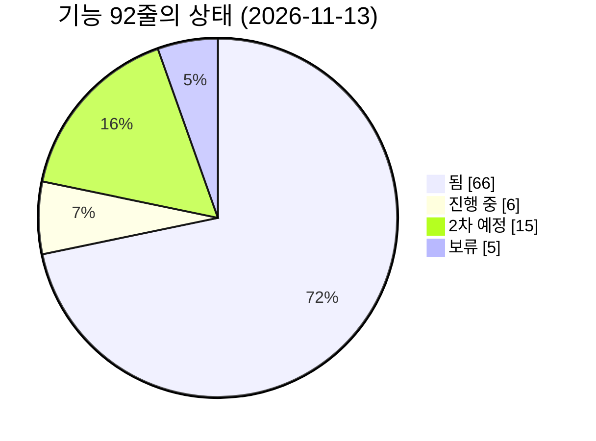
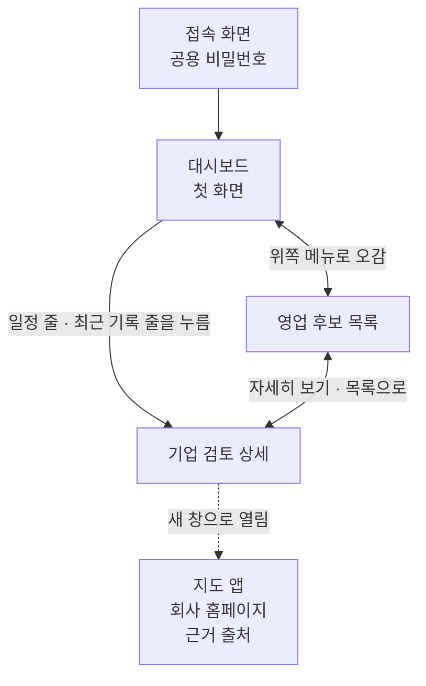
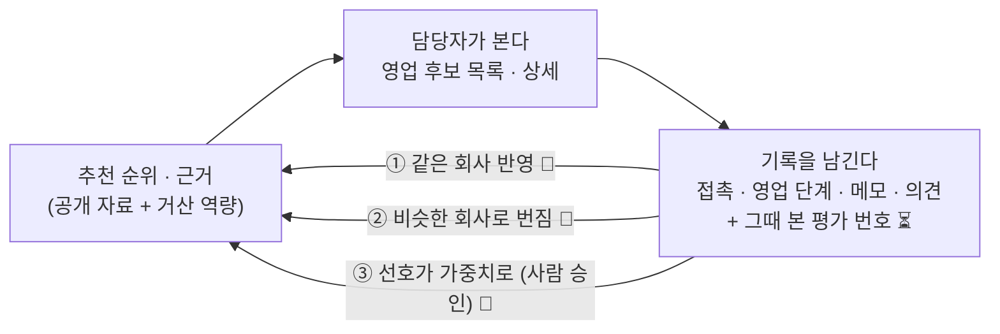
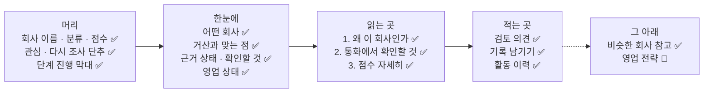

# 기능 지도 — 담당자가 화면에서 지금 무엇을 할 수 있나

> **기준일: 2026-11-13** (`develop` 줄기 기준) · [지도 입구로 돌아가기](README.md)

거산 영업 담당자가 **화면 어디에서 무엇을 할 수 있는지**를 한 줄씩 적은 표입니다. 한 줄이 기능 하나입니다.

## 최근 바뀐 것

최근 5줄만 둡니다. 전체 기록은 [기획 변경 기록](change-log.md)에 쌓습니다.

- **11/13** [관심]을 누르면 조사가 저절로 돕니다. 홈페이지 주소는 있는데 아직 조사 전인 회사에 관심을 켜면 뒤에서 홈페이지를 읽어 근거를 붙이고(단추는 기다리지 않음), 하루 금액 한도를 넘으면 "조사 중단 · 자동 조사 한도로 조사 안 함"이 보입니다. 자동 조사가 홈페이지를 못 읽으면 이유(인증서 문제 · 주소를 찾을 수 없음 · 시간 초과)가 전송 기록에 남습니다 ([#690]).
- **11/13** 통화에서 고른 답이 점수로 들어갑니다. "견적 요청"·"외주처를 바꿀 생각 있음"은 "구매·외주 의향" 7점, "관심 높음"·방문·샘플 요청은 "관심" 5점이 붙고 점수표에 "통화에서 확인(11/20) · 견적 요청"으로 보입니다. 값이 들어올 길이 없던 "공고"·"채용" 항목의 뜻을 넓힌 것이고 배점과 가상 사례 A정밀의 점수는 그대로입니다 ([#685]).
- **11/13** 꼬리 질문에서 다음 일정까지 잡습니다. "다음 할 일은? 견적"을 고르면 바로 아래 "언제 할까요?"가 보이고, 저장 한 번에 접촉 기록과 다음 일정("11/20 견적")이 함께 남습니다. 따로 있던 "다음 일정" 칸은 "지금 일정: 11/20 견적 [일정만 바꾸기]" 한 줄로 접었습니다 ([#683]).
- **11/13** 기업 검토 상세가 위는 읽는 보고서, 아래는 적는 곳으로 바뀌었습니다. 맨 위에 단계 진행 막대(연결 전 → … → 성사, 지금 단계에 색)와 "한눈에" 상자(어떤 회사 · 거산과 맞는 점 · 근거 상태 · 확인할 것 · 영업 상태)가 보이고, 사람이 확인한 값에는 초록 ✓가 붙습니다. 읽는 곳의 [붙여넣고 조사]·[메모 적기]·체크·거래 관계 입력을 뺐고, 영업 단계 칸은 [단계 고치기]로 접었습니다 ([#674]).
- **11/13** 추천 목록 카드를 줄였습니다. 지역·"평가 전"·"필수조건 확인 필요"·"핵심 근거 재확인" 꼬리표를 빼고 공정 꼬리표는 확정된 공정만 보입니다. "검토사항" 줄은 "확인할 것: 공정 · 소재 · 근거 부족"처럼 낱말로 말합니다. 상세에서는 "고객이 요구하는 것과 거산의 준비 상태"·"공정 적합성 검토" 구역을 빼고 위쪽 한 줄("공정: 아연도금 · 소재 철 · 통과")로 줄였고, 검토사항 문장에서 "거래 관계"를 뺐습니다 ([#659]).

## 상태를 읽는 법

| 표시 | 뜻 |
|---|---|
| ✅ 됨 | 화면과 서버가 모두 `develop` 줄기에 합쳐져 있음 |
| ⏳ 진행 중 | 1차(11/15 거산 전달)에 넣기로 하고 만드는 중. 화면만 있거나 서버만 있는 경우도 여기 |
| 📅 2차 예정 | 2차(11/17 이후)에 만들기로 함 |
| ⏸ 보류 | 만들지 않고 멈춰 둠 |

- **✅ 됨은 "코드가 합쳐졌다"는 뜻입니다.** 거산이 접속하는 주소에 올리는 일은 2차가 어느 정도 된 뒤에 합니다 ([#213], PM 결정 11/11). 이 지도를 만들면서 브라우저에서 하나씩 눌러 보지는 않았습니다.
- 세부 진행 상황의 기준은 계속 **이슈**입니다. 이 표의 상태는 요약이고, 줄마다 이슈 번호를 눌러 확인합니다.

## 한눈에 — 기능 92줄의 상태

**그림을 글로 풀면** — 92줄 가운데 됨 66, 진행 중 6, 2차 예정 15, 보류 5입니다.

## 화면은 어떻게 이어져 있나

**그림을 글로 풀면**

1. 공용 비밀번호를 넣으면 **대시보드**가 첫 화면으로 열립니다.
2. 위쪽 메뉴로 대시보드와 **영업 후보 목록**을 오갑니다.
3. 목록 카드의 "자세히 보기", 대시보드의 일정 줄·최근 기록 줄을 누르면 그 회사의 **기업 검토 상세**로 갑니다.
4. 상세에서 지도 앱, 회사 홈페이지, 근거 출처는 새 창으로 열립니다.
5. 대시보드에서 회사 이름을 검색하거나 건수 카드를 누르면 **그 조건으로 걸러진 목록**이 열립니다. 예: "관심 기업" 칸을 누르면 관심으로 고른 회사만 보입니다.

> **이름 안내** — 이슈와 설계 문서에서 "추천 목록"이라고 부르는 화면의 실제 이름은 **"영업 후보 목록"**, "상세 화면"의 실제 제목은 **"기업 검토 상세"**입니다. 이 지도는 화면에 보이는 이름을 씁니다.

---

## 이 서비스의 핵심 — 쓸수록 거산에 맞게 순위·근거가 맞춰진다

> **2026-11-08 PM 정리.** 발표 메모 0장([docs/presentation-notes.md](../presentation-notes.md))과 같은 내용의 요약입니다.

이 프로그램은 "공개 자료로 한 번 뽑은 순위"를 보여 주고 끝나는 도구가 아닙니다. 담당자가 **기록을 남길수록** 그 기록이 순위와 근거에 되돌아와 **거산의 영업 방식에 맞춰 가는 영업 비서**가 목표입니다. 아래 표의 줄들이 그 되먹임의 재료와 단계입니다.

**그림을 글로 풀면** — 순위를 보고 → 연락하고 기록을 남기면 → 그 기록이 세 갈래로 순위에 돌아옵니다. 1차(지금)는 "기록 남기기"와 "그때 본 평가 번호 남기기"까지이고, 세 갈래 되먹임은 2차입니다.

| 단계 | 쉬운 뜻 | 지도의 어느 줄 | 상태 |
|---|---|---|---|
| 재료 | 접촉·영업 단계·메모·검토 의견·거절 이유를 남긴다 | [4장 기록](#기록) | ✅ 됨 |
| 재료 | 기록을 저장할 때 그때 보고 있던 평가 번호를 같이 남긴다(화면 변화 없음). 늦게 넣으면 그 전 기록은 복구할 수 없어 11/15 전에 넣었다 | [4장 기록](#기록) | ✅ 됨 · [#450] [#451] |
| 재료 | 접촉할 때 "AI 판단이 맞았나(맞음·다름·모름)"를 남긴다. 영업 성과와 따로 잰다. 외주처가 있어 거절해도 사실이 맞으면 맞음이다 | [4장 기록](#기록) | ✅ 됨 |
| ① 같은 회사 반영 | 그 회사의 기록이 그 회사의 순위·근거에 바로 반영된다. 예: "거절(단가) 기록이 있어 순위를 내렸습니다" | [6장](#6-화면-뒤에서-돌아가는-일) | 📅 2차 예정 · 이슈 아직 없음 |
| ② 비슷한 회사로 번짐 | 같은 공정·산업군·지역 회사의 기록이 비슷한 회사의 순위·근거에 참고로 들어간다 | [4장 기록](#기록) 비슷한 회사 참고 · [6장](#6-화면-뒤에서-돌아가는-일) | 📅 2차 예정 · [#268] [#269] |
| ③ 선호가 가중치로 | 담당자가 반복해서 고른 것을 점수 가중치 제안으로 바꾸고 사람이 승인해야 적용된다 | [6장](#6-화면-뒤에서-돌아가는-일) | 📅 2차 예정 · 이슈 아직 없음 |

- 통계 학습(왜 바뀌었는지 설명 못 하는 방식)은 쓰지 않습니다. 어느 단계든 바뀐 순위 옆에 "왜 바뀌었나"가 보여야 합니다(PM 결정 2026-11-08).
- 발표에서는 "처음 1~5위 추천의 성사율 → 기록 반영 뒤 성사율" 비교가 가능하도록 처음부터 설계했다는 점을 말합니다.

---

## 1. 모든 화면 공통

| 어디 | 담당자가 할 수 있는 것 | 상태 | 이슈 · 담당 |
|---|---|---|---|
| [접속 화면] | 공용 비밀번호를 넣어야 화면이 열린다. 여러 번 틀리면 잠시 뒤 다시 시도하라는 안내가 나온다 | ✅ 됨 | [#213] |
| [위쪽 › 메뉴] | "대시보드"·"영업 후보 목록"·"영업 분석"을 오간다 | ✅ 됨 | [#215] [#608] |
| [위쪽 › "담당자" 선택] | 자기 이름을 고르면 기록을 저장할 수 있다. 고르지 않으면 "먼저 담당자를 고르세요"가 뜬다 | ✅ 됨 | [#10] |
| [위쪽 아래 띠] | "내부용 · 고객 제출용 아님"이 항상 보이고, 가상 자료·거산 확인 전·다시 평가됨 안내가 상황에 따라 보인다 | ✅ 됨 | [#202] |
| [화면 전체] | 불러오는 중·빈 목록·오류와 "다시 시도"가 화면마다 같은 모양으로 보인다. 좁은 화면에서는 넓은 화면에서 써 달라는 안내가 뜬다 | ✅ 됨 | — |

## 2. 대시보드 (첫 화면)

| 어디 | 담당자가 할 수 있는 것 | 상태 | 이슈 · 담당 |
|---|---|---|---|
| [대시보드 › "관심 기업" 구역] | 관심으로 고른 회사가 모두 몇 곳인지 맨 앞 큰 칸 "관심 기업 ○곳"으로 보고, 그 가운데 의견 전 / 추가 확인 필요가 각각 몇 곳인지 본다. "검토 대상 제외"로 저장한 회사는 관심 기업에서 빠져 세지 않는다(#536). 0곳이면 "아직 관심으로 고른 회사가 없습니다. 추천 목록에서 [관심]을 눌러 담아 보세요" 안내가 나온다. 새로 찾은 회사도 확정 평가 기록이 있으면 관심을 켜는 즉시 반영한다. 전체 평가를 기다리지 않는다(예: 관심 기업 1곳 · 의견 미선택 1곳) | ✅ 됨 | [#356] [#357] [#215] [#216] [#465](https://github.com/agent-ddalgi-team/final-geosan/issues/465) |
| [대시보드 › "영업 진행" 구역] | 관심 기업 가운데 검토 권고를 받은 뒤의 진행을 미접촉(검토 권고 · 접촉 전) / 접촉 중 / 견적·샘플 / 보류 / 완료로 보고, 끝에 이번 주 일정 건수를 본다. 관심으로 고르지 않은 회사는 어느 칸에도 세지 않는다 | ✅ 됨 | [#356] [#357] |
| [대시보드 › 건수 칸 누르기] | 칸을 누르면 그 칸에 든 회사만 목록에 걸러서 보인다("관심 기업" 칸은 관심 기업 보기를 연다). 이때는 공정 선택란 없이 전체에서 거르고, 목록 머리에 무엇으로 걸렀는지 칸 이름과 [거르기 풀기]가 보인다 | ✅ 됨 | [#356] [#357] [#306] |
| [대시보드 › "일정 달력"] | 한 달 달력에서 일정이 있는 날을 색으로 보고(기한 지남 빨강 · 예정 파랑 · 오늘 테두리), 그 날을 누르면 작은 팝업에 회사·건 이름·내용이 보인다. 팝업의 [상세 보기]는 그 회사 상세로 간다. 팝업은 [닫기]·Esc·바깥 누르기로 닫고, ‹ › 로 달을 넘긴다. 기한 지난 일정이 맨 위에 보인다 | ✅ 됨 | [#216] [#572] |
| [대시보드 › "최근 내 기록"] | 내가 남긴 최근 기록 10건을 보고 누르면 그 회사 상세로 간다. 담당자를 바꾸면 그 담당자의 기록으로 바뀐다 | ✅ 됨 | [#216] [#351] |
| [대시보드 › 회사 이름 검색] | 이름을 넣고 "검색"을 누르면 그 이름으로 걸러진 목록으로 간다 | ✅ 됨 | [#306] |
| [대시보드 › "공정별"·"산업군별" 막대] | 관심으로 켜 둔 회사 가운데 접촉 전·진행 중·최근 12개월 성사인 곳을 공정·산업군마다 세어 막대로 본다. 예: "아노다이징 4곳 (100%)", "방위산업 2곳 (50%)", 맨 끝 "미확정". 공정은 9종 모두(0곳 포함), 한 회사가 여러 공정이면 각각 센다. AI 제안 산업군이 섞이면 "AI 제안 포함"이 붙는다. 가상 묶음에서는 숨긴다. 임시 DB와 가짜 응답으로 확인했고 실제 DB·브라우저로는 아직 보지 않았다 | ✅ 됨 | [#229] · [#627] |
| [대시보드 › 지도] | 거산 본사를 가운데 두고 30·50·100km 원 안의 회사를 점으로 본다(● 관심 / ◆ 진행 중 / ★ 올해 성공, 점을 누르면 말풍선, 좌표 없는 회사 수 한 줄). 화면(원·점·범례·말풍선·빈 상태)은 가짜 데이터로 만들었고(#641), 지도 서버는 관심·진행·한국 시간 올해 성공 회사의 위치·묶음·직선거리와 좌표 없는 회사 수를 준다(#642, 받은 공공좌표를 재사용하고 남은 주소는 네이버 실시간 보완·미저장). 화면과 서버를 붙여 브라우저로 본 것은 아직 없고, 지도 배경도 아직 | ⏳ 진행 중 | [#226] [#641] [#642] · 서버 이강욱 / 화면 고선주 |

## 3. 영업 후보 목록

| 어디 | 담당자가 할 수 있는 것 | 상태 | 이슈 · 담당 |
|---|---|---|---|
| [목록 › 맨 위] | "전체 ○곳"을 보고 카드를 20곳씩 넘겨 본다. 순서는 프로그램이 정한다: "지금 연락할 곳 ○곳" → "확인 필요 ○곳" → "나중 ○곳" 세 묶음 순이고, 묶음이 바뀌는 자리에 제목이 보인다. 카드에는 그 묶음에 든 이유 꼬리표가 붙는다(예: "필수조건 통과", "거래 중", "성사·거절·보류"). "필수조건 확인 전"·"핵심 근거 재확인"·"평가 전 · 적합도 상"·"평가 전 · 적합도 낮음" 꼬리표와 분류 꼬리표 "평가 전"은 보이지 않고 검토사항 줄이 대신 말한다(11/13 PM 결정, [#659]). 같은 공정·산업에서 최근 12개월 성사·거절이 5곳 이상 쌓이면 묶음 안 순서가 오르내리고, 카드 "순서 조정" 줄에 이유가 보인다(예: "같은 공정·산업(아연도금 · 자동차 부품)에서 최근 12개월 성사 3곳 → 위로"). 점수·분류·순위 번호 계산은 바꾸지 않는다. 묶음 기준 숫자는 PM 확인 전 초안 | ✅ 됨 | [#10] [#610] |
| [목록 › 카드 머리] | 순위, 회사 이름, 분류와 "가상 사례"·"거산 확인 전"·"재평가됨" 꼬리표를 본다. 꼬리표를 줄였다: 지역 꼬리표는 없고(목록 머리 지역 선택란과 겹침), 공정 꼬리표는 확정된 공정만 보인다. 무엇을 확인하라는 말인지 알 수 없던 꼬리표 세 가지("필수조건 확인 필요", "필수조건 확인 전"·"핵심 근거 재확인", "핵심 근거 재확인 필요")도 뺐다. 어느 묶음인지는 묶음 제목("확인 필요 ○곳")으로 알고, 무엇을 확인할지는 "검토사항" 줄이 말한다. 화면은 가짜 응답으로만 확인했다 | ✅ 됨 | [#202] [#659] |
| [목록 › 카드 점수] | "참고 50점 · 3/8" 같은 점수를 본다. 필수조건이 확인 전이면 흐리게 + "거래 확인 전", 거래 중이면 "기존 거래처"가 붙는다. 거래 관계 "확인 전"만으로는 흐려지지 않는다(11/11 PM 결정, 규칙 설정으로 끔) | ✅ 됨 | [#264] [#567] |
| [목록 › 카드 영업 단계 꼬리표] | 접촉·견적·샘플·보류·성사·거절 꼬리표를 본다. 세부 단계가 있으면 "접촉 · 수요 확인"처럼 붙는다. "관심"은 단계가 아니라 [관심] 단추로 옮겼다 | ✅ 됨 | [#210] [#357] [#607] |
| [목록 › 카드 [관심] 단추] | [관심]을 누르면 그 회사가 관심 기업으로 담기고 단추가 "관심 기업"으로 바뀐다. 다시 누르면 빠진다. 팀이 함께 쓰는 표시다. 메모·영업 기록·검토 의견이 있는 회사는 빼지 못하고 "기록이 있는 회사는 관심에서 뺄 수 없습니다" 안내가 단추 옆에 나온다. 검토 의견을 저장하면 관심이 저절로 켜진다. 단 "검토 대상 제외"를 저장하면 관심이 저절로 꺼지고, 제외한 회사는 메모·접촉을 적어도 다시 켜지지 않으며 [관심]을 누르면 "관심 기업에 다시 담으려면 검토 의견을 검토 권고나 추가 확인 필요로 바꿔 주세요" 안내가 나온다(#536). 담당자를 고르기 전에는 잠긴다. 관심이 켜지면(단추든, 기록 저장으로 저절로든) 홈페이지 주소가 있고 아직 조사 전인 회사는 [다시 조사]를 누르지 않아도 조사가 뒤에서 저절로 돈다. 하루에 쓸 수 있는 금액은 설정이고(예시 1달러, 0이면 꺼짐) 오늘 쓴 금액이 그 이상이면 돌지 않는다(마지막 한 곳만큼은 넘을 수 있다). 홈페이지가 없는 회사·이미 조사된 회사는 그대로다. 가짜 홈페이지·가짜 AI 응답과 임시 DB로 확인했고 실제 AI 호출은 미확인(#690) | ✅ 됨 | [#356] [#357] [#536] [#690] |
| [목록 › 머리 "관심 기업" 보기] | [관심 기업만 보기]를 누르면 관심으로 고른 회사만 모아 보고, 전체 보기 / 검토 권고 / 추가 확인 필요 / 기타로 걸러 본다("기타"는 의견을 아직 안 고른 회사). 제외한 회사는 관심 기업이 아니라서 아래 "제외한 회사" 보기에서 본다(#536). 전체 목록으로는 위쪽 메뉴 "영업 후보 목록"으로 돌아간다. 고른 값은 주소에 남아 새로 고침해도 유지된다. 관심 기업 보기 안에서도 공정·지역·산업 선택란으로 더 좁혀 볼 수 있고(공정 선택란 맨 위는 "전체"), 선택지 옆 곳 수는 관심 기업 안에서만 센다. 여기서 고른 공정은 평소 목록의 "마지막 선택" 기억을 바꾸지 않는다. 실제 임시 DB·API와 화면 테스트로 확인했다(11/9) | ✅ 됨 | [#356] [#357] [#516] [#536] |
| [목록 › 머리 "제외한 회사" 보기] | [제외한 회사 보기]를 누르면 "검토 대상 제외"로 저장한 회사만 모아 본다. 머리에 "검토 대상 제외로 저장한 회사입니다. 검토 의견을 바꾸면 관심 기업으로 돌아갑니다"가 보이고, 공정·지역·산업 선택란으로 좁혀 볼 수 있다(공정 맨 위는 "전체"). 0곳이면 "검토 대상 제외로 저장한 회사가 없습니다". 전체 목록으로는 위쪽 메뉴로 돌아간다. 고른 값은 주소에 남는다 | ✅ 됨 | [#536] |
| [목록 › 카드 두 줄] | "추천 근거" / "검토사항"을 회사마다 다른 문장으로 읽는다. "후속 조치"는 카드에서 빼고 상세 "1. 추천 근거와 후속 조치"에서 읽는다(11/13 PM 결정). "검토사항" 줄은 무엇을 확인해야 하는지 낱말로 말한다(11/13 PM 결정): "확인할 것: 공정 · 소재 · 근거 부족". "공정"은 확정된 공정이 없고 AI 제안만 있을 때(제안 개수는 카드에 쓰지 않는다), "소재"는 적용 부품의 소재나 거산의 처리 소재가 확인 전일 때, "근거 부족"은 핵심 근거가 약하거나 없을 때(둘을 구분하지 않는다) 붙는다. 필수 요구는 이름 그대로 적는다(많으면 앞 3개 + "외 n개"). 확인할 것이 없으면 전 문장("없음 — 지금 단계 필수 요구 통과")이 그대로 보인다. 평가 전 회사도 "평가 전" 꼬리표 없이 같은 방식으로 "확인할 것: 공정 · 근거 부족"처럼 보인다(점수가 없다는 것은 점수 자리의 "점수 전"으로 안다). 긴 문장은 상세에서 읽는다. 재접촉 관리를 하지 않아 "거래 관계"는 넣지 않는다. 서버는 실제 임시 DB·API로, 화면은 가짜 응답으로 확인했다 | ✅ 됨 | [#139] [#160] [#647] [#659] |
| [목록 › 카드 "담당자 검토 의견"] | "검토 권고" / "추가 확인 필요" / "검토 대상 제외" 단추로 바로 저장하고 고친다. 제외는 이유를 꼭 적는다 | ✅ 됨 | [#10] |
| [목록 › 카드 "자세히 보기"] | 그 회사의 상세로 간다 | ✅ 됨 | — |
| [목록 › 머리 공정 · 지역 · 산업 선택란] | 한 줄에 놓인 공정·지역·산업 선택란으로 회사를 골라 본다. 공정 선택란 맨 위는 "전체(공정별로 묶음)"이고 그 아래에 거산 공정 9종이 곳 수와 함께 모두 보인다(예: "아연도금(전기아연도금) 9", "크롬 도금 0"). 처음 열면 "전체(공정별로 묶음)"로 열려 회사가 있는 공정마다 "아연도금(전기아연도금) · 9곳" 같은 묶음으로 보이고, 번호는 묶음 안에서만 매긴다(서로 다른 공정을 한 줄 순위로 섞지 않는다). 지역·산업은 이때도 고를 수 있어 지역을 먼저 골라 인근 후보를 훑을 수 있다(묶음 머리에 "충남 · 자동차 부품"처럼 고른 조건이 붙고, 회사가 0곳인 묶음은 보이지 않는다). 한 공정이 50곳을 넘으면 묶음 끝 "이 공정만 보기"로 그 공정 보기에 간다. 마지막 선택(공정 하나 또는 묶음 보기)은 이 브라우저가 기억해, 다음에 목록을 열면 그것으로 열린다(프로그램이 공정을 대신 고르지 않는다). 공정 하나를 고르면 순위는 그 공정 안 번호이고 20곳씩 넘겨 본다. 고른 조건은 주소에 남아 새로 고침해도 유지된다. 회사가 0곳인 공정을 고르면 "이 공정의 후보가 아직 없습니다. 후보 찾기로 회사를 찾으면 여기에 나타납니다"가 나온다. 대시보드 칸으로 넘어온 목록에는 공정 선택란이 없다(관심 기업 보기에는 있다, #516). 공정 순서는 역량 파일의 순서를 따르고, 파일을 다시 넣어도(같은 시각에 저장돼도) 그 파일 순서로 유지된다. (11/13 #370) 의견·영업 단계·대시보드 칸으로 거른 목록에서도 지역·산업 곳 수는 지금 보이는 목록 안에서 센다. 예: "추가 확인 필요" 2곳 목록이면 "천안시 1 · 대전광역시 1"(전에는 전체 기준 "천안시 7 · 대전광역시 3"). | ✅ 됨 | [#383] [#361] [#368] [#306] [#406] · [#370] |
| [목록 › 머리 회사 이름 검색] | 이름을 넣고 [검색]을 누르거나 Enter를 치면 고른 공정·지역·산업과 상관없이 전체 후보에서 찾는다. 결과 위에 "전체 후보에서 찾은 결과"와 검색어가 보이고, 검색하는 동안 세 선택란은 숨는다. [검색 지우기]를 누르면 검색하기 직전에 보던 목록(고른 조건, 관심 기업 보기)으로 돌아간다. 찾은 곳이 없으면 "이 이름으로 찾은 후보가 없습니다"가 나온다 | ✅ 됨 | [#361] |
| [목록 › 카드 공정·산업 꼬리표] | 카드에서 확정된 공정 이름(사례 파일에 적혔거나 담당자가 꼬리 질문에서 확정한 것)과 산업(예: 자동차 부품)을 본다. 산업이 비어 있으면 "산업 미확정"으로 보인다. AI가 제안만 하고 아직 확인 안 된 공정은 꼬리표로 보이지 않고, 확정된 공정이 하나도 없으면 카드 "검토사항" 줄에 "공정" 한 낱말이 들어간다(예: "확인할 것: 공정 · 근거 부족", 11/13 PM 결정). 지역 꼬리표는 뺐다(지역은 목록 머리 선택란으로 거른다). 산업 꼬리표도 확정된 것만 보일지는 PM 확인 뒤. 화면은 가짜 응답으로만 확인했다 | ✅ 됨 | [#306] [#659] |
| [목록 › 머리 정렬] | "추천 순"(프로그램이 정한 순서) 또는 "최근 들어온 순"(후보 찾기로 들어온 시각이 최신인 회사가 위, 사례 파일 18곳과 예전 회사는 아래에 추천 순 그대로)으로 본다. 고른 정렬은 주소에 남아 새로 고침해도 유지되고, 공정별 묶음 보기에도 같이 적용된다. "최근 들어온 순"은 서버·화면 테스트로 확인했고 브라우저 확인은 합친 뒤다(11/9). "가까운 순 (준비 중)"은 흐리게 보이고 고를 수 없다. 서버는 #658에서 가까운 순·거리 조건을 지원하며 화면 연결은 별도다. 정렬 줄 끝의 "전체 보기"를 누르면 공정별 묶음을 풀고 모든 회사를 한 줄로 본다(고른 정렬이 전체에 걸쳐 적용되고, 공정이 섞이므로 순위 번호는 없다). 다시 누르거나 공정을 고르면 묶음 보기로 돌아가고, 마지막 선택은 브라우저가 기억한다. 화면 테스트로 확인했다(11/9) | ✅ 됨 | [#361] [#516] |
| [목록 › 머리 "영업 후보로 더하기 💰" 단추] | 공정·지역·산업을 고르고 누르면 AI가 공공자료에서 맞는 회사를 골라 목록에 더하고, 새 회사만 자동으로 조사한다. (11/10 #549 1단계) 단추 이름이 [새 후보 가져오기]에서 [영업 후보로 더하기 💰]로 바뀌었고, 공정을 고르면 단추 위에 "맞는 공장 1,518곳 (상 134 · 중 1,382 · 하 2) · 영업 후보로 들어온 곳 102곳 · 아직 안 들어온 상 32곳"이 바로 보인다. 저장된 AI 판단만 세서 비용이 들지 않고, 판단 전 공장이 있으면 "아직 AI 판단 전 n곳"이 붙는다. 이 PC DB 사본의 실제 서버로 확인했고 브라우저 확인은 합친 뒤다. (11/13 #549 2단계) 단추 위에 누르기 전 예상 금액과 이번 달 사용액이 보인다. 예: "누르면 최대 50곳을 영업 후보로 더합니다 · 예상 약 $2.00 · 이번 달 AI 사용 $3.20 / $20.00". 이번 달 남은 금액·호출을 넘으면 단추가 잠기고 "이번 달 남은 금액으로 약 8,400곳까지 판단할 수 있습니다 · 시·군을 골라 나눠 진행해 주세요"가 보이며, 서버와 운영 명령도 같은 계산으로 거부한다. 끝난 뒤 요약 끝에 "20곳을 더했습니다 · 실제 $0.74". 예상 금액·잠금은 임시 DB와 가짜 응답으로만 확인했다. 조건 칸은 화면 설정에서 활성 역량 파일의 공정 전부(회사 0곳인 공정 포함)와 설정의 지역·산업을 읽는다. 담당자 선택 전과 가져오는 중에는 단추가 잠긴다. 합쳐진 develop의 실제 서버·브라우저에서 확인했다(11/9): 공정 9개 순서·실행 중 잠금·완료 요약(예: "훑어본 공장 500곳 · 고른 공장 20곳 · 조사 0/20", 11/10부터 "회사" 대신 "공장"), 실행 뒤 새 회사 등록과 "평가 전" 카드·상세, 실패 뒤 기존 목록 보존과 재실행(새 회사 0곳). 실행·저장·등록·평가는 실제 부품이고 외부 AI 통신 응답만 가상으로 대체했다. 보기 전용 계정에서 조건 칸이 숨는 것과 이미 가져오는 중일 때의 안내는 화면 테스트로만 확인했다. 실제 외부 AI 호출은 #221 후속(500행 품질·비용 실측)에서 확인한다. 단지 조회의 이상한 줄은 제외하고 다음 단지로 계속하며, 건너뛴 줄 번호·사유는 회차 수집 기록에 남긴다. 실제 조회 실패·하루 한도·응답 형식 오류일 때는 받은 결과와 파일 목록으로 계속한다(#546, 가상 제공처·임시 DB 검사; 실제 조회는 PM 확인 전) | ⏳ 진행 중 | [#221] [#316] [#317] [#327] [#328] [#340] [#427] [#428] [#549] [#553] · 유동렬·이강욱·고선주·최지예 |
| [목록 › 머리 후보 수집 요약] | 가져오는 중이면 "지금 가져오는 중입니다", 끝난 뒤에는 "훑어본 ○곳 · 고른 ○곳 · 조사 ○/○"를 본다. 서버가 준 건수만 보이고 모르는 칸은 뺀다. 가져오는 중에는 5초마다 진행을 다시 읽는다. 진행 건수의 서버 응답을 준비했으며, 실제 찾기 연결 전이라 지금은 가짜 찾기와 임시 DB로 확인했다. 임시 DB에 넣은 시험 회차로 실제 서버와 브라우저(Edge)에서 이 줄이 보이는 것까지 확인했다(11/9). 실패하면 "공장현황 소스의 이용·저장 확인을 먼저 기록해 주세요"처럼 코드가 준비한 안전한 사유를 그대로 보인다. 실행 단계의 사유가 API에서 덮이지 않는 것을 실제 임시 DB·API로 확인했으며 외부 예외 원문은 숨긴다 | ✅ 됨 | [#316] [#342] [#317] [#490] · 고선주·이강욱 |
| [목록 › 카드 고른 이유·점수 전·들어온 날짜] | 찾은 회사 카드에서 AI가 고른 이유 한 줄을 읽고, 점수가 아직 없으면 "점수 전"과 함께 "조사 중" 또는 "조사 중단"(이유는 상세, #596), 후보 찾기로 들어온 회사면 "11/9 들어옴" 꼬리표를 본다(들어온 날짜 기준이라 같은 조건을 다시 돌려도 바뀌지 않는다. 예전의 "이번에 들어옴"은 없앴다, #516). 추천 근거가 고른 이유와 같은 문장이면 고른 이유 한 줄만 보인다(조사로 근거가 달라지면 두 줄, #555). 팩토리온 원자재가 붙은 공장은 AI가 원자재도 보고 고른다(다음 후보 찾기의 다시 판단부터, #570). 사례 파일 18곳 카드는 그대로다. "고른 이유"는 시험 회차로 브라우저에서 보이는 것을 확인했고, "점수 전"과 날짜 꼬리표는 화면 테스트로 확인했다(11/9) | ✅ 됨 | [#316] [#516] [#555] [#570] [#596] · 고선주·최지예 |
| [목록 › 카드 "표면처리를 직접 하는 회사일 수 있음" 꼬리표] | 찾은 회사가 도금·아노다이징 같은 표면처리를 직접 하는 회사로 보이면 꼬리표와 검토사항 확인 줄이 붙는다. 자동으로 빼지 않고, 점수 전 회사들 안에서는 표시가 없는 회사 뒤에 선다. 상세 검토사항의 확인 줄은 서버가 만들어 주고(예: "표면처리를 직접 하는 회사일 수 있음: 생산품 '알루미늄 아노다이징'", 출처는 AI 판단 또는 업종명 규칙), 기존 체크 저장을 그대로 써서 확인 표시를 남긴다. 평가 전 회사는 줄만 보이고 체크는 평가 뒤에 한다. 이 부분은 실제 임시 DB·API로 확인했다. 표시를 채우는 길은 둘이다. 수질 명단·업종번호로 붙이는 길은 됐고(아래 "공장 정보" 줄, [#573] [#613]), 후보 찾기의 AI 판단·업종명 규칙으로 붙이는 길은 실제 화면 확인 전이다. 화면은 서버가 표시를 준 회사 카드에 꼬리표와 근거 한 줄을, 상세 머리에 꼬리표를(근거는 없음), 상세 검토사항에 확인 줄을 보이도록 만들어 두었고 가짜 응답으로 확인했다 | ⏳ 진행 중 | [#319] [#363] [#221] [#336] [#342] [#316] [#353] · 유동렬·이강욱·고선주 |
| [목록 › 카드 "공장 정보" 줄 · 상세 "이 회사 한눈에" 공장 정보] | 팩토리온 공장조회에 이름·주소가 맞는 공장이 있으면 업종·원자재·공장 규모를 한 줄로 본다(예: "업종 절삭가공 및 유사처리업 · 원자재 강판, SUS · 소기업"). 업종은 공장 등록 업종명 그대로라 AI가 고른 이유(추정)와 나눠 읽는다([#617]). 종업원 수는 공장 등록 때 적은 값이라 실제와 많이 달라 화면에 보이지 않고(11/13 PM 결정, [#635]) 순서·점수에도 쓰지 않는다. 수질 명단(특정수질유해물질 배출 사업장)에 회사명과 도로명·건물번호가 모두 같은 사업장이 있거나([#613], 같은 시·군에 이름만 비슷한 회사에는 붙지 않음) 업종번호가 설정의 도금업·피막처리업이면 "표면처리를 직접 하는 회사일 수 있음" 표시가 붙는다. 운영자가 `geosan source-load`로 파일을 넣으며, 이 PC DB 복사본에서 178곳 중 149곳에 붙고 표시 2곳이 생겼다(11/11) | ✅ 됨 | [#573] · [#617] · [#635] |
| [목록 › 거리] | 거산 기준 직선거리의 서버 값을 카드·상세에 제공한다. 좌표 구하기 명령은 위치 CSV → 행안부 주소검색·동일 CSV → 좌표 API → 네이버 순서이며, 공공좌표만 저장하고 네이버는 요청 안에서만 쓴다(11/13 이강욱 확인). 작업 가지의 실제 로컬 DB 739곳 중 공공좌표 697곳을 저장하고 상세의 거리 표시를 확인했다. 네이버도 공개 주소 1곳의 실제 조회·정확한 주소 대조·결과 미저장을 확인했다. 가까운 순·거리 필터 서버는 #658에서 연결했으며 화면은 별도 연결 전이다 | ⏳ 진행 중 | [#651] [#222] [#361] · 이강욱 |
| [목록 › 엑셀 내려받기] | 지금 걸러 본 목록 전체를 내부용 엑셀로 받는다(회사·공정·점수·단계·다음 일정 다섯 열, 메모·대표번호는 담지 않음). **만들어 둠 · 설정으로 꺼 둠** — 지금은 단추가 보이지 않고, 거산이 필요하다고 하면 설정만 켠다. 켜기 전에 "누가 언제 내려받았는지" 기록을 먼저 만든다 | 📅 2차 예정 | [#217] · 이강욱 |

## 4. 기업 검토 상세

상세 화면은 위에서 아래로 길게 이어집니다. 그림은 왼쪽이 화면의 위쪽이고, 상자 안의 줄도 화면에 나오는 순서입니다.

**그림을 글로 풀면** — 상세는 읽는 보고서처럼 위·아래 두 덩어리입니다(11/13 PM 결정, [#674]). 맨 위 **머리**에서 회사 이름과 단계 진행 막대(연결 전 → 연결됨 → 수요 확인 → 자료·견적 → 방문·샘플 → 성사, 지금 단계에 색과 "지금 (11/12부터)")를 보고, **한눈에** 상자에서 어떤 회사인지·거산과 맞는 점·근거 상태·확인할 것·영업 상태를 읽습니다. 그 아래 **읽는 곳**은 1. 왜 이 회사인가(추천 근거 문장 아래 인용과 출처) → 2. 통화에서 확인할 것(물을 말 한 줄씩) → 3. 점수 자세히 보기(접힘) 순서이고, 단추는 [목록으로]·[관심]·[다시 조사]와 접힌 구역을 여는 단추뿐입니다. "여기부터 적는 곳" 구분 줄 아래 **적는 곳**에서 검토 의견과 기록(접촉 → 꼬리 질문 → 한 줄 메모 → 다음 일정)을 남기고 활동 이력을 봅니다. 맨 아래에는 같은 공정·산업군의 **비슷한 회사 참고**가 붙습니다. 영업 전략은 2차에 더합니다(화면에서 놓일 자리는 그때 정합니다). "요구와 준비 상태"·"공정 적합성 검토" 구역은 11/13 PM 결정([#659])으로 화면에서 뺐습니다.

### 머리

| 어디 | 담당자가 할 수 있는 것 | 상태 | 이슈 · 담당 |
|---|---|---|---|
| [상세 › 머리] | 회사 이름, 분류, 점수, "기존 거래처" 표시를 보고 "목록으로" 돌아간다. 점수 옆 "거래 확인 전" 표시와 분류 꼬리표 "필수조건 확인 필요"·"핵심 근거 재확인 필요"·"평가 전"은 보이지 않는다(11/13 PM 결정: 재접촉 관리를 하지 않고, 무엇을 확인할지는 "한눈에"의 "확인할 것"이 말한다) | ✅ 됨 | [#264] [#674] |
| [상세 › 머리 단계 진행 막대] | 맨 위에서 영업이 어디까지 왔는지 그림으로 본다: 연결 전 → 연결됨 → 수요 확인 → 자료·견적 → 방문·샘플 → 성사. 지나온 단계는 연한 색으로 채운 점(✓), 지금 단계는 진한 색 큰 점과 "▲ 지금 (11/12부터)", 아직인 단계는 빈 점. 거절이면 멈춘 자리까지 채우고 끝에 "✕ 거절 (가격)"(회색), 보류면 "⏸ 보류"(주황), 성사면 끝까지 채우고 "✓ 성사"(초록). 접촉 기록이 없으면 모두 빈 점과 "아직 접촉 기록이 없습니다". 막대 아래에 "다음 일정: 11/20 견적 보내기". 색으로만 구분하지 않고 점 모양·글자와 "6단계 중 3단계 수요 확인" 같은 글을 함께 둔다. 실제 값(DB 사본을 읽는 확인용 서버)으로 진행 중·기록 없음 두 회사를 브라우저 그림으로 확인했고 거절·보류·성사는 가짜 응답으로만 확인했다 | ✅ 됨 | [#674] |
| [상세 › 머리 [관심] 단추] | 목록 카드와 같은 [관심] 단추로 이 회사를 관심 기업에 담거나 뺀다. 메모·영업 기록·검토 의견을 저장하면 관심이 저절로 켜지고 단추가 "관심 기업"으로 바뀐다. "검토 대상 제외"를 저장하면 관심이 꺼지고 단추가 "관심"으로 돌아간다(#536). 관심이 켜지면 조사 전인 회사는 조사가 저절로 돈다(목록 카드 [관심] 줄과 같음, #690) | ✅ 됨 | [#356] [#357] [#536] [#690] |
| [상세 › "한눈에" 주소] | "한눈에"의 "어떤 회사" 둘째 줄 주소 옆 "네이버 지도에서 보기"·"카카오맵에서 보기"로 위치를 새 창에서 본다 | ✅ 됨 | [#210] [#674] |
| [상세 › "한눈에" "기업 소개 페이지"] | 회사 홈페이지 주소가 있으면 "한눈에"의 홈페이지 줄에서 새 창으로 연다 | ✅ 됨 | [#190] [#674] |
| [상세 › 머리 "대응·담당"] | 대응 목적과 담당자 이름을 점수 줄 옆에서 읽는다. "거래 관계: …" 글은 입력과 함께 뺐다(11/13) | ✅ 됨 | [#674] |
| [상세 › 머리 거래 관계 단추] | [거래 없음] [거래 중] [확인 전으로]를 눌러 거래 관계를 저장하던 단추. 11/13 PM 결정으로 화면에서 뺌(재접촉 관리 안 함). 서버 창구와 화면 부품은 남아 있고, "기존 거래처" 표시·묶음 이유 "거래 중"·거절 이유 "기존 거래처 유지"·활동 이력의 옛 거래 관계 기록은 그대로 보인다 | ⏸ 보류 | [#266] [#296] [#305] [#674] |
| [상세 › "한눈에" 대표번호] | 공개된 회사 대표번호(누르면 전화)와 출처, "담당자 확인 전" 또는 "담당자 확인 11/5 박 이사"를 읽는다. 읽는 곳이라 [맞음] 단추는 화면에서 뺐다(11/13, 서버 창구는 남아 있음. 다시 둘지는 PM 결정 대기) | ✅ 됨 | [#210] [#674] |
| [상세 › 맨 위 "한눈에"] | 머리 바로 아래 한 상자에서 다섯 묶음을 읽는다. ① 어떤 회사: 한 줄 소개(없으면 "공장 자료 기준" 생산품, 그것도 없으면 "아직 조사 전"), 주소 · 업종 · 원자재 · 규모, 홈페이지(없으면 검색에서 찾은 페이지 → 근거가 나온 페이지 → "홈페이지를 찾지 못했습니다"), 대표번호, 특징 ② 거산과 맞는 점: 사람이 확인한 값(사례 파일·담당자 확정)에만 초록 ✓가 붙는다 — "공정 아연도금(전기아연도금) ✓ 확인됨", "소재 철 ✓ 통과"(판정이 통과일 때만), "산업 기계·설비 ✓ 확인됨". AI가 제안만 한 값은 회색 ○ — "공정 아연도금, 아노다이징 외 3개 ○ AI 제안 · 확인 전", "산업 기계·설비 ○ AI 제안 · 확인 전". 값이 없으면 표시 없이 "확인 전", "거리 거산에서 42km"는 숫자만. 확인한 값이 AI 제안과 같았는지는 지금 응답으로 알 수 없어 적지 않는다 ③ 근거 상태: "근거 5건 · 홈페이지 있음 · 적합도 상 · 조사 11/10 (3일 전)"(못 찾았으면 "근거 없음 · 홈페이지 못 찾음") ④ 확인할 것: 카드와 같은 낱말 "공정 · 소재 · 근거 부족"(없으면 "지금 확인할 것 없음") ⑤ 영업 상태: "접촉 3회 (전화 2 · 방문 1) · 마지막 접촉 11/12". 전에 머리에 흩어져 있던 홈페이지·대표번호·공장 정보·산업·접촉 횟수를 여기로 모았고 같은 내용을 두 번 보이지 않는다. 저장된 값만 보여 새 AI 호출이 없다. "마지막 접촉"은 서버가 새로 주는 값이라 가짜 응답과 서버 시험으로만 확인했다 | ✅ 됨 | [#563] [#674] |
| [상세 › "한눈에" 조사한 날·특징] | "한눈에"에서 조사한 날, 한 줄 소개와 특징을 본다. 조사한 지 오래되면 "오래됨"이 붙는다. 거산에서의 거리는 값이 생기면 보인다(거리 계산은 2차 [#222]) | ✅ 됨 | [#210] |
| [상세 › 우측 상단 [다시 조사]] | 상세 맨 위 "목록으로" 줄 오른쪽([관심] 옆)의 단추 하나로 AI 조사를 다시 돌린다(최대 1분). 홈페이지 주소가 있으면 그 주소로, 없으면 홈페이지부터 다시 찾고 이어서 조사한다. 또 못 찾으면 "홈페이지를 찾지 못했습니다"가 보인다(#596). 읽기 거부면 본문 붙여넣기 칸이 열린다. AI 응답을 못 받은 호출은 추정 비용으로 월 한도에 넣고, 한도에 닿으면 단추가 잠긴다. 주소 없는 회사의 다시 찾기는 가짜 응답·실제 임시 DB로 확인했고 실제 AI 호출은 미확인 | ✅ 됨 | [#304] [#210] [#538] [#596] |
| [상세 › 점수 줄 옆 조사 상태] | 점수가 아직 없는 찾은 회사는 점수 줄 옆에 "조사 중" 또는 "조사 중단 · 이유"가 보인다. 이유는 홈페이지 못 찾음 / 홈페이지 읽기 실패 / 조사 안 됨 / 점수 근거 없음 넷이다. 예전의 [맞음]·[고치기] 단추와 "홈페이지 확인 필요"·"홈페이지 못 찾음" 띠는 없앴다(11/12 PM 결정). 이 PC 실제 DB로 브라우저에서 확인했다(11/12). 관심을 켜서 시작된 조사가 도는 동안에도 "조사 중"이 보이고, 하루 금액 설정 때문에 돌지 않았으면 "조사 중단 · 자동 조사 한도로 조사 안 함"이 보인다(다섯째 이유, #690. 화면 확인은 아직) | ✅ 됨 | [#596] [#690] |

### 본문

| 어디 | 담당자가 할 수 있는 것 | 상태 | 이슈 · 담당 |
|---|---|---|---|
| [상세 › "1. 왜 이 회사인가"] | 추천 근거 문장을 항목마다 한 줄씩 읽고, 문장 바로 아래에서 그 문장에 쓴 근거의 인용과 출처(누르면 새 창), 출처 등급, 확인된 사실인지 추정인지, AI가 뽑은 것인지를 본다. 예: "제품: 앙카를 생산하는 회사이고 … 백색 전기아연도금 사양이 적혀 있습니다" 아래 “표면처리 : 전기아연도금 (백색)” — 홈페이지 제품 안내 ↗ · 출처 등급 B · 사실(확인). 어느 문장에도 안 쓰인 근거는 "그 밖의 근거 자료"로 모인다. 근거가 없는 항목(자료 미확보·신호 없음)의 문장은 여기에 없고 2번의 접힌 묶음에서 본다. 조사 전·홈페이지 없는 회사는 "AI가 고른 이유"와 공장 등록 정보만 보인다. 전의 "1. 추천 근거와 후속 조치"와 "2. 근거 자료"를 합쳤다(11/13 PM 결정) | ✅ 됨 | [#145] [#175] [#174] [#674] |
| [상세 › "2. 통화에서 확인할 것"] | 확인이 필요한 것만 통화 때 물을 말로 한 줄씩 읽는다(읽기 전용). 순서: 후속 조치 → "공정 — 어떤 공정을 맡길 수 있나요?" → "소재 — 부품 소재가 무엇인가요?" → "산업 — 어느 산업인가요?" → 지금 세부 단계에서 아직 답이 없는 꼬리 질문(예: "외주처를 바꿀 생각이 있나요?") → AI 질문·표면처리 직접 표시·요구 조건 줄. 공정·산업·꼬리 질문은 "기록 남기기"의 꼬리 질문과 같은 문구다(소재는 꼬리 질문에 없어 화면 문구). "아직 근거·자료가 없는 항목 3개 보기"는 접어 두고 펼쳐도 읽기만 하며, 그 가운데 공고·채용 줄은 연결하지 않는 자료라 보이지 않는다. 전에 저장한 답·메모·확인 표시는 그 줄 아래에 "답: …", "메모: …", "✓ 확인함 — 박 이사 · 11/6"으로 계속 보인다. 들은 답은 아래 "기록 남기기"에 적는다. 전의 "검토사항"을 바꾼 것(11/13 PM 결정) | ✅ 됨 | [#619] [#659] [#674] |
| [상세 › "검토사항" 체크] | AI 질문·"자료 못 찾음"·"자료 부족" 줄에 확인 표시를 하고 "확인 2 / 5"처럼 진행을 보던 기능. 11/13 PM 결정으로 화면에서 뺌(읽는 곳에는 단추·입력을 두지 않는다). 전에 한 확인 표시는 줄 아래에 읽기 전용으로 보이고, 서버 창구와 화면 부품은 남아 있다 | ⏸ 보류 | [#227] [#228] [#674] |
| [상세 › "검토사항" 답 적기] | 질문 줄 아래에 들은 답을 적고 "답 고치기"로 바꾸던 기능. 11/13 PM 결정으로 화면에서 뺌(통화에서 들은 것은 "기록 남기기"의 꼬리 질문·한 줄 메모에 적는다). 전에 적은 답은 줄 아래에 읽기 전용으로 보이고, 서버 창구와 화면 부품은 남아 있다 | ⏸ 보류 | [#248] [#249] [#674] |
| [상세 › "검토사항" 자료 줄] | 자료가 없거나 부족한 줄에 [메모 적기]·[붙여넣고 조사]로 직접 찾은 자료를 넣던 기능. 11/13 PM 결정으로 두 단추를 화면에서 뺌. 그래서 홈페이지가 없는 회사는 꼬리 질문·메모로만 채워지고 그 내용은 근거·점수로 가지 않는다. 전에 적은 메모는 줄 아래에 "메모: … — 박 이사 · 11/20"으로 읽기 전용으로 보이고(주소는 새 창), 서버 창구와 화면 부품은 남아 있다. [붙여넣고 조사]의 실제 조사 확인은 하지 않은 채 멈췄다 | ⏸ 보류 | [#259] [#260] [#674] · 이강욱·고선주 |
| [상세 › AI 공정 연결 제안 [확정]] | 접힌 "AI 공정 연결 제안 n개 보기"에서 공정마다 [확정]을 누르던 기능. 11/13 PM 결정으로 화면에서 뺌. 공정은 "기록 남기기"의 꼬리 질문 "어떤 공정을 맡길 수 있나요?"로 확정하고([#652]), 제안이 몇 개인지는 "한눈에"의 공정 줄에 보인다. 서버 창구와 화면 부품은 남아 있다 | ⏸ 보류 | [#498] [#674] |
| [상세 › "고객이 요구하는 것과 거산의 준비 상태"] | 요구마다 꼭 필요한지, 언제 필요한지, 거산이 준비됐는지, 판정을 표로 보던 구역. 11/13 PM 결정으로 화면에서 뺌(재접촉 관리 안 함). 서버 응답과 화면 부품은 남아 있다 | ⏸ 보류 | [#659] |
| [상세 › "승인 가능 여부" 한 줄] | 접촉을 승인할 수 있는 상태인지와 이유를 읽던 줄. 위 구역 안에 있어서 11/13 PM 결정으로 함께 화면에서 뺌(재접촉 관리 안 함) | ⏸ 보류 | [#659] |
| [상세 › 접촉 승인 단추] | 접촉을 승인·거절한다. 지금은 화면에서 숨겨 두었다 | 📅 2차 예정 | [#131] · 미정 |
| [상세 › "공정 적합성 검토"] | 거산의 어느 공정이 맞는지, 적용 소재와 판정을 보던 구역. 11/13 PM 결정으로 화면에서 뺌. 공정·소재·판정은 "한눈에"의 "거산과 맞는 점"에서 본다(검토사항 맨 위 "왜 추천했나" 한 줄도 [#674]에서 그쪽으로 옮김). 서버 응답과 화면 부품은 남아 있다 | ⏸ 보류 | [#659] [#674] |
| [상세 › "2. 근거 자료"] | 근거마다 출처, 믿을 만한 정도, 확인된 사실인지 추정인지, AI가 뽑은 것인지를 보던 구역. 11/13 PM 결정으로 따로 두지 않고 "1. 왜 이 회사인가" 안에서 근거 문장 바로 아래에 같은 내용을 보인다(위 줄). 구역 부품은 남아 있다 | ⏸ 보류 | [#174] [#674] |
| [상세 › "3. 점수 자세히 보기"] | 기본으로 접혀 있고 제목 줄에 "48점 · 8항목 중 3항목 근거 있음"(점수가 없으면 "점수 전")이 보인다. 펼치면 맨 위에 AI 점수 입력 제안 줄과 [확정]·[고치기](전에는 검토사항에 있었다), 그 아래 항목별 점수표를 본다. 제안을 확정하면 점수를 다시 계산하고 이 구역은 펼친 채로 남는다 | ✅ 됨 | [#202] [#498] [#674] |
| [상세 › "담당자 검토 의견"] | "여기부터 적는 곳" 구분 줄 바로 아래에서 목록 카드와 같은 의견 세 단추로 저장하고 고친다 | ✅ 됨 | [#10] [#674] |

### 기록

| 어디 | 담당자가 할 수 있는 것 | 상태 | 이슈 · 담당 |
|---|---|---|---|
| [상세 › "기록 남기기" 접촉] | 종류(전화·방문·메일)를 고르고 결과(연결됨·부재·거절)와 날짜를 저장한다. 횟수는 "한눈에"의 "영업 상태"에 "접촉 3회 (전화 2 · 방문 1) · 마지막 접촉 11/12"처럼 보인다. 날짜는 오늘(한국 시간)까지만 고를 수 있고, 뒤 날짜를 넣으면 서버가 "앞으로 할 일은 다음 일정에 적어 주세요. 접촉 날짜는 오늘까지입니다"로 거부하고 그 문장이 날짜 칸 아래에 보인다. 접촉 날짜는 오늘(한국 시간)까지만 저장하고 앞으로 할 접촉은 다음 일정에 적는다. 결과가 "연결됨"이면 지금 세부 단계의 꼬리 질문이 보이고(예: "지금 도금은? 직접 함 · 외주 줌 · 모름"), 질문 묶음 맨 위에 "지금 단계: 수요 확인 — 이 단계의 질문과 모든 단계 공통 질문입니다."가 보여 왜 이 질문들이 나오는지 알 수 있고, "외주 줌"을 고르면 "외주처를 바꿀 생각이 있나요?"가 바로 이어진다. 질문에 없는 이야기는 한 줄 메모(100자)에 적는다. 저장하면 단계가 미접촉 → 접촉, 자료·견적 이상이면 견적·샘플로 앞으로만 바뀐다. "다음 할 일은?"에서 끝이 아닌 할 일(자료 보내기·견적·다시 연락·방문)을 고르면 바로 아래에 "언제 할까요?" 날짜 한 칸이 보이고(선택 사항, 오늘이나 그 뒤 날짜만), 날짜를 넣으면 "저장하면 다음 일정이 11/20 견적(으)로 잡힙니다."가 보이며 접촉 저장 한 번에 다음 일정("11/20 견적")까지 함께 저장된다. 날짜를 비우면 있던 일정은 그대로다(11/13 PM 결정). "다음 할 일은?"에서 "끝"을 고르면 "어떻게 끝났나요? 성사 · 거절 · 보류 · 나중에 다시"가 이어지고, "거절"이면 "거절 이유는?"(6가지)이 이어진다. 저장 전에 "저장하면 영업 단계가 '거절 · 가격'(으)로 바뀝니다"가 보이고, 저장하면 단계와 거절 이유가 함께 저장된다(거절 이유를 안 고르면 저장되지 않고, "기타"면 한 줄 메모에 이유를 적어야 한다). 결과가 "거절"일 때도 "다음 할 일은?"과 마무리 질문은 보인다(부재는 질문 없음). 세부 단계 "연결됨"부터는 "어떤 공정을 맡길 수 있나요?"와 "어느 산업인가요?"도 답할 때까지 묻는다(여러 개 고름, AI가 제안한 것이 "AI 제안" 표시와 함께 먼저 보이되 미리 골라 두지 않음, "아직 모름" 있음). 고르면 저장 전에 "저장하면 이 회사의 공정이 '아연도금'(으)로 확정되고 다른 AI 제안 4개는 빠집니다"가 보이고, 저장하면 그 공정·산업이 담당자 확정이 되며 다시 평가된다. 이미 확정된 공정은 여기서 빠지지 않고, 확정된 것만 맞으면 "지금 확정된 것이 맞음"을 골라 저장한다(아무것도 안 고르고 저장하면 AI 제안은 그대로) | ✅ 됨 | [#209] [#210] [#433] [#434] [#607] [#643] [#652] [#683] |
| [상세 › "기록 남기기" 메모] | 종류에서 메모나 자료 조사를 골라 덧붙인다. 고치거나 지울 수 없다 | ✅ 됨 | [#209] [#210] |
| [상세 › "기록" 영업 단계] | 단계는 꼬리 질문 답으로 저절로 저장되므로 이 칸은 접혀 있고, 기록 남기기 아래에 "단계가 잘못됐나요? [단계 고치기]" 한 줄만 보인다(11/13 PM 지시). 누르면 그 자리에서 펼쳐져 "현재 단계: 접촉", 단계(미접촉·접촉·견적·샘플·보류·성사·거절) 고르기와 저장, "거절"이면 거절 이유 6가지, 세부 단계 고치기(연결 전·연결됨·수요 확인·자료·견적·방문·샘플)가 한 곳에 보인다. 저장 규칙은 그대로다. 지금 단계는 상세 맨 위 진행 막대에 보이고, 기록 구역 맨 위에는 "지금 세부 단계: 접촉 · 수요 확인 (10/22부터)", "알아낸 것", "아직 모르는 것"이 보인다. "관심"은 선택지에 없다(머리의 [관심] 단추) | ✅ 됨 | [#250] [#251] [#357] [#433] [#607] [#643] [#674] |
| [상세 › "기록" 다음 일정] | 다음 일정은 꼬리 질문 "다음 할 일은?" 아래 날짜로 접촉과 함께 잡으므로 이 칸은 접혀 있고, "지금 일정: 11/20 견적 [일정만 바꾸기]" 한 줄만 보인다(일정이 없으면 "다음 일정 없음 [일정 잡기]", 11/13 PM 결정). 누르면 그 자리에서 날짜와 할 일 한 줄·저장 칸이 펼쳐져 통화 없이 일정만 바꿀 수 있다(저장 규칙은 그대로). 접촉 결과가 부재일 때도 여기서 잡는다. 대시보드 "일정"과 상세 맨 위 진행 막대 아래 "다음 일정"에 나온다. 기록 구역 머리 안내는 "한 일 적기(접촉·꼬리 질문·메모·다음 일정) · 영업 단계는 저절로 정해집니다" 한 줄이고 제목 앞 번호(①②)는 뗐다 | ✅ 됨 | [#209] [#210] [#433] [#683] |
| [상세 › "활동 이력"] | 누가 언제 무엇을 했는지 최근 순으로 읽는다. 종류는 뜻이 같은 3묶음(영업 활동 회색 · 사실 파랑 · 의견 노랑)끼리 같은 색 태그로 보이고, 위의 "전체 / 영업 활동 / 사실 / 의견" 단추로 한 묶음만 본다. 화면에서만 거르고 서버는 그대로 | ✅ 됨 | [#228] [#389] |
| [상세 › "기록 남기기" 한 칸] | 접촉과 메모를 한 칸에서 종류를 골라 넣는다 | ✅ 됨 | [#210] |
| [상세 › 기록 저장 뒤 (화면에 안 보임)] | 접촉·영업 단계·메모를 저장할 때 그때 담당자가 보고 있던 평가 번호를 같이 남긴다. 낡은 번호여도 저장하고 다른 회사의 번호만 거부한다. "몇 위를 보고 연락했고 결과가 어땠나"를 되먹임의 재료로 남기는 것 | ✅ 됨 | [#450] [#451] · 이강욱·PM |
| [상세 › "활동 이력" 잘못 입력] | 내가 저장한 메모·접촉·영업 단계·다음 일정 줄 끝의 [잘못 입력]을 누르면 줄 아래에 "이유(선택)" 한 칸이 열리고(창 없음) [표시]로 확정한다. 줄은 지워지지 않고 줄이 그어지며 "취소 · 박 이사 · 11/06"이 붙고, 취소 사실도 "기록 취소" 한 줄로 남는다. 취소하면 상세를 다시 불러와 현재 단계·접촉 횟수가 이전 값으로 돌아간다. 남의 기록·이미 취소된 줄에는 단추가 없다. 실제 서버로 저장되는 것까지 확인했다(11/13, DB 사본 + 브라우저). 취소한 기록은 카드 꼬리표·대시보드 건수·영업 분석·엑셀에서도 빠진다 | ✅ 됨 | [#253] [#254] |
| [상세 › 맨 아래 "비슷한 회사 참고"] | 같은 공정·산업군의 다른 회사 최대 5곳을 요약 한 줄("같은 공정 4곳 · 산업군 2곳 \| 접촉 1 · 거절 1(가격) \| 전화 연결 3/5")과 회사 줄로 본다. 회사 줄 예: "코파스 · 전기아연도금 · 자동차 부품 · 접촉 · 11/06 전화 · 메모: 납기 걱정, 샘플 먼저 요청 — 박 이사"(거절이면 "거절 · 가격", 메모는 120자에서 "…"). 회사 이름을 누르면 그 회사 상세로 가고, 0곳이면 "같은 공정·산업군의 다른 회사가 아직 없습니다". 보기 전용도 볼 수 있고 "내부 참고 · 밖으로 안 나감"이 붙는다. 영업 전략 영역의 "참고한 이력" 상자는 전략 영역([#27])이 생긴 뒤에 붙인다(상자 부품은 만들어 둠). 실제 서버 값으로 보이는 것까지 확인했다(11/13, DB 사본 + 브라우저). 순서는 같은 공정 → 같은 산업군 → 단계가 앞선 순(성사 · 거절 · 견적·샘플 · 접촉 · 보류 · 미접촉) → 최근 기록 순. 되먹임 ②(비슷한 회사로 번짐)의 첫걸음 | ✅ 됨 | [#268] [#269] |
| [상세 › "영업 전략"] | AI가 공개 자료로 쓴 전략 초안을 보고 회사별 맞춤 메모를 받는다 | 📅 2차 예정 | [#27] · 미정 |

## 5. 그 밖의 화면

| 어디 | 담당자가 할 수 있는 것 | 상태 | 이슈 · 담당 |
|---|---|---|---|
| [영업 분석 화면] | 접촉 기록이 있는 회사를 공정·산업군별 표(접촉한 곳 · 진행 중 · 보류 · 성사 · 거절 · 성사까지 평균 접촉 · 방법별 연결/시도 · 거절 이유)와 회사별 표(접촉 횟수 · 지금 단계 · 첫 접촉 · 마지막 접촉)로 본다. 성사·거절은 최근 365일 안의 것만 세고, 표본이 10건보다 적은 줄은 비율 없이 "표본 n건"만 보인다. 기록이 없으면 "아직 접촉 기록이 없습니다…" 안내가 나온다. 담당자가 확인한 공정·산업군(사례 파일 확정 + 담당자 확정)으로만 세고, AI 제안뿐인 회사는 "공정 확인 전"·"산업 확인 전" 한 줄에 모인다. 취소된 기록을 빼는 것은 기록 취소([#253]) 뒤에 한다 | ✅ 됨 | [#608] [#652] |
| [질문 목록 화면] | 확인할 질문을 한 화면에 모아 보고 글로 내보낸다 | 📅 2차 예정 | [#223] · 미정 |
| [재접촉 화면] | 예전에 거래했던 회사를 다시 영업할 후보로 본다 | ⏸ 보류 | 11/3 PM 결정 |

## 6. 화면 뒤에서 돌아가는 일

담당자 화면에는 단추가 없지만, 화면에 보이는 내용을 만들어 내는 일입니다.

| 무엇 | 되는 것 | 상태 | 이슈 · 담당 |
|---|---|---|---|
| [평가] | 회사마다 꼭 맞아야 하는 조건으로 거르고, 점수를 매기고, 분류하고, 순위를 정한다. 점수 8항목 가운데 두 항목은 뜻을 넓혀 "구매·외주 의향"(7점)·"관심"(5점)이 됐고, 담당자가 통화 뒤 고른 꼬리 질문 답이 이 두 항목으로 들어간다(11/13 PM 결정). 예: "견적 요청"을 고르고 저장하면 구매·외주 의향 7점에 "통화에서 확인(11/20) · 견적 요청"이 붙고 다시 평가된다. 통화 날짜에서 30일까지 전부, 90일까지 절반, 그 뒤 0점이고, "아직 없음"·"모름"은 0점이 아니라 아직 모름으로 둔다. 그 접촉 기록을 취소하면 점수도 빠진다. 서버까지 됨, 화면 말·기획서 부록 F는 다음 PR | ✅ 됨 | [#9] [#685] |
| [회사 넣기] | 회사 1곳을 파일 1개로 써서 넣는다. 지금 18곳이 들어 있다 | ✅ 됨 | [#8] [#140] |
| [AI 조사] | 회사를 넣으면 홈페이지를 찾고, 본문을 읽고, 근거와 확인 질문을 뽑아 다시 평가한다. 첫 화면에 더해 같은 사이트의 회사소개·제품·연혁 같은 페이지를 최대 3장 더 읽고(장수·이름은 설정), 근거 출처는 인용문이 있는 페이지다(11/11 #557). 잘못된 안쪽 링크는 건너뛰고 첫 화면으로 계속하며, 안쪽 페이지·프레임이 다른 사이트로 이동하면 따라가지 않는다. 본문이 없는 안내 쪽이거나 사이트 오류가 나는 홈페이지, robots로 막은 페이지는 읽지 못한다. robots 파일이 없다는 응답(잘못된 주소 이동 끝의 400 같은 4xx)은 "제한 없음"으로 읽고, 접근 거부(401·403)·서버 오류는 지금처럼 읽지 않는다. 못 읽은 이유(인증서 문제 / 주소를 찾을 수 없음 / 시간 초과 / 그 밖)는 안내 문장과 전송 기록에 남는다. 인증서 검증은 끄지 않는다(#690) | ✅ 됨 | [#289] [#297] [#557] [#690] |
| [회사 홈페이지 칸] | 회사 파일에 홈페이지 주소를 적어 넣으면 "확정 · 사례 파일 출처"로 저장돼 상세의 링크가 공식 주소를 가리킨다. 칸을 비우면 저장된 주소를 지우지 않는다. 모션텍 파일에도 공식 주소를 넣었고, 임시 DB에서 다시 투입한 뒤 상세 주소와 18곳 점수·공정별 순위 보존을 확인했다. 운영 DB 반영은 별도다 | ✅ 됨 | [#190] [#332] [#414] |
| [거산 소개서 내용을 '거산이 확인함'으로 바꾸기] | 소개서에서 온 거산 값을 "거산 확인 완료"로 바꾸고 18곳을 다시 평가한다. 전환 뒤에도 목록·후보 선택지의 공정 순서는 최신 투입 파일과 같다. 배포 DB에서 실행하는 일은 배포 때 한다 | 📅 2차 예정 | [#212] · [#483] · 유동렬 |
| [접속 환경] | 거산이 접속할 주소에 프로그램을 올린다. 2차가 어느 정도 된 뒤에 한다 | 📅 2차 예정 | [#213] · 이강욱 |
| [백업 · 복원] | `geosan backup`으로 서버를 켜 둔 채 DB를 한 파일로 복사하고, 문제가 생기면 서버를 멈춘 뒤 `geosan restore <파일>`로 되돌린다(확인 질문 1회, 지금 DB는 자동 보관). 절차는 `docs/backup-restore-guide.md` | ✅ 됨 | [#214] · PM |
| [새 후보 자동 수집] | 서버가 공공 자료에서 새 후보 회사를 주기적으로 모아 더한다 | 📅 2차 예정 | [#221] · 유동렬 |
| [AI 점수 제안] | 찾은 회사의 홈페이지 근거에서 AI가 점수 8항목 입력(고정 단계·강한/약한 추정)과 공정 연결을 제안해 저장하고, 평가가 그 값으로 점수를 내며 카드 점수 상태는 "확인 전"(흐림)이 된다. 사람이 적은 값은 덮지 않는다. 서버 본체와 확정·고치기 저장 창구는 됨: 이전 AI 값을 남기고 담당자 새 버전·재평가·활동 이력을 함께 저장하며 실패하면 모두 취소한다. 미확보 항목은 확인해도 점수를 지어내지 않는다. 화면(고선주 #498)은 가짜 응답으로 만들어 확인했다: 카드·상세 머리의 흐린 점수에 "AI 제안 · 확인 전", 상세 검토사항의 제안 줄에 [확정]과 [고치기](줄 안 드롭다운, 공정 연결 줄은 [확정]만). 서버 창구(이강욱 #497)는 가상 제안과 실제 임시 DB·API로 확인했으며, 화면과 서버가 모두 합쳐졌고, 화면과 실제 서버의 브라우저 연결은 미확인 | ✅ 됨 | [#286] · [#497] [#498] |
| [후보 찾기 › 웹 검색] | 고른 조건으로 AI가 웹에서도 회사를 찾아 더한다. 등록 자료에서 못 찾은 회사는 "등록 자료에서 못 찾음 · 확인 필요" 꼬리표가 붙고, 담당자가 확인하기 전까지 점수가 흐리다. 공공자료 찾기가 끝난 뒤에 돌고, 이미 목록에 있는 회사는 새로 넣지 않으며 출처도 바꾸지 않는다(11/6 PM 결정). 11/12까지 부품이 합쳐졌다: 웹 후보를 공장등록 조회와 이름·주소로 대조하고, 고르지 않은 시·군은 거르고, 기존 회사와 같은지 본 뒤 목록에 등록한다. 후보 찾기 단추에 잇는 전체 연결은 PM 결정 세 가지(등록 전 홈페이지 확인 기준·보내는 범위·등록 확인 상태)를 기다린다 | ⏳ 진행 중 | [#314] [#345] · 유동렬 |
| [채용 공고 근거] | 찾은 회사를 조사할 때 최근 채용 공고를 찾아 "지금 연락할 때인가" 신호로 붙인다. 날짜·직무 요지·링크만 쓴다 | 📅 2차 예정 | [#315] · 미정 |
| [조사 에이전트] | 조사를 스스로 이어 가는 AI는 지금 만들지 않는다(11/13 PM 결정). "홈페이지 못 찾음" 10곳을 확인해 보니 프로그램이 놓친 홈페이지가 0곳이었다. 홈페이지가 없는 회사는 [붙여넣고 조사]·[메모 적기]·꼬리 질문으로 담당자가 채운다. 국내 포털에서는 나오는 회사가 여럿 확인되면 다시 본다 | ⏸ 보류 | [#224] |
| [시연용 자료 분리] | 발표 때 쓸 가상 회사 기록을 실제 자료와 따로 둔다 | 📅 2차 예정 | [#274] · PM |
| [되먹임 ① 같은 회사 반영] | 그 회사에 남긴 거절 이유·영업 단계·검토 의견이 그 회사의 순위·근거에 바로 반영되고, 근거 줄에 "왜 바뀌었나"가 함께 보인다 | 📅 2차 예정 | 이슈 아직 없음 · PM 결정 11/8 |
| [되먹임 ② 비슷한 회사로 번짐] | 같은 공정·산업군·지역 회사에 쌓인 기록이 아직 연락 안 한 비슷한 회사의 순위·근거에 참고로 들어간다 | 📅 2차 예정 | [#268] [#269] · 이강욱·고선주 |
| [되먹임 ③ 선호가 가중치로] | 담당자가 반복해서 고른 것(거리·산업군·공정 조합)을 점수 가중치 제안으로 바꾸고, 사람이 승인해야 적용된다. 통계 학습은 쓰지 않는다 | 📅 2차 예정 | 이슈 아직 없음 · PM 결정 11/8 |

## 7. 결정을 기다리는 것

| 무엇 | 정해야 할 것 | 이슈 |
|---|---|---|
| 거산이 접속할 주소 | 서버를 올릴 곳의 공개 주소와 계정 연결 확인. 이 답이 있어야 실제 올리기가 이어진다 | [#213] |
| 영업 기록을 외부 AI로 보낼 때 남은 확인 | 보내기로 정함(11/13 PM 결정, 연락처를 지우고 설정 스위치·전송 기록·비용 한도를 거침). 남은 것: AI 제공사 약관 확인, 실제로 매일 쓰기 시작할 때 보내는 항목 목록을 거산과 글로 확인 | [#681] |
| 거산에 물을 것·전할 것 | 다음 방문·연락 때 확인할 것 모음 | [#275] |

---

기술 메모 (확인한 방법과 근거 파일)

- 기준: `develop` 줄기의 2026-11-06 오후 상태(커밋 `3c17a3b`).
- 화면 기능은 `web/src/pages/`, `web/src/components/`, `web/src/labels/ko.ts`를, 서버 연결은 `contracts/openapi.json`과 `geosan/api/routes/`를 읽어 확인했다. 브라우저 실행은 하지 않았다.
- 목록 거르기: `web/src/pages/OpportunityListPage.tsx`가 주소의 `process`·`region`·`industry`·`stage`·`filter`·`q`를 읽어 `web/src/api/client.ts`의 목록 요청에 붙여 보낸다. 거르는 줄은 `web/src/components/list/ListFilterBar.tsx`. 코드와 테스트로 확인했고 브라우저 실행은 하지 않았다.
- 후보 가져오기 조건 칸: `web/src/components/list/IngestForm.tsx`가 있고, 선택지를 주는 `useIngestOptions.ts`가 아직 빈 값을 돌려줘 목록 화면이 조건 칸을 그리지 않는다. "표면처리를 직접 하는 회사일 수 있음" 꼬리표는 카드(`OpportunityCard.tsx`), 상세 머리(`HeaderSection.tsx`), 검토사항(`ReviewArea.tsx`)에 만들어 두었고, 서버가 표시를 주기 전에는 보이지 않는다. 코드로 확인했고 브라우저 실행은 하지 않았다.
- 관심 단추·관심 기업 보기·대시보드 두 구역(#357): `web/src/components/common/BookmarkButton.tsx`, `web/src/components/list/ListViewBar.tsx`, `web/src/components/dashboard/CountCards.tsx`. 서버(#356)가 합쳐지기 전이라 화면 검사는 가짜 응답으로만 돌렸고 브라우저·실제 서버 확인은 하지 않았다.
- 건수는 이 문서의 표에서 상태 표시가 붙은 줄을 센 것이다.

[#8]: https://github.com/agent-ddalgi-team/final-geosan/issues/8
[#9]: https://github.com/agent-ddalgi-team/final-geosan/issues/9
[#10]: https://github.com/agent-ddalgi-team/final-geosan/issues/10
[#27]: https://github.com/agent-ddalgi-team/final-geosan/issues/27
[#131]: https://github.com/agent-ddalgi-team/final-geosan/issues/131
[#139]: https://github.com/agent-ddalgi-team/final-geosan/issues/139
[#140]: https://github.com/agent-ddalgi-team/final-geosan/issues/140
[#145]: https://github.com/agent-ddalgi-team/final-geosan/issues/145
[#160]: https://github.com/agent-ddalgi-team/final-geosan/issues/160
[#174]: https://github.com/agent-ddalgi-team/final-geosan/issues/174
[#175]: https://github.com/agent-ddalgi-team/final-geosan/issues/175
[#190]: https://github.com/agent-ddalgi-team/final-geosan/issues/190
[#202]: https://github.com/agent-ddalgi-team/final-geosan/issues/202
[#209]: https://github.com/agent-ddalgi-team/final-geosan/issues/209
[#210]: https://github.com/agent-ddalgi-team/final-geosan/issues/210
[#212]: https://github.com/agent-ddalgi-team/final-geosan/issues/212
[#483]: https://github.com/agent-ddalgi-team/final-geosan/issues/483
[#213]: https://github.com/agent-ddalgi-team/final-geosan/issues/213
[#214]: https://github.com/agent-ddalgi-team/final-geosan/issues/214
[#215]: https://github.com/agent-ddalgi-team/final-geosan/issues/215
[#216]: https://github.com/agent-ddalgi-team/final-geosan/issues/216
[#217]: https://github.com/agent-ddalgi-team/final-geosan/issues/217
[#221]: https://github.com/agent-ddalgi-team/final-geosan/issues/221
[#222]: https://github.com/agent-ddalgi-team/final-geosan/issues/222
[#651]: https://github.com/agent-ddalgi-team/final-geosan/issues/651
[#223]: https://github.com/agent-ddalgi-team/final-geosan/issues/223
[#224]: https://github.com/agent-ddalgi-team/final-geosan/issues/224
[#226]: https://github.com/agent-ddalgi-team/final-geosan/issues/226
[#641]: https://github.com/agent-ddalgi-team/final-geosan/issues/641
[#227]: https://github.com/agent-ddalgi-team/final-geosan/issues/227
[#228]: https://github.com/agent-ddalgi-team/final-geosan/issues/228
[#229]: https://github.com/agent-ddalgi-team/final-geosan/issues/229
[#247]: https://github.com/agent-ddalgi-team/final-geosan/issues/247
[#248]: https://github.com/agent-ddalgi-team/final-geosan/issues/248
[#249]: https://github.com/agent-ddalgi-team/final-geosan/issues/249
[#250]: https://github.com/agent-ddalgi-team/final-geosan/issues/250
[#251]: https://github.com/agent-ddalgi-team/final-geosan/issues/251
[#253]: https://github.com/agent-ddalgi-team/final-geosan/issues/253
[#254]: https://github.com/agent-ddalgi-team/final-geosan/issues/254
[#259]: https://github.com/agent-ddalgi-team/final-geosan/issues/259
[#260]: https://github.com/agent-ddalgi-team/final-geosan/issues/260
[#264]: https://github.com/agent-ddalgi-team/final-geosan/issues/264
[#266]: https://github.com/agent-ddalgi-team/final-geosan/issues/266
[#268]: https://github.com/agent-ddalgi-team/final-geosan/issues/268
[#269]: https://github.com/agent-ddalgi-team/final-geosan/issues/269
[#274]: https://github.com/agent-ddalgi-team/final-geosan/issues/274
[#275]: https://github.com/agent-ddalgi-team/final-geosan/issues/275
[#286]: https://github.com/agent-ddalgi-team/final-geosan/issues/286
[#289]: https://github.com/agent-ddalgi-team/final-geosan/issues/289
[#296]: https://github.com/agent-ddalgi-team/final-geosan/issues/296
[#297]: https://github.com/agent-ddalgi-team/final-geosan/issues/297
[#304]: https://github.com/agent-ddalgi-team/final-geosan/issues/304
[#305]: https://github.com/agent-ddalgi-team/final-geosan/issues/305
[#306]: https://github.com/agent-ddalgi-team/final-geosan/issues/306
[#314]: https://github.com/agent-ddalgi-team/final-geosan/issues/314
[#315]: https://github.com/agent-ddalgi-team/final-geosan/issues/315
[#316]: https://github.com/agent-ddalgi-team/final-geosan/issues/316
[#317]: https://github.com/agent-ddalgi-team/final-geosan/issues/317
[#319]: https://github.com/agent-ddalgi-team/final-geosan/issues/319
[#327]: https://github.com/agent-ddalgi-team/final-geosan/issues/327
[#328]: https://github.com/agent-ddalgi-team/final-geosan/issues/328
[#331]: https://github.com/agent-ddalgi-team/final-geosan/issues/331
[#332]: https://github.com/agent-ddalgi-team/final-geosan/issues/332
[#336]: https://github.com/agent-ddalgi-team/final-geosan/issues/336
[#340]: https://github.com/agent-ddalgi-team/final-geosan/issues/340
[#342]: https://github.com/agent-ddalgi-team/final-geosan/issues/342
[#345]: https://github.com/agent-ddalgi-team/final-geosan/issues/345
[#351]: https://github.com/agent-ddalgi-team/final-geosan/issues/351
[#353]: https://github.com/agent-ddalgi-team/final-geosan/issues/353
[#356]: https://github.com/agent-ddalgi-team/final-geosan/issues/356
[#357]: https://github.com/agent-ddalgi-team/final-geosan/issues/357
[#361]: https://github.com/agent-ddalgi-team/final-geosan/issues/361
[#368]: https://github.com/agent-ddalgi-team/final-geosan/issues/368
[#383]: https://github.com/agent-ddalgi-team/final-geosan/issues/383
[#414]: https://github.com/agent-ddalgi-team/final-geosan/issues/414
[#406]: https://github.com/agent-ddalgi-team/final-geosan/issues/406
[#433]: https://github.com/agent-ddalgi-team/final-geosan/issues/433
[#434]: https://github.com/agent-ddalgi-team/final-geosan/issues/434
[#450]: https://github.com/agent-ddalgi-team/final-geosan/issues/450
[#451]: https://github.com/agent-ddalgi-team/final-geosan/issues/451
[#458]: https://github.com/agent-ddalgi-team/final-geosan/issues/458
[#490]: https://github.com/agent-ddalgi-team/final-geosan/issues/490
[#497]: https://github.com/agent-ddalgi-team/final-geosan/issues/497
[#498]: https://github.com/agent-ddalgi-team/final-geosan/issues/498
[#516]: https://github.com/agent-ddalgi-team/final-geosan/issues/516
[#555]: https://github.com/agent-ddalgi-team/final-geosan/issues/555
[#521]: https://github.com/agent-ddalgi-team/final-geosan/issues/521
[#528]: https://github.com/agent-ddalgi-team/final-geosan/issues/528
[#531]: https://github.com/agent-ddalgi-team/final-geosan/issues/531
[#536]: https://github.com/agent-ddalgi-team/final-geosan/issues/536
[#538]: https://github.com/agent-ddalgi-team/final-geosan/issues/538
[#546]: https://github.com/agent-ddalgi-team/final-geosan/issues/546
[#549]: https://github.com/agent-ddalgi-team/final-geosan/issues/549
[#553]: https://github.com/agent-ddalgi-team/final-geosan/issues/553
[#557]: https://github.com/agent-ddalgi-team/final-geosan/issues/557
[#558]: https://github.com/agent-ddalgi-team/final-geosan/issues/558
[#612]: https://github.com/agent-ddalgi-team/final-geosan/issues/612
[#563]: https://github.com/agent-ddalgi-team/final-geosan/issues/563
[#570]: https://github.com/agent-ddalgi-team/final-geosan/issues/570
[#573]: https://github.com/agent-ddalgi-team/final-geosan/issues/573
[#567]: https://github.com/agent-ddalgi-team/final-geosan/issues/567
[#572]: https://github.com/agent-ddalgi-team/final-geosan/issues/572
[#596]: https://github.com/agent-ddalgi-team/final-geosan/issues/596
[#615]: https://github.com/agent-ddalgi-team/final-geosan/issues/615
[#617]: https://github.com/agent-ddalgi-team/final-geosan/issues/617
[#613]: https://github.com/agent-ddalgi-team/final-geosan/issues/613
[#607]: https://github.com/agent-ddalgi-team/final-geosan/issues/607
[#643]: https://github.com/agent-ddalgi-team/final-geosan/issues/643
[#652]: https://github.com/agent-ddalgi-team/final-geosan/issues/652
[#608]: https://github.com/agent-ddalgi-team/final-geosan/issues/608
[#635]: https://github.com/agent-ddalgi-team/final-geosan/issues/635
[#610]: https://github.com/agent-ddalgi-team/final-geosan/issues/610
[#363]: https://github.com/agent-ddalgi-team/final-geosan/issues/363
[#389]: https://github.com/agent-ddalgi-team/final-geosan/issues/389
[#427]: https://github.com/agent-ddalgi-team/final-geosan/issues/427
[#428]: https://github.com/agent-ddalgi-team/final-geosan/issues/428
[#465]: https://github.com/agent-ddalgi-team/final-geosan/issues/465
[#370]: https://github.com/agent-ddalgi-team/final-geosan/issues/370
[#619]: https://github.com/agent-ddalgi-team/final-geosan/issues/619
[#627]: https://github.com/agent-ddalgi-team/final-geosan/issues/627
[#647]: https://github.com/agent-ddalgi-team/final-geosan/issues/647
[#659]: https://github.com/agent-ddalgi-team/final-geosan/issues/659
[#674]: https://github.com/agent-ddalgi-team/final-geosan/issues/674
[#690]: https://github.com/agent-ddalgi-team/final-geosan/issues/690
[#683]: https://github.com/agent-ddalgi-team/final-geosan/issues/683
[#685]: https://github.com/agent-ddalgi-team/final-geosan/issues/685
[#642]: https://github.com/agent-ddalgi-team/final-geosan/issues/642
[#658]: https://github.com/agent-ddalgi-team/final-geosan/issues/658
[#681]: https://github.com/agent-ddalgi-team/final-geosan/issues/681
