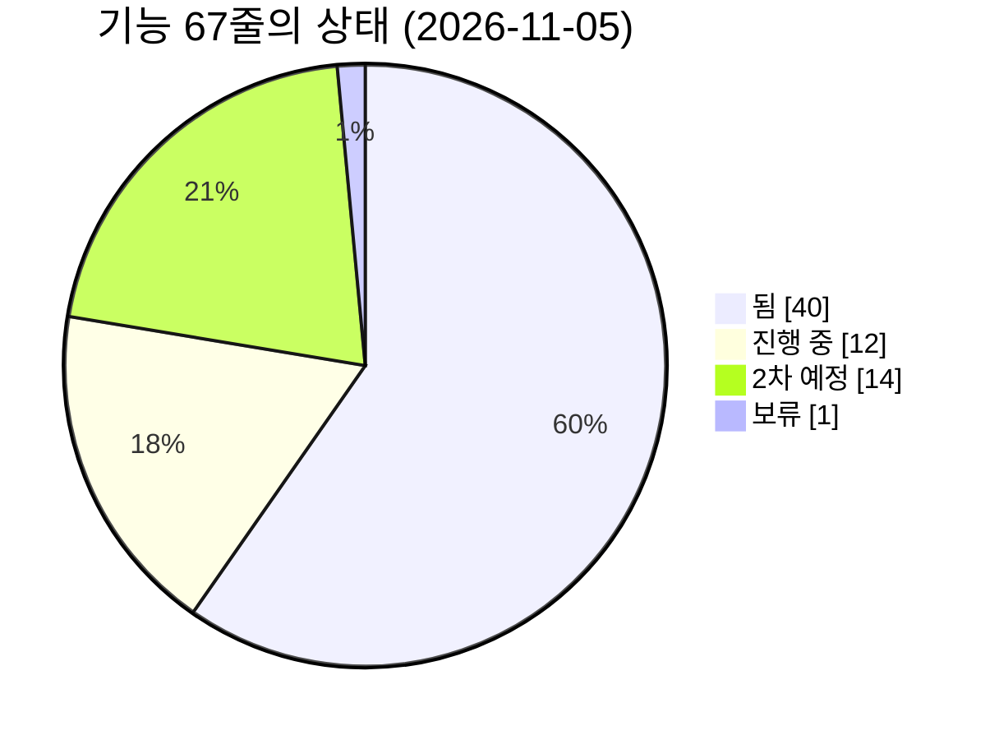
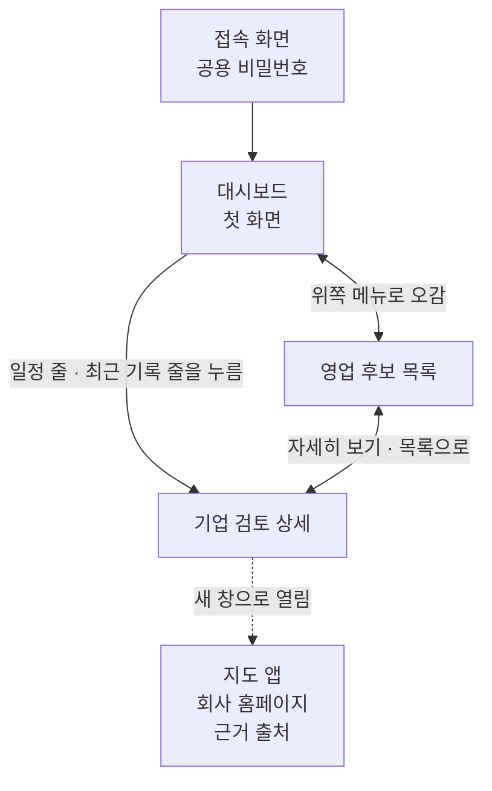
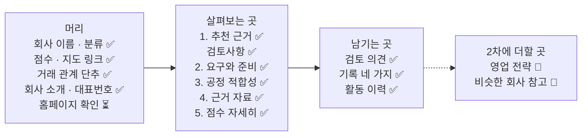

# 기능 지도 — 담당자가 화면에서 지금 무엇을 할 수 있나

> **기준일: 2026-11-05** (`develop` 줄기 기준) · [지도 입구로 돌아가기](README.md)

거산 영업 담당자가 **화면 어디에서 무엇을 할 수 있는지**를 한 줄씩 적은 표입니다. 한 줄이 기능 하나입니다.

## 최근 바뀐 것

최근 5줄만 둡니다. 전체 기록은 [기획 변경 기록](change-log.md)에 쌓습니다.

- **11/5** 후보 찾기에 웹 검색을 더하기로 했습니다. 웹에서 찾았지만 등록 자료에 없는 회사는 "등록 자료에서 못 찾음 · 확인 필요" 꼬리표가 붙습니다. 채용 공고도 근거로 쓰기로 했습니다(2차). 아직 만드는 중입니다 ([#314], [#315]).
- **11/5** 후보 찾기를 1차로 당겼습니다. 담당자가 공정·지역·산업을 고르면 AI가 공공자료에서 회사를 찾아 줍니다. 아직 만드는 중입니다 ([#221], [#286]).
- **11/5** 상세 화면 머리에 "회사 소개"가 생겼습니다. 조사한 날, 한 줄 소개와 특징, 대표번호와 [맞음]이 보입니다 ([#210]).
- **11/5** 기록을 "기록 남기기" 한 칸에서 종류를 골라 넣고, 접촉 횟수는 머리에 보입니다 ([#210]).
- **11/5** 거래 관계를 바꾸거나 홈페이지 조사가 끝나면 전체 순위가 함께 맞춰집니다. "거래 중" 회사의 카드가 여럿이어도 모두 맨 아래로 가고, 다른 회사 재평가 뒤에도 유지됩니다 ([#266], [#296], [#305]).

## 상태를 읽는 법

| 표시 | 뜻 |
|---|---|
| ✅ 됨 | 화면과 서버가 모두 `develop` 줄기에 합쳐져 있음 |
| ⏳ 진행 중 | 1차(11/15 거산 전달)에 넣기로 하고 만드는 중. 화면만 있거나 서버만 있는 경우도 여기 |
| 📅 2차 예정 | 2차(11/17 이후)에 만들기로 함 |
| ⏸ 보류 | 만들지 않고 멈춰 둠 |

- **✅ 됨은 "코드가 합쳐졌다"는 뜻입니다.** 거산이 접속하는 주소에 올리는 일은 아직 진행 중입니다 ([#213]). 이 지도를 만들면서 브라우저에서 하나씩 눌러 보지는 않았습니다.
- 세부 진행 상황의 기준은 계속 **이슈**입니다. 이 표의 상태는 요약이고, 줄마다 이슈 번호를 눌러 확인합니다.

## 한눈에 — 기능 67줄의 상태

**그림을 글로 풀면** — 67줄 가운데 됨 40, 진행 중 12, 2차 예정 14, 보류 1입니다.

## 화면은 어떻게 이어져 있나

**그림을 글로 풀면**

1. 공용 비밀번호를 넣으면 **대시보드**가 첫 화면으로 열립니다.
2. 위쪽 메뉴로 대시보드와 **영업 후보 목록**을 오갑니다.
3. 목록 카드의 "자세히 보기", 대시보드의 일정 줄·최근 기록 줄을 누르면 그 회사의 **기업 검토 상세**로 갑니다.
4. 상세에서 지도 앱, 회사 홈페이지, 근거 출처는 새 창으로 열립니다.
5. **아직 완전하지 않은 길이 하나 있습니다.** 대시보드에서 검색하거나 건수 카드를 누르면 목록으로 가지만, 목록이 그 조건으로 걸러지지 않고 전체가 보입니다.

> **이름 안내** — 이슈와 설계 문서에서 "추천 목록"이라고 부르는 화면의 실제 이름은 **"영업 후보 목록"**, "상세 화면"의 실제 제목은 **"기업 검토 상세"**입니다. 이 지도는 화면에 보이는 이름을 씁니다.

---

## 1. 모든 화면 공통

| 어디 | 담당자가 할 수 있는 것 | 상태 | 이슈 · 담당 |
|---|---|---|---|
| [접속 화면] | 공용 비밀번호를 넣어야 화면이 열린다. 여러 번 틀리면 잠시 뒤 다시 시도하라는 안내가 나온다 | ✅ 됨 | [#213] |
| [위쪽 › 메뉴] | "대시보드"와 "영업 후보 목록"을 오간다 | ✅ 됨 | [#215] |
| [위쪽 › "담당자" 선택] | 자기 이름을 고르면 기록을 저장할 수 있다. 고르지 않으면 "먼저 담당자를 고르세요"가 뜬다 | ✅ 됨 | [#10] |
| [위쪽 아래 띠] | "내부용 · 고객 제출용 아님"이 항상 보이고, 가상 자료·거산 확인 전·다시 평가됨 안내가 상황에 따라 보인다 | ✅ 됨 | [#202] |
| [화면 전체] | 불러오는 중·빈 목록·오류와 "다시 시도"가 화면마다 같은 모양으로 보인다. 좁은 화면에서는 넓은 화면에서 써 달라는 안내가 뜬다 | ✅ 됨 | — |

## 2. 대시보드 (첫 화면)

| 어디 | 담당자가 할 수 있는 것 | 상태 | 이슈 · 담당 |
|---|---|---|---|
| [대시보드 › 건수 카드 5개] | 미접촉 / 관심 / 접촉 중 / 견적·샘플 / 이번 주 일정이 각각 몇 곳인지 본다 | ✅ 됨 | [#215] [#216] |
| [대시보드 › 건수 카드 누르기] | 카드를 누르면 그 단계(또는 이번 주 일정)인 회사만 목록에 걸러서 보인다. 이때는 공정 탭 없이 전체에서 거른다 | ✅ 됨 | [#306] |
| [대시보드 › "일정"] | 다가오는 일정을 지난 것 먼저, 날짜순으로 보고 누르면 그 회사 상세로 간다 | ✅ 됨 | [#216] |
| [대시보드 › "최근 내 기록"] | 내가 남긴 최근 기록 10건을 보고 누르면 그 회사 상세로 간다 | ✅ 됨 | [#216] |
| [대시보드 › 회사 이름 검색] | 이름을 넣고 "검색"을 누르면 그 이름으로 걸러진 목록으로 간다 | ✅ 됨 | [#306] |
| [대시보드 › "공정별"·"산업군별" 막대] | 공정·산업군마다 몇 곳인지 막대로 본다. 지금은 숨겨져 있다 | 📅 2차 예정 | [#229] · 미정 |
| [대시보드 › 지도] | 거산 본사를 가운데 두고 30·50·100km 원 안의 회사를 점으로 본다 | 📅 2차 예정 | [#226] · 미정 |

## 3. 영업 후보 목록

| 어디 | 담당자가 할 수 있는 것 | 상태 | 이슈 · 담당 |
|---|---|---|---|
| [목록 › 맨 위] | "전체 ○곳"을 보고 순위대로 카드를 20곳씩 넘겨 본다. 순서는 프로그램이 정한다 | ✅ 됨 | [#10] |
| [목록 › 카드 머리] | 순위, 회사 이름, 분류와 "가상 사례"·"거산 확인 전"·"재평가됨" 꼬리표를 본다 | ✅ 됨 | [#202] |
| [목록 › 카드 점수] | "참고 50점 · 3/8" 같은 점수를 본다. 거래 여부를 모르면 흐리게 + "거래 확인 전", 거래 중이면 "기존 거래처"가 붙는다 | ✅ 됨 | [#264] |
| [목록 › 카드 영업 단계 꼬리표] | 관심·접촉·견적·샘플·보류·성사·거절 꼬리표를 본다 | ✅ 됨 | [#210] |
| [목록 › 카드 세 줄] | "추천 근거" / "검토사항" / "후속 조치"를 회사마다 다른 문장으로 읽는다 | ✅ 됨 | [#139] [#160] |
| [목록 › 카드 "담당자 검토 의견"] | "검토 권고" / "추가 확인 필요" / "검토 대상 제외" 단추로 바로 저장하고 고친다. 제외는 이유를 꼭 적는다 | ✅ 됨 | [#10] |
| [목록 › 카드 "자세히 보기"] | 그 회사의 상세로 간다 | ✅ 됨 | — |
| [목록 › 공정 탭 · 지역 · 산업으로 거르기] | 맨 위 공정 탭과 지역·산업 드롭다운으로 회사를 골라 본다. 순위는 고른 조건 안 번호이고, 고른 조건은 주소에 남아 새로 고침해도 유지된다. 조건에 맞는 곳이 없으면 안내 문구가 나온다 | ✅ 됨 | [#306] |
| [목록 › 카드 공정·지역·산업 꼬리표] | 카드에서 공정 이름, 지역(예: 아산시), 산업(예: 자동차 부품)을 본다. 비어 있으면 "지역 미확인"·"산업 미확정"으로 보인다 | ✅ 됨 | [#306] |
| [목록 › 머리 "새 후보 가져오기" 단추] | 공정·지역·산업을 고르고 누르면 AI가 공공자료에서 맞는 회사를 골라 목록에 더하고, 새 회사만 자동으로 조사한다. 조건 고르는 칸과 단추는 서버가 합쳐진 뒤 이어서 붙인다 | ⏳ 진행 중 | [#221] · 유동렬·이강욱·고선주 |
| [목록 › 머리 후보 수집 요약] | 가져오는 중이면 "지금 가져오는 중입니다", 끝난 뒤에는 "훑어본 ○곳 · 고른 ○곳 · 조사 ○/○"를 본다. 서버가 준 건수만 보이고 모르는 칸은 뺀다. 지금은 가짜 응답으로만 확인했다 | ⏳ 진행 중 | [#316] · 고선주 |
| [목록 › "이번 수집만 / 전체" 전환] | 마지막으로 가져온 회사만 보거나 전체를 본다. 고른 보기는 주소에 남아 새로 고침해도 유지된다 | ⏳ 진행 중 | [#316] · 고선주 |
| [목록 › 카드 고른 이유·점수 전·이번에 들어옴] | 찾은 회사 카드에서 AI가 고른 이유 한 줄을 읽고, 점수가 아직 없으면 "점수 전", 이번 수집에 들어왔으면 "이번에 들어옴 · 11/20" 꼬리표를 본다. 사례 파일 18곳 카드는 그대로다 | ⏳ 진행 중 | [#316] · 고선주 |
| [목록 › 거리] | 거산 본사에서의 직선거리를 보고 가까운 순으로 본다 | 📅 2차 예정 | [#222] · 미정 |
| [목록 › 엑셀 내려받기] | 목록을 엑셀 파일로 받는다 | 📅 2차 예정 | [#217] · 이강욱 |

## 4. 기업 검토 상세

상세 화면은 위에서 아래로 길게 이어집니다. 그림은 왼쪽이 화면의 위쪽이고, 상자 안의 줄도 화면에 나오는 순서입니다.

**그림을 글로 풀면** — 맨 위 **머리**에서 회사를 확인하고, 가운데 **살펴보는 곳**에서 추천 근거 → 검토사항 → 요구와 준비 상태 → 공정 적합성 → 근거 자료 → 점수 순서로 읽고, 아래 **남기는 곳**에서 검토 의견과 기록을 남깁니다. 영업 전략과 비슷한 회사 참고는 2차에 더합니다(화면에서 놓일 자리는 그때 정합니다).

### 머리

| 어디 | 담당자가 할 수 있는 것 | 상태 | 이슈 · 담당 |
|---|---|---|---|
| [상세 › 머리] | 회사 이름, 분류, 점수, "거래 확인 전"·"기존 거래처" 표시를 보고 "목록으로" 돌아간다 | ✅ 됨 | [#264] |
| [상세 › 머리 주소] | 주소 옆 "네이버 지도에서 보기"·"카카오맵에서 보기"로 위치를 새 창에서 본다 | ✅ 됨 | [#210] |
| [상세 › 머리 "기업 소개 페이지"] | 회사 홈페이지 주소가 있으면 새 창으로 연다 | ✅ 됨 | [#190] |
| [상세 › 머리 "고객 관계·대응·담당"] | 신규인지 기존인지, 대응 목적, 담당자 이름을 읽는다 | ✅ 됨 | — |
| [상세 › 머리 거래 관계 단추] | [거래 없음] [거래 중] [확인 전으로]를 누르면 저장되고 순위가 다시 맞춰진다. "거래 중" 회사의 카드가 여럿이어도 모두 맨 아래로 간다. 다른 회사 재평가나 목록 밖 같은 회사 기회의 거래 관계 변경 뒤에도 순서를 유지하고, 다른 기회의 점수·평가 번호는 보존한다 | ✅ 됨 | [#266] [#296] [#305] |
| [상세 › 머리 "회사 소개" 대표번호] | 공개된 회사 대표번호와 출처를 보고 [맞음]으로 확인한다. 확인한 사람과 날짜가 남는다 | ✅ 됨 | [#210] |
| [상세 › 머리 "회사 소개"] | 조사한 날, 한 줄 소개와 특징을 본다. 조사한 지 오래되면 "오래됨"이 붙는다. 거산에서의 거리는 값이 생기면 보인다(거리 계산은 2차 [#222]) | ✅ 됨 | [#210] |
| [상세 › 머리 [다시 조사]] | AI 조사를 다시 돌린다. 서버 연결을 만드는 중이고(PM 결정 대기), 그 뒤에 단추를 만든다 | ⏳ 진행 중 | [#304] [#210] · 이강욱·고선주 |
| [상세 › 홈페이지 확인] | AI가 찾은 홈페이지가 불확실하거나 없으면 맨 위에 "홈페이지 확인 필요"·"홈페이지 못 찾음" 띠가 보인다. [맞음] [고치기] 단추는 서버 연결(PM 결정 대기) 뒤에 만든다 | ⏳ 진행 중 | [#304] [#210] · 이강욱·고선주 |

### 본문

| 어디 | 담당자가 할 수 있는 것 | 상태 | 이슈 · 담당 |
|---|---|---|---|
| [상세 › "1. 추천 근거와 후속 조치"] | 항목마다 요약 한 줄과 다음 할 일을 읽고, 줄 끝 출처를 누르면 원문이 열린다 | ✅ 됨 | [#145] [#175] |
| [상세 › "검토사항" 체크] | AI 질문·"자료 못 찾음"·"자료 부족" 줄에 확인 표시를 하고 "확인 2 / 5"처럼 진행을 본다 | ✅ 됨 | [#227] [#228] |
| [상세 › "검토사항" 답 적기] | 질문 줄 아래에 들은 답을 적고 "답 고치기"로 바꾼다 | ✅ 됨 | [#248] [#249] |
| [상세 › "검토사항" 자료 줄] | 자료가 없거나 부족한 줄에 [메모 적기]·[붙여넣고 조사]로 직접 찾은 자료를 넣는다 | 📅 2차 예정 | [#259] [#260] · 이강욱·고선주 |
| [상세 › "2. 고객이 요구하는 것과 거산의 준비 상태"] | 요구마다 꼭 필요한지, 언제 필요한지, 거산이 준비됐는지, 판정을 표로 본다 | ✅ 됨 | — |
| [상세 › "승인 가능 여부" 한 줄] | 접촉을 승인할 수 있는 상태인지와 이유를 읽는다 | ✅ 됨 | — |
| [상세 › 접촉 승인 단추] | 접촉을 승인·거절한다. 지금은 화면에서 숨겨 두었다 | 📅 2차 예정 | [#131] · 미정 |
| [상세 › "3. 공정 적합성 검토"] | 거산의 어느 공정이 맞는지, 적용 소재와 판정을 본다 | ✅ 됨 | — |
| [상세 › "4. 근거 자료"] | 근거마다 출처, 믿을 만한 정도, 확인된 사실인지 추정인지, AI가 뽑은 것인지를 본다 | ✅ 됨 | [#174] |
| [상세 › "5. 점수 자세히 보기"] | 펼치면 항목별 점수표를 본다 | ✅ 됨 | [#202] |
| [상세 › "담당자 검토 의견"] | 목록 카드와 같은 의견 세 단추로 저장하고 고친다 | ✅ 됨 | [#10] |

### 기록

| 어디 | 담당자가 할 수 있는 것 | 상태 | 이슈 · 담당 |
|---|---|---|---|
| [상세 › "기록 남기기" 접촉] | 종류(전화·방문·메일)를 고르고 결과(연결됨·부재·거절)와 날짜를 저장한다. 횟수는 머리에 "접촉 3회 (전화 2 · 방문 1)"처럼 보인다 | ✅ 됨 | [#209] [#210] |
| [상세 › "기록 남기기" 메모] | 종류에서 메모나 자료 조사를 골라 덧붙인다. 고치거나 지울 수 없다 | ✅ 됨 | [#209] [#210] |
| [상세 › "기록" 영업 단계] | 단계를 바꿔 저장한다. "거절"이면 거절 이유 6가지 중에서 고른다 | ✅ 됨 | [#250] [#251] |
| [상세 › "기록" 다음 일정] | 날짜와 할 일 한 줄을 저장한다. 대시보드 "일정"에 나온다 | ✅ 됨 | [#209] [#210] |
| [상세 › "활동 이력"] | 누가 언제 무엇을 했는지 최근 순으로 읽는다 | ✅ 됨 | [#228] |
| [상세 › "기록 남기기" 한 칸] | 접촉과 메모를 한 칸에서 종류를 골라 넣는다 | ✅ 됨 | [#210] |
| [상세 › "활동 이력" 잘못 입력] | 잘못 저장한 줄을 지우지 않고 [잘못 입력]으로 표시한다 | 📅 2차 예정 | [#253] [#254] · 이강욱·고선주 |
| [상세 › "비슷한 회사 참고"] | 같은 공정·산업군 회사의 영업 단계, 거절 이유, 최근 메모를 참고로 본다 | 📅 2차 예정 | [#268] [#269] · 이강욱·고선주 |
| [상세 › "영업 전략"] | AI가 공개 자료로 쓴 전략 초안을 보고 회사별 맞춤 메모를 받는다 | 📅 2차 예정 | [#27] · 미정 |

## 5. 그 밖의 화면

| 어디 | 담당자가 할 수 있는 것 | 상태 | 이슈 · 담당 |
|---|---|---|---|
| [질문 목록 화면] | 확인할 질문을 한 화면에 모아 보고 글로 내보낸다 | 📅 2차 예정 | [#223] · 미정 |
| [재접촉 화면] | 예전에 거래했던 회사를 다시 영업할 후보로 본다 | ⏸ 보류 | 11/3 PM 결정 |

## 6. 화면 뒤에서 돌아가는 일

담당자 화면에는 단추가 없지만, 화면에 보이는 내용을 만들어 내는 일입니다.

| 무엇 | 되는 것 | 상태 | 이슈 · 담당 |
|---|---|---|---|
| [평가] | 회사마다 꼭 맞아야 하는 조건으로 거르고, 점수를 매기고, 분류하고, 순위를 정한다 | ✅ 됨 | [#9] |
| [회사 넣기] | 회사 1곳을 파일 1개로 써서 넣는다. 지금 18곳이 들어 있다 | ✅ 됨 | [#8] [#140] |
| [AI 조사] | 회사를 넣으면 홈페이지를 찾고, 본문을 읽고, 근거와 확인 질문을 뽑아 다시 평가한다. 본문이 없는 안내 쪽이거나 사이트 오류가 나는 홈페이지는 읽지 못한다 | ✅ 됨 | [#289] [#297] |
| [회사 홈페이지 칸] | 회사 파일에 홈페이지 주소 칸을 더해 상세의 링크가 공식 주소를 가리키게 한다 | ⏳ 진행 중 | [#190] · 이강욱·유동렬 |
| [거산 소개서 내용을 '거산이 확인함'으로 바꾸기] | 소개서에서 온 거산 값을 "거산 확인 완료"로 바꾸고 18곳을 다시 평가한다. 명령은 있고, 올려 둔 곳에서 실행하는 일이 남았다 | ⏳ 진행 중 | [#212] · 유동렬 |
| [접속 환경] | 거산이 접속할 주소에 프로그램을 올린다 | ⏳ 진행 중 | [#213] · 이강욱 |
| [백업 · 복원] | 쌓인 기록을 백업하고 되돌리는 명령과 절차 | ⏳ 진행 중 | [#214] · PM |
| [새 후보 자동 수집] | 서버가 공공 자료에서 새 후보 회사를 주기적으로 모아 더한다 | 📅 2차 예정 | [#221] · 유동렬 |
| [AI 점수 제안] | 찾은 회사에 AI가 공정 연결과 점수 입력을 제안해 "AI 제안·확인 전" 흐린 점수로 순위에 들어가게 한다. 사람이 적은 값은 덮지 않는다 | ⏳ 진행 중 | [#286] · 유동렬 |
| [후보 찾기 › 웹 검색] | 고른 조건으로 AI가 웹에서도 회사를 찾아 더한다. 등록 자료에서 못 찾은 회사는 "등록 자료에서 못 찾음 · 확인 필요" 꼬리표가 붙고, 담당자가 확인하기 전까지 점수가 흐리다 | ⏳ 진행 중 | [#314] · 유동렬 |
| [채용 공고 근거] | 찾은 회사를 조사할 때 최근 채용 공고를 찾아 "지금 연락할 때인가" 신호로 붙인다. 날짜·직무 요지·링크만 쓴다 | 📅 2차 예정 | [#315] · 미정 |
| [조사 에이전트] | 1차 결과를 본 뒤 조사를 스스로 이어 가는 AI를 들일지 검토한다 | 📅 2차 예정 | [#224] · 미정 |
| [시연용 자료 분리] | 발표 때 쓸 가상 회사 기록을 실제 자료와 따로 둔다 | 📅 2차 예정 | [#274] · PM |

## 7. 결정을 기다리는 것

| 무엇 | 정해야 할 것 | 이슈 |
|---|---|---|
| 홈페이지 주소를 고친 뒤 조사가 실패하면 | 고친 주소를 그대로 둘지 / 원래 주소로 되돌릴지. 이 답이 있어야 홈페이지 확인 서버가 올라온다 | [#304] |
| 영업 메모를 AI에 보낼지 | 안 보냄 / 이름·연락처를 지우고 보냄 / 고른 메모만 보냄 | [#247] |
| 거산에 물을 것·전할 것 | 다음 방문·연락 때 확인할 것 모음 | [#275] |

---

기술 메모 (확인한 방법과 근거 파일)

- 기준: `develop` 줄기의 2026-11-05 상태(커밋 `93cf81d`).
- 화면 기능은 `web/src/pages/`, `web/src/components/`, `web/src/labels/ko.ts`를, 서버 연결은 `contracts/openapi.json`과 `geosan/api/routes/`를 읽어 확인했다. 브라우저 실행은 하지 않았다.
- "대시보드 → 목록이 걸러지지 않음": `web/src/api/client.ts`의 목록 요청이 `tab`·`page`·`pageSize`만 보내고, `web/src/pages/OpportunityListPage.tsx`가 주소의 `q`·`stage`·`filter`를 읽지 않는다. 대시보드는 `web/src/components/dashboard/CountCards.tsx`, `web/src/pages/DashboardPage.tsx`에서 그 조건을 붙여 보낸다.
- 건수는 이 문서의 표에서 상태 표시가 붙은 줄을 센 것이다.

[#8]: https://github.com/agent-ddalgi-team/final-geosan/issues/8
[#9]: https://github.com/agent-ddalgi-team/final-geosan/issues/9
[#10]: https://github.com/agent-ddalgi-team/final-geosan/issues/10
[#27]: https://github.com/agent-ddalgi-team/final-geosan/issues/27
[#131]: https://github.com/agent-ddalgi-team/final-geosan/issues/131
[#139]: https://github.com/agent-ddalgi-team/final-geosan/issues/139
[#140]: https://github.com/agent-ddalgi-team/final-geosan/issues/140
[#145]: https://github.com/agent-ddalgi-team/final-geosan/issues/145
[#160]: https://github.com/agent-ddalgi-team/final-geosan/issues/160
[#174]: https://github.com/agent-ddalgi-team/final-geosan/issues/174
[#175]: https://github.com/agent-ddalgi-team/final-geosan/issues/175
[#190]: https://github.com/agent-ddalgi-team/final-geosan/issues/190
[#202]: https://github.com/agent-ddalgi-team/final-geosan/issues/202
[#209]: https://github.com/agent-ddalgi-team/final-geosan/issues/209
[#210]: https://github.com/agent-ddalgi-team/final-geosan/issues/210
[#212]: https://github.com/agent-ddalgi-team/final-geosan/issues/212
[#213]: https://github.com/agent-ddalgi-team/final-geosan/issues/213
[#214]: https://github.com/agent-ddalgi-team/final-geosan/issues/214
[#215]: https://github.com/agent-ddalgi-team/final-geosan/issues/215
[#216]: https://github.com/agent-ddalgi-team/final-geosan/issues/216
[#217]: https://github.com/agent-ddalgi-team/final-geosan/issues/217
[#221]: https://github.com/agent-ddalgi-team/final-geosan/issues/221
[#222]: https://github.com/agent-ddalgi-team/final-geosan/issues/222
[#223]: https://github.com/agent-ddalgi-team/final-geosan/issues/223
[#224]: https://github.com/agent-ddalgi-team/final-geosan/issues/224
[#226]: https://github.com/agent-ddalgi-team/final-geosan/issues/226
[#227]: https://github.com/agent-ddalgi-team/final-geosan/issues/227
[#228]: https://github.com/agent-ddalgi-team/final-geosan/issues/228
[#229]: https://github.com/agent-ddalgi-team/final-geosan/issues/229
[#247]: https://github.com/agent-ddalgi-team/final-geosan/issues/247
[#248]: https://github.com/agent-ddalgi-team/final-geosan/issues/248
[#249]: https://github.com/agent-ddalgi-team/final-geosan/issues/249
[#250]: https://github.com/agent-ddalgi-team/final-geosan/issues/250
[#251]: https://github.com/agent-ddalgi-team/final-geosan/issues/251
[#253]: https://github.com/agent-ddalgi-team/final-geosan/issues/253
[#254]: https://github.com/agent-ddalgi-team/final-geosan/issues/254
[#259]: https://github.com/agent-ddalgi-team/final-geosan/issues/259
[#260]: https://github.com/agent-ddalgi-team/final-geosan/issues/260
[#264]: https://github.com/agent-ddalgi-team/final-geosan/issues/264
[#266]: https://github.com/agent-ddalgi-team/final-geosan/issues/266
[#268]: https://github.com/agent-ddalgi-team/final-geosan/issues/268
[#269]: https://github.com/agent-ddalgi-team/final-geosan/issues/269
[#274]: https://github.com/agent-ddalgi-team/final-geosan/issues/274
[#275]: https://github.com/agent-ddalgi-team/final-geosan/issues/275
[#286]: https://github.com/agent-ddalgi-team/final-geosan/issues/286
[#289]: https://github.com/agent-ddalgi-team/final-geosan/issues/289
[#296]: https://github.com/agent-ddalgi-team/final-geosan/issues/296
[#297]: https://github.com/agent-ddalgi-team/final-geosan/issues/297
[#304]: https://github.com/agent-ddalgi-team/final-geosan/issues/304
[#305]: https://github.com/agent-ddalgi-team/final-geosan/issues/305
[#306]: https://github.com/agent-ddalgi-team/final-geosan/issues/306
[#314]: https://github.com/agent-ddalgi-team/final-geosan/issues/314
[#315]: https://github.com/agent-ddalgi-team/final-geosan/issues/315
