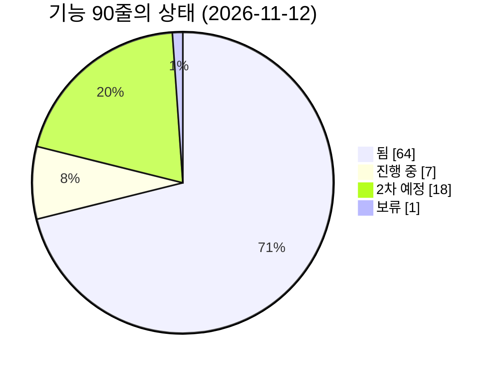
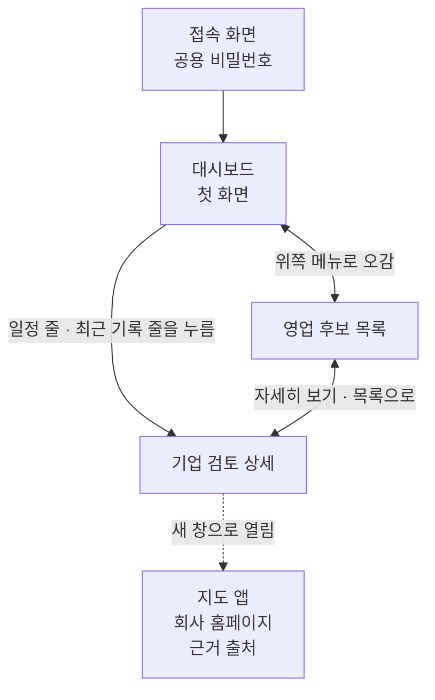
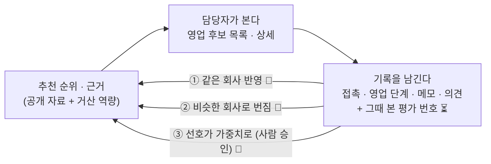
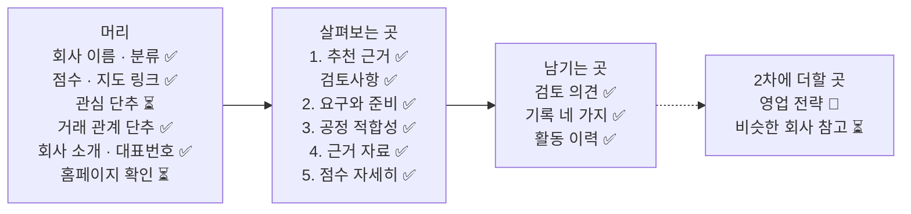

# 기능 지도 — 담당자가 화면에서 지금 무엇을 할 수 있나

> **기준일: 2026-11-12** (`develop` 줄기 기준) · [지도 입구로 돌아가기](README.md)

거산 영업 담당자가 **화면 어디에서 무엇을 할 수 있는지**를 한 줄씩 적은 표입니다. 한 줄이 기능 하나입니다.

## 최근 바뀐 것

최근 5줄만 둡니다. 전체 기록은 [기획 변경 기록](change-log.md)에 쌓습니다.

- **11/12** 상세 맨 아래에 "비슷한 회사 참고"가 생겼습니다. 같은 공정·산업군의 다른 회사 최대 5곳의 영업 단계·거절 이유·마지막 접촉·최근 메모를 한 줄씩, 맨 위에 건수 요약 한 줄로 봅니다. 회사 이름을 누르면 그 회사 상세로 가고 "내부 참고 · 밖으로 안 나감"이 붙습니다. 서버([#268])가 합쳐지기 전에는 가짜 응답으로만 확인했습니다 ([#269]).
- **11/12** 검토사항의 "자료 못 찾음·자료 부족" 줄에 [메모 적기]가 생겼습니다. 줄 아래에서 바로 적고(500자) 저장하면 "메모: … — 박 이사 · 11/20"이 보입니다. 기록용이라 점수는 바뀌지 않습니다. 서버([#259])가 합쳐지기 전에는 가짜 응답으로만 확인했습니다 ([#260]).
- **11/12** AI가 회사를 다시 판단하면 이미 목록에 있는 회사의 카드 "고른 이유"와 적합도도 최신 판단으로 바뀝니다. 예: "산업용 기계부품 가공, 방청·내마모 표면처리 수요 높음" → "산업용 기계부품 절삭가공으로 도금·피막 외주 가능성 높음". 같은 조건으로 [새 후보 가져오기]를 다시 누르면 반영되고 새 조사 비용은 들지 않습니다 ([#615]).
- **11/12** 활동 이력의 내 기록 줄에 [잘못 입력]이 생겼습니다. 누르면 줄이 그어지고 "취소 · 박 이사 · 11/06"이 붙으며 현재 단계·접촉 횟수가 이전 값으로 돌아갑니다. 서버([#253])가 합쳐지기 전에는 가짜 응답으로만 확인했습니다 ([#254]).
- **11/12** 찾은 회사 카드의 "점수 전" 옆에 "조사 중" 또는 "조사 중단"이 붙고, 상세 점수 줄 옆에 멈춘 이유가 보입니다. 예: "조사 중단 · 홈페이지 못 찾음". 상세의 [맞음]·[고치기]와 홈페이지 띠는 없애고 [다시 조사]를 우측 상단 하나로 두었습니다. 홈페이지가 없는 회사도 [다시 조사]를 누르면 홈페이지부터 다시 찾습니다 ([#596]).

## 상태를 읽는 법

| 표시 | 뜻 |
|---|---|
| ✅ 됨 | 화면과 서버가 모두 `develop` 줄기에 합쳐져 있음 |
| ⏳ 진행 중 | 1차(11/15 거산 전달)에 넣기로 하고 만드는 중. 화면만 있거나 서버만 있는 경우도 여기 |
| 📅 2차 예정 | 2차(11/17 이후)에 만들기로 함 |
| ⏸ 보류 | 만들지 않고 멈춰 둠 |

- **✅ 됨은 "코드가 합쳐졌다"는 뜻입니다.** 거산이 접속하는 주소에 올리는 일은 아직 진행 중입니다 ([#213]). 이 지도를 만들면서 브라우저에서 하나씩 눌러 보지는 않았습니다.
- 세부 진행 상황의 기준은 계속 **이슈**입니다. 이 표의 상태는 요약이고, 줄마다 이슈 번호를 눌러 확인합니다.

## 한눈에 — 기능 90줄의 상태

**그림을 글로 풀면** — 90줄 가운데 됨 64, 진행 중 7, 2차 예정 18, 보류 1입니다.

## 화면은 어떻게 이어져 있나

**그림을 글로 풀면**

1. 공용 비밀번호를 넣으면 **대시보드**가 첫 화면으로 열립니다.
2. 위쪽 메뉴로 대시보드와 **영업 후보 목록**을 오갑니다.
3. 목록 카드의 "자세히 보기", 대시보드의 일정 줄·최근 기록 줄을 누르면 그 회사의 **기업 검토 상세**로 갑니다.
4. 상세에서 지도 앱, 회사 홈페이지, 근거 출처는 새 창으로 열립니다.
5. 대시보드에서 회사 이름을 검색하거나 건수 카드를 누르면 **그 조건으로 걸러진 목록**이 열립니다. 예: "관심 기업" 칸을 누르면 관심으로 고른 회사만 보입니다.

> **이름 안내** — 이슈와 설계 문서에서 "추천 목록"이라고 부르는 화면의 실제 이름은 **"영업 후보 목록"**, "상세 화면"의 실제 제목은 **"기업 검토 상세"**입니다. 이 지도는 화면에 보이는 이름을 씁니다.

---

## 이 서비스의 핵심 — 쓸수록 거산에 맞게 순위·근거가 맞춰진다

> **2026-11-08 PM 정리.** 발표 메모 0장([docs/presentation-notes.md](../presentation-notes.md))과 같은 내용의 요약입니다.

이 프로그램은 "공개 자료로 한 번 뽑은 순위"를 보여 주고 끝나는 도구가 아닙니다. 담당자가 **기록을 남길수록** 그 기록이 순위와 근거에 되돌아와 **거산의 영업 방식에 맞춰 가는 영업 비서**가 목표입니다. 아래 표의 줄들이 그 되먹임의 재료와 단계입니다.

**그림을 글로 풀면** — 순위를 보고 → 연락하고 기록을 남기면 → 그 기록이 세 갈래로 순위에 돌아옵니다. 1차(지금)는 "기록 남기기"와 "그때 본 평가 번호 남기기"까지이고, 세 갈래 되먹임은 2차입니다.

| 단계 | 쉬운 뜻 | 지도의 어느 줄 | 상태 |
|---|---|---|---|
| 재료 | 접촉·영업 단계·메모·검토 의견·거절 이유를 남긴다 | [4장 기록](#기록) | ✅ 됨 |
| 재료 | 기록을 저장할 때 그때 보고 있던 평가 번호를 같이 남긴다(화면 변화 없음). 늦게 넣으면 그 전 기록은 복구할 수 없어 11/15 전에 넣었다 | [4장 기록](#기록) | ✅ 됨 · [#450] [#451] |
| 재료 | 접촉할 때 "AI 판단이 맞았나(맞음·다름·모름)"를 남긴다. 영업 성과와 따로 잰다. 외주처가 있어 거절해도 사실이 맞으면 맞음이다 | [4장 기록](#기록) | ✅ 됨 |
| ① 같은 회사 반영 | 그 회사의 기록이 그 회사의 순위·근거에 바로 반영된다. 예: "거절(단가) 기록이 있어 순위를 내렸습니다" | [6장](#6-화면-뒤에서-돌아가는-일) | 📅 2차 예정 · 이슈 아직 없음 |
| ② 비슷한 회사로 번짐 | 같은 공정·산업군·지역 회사의 기록이 비슷한 회사의 순위·근거에 참고로 들어간다 | [4장 기록](#기록) 비슷한 회사 참고 · [6장](#6-화면-뒤에서-돌아가는-일) | 📅 2차 예정 · [#268] [#269] |
| ③ 선호가 가중치로 | 담당자가 반복해서 고른 것을 점수 가중치 제안으로 바꾸고 사람이 승인해야 적용된다 | [6장](#6-화면-뒤에서-돌아가는-일) | 📅 2차 예정 · 이슈 아직 없음 |

- 통계 학습(왜 바뀌었는지 설명 못 하는 방식)은 쓰지 않습니다. 어느 단계든 바뀐 순위 옆에 "왜 바뀌었나"가 보여야 합니다(PM 결정 2026-11-08).
- 발표에서는 "처음 1~5위 추천의 성사율 → 기록 반영 뒤 성사율" 비교가 가능하도록 처음부터 설계했다는 점을 말합니다.

---

## 1. 모든 화면 공통

| 어디 | 담당자가 할 수 있는 것 | 상태 | 이슈 · 담당 |
|---|---|---|---|
| [접속 화면] | 공용 비밀번호를 넣어야 화면이 열린다. 여러 번 틀리면 잠시 뒤 다시 시도하라는 안내가 나온다 | ✅ 됨 | [#213] |
| [위쪽 › 메뉴] | "대시보드"와 "영업 후보 목록"을 오간다 | ✅ 됨 | [#215] |
| [위쪽 › "담당자" 선택] | 자기 이름을 고르면 기록을 저장할 수 있다. 고르지 않으면 "먼저 담당자를 고르세요"가 뜬다 | ✅ 됨 | [#10] |
| [위쪽 아래 띠] | "내부용 · 고객 제출용 아님"이 항상 보이고, 가상 자료·거산 확인 전·다시 평가됨 안내가 상황에 따라 보인다 | ✅ 됨 | [#202] |
| [화면 전체] | 불러오는 중·빈 목록·오류와 "다시 시도"가 화면마다 같은 모양으로 보인다. 좁은 화면에서는 넓은 화면에서 써 달라는 안내가 뜬다 | ✅ 됨 | — |

## 2. 대시보드 (첫 화면)

| 어디 | 담당자가 할 수 있는 것 | 상태 | 이슈 · 담당 |
|---|---|---|---|
| [대시보드 › "관심 기업" 구역] | 관심으로 고른 회사가 모두 몇 곳인지 맨 앞 큰 칸 "관심 기업 ○곳"으로 보고, 그 가운데 의견 전 / 추가 확인 필요가 각각 몇 곳인지 본다. "검토 대상 제외"로 저장한 회사는 관심 기업에서 빠져 세지 않는다(#536). 0곳이면 "아직 관심으로 고른 회사가 없습니다. 추천 목록에서 [관심]을 눌러 담아 보세요" 안내가 나온다. 새로 찾은 회사도 확정 평가 기록이 있으면 관심을 켜는 즉시 반영한다. 전체 평가를 기다리지 않는다(예: 관심 기업 1곳 · 의견 미선택 1곳) | ✅ 됨 | [#356] [#357] [#215] [#216] [#465](https://github.com/agent-ddalgi-team/final-geosan/issues/465) |
| [대시보드 › "영업 진행" 구역] | 관심 기업 가운데 검토 권고를 받은 뒤의 진행을 미접촉(검토 권고 · 접촉 전) / 접촉 중 / 견적·샘플 / 보류 / 완료로 보고, 끝에 이번 주 일정 건수를 본다. 관심으로 고르지 않은 회사는 어느 칸에도 세지 않는다 | ✅ 됨 | [#356] [#357] |
| [대시보드 › 건수 칸 누르기] | 칸을 누르면 그 칸에 든 회사만 목록에 걸러서 보인다("관심 기업" 칸은 관심 기업 보기를 연다). 이때는 공정 선택란 없이 전체에서 거르고, 목록 머리에 무엇으로 걸렀는지 칸 이름과 [거르기 풀기]가 보인다 | ✅ 됨 | [#356] [#357] [#306] |
| [대시보드 › "일정 달력"] | 한 달 달력에서 일정이 있는 날을 색으로 보고(기한 지남 빨강 · 예정 파랑 · 오늘 테두리), 그 날을 누르면 작은 팝업에 회사·건 이름·내용이 보인다. 팝업의 [상세 보기]는 그 회사 상세로 간다. 팝업은 [닫기]·Esc·바깥 누르기로 닫고, ‹ › 로 달을 넘긴다. 기한 지난 일정이 맨 위에 보인다 | ✅ 됨 | [#216] [#572] |
| [대시보드 › "최근 내 기록"] | 내가 남긴 최근 기록 10건을 보고 누르면 그 회사 상세로 간다. 담당자를 바꾸면 그 담당자의 기록으로 바뀐다 | ✅ 됨 | [#216] [#351] |
| [대시보드 › 회사 이름 검색] | 이름을 넣고 "검색"을 누르면 그 이름으로 걸러진 목록으로 간다 | ✅ 됨 | [#306] |
| [대시보드 › "공정별"·"산업군별" 막대] | 공정·산업군마다 몇 곳인지 막대로 본다. 지금은 숨겨져 있다 | 📅 2차 예정 | [#229] · 미정 |
| [대시보드 › 지도] | 거산 본사를 가운데 두고 30·50·100km 원 안의 회사를 점으로 본다 | 📅 2차 예정 | [#226] · 미정 |

## 3. 영업 후보 목록

| 어디 | 담당자가 할 수 있는 것 | 상태 | 이슈 · 담당 |
|---|---|---|---|
| [목록 › 맨 위] | "전체 ○곳"을 보고 순위대로 카드를 20곳씩 넘겨 본다. 순서는 프로그램이 정한다 | ✅ 됨 | [#10] |
| [목록 › 카드 머리] | 순위, 회사 이름, 분류와 "가상 사례"·"거산 확인 전"·"재평가됨" 꼬리표를 본다 | ✅ 됨 | [#202] |
| [목록 › 카드 점수] | "참고 50점 · 3/8" 같은 점수를 본다. 필수조건이 확인 전이면 흐리게 + "거래 확인 전", 거래 중이면 "기존 거래처"가 붙는다. 거래 관계 "확인 전"만으로는 흐려지지 않는다(11/11 PM 결정, 규칙 설정으로 끔) | ✅ 됨 | [#264] [#567] |
| [목록 › 카드 영업 단계 꼬리표] | 접촉·견적·샘플·보류·성사·거절 꼬리표를 본다. "관심"은 단계가 아니라 [관심] 단추로 옮겼다 | ✅ 됨 | [#210] [#357] |
| [목록 › 카드 [관심] 단추] | [관심]을 누르면 그 회사가 관심 기업으로 담기고 단추가 "관심 기업"으로 바뀐다. 다시 누르면 빠진다. 팀이 함께 쓰는 표시다. 메모·영업 기록·검토 의견이 있는 회사는 빼지 못하고 "기록이 있는 회사는 관심에서 뺄 수 없습니다" 안내가 단추 옆에 나온다. 검토 의견을 저장하면 관심이 저절로 켜진다. 단 "검토 대상 제외"를 저장하면 관심이 저절로 꺼지고, 제외한 회사는 메모·접촉을 적어도 다시 켜지지 않으며 [관심]을 누르면 "관심 기업에 다시 담으려면 검토 의견을 검토 권고나 추가 확인 필요로 바꿔 주세요" 안내가 나온다(#536). 담당자를 고르기 전에는 잠긴다 | ✅ 됨 | [#356] [#357] [#536] |
| [목록 › 머리 "관심 기업" 보기] | [관심 기업만 보기]를 누르면 관심으로 고른 회사만 모아 보고, 전체 보기 / 검토 권고 / 추가 확인 필요 / 기타로 걸러 본다("기타"는 의견을 아직 안 고른 회사). 제외한 회사는 관심 기업이 아니라서 아래 "제외한 회사" 보기에서 본다(#536). 전체 목록으로는 위쪽 메뉴 "영업 후보 목록"으로 돌아간다. 고른 값은 주소에 남아 새로 고침해도 유지된다. 관심 기업 보기 안에서도 공정·지역·산업 선택란으로 더 좁혀 볼 수 있고(공정 선택란 맨 위는 "전체"), 선택지 옆 곳 수는 관심 기업 안에서만 센다. 여기서 고른 공정은 평소 목록의 "마지막 선택" 기억을 바꾸지 않는다. 실제 임시 DB·API와 화면 테스트로 확인했다(11/9) | ✅ 됨 | [#356] [#357] [#516] [#536] |
| [목록 › 머리 "제외한 회사" 보기] | [제외한 회사 보기]를 누르면 "검토 대상 제외"로 저장한 회사만 모아 본다. 머리에 "검토 대상 제외로 저장한 회사입니다. 검토 의견을 바꾸면 관심 기업으로 돌아갑니다"가 보이고, 공정·지역·산업 선택란으로 좁혀 볼 수 있다(공정 맨 위는 "전체"). 0곳이면 "검토 대상 제외로 저장한 회사가 없습니다". 전체 목록으로는 위쪽 메뉴로 돌아간다. 고른 값은 주소에 남는다 | ✅ 됨 | [#536] |
| [목록 › 카드 세 줄] | "추천 근거" / "검토사항" / "후속 조치"를 회사마다 다른 문장으로 읽는다 | ✅ 됨 | [#139] [#160] |
| [목록 › 카드 "담당자 검토 의견"] | "검토 권고" / "추가 확인 필요" / "검토 대상 제외" 단추로 바로 저장하고 고친다. 제외는 이유를 꼭 적는다 | ✅ 됨 | [#10] |
| [목록 › 카드 "자세히 보기"] | 그 회사의 상세로 간다 | ✅ 됨 | — |
| [목록 › 머리 공정 · 지역 · 산업 선택란] | 한 줄에 놓인 공정·지역·산업 선택란으로 회사를 골라 본다. 공정 선택란 맨 위는 "전체(공정별로 묶음)"이고 그 아래에 거산 공정 9종이 곳 수와 함께 모두 보인다(예: "아연도금(전기아연도금) 9", "크롬 도금 0"). 처음 열면 "전체(공정별로 묶음)"로 열려 회사가 있는 공정마다 "아연도금(전기아연도금) · 9곳" 같은 묶음으로 보이고, 번호는 묶음 안에서만 매긴다(서로 다른 공정을 한 줄 순위로 섞지 않는다). 지역·산업은 이때도 고를 수 있어 지역을 먼저 골라 인근 후보를 훑을 수 있다(묶음 머리에 "충남 · 자동차 부품"처럼 고른 조건이 붙고, 회사가 0곳인 묶음은 보이지 않는다). 한 공정이 50곳을 넘으면 묶음 끝 "이 공정만 보기"로 그 공정 보기에 간다. 마지막 선택(공정 하나 또는 묶음 보기)은 이 브라우저가 기억해, 다음에 목록을 열면 그것으로 열린다(프로그램이 공정을 대신 고르지 않는다). 공정 하나를 고르면 순위는 그 공정 안 번호이고 20곳씩 넘겨 본다. 고른 조건은 주소에 남아 새로 고침해도 유지된다. 회사가 0곳인 공정을 고르면 "이 공정의 후보가 아직 없습니다. 후보 찾기로 회사를 찾으면 여기에 나타납니다"가 나온다. 대시보드 칸으로 넘어온 목록에는 공정 선택란이 없다(관심 기업 보기에는 있다, #516). 공정 순서는 역량 파일의 순서를 따르고, 파일을 다시 넣어도(같은 시각에 저장돼도) 그 파일 순서로 유지된다. | ✅ 됨 | [#383] [#361] [#368] [#306] [#406] |
| [목록 › 머리 회사 이름 검색] | 이름을 넣고 [검색]을 누르거나 Enter를 치면 고른 공정·지역·산업과 상관없이 전체 후보에서 찾는다. 결과 위에 "전체 후보에서 찾은 결과"와 검색어가 보이고, 검색하는 동안 세 선택란은 숨는다. [검색 지우기]를 누르면 검색하기 직전에 보던 목록(고른 조건, 관심 기업 보기)으로 돌아간다. 찾은 곳이 없으면 "이 이름으로 찾은 후보가 없습니다"가 나온다 | ✅ 됨 | [#361] |
| [목록 › 머리 정렬] | "추천 순"(프로그램이 정한 순서) 또는 "최근 들어온 순"(후보 찾기로 들어온 시각이 최신인 회사가 위, 사례 파일 18곳과 예전 회사는 아래에 추천 순 그대로)으로 본다. 고른 정렬은 주소에 남아 새로 고침해도 유지되고, 공정별 묶음 보기에도 같이 적용된다. "최근 들어온 순"은 서버·화면 테스트로 확인했고 브라우저 확인은 합친 뒤다(11/9). "가까운 순 (준비 중)"은 흐리게 보이고 고를 수 없다. 정렬 줄 끝의 "전체 보기"를 누르면 공정별 묶음을 풀고 모든 회사를 한 줄로 본다(고른 정렬이 전체에 걸쳐 적용되고, 공정이 섞이므로 순위 번호는 없다). 다시 누르거나 공정을 고르면 묶음 보기로 돌아가고, 마지막 선택은 브라우저가 기억한다. 화면 테스트로 확인했다(11/9) | ✅ 됨 | [#361] [#516] |
| [목록 › 카드 공정·지역·산업 꼬리표] | 카드에서 공정 이름, 지역(예: 아산시), 산업(예: 자동차 부품)을 본다. 비어 있으면 "지역 미확인"·"산업 미확정"으로 보인다 | ✅ 됨 | [#306] |
| [목록 › 머리 "영업 후보로 더하기 💰" 단추] | 공정·지역·산업을 고르고 누르면 AI가 공공자료에서 맞는 회사를 골라 목록에 더하고, 새 회사만 자동으로 조사한다. (11/10 #549 1단계) 단추 이름이 [새 후보 가져오기]에서 [영업 후보로 더하기 💰]로 바뀌었고, 공정을 고르면 단추 위에 "맞는 공장 1,518곳 (상 134 · 중 1,382 · 하 2) · 영업 후보로 들어온 곳 102곳 · 아직 안 들어온 상 32곳"이 바로 보인다. 저장된 AI 판단만 세서 비용이 들지 않고, 판단 전 공장이 있으면 "아직 AI 판단 전 n곳"이 붙는다. 이 PC DB 사본의 실제 서버로 확인했고 브라우저 확인은 합친 뒤다. 누르기 전 예상 금액·한도 넘김 잠금은 2단계(#543 뒤). 조건 칸은 화면 설정에서 활성 역량 파일의 공정 전부(회사 0곳인 공정 포함)와 설정의 지역·산업을 읽는다. 담당자 선택 전과 가져오는 중에는 단추가 잠긴다. 합쳐진 develop의 실제 서버·브라우저에서 확인했다(11/9): 공정 9개 순서·실행 중 잠금·완료 요약(예: "훑어본 공장 500곳 · 고른 공장 20곳 · 조사 0/20", 11/10부터 "회사" 대신 "공장"), 실행 뒤 새 회사 등록과 "평가 전" 카드·상세, 실패 뒤 기존 목록 보존과 재실행(새 회사 0곳). 실행·저장·등록·평가는 실제 부품이고 외부 AI 통신 응답만 가상으로 대체했다. 보기 전용 계정에서 조건 칸이 숨는 것과 이미 가져오는 중일 때의 안내는 화면 테스트로만 확인했다. 실제 외부 AI 호출은 #221 후속(500행 품질·비용 실측)에서 확인한다. 단지 조회의 이상한 줄은 제외하고 다음 단지로 계속하며, 건너뛴 줄 번호·사유는 회차 수집 기록에 남긴다. 실제 조회 실패·하루 한도·응답 형식 오류일 때는 받은 결과와 파일 목록으로 계속한다(#546, 가상 제공처·임시 DB 검사; 실제 조회는 PM 확인 전) | ⏳ 진행 중 | [#221] [#316] [#317] [#327] [#328] [#340] [#427] [#428] [#549] [#553] · 유동렬·이강욱·고선주·최지예 |
| [목록 › 머리 후보 수집 요약] | 가져오는 중이면 "지금 가져오는 중입니다", 끝난 뒤에는 "훑어본 ○곳 · 고른 ○곳 · 조사 ○/○"를 본다. 서버가 준 건수만 보이고 모르는 칸은 뺀다. 가져오는 중에는 5초마다 진행을 다시 읽는다. 진행 건수의 서버 응답을 준비했으며, 실제 찾기 연결 전이라 지금은 가짜 찾기와 임시 DB로 확인했다. 임시 DB에 넣은 시험 회차로 실제 서버와 브라우저(Edge)에서 이 줄이 보이는 것까지 확인했다(11/9). 실패하면 "공장현황 소스의 이용·저장 확인을 먼저 기록해 주세요"처럼 코드가 준비한 안전한 사유를 그대로 보인다. 실행 단계의 사유가 API에서 덮이지 않는 것을 실제 임시 DB·API로 확인했으며 외부 예외 원문은 숨긴다 | ✅ 됨 | [#316] [#342] [#317] [#490] · 고선주·이강욱 |
| [목록 › 카드 고른 이유·점수 전·들어온 날짜] | 찾은 회사 카드에서 AI가 고른 이유 한 줄을 읽고, 점수가 아직 없으면 "점수 전"과 함께 "조사 중" 또는 "조사 중단"(이유는 상세, #596), 후보 찾기로 들어온 회사면 "11/9 들어옴" 꼬리표를 본다(들어온 날짜 기준이라 같은 조건을 다시 돌려도 바뀌지 않는다. 예전의 "이번에 들어옴"은 없앴다, #516). 추천 근거가 고른 이유와 같은 문장이면 고른 이유 한 줄만 보인다(조사로 근거가 달라지면 두 줄, #555). 팩토리온 원자재가 붙은 공장은 AI가 원자재도 보고 고른다(다음 후보 찾기의 다시 판단부터, #570). 사례 파일 18곳 카드는 그대로다. "고른 이유"는 시험 회차로 브라우저에서 보이는 것을 확인했고, "점수 전"과 날짜 꼬리표는 화면 테스트로 확인했다(11/9) | ✅ 됨 | [#316] [#516] [#555] [#570] [#596] · 고선주·최지예 |
| [목록 › 카드 "표면처리를 직접 하는 회사일 수 있음" 꼬리표] | 찾은 회사가 도금·아노다이징 같은 표면처리를 직접 하는 회사로 보이면 꼬리표와 검토사항 확인 줄이 붙는다. 자동으로 빼지 않고, 점수 전 회사들 안에서는 표시가 없는 회사 뒤에 선다. 상세 검토사항의 확인 줄은 서버가 만들어 주고(예: "표면처리를 직접 하는 회사일 수 있음: 생산품 '알루미늄 아노다이징'", 출처는 AI 판단 또는 업종명 규칙), 기존 체크 저장을 그대로 써서 확인 표시를 남긴다. 평가 전 회사는 줄만 보이고 체크는 평가 뒤에 한다. 이 부분은 실제 임시 DB·API로 확인했다. 표시를 채우는 길은 둘이다. 수질 명단·업종번호로 붙이는 길은 됐고(아래 "공장 정보" 줄, [#573] [#613]), 후보 찾기의 AI 판단·업종명 규칙으로 붙이는 길은 실제 화면 확인 전이다. 화면은 서버가 표시를 준 회사 카드에 꼬리표와 근거 한 줄을, 상세 머리에 꼬리표를(근거는 없음), 상세 검토사항에 확인 줄을 보이도록 만들어 두었고 가짜 응답으로 확인했다 | ⏳ 진행 중 | [#319] [#363] [#221] [#336] [#342] [#316] [#353] · 유동렬·이강욱·고선주 |
| [목록 › 카드 "공장 정보" 줄 · 상세 "이 회사 한눈에" 공장 정보] | 팩토리온 공장조회에 이름·주소가 맞는 공장이 있으면 원자재·종업원 수·공장 규모를 한 줄로 본다(예: "원자재 강판, SUS · 종업원 약 12명(추정) · 소기업"). 종업원 수는 공장 등록 때 적은 값이라 언제나 "(추정)"이고 순서·점수에는 쓰지 않는다. 수질 명단(특정수질유해물질 배출 사업장)에 회사명과 도로명·건물번호가 모두 같은 사업장이 있거나([#613], 같은 시·군에 이름만 비슷한 회사에는 붙지 않음) 업종번호가 설정의 도금업·피막처리업이면 "표면처리를 직접 하는 회사일 수 있음" 표시가 붙는다. 운영자가 `geosan source-load`로 파일을 넣으며, 이 PC DB 복사본에서 178곳 중 149곳에 붙고 표시 2곳이 생겼다(11/11) | ✅ 됨 | [#573] |
| [목록 › 거리] | 거산 본사에서의 직선거리를 보고, 목록 머리 정렬에서 "가까운 순"을 골라 가까운 순으로 본다. 지금은 "가까운 순 (준비 중)"이 흐리게만 보인다 | 📅 2차 예정 | [#222] [#361] · 미정 |
| [목록 › 엑셀 내려받기] | 목록을 엑셀 파일로 받는다 | 📅 2차 예정 | [#217] · 이강욱 |

## 4. 기업 검토 상세

상세 화면은 위에서 아래로 길게 이어집니다. 그림은 왼쪽이 화면의 위쪽이고, 상자 안의 줄도 화면에 나오는 순서입니다.

**그림을 글로 풀면** — 맨 위 **머리**에서 회사를 확인하고, 가운데 **살펴보는 곳**에서 추천 근거 → 검토사항 → 요구와 준비 상태 → 공정 적합성 → 근거 자료 → 점수 순서로 읽고, 아래 **남기는 곳**에서 검토 의견과 기록을 남깁니다. 영업 전략은 2차에 더합니다(화면에서 놓일 자리는 그때 정합니다). 맨 아래에는 같은 공정·산업군의 **비슷한 회사 참고**가 붙습니다(서버 연결 확인 전).

### 머리

| 어디 | 담당자가 할 수 있는 것 | 상태 | 이슈 · 담당 |
|---|---|---|---|
| [상세 › 머리] | 회사 이름, 분류, 점수, "거래 확인 전"·"기존 거래처" 표시를 보고 "목록으로" 돌아간다 | ✅ 됨 | [#264] |
| [상세 › 머리 [관심] 단추] | 목록 카드와 같은 [관심] 단추로 이 회사를 관심 기업에 담거나 뺀다. 메모·영업 기록·검토 의견을 저장하면 관심이 저절로 켜지고 단추가 "관심 기업"으로 바뀐다. "검토 대상 제외"를 저장하면 관심이 꺼지고 단추가 "관심"으로 돌아간다(#536) | ✅ 됨 | [#356] [#357] [#536] |
| [상세 › 머리 주소] | 주소 옆 "네이버 지도에서 보기"·"카카오맵에서 보기"로 위치를 새 창에서 본다 | ✅ 됨 | [#210] |
| [상세 › 머리 "기업 소개 페이지"] | 회사 홈페이지 주소가 있으면 새 창으로 연다 | ✅ 됨 | [#190] |
| [상세 › 머리 "고객 관계·대응·담당"] | 신규인지 기존인지, 대응 목적, 담당자 이름을 읽는다 | ✅ 됨 | — |
| [상세 › 머리 거래 관계 단추] | [거래 없음] [거래 중] [확인 전으로]를 누르면 저장되고 순위가 다시 맞춰진다. "거래 중" 회사의 카드가 여럿이어도 모두 맨 아래로 간다. 다른 회사 재평가나 목록 밖 같은 회사 기회의 거래 관계 변경 뒤에도 순서를 유지하고, 다른 기회의 점수·평가 번호는 보존한다 | ✅ 됨 | [#266] [#296] [#305] |
| [상세 › 머리 "회사 소개" 대표번호] | 공개된 회사 대표번호와 출처를 보고 [맞음]으로 확인한다. 확인한 사람과 날짜가 남는다 | ✅ 됨 | [#210] |
| [상세 › 맨 위 "이 회사 한눈에"] | 상세를 열면 맨 위 한 칸에서 ① 홈페이지(없으면 검색에서 찾은 페이지 → 등급이 가장 높은 근거의 출처 페이지 → "홈페이지를 찾지 못했습니다") ② 소개(조사한 한 줄 소개, 없으면 "공장 자료 기준" 생산품·업종) ③ 왜 이 회사(적합도 상/중/하 + AI가 고른 이유, 후보 찾기로 들어온 회사만)를 본다. 저장된 값만 보여 새 AI 호출이 없다. 이 PC 실제 DB 복사본으로 브라우저에서 세 경우를 확인했다(11/11) | ✅ 됨 | [#563] |
| [상세 › 머리 "회사 소개"] | 조사한 날, 한 줄 소개와 특징을 본다. 조사한 지 오래되면 "오래됨"이 붙는다. 거산에서의 거리는 값이 생기면 보인다(거리 계산은 2차 [#222]) | ✅ 됨 | [#210] |
| [상세 › 우측 상단 [다시 조사]] | 상세 맨 위 "목록으로" 줄 오른쪽의 단추 하나로 AI 조사를 다시 돌린다(최대 1분). 홈페이지 주소가 있으면 그 주소로, 없으면 홈페이지부터 다시 찾고 이어서 조사한다. 또 못 찾으면 "홈페이지를 찾지 못했습니다"가 보인다(#596). 읽기 거부면 본문 붙여넣기 칸이 열린다. AI 응답을 못 받은 호출은 추정 비용으로 월 한도에 넣고, 한도에 닿으면 단추가 잠긴다. 주소 없는 회사의 다시 찾기는 가짜 응답·실제 임시 DB로 확인했고 실제 AI 호출은 미확인 | ✅ 됨 | [#304] [#210] [#538] [#596] |
| [상세 › 점수 줄 옆 조사 상태] | 점수가 아직 없는 찾은 회사는 점수 줄 옆에 "조사 중" 또는 "조사 중단 · 이유"가 보인다. 이유는 홈페이지 못 찾음 / 홈페이지 읽기 실패 / 조사 안 됨 / 점수 근거 없음 넷이다. 예전의 [맞음]·[고치기] 단추와 "홈페이지 확인 필요"·"홈페이지 못 찾음" 띠는 없앴다(11/12 PM 결정). 이 PC 실제 DB로 브라우저에서 확인했다(11/12) | ✅ 됨 | [#596] |

### 본문

| 어디 | 담당자가 할 수 있는 것 | 상태 | 이슈 · 담당 |
|---|---|---|---|
| [상세 › "1. 추천 근거와 후속 조치"] | 항목마다 요약 한 줄과 다음 할 일을 읽고, 줄 끝 출처를 누르면 원문이 열린다 | ✅ 됨 | [#145] [#175] |
| [상세 › "검토사항" 체크] | AI 질문·"자료 못 찾음"·"자료 부족" 줄에 확인 표시를 하고 "확인 2 / 5"처럼 진행을 본다 | ✅ 됨 | [#227] [#228] |
| [상세 › "검토사항" 답 적기] | 질문 줄 아래에 들은 답을 적고 "답 고치기"로 바꾼다 | ✅ 됨 | [#248] [#249] |
| [상세 › "검토사항" 자료 줄] | 자료가 없거나 부족한 줄에 [메모 적기]·[붙여넣고 조사]로 직접 찾은 자료를 넣는다. [메모 적기]를 누르면 줄 아래에 입력 한 칸이 열리고(창 없음, 500자) 저장하면 "메모: 홈페이지 연혁에 2023 납품 기재 https://… — 박 이사 · 11/20"이 보이며 주소는 눌러 새 창으로 열린다. 메모가 있으면 [메모 고치기]이고 이전 메모는 활동 이력에 남는다. 메모는 기록용이라 점수·체크는 바뀌지 않고 밖으로 나가지 않는다. 두 단추 모두 화면은 만들어졌고(가짜 응답으로 확인) 서버 연결 확인은 [메모 적기]는 [#259] 뒤에, [붙여넣고 조사]는 남아 있다 | ⏳ 진행 중 | [#259] [#260] · 이강욱·고선주 |
| [상세 › "2. 고객이 요구하는 것과 거산의 준비 상태"] | 요구마다 꼭 필요한지, 언제 필요한지, 거산이 준비됐는지, 판정을 표로 본다 | ✅ 됨 | — |
| [상세 › "승인 가능 여부" 한 줄] | 접촉을 승인할 수 있는 상태인지와 이유를 읽는다 | ✅ 됨 | — |
| [상세 › 접촉 승인 단추] | 접촉을 승인·거절한다. 지금은 화면에서 숨겨 두었다 | 📅 2차 예정 | [#131] · 미정 |
| [상세 › "3. 공정 적합성 검토"] | 거산의 어느 공정이 맞는지, 적용 소재와 판정을 본다 | ✅ 됨 | — |
| [상세 › "4. 근거 자료"] | 근거마다 출처, 믿을 만한 정도, 확인된 사실인지 추정인지, AI가 뽑은 것인지를 본다 | ✅ 됨 | [#174] |
| [상세 › "5. 점수 자세히 보기"] | 펼치면 항목별 점수표를 본다 | ✅ 됨 | [#202] |
| [상세 › "담당자 검토 의견"] | 목록 카드와 같은 의견 세 단추로 저장하고 고친다 | ✅ 됨 | [#10] |

### 기록

| 어디 | 담당자가 할 수 있는 것 | 상태 | 이슈 · 담당 |
|---|---|---|---|
| [상세 › "기록 남기기" 접촉] | 종류(전화·방문·메일)를 고르고 결과(연결됨·부재·거절)와 날짜를 저장한다. 횟수는 머리에 "접촉 3회 (전화 2 · 방문 1)"처럼 보인다. 날짜는 오늘(한국 시간)까지만 고를 수 있고, 뒤 날짜를 넣으면 서버가 "앞으로 할 일은 다음 일정에 적어 주세요. 접촉 날짜는 오늘까지입니다"로 거부하고 그 문장이 날짜 칸 아래에 보인다. 접촉 날짜는 오늘(한국 시간)까지만 저장하고 앞으로 할 접촉은 다음 일정에 적는다. 접촉을 적어도 단계는 자동으로 바뀌지 않는다 | ✅ 됨 | [#209] [#210] [#433] [#434] |
| [상세 › "기록 남기기" 메모] | 종류에서 메모나 자료 조사를 골라 덧붙인다. 고치거나 지울 수 없다 | ✅ 됨 | [#209] [#210] |
| [상세 › "기록" 영업 단계] | 단계(미접촉·접촉·견적·샘플·보류·성사·거절)를 바꿔 저장한다. "거절"이면 거절 이유 6가지 중에서 고른다. "관심"은 선택지에서 빠졌다(머리의 [관심] 단추로 옮김). 단계가 미접촉이거나 기록이 없는 회사에 접촉을 적으면 "단계를 접촉으로 바꿀까요? [접촉으로 바꾸기] [닫기]"를 한 번 묻는다(누르기 전에는 바뀌지 않고, 닫으면 그 회사에서는 다시 묻지 않는다) | ✅ 됨 | [#250] [#251] [#357] [#433] |
| [상세 › "기록" 다음 일정] | 날짜와 할 일 한 줄을 저장한다. 대시보드 "일정"에 나온다. 기록 구역 머리에 "① 한 일 적기(접촉·메모) → ② 지금 단계 → ③ 다음 할 일" 안내와 세 칸 제목 앞 번호가 붙어, 앞으로 할 일은 이 칸(③)에 적게 한다 | ✅ 됨 | [#209] [#210] [#433] |
| [상세 › "활동 이력"] | 누가 언제 무엇을 했는지 최근 순으로 읽는다. 종류는 뜻이 같은 3묶음(영업 활동 회색 · 사실 파랑 · 의견 노랑)끼리 같은 색 태그로 보이고, 위의 "전체 / 영업 활동 / 사실 / 의견" 단추로 한 묶음만 본다. 화면에서만 거르고 서버는 그대로 | ✅ 됨 | [#228] [#389] |
| [상세 › "기록 남기기" 한 칸] | 접촉과 메모를 한 칸에서 종류를 골라 넣는다 | ✅ 됨 | [#210] |
| [상세 › 기록 저장 뒤 (화면에 안 보임)] | 접촉·영업 단계·메모를 저장할 때 그때 담당자가 보고 있던 평가 번호를 같이 남긴다. 낡은 번호여도 저장하고 다른 회사의 번호만 거부한다. "몇 위를 보고 연락했고 결과가 어땠나"를 되먹임의 재료로 남기는 것 | ✅ 됨 | [#450] [#451] · 이강욱·PM |
| [상세 › "활동 이력" 잘못 입력] | 내가 저장한 메모·접촉·영업 단계·다음 일정 줄 끝의 [잘못 입력]을 누르면 줄 아래에 "이유(선택)" 한 칸이 열리고(창 없음) [표시]로 확정한다. 줄은 지워지지 않고 줄이 그어지며 "취소 · 박 이사 · 11/06"이 붙고, 취소 사실도 "기록 취소" 한 줄로 남는다. 취소하면 상세를 다시 불러와 현재 단계·접촉 횟수가 이전 값으로 돌아간다. 남의 기록·이미 취소된 줄에는 단추가 없다. 화면은 만들어졌고(가짜 응답으로 확인) 서버 [#253]이 합쳐진 뒤 실제 연결을 확인한다 | ⏳ 진행 중 | [#253] [#254] · 이강욱·고선주 |
| [상세 › 맨 아래 "비슷한 회사 참고"] | 같은 공정·산업군의 다른 회사 최대 5곳을 요약 한 줄("같은 공정 4곳 · 산업군 2곳 \| 접촉 1 · 거절 1(가격) \| 전화 연결 3/5")과 회사 줄로 본다. 회사 줄 예: "코파스 · 전기아연도금 · 자동차 부품 · 접촉 · 11/06 전화 · 메모: 납기 걱정, 샘플 먼저 요청 — 박 이사"(거절이면 "거절 · 가격", 메모는 120자에서 "…"). 회사 이름을 누르면 그 회사 상세로 가고, 0곳이면 "같은 공정·산업군의 다른 회사가 아직 없습니다". 보기 전용도 볼 수 있고 "내부 참고 · 밖으로 안 나감"이 붙는다. 영업 전략 영역의 "참고한 이력" 상자는 전략 영역([#27])이 생긴 뒤에 붙인다(상자 부품은 만들어 둠). 화면은 만들어졌고(가짜 응답으로 확인) 서버 [#268]이 합쳐진 뒤 실제 연결을 확인한다. 되먹임 ②(비슷한 회사로 번짐)의 첫걸음 | ⏳ 진행 중 | [#268] [#269] · 이강욱·고선주 |
| [상세 › "영업 전략"] | AI가 공개 자료로 쓴 전략 초안을 보고 회사별 맞춤 메모를 받는다 | 📅 2차 예정 | [#27] · 미정 |

## 5. 그 밖의 화면

| 어디 | 담당자가 할 수 있는 것 | 상태 | 이슈 · 담당 |
|---|---|---|---|
| [질문 목록 화면] | 확인할 질문을 한 화면에 모아 보고 글로 내보낸다 | 📅 2차 예정 | [#223] · 미정 |
| [재접촉 화면] | 예전에 거래했던 회사를 다시 영업할 후보로 본다 | ⏸ 보류 | 11/3 PM 결정 |

## 6. 화면 뒤에서 돌아가는 일

담당자 화면에는 단추가 없지만, 화면에 보이는 내용을 만들어 내는 일입니다.

| 무엇 | 되는 것 | 상태 | 이슈 · 담당 |
|---|---|---|---|
| [평가] | 회사마다 꼭 맞아야 하는 조건으로 거르고, 점수를 매기고, 분류하고, 순위를 정한다 | ✅ 됨 | [#9] |
| [회사 넣기] | 회사 1곳을 파일 1개로 써서 넣는다. 지금 18곳이 들어 있다 | ✅ 됨 | [#8] [#140] |
| [AI 조사] | 회사를 넣으면 홈페이지를 찾고, 본문을 읽고, 근거와 확인 질문을 뽑아 다시 평가한다. 첫 화면에 더해 같은 사이트의 회사소개·제품·연혁 같은 페이지를 최대 3장 더 읽고(장수·이름은 설정), 근거 출처는 인용문이 있는 페이지다(11/11 #557). 잘못된 안쪽 링크는 건너뛰고 첫 화면으로 계속하며, 안쪽 페이지·프레임이 다른 사이트로 이동하면 따라가지 않는다. 본문이 없는 안내 쪽이거나 사이트 오류가 나는 홈페이지, robots로 막은 페이지는 읽지 못한다 | ✅ 됨 | [#289] [#297] [#557] |
| [회사 홈페이지 칸] | 회사 파일에 홈페이지 주소를 적어 넣으면 "확정 · 사례 파일 출처"로 저장돼 상세의 링크가 공식 주소를 가리킨다. 칸을 비우면 저장된 주소를 지우지 않는다. 모션텍 파일에도 공식 주소를 넣었고, 임시 DB에서 다시 투입한 뒤 상세 주소와 18곳 점수·공정별 순위 보존을 확인했다. 운영 DB 반영은 별도다 | ✅ 됨 | [#190] [#332] [#414] |
| [거산 소개서 내용을 '거산이 확인함'으로 바꾸기] | 소개서에서 온 거산 값을 "거산 확인 완료"로 바꾸고 18곳을 다시 평가한다. 전환 뒤에도 목록·후보 선택지의 공정 순서는 최신 투입 파일과 같다. 배포 DB에서 실행하는 일이 남았다 | ⏳ 진행 중 | [#212] · [#483] · 유동렬 |
| [접속 환경] | 거산이 접속할 주소에 프로그램을 올린다 | ⏳ 진행 중 | [#213] · 이강욱 |
| [백업 · 복원] | `geosan backup`으로 서버를 켜 둔 채 DB를 한 파일로 복사하고, 문제가 생기면 서버를 멈춘 뒤 `geosan restore <파일>`로 되돌린다(확인 질문 1회, 지금 DB는 자동 보관). 절차는 `docs/backup-restore-guide.md` | ✅ 됨 | [#214] · PM |
| [새 후보 자동 수집] | 서버가 공공 자료에서 새 후보 회사를 주기적으로 모아 더한다 | 📅 2차 예정 | [#221] · 유동렬 |
| [AI 점수 제안] | 찾은 회사의 홈페이지 근거에서 AI가 점수 8항목 입력(고정 단계·강한/약한 추정)과 공정 연결을 제안해 저장하고, 평가가 그 값으로 점수를 내며 카드 점수 상태는 "확인 전"(흐림)이 된다. 사람이 적은 값은 덮지 않는다. 서버 본체와 확정·고치기 저장 창구는 됨: 이전 AI 값을 남기고 담당자 새 버전·재평가·활동 이력을 함께 저장하며 실패하면 모두 취소한다. 미확보 항목은 확인해도 점수를 지어내지 않는다. 화면(고선주 #498)은 가짜 응답으로 만들어 확인했다: 카드·상세 머리의 흐린 점수에 "AI 제안 · 확인 전", 상세 검토사항의 제안 줄에 [확정]과 [고치기](줄 안 드롭다운, 공정 연결 줄은 [확정]만). 서버 창구(이강욱 #497)는 가상 제안과 실제 임시 DB·API로 확인했으며, 화면과 서버가 모두 합쳐졌고, 화면과 실제 서버의 브라우저 연결은 미확인 | ✅ 됨 | [#286] · [#497] [#498] |
| [후보 찾기 › 웹 검색] | 고른 조건으로 AI가 웹에서도 회사를 찾아 더한다. 등록 자료에서 못 찾은 회사는 "등록 자료에서 못 찾음 · 확인 필요" 꼬리표가 붙고, 담당자가 확인하기 전까지 점수가 흐리다. 공공자료 찾기가 끝난 뒤에 돌고, 이미 목록에 있는 회사는 새로 넣지 않으며 출처도 바꾸지 않는다(11/6 PM 결정). 11/12까지 부품이 합쳐졌다: 웹 후보를 공장등록 조회와 이름·주소로 대조하고, 고르지 않은 시·군은 거르고, 기존 회사와 같은지 본 뒤 목록에 등록한다. 후보 찾기 단추에 잇는 전체 연결은 PM 결정 세 가지(등록 전 홈페이지 확인 기준·보내는 범위·등록 확인 상태)를 기다린다 | ⏳ 진행 중 | [#314] [#345] · 유동렬 |
| [채용 공고 근거] | 찾은 회사를 조사할 때 최근 채용 공고를 찾아 "지금 연락할 때인가" 신호로 붙인다. 날짜·직무 요지·링크만 쓴다 | 📅 2차 예정 | [#315] · 미정 |
| [조사 에이전트] | 1차 결과를 본 뒤 조사를 스스로 이어 가는 AI를 들일지 검토한다 | 📅 2차 예정 | [#224] · 미정 |
| [시연용 자료 분리] | 발표 때 쓸 가상 회사 기록을 실제 자료와 따로 둔다 | 📅 2차 예정 | [#274] · PM |
| [되먹임 ① 같은 회사 반영] | 그 회사에 남긴 거절 이유·영업 단계·검토 의견이 그 회사의 순위·근거에 바로 반영되고, 근거 줄에 "왜 바뀌었나"가 함께 보인다 | 📅 2차 예정 | 이슈 아직 없음 · PM 결정 11/8 |
| [되먹임 ② 비슷한 회사로 번짐] | 같은 공정·산업군·지역 회사에 쌓인 기록이 아직 연락 안 한 비슷한 회사의 순위·근거에 참고로 들어간다 | 📅 2차 예정 | [#268] [#269] · 이강욱·고선주 |
| [되먹임 ③ 선호가 가중치로] | 담당자가 반복해서 고른 것(거리·산업군·공정 조합)을 점수 가중치 제안으로 바꾸고, 사람이 승인해야 적용된다. 통계 학습은 쓰지 않는다 | 📅 2차 예정 | 이슈 아직 없음 · PM 결정 11/8 |

## 7. 결정을 기다리는 것

| 무엇 | 정해야 할 것 | 이슈 |
|---|---|---|
| 거산이 접속할 주소 | 서버를 올릴 곳의 공개 주소와 계정 연결 확인. 이 답이 있어야 실제 올리기가 이어진다 | [#213] |
| 영업 메모를 AI에 보낼지 | 안 보냄 / 이름·연락처를 지우고 보냄 / 고른 메모만 보냄 | [#247] |
| 거산에 물을 것·전할 것 | 다음 방문·연락 때 확인할 것 모음 | [#275] |

---

기술 메모 (확인한 방법과 근거 파일)

- 기준: `develop` 줄기의 2026-11-06 오후 상태(커밋 `3c17a3b`).
- 화면 기능은 `web/src/pages/`, `web/src/components/`, `web/src/labels/ko.ts`를, 서버 연결은 `contracts/openapi.json`과 `geosan/api/routes/`를 읽어 확인했다. 브라우저 실행은 하지 않았다.
- 목록 거르기: `web/src/pages/OpportunityListPage.tsx`가 주소의 `process`·`region`·`industry`·`stage`·`filter`·`q`를 읽어 `web/src/api/client.ts`의 목록 요청에 붙여 보낸다. 거르는 줄은 `web/src/components/list/ListFilterBar.tsx`. 코드와 테스트로 확인했고 브라우저 실행은 하지 않았다.
- 후보 가져오기 조건 칸: `web/src/components/list/IngestForm.tsx`가 있고, 선택지를 주는 `useIngestOptions.ts`가 아직 빈 값을 돌려줘 목록 화면이 조건 칸을 그리지 않는다. "표면처리를 직접 하는 회사일 수 있음" 꼬리표는 카드(`OpportunityCard.tsx`), 상세 머리(`HeaderSection.tsx`), 검토사항(`ReviewArea.tsx`)에 만들어 두었고, 서버가 표시를 주기 전에는 보이지 않는다. 코드로 확인했고 브라우저 실행은 하지 않았다.
- 관심 단추·관심 기업 보기·대시보드 두 구역(#357): `web/src/components/common/BookmarkButton.tsx`, `web/src/components/list/ListViewBar.tsx`, `web/src/components/dashboard/CountCards.tsx`. 서버(#356)가 합쳐지기 전이라 화면 검사는 가짜 응답으로만 돌렸고 브라우저·실제 서버 확인은 하지 않았다.
- 건수는 이 문서의 표에서 상태 표시가 붙은 줄을 센 것이다.

[#8]: https://github.com/agent-ddalgi-team/final-geosan/issues/8
[#9]: https://github.com/agent-ddalgi-team/final-geosan/issues/9
[#10]: https://github.com/agent-ddalgi-team/final-geosan/issues/10
[#27]: https://github.com/agent-ddalgi-team/final-geosan/issues/27
[#131]: https://github.com/agent-ddalgi-team/final-geosan/issues/131
[#139]: https://github.com/agent-ddalgi-team/final-geosan/issues/139
[#140]: https://github.com/agent-ddalgi-team/final-geosan/issues/140
[#145]: https://github.com/agent-ddalgi-team/final-geosan/issues/145
[#160]: https://github.com/agent-ddalgi-team/final-geosan/issues/160
[#174]: https://github.com/agent-ddalgi-team/final-geosan/issues/174
[#175]: https://github.com/agent-ddalgi-team/final-geosan/issues/175
[#190]: https://github.com/agent-ddalgi-team/final-geosan/issues/190
[#202]: https://github.com/agent-ddalgi-team/final-geosan/issues/202
[#209]: https://github.com/agent-ddalgi-team/final-geosan/issues/209
[#210]: https://github.com/agent-ddalgi-team/final-geosan/issues/210
[#212]: https://github.com/agent-ddalgi-team/final-geosan/issues/212
[#483]: https://github.com/agent-ddalgi-team/final-geosan/issues/483
[#213]: https://github.com/agent-ddalgi-team/final-geosan/issues/213
[#214]: https://github.com/agent-ddalgi-team/final-geosan/issues/214
[#215]: https://github.com/agent-ddalgi-team/final-geosan/issues/215
[#216]: https://github.com/agent-ddalgi-team/final-geosan/issues/216
[#217]: https://github.com/agent-ddalgi-team/final-geosan/issues/217
[#221]: https://github.com/agent-ddalgi-team/final-geosan/issues/221
[#222]: https://github.com/agent-ddalgi-team/final-geosan/issues/222
[#223]: https://github.com/agent-ddalgi-team/final-geosan/issues/223
[#224]: https://github.com/agent-ddalgi-team/final-geosan/issues/224
[#226]: https://github.com/agent-ddalgi-team/final-geosan/issues/226
[#227]: https://github.com/agent-ddalgi-team/final-geosan/issues/227
[#228]: https://github.com/agent-ddalgi-team/final-geosan/issues/228
[#229]: https://github.com/agent-ddalgi-team/final-geosan/issues/229
[#247]: https://github.com/agent-ddalgi-team/final-geosan/issues/247
[#248]: https://github.com/agent-ddalgi-team/final-geosan/issues/248
[#249]: https://github.com/agent-ddalgi-team/final-geosan/issues/249
[#250]: https://github.com/agent-ddalgi-team/final-geosan/issues/250
[#251]: https://github.com/agent-ddalgi-team/final-geosan/issues/251
[#253]: https://github.com/agent-ddalgi-team/final-geosan/issues/253
[#254]: https://github.com/agent-ddalgi-team/final-geosan/issues/254
[#259]: https://github.com/agent-ddalgi-team/final-geosan/issues/259
[#260]: https://github.com/agent-ddalgi-team/final-geosan/issues/260
[#264]: https://github.com/agent-ddalgi-team/final-geosan/issues/264
[#266]: https://github.com/agent-ddalgi-team/final-geosan/issues/266
[#268]: https://github.com/agent-ddalgi-team/final-geosan/issues/268
[#269]: https://github.com/agent-ddalgi-team/final-geosan/issues/269
[#274]: https://github.com/agent-ddalgi-team/final-geosan/issues/274
[#275]: https://github.com/agent-ddalgi-team/final-geosan/issues/275
[#286]: https://github.com/agent-ddalgi-team/final-geosan/issues/286
[#289]: https://github.com/agent-ddalgi-team/final-geosan/issues/289
[#296]: https://github.com/agent-ddalgi-team/final-geosan/issues/296
[#297]: https://github.com/agent-ddalgi-team/final-geosan/issues/297
[#304]: https://github.com/agent-ddalgi-team/final-geosan/issues/304
[#305]: https://github.com/agent-ddalgi-team/final-geosan/issues/305
[#306]: https://github.com/agent-ddalgi-team/final-geosan/issues/306
[#314]: https://github.com/agent-ddalgi-team/final-geosan/issues/314
[#315]: https://github.com/agent-ddalgi-team/final-geosan/issues/315
[#316]: https://github.com/agent-ddalgi-team/final-geosan/issues/316
[#317]: https://github.com/agent-ddalgi-team/final-geosan/issues/317
[#319]: https://github.com/agent-ddalgi-team/final-geosan/issues/319
[#327]: https://github.com/agent-ddalgi-team/final-geosan/issues/327
[#328]: https://github.com/agent-ddalgi-team/final-geosan/issues/328
[#331]: https://github.com/agent-ddalgi-team/final-geosan/issues/331
[#332]: https://github.com/agent-ddalgi-team/final-geosan/issues/332
[#336]: https://github.com/agent-ddalgi-team/final-geosan/issues/336
[#340]: https://github.com/agent-ddalgi-team/final-geosan/issues/340
[#342]: https://github.com/agent-ddalgi-team/final-geosan/issues/342
[#345]: https://github.com/agent-ddalgi-team/final-geosan/issues/345
[#351]: https://github.com/agent-ddalgi-team/final-geosan/issues/351
[#353]: https://github.com/agent-ddalgi-team/final-geosan/issues/353
[#356]: https://github.com/agent-ddalgi-team/final-geosan/issues/356
[#357]: https://github.com/agent-ddalgi-team/final-geosan/issues/357
[#361]: https://github.com/agent-ddalgi-team/final-geosan/issues/361
[#368]: https://github.com/agent-ddalgi-team/final-geosan/issues/368
[#383]: https://github.com/agent-ddalgi-team/final-geosan/issues/383
[#414]: https://github.com/agent-ddalgi-team/final-geosan/issues/414
[#406]: https://github.com/agent-ddalgi-team/final-geosan/issues/406
[#433]: https://github.com/agent-ddalgi-team/final-geosan/issues/433
[#434]: https://github.com/agent-ddalgi-team/final-geosan/issues/434
[#450]: https://github.com/agent-ddalgi-team/final-geosan/issues/450
[#451]: https://github.com/agent-ddalgi-team/final-geosan/issues/451
[#458]: https://github.com/agent-ddalgi-team/final-geosan/issues/458
[#490]: https://github.com/agent-ddalgi-team/final-geosan/issues/490
[#497]: https://github.com/agent-ddalgi-team/final-geosan/issues/497
[#498]: https://github.com/agent-ddalgi-team/final-geosan/issues/498
[#516]: https://github.com/agent-ddalgi-team/final-geosan/issues/516
[#555]: https://github.com/agent-ddalgi-team/final-geosan/issues/555
[#521]: https://github.com/agent-ddalgi-team/final-geosan/issues/521
[#528]: https://github.com/agent-ddalgi-team/final-geosan/issues/528
[#531]: https://github.com/agent-ddalgi-team/final-geosan/issues/531
[#536]: https://github.com/agent-ddalgi-team/final-geosan/issues/536
[#538]: https://github.com/agent-ddalgi-team/final-geosan/issues/538
[#546]: https://github.com/agent-ddalgi-team/final-geosan/issues/546
[#549]: https://github.com/agent-ddalgi-team/final-geosan/issues/549
[#553]: https://github.com/agent-ddalgi-team/final-geosan/issues/553
[#557]: https://github.com/agent-ddalgi-team/final-geosan/issues/557
[#558]: https://github.com/agent-ddalgi-team/final-geosan/issues/558
[#563]: https://github.com/agent-ddalgi-team/final-geosan/issues/563
[#570]: https://github.com/agent-ddalgi-team/final-geosan/issues/570
[#573]: https://github.com/agent-ddalgi-team/final-geosan/issues/573
[#567]: https://github.com/agent-ddalgi-team/final-geosan/issues/567
[#572]: https://github.com/agent-ddalgi-team/final-geosan/issues/572
[#596]: https://github.com/agent-ddalgi-team/final-geosan/issues/596
[#615]: https://github.com/agent-ddalgi-team/final-geosan/issues/615
[#613]: https://github.com/agent-ddalgi-team/final-geosan/issues/613
[#363]: https://github.com/agent-ddalgi-team/final-geosan/issues/363
[#389]: https://github.com/agent-ddalgi-team/final-geosan/issues/389
[#427]: https://github.com/agent-ddalgi-team/final-geosan/issues/427
[#428]: https://github.com/agent-ddalgi-team/final-geosan/issues/428
[#465]: https://github.com/agent-ddalgi-team/final-geosan/issues/465
