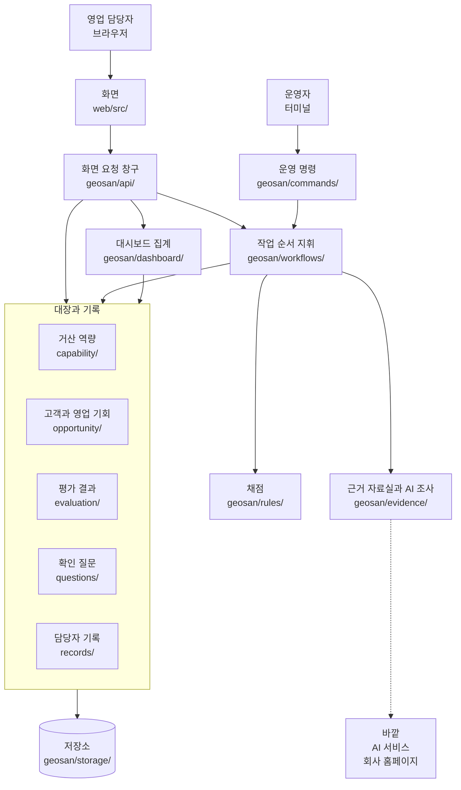
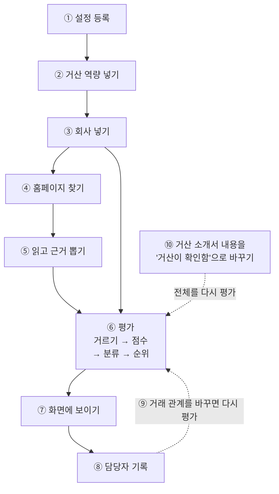
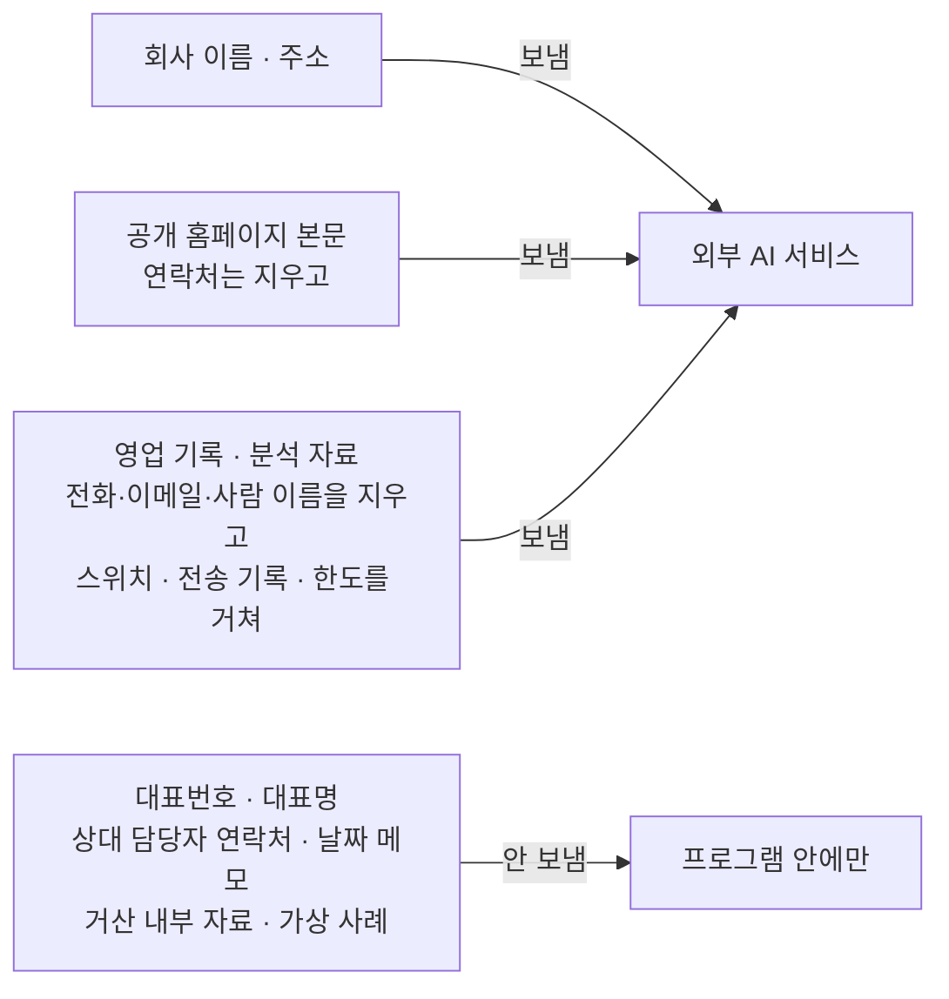

# 구조 지도 — 그 기능은 어느 폴더에 있나

> **기준일: 2026-11-29** (`develop` 줄기 기준) · [지도 입구로 돌아가기](README.md)

프로그램 안쪽이 어떻게 나뉘어 있는지 보여 줍니다. 이 문서에는 폴더 이름과 명령 이름이 그대로 나옵니다. 폴더 이름은 "주소"라서 바꿔 쓸 수 없기 때문이고, 옆에 쉬운 말을 붙였습니다.

- [1. 한 장 그림](#1-한-장-그림--어떻게-나뉘어-있나)
- [2. 자료가 흐르는 길](#2-자료가-흐르는-길)
- [3. 폴더표](#3-폴더표)
- [4. 화면이 서버에 요청하는 창구 56개](#4-화면이-서버에-요청하는-창구-56개)
- [5. 운영 명령 32개](#5-운영-명령-32개)
- [6. 저장 표 54개](#6-저장-표-54개)
- [7. 약속 파일 5개](#7-약속-파일-5개)
- [8. 밖으로 나가는 것과 안 나가는 것](#8-밖으로-나가는-것과-안-나가는-것)
- [9. 어긋난 곳](#9-어긋난-곳--pm-확인이-필요한-목록)

---

## 1. 한 장 그림 — 어떻게 나뉘어 있나

**그림을 글로 풀면**

1. **들어오는 문은 둘**입니다. 영업 담당자는 브라우저의 **화면**으로, 운영자는 터미널의 **운영 명령**으로 들어옵니다.
2. 화면은 직접 저장하지 못하고 반드시 **화면 요청 창구**를 거칩니다.
3. 여러 단계를 차례로 해야 하는 일(평가, AI 조사)은 **작업 순서 지휘**가 순서를 잡습니다.
4. **채점**은 계산만 합니다. 저장도, 바깥 연결도 하지 않습니다.
5. 바깥(AI 서비스, 회사 홈페이지)과 닿는 곳은 **근거 자료실** 한 곳뿐입니다.
6. 모든 자료는 맨 아래 **저장소** 한 곳에 쌓입니다.

**2026-11-14부터 PM이 모든 폴더를 맡아서**(역할표 1-0, #881) 이 지도에는 담당 칸을 두지 않습니다(2026-11-25 PM 지시). 폴더를 처음 만든 사람은 Git 기록과 역할표(`team-allocation.md` 1장, 11/3 기준)에서 봅니다.

---

## 2. 자료가 흐르는 길

자료가 들어와 화면에 보이고, 담당자의 기록이 다시 순위에 반영되기까지입니다.

| # | 무슨 일 | 어느 폴더 | 누가 시작하나 |
|---|---|---|---|
| ① | 규칙 숫자 파일과 앱 설정 파일을 검사하고 등록한다 | `geosan/config/` | 운영 명령 `init-db`, `check-config` |
| ② | 거산의 공정·인증·실적 파일을 검사하고 저장한다 | `geosan/capability/` | 운영 명령 `import-capability` |
| ③ | 회사 1곳을 파일 1개로 넣는다. 형식과 연락처를 검사한다. 또는 담당자가 공정·지역·산업을 고르면 AI가 공공자료에서 회사를 찾아 "점수 전"으로 등록한다(자세한 흐름은 [데이터 지도](data-map.md)) | `geosan/opportunity/` 외, `geosan/workflows/` | 운영 명령 `import-case`, 또는 화면의 [영업 후보로 더하기]·운영 명령 `ingest` |
| ④ | 회사 이름과 주소로 공식 홈페이지를 AI 웹 검색으로 찾는다 | `geosan/evidence/` | ③ 뒤에 자동, 운영 명령 `research`, 또는 상세의 [다시 조사] |
| ⑤ | 홈페이지를 읽고 연락처를 지운 뒤 AI가 근거 문장과 확인 질문을 뽑는다 | `geosan/evidence/`, `geosan/workflows/` | ④에 이어 자동 |
| ⑥ | 꼭 맞아야 하는 조건으로 거르고 → 점수 → 분류 → 순위를 정해 저장한다 | `geosan/workflows/` → `geosan/rules/` → `geosan/evaluation/` | 운영 명령 `evaluate`. ⑤·⑨·⑩ 뒤에는 자동 |
| ⑦ | 대시보드, 거래처 후보·관심 기업, 기업 검토 상세에 보여 준다 | `geosan/api/` → `web/src/` | 담당자가 화면을 열 때 |
| ⑧ | 의견, 영업 메모, 영업 단계, 일정, 검토사항 체크, 질문 답을 저장한다 | `geosan/api/` → `geosan/records/` | 화면 |
| ⑨ | 거래 관계를 바꾸면 이력을 남기고 그 회사를 다시 평가한다 | `geosan/opportunity/`, `geosan/api/` | 화면 |
| ⑩ | 소개서에서 온 거산 값을 "거산 확인 완료"로 바꾸고 전체를 다시 평가한다 | `geosan/capability/` | 운영 명령 `review-set` |

**꼭 알아 둘 두 가지**

- **담당자가 화면에서 순위를 바꾸는 길은 세 가지입니다.** 거래 관계 바꾸기, AI가 제안한 점수·공정 줄의 [확정]·[고치기]([#497]), 자료를 더 넣는 [붙여넣고 조사]·[다시 조사]입니다. 의견·메모·단계·일정·체크·답은 저장만 되고 순위는 그대로입니다. 다시 평가할 때는 그 회사만 점수를 다시 계산하고, 전체 순위는 함께 맞춥니다. 다른 회사의 점수는 그대로입니다 ([#296]에서 고침).
- **한 번의 일은 통째로 저장되거나 통째로 취소됩니다.** 중간에 실패하면 반만 저장되지 않습니다.

---

## 3. 폴더표

### 서버 (`geosan/`)

| 폴더 | 쉬운 말로 무슨 부서인가 | 고치기 전에 PM에게 말할 파일 |
|---|---|---|
| `config/` | 설정 접수 창구. 규칙 숫자와 앱 설정을 검사한다 | `errors.py` |
| `capability/` | 거산 역량 대장. 공정·인증·실적과 확인 기록 | — |
| `opportunity/` | 고객과 영업 기회 대장. 요구, 거래 관계 이력, 대표번호·대표명, 좌표, 기존 고객 참고 자료(꺼 둠), 이름으로 회사 넣기 | — |
| `evidence/` | 근거 자료실이자 바깥 조사 창구. 홈페이지 찾기·읽기·AI 추출 | — |
| `rules/` | 채점 부서. 계산만 한다 | `codes.py`, `models.py` |
| `evaluation/` | 평가 기록 보관소 | — |
| `questions/` | 확인 질문함. 질문과 답 | — |
| `records/` | 담당자 기록 대장. 의견·메모·단계·일정·검토 체크·관심 기업 표시, 상대 담당자 연락처와 열람 기록, 달력 날짜 메모, 순서 조정 제안, AI 분석 저장본 | — |
| `workflows/` | 작업 순서 지휘. 평가, AI 조사, 후보 찾기의 순서를 잡는다 | `models.py` |
| `commands/` | 운영 명령 창구. 터미널에서 치는 명령 | — |
| `api/` | 화면 요청 창구와 접속 보호(계정 로그인 포함). 영업 비서·영업 코치, PC의 AI 앱이 읽는 MCP 서버(`mcp_server.py`·`mcp_tools.py`)도 여기 있다. 창구마다 파일 하나(`routes/` — 예: 상대 담당자 연락처 `contacts.py`, 대표번호·대표명 고치기 `company_info.py`, 이름으로 회사 넣기 `companies.py`, 달력 메모 `day_memos.py`) | `schemas.py` |
| `dashboard/` | 영업 홈·영업 분석 집계. 기록을 세어 건수·패턴을 내고, 지도 점과 순서 조정 제안을 계산한다 | — |
| `storage/` | 저장소 연결 | — |

### 그 밖

| 폴더 | 무엇이 들어 있나 |
|---|---|
| `web/src/` | 화면. 쪽 파일 6개(주소로는 7화면: 영업 홈 · 거래처 후보 · 관심 기업 · 기업 상세 · 회사 보고서 · 영업 분석 · 운영 관리), 화면 부품 13묶음(예: 왼쪽 메뉴·달력 `components/frame/`, 일정 칸·날짜 메모 `components/schedule/`, 회사 보고서 `components/report/`), 화면에 쓰는 쉬운 말 대응표 |
| `contracts/` | 약속 파일 5개 ([7장](#7-약속-파일-5개)) |
| `migrations/` | 저장 표를 바꾼 이력 |
| `examples/` | 예시와 기준 파일(규칙 숫자, 앱 설정, 거산 역량, 가상 사례). `cases/`에 실제 기업 18곳 |
| `tests/` | 시나리오 검사와 세부 검사 |
| `scripts/` | PR 전에 돌리는 검사, 비밀값 검사, PR·이슈 연결 검사 |
| `demo/` | 10/29 방문 때 쓴 시연 자료 |
| `docs/` | 안내서, 방문 자료, 발표 메모, 작업 지시서, 이 지도 |
| `aidlc/` | 설계와 승인 기록 |

---

## 4. 화면이 서버에 요청하는 창구 56개

"창구(API)"는 화면이 서버에 "이것 주세요 / 이것 저장해 주세요"라고 요청하는 정해진 문입니다. 주소 앞에는 모두 `/api/v1`이 붙습니다. 주소 하나를 창구 하나로 셉니다. 같은 주소로 보기와 저장을 둘 다 하는 곳이 4개라(날짜 메모 · 상대 담당자 연락처 · 순서 조정 제안 · AI 분석) 요청 종류로 세면 60개입니다.

**11/14에 있던 24개**

| 종류 | 주소 | 화면에서 언제 쓰나 |
|---|---|---|
| 보기 | `/config/ui` | 화면을 열 때 담당자 목록과 화면 설정을 받는다 |
| 보기 | `/dashboard` | 영업 홈의 건수·일정·최근 기록을 받는다(11/20 전 이름 "대시보드") |
| 보기 | `/ingest/preview` | 후보 찾기 조건을 고르면 맞는 공장 수를 받는다. 저장된 AI 판단만 세어 비용이 들지 않는다 |
| 보기 | `/opportunities` | 거래처 후보·관심 기업 목록을 받는다(관심 기업은 `bookmarked=true`) |
| 보기 | `/opportunities/{회사}` | 기업 검토 상세를 받는다 |
| 보기 | `/opportunities/{회사}/activity` | 활동 이력을 받는다 |
| 보기 | `/opportunities/{회사}/peers` | 같은 공정·산업군의 다른 회사 최대 5곳과 건수 요약을 받는다([#268]) |
| 보기 | `/dashboard/map` | 영업 홈 지도에 찍을 회사 점과 거리 원을 받는다 |
| 보기 | `/sales-analysis` | 영업 분석 화면의 공정별·회사별 표를 받는다 |
| 보기 | `/sales-questions` | 접촉 기록에 쓰는 꼬리 질문 묶음을 받는다 |
| 보기 | `/export/xlsx` | 지금 걸러 본 추천 목록을 내부용 엑셀로 받는다(설정으로 꺼 둠) |
| 저장 | `/session` | 접속 화면에서 비밀번호(계정이 있으면 아이디·비밀번호)를 확인한다 |
| 저장 | `/ingest` | 고른 조건으로 후보 찾기를 시작한다 |
| 저장 | `/opportunities/{회사}/bookmark` | 관심 기업으로 표시하거나 푼다 |
| 저장 | `/opportunities/{회사}/homepage` | 홈페이지를 확인하거나 다시 조사한다 |
| 저장 | `/opportunities/{회사}/industries` | AI가 제안한 산업군을 확정하거나 고친다([#646]) |
| 저장 | `/opportunities/{회사}/opinions` | 담당자 검토 의견을 저장한다 |
| 저장 | `/opportunities/{회사}/notes` | 영업 메모·전달 사항을 저장한다 |
| 저장 | `/opportunities/{회사}/outcomes` | 접촉 시도, 영업 단계(거절 이유 포함), 다음 일정을 저장한다 |
| 저장 | `/opportunities/{회사}/records/{기록}/cancel` | 잘못 저장한 메모·영업 기록을 지우지 않고 "잘못 입력"으로 표시한다([#253]) |
| 저장 | `/opportunities/{회사}/relation` | 거래 관계를 저장하고 다시 평가한다. 단추는 11/13에 화면에서 뺐고 창구만 남았다 |
| 저장 | `/opportunities/{회사}/review-items/{줄}/check` | 검토사항 줄에 확인 표시를 한다 |
| 저장 | `/opportunities/{회사}/main-phone/confirm` | 대표번호가 맞다고 확인한다 |
| 저장 | `/questions/{질문}/reply` | 검토사항 질문에 들은 답을 저장한다 |

**11/14 뒤 더한 32개** (모두 약속 파일에 먼저 적고 만들었다)

| 종류 | 주소 | 화면에서 언제 쓰나 |
|---|---|---|
| 보기 | `/assistant/daily` | [영업 홈 › 맨 위 "오늘 브리핑"] 영업 비서의 하루 한 번 아침 정리를 받는다([#743]) |
| 보기 | `/menu-badges` | [왼쪽 메뉴 › 숫자] 새로 생긴 곳 수와 "의견 전 3" 같은 숫자를 받는다([#770] [#987]) |
| 보기 | `/operations` | [운영 관리 화면] AI 사용액·자료 기준일·연락처 열람 기록을 받는다. 운영 담당만([#799] [#980]) |
| 보기 | `/companies/lookup` | [새 후보 발굴 › 이름으로 회사 넣기] 이름으로 목록·공장 자료를 찾는다. 바깥 호출 없음([#948]) |
| 보기 | `/existing-customers/suggestions` | [거래처 후보 › "기존 고객과 닮은 조건 [적용]"] 꺼 둔 확장 기능([#932]) |
| 보기 | `/sales-analysis/patterns` | [영업 분석 › "기록에서 배우기"] 실패·성공 패턴을 센 표를 받는다([#802]) |
| 보기 | `/sales-analysis/feedback/history` | [영업 분석 › "지난 분석" 탭] 받았던 AI 분석 목록([#918]) |
| 보기 | `/sales-analysis/feedback/history/{분석}` | 지난 분석 한 건을 그대로 연다([#918]) |
| 보기·저장 | `/sales-analysis/feedback` | [영업 분석 › AI 분석 피드백] 저장된 분석을 보고, [AI 분석 받기]로 새로 받는다([#824]) |
| 보기·저장 | `/day-memos` | [왼쪽 달력 › 날짜 누름] 그날 메모를 읽고 200자 메모를 남긴다([#984]) |
| 보기·저장 | `/opportunities/{회사}/contacts` | [기업 상세 › 상대 담당자 연락처] 가린 연락처를 받고 새로 적는다([#980]) |
| 보기·저장 | `/preferences` | [영업 분석 › 순서 조정 제안] 담당자가 반복해 고른 조합의 제안을 보고 관리자가 승인한다([#943]) |
| 저장 | `/assistant/ask` | [오른쪽 💬 영업 코치 칸] 영업 홈·거래처 후보·관심 기업·영업 분석에서 물은 것에 답한다([#680] [#774]) |
| 저장 | `/companies` | [새 후보 발굴 › 이름으로 회사 넣기] 찾은 회사 1곳을 AI 고르기 없이 관심 기업으로 넣는다([#948]) |
| 저장 | `/day-memos/{메모}` (지우기) | 내가 쓴 날짜 메모를 지운다. 행은 남기고 숨긴다([#984]) |
| 저장 | `/notes/{메모}/confirm` | [기업 상세 › 전달 사항] 받는 사람이 [확인했어요]를 누른다([#771]) |
| 저장 | `/notes/{메모}/reveal` | 메모 글 속 "[번호 가림]"을 확인 문구 체크 뒤 열고 열람 기록을 남긴다([#980]) |
| 저장 | `/opportunities/{회사}/assistant/coach` | [기업 상세 › 영업 코치] 메모 [보내기]로 피드백·빠진 질문·다음 통화 준비를 받는다. 저장은 담당자가 [이대로 저장]할 때만([#742] [#750] [#916]) |
| 저장 | `/opportunities/{회사}/assistant/call-prep` | 통화 준비. 11/14에 영업 코치로 합쳐 화면에서 뺐고 창구만 남았다([#742]) |
| 저장 | `/opportunities/{회사}/assistant/memo-read` | AI가 메모 읽기. 11/14에 화면에서 뺐고 창구만 남았다([#742]) |
| 저장 | `/opportunities/{회사}/company-info` | [기업 상세 › 한눈에 › [고치기]] 주소·회사 이름(직접 넣은 회사만)·대표번호·대표명을 고친다([#958] [#980]) |
| 저장 | `/opportunities/{회사}/contacts/{연락처}` | 상대 담당자 연락처를 고친다([#980]) |
| 저장 | `/opportunities/{회사}/contacts/{연락처}/reveal` | 확인 문구에 체크한 뒤 가린 번호를 열고 열람 기록을 남긴다([#980]) |
| 저장 | `/opportunities/{회사}/contacts/{연락처}/delete` | 상대 담당자 연락처를 지운다([#980]) |
| 저장 | `/opportunities/{회사}/contacts/{연락처}/keep` | 보관 1년이 다가와 영업 홈에서 물을 때 "1년 더 보관"을 고른다([#980]) |
| 저장 | `/opportunities/{회사}/material` | [기업 상세 › 한눈에 › 소재 [고치기]] 소재를 고친다([#958]) |
| 저장 | `/opportunities/{회사}/processes` | [기업 상세 › 한눈에 › 공정 [고치기]] 공정을 고친다([#847]) |
| 저장 | `/opportunities/{회사}/schedule` | 다음 일정만 잡거나 바꾼다. 영업 코치 [넣기], 영업 홈 표, 기업 상세 코치 맨 위 "다음 일정" 칸([#774] [#983] [#980]) |
| 저장 | `/opportunities/{회사}/schedule/resolve` | [영업 홈 › 지난 일정 — 했나요?] [완료]·[날짜 바꾸기]·[필요 없어요]로 정리한다([#766]) |
| 저장 | `/preferences/{제안}/revoke` | 승인한 순서 조정을 거둔다([#943]) |
| 저장 | `/session/profile` | 계정으로 처음 로그인할 때 화면에 보일 이름을 적는다([#754]) |
| 저장 | `/session/logout` | 로그아웃([#754]) |

약속에 없는 창구는 만들지 않습니다. 필요하면 PM에게 먼저 묻고 약속 파일에 먼저 적습니다.

**약속 파일과 서버가 같은지** — 2026-11-29에 서버 코드가 만드는 창구 목록과 약속 파일(`contracts/openapi.json`)을 견줘 보니 56개 주소(요청 종류 60개)가 똑같았습니다.

---

## 5. 운영 명령 32개

터미널에서 `geosan 명령이름`으로 실행합니다.

| 명령 | 무엇을 하나 | 누가 언제 쓰나 |
|---|---|---|
| `init-db` | 저장소를 만들고 표를 최신으로 맞춘다 | 운영자, 처음과 갱신 때 |
| `check-config` | 규칙 숫자·앱 설정 파일을 검사하고 등록한다 | 운영자, 설정을 바꿀 때 |
| `serve` | 서버를 띄운다 | 운영자 |
| `import-capability` | 거산 역량 파일을 넣는다 | PM, 역량 파일이 바뀔 때 |
| `import-case` | 회사 파일을 넣는다. 자동 조사가 켜져 있으면 바로 조사한다 | PM·팀원, 회사를 넣을 때 |
| `check-case` | 저장하지 않고 회사 파일의 형식과 연락처만 검사한다 | 팀원, 회사 파일을 쓴 뒤 |
| `evaluate` | 평가를 실행한다 | 운영자, 넣기·설정 변경 뒤 |
| `verify-case` | 평가 결과가 회사 파일에 적은 기대값과 같은지 본다 | PM, 가상 사례(A정밀) 검증 |
| `dataset-set` | 쓰고 있는 거산 값 묶음을 바꾼다 | PM |
| `review-set` | 거산 값을 "확인 완료"로 바꾸고 다시 평가한다 | PM, 거산 확인 뒤 |
| `research` | 홈페이지가 없는 회사를 한꺼번에 찾고, 뽑고, 다시 평가한다 | 운영자, 회사를 넣은 뒤 |
| `ingest` | 고른 공정·지역·산업으로 공공자료에서 후보 회사를 찾아 목록에 더한다 | 운영자. 화면의 [영업 후보로 더하기]와 같은 일 |
| `source-confirm` | 공공 자료의 이용·저장 조건을 확인했다는 기록을 남긴다 | PM, 새 공공 자료를 쓰기 전 |
| `source-load` | 팩토리온 공장조회·수질 명단 파일을 넣고 목록 회사에 공장 정보·표면처리 표시를 붙인다 | 운영자, 파일을 새로 받았을 때 |
| `backup` | 지금 저장소를 파일 하나로 복사해 둔다. 서버가 켜져 있어도 된다 | 운영자, 올리기 전과 정기적으로 |
| `restore` | 서버를 멈춘 상태에서 백업 파일로 되돌린다. 지금 저장소는 먼저 따로 보관한다 | 운영자, 되돌릴 때 |
| `cost` | 이번 달 AI 사용 횟수와 비용, 한도를 본다 | PM |
| `transfer-unblock` | 사용량을 못 받아 막힌 AI 호출을 정리한다 | PM, 막혔을 때 |
| `export-contracts` | 코드에서 창구 약속 파일을 다시 만든다 | 사람이 직접 실행할 때만 |
| `demo-report` | 화면 없이 순위표·근거·사실표를 뽑는다 | PM, 시연 자료 |
| `geocode` | 위치 자료와 공공 조회로 회사 좌표를 확인하고 공공좌표만 저장한다(거리 계산용, [#222]) | 운영자, 회사가 새로 들어온 뒤 |
| `seed-demo-records` | 발표 시연용 DB에 가상 영업 기록을 넣는다. 시연 표시가 있는 DB에서만 되고 실제 DB에서는 거부한다([#274]) | PM, 발표 준비 때 |
| `db merge-heads` | 표 변경 이력이 두 갈래가 됐을 때 합친다 | 개발자, PR을 합친 뒤 필요할 때 |
| `copy-without-records` | 배포용 DB를 만든다. 지금 DB를 복사하고 사본에서만 시험 영업 기록·AI 전송 기록을 지운다([#753]) | PM, 배포 DB를 새로 만들 때 |
| `staff-add` | 담당자 계정을 만들고 임시 비밀번호를 한 번 보여 준다. 이름은 각자 첫 로그인 때 적는다([#754]) | PM, 사람이 늘 때 |
| `staff-reset` | 새 임시 비밀번호를 만들고 그 계정의 접속을 끊는다([#754]) | PM, 비밀번호를 잊었을 때 |
| `staff-list` | 계정 목록(아이디·역할·이름·첫 로그인 여부·막힘)을 본다([#754]) | PM |
| `staff-disable` | 계정을 막거나 다시 연다([#754]) | PM |
| `staff-role` | 계정 종류를 담당자 ↔ 보기 전용으로 바꾼다([#862]) | PM |
| `supply-tier` | 공급망 위치(1차 / 2·3차 가공)가 빈 회사를 AI로 판단한다. 비용이 든다([#860] [#886]) | 운영자, 회사가 새로 들어온 뒤 |
| `mcp` | PC의 AI 앱(Claude 앱 등)이 영업 기록을 지운 사본으로 읽는 MCP 서버를 띄운다. 읽기 전용, 배포 서버에는 열지 않는다([#927]) | PM, PC에서만 |
| `customer-load` | 검증된 기존 고객 파일을 통째로 바꿔 넣는다. 꺼 둔 확장 기능([#932]) | PM, 거산이 요청해 켤 때만 |

**약속에는 있고 아직 만들지 않은 명령 2개**

| 명령 | 무엇을 할 예정인가 | 이슈 |
|---|---|---|
| `merge-list`, `merge-confirm` | 같은 회사일 수 있는 후보를 보고 합친다 | [#221] (11/14 닫힘. 이 두 명령을 맡는 열린 이슈는 없음 — [9장](#9-어긋난-곳--pm-확인이-필요한-목록)) |

---

## 6. 저장 표 54개

"표"는 자료를 쌓아 두는 장부 한 권입니다. 이름 앞머리로 어느 부서 장부인지 알 수 있습니다.

| 앞머리 | 표 수 | 무엇을 담나 |
|---|---|---|
| `cfg_` | 2 | 규칙 숫자 설정의 판, 앱 설정 사본 |
| `cap_` | 7 | 거산 공정, 세부 역량, 납품 실적, 인증, 적용 범위, 상태 이력, 확인 기록 |
| `opp_` | 10 | 고객, 영업 기회, 거래 관계 이력, 접촉 이력, 발견 경로, 공정 연결, 고객 요구, 시점 신호, 후보 찾기 회차, 같은 회사일 수 있어 확인이 필요한 후보. 고객 표에 대표명과 그 출처 칸이 더해짐([#980]) |
| `src_` | 10 | 후보 찾기 재료: 읽어 둔 공장 행, AI가 행마다 내린 판단, 단지 조회 기록, 웹 검색 실행과 찾은 회사, 소스 이용 확인, 수집 집계, 팩토리온 공장 정보, 수질 명단 사업장([#573]), 기존 고객 참고 자료(꺼 둔 확장 기능, [#932]). 팩토리온 공장 정보에 회사 전화번호, 공장 행에 대표자명 칸이 더해짐([#980]). 웹 검색 갈래는 만들어 켰고 배포 뒤 결과를 본다([#314]) |
| `ev_` | 1 | 근거 자료 |
| `eval_` | 7 | 평가 묶음, 평가 결과, 항목 판정, 요구 판정, 판정과 근거 연결, 점수 입력, 기한 체크 |
| `q_` | 3 | 확인 질문, 질문과 기회 연결, 조사 요건 |
| `rec_` | 11 | 영업 메모, 단계·접촉·일정, 접촉 기록의 꼬리 질문 답, 검토사항 체크, 담당자 의견, 관심 기업 표시. 메모와 단계·접촉·일정에는 "잘못 입력" 표시 칸이 있고 행은 지우지 않는다. 11/14 뒤 더한 것: AI 분석 저장본([#824]), 순서 조정 제안([#943]), 상대 담당자 연락처와 그 열람 기록([#980]), 달력 날짜 메모([#984]) |
| `tg_` | 1 | 외부 AI 호출 기록(횟수·비용). 보낸 본문은 저장하지 않음. 후보 판단처럼 영업 기회가 생기기 전의 호출은 회차 번호로 남김 |
| `web_` | 2 | 접속 상태와 비밀번호 실패 횟수, 담당자 계정([#754]) |

**연락처·이름이 담기는 곳은 네 군데**입니다. ① 회사 대표번호(고객 표, 팩토리온 공장 정보 — 휴대폰 번호는 버림) ② 회사 대표명(고객 표, 공장 행) ③ 담당자가 직접 적은 상대 담당자 연락처(가려서 보이고 열 때마다 열람 기록, 1년 보관 뒤 확인하고 지움) ④ 영업 메모(화면에서는 글 속 번호를 가림). ①④는 2026-11-03, ②③은 2026-11-28([#980]) PM 결정으로 허용했고, 밖으로는 내보내지 않습니다([8장](#8-밖으로-나가는-것과-안-나가는-것)).

---

## 7. 약속 파일 5개

"약속 파일"은 "이 모양으로만 주고받는다"고 정해 둔 파일입니다. `contracts/` 폴더에 있고 PM 확인 없이 고치지 않습니다.

| 파일 | 무엇을 약속하나 |
|---|---|
| `openapi.json` | 화면이 서버에 요청하는 창구 56개의 주소와 주고받는 모양 |
| `case-file.schema.json` | 회사 파일의 칸과 허용 값. 모르는 칸과 연락처는 거부 |
| `capability-file.schema.json` | 거산 역량 파일의 칸 |
| `rule-config.schema.json` | 규칙 숫자 파일의 칸 |
| `app-settings.schema.json` | 앱 설정 파일의 칸. 비밀번호·키 칸은 거부 |

약속의 뜻을 글로 풀어 쓴 문서는 설계 기록 폴더의 약속 요약(`contract-summary.md`)입니다.

---

## 8. 밖으로 나가는 것과 안 나가는 것

**그림을 글로 풀면**

- **보내는 것** — 홈페이지를 찾을 때는 회사 이름과 주소만, 근거를 뽑을 때는 공개 홈페이지 본문만 보냅니다. 보내기 전에 연락처를 지웁니다.
- **후보 찾기에서 보내는 것** — 공공자료 공장 행의 회사명·생산품·원자재·업종 같은 공개 값만 보냅니다. 웹 검색어에는 담당자가 고른 공정·지역·산업의 이름만 넣습니다.
- **영업 기록 (2026-11-13 PM 결정 [#681], 분석 자료까지 넓힘 2026-11-17 [#821])** — 접촉 기록·꼬리 질문 답·영업 결과·거절 이유·영업 메모와, 그것을 센 분석 자료는 외부 AI에 보낼 수 있습니다. 메모 속 전화·이메일·사람 이름을 지운 뒤에만, 설정 스위치가 켜져 있을 때만(예시 설정은 꺼 둠), 전송 기록을 남기고 월 비용 한도 안에서 보냅니다. 11/14 뒤 이 길을 쓰는 기능: 기업 상세 영업 코치(지운 메모 사본, [#742] [#916]), 영업 홈·목록의 영업 코치 칸(메모 글은 보내지 않고 고른 값만, [#680]), 영업 분석 [AI 분석 받기] 단추([#824]), PC의 AI 앱이 읽는 MCP 서버(지운 사본만, 월 비용 대신 하루 200회 한도, [#927]). 계속·깊이 쓰게 될 때의 대책은 [영업 기록을 외부 AI로 보내는 범위와 대책](../ai-records-policy.md)에 있습니다.
- **안 보내는 것** — 연락처(전화·이메일·사람 이름), 회사 대표번호, **회사 대표명, 상대 담당자 연락처**(외부 AI·엑셀·회사 보고서·MCP 어디로도 나가지 않음, [#980]), 달력 날짜 메모(AI 정리도 하지 않음, [#984]), 거산 역량 값 같은 거산 내부 자료, 가상 사례는 보내지 않습니다. 재접촉 흐름은 만들지 않기로 해서 보낼 재접촉 자료가 없습니다.
- **바깥과 닿는 곳** — 내용을 보내는 바깥 AI 서비스는 하나입니다. 그 밖에는 회사 홈페이지를 직접 읽고(공개 주소만, 그 사이트의 수집 제한을 지킴), 공공 조회(산단공 공장등록 조회, 주소·좌표 조회)를 부르며, 좌표를 못 찾은 회사는 네이버 조회로 보완하되 그 결과는 저장하지 않습니다([#222]).
- **한도** — 하루 200회, 월 2,000회(11/14 영업 코치 몫으로 1,000에서 올림, [#742]), 월 20달러를 넘는지 부르기 전에 검사합니다. 숫자는 예시 설정 값이고, 기본 설정은 "바깥 호출 안 함"입니다.
- **올려 두는 곳** — 화면과 서버를 두 서비스에 나눠 11/18 새벽(한국 시각)에 처음 올렸습니다([#213] 닫음). 키와 비밀번호는 코드가 아니라 환경 설정에만 둡니다.

---

## 9. 어긋난 곳 — PM 확인이 필요한 목록

지도를 만들면서 **서로 다르게 적힌 곳**을 찾은 대로 적었습니다. 어느 쪽이 맞는지 여기서 정하지 않았고, 아무것도 고치지 않았습니다. 정리되면 줄을 지웁니다.

### 가. 이슈와 코드가 다른 곳

| 어디 | 무엇이 다른가 |
|---|---|
| [구조 지도 5장 › 약속에만 있는 명령 `merge-list`·`merge-confirm`] | 약속 요약(운영 명령 장)에는 있고 코드에는 없다. 맡던 [#221]이 닫혀 이 두 명령을 맡은 열린 이슈가 없다. 화면에서 "같은 회사일 수 있음" 후보를 합칠 길도 없다. 만들지, 약속에서 뺄지 PM 확인 필요 |

### 나. 문서와 코드가 다른 곳

| 문서에 적힌 것 | 실제 |
|---|---|
| `README.md` 4장: "운영 명령 9개" | 32개 |
| `README.md` 4장 폴더표에 `geosan/dashboard/`가 없음 | 폴더가 있음 |
| `README.md` 4장: `evidence/`는 "근거 자료 최소형" | 홈페이지 찾기·읽기·AI 추출까지 들어 있음 |
| `README.md` 4장: `records/`는 "담당자 의견" | 의견·메모·단계·일정·검토 체크 |
| `README.md` 4장: "예시 파일 5개" | 7개와 실제 기업 18곳 |
| `README.md` 4장: "연락처는 어디에도 저장하지 않습니다" | 대표번호·대표명 칸, 상대 담당자 연락처 표, 영업 메모에 저장함 (11/3·11/28 PM 결정, [#980]) |
| `README.md` 2장: 일부 명령은 "아직 구현되지 않았습니다" | 등록된 명령은 모두 동작하도록 만들어져 있음 |
| 자동 검사의 "뼈대 검증" 단계: 실패를 한동안 허용한다 | 시나리오 검사는 2026-11-10에 필수로 바뀌었고([#527]), 뼈대 검증 단계의 허용 설정만 검사 스크립트와 자동 검사에 남아 있음(2026-11-29에도 그대로). 걷어낼 때가 됐는지 확인 필요 |
| `README.md` 5장: 뼈대(U1) 설계 문서만 안내 | 코드는 AI 조사·기록·대시보드·접속 보호까지 들어와 있음 |
| 화면 안내문: "답 기록 기능은 11월에 들어갑니다" | 답 적기가 이미 들어감 |
| 약속 요약의 채용 공고 근거 줄 세 곳(설정 `research.hiringSignal`, 바깥 서비스 `HiringSignalFinder`, 변경 기록의 2026-11-05 밤 줄): "만들기는 후보 찾기 다음" | 채용 공고는 연결하지 않기로 함(PM 결정 2026-11-13, [#315] 닫음). 코드와 예시 설정에도 그 칸이 없음. 2026-11-14([#722])에는 나라장터 줄 두 곳에만 "연결하지 않기로 함"을 덧붙였고 채용 줄은 건드리지 않았다. 덧붙일지는 PM 확인 필요 |
| 규칙 BR8.2: 같은 질문을 다시 쓸 때 처음 만든 평가 번호를 보존한다 | 질문 저장 코드는 다시 저장할 때 전달받은 새 평가 번호로 바꾼다. #71의 규칙 번호 대조 중 확인했으며, 저장 동작을 어떻게 맞출지는 PM 확인 필요 |

### 다. 문서끼리 다른 곳

| 무엇 | 한쪽 | 다른 쪽 |
|---|---|---|
| 영업 메모의 연락처 | 작업 단위 문서: "연락처면 저장 거부" | 연락처 규칙 변경 문서: "허용" |
| 엑셀 내려받기 시기 | 범위 문서·작업 단위 문서: 1차 | 11/3 결정과 [#217]: 2차 |
| 올려 두는 모양 | 작업 단위 문서와 [#213] 제목: "한 덩어리" | 배포 결정 문서: 화면과 서버를 나눔 |
| 합치는 방식 | 구현 묶음 계획: "스쿼시 커밋" | 10/22 결정: merge commit |
| 첫 올리기 날짜 | 팀 규칙 파일: 11/6까지 | 11/3 갱신: 11/10까지 |
| 문서 맨 위 상태 줄 | 거리·지도 제안: "초안, PM 결정 대기" | 같은 문서 7장: 모두 PM 확정 |
| 화면 이름 | 이슈·설계 문서: "추천 목록", "추천 이유·막는 조건·다음 할 일" | 화면: "거래처 후보"(11/24부터, 11/16~11/24 "신규 거래처 찾기", 그 전 "영업 후보 목록"), 목록 줄 가운데 칸 "추천 이유"(11/28 [#987]), 상세 "왜 이 회사인가"·"통화에서 확인할 것" |
| 영업 단계 이름 | 대시보드 카드: "접촉 중" | 목록·상세 꼬리표: "접촉" |
| 작업 단위 U9·U10·U11 | 작업 단위 문서에는 계획이 있음 | 일부 일은 다른 단위로 옮겨졌고, 나머지는 이슈를 찾지 못함 |

---

기술 메모 (확인한 방법과 근거 파일)

- 2026-11-29 갱신([#993], 기준 커밋 `0165799a`). 11/14 지도 갱신(커밋 `54aa62a8`) 뒤 합쳐진 PR 125개를 출발점으로 다시 셌다.
- 창구 56개: `contracts/openapi.json`의 주소 수(요청 종류로는 60개). 서버 코드(`geosan/api/app.py`가 등록한 창구 묶음 21개 + 후보 찾기 묶음)가 만드는 목록과 견줘 56개·60개가 똑같았다. 그래서 2026-11-06에 적었던 "목록 조건이 약속 파일에 없음" 줄을 9장에서 지웠다.
- 명령 32개: `geosan/commands/app.py`에 등록된 명령 31개와 `db merge-heads`. 11/14보다 9개(`copy-without-records`, `staff-add`·`staff-reset`·`staff-list`·`staff-disable`·`staff-role`, `supply-tier`, `mcp`, `customer-load`)가 늘었다.
- 표 54개: 이번에는 DB가 아니라 코드의 표 목록(`geosan/storage/metadata.py`의 `table_names()`)으로 셌다(`cap` 7 · `cfg` 2 · `ev` 1 · `eval` 7 · `opp` 10 · `q` 3 · `rec` 11 · `src` 10 · `tg` 1 · `web` 2). 11/14보다 7개: `rec_analysis_feedback`, `rec_preference`, `rec_contact_person`, `rec_contact_reveal`, `rec_day_memo`, `src_existing_customer`, `web_staff_account`. 표 변경 이력의 마지막은 `rec_021`(달력 날짜 메모).
- 9장 "나"에서 `AGENTS.md` 담당 폴더 줄을 지웠다: `AGENTS.md`가 2026-11-14부터 PM이 모든 폴더를 맡는다고 적고, Part C·D·E 분담을 10/21~11/13 기록으로 돌렸다(#881).
- 뼈대 검증 허용 설정: `scripts/check.sh` 78·122행, `.github/workflows/check.yml` 136행(2026-11-29).
- 목록 화면 이름: `web/src/labels/ko.ts`의 `menuOpportunities`·`pageTitleList`가 "거래처 후보"(커밋 `eb782003`, 2026-11-24).
- 실행해서 확인한 것: 서버 코드를 불러 창구 목록을 만들어 약속 파일과 견준 것, 명령 도움말(`--help`) 목록, 표 목록. 서버를 띄우거나 DB를 읽지는 않았다.
- 2026-11-14 갱신에서 다시 확인한 것: 창구 수, 명령 수, 9장의 [#249] 이슈 상태, 시연용 DB로 배포 환경에서 서버가 시작되지 않는 것(`geosan/commands/serve.py`), 9장에 새로 더한 다섯 줄. 저장 표 수와 나머지 줄은 다시 세지 않았다.
- 기준: `develop` 줄기의 2026-11-12 상태(커밋 `8cb7e48`). 9장의 줄 가운데 이번에 다시 확인한 것은 이슈 상태, 명령 수, 검사 허용 설정, 화면 안내문이고, 나머지 줄은 2026-11-06에 확인한 그대로다.
- 명령 23개: `geosan/commands/app.py`에 등록된 명령 22개와 `db merge-heads`(2026-11-14). 전보다 `geocode`·`seed-demo-records` 두 개가 늘었다.
- 표 47개: 2026-11-13 PM PC의 DB에서 표 이름을 앞머리별로 셈(`cap` 7 · `cfg` 2 · `ev` 1 · `eval` 7 · `opp` 10 · `q` 3 · `rec` 6 · `src` 9 · `tg` 1 · `web` 1). 꼬리 질문 답 표 1개가 더해짐([#607]). 2026-11-06 [#327]에서 후보 찾기 표 9개, 그 뒤 관심 기업 표시 1개와 보조 자료 2개([#573])가 더해짐.
- 창구 24개: `contracts/openapi.json`의 경로(2026-11-14). 산업군 확정 창구가 늘었다.
- 다시 평가를 부르는 곳 3군데: `geosan/api/routes/records.py`(거래 관계), `geosan/commands/review_set.py`, `geosan/workflows/flow_extract.py`.
- 대표번호 칸: `geosan/opportunity/models.py`의 `main_phone` 외 4칸.
- 검사 허용 설정: `scripts/check.sh` 33·44행, `.github/workflows/check.yml` 46·51행.
- 한도 숫자: `README.md` 2장.
- 실행해서 확인한 것은 없다. 코드와 문서를 읽어 확인했다.
- 2026-11-06에 "다. 문서끼리 다른 곳"에서 "연락처 규칙" 줄을 지웠다. 프로젝트 규칙 파일(`aidlc/spaces/default/memory/project.md`)의 연락처 줄이 11/3 결정(회사 대표번호 저장, 영업 메모에 허용)에 맞게 고쳐졌다(PM 승인 2026-11-06, `AGENTS.md` "바깥 자료 규칙" 끝 줄).
- #71 규칙 번호 대조(2026-11-05): `functional-design/rules.md` BR8.2와 `geosan/questions/store.py`의 `source_eval_id` 대입, `geosan/workflows/flow_evaluate.py`의 새 평가 번호 전달을 비교했다. 저장 코드·약속 파일은 바꾸지 않았다.

[#213]: https://github.com/agent-ddalgi-team/final-geosan/issues/213
[#217]: https://github.com/agent-ddalgi-team/final-geosan/issues/217
[#221]: https://github.com/agent-ddalgi-team/final-geosan/issues/221
[#222]: https://github.com/agent-ddalgi-team/final-geosan/issues/222
[#249]: https://github.com/agent-ddalgi-team/final-geosan/issues/249
[#296]: https://github.com/agent-ddalgi-team/final-geosan/issues/296
[#327]: https://github.com/agent-ddalgi-team/final-geosan/issues/327
[#253]: https://github.com/agent-ddalgi-team/final-geosan/issues/253
[#259]: https://github.com/agent-ddalgi-team/final-geosan/issues/259
[#268]: https://github.com/agent-ddalgi-team/final-geosan/issues/268
[#314]: https://github.com/agent-ddalgi-team/final-geosan/issues/314
[#497]: https://github.com/agent-ddalgi-team/final-geosan/issues/497
[#527]: https://github.com/agent-ddalgi-team/final-geosan/issues/527
[#573]: https://github.com/agent-ddalgi-team/final-geosan/issues/573
[#594]: https://github.com/agent-ddalgi-team/final-geosan/issues/594
[#605]: https://github.com/agent-ddalgi-team/final-geosan/issues/605

### 2026-11-13 좌표 서버 작업 중 (#651, 상위 #222)

- `geosan/opportunity/geo*`·`location_csv.py`: CSV 대조, 외부 좌표 조회, 공공좌표 저장, 실시간 거리 계산.
- `geosan/commands/geocode.py`: 좌표 없는 회사의 처리 명령. API는 카드·상세 거리 값만 연결하며 지도 서버(#642)·화면(#641)은 별도다.
- 기존 설계의 “지오코딩은 행안부만 사용” 문장은 11/13 확인으로 변경됐다. 네이버 결과는 저장하지 않는다. 브라우저 지도 SDK의 Service 호출 금지는 유지한다.
- 로컬 DB의 공공좌표 저장과 실제 상세 화면 거리 표시를 확인했다. 네이버 실제 조회·주소 대조·비저장도 확인했으며, 지도 표시·거리 필터 화면은 이 작업에 포함하지 않는다.

- 2026-11-13 확인 후 `merge_002`로 공공좌표(`opp_010`)와 잘못 입력 표시(`rec_013`) 두 이관을 보존했다. 두 기존 버전에서 각각 올려도 업무 데이터와 좌표·표시가 남는 검사를 추가했다.

### 2026-11-13 지도 데이터 서버 (#642)

- `geosan/api/routes/dashboard.py`의 `GET /api/v1/dashboard/map`: 기존 접속 보호와 지도 전용 응답. 화면은 #641에서 연결.
- `geosan/dashboard/map_points.py`: 관심·진행·올해 성공을 고르고, 공유 좌표 처리로 공공자료 재사용·네이버 실시간 보완·거리 계산. 대시보드 막대의 최근 12개월과 구분한다.

### 2026-11-13 목록 거리 서버 (#658)

- `geosan/api/routes/opportunities.py`: 전체 대상의 거리를 구한 뒤 거리 조건·정렬·페이지 나누기. 기존 점수·기본 추천 순은 유지한다.
- `geosan/api/routes/export.py`: 실시간 네이버 결과로 정한 거리 순서·범위가 파일로 남지 않도록, 기존에 지원하지 않던 거리 조건 내보내기는 계속 거부한다.
- **화면과 차이**: 서버는 가까운 순·거리 조건을 지원하지만 화면은 아직 준비 중이다. 뒤에 연결한다. (2026-11-29 확인: 11/13 [#666]에서 화면에 연결됨, 기능 지도 "목록 › 거리" 줄 참고)
[#607]: https://github.com/agent-ddalgi-team/final-geosan/issues/607
[#681]: https://github.com/agent-ddalgi-team/final-geosan/issues/681
[#646]: https://github.com/agent-ddalgi-team/final-geosan/issues/646
[#274]: https://github.com/agent-ddalgi-team/final-geosan/issues/274
[#685]: https://github.com/agent-ddalgi-team/final-geosan/issues/685
[#722]: https://github.com/agent-ddalgi-team/final-geosan/issues/722
[#315]: https://github.com/agent-ddalgi-team/final-geosan/issues/315
[#666]: https://github.com/agent-ddalgi-team/final-geosan/issues/666
[#680]: https://github.com/agent-ddalgi-team/final-geosan/issues/680
[#742]: https://github.com/agent-ddalgi-team/final-geosan/issues/742
[#743]: https://github.com/agent-ddalgi-team/final-geosan/issues/743
[#750]: https://github.com/agent-ddalgi-team/final-geosan/issues/750
[#753]: https://github.com/agent-ddalgi-team/final-geosan/issues/753
[#754]: https://github.com/agent-ddalgi-team/final-geosan/issues/754
[#766]: https://github.com/agent-ddalgi-team/final-geosan/issues/766
[#770]: https://github.com/agent-ddalgi-team/final-geosan/issues/770
[#771]: https://github.com/agent-ddalgi-team/final-geosan/issues/771
[#774]: https://github.com/agent-ddalgi-team/final-geosan/issues/774
[#799]: https://github.com/agent-ddalgi-team/final-geosan/issues/799
[#802]: https://github.com/agent-ddalgi-team/final-geosan/issues/802
[#821]: https://github.com/agent-ddalgi-team/final-geosan/issues/821
[#824]: https://github.com/agent-ddalgi-team/final-geosan/issues/824
[#847]: https://github.com/agent-ddalgi-team/final-geosan/issues/847
[#860]: https://github.com/agent-ddalgi-team/final-geosan/issues/860
[#862]: https://github.com/agent-ddalgi-team/final-geosan/issues/862
[#886]: https://github.com/agent-ddalgi-team/final-geosan/issues/886
[#902]: https://github.com/agent-ddalgi-team/final-geosan/issues/902
[#916]: https://github.com/agent-ddalgi-team/final-geosan/issues/916
[#918]: https://github.com/agent-ddalgi-team/final-geosan/issues/918
[#927]: https://github.com/agent-ddalgi-team/final-geosan/issues/927
[#932]: https://github.com/agent-ddalgi-team/final-geosan/issues/932
[#943]: https://github.com/agent-ddalgi-team/final-geosan/issues/943
[#948]: https://github.com/agent-ddalgi-team/final-geosan/issues/948
[#958]: https://github.com/agent-ddalgi-team/final-geosan/issues/958
[#980]: https://github.com/agent-ddalgi-team/final-geosan/issues/980
[#983]: https://github.com/agent-ddalgi-team/final-geosan/issues/983
[#984]: https://github.com/agent-ddalgi-team/final-geosan/issues/984
[#987]: https://github.com/agent-ddalgi-team/final-geosan/issues/987
[#993]: https://github.com/agent-ddalgi-team/final-geosan/issues/993
